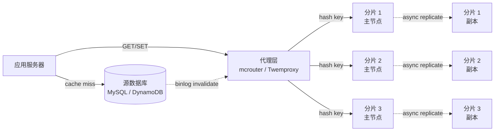
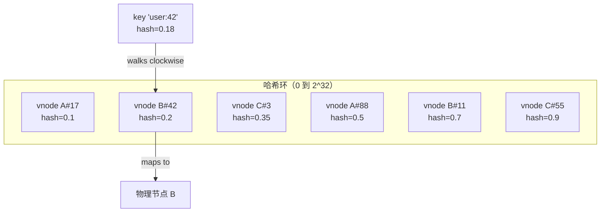
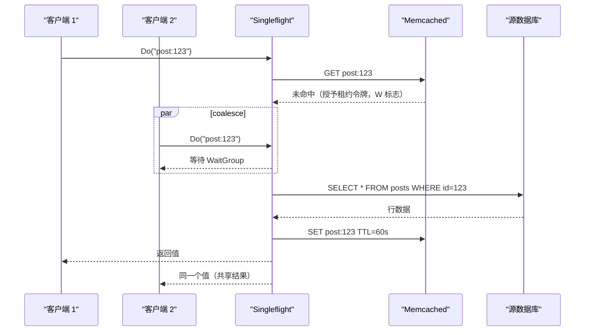
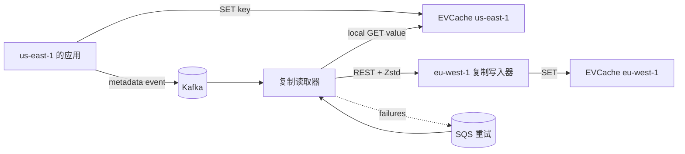

# 设计一个分布式缓存（Memcached / Redis Cluster）

> **TL;DR.** 分布式缓存是一群以内存为底座的节点，夹在无状态的应用服务器和更慢的源数据库之间。整个设计绕三个维度转：键怎么映射到节点（一致性哈希）、内存写满时淘汰什么（LRU 与 W-TinyLFU）、以及如何扛住超出单分片容量的热键（租约、singleflight、概率提前过期）。Facebook 的 memcache 层每秒承接数十亿次请求[^1]，99% 的命中率把 MySQL 负载压低 100 倍[^2]。Netflix 的 EVCache 在 4 个区域跑 22,000 个实例，每秒处理 4 亿次操作，缓存数据 14.3 PB[^3]。而客户端库，才是你日后花最多时间维护的那部分。

## 学习目标

学完本模块，你将能够：

- [ ] 用一致性哈希把键映射到分片，并说明什么情况下 rendezvous 哈希更可取
- [ ] 根据工作负载的访问模式选择淘汰策略（LRU、LFU、W-TinyLFU、ARC）
- [ ] 为必须扛住节点丢失的缓存层设计复制与故障切换
- [ ] 用租约、singleflight 和概率提前过期缓解热键与缓存雪崩
- [ ] 说清什么时候该选 Memcached、什么时候选 Redis Cluster、什么时候选 MemoryDB 这类托管服务
- [ ] 为一个 10M ops/sec 的缓存集群估算内存、节点数与带宽

## 直觉理解

分布式缓存看着很简单。对键做一次哈希，挑一台服务器，把值塞进内存。单节点原型一个下午就能写完。

但到了规模上，有三种力量会把这种朴素做法撞碎。第一是内存。100 TB 的工作集装不进一台机器，你需要 1,000 个节点，于是每次查键都多了一次路由决策。如果路由只是简单的取模哈希，加一个节点就会重映射几乎所有键，迁移期间命中率直接归零。第二是热键。一条名人推文、一个爆款商品页，能把数百万次读压到一个分片上。这块分片的网卡被打满，长尾延迟飙起来，同分片上的其他键跟着遭殃。第三是 TTL 悬崖。一个热门键到期时，成千上万的并发客户端同时未命中，一起冲向源数据库。

解开这套设计的关键认知只有一句：缓存不是数据库。它是一层以内存预算为约束的性能优化。所有决策都从这个约束推出来。数据可以丢（能重新生成）。可用性不能丢（源库吃不下全量负载）。路由稳定性也不能丢（每次拓扑变更就重映射所有键，等于自己给自己造一次故障）。

## 需求

### 澄清问题

- **Q：这是纯缓存（可从源库重建），还是主存储？**
  假设：纯缓存。源数据库是记录系统。缓存丢失只意味着延迟上升，不会丢数据。

- **Q：读写比是多少？**
  假设：100:1。读占绝对主导。写只有两类：源库触发的失效，以及基于 TTL 的过期。

- **Q：需要多区域部署吗？**
  假设：需要。三个区域，读走本地区，对延迟敏感的数据做跨区域复制。

- **Q：一致性给到什么保证？**
  假设：最终一致。读到的旧值容忍几秒。强一致性是源库的事。

- **Q：SLA 目标是多少？**
  假设：缓存命中 P99 < 5 ms，读路径可用性 99.99%。

- **Q：要支持丰富的数据结构（有序集合、列表），还是只存键值二进制块？**
  假设：核心设计只做键值二进制块。丰富结构属于 Redis 特有的扩展。

### 功能需求

- 在内存中存储键值对，每个键的 TTL 可配置
- 用一致性哈希把键路由到分片，拓扑变更时尽量少搬键
- 内存写满时按键淘汰，淘汰策略可配置（默认 LRU）
- 对重建代价高的高价值数据，可选地做分片复制
- 对外暴露兼容 memcached 的 ASCII/二进制协议，让客户端覆盖面足够广

### 非功能需求

- **负载：** 全集群 10M ops/sec，单节点 10K ops/sec（P99 < 1 ms）
- **容量：** 1,000 个节点合计 100 TB，单节点 100 GB 内存
- **可用性：** 读路径 99.99%；分片故障不能让用户可见的请求失败
- **再平衡：** 增加或摘除一个节点，最多搬动 1/N 的键
- **延迟：** 区域内缓存命中的 P50 < 0.5 ms，P99 < 2 ms

## 容量估算

| 指标 | 数值 | 推导 |
|--------|------:|------------|
| 缓存总容量 | 100 TB | 1,000 节点 x 100 GB 内存 |
| 平均条目大小 | 1 KB | key（约 50 B）+ value（约 900 B）+ 元数据（约 50 B） |
| 条目总数 | 100B | 100 TB / 1 KB |
| 峰值读 QPS | 10M | 读写比 100:1，写入 100K/秒 |
| 单节点 QPS | 10K | 10M / 1,000 节点 |
| 复制因子 2 的内存 | 200 TB | 原始容量成本翻倍 |
| 单节点网络（读） | ~80 Mbps | 10K ops/sec x 1 KB x 8 bit |

关键推导：

- **按 QPS 推节点数：** 单个 Redis 节点能扛约 100K ops/sec[^4]；单个 memcached 实例能扛约 1M 次简单 get/秒[^2]。集群 QPS 到 10M 时，光看吞吐就需要 100 个 Redis 节点，或者 10 个 memcached 节点。
- **按内存推节点数：** 100 TB / 100 GB = 1,000 个节点。约束落在内存上，不是 CPU。
- **Slab 开销（memcached）：** 每条目的元数据约 50 字节[^5]。100B 条目就是 5 TB 开销（对 1 KB 的条目约 5%）。
- **碎片余量：** 为 jemalloc 碎片（Redis）或 slab 固化（memcached）多留 20% 内存[^5][^6]。

## API 与数据模型

### API 设计

```text
GET <key>
  返回：value（字节）+ flags + CAS token
  未命中：NOT_FOUND（启用租约时返回 lease token）

SET <key> <flags> <ttl> <bytes>\r\n<value>
  返回：STORED | NOT_STORED（CAS 不匹配）

DELETE <key>
  返回：DELETED | NOT_FOUND

GETS <key1> <key2> ... <keyN>
  返回：多个 value + CAS token（批量 multi-get）

META GET <key> [flags: v N30 R10 t]
  返回：value + 元数据 flags（W=赢得重缓存，Z=等待）
  用途：服务端租约与概率提前刷新[^7]
```

设计要点：

- **Multi-get 批处理：** 客户端先把键按分片分组，并行发请求，再拼回结果。mcrouter 会透明地做这件事[^8]。
- **CAS（比较并交换）：** 防止旧值覆盖新值的写竞争。客户端用 `GETS` 取回 CAS token，再用 `CAS <token>` 写入。如果中间有别的写入插进来，CAS 就会失败。
- **Meta 命令：** memcached 的 meta 协议把租约语义直接暴露出来（`N` 标志在未命中时创建 stub，`W` 标志授予重缓存许可），不需要应用层协调[^7]。

### 数据模型

```text
-- 单条目布局（memcached slab 分配器）
struct item {
    uint8_t   slab_class;     // 属于哪个大小类（约 40 个之一）
    uint32_t  flags;          // 应用自定义
    uint32_t  exptime;        // 绝对 TTL（epoch 秒）
    uint64_t  cas_token;      // compare-and-swap 版本号
    uint8_t   key_len;        // 最大 250 字节[^7]
    uint32_t  value_len;      // 默认为最大 1 MB[^7]
    char      key[];
    char      value[];
}
// 总开销：每条约 50 字节[^5]

-- Redis Cluster 槽位映射
HASH_SLOT = CRC16(key) mod 16384
-- 哈希标签：{user:1000}.name 与 {user:1000}.age -> 落到同一个槽[^9]
```

Memcached 用 slab 分配器：内存切成 1 MB 的页，每页分配给一个大小类（chunk 大小按 1.25 倍递增）。600 字节的条目落在 640 字节的类里。每个类有自己的 LRU 链[^5]。

Redis Cluster 用 CRC16 把所有键映射到 16,384 个哈希槽。每个主节点拥有一部分槽。哈希标签（`{...}`）把相关的键强制放到同一个槽，以便执行多键操作[^9]。

## 高层架构



*旁路缓存（look-aside）架构：应用分别访问缓存与源库，两者互不知情。缓存不关心数据库的 schema。由 binlog 驱动的失效保证删除能传播出去，不需要应用层协调。*

**写路径（cache-aside 加写时删除）：** 应用先写源数据库，再删除缓存键。Facebook 用删除而不是设置，因为并发写入在删除语义下可交换，在设置语义下不可交换[^2]。如果某个读方在并发写方的 `DELETE` 之后补了一个 `SET`，旧值就会被永久缓存；改成写时删除，最坏情况只是一次短暂的未命中。

**读路径：** 应用向代理发 `GET key`。代理把键哈希到一个分片。命中时，分片在 1 ms 内返回值。未命中时，应用去读源库，并发出 `SET` 回填缓存。

**失效路径：** MySQL 的 binlog 变更流经一条管道（Facebook 的 McSqueal[^2]），翻译成 `DELETE` 命令发给缓存代理。这样即使写应用在发出自己的删除之前就崩了，每个集群照样能收到失效。

## 深入探讨

### 一致性哈希与键分布

根本的路由问题是：有 N 个缓存节点和一个键，这个键归谁？当 N 变成 N+1 时，又有多少键要搬家？

**朴素取模哈希**（`node = hash(key) % N`）在 N 变化时几乎重映射所有键。往 100 节点的集群里加一个节点，约 99% 的键要搬，引发近乎全量的缓存未命中风暴。

**基于环的一致性哈希**（Karger 等，1997）[^10][^11] 把节点和键都放在一个环形哈希空间上，键顺时针走到下一个节点。加一个节点只搬 1/N 的键。为避免节点落点不均带来的偏斜，每个物理节点用 V 个虚拟节点（vnode）表示。Ketama（last.fm，2007）每台服务器用 160 个 vnode，环哈希用 MD5[^10]。

**跳跃一致性哈希**（Lamping 与 Veach，Google，2014）[^12] 用一个 5 行的闭式函数替掉整个哈希环。零内存开销，每次查找 O(ln N)，在随机分桶上比环哈希更均衡。缺点是假设桶按顺序编号，所以摘掉任意一台服务器会很别扭。

**Rendezvous 哈希（HRW）**（Thaler 与 Ravishankar，1996）[^13] 把键分配给 `hash(key, node)` 最大的那个节点。每次查找 O(N)，但无状态，天然支持带权重的节点。物理节点超过 1,000 台时，CPU 开销开始变得明显。



*每个物理节点在环上以 100 到 160 个 vnode 的形式存在。键顺时针走到最近的 vnode，就找到了归属。加入节点 D 只会插入新的 vnode，搬动约 1/N 的键。*

**生产环境的选择：** mcrouter 用 Ketama 一致性哈希[^8]。Redis Cluster 用 CRC16 加固定的 16,384 槽哈希环[^9]。Twemproxy 同时支持 Ketama 和取模哈希，并在节点故障时自动剔除[^14]。

### 热键与缓存雪崩

热键指的是 QPS 超过单个分片承载能力的那个键。缓存雪崩（惊群，thundering herd）发生在热门键过期的那一刻：N 个并发调用方同时未命中，同时打到源库。

**雪崩问题：** 一个每秒承担 500K 次读的键过期了。50 万个客户端全部未命中，全部打到源库。源库的分区上限（DynamoDB 上 3,000 RCU，MySQL 上约 100K QPS）被超出好几个数量级，接着就是级联故障。

**防线一：租约（Facebook，NSDI 2013）。** 未命中时，memcached 给第一个请求方一个 64 位租约令牌，让后续客户端“过几毫秒再试”。只有租约持有者去读 DB 并回填缓存。该键一旦被删除，未到期的租约随之失效，从而挡住旧值覆盖的竞争[^1][^2]。

**防线二：Singleflight（客户端合并）。** 进程内有 N 个线程请求同一个键时，被汇聚成一次在途调用。`groupcache/singleflight` 包大约 65 行就实现了这件事（其中 `Do` 方法本身约 20 行）[^15]；Go 官方的 `golang.org/x/sync/singleflight` 更长、功能更全，额外提供 `DoChan` 和 `Forget`。局限是只能在一个进程内合并。10,000 个进程的集群，照样把源库冲垮。

**防线三：概率提前过期（XFetch）。** 每次命中时，读方都掷一次骰子。这个概率很小，但随着 TTL 逼近零而增大，于是读方会在值正式过期之前主动刷新[^16]。memcached 的 meta 协议用 `N` 和 `R` 标志暴露这一机制：`mg key v N30 R10` 表示剩余 TTL 不足 10 秒时，谁赢得重缓存[^7]。



*第一个调用方赢得租约去刷新。Singleflight 把进程内并发的未命中合并成一次 DB 调用。后来的客户端共享结果，不再给源库加负载。*

**雪崩之外的热键缓解：** 把热键的影子副本铺到 M 个分片上（`post:123:0` 一直到 `post:123:M-1`）。读方随机选一个后缀。写方更新全部 M 份副本。Netflix 的 EVCache 天然就是这么做：客户端写时复制，读时读本地可用区[^3][^17]。

### LRU 之外的淘汰策略

内存写满时，缓存得决定丢哪个键。这个选择直接影响命中率，命中率又直接影响源库负载。

**LRU（最近最少使用）：** 淘汰最久没被访问的键。用双向链表加哈希表做到 O(1)。在以新近度为主的工作负载上是很好的默认值。遇到扫描密集的轨迹会抖动：一次全表扫描就能把整个工作集挤出去[^18]。

**LFU（最不经常使用）：** 记录访问频次。对少数键被反复访问的 Zipf 分布负载更合适。偏置问题：昨天很热、今天已经冷掉的键，因为计数高而赖在缓存里不走。

**W-TinyLFU（Caffeine，2015）：** 一个小的 LRU 准入门窗，配一个 TinyLFU 频率过滤器，后者基于 4 位的 count-min sketch（每条目 8 字节）[^19]。sketch 里的计数会周期性减半，让过时的频率自然老化。主区域是分段 LRU，存放被准入的条目。在数据库、搜索、OLTP 和循环这四类轨迹上，W-TinyLFU 都拿到了接近最优的命中率，内存占用还明显低于 ARC[^18]。

**ARC（自适应替换缓存，IBM）：** 维护两个 LRU 链表（近期出现的、频繁出现的），外加两个存放已淘汰键的幽灵链表。自己会调，不需要针对负载拧旋钮。缺点是 IBM 的专利，而且幽灵链表实际上让元数据内存需求翻倍[^18]。

| 策略 | 命中率（Zipf 分布） | 内存开销 | 复杂度 | 最适合 |
|--------|-------------------|-----------------|------------|----------|
| LRU | 好 | 极小 | O(1) | 通用 Web 缓存 |
| LFU | 更好 | 中等（计数器） | O(log n) | 稳定的热点集合 |
| W-TinyLFU | 接近最优 | 每条目 8 B 的 sketch[^19] | 摊还 O(1) | CDN 边缘、大工作集 |
| ARC | 好（自调优） | 元数据 2 倍（幽灵链） | O(1) | ZFS、有专利顾虑的场景 |

**生产现实：** Memcached 用按 slab 类划分的 LRU，内部还有 HOT/WARM/COLD/TEMP 子链[^5]。Redis 提供 10 种淘汰策略，包括 `allkeys-lfu` 和 `volatile-lfu`[^4]。Caffeine（JVM）用 W-TinyLFU，是 Spring、Micronaut 以及大量 JVM 服务的默认进程内缓存[^18]。

## 真实案例

**Facebook memcache（Nishtala 等，NSDI 2013）** 是分布式缓存的生产环境典范。论文发表时，整个集群每秒处理数十亿次请求，条目数以万亿计[^1]。每个 memcached 实例每秒服务约 1M 次 get[^2]。99% 的命中率把 MySQL 读负载压低了 100 倍；命中率掉 1 个百分点，DB 负载就翻倍[^2]。

架构是旁路式的：memcached 待在 MySQL 旁边，而不是挡在前面。写先落到 MySQL，然后应用删除缓存键。每个区域有多个 memcached 集群（前端池）。一个跨区域的共享池存放不太热的键，避免每个集群各自复制造成浪费。Gutter 池专门承接故障节点的流量，而不去压垮存活的节点[^2]。

mcrouter 是把它串起来的用户态代理：连接池化、多键 get 扇出、按前缀做命名空间路由、把流量影子打到测试集群、故障时切到 Gutter。峰值时，mcrouter 在 Facebook 与 Instagram 的缓存上每秒处理约 50 亿次请求（据项目 README，约 2019 年）[^8]。

**Netflix EVCache** 在 4 个区域、200 个集群里跑 22,000 个服务实例，每秒服务 4 亿次操作，2 万亿条目合计 14.3 PB[^3]。客户端库是拓扑感知的：写扇出到本区域所有可用区的副本；读优先选同可用区的副本，省掉跨可用区的数据传输费。跨区域复制用的是只带元数据的 Kafka 事件（键 + TTL，不带值），目标区域有一个读取器在本地取值，再由目标区域的 REST 写入器落库。重试交给 SQS。Netflix 公布的数字是全局每秒 3,000 万条复制事件，靠 Zstandard 批量压缩省下 35% 带宽[^3]。



*Netflix EVCache 的跨区域复制：只带元数据的 Kafka 事件避免往总线里灌 14 PB 的值。读取器在本地取值，再把压缩后的批量推过区域边界。*

## 权衡

| 方案 | 优点 | 缺点 | 何时使用 |
|----------|------|------|-------------|
| 一致性哈希环（vnode） | 理解成本低，160 个 vnode 下分布均衡[^10] | 要维护环结构，运维有负担 | 大规模集群、团队熟悉这套工具 |
| Rendezvous 哈希（HRW） | 无状态、简单、支持带权重节点[^13] | 每次查找 O(N)，N > 1,000 时变贵 | 中小集群、代理层 |
| 跳跃一致性哈希 | 零内存，5 行代码[^12] | 假设桶 ID 连续 | 节点顺序编号的场景 |
| 客户端分片（EVCache） | 延迟最低，服务端简单[^3] | 客户端库必须知道拓扑 | 同构的内部服务 |
| 服务端集群（Redis Cluster） | 透明的 MOVED/ASK 重定向[^9] | 延迟更高，gossip 有开销 | 多语言客户端混用 |
| LRU 淘汰 | 简单、O(1)、默认就好用[^18] | 遇到扫描会抖动 | 通用 Web 缓存 |
| W-TinyLFU 淘汰 | 命中率接近最优[^19] | 每条目 8 B 的 sketch 开销 | CDN 边缘、热点工作集 |
| 不做复制（Memcached） | 便宜、简单[^5] | 节点故障就丢键 | 纯缓存、数据可重建 |
| 做复制（Redis Cluster、EVCache） | 扛得住节点丢失[^9][^3] | 内存成本翻倍 | 重建代价高的数据 |

最大的那个元决策是 **Memcached 还是 Redis**。纯缓存场景——数据可重建、条目是简单二进制块、你想要可预测的长尾延迟和尽可能低的单条开销（约 50 字节）[^5]——Memcached 是对的选择。需要丰富数据结构（有序集合、stream、HyperLogLog）、可选持久化、或集群托管的故障切换时，Redis 是对的选择。但别把 Redis Cluster 当记录系统用：它的复制是异步的，分区期间写会丢[^9]。AWS MemoryDB 就是给想要 Redis API 又要持久性的人准备的（多可用区事务日志，写入个位数毫秒，读微秒级）[^20]。

## 扩展与故障模式

**10 倍负载时（100M ops/sec）：**

- 瓶颈在内存：加节点。一致性哈希每加一个节点只搬 1/N 的键。
- 热键会打满个别分片。缓解手段：把键的影子副本铺到 M 个分片，客户端再加一层短 TTL 的 L1 缓存。
- memcached 上网络会比 CPU 更早成为瓶颈（1M ops/sec x 1 KB = 每节点 8 Gbps）。

**100 倍负载时（1B ops/sec）：**

- 客户端连接数爆炸。代理层（mcrouter）把成千上万条应用连接复用成少量到服务端的持久连接[^8]。
- 跨区域复制延迟变大。缓解手段：读本地、写全量（EVCache 模式）[^3]。

**1000 倍负载时（10B ops/sec）：**

- Facebook 量级。mcrouter 本身已经能处理约 50 亿请求/秒[^8]。架构转向多个区域集群：冷数据放共享池，热数据放各集群自己的池。

**故障模式：**

- **节点故障（无复制）：** 该节点上的键一直未命中，直到源库重新填充。一致性哈希把负载重新分给存活的节点。Gutter 池（Facebook）吸收这波尖峰[^2]。
- **节点故障（有复制）：** Redis Cluster 在 `NODE_TIMEOUT * 2` 内通过基于 gossip 的选举提升一个副本[^9]。已由故障主节点确认、但还没复制出去的写会丢失。
- **网络分区：** Redis Cluster 的“最后完成故障切换者获胜”会造成写丢失。少数派一侧的主节点继续接受写入，等分区恢复后这些写被丢弃[^9]。
- **Slab 固化（memcached）：** 负载从小条目转向大条目；大条目的 slab 类耗尽，小类还攥着一堆用不上的内存。开启 `slabs automove 1`[^5][^7]。

## 常见陷阱

> [!WARNING]
> **把 Redis Cluster 当记录系统。** Redis 的复制是异步的。主节点故障可能丢掉已确认的写。重建不出来的数据，请用 MemoryDB 或另设一个持久化存储[^9][^20]。

> [!WARNING]
> **用取模哈希代替一致性哈希。** 往 100 节点的集群里加一个节点，取模会重映射约 99% 的键。随之而来的未命中风暴能把源数据库压垮。

> [!WARNING]
> **忽视 memcached 的 slab 固化。** 一旦条目大小分布发生变化，某个 slab 类会饿死，另一个类却握着闲置内存。盯住 `stats slabs`，打开 slab 自动迁移[^5][^7]。

> [!WARNING]
> **以为 singleflight 能解决全集群的雪崩。** Singleflight 只在一个进程内合并。10,000 个进程的集群，冷未命中时照样给源库发 10,000 个请求。要全集群级别的保护，得上服务端租约或概率提前过期[^1][^21]。

> [!WARNING]
> **给所有键设一样的 TTL。** 几千个键在同一秒过期时，源库会看到一次齐步走的未命中风暴。加上随机抖动（TTL 的 5% 到 10%），把过期时间摊开。

> [!WARNING]
> **写时用 SET 而不是 DELETE。** 并发写入到达缓存的顺序可能和在 DB 里的顺序不一致，于是把旧值永久缓存下来。DELETE 可交换，SET 不可交换[^2]。

> [!WARNING]
> **热键拖到线上出事才管。** 一个每秒 50 万次读的键，能把额定 10 万的分配片打满。早点用按键采样检测（memcached 的 `lru_crawler metadump`、Redis 的 `--hotkeys`），并提前准备好影子键的晋升路径[^17]。

## 追问

**1. 一场名人事件让某个键比任何分片能承载的热度还高 100 倍，你怎么处理？**

靠分片级 QPS 监控发现热键。把它晋升到每台应用服务器的进程内 L1 缓存，TTL 设 1 到 2 秒。同时把这个键的影子副本铺到 M 个分片（`key:0` 到 `key:M-1`），读方随机选后缀，写方更新全部 M 份副本。等 QPS 掉到阈值以下再降级。

**2. schema 迁移期间，怎么保持缓存与源库之间的一致？**

迁移期双写。旧 schema 的写去失效旧缓存键，新 schema 的写去填充新缓存键。再跑一个后台对账程序，抽样比对缓存值与源库，把过时的条目失效掉[^3]。

**3. 如果缓存必须支持多键事务（比如两个计数器之间转账），设计要改什么？**

Redis Cluster 只在同一个哈希槽内支持多键操作。用哈希标签把相关键放到一起：`{account:A}.balance` 和 `{account:A}.history`。跨槽事务要么在应用层用 saga 模式，要么接受最终一致。

**4. 新区域怎么做缓存预热？**

Facebook 的冷集群预热路径是：新集群的客户端未命中时，去一个已经热的现有集群读，再 `SET` 进冷集群[^2]。这样上线期间不会给 DB 造成尖峰。随着命中率上升，逐步把流量从热集群迁到冷集群。

**5. memcached 集群整体升级，怎么做到不把缓存全部丢光？**

借助一致性哈希做滚动重启。每个重启的节点会丢自己的数据，但只影响 1/N 的键。重启要错开，保证源库同一时刻承受的额外负载不超过 1/N。如果数据重建代价高，重启后先从一个对等节点预热。

**6. 1,000 个节点时，Redis Cluster 的 gossip 协议运维成本有多大？**

Redis Cluster 的 gossip 每秒向随机一部分节点发心跳。到 1,000 个节点时，最坏情况下集群总线流量按平方增长。Redis 文档建议上限约 1,000 个节点[^9]。再往上，就在前面加一层代理做分片（像 memcached 的 mcrouter 那样），别指望集群原生的 gossip。

## 练习

### 练习 1：热键缓解设计

你的 Redis Cluster 有 100 个分片，每片额定 100K ops/sec。一条名人帖子让 `post:12345:likes` 每秒收到 500K 次读。用影子键、客户端合并和晋升策略设计这条缓解路径。要定清楚：什么时候晋升、怎么判断热度已经过去、以及晋升窗口内写入怎么办。

<details>
<summary>提示</summary>

这个键需要由 5 个以上的分片来服务，才扛得住 500K 读/秒。想一想客户端怎么决定读哪个影子分片，以及写入（比如点赞数自增）怎么在多个影子之间保持一致。

</details>

<details>
<summary>参考答案</summary>

**检测：** 分片级 QPS 监控在任意键超过分片容量 80%（80K ops/sec）时告警。热键探测器通过 Redis 的 `--hotkeys` 或代理层采样识别出 `post:12345:likes`。

**晋升：** 创建影子键 `post:12345:likes:0` 到 `post:12345:likes:4`（5 个影子，靠一致性哈希落到 5 个不同分片）。把当前值复制到所有影子。更新客户端库里的路由表，把这个键标记为“已影子化”。

**晋升期间的读：** 客户端随机选一个后缀 `[0..4]`，读对应的影子。负载均匀摊开：500K / 5 = 每片 100K，正好在容量内。

**晋升期间的写：** 点赞计数只往主键上自增。一个后台复制器每 500 ms 把更新后的值刷到所有影子。读可能略有滞后（最多 500 ms），对点赞计数器来说可以接受。

**降级：** 当热键探测器发现 QPS 连续 5 分钟低于 100K，删掉影子键、移除路由覆盖。主分片恢复直接服务。

**接受的权衡：** 晋升窗口内影子有 500 ms 的滞后。对点赞计数器，用户看不出来。换成余额或库存字段，这套做法就不成立。

</details>

## 要点回顾

- **一致性哈希是没得商量的。** 取模哈希在拓扑变更时会引发近乎全量的未命中风暴。选环式的 Ketama 或跳跃哈希，然后让它一直老老实实跑着。
- **对大多数负载，LRU 就够。** 工作集很大且呈 Zipf 分布时，W-TinyLFU 是明确的赢家，但要额外承担复杂度。
- **热键是最难的真问题。** 每个生产缓存都有一堆故事。趁还没出事，先把影子键的晋升路径准备好。
- **写时删除，不是写时设置。** 并发写入在删除语义下可交换。就这一个决定，能挡掉一整类“旧值永久滞留”的 bug。
- **客户端库是你维护最多的部分。** 它知道拓扑、处理故障切换、合并请求、路由多键 get。挑一个（或者 fork 一个），然后自己扛起来。
- **Redis Cluster 不是记录系统。** 异步复制意味着分区期间会丢写。重建不出来的数据，用 MemoryDB 或另设持久化存储。

## 延伸阅读

- [Scaling Memcache at Facebook (NSDI 2013)](https://www.usenix.org/conference/nsdi13/technical-sessions/presentation/nishtala)。关于在行星级规模上运营分布式缓存最重要的一篇论文；覆盖租约、Gutter 池、冷集群预热和跨区域失效。
- [Redis Cluster 规范](https://redis.io/docs/latest/operate/oss_and_stack/reference/cluster-spec/)。16,384 哈希槽、gossip 协议、MOVED/ASK 重定向与故障切换语义的权威参考。
- [TinyLFU: A Highly Efficient Cache Admission Policy](https://arxiv.org/abs/1512.00727)。那篇在几乎所有负载上都打赢 LRU 的频率 sketch 论文，Caffeine 的 W-TinyLFU 就建立在它之上。
- [Building a Global Caching System at Netflix](https://www.infoq.com/articles/netflix-global-cache/)。4 亿 ops/sec、14.3 PB、Kafka 加 SQS 的跨区域复制，以及 Zstandard 压缩省下的 35% 带宽。
- [Optimal Probabilistic Cache Stampede Prevention (PVLDB 2015)](https://cseweb.ucsd.edu/~avattani/papers/cache_stampede.pdf)。XFetch 那篇论文，证明在某些假设下概率提前刷新是最优的。
- [A Fast, Minimal Memory, Consistent Hash Algorithm](https://arxiv.org/abs/1406.2294)。Lamping 与 Veach 的跳跃一致性哈希，5 行代码；零内存，O(ln N) 查找。
- [Why Pelikan (Twitter, 2019)](https://pelikan.io/blog/why-pelikan/)。一份现场报告：Twitter 规模下 Redis 和 Twemcache 会出什么问题——碎片、不可预测的过期、被 OOM 杀掉。
- [Caffeine Efficiency wiki](https://github.com/ben-manes/caffeine/wiki/Efficiency)。Ben Manes 在 Wikipedia、Search、Database、OLTP 轨迹上，对 ARC、LIRS、W-TinyLFU 做的命中率对比图。

## 记忆卡片

<details>
<summary><strong>Q：为什么加一个节点时一致性哈希只搬 1/N 的键？</strong></summary>

A：每个键归哈希环上顺时针方向的下一个节点。新加节点只会截走它和它的前驱之间的键。有 N 个现存节点时，那大约是键空间的 1/N。

</details>

<details>
<summary><strong>Q：租约（Facebook）和 singleflight（Go）有什么区别？</strong></summary>

A：租约在服务端：memcached 授予一个调用方刷新的许可，让其他人重试。Singleflight 在客户端：一个进程把进程内的并发请求合并成一次调用。租约保护全集群，singleflight 只保护单个进程内。

</details>

<details>
<summary><strong>Q：为什么 Facebook 用写时 DELETE 而不是写时 SET 来做缓存失效？</strong></summary>

A：并发写入到达缓存的顺序可能和在 DB 里的顺序不一致。SET 不可交换（最后那个 SET 获胜，而它可能是旧值）。DELETE 可交换：无论删除以什么顺序发生，结果都一样（键不存在），下一个读方会取到新数据。

</details>

<details>
<summary><strong>Q：memcached 里的 slab 固化是什么？</strong></summary>

A：内存被固定绑定到各个大小类上。一旦负载发生变化（比如条目从 500 B 长到 4 KB），大条目类耗尽，而小类攥着无法复用的内存。缓解办法：开启 `slabs automove 1`，或者重启实例。

</details>

<details>
<summary><strong>Q：请求打到错误的节点上，Redis Cluster 怎么处理？</strong></summary>

A：节点先算出哈希槽。如果这个槽不归自己，就回 `-MOVED <slot> <correct_node>`。客户端更新槽映射后重试。在线迁移槽期间，源节点改回 `-ASK`（一次性重定向）。

</details>

<details>
<summary><strong>Q：分区期间 Redis Cluster 为什么会丢掉已确认的写？</strong></summary>

A：复制是异步的。主节点先确认写入，副本才慢慢收到。如果主节点在复制完成前故障，被提升的副本手里没有这笔写。`WAIT` 命令可以强制同步语义，代价是延迟。

</details>

<details>
<summary><strong>Q：W-TinyLFU 是什么，为什么它能打赢 LRU？</strong></summary>

A：W-TinyLFU 把一个小的 LRU 准入门窗和一个 4 位 count-min sketch 频率过滤器结合起来。条目要通过频率检查才能进入主缓存。这样既挡住了扫描污染（一次全表扫描把工作集全挤出去），又保留了对新近度的适应能力。

</details>

<details>
<summary><strong>Q：Netflix EVCache 怎么做到跨区域复制，又不往 Kafka 里灌 14 PB 的值？</strong></summary>

A：EVCache 只往 Kafka 发元数据事件（键、TTL、时间戳，不带值）。目标区域的复制读取器轮询 Kafka，通过一次 GET 在本地取到完整值，再用 REST 加 Zstandard 批量压缩推过区域边界。

</details>

<details>
<summary><strong>Q：概率提前过期（XFetch）是什么，什么时候该用？</strong></summary>

A：每次缓存命中时，读方都掷一次骰子。概率随 TTL 逼近零而增大，于是读方会在正式过期前刷新值。这把重算摊到了时间轴上，避免 TTL 悬崖上所有客户端同时未命中。

</details>

<details>
<summary><strong>Q：Rendezvous 哈希（HRW）到什么规模就不实用了，该换成什么？</strong></summary>

A：HRW 要对每个节点算一次 hash(key, node)，所以每次查找是 O(N)。物理节点超过 1,000 台时，CPU 开销开始明显。这时改用环式一致性哈希（查找 O(log V)，V 是 vnode 数量）或跳跃哈希（O(ln N)）。

</details>

## 参考文献

[^1]: Rajesh Nishtala et al., "Scaling Memcache at Facebook," NSDI 2013. https://www.usenix.org/conference/nsdi13/technical-sessions/presentation/nishtala

[^2]: MIT 6.5840 course notes on Scaling Memcache at Facebook. https://pdos.csail.mit.edu/6.5840/notes/l-memcached.txt

[^3]: Sriram Rangarajan and Prudhviraj Karumanchi, "Building a Global Caching System at Netflix: A Deep Dive to Global Replication," InfoQ, 2024-10-11. https://www.infoq.com/articles/netflix-global-cache/

[^4]: Redis docs, "Key eviction policies." https://redis.io/docs/latest/develop/reference/eviction/

[^5]: Memcached project, "Slab allocator and LRU internals." https://github.com/memcached/memcached/wiki/UserInternals

[^6]: Yao Yue, "Why Pelikan," 2019. https://pelikan.io/blog/why-pelikan/

[^7]: Memcached project, "ASCII protocol reference including meta commands." https://github.com/memcached/memcached/blob/master/doc/protocol.txt

[^8]: Facebook, "Mcrouter: Memcached protocol router." https://github.com/facebook/mcrouter

[^9]: Redis, "Redis cluster specification." https://redis.io/docs/latest/operate/oss_and_stack/reference/cluster-spec/

[^10]: Tom White, "A Brief History of Consistent Hashing," 2007. https://tom-e-white.com/2007/11/consistent-hashing.html

[^11]: David Karger, Eric Lehman, Tom Leighton, Rina Panigrahy, Matthew Levine, Daniel Lewin, "Consistent Hashing and Random Trees: Distributed Caching Protocols for Relieving Hot Spots on the World Wide Web," STOC 1997, pp. 654-663. https://doi.org/10.1145/258533.258660

[^12]: John Lamping and Eric Veach, "A Fast, Minimal Memory, Consistent Hash Algorithm," Google, 2014. https://arxiv.org/abs/1406.2294

[^13]: Wikipedia, "Rendezvous hashing," citing Thaler and Ravishankar 1996/1998. https://en.wikipedia.org/wiki/Rendezvous_hashing

[^14]: Twitter, "Twemproxy: A fast, light-weight proxy for memcached and redis." https://github.com/twitter/twemproxy

[^15]: golang/groupcache, "singleflight package source." https://github.com/golang/groupcache/blob/master/singleflight/singleflight.go

[^16]: Andrea Vattani, Flavio Chierichetti, Keegan Lowenstein, "Optimal Probabilistic Cache Stampede Prevention," PVLDB Vol. 8, 2015. https://cseweb.ucsd.edu/~avattani/papers/cache_stampede.pdf

[^17]: Netflix TechBlog, "Caching for a Global Netflix," 2016. https://web.archive.org/web/20240126/http://techblog.netflix.com/2016/03/caching-for-global-netflix.html

[^18]: Ben Manes, "Caffeine: Efficiency wiki." https://github.com/ben-manes/caffeine/wiki/Efficiency

[^19]: Gil Einziger, Roy Friedman, Ben Manes, "TinyLFU: A Highly Efficient Cache Admission Policy," arXiv:1512.00727, 2015. https://arxiv.org/abs/1512.00727

[^20]: AWS, "What is MemoryDB." https://docs.aws.amazon.com/memorydb/latest/devguide/what-is-memorydb.html

[^21]: Jaz Volpert, "Solving Thundering Herds with Request Coalescing in Go." https://jazco.dev/2023/09/28/request-coalescing/
