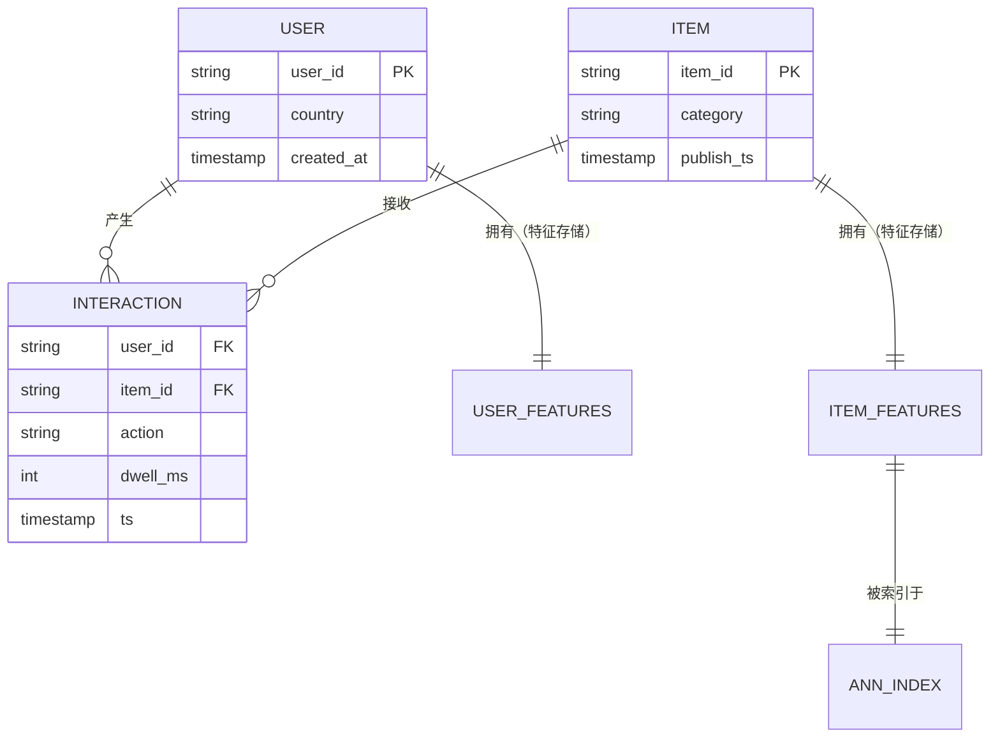
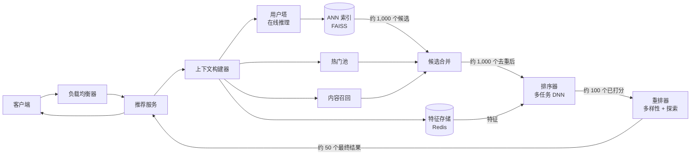
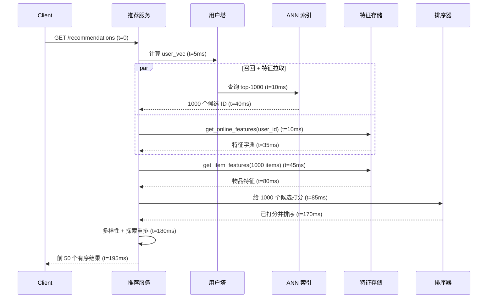
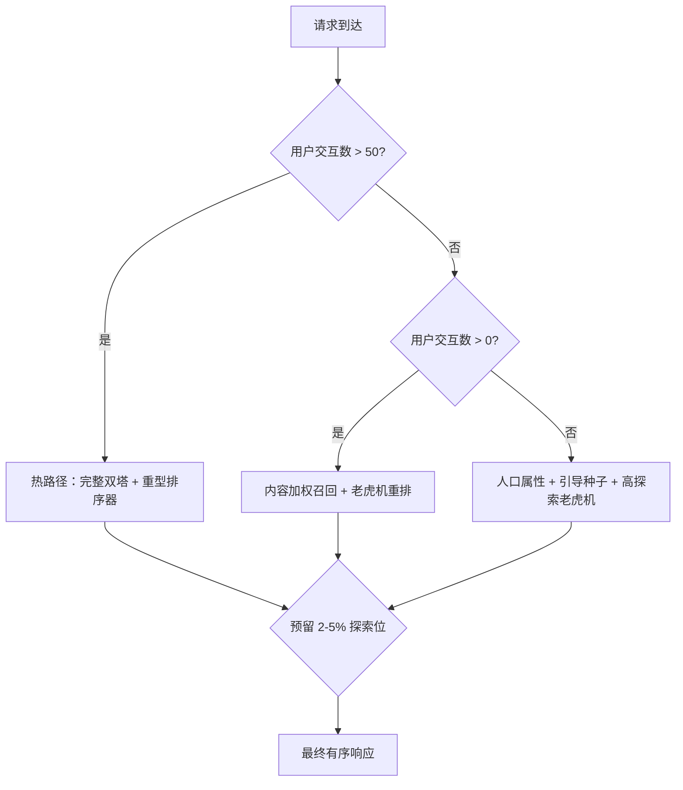
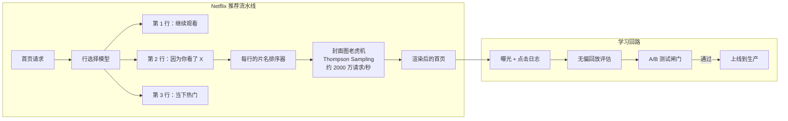

# 设计一个推荐系统（Netflix / YouTube / TikTok）

> **TL;DR.** 生产环境里的推荐系统是一条流水线，而不是一个模型。两阶段架构——先用 ANN 在 embedding 上快速做候选生成，再用重量级排序模型对每个物品的上百个特征打分——是业界的默认答案，因为在十亿级物品库上，没有别的方案能塞进 200 ms 的延迟预算[^1]。Netflix 估算个性化每年在留存上价值超过 10 亿美元[^2]，YouTube 则报告 70% 的观看时长由推荐驱动[^3]。最关键的权衡是：推荐质量与服务延迟之间的取舍，而调节它的阀门，是每一阶段漏斗的宽度。

## 学习目标

- 设计一条两阶段推荐流水线，在 200 ms 延迟预算内支撑 1000 万+ 请求/秒
- 用容量计算论证候选生成（ANN 检索）与排序（深度多任务模型）之间的分工
- 判断协同过滤、基于内容、混合方案分别适用的场景，并说明各自的冷启动影响
- 设计一个特征存储，消除批式特征与流式特征在训练与服务之间的偏差
- 用带预算上限的上下文老虎机，在探索与利用之间做权衡
- 估算一个十亿用户推荐系统的存储、计算与带宽开销

## 直觉理解

假设你经营一家有 1 亿种书的书店。一位顾客走进来，说"给我推荐点什么"。你只有 200 毫秒，超过这个时间他就会失去兴趣转身离开[^2]。

把每一本书的封底都读一遍（也就是给每个物品打分）要花上几个小时。你的做法是：在脑子里维护一张店内的地图——"喜欢 X 的顾客也喜欢 Y"（协同过滤）。你用 50 毫秒走到三个相关的书架通道，抓起 1000 本看起来靠谱的书，然后用剩下的 150 毫秒仔细读这些书的封底，同时权衡顾客当下的心情、现在几点、以及他上周买过什么。

这就是两阶段漏斗。第一阶段（候选生成）便宜且快：用预先算好的 embedding 和近似最近邻搜索，把十亿个物品收窄到一千个。第二阶段（排序）昂贵且精确：对每个（用户，物品）对用上百个特征给这一千个物品打分，其中包含检索阶段无法使用的交叉特征——因为一旦用了交叉特征，ANN 赖以成立的"可分离性"就被破坏了[^4]。

朴素做法（一个模型给所有物品打分）在 1 万个物品时还行。到了 1 亿个物品，光排序器每个请求就需要多出 10 万倍的计算量。漏斗不是一种优化，它是唯一能在规模上满足延迟预算的架构。

## 需求

### 澄清问题

- **问：物品库有多大，增长速度如何？**
  假设：库中有 10 亿个物品。YouTube 每分钟大约接收 500+ 小时视频[^5]；Netflix 和 Spotify 增长慢一些，但每天仍然新增成千上万个条目。
- **问：推荐的延迟 SLA 是多少？**
  假设：从收到请求到返回有序结果，端到端 P99 低于 200 ms。
- **问：实时个性化，还是批式预计算？**
  假设：在请求时在线打分。对重度用户做批式预计算，作为延迟优化手段。
- **问：模型需要多新？**
  假设：每天重训一次作为基线。短视频领域采用近实时的在线学习（TikTok 能做到分钟级的新鲜度[^6]）。
- **问：多目标还是单一指标？**
  假设：多任务排序。排序器预测多种互动类型（点击、观看、点赞、分享），再用可调权重把它们组合起来[^4]。
- **问：新用户和新物品怎么处理？**
  假设：把冷启动当作一等公民，走基于内容的特征加上下文老虎机，探索预算占 2-5%[^7][^8]。

### 功能需求

- 针对给定的用户上下文（设备、时间、位置），返回个性化、有序的 N 个物品列表
- 支持多种召回来源（协同、基于内容、热门、编辑精选）
- 用多任务模型给候选打分，输出多种互动类型的概率
- 在最终重排阶段施加多样性约束与探索位
- 记录曝光和交互，并保留完整归因，供模型重训使用

### 非功能需求

- **负载：** 峰值 1000 万次推荐请求/秒（10 亿 DAU，每天 10 次会话，峰值 3 倍）
- **延迟：** 端到端 P50 < 100 ms，P99 < 200 ms
- **可用性：** 读路径 99.99%，降级时可退化为基于热度的兜底推荐
- **新鲜度：** 模型权重每天更新；流式特征在秒级内更新
- **物品库：** 10 亿个物品进入检索索引；embedding 每晚刷新

## 容量估算

| 指标 | 数值 | 推导 |
|--------|------:|------------|
| 推荐 QPS（峰值） | 1000 万 | 10 亿 DAU *每天 10 次会话 / 86,400* 3 倍峰值 |
| 候选生成输出 | 1000 个物品 | 每个请求，来自 ANN 索引[^1] |
| 排序器输入 | 1000 个物品 * 每个约 100 个特征 | 每个请求 10 万次特征查询[^1] |
| 物品 embedding（128 维 float32） | 每个 512 B | 128 维 * 4 字节 |
| embedding 总存储 | 512 GB | 10 亿个物品 * 512 B |
| 特征存储在线读取 | 1000 万次/秒 | 每个请求拉取一次特征向量 |
| 每日交互事件 | 约 1000 亿 | 10 亿用户 * 每天约 100 次曝光 |
| 每日训练数据 | 约 10 TB | 1000 亿条事件 * 每条约 100 B |
| 模型大小（排序器） | 1-10 GB | 主要是 embedding 表[^9] |

关键比例：检索实现了 1000:1 的收窄（从 10 亿到 1000 个候选）。每个请求中，排序器只看得到物品库的 0.0001%。特征存储的延迟必须控制在 30 ms 以内才塞得进预算。ANN 召回率 95-99% 是可以接受的，漏掉的候选由排序器兜住[^10]。

## API 与数据模型

### API 设计

```http
GET /v1/recommendations?user_id=<id>&context=<ctx>&limit=50
  Returns: 200 { "items": [...], "request_id": "abc", "next_cursor": "..." }

POST /v1/impressions
  Body: { "request_id": "abc", "items_shown": [...], "positions": [...] }
  Returns: 202 Accepted

POST /v1/interactions
  Body: { "user_id": "...", "item_id": "...", "action": "click|watch|like|skip", "dwell_ms": 4500 }
  Returns: 202 Accepted

GET /v1/items/{id}/similar?limit=20
  Returns: 200 { "items": [...] }
```

推荐接口把上下文（设备类型、一天中的时段、位置）作为查询参数接收，因为上下文特征同时影响召回和排序。曝光与交互接口是发后即忘的（202），以免阻塞用户体验；它们通过 Kafka 异步喂给训练流水线。

### 数据模型

```sql
-- User features (Feature Store - online: Redis, offline: Parquet/Hive)
key: user:{user_id}
value: {
  embedding_128d: float[128],       -- from user tower, refreshed daily
  recent_items_50: list<item_id>,   -- streaming, updated per interaction
  demographics: {age_bucket, country, device},
  long_term_prefs: float[64]        -- batch, refreshed weekly
}

-- Item features (Feature Store - online: Redis, offline: Parquet/Hive)
key: item:{item_id}
value: {
  embedding_128d: float[128],       -- from item tower, refreshed nightly
  content_embedding: float[256],    -- from text/image/audio encoder
  metadata: {category, creator_id, publish_ts, duration},
  popularity_7d: float              -- streaming aggregate
}

-- ANN Index (FAISS IVF-PQ or HNSW, served via dedicated cluster)
-- 1B item embeddings, 128 dimensions, updated nightly
-- Query: user_embedding -> top-1000 item_ids in <10 ms
```



*用户特征和物品特征存放在双存储中（在线 Redis + 离线 Parquet）；ANN 索引是物品 embedding 的物化视图，每晚刷新。*

## 高层架构



*这条漏斗在 200 ms 内把十亿级的物品库裁剪成 50 个有序结果：召回（多路来源合并）、排序（吃全量特征的重模型）、重排（多样性与探索）。*

写入路径是分开的：交互事件从客户端经 Kafka 流向两条链路——流式特征流水线（Flink，在秒级内更新在线特征存储）和批式训练流水线（每天重训模型）。上面这条读路径完全在线，除了查特征存储之外是无状态的。

召回在多路来源上并行进行：双塔 ANN 路径（协同信号）、基于内容的召回路径（服务冷物品）、以及热门/编辑池（保证新鲜度和覆盖面）。结果去重合并之后才进入排序器。

排序器是最耗算力的组件。Meta 的 DLRM 架构把稠密特征送进底部 MLP，在 embedding 表里查稀疏 ID，计算两两点积，再把所有东西送进顶部 MLP，输出各类互动概率[^9]。在 1000 万 QPS、每个请求 1000 个候选的情况下，排序集群每秒必须扛住 100 亿次打分运算。

## 深入探讨

### 深入探讨 1：两阶段检索与排序

两阶段架构由 Covington、Adams 和 Sargin 在 2016 年的 YouTube 论文中正式提出[^1]。其洞见是：把问题拆成"快速找出看起来靠谱的物品"和"精确地给它们排序"两件事。

**候选生成**使用双塔神经网络。用户塔把用户特征（观看历史、搜索历史、人口属性）编码成 128 维向量[^1]。物品塔把物品特征（内容 embedding、元数据）编码到同一个 128 维空间。训练时最小化采样 softmax 损失，让正样本（用户，物品）对的内积尽可能大[^11]。

服务时，物品 embedding 在离线预先算好，加载进 ANN 索引（FAISS IVF 加乘积量化，或 HNSW 图）。用户 embedding 在线计算（用户塔的一次前向传播，约 5 ms），然后作为查询向量使用。在十亿规模下，FAISS 能在 10 ms 以内返回最近的 1000 个物品，召回率 95-99%[^10]。

**排序**使用全量特征。与双塔模型不同，排序器可以消费用户-物品交叉特征（例如"这个用户在过去 7 天里看过多少次这位创作者的视频"）。这类交叉特征是最强的信号，但会破坏让 ANN 得以成立的可分离性[^4]。Instagram Explore 把它扩展成四个阶段：召回、一阶段排序（轻量双塔）、二阶段排序（重型多任务模型）、最终重排[^4]。



*200 ms 的预算大致这样切分：召回 40 ms，特征拉取 40 ms（并行），排序 85 ms，重排 15 ms。召回与特征拉取并行执行，以压住长尾。*

YouTube 论文里那个关键的工程决策是：用隐式反馈（观看行为）训练，并对整个物品库做负采样，而不只是对曝光过的物品。这与服务时的分布一致——召回考虑的是所有物品，而不只是之前展示过的那些[^1]。

### 深入探讨 2：特征存储与训练-服务偏差

特征存储是基础设施，不是 ML 产物。它解决的是最常见的生产故障：同一个特征在训练时和在线服务时算法不一样。

一个特征存储包含两个存储和一个注册表[^12]。离线存储（S3 上的 Parquet，或 Hive）为训练提供时点正确（point-in-time）的特征关联。在线存储（Redis、DynamoDB）在推理时提供低延迟的特征向量。两个存储都由同一份特征定义写入，从而保证一致性。

**批式特征**（用户长期偏好、物品热度聚合）按计划物化（每天或每周）。**流式特征**（最近看过的 10 个物品、会话上下文）从 Kafka 经 Flink 摄取，在秒级内推送到在线存储[^12][^13]。

Feast 是开源的参考实现。推理时，客户端调用 `store.get_online_features(features=[...], entity_rows=[{"user_id": 1001}])`，在个位数毫秒内拿到特征字典[^12]。同一份特征列表在训练时通过 `store.get_historical_features(entity_df=...)` 使用，从而保证计算完全一致。

Uber 的 Michelangelo Palette 把这套模式在规模上做了延伸：自动生成特征流水线、管理特征新鲜度的 SLA、并通过统一契约把特征供给模型服务[^13]。

**为什么这对推荐很重要：** 排序器对每个（用户，物品）对消费约 100 个特征[^1]。只要有一个特征（比如"过去 7 天的平均观看时长"）在训练和服务时算法不同，模型的分数分布就会偏移。表现出来的结果是：模型在离线评估里看着很好，一到 A/B 测试就拉垮[^14]。特征存储从构造上就消灭了这类 bug。

### 深入探讨 3：冷启动与探索

冷启动不是一次性问题。每分钟都有新用户到来，每秒钟都有新物品落地。一个只对"热"实体有效的推荐系统，对永远存在的那部分流量而言就是坏的。

**新物品**在上传时就会拿到基于内容的 embedding。物品塔处理文本、图像、音频特征，即使交互历史为零，也能产出一个像样的 128 维向量[^4]。这个向量立刻进入 ANN 索引，让物品从第一天起就可被召回。

**新用户**没有可供协同过滤使用的交互历史。缓解手段包括：引导流程收集 3-5 个显式偏好、基于人口属性的先验、以及激进的探索。系统让冷用户走一条专门路径，在那条路径上内容召回的权重高于协同召回。

**上下文老虎机**（LinUCB、Thompson Sampling）会明确地把一部分曝光分配给高不确定性的物品，用短期的后悔换取长期的学习[^7][^8]。Netflix 用上下文老虎机做封面图个性化：2017 年这套系统的峰值超过每秒 2000 万次请求，而每个用户的探索成本可以忽略不计，系统能学到对每个会员分群来说哪种封面图更能带来点击[^7]。



*冷启动绕开了以协同信号为主的默认路径。所有路径都会留出 2-5% 的展示位做刻意探索，以避免信息茧房。*

"探索位"模式把最终排名的 2-5% 留给刻意的模型外物品[^7][^8]。这能防止形成反馈回路——模型只在自己已经推荐过的物品上拿到标签，于是推荐范围随时间越来越窄。Spotify 的 BaRT 框架（Bandits for Recommendations as Treatments）同时学习该展示哪些货架、每个货架里该放哪些内容、以及该配哪种解释文案，整套都用探索-利用框架来完成[^8]。

## 真实案例

**Netflix：从协同过滤到上下文老虎机**

Netflix 的推荐系统驱动了约 80% 的观看时长[^15]，每年在留存上的价值估计超过 10 亿美元[^2]。会员在浏览 60-90 秒后就会失去兴趣[^2]，因此推荐质量对这个业务是生死攸关的。

Netflix 跑的不是一个模型，而是很多个：行选择（首页显示哪些行）、行内标题排序、封面图个性化、搜索排序等等。2025 年，Netflix 开始用 transformer 架构把生成式推荐模型从 O(1M) 参数扩展到 O(1B) 参数，朝着用一个统一基础模型替代众多专用模型的方向走。封面图个性化系统尤其有启发。每个片名都有几十种封面图变体。系统用带会员上下文的上下文老虎机（Thompson Sampling）来学习哪种封面图能带来每个用户分群的点击[^7]。2017 年，Netflix 报告这套系统的峰值超过每秒 2000 万次请求[^7]，是生产环境中 QPS 最高的老虎机系统之一。

实验平台同时跑着数百个 A/B 实验[^16]。关键洞见是：离线指标（AUC、NDCG）与线上互动的相关性很弱。Netflix 把离线评估当作过滤器（任何在留出指标上退步的模型都直接拒掉），把 A/B 测试当作唯一真相（衡量真实留存影响的唯一途径）[^16]。序贯 A/B 测试能尽早发现伤害，在实验积累出破坏之前就把它停掉，从而把退步挡在生产之外[^17]。



*Netflix 叠了多个个性化模型（行选择、片名排序、封面图老虎机），每一次变更都要先过无偏回放评估，再做线上 A/B 测试。*

Spotify 的 Discover Weekly 演示了批式预计算这条路：每周一刷新个性化歌单时，大约要处理 1 TB 新数据[^18]。到 2025 年它的十周年时，这个歌单累计播放已超过 1000 亿首，每周还带来 5600 万次新的艺人发现[^18]。系统把收听日志上的协同过滤、歌词上的 NLP、基于 CNN 的音频 embedding 结合起来，然后把结果缓存起来，而不是实时现算。

## 权衡

| 方案 | 优点 | 缺点 | 适用场景 |
|----------|------|------|-------------|
| 协同过滤（MF/ALS） | 捕捉潜在偏好；推理便宜 | 冷启动问题；忽略内容 | 交互数据量大、物品库稳定[^15] |
| 基于内容的过滤 | 新物品第一天就能用；可解释 | 过度专门化；忽略社交信号 | 新物品库、交互稀疏 |
| 混合双塔 | 兼得两者之长；塔可缓存 | 无法使用交叉特征；批内负样本偏差 | 生产环境的召回阶段[^1][^4] |
| 单阶段打分 | 简单；没有流水线复杂度 | 超过约 10 万物品就不可行 | 小物品库、原型阶段 |
| 两阶段漏斗 | 可扩展到十亿级；延迟有界 | 要维护两个模型；召回阶段有损失 | 所有规模化的生产推荐系统[^1] |
| 逐点排序 | 训练简单；推理快 | 忽略列表上下文与多样性 | 多样性要求低的场景 |
| 列表级排序 | 优化 NDCG；考虑多样性 | 训练复杂；收敛慢 | 视频流、音乐歌单[^8] |
| 预留 2-5% 探索位 | 长期互动更好；防止收窄 | 短期的可见质量损失 | 所有生产系统[^7][^8] |

最大的一个权衡：**质量与延迟**。特征更多、更重的排序器推荐效果更好，但耗时更长。漏斗架构的解法是：只把重计算花在最后那几百个候选上。第二大的权衡：**新鲜度与稳定性**。TikTok 的 Monolith 用系统可靠性换分钟级的模型新鲜度[^6]；Netflix 每天重训，并靠序贯 A/B 测试验证[^17]。正确答案取决于内容更新速度：短视频平台需要分钟级新鲜度，因为话题在几小时内就会起势。

## 扩展与故障模式

**10 倍负载（1 亿 QPS）时：** ANN 索引成为瓶颈。缓解办法：按 item-ID 区间把索引分片到多个副本，把查询路由到最近的分片组。部署时预热索引，避免冷缓存造成的延迟尖峰。

**100 倍负载（10 亿 QPS）时：** 排序器饱和。缓解办法：两阶段蒸馏（用重型排序器训练一个轻量学生模型，让学生模型做首轮打分，重型排序器只处理前 100 个）。在低谷时段为前 10% 的用户预计算推荐，从缓存提供服务。

**1000 倍负载时：** 架构转向边缘优先：在 CDN 边缘为高互动用户预渲染个性化信息流。源站退化为慢路径，只服务冷用户和新物品。

**故障模式：特征存储不可用。** 影响：排序器拿到空特征，分数失去意义。应对：熔断器降级到仅按召回排序（只用 ANN 分数，不做排序）。检测：特征拉取错误率超过 1%。恢复：特征存储在多个可用区部署副本；陈旧缓存兜底，最多可用 5 分钟前的特征。

**故障模式：ANN 索引在夜间重建后损坏。** 影响：召回返回不相关的候选。检测：索引上线后几分钟内线上指标（CTR、观看时长）下跌。应对：用带互动指标闸门的金丝雀部署，自动回滚到上一个索引版本。

**故障模式：反馈回路崩塌。** 影响：推荐多样性在几周内持续下降，长期留存下滑。检测：被推荐类目的熵低于阈值；物品库覆盖度指标下滑。应对：把探索预算从 2% 提到 5%；在重排器里加入多样性约束。

## 常见陷阱

> [!WARNING]
> **用重型排序器给每个物品打分。** 10 亿物品加 1000 万 QPS，就是每秒 10^16 次打分运算。两阶段漏斗之所以存在，就是因为单阶段在规模上算力上根本不可能。

> [!WARNING]
> **随手写特征导致训练-服务偏差。** "过去 7 天平均观看时长"在训练流水线和在线服务路径里算法不同，是最常见的生产 bug。用一个特征存储：一份定义，两个存储[^12][^13]。

> [!WARNING]
> **把冷启动当成罕见的边缘情况。** 新用户和新物品是持续到来的。把冷启动当成边缘情况，意味着 5-15% 的流量会拿到垃圾推荐。要把冷路径设计成一等公民，用基于内容的召回加激进探索[^7]。

> [!WARNING]
> **把离线指标当成真相。** 离线 NDCG 更高的模型，可能因为日志数据里的选择偏差而在线上 A/B 测试中输掉。离线指标是过滤器，A/B 测试才是决策[^16]。

> [!WARNING]
> **纯粹利用，完全不探索。** 只展示模型预测会带来互动的物品，系统就永远学不到它没试过的用户偏好。几周之内信息茧房就出现了。留出 2-5% 的探索位[^7][^8]。

> [!WARNING]
> **批内负样本带来的热度偏差。** 热门物品作为负样本出现在更多训练批次里，让采样 softmax 产生偏差。要做采样偏差校正（从 logit 里减去物品频次的对数）[^11]。

## 追问

**1. 一个爆款物品同时被 1 亿用户想看，你怎么处理？**

该物品的 embedding 在夜间刷新时已经进了 ANN 索引。对于当天才爆的物品，维护一个"热门池"召回来源，完全绕过 ANN。对该物品的特征做激进缓存。排序器照常给它打分，除了注入召回之外不需要任何特殊路径。

**2. 怎么防止模型去优化标题党？**

多目标排序。价值模型把 P(click)、P(long_watch)、P(like) 和 P(see_less) 用可调权重组合起来[^4]。对高点击但低停留时长的物品施加惩罚。把"后悔"标签（用户 5 秒内点返回）作为负向信号。YouTube 的排序网络最初用预期观看时长作为主目标[^1]；到 2026 年初，YouTube 把"满意度信号"（观看后问卷、重复观看、分享）的权重放在了纯观看时长之上。

**3. 多区域部署时怎么保证模型一致性？**

把 ANN 索引和特征存储复制到每个区域。排序模型足够小（1-10 GB），可以全球部署。接受流式特征存在跨区域延迟（秒级）。对大多数推荐场景来说，特征上的最终一致性是可以接受的，因为模型对轻微的特征陈旧是鲁棒的。

**4. 怎么加上可解释性（"因为你看了 X"）？**

召回时记录每个候选是被哪个来源提名的、以及是哪些种子物品驱动了这次 ANN 查询。排序时用 SHAP 或注意力权重找出贡献最大的特征。把权重最高的解释展示给用户。Spotify 的 BaRT 框架把解释和推荐放在一起联合优化[^8]。

**5. 怎么在切换期间重训模型，而不让用户看到过时的预测？**

影子部署。离线训练新模型，用日志中的随机化数据做无偏回放评估[^7]，然后以金丝雀方式上线，只服务 5% 流量。监控互动指标 24 小时。指标稳住就放量到 100%。旧模型保持热备，随时可以瞬间回滚。

**6. 短视频平台（TikTok）和长视频（Netflix）有什么不同？**

关键差异是内容更新速度。TikTok 需要分钟级的模型新鲜度，因为话题在几小时内就会起势。字节的 Monolith 用无冲突 embedding 表的在线训练，刻意放松一致性来换新鲜度[^6]。Netflix 每天重训，因为电影偏好变化很慢。架构还是同一个漏斗；训练节奏和新鲜度要求差了 1000 倍。

## 练习

### 练习 1：从冷到热的过渡

一个新用户注册了。你只知道他的年龄（25 岁）、国家（美国），以及他在引导流程中点过的三个物品。请设计他第一次看到的推荐信息流。在 1 小时、50 次交互之后，描述推荐会怎么变化。并说明冷转热的切换阈值。

<details>
<summary>提示</summary>

想一想在没有训练好的用户 embedding 时，哪些召回来源是可用的。再想想用户塔需要多少次交互才能产出有意义的 embedding，以及随着置信度上升，探索预算该怎么变。

</details>

<details>
<summary>解答</summary>

**第一次信息流（除引导之外 0 次交互）：**

- 此时还没有用户 embedding。跳过双塔 ANN 路径。
- 召回来源：与那 3 个引导物品的内容相似度（把它们的物品 embedding 取平均当作伪用户向量）、人口属性分群热度（美国、25 岁）、以及热门池。
- 排序器使用人口属性特征加上这 3 次物品交互作为稀疏历史。探索预算：10%（高于稳态的 2-5%）。
- 结果：与引导选择相似的物品、该用户人口属性下的热门物品、以及探索性物品的混合。

**50 次交互之后（大约 1 小时）：**

- 用户塔现在能从 50 个交互 ID 产出有意义的 embedding。开启双塔 ANN 召回路径。
- 把探索预算从 10% 降到 5%。
- 排序器现在有流式特征（最近 50 个物品、会话停留时长），信号很强。
- 切换阈值：50 次交互。低于这个数，用户 embedding 方差很大，ANN 召回不可靠。高于这个数，协同信号开始压过内容信号。

阈值是经验性的：把推荐质量（线上 CTR 或 NDCG）对交互次数作图，协同召回开始优于内容召回的那个交叉点，就是切换阈值。业界取值在 20-100 次交互之间，取决于具体领域。

</details>

## 要点回顾

- **规模化之后两阶段是必选项：** 在 10 亿物品上做单阶段打分，塞不进任何延迟预算。漏斗（召回 1000、排序 1000、服务 50）是唯一可行的架构[^1]。
- **特征存储是基础设施：** 在这上面省事，必然换来训练-服务偏差。一份定义，两个存储，零分歧[^12]。
- **冷启动是永久问题：** 新用户和新物品持续到来。冷路径要设计成一等公民，而不是兜底[^7]。
- **探索不是可选项：** 只做利用的推荐系统会停止学习，几周内就收窄。留出 2-5% 的探索位[^8]。
- **离线指标是过滤器，不是决策：** A/B 测试才是真相。NDCG 与线上互动的相关性很弱[^16]。
- **新鲜度取决于内容更新速度：** 短视频需要分钟级更新（Monolith[^6]）；长视频需要每天重训（Netflix[^17]）。

## 延伸阅读

- [Deep Neural Networks for YouTube Recommendations (RecSys 2016)](https://research.google/pubs/deep-neural-networks-for-youtube-recommendations/)。两阶段架构的经典论文；任何推荐系统面试之前都该先读它。
- [Scaling the Instagram Explore Recommendations System (Meta, 2023)](https://engineering.fb.com/2023/08/09/ml-applications/scaling-instagram-explore-recommendations-system/)。当代的四阶段生产实践总结，架构细节很具体。
- [Artwork Personalization at Netflix (2017)](https://netflixtechblog.com/artwork-personalization-c589f074ad76)。每秒 2000 万请求量级的上下文老虎机生产实践；关于推荐中探索的最好的公开文章。
- [Monolith: Real Time Recommendation with Collisionless Embedding Table (ByteDance, 2022)](https://arxiv.org/abs/2209.07663)。TikTok 用可靠性换分钟级新鲜度的在线训练架构。
- [Sampling-Bias-Corrected Neural Modeling (YouTube, RecSys 2019)](https://research.google/pubs/sampling-bias-corrected-neural-modeling-for-large-corpus-item-recommendations/)。如何训练双塔模型而不被批内负样本引入热度偏差。
- [Feast Documentation](https://docs.feast.dev/)。开源参考实现的特征存储；解决训练-服务偏差问题的必读材料。
- [FAISS: A Library for Efficient Similarity Search (Meta)](https://github.com/facebookresearch/faiss)。十亿级向量召回的经典 ANN 库。
- [Explore, Exploit, Explain (Spotify, RecSys 2018)](https://research.atspotify.com/publications/explore-exploit-explain-personalizing-explainable-recommendations-with-bandits)。BaRT 的基础，老虎机驱动的首页个性化。

## 记忆卡片

<details>
<summary><strong>Q: 生产环境的推荐流水线有哪两个阶段？</strong></summary>

A: 候选生成（在预计算 embedding 上做快速 ANN 召回，把十亿级收窄到数千级）和排序（重型多任务模型对每个候选的上百个特征打分，把数千级收窄到数十级）。

</details>

<details>
<summary><strong>Q: 为什么排序器能用交叉特征，召回阶段却不能？</strong></summary>

A: 交叉特征（用户-物品之间的交互，比如"该用户看过这位创作者多少次"）要求用户和物品同时已知。这破坏了 ANN 所需的可分离性：如果物品 embedding 依赖于发起查询的用户，你就不可能预先算好它。

</details>

<details>
<summary><strong>Q: Netflix 的观看时长里有多大比例来自推荐？</strong></summary>

A: 大约 80%，每年在留存上的价值估计超过 10 亿美元。

</details>

<details>
<summary><strong>Q: 什么是训练-服务偏差，特征存储怎么防止它？</strong></summary>

A: 训练-服务偏差是指同一特征在训练流水线和在线服务路径里的计算方式不同。特征存储的防法是用一份特征定义同时填充离线存储（供训练）和在线存储（供服务）。

</details>

<details>
<summary><strong>Q: 生产推荐系统里典型的探索预算是多少？</strong></summary>

A: 2-5% 的推荐位留给刻意的模型外物品，用上下文老虎机（Thompson Sampling、LinUCB）在探索的后悔与长期学习之间做平衡。

</details>

<details>
<summary><strong>Q: 冷启动路径和热路径有什么不同？</strong></summary>

A: 冷用户缺少可供协同过滤使用的交互历史。冷路径使用基于内容的召回（来自文本/图像/音频的物品 embedding）、人口属性先验、以及更高的探索预算（5-10% 对 2-5%）。大约 50 次交互之后转入热路径。

</details>

<details>
<summary><strong>Q: 为什么 YouTube 的候选生成在整个语料上训练，而不只用曝光过的物品？</strong></summary>

A: 服务时召回考虑的是语料里的所有物品，而不只是之前展示过的。只用曝光物品训练会造成分布不匹配。在整个语料上做负采样，才与服务分布一致。

</details>

<details>
<summary><strong>Q: TikTok（Monolith）和 Netflix 的推荐在架构上的关键差异是什么？</strong></summary>

A: TikTok 用在线训练加无冲突 embedding 表，做到分钟级模型新鲜度，用系统可靠性换新鲜度。Netflix 每天重训，靠序贯 A/B 测试验证，优先稳定性而非新鲜度。差异的根源是内容更新速度：短视频的话题在几小时内就会起势。

</details>

<details>
<summary><strong>Q: ANN 索引在召回率和延迟之间做了什么权衡？</strong></summary>

A: ANN 索引（FAISS IVF-PQ、HNSW）牺牲几个百分点的召回率（95-99% 对 100%），换相对精确 kNN 几个数量级的加速。调参（nprobe、efSearch）就是在这条曲线上滑动。

</details>

<details>
<summary><strong>Q: 为什么离线指标（NDCG、AUC）不足以评估推荐系统？</strong></summary>

A: 离线指标衡量的是旧模型产出的日志数据上的排序质量（存在选择偏差）。指标提升可能只是学到了无法泛化的捷径。A/B 测试才是真相；离线指标只是过滤器，用来在上线前拒掉任何在留出指标上退步的模型。

</details>

## 参考文献

[^1]: Covington, Adams, Sargin, "Deep Neural Networks for YouTube Recommendations", RecSys 2016. https://research.google/pubs/deep-neural-networks-for-youtube-recommendations/

[^2]: Hartmans, "Netflix Recommendation Engine Worth $1 Billion Per Year", Business Insider, 2016. https://www.businessinsider.com/netflix-recommendation-engine-worth-1-billion-per-year-2016-6

[^3]: Solsman, "CES 2018: YouTube's AI recommendations drive 70 percent of viewing", CNET, 2018. https://www.cnet.com/tech/services-and-software/youtube-ces-2018-neal-mohan/

[^4]: Vorotilov and Shugaepov, "Scaling the Instagram Explore recommendations system", Meta Engineering, 2023. https://engineering.fb.com/2023/08/09/ml-applications/scaling-instagram-explore-recommendations-system/

[^5]: Multiple sources including Statista, vidIQ, and whatsthebigdata.com confirm 500+ hours of video uploaded to YouTube every minute (2022-2026). https://whatsthebigdata.com/youtube-statistics/

[^6]: Liu et al., "Monolith: Real Time Recommendation System With Collisionless Embedding Table", ByteDance, arXiv 2209.07663, RecSys ORSUM 2022. https://arxiv.org/abs/2209.07663

[^7]: Chandrashekar et al., "Artwork Personalization at Netflix", Netflix TechBlog, 2017. https://netflixtechblog.com/artwork-personalization-c589f074ad76

[^8]: McInerney et al., "Explore, Exploit, Explain: Personalizing Explainable Recommendations with Bandits", Spotify Research, RecSys 2018. https://research.atspotify.com/publications/explore-exploit-explain-personalizing-explainable-recommendations-with-bandits

[^9]: Naumov et al., "Deep Learning Recommendation Model for Personalization and Recommendation Systems (DLRM)", 2019. https://github.com/facebookresearch/dlrm

[^10]: Meta Fundamental AI Research, "Faiss: A library for efficient similarity search and clustering of dense vectors". https://github.com/facebookresearch/faiss

[^11]: Yi et al., "Sampling-Bias-Corrected Neural Modeling for Large Corpus Item Recommendations", RecSys 2019. https://research.google/pubs/sampling-bias-corrected-neural-modeling-for-large-corpus-item-recommendations/

[^12]: Feast project, README and online features API. https://github.com/feast-dev/feast

[^13]: Uber Engineering, "Palette Meta Store Journey", 2024. https://www.uber.com/us/en/blog/palette-meta-store-journey/

[^14]: Chandrashekar, Amat, Basilico, Jebara, "Artwork Personalization at Netflix", Netflix TechBlog, 2017. https://netflixtechblog.com/artwork-personalization-c589f074ad76

[^15]: ACM, "The Netflix Recommender System: Algorithms, Business Value, and Innovation" (Gomez-Uribe and Hunt), ACM TMIS, 2016. https://dl.acm.org/doi/10.1145/2843948

[^16]: Netflix Technology Blog, "It's All A/Bout Testing: The Netflix Experimentation Platform", 2016. https://netflixtechblog.com/its-all-a-bout-testing-the-netflix-experimentation-platform-4e1ca458c15

[^17]: Netflix Technology Blog, "Sequential A/B Testing Keeps the World Streaming Netflix, Part 1: Continuous Data", 2024. https://netflixtechblog.com/sequential-a-b-testing-keeps-the-world-streaming-netflix-part-1-continuous-data-cba6c7ed49df

[^18]: Spotify Newsroom, "Celebrating 100 Billion+ Tracks Streamed and a Decade of Personalized Discovery", 2025. https://newsroom.spotify.com/2025-06-30/discover-weekly-turns-10-celebrating-100-billion-tracks-streamed-and-a-decade-of-personalized-discovery
