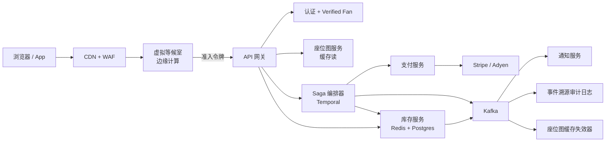
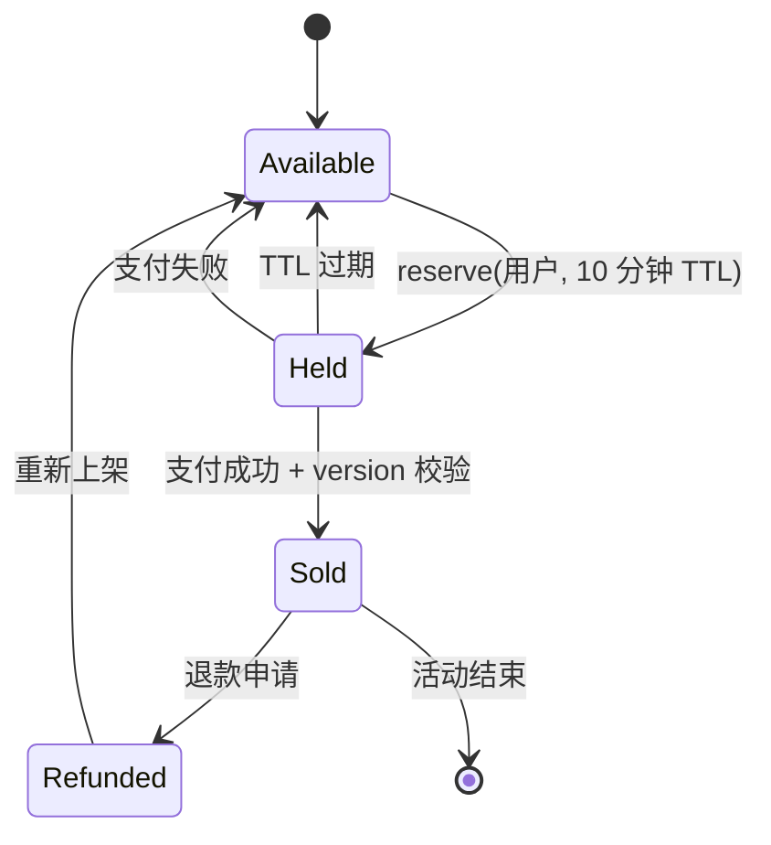
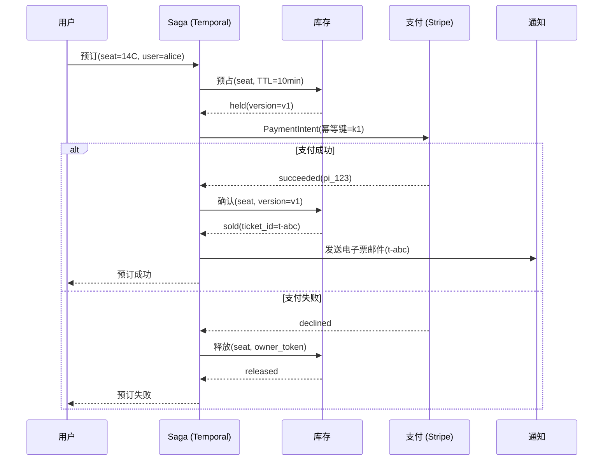
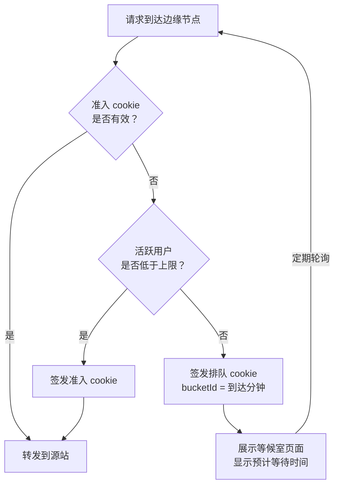

# 设计一个票务系统（BookMyShow / Ticketmaster）

> **TL;DR.** 票务是教科书式的“库存要强一致、其余一切都可以最终一致”问题。Live Nation 每年处理 5 亿张票 [^1]，但一场热门开票就可能把 1400 万用户引到 7 万个座位前 [^2]。架构上只对一个操作做线性化（用 Redis 的 `SET NX PX` 配合 Lua 脚本完成座位预占），其余全部推给缓存读和异步扇出，用虚拟等候室控制准入，用带补偿的 Saga 串起支付。最关键的一处权衡：预占 TTL 该给多长，与支付完成延迟之间的取舍。

## 学习目标

学完本章，你将能够：

- [ ] 设计一套三态座位锁定协议（available、held、sold），在 10 万 TPS 的瞬时洪峰下防止重复售出
- [ ] 在 Redis 单节点锁、Redlock、ZooKeeper、etcd 和数据库行锁之间做出选择，并给出明确的安全性论证
- [ ] 用 Saga 模式把座位预占与外部支付渠道串起来
- [ ] 设计一个虚拟等候室，把流量尖峰转换成有界的准入速率
- [ ] 结合监管背景论证反机器人策略（Verified Fan、设备指纹、CAPTCHA）的合理性
- [ ] 为 Ticketmaster 量级的平台做容量估算：高峰每天 35 亿次请求 [^1]

## 直觉理解

票务系统看起来就是个简单的 CRUD 应用。建活动、列座位、让用户买。10 个用户时它运转良好。可当 1000 万用户在上午 10:00:00 同时点下“购买”，抢那同样的 7 万个座位时，它会崩，原因是争用。

想象一家面包店，柜台上摆着 50 张编号小票。一个顾客进来，拿起 7 号，付钱，走人。毫无问题。现在同时放 5000 人进门。所有人一起扑向柜台。两个人同时抓住了 7 号小票。一个人把它撕了，另一个人说自己先拿到的。而面包师根本记不清谁在什么时候碰过它。

工程上的洞察是：你不能让 5000 人同时碰到柜台。门口得要个保安（等候室），每分钟只放 10 个人进去。进去之后，每张小票上都有一个只有一只手能扣上的夹子（原子锁）。而面包师在卡刷通之前不会把点心递出去（Saga），但小票只保留正好 10 分钟，这样一次被放弃的尝试不会永远挡住下一个买家。

有三个力量左右着每一个决策：(1) 座位与买家的映射必须强一致，没得商量；(2) 来自机器人的对抗性流量不是边缘情况，而是主要的负载来源；(3) 需求超过供给 10 倍到 100 倍，是热门活动的常态。

## 需求

### 澄清问题

- **问：座位是唯一标识的（对号入座），还是不设座位？**
  假设：两种都有。对号入座是难的那个；不设座位就是一个计数器递减。
- **问：支付必须在多长时间内完成，预占保留多久？**
  假设：10 分钟。必须留有余量地超过 P99 支付延迟。
- **问：支付系统是我们自己的，还是对接外部？**
  假设：外部（Stripe、Adyen）。我们没法在它们的系统之间跑 2PC。
- **问：峰值突发是什么场景？**
  假设：单场活动 50 万并发用户，峰值 10 万座位选择 TPS [^1]。
- **问：机器人流量算设计问题还是运维问题？**
  假设：设计问题。2022 年 Eras Tour 开票期间，机器人制造的流量是此前峰值的 3 倍 [^3]。
- **问：要多区域吗？**
  假设：读要（活动目录、座位图）。库存写按活动单主节点。

### 功能需求

- 浏览活动，查看实时座位可售图
- 选择并预占具体座位，预占有明确时限（10 分钟）
- 在预占窗口内完成购买；确认后座位标记为已售
- TTL 到期或支付失败时自动释放被预占的座位
- 需求超过后端容量时，让用户公平排队
- 交付带轮换加密条码的电子票（SafeTix）[^4]

### 非功能需求

- **负载：** 稳态每年 5 亿张票；开票高峰每天 35 亿次请求 [^1]；突发 10 万座位锁定 TPS
- **延迟：** 选座 P99 < 500 ms；端到端支付确认 < 30 秒
- **可用性：** 购买链路 99.9%；目录读 99.99%
- **一致性：** 座位状态迁移要求线性一致性；目录与推荐最终一致
- **持久性：** 对重复售出零容忍；支付确认后零丢票

## 容量估算

| 指标 | 数值 | 推导 |
|--------|------:|------------|
| 每年票量 | 5 亿 | Ticketmaster 全平台 [^1] |
| 平均出票速率 | ~16/秒 | 5 亿 / (365 x 86,400) |
| 峰值每日请求 | 35 亿 | Taylor Swift Eras Tour 开票 [^1] |
| 峰值请求速率 | ~40,500/秒 | 35 亿 / 86,400（均值）；突发时再高 3-5 倍 |
| 座位锁定 TPS（突发） | 10 万 | 热门开票那一分钟的设计目标 |
| 并发买家（峰值） | 50 万 | 1400 万访客中约 50 万处于活跃结账 [^2] |
| 座位记录大小 | ~200 B | event_id(8) + seat_id(32) + state(8) + holder(8) + 时间戳(32) + version(8) |
| 热门活动座位图 | ~14 MB | 7 万座位 x 200 B |
| 每年存储（票） | ~100 GB | 5 亿 x 200 B 元数据 + 支付引用 |
| Queue-it DynamoDB TPS | 10-20 万 | 单表，虚拟等候室后端 [^5] |

**关键比值：** 浏览阶段座位图的读写比约 50:1，进入活跃结账后缩到约 2:1。等候室在流量抵达库存层之前就吸收掉 90% 以上。Redis 单节点约能扛 10 万 ops/s [^6]，正好用一场热门活动一个节点匹配突发目标。

## API 与数据模型

### API 设计

```http
POST /v1/events/{event_id}/seats/hold
  Idempotency-Key: <uuid>
  Body: { "seat_ids": ["sec-A:row-12:seat-7"], "user_id": "u-abc" }
  Returns: 201 { "hold_id": "h-xyz", "held_until": "2026-05-04T10:10:00Z", "version": 1 }
  Errors: 409 seat already held, 429 rate limited, 403 not admitted

POST /v1/holds/{hold_id}/confirm
  Idempotency-Key: <uuid>
  Body: { "payment_intent_id": "pi_stripe_123" }
  Returns: 200 { "ticket_id": "t-final", "status": "sold" }
  Errors: 410 hold expired, 402 payment failed

DELETE /v1/holds/{hold_id}
  Returns: 204 (seat released)

GET /v1/events/{event_id}/seats?section=A
  Returns: 200 { "seats": [{"id": "...", "state": "available|held|sold"}], "updated_at": "..." }
```

创建预占用幂等键防止重试时产生重复预占。`version` 字段是确认环节的栅栏令牌。座位图的 GET 走缓存，容忍 1-2 秒的陈旧。

### 数据模型

```sql
-- 真实来源（PostgreSQL）
CREATE TABLE seat (
  event_id   BIGINT  NOT NULL,
  seat_id    TEXT    NOT NULL,
  state      TEXT    NOT NULL DEFAULT 'available',
  holder_id  BIGINT,
  held_until TIMESTAMPTZ,
  version    BIGINT  NOT NULL DEFAULT 0,
  PRIMARY KEY (event_id, seat_id)
);

-- 原子预占（单条语句，无需 SELECT FOR UPDATE）
UPDATE seat
SET state = 'held', holder_id = $1,
    held_until = now() + interval '10 minutes',
    version = version + 1
WHERE event_id = $2 AND seat_id = $3
  AND (state = 'available' OR (state = 'held' AND held_until < now()))
RETURNING version;
```

Redis 担当高 TPS 活动的热路径锁层。PostgreSQL 是持久化的真实来源，通过异步方式对账。Kafka 把预占/售出/释放事件送往通知、分析，以及座位图缓存失效器。

## 高层架构



*等候室在边缘控制准入，只有被放行的用户才能抵达库存服务；库存服务通过 Redis 协调座位锁，并经由 Kafka 驱动的对账落到 PostgreSQL。*

**写路径：** 被放行的用户选定座位。库存服务在 Redis 上执行 `SET seat:{event}:{id} {owner_token} NX PX 600000` [^7]。成功后向 Kafka 发布 `seat.held` 事件，并异步写入 PostgreSQL。Saga 编排器（Temporal）启动“预占—扣款—确认”工作流。

**读路径：** 座位图服务由 Redis 支撑的缓存提供，缓存通过 Kafka 消费者每 1-2 秒刷新一次。浏览器轮询或接收 SSE 更新。CDN 无限期缓存活动目录和场馆元数据，直到收到失效通知。

**异步路径：** Kafka 把预占/售出/过期事件扇出到通知服务（邮件、短信、推送）、审计日志（事件溯源，用于合规）和分析系统（供运维用的实时看板）。

## 深入剖析

### 座位锁定：三态机

一个座位恰好有三种状态：`available`、`held` 和 `sold`。还有第四种（`refunded`），在做出重新上架的决定之后再迁回 `available`。



*座位通过 Redis SETNX 从 available 原子地迁移到 held；TTL 到期或支付失败会让它自动回到 available，无需人工介入。*

原子迁移使用 Redis 的 `SET key val NX PX 600000`，其中 key 编码为 `seat:{event_id}:{seat_id}`，value 是随机的持有者令牌 [^7]。`NX` 标志保证互斥。`PX 600000` 以毫秒为单位设置 10 分钟 TTL。释放用一段 Lua 脚本，先校验持有权再删除：

```lua
if redis.call('get', KEYS[1]) == ARGV[1] then
  return redis.call('del', KEYS[1])
else
  return 0
end
```

这能防止一个迟到的客户端释放掉早已过期、又被其他用户重新获取的锁 [^7]。持有者令牌每次尝试都会重新生成；没有它，客户端 A 在被 GC 停顿之后就可能释放掉客户端 B 的锁。

**为什么是 10 分钟？** 预占 TTL 必须超过 P99 支付延迟（卡授权通常 5-15 秒），并为用户犹豫、3D Secure 挑战和网络重试留出充裕余量。把它设成 P50 支付延迟，等于在边界上保证会出竞态 [^8]。设得太长（30 分钟）又会把库存从真正的买家手里挡住。

**边界的竞态：** 如果支付在 T+9:58 成功，而预占在 T+10:00 过期，确认环节必须在迁移到 `sold` 之前原子地校验栅栏令牌（版本号）。如果座位在这 2 秒的缝隙里被重新售出，原买家收到退款 [^8]。

### 分布式锁的替代方案与 Kleppmann 之争

锁机制的选择落在一根成本/安全性的轴上：

| 机制 | 吞吐量 | 安全性 | 栅栏 | 适用场景 |
|-----------|-----------|--------|---------|----------|
| Redis `SET NX PX`（单节点） | ~10 万 ops/s [^6] | 故障切换时锁会丢失 | 手动（版本列） | 多数生产票务系统 |
| Redlock（5 个 Redis 节点，多数派） | ~2 万 ops/s | 存在争议 [^9] | 无内置支持 | 正确性场景应避免 |
| ZooKeeper 临时顺序节点 | ~5-20K ops/s | 共识背书 | zxid 作为栅栏令牌 [^10] | 正确性压倒一切时 |
| etcd lease + CAS | ~10-30K ops/s [^11] | Raft 背书 | Revision 作为栅栏令牌 | Kubernetes 原生技术栈 |
| PostgreSQL `SELECT FOR UPDATE` | 单行每秒几百次 [^12] | 事务性 | 版本列 | 小活动、简单架构 |

Martin Kleppmann 对 Redlock 的经典批评 [^9] 认为它“非驴非马”：做效率锁太贵，做正确性锁又不够安全。核心问题在于 Redlock 没有栅栏令牌。客户端 A 一次 GC 停顿就让它持有的租约过期；客户端 B 拿到锁；A 恢复执行后不做任何校验就写入。解法是给任何锁都配一个单调递增的栅栏令牌，由存储层在写入时校验 [^9]。

对票务来说，务实的做法是按热门活动各用一个单节点 Redis `SET NX PX`，同时在确认路径上以 PostgreSQL 的版本列作为栅栏令牌。Redis 故障切换可能带来一小段重复预占的窗口，但确认环节的版本校验能阻止重复售出。这是“效率锁 + 正确性栅栏”，而不是把正确性单独押在锁上。

### 用 Saga 编排预占与支付

[分布式事务](../part-3-distributed-systems-theory/06-distributed-transactions.md) 解释了为什么 2PC 在相互独立的服务之间行不通。Stripe 无法作为资源管理器参与分布式事务；你没法对一笔卡授权执行 `PREPARE` [^13]。Saga 模式是业界的标准答案。



*Saga 先预占座位，用 Stripe 的幂等键扣款，然后要么确认、要么补偿；任一步崩溃，都会借助 Temporal 的持久化工作流重放触发对应的回滚。*

**幂等键**没有商量余地。Stripe 会保留幂等键到响应的映射 24 小时 [^14]。键在服务端于预占时生成，形式为 `hash(user_id, seat_ids, attempt_nonce)`，并与 Saga 状态一同持久化。网络重试复用同一个键，防止重复扣款。

**补偿不是回滚。** 退款不是“取消扣款”。它会出现在客户的账单上，可能耗时 5-10 个工作日，而且本身也可能失败。Saga 必须处理补偿失败：升级到死信队列并人工对账 [^15]。

**编排器的选择：** Temporal（Uber 的 Cadence 在 MIT 许可下的后继者，出自同一批作者）把工作流状态持久化到 Cassandra/PostgreSQL，能扛住进程重启，并内置带指数退避的重试 [^13]。已经在 AWS 上的团队可以用 AWS Step Functions 替代。

### 虚拟等候室

当 1400 万用户为 7 万个座位在 10:00:00 涌入时，后端没法同时服务所有人。等候室把洪峰化成涓流。



*边缘网关检查每个数据中心的准入预算；超出预算的用户拿到排队 cookie，轮询等待自己的桶被放行。*

Cloudflare Waiting Room 用两层 Durable Object 架构实现这一点 [^16]。每个数据中心的 Durable Object 汇总本地 worker 的计数。单个 Global Durable Object 负责对账全球状态。准入预算按上一分钟各数据中心的流量占比分配下去，于是每个数据中心都知道自己的本地限额，无需逐请求协调 [^16]。

Ticketmaster 的 Smart Queue 在用户看来如出一辙：开票前登录，开卖时拿到排队位置，按与后端容量匹配的速率进入购买流程 [^17]。Queue-it 靠 DynamoDB 单表 10-20 万 TPS 的吞吐撑住每分钟数千万次请求 [^5]。

**预计等待时间** = `users_ahead / avg_admission_rate_per_minute` [^16]。错得离谱的预估值会摧毁信任；Cloudflare 用的是上一分钟的实际准入速率，而不是理论最大值。

## 真实案例

**Ticketmaster，2022-11-15：Taylor Swift Eras Tour 崩盘**

Eras Tour 预售在单日产生了 35 亿次系统请求，是 Ticketmaster 此前峰值的 4 倍 [^1]。预注册吸引了 350 万 Verified Fan 报名（史上最多），其中 150 万人拿到了预售码 [^1]。开票期间的实际流量达到约 1400 万用户，其中包含机器人 [^2]。

出故障的不是座位锁定，也不是库存链路，而是 Verified Fan 的验证码校验服务，机器人“首次”把矛头对准了它 [^3]。机器人流量是 Ticketmaster 此前峰值的 3 倍 [^3]。验证码校验服务器被打垮，约 15% 的交互报错，其中包括验证码失败，导致粉丝丢掉了已经放进购物车的票 [^1]。

Ticketmaster 的应对是放慢队列消化速率来稳住系统。权衡的结果：等待更久，但结账错误更少 [^1]。由于剩余库存不足，公售在 2022-11-17 取消 [^2]。尽管一片混乱，2022-11-15 当天 Ticketmaster 仍售出超过 200 万张票，是单一艺人有史以来单日销量的最高纪录；加上 Verified Fan 和 Capital One 两轮预售，Ticketmaster 与 SeatGeek 两个平台上的巡演总销量达到 240 万张 [^1]。

Live Nation 总裁兼 CFO Joe Berchtold 于 2023-01-24 在美国参议院司法委员会作证，把故障归咎于“产业化黄牛”和前所未有的机器人流量 [^3] [^18]。这场听证会最终变成了对 2010 年合并之后 Live Nation/Ticketmaster 市场支配地位的声讨，而不只是讨论一次技术事故 [^18]。

**反垄断的余波：** 2024-05-23，美国司法部与 30 位州总检察长在纽约南区法院提起 *United States v. Live Nation Entertainment* 诉讼，指控 Live Nation 非法垄断现场演出行业 [^22]。庭审于 2026-03-02 开始。司法部于 2026-03-09 与 Live Nation 达成和解（不强制拆分），但 33 个州拒绝接受和解并继续诉讼 [^23]。2026-04-15，联邦陪审团认定 Live Nation 和 Ticketmaster 在票务和露天剧场市场非法维持垄断力量 [^24]。截至 2026 年 5 月，救济措施（可能包括强制拆分 Ticketmaster）仍待法院裁定。

**关键教训：** 反机器人防线必须覆盖关键路径上的每一个端点，而不只是购买端点。攻击者挑的是最便宜的瓶颈（认证校验），不是最难的那个（库存）。

## 权衡

| 方案 | 优点 | 缺点 | 适用场景 | 我们的选择 |
|----------|------|------|-------------|----------|
| 数据库行锁（`SELECT FOR UPDATE`） | 简单、事务性、ACID | 单行每秒几百次写入就到顶 [^12] | 小活动，座位 < 1000 | 不用（扩不上去） |
| Redis `SET NX PX`（单节点） | ~10 万 ops/s，亚毫秒延迟 [^6] | 异步故障切换时锁会丢失 | 多数生产票务系统 | 用（热路径锁） |
| Redlock（5 个 Redis 节点） | 能扛单节点故障 | 无栅栏令牌；按 Kleppmann 的说法不能作为正确性锁 [^9] | 高可用 Redis 上的效率锁；正确性场景需搭配幂等或栅栏令牌 | 仅用于效率锁 |
| ZooKeeper / etcd | 共识背书，有栅栏令牌 [^10] | 5-20 ms 延迟，吞吐更低 | 正确性优先于吞吐时 | VIP 活动的兜底方案 |
| 用 Temporal 的 Saga | 可跨独立服务；状态持久化 [^13] | 补偿逻辑本身就是业务逻辑 [^15] | 预占 + 支付场景的默认选择 | 用 |
| 直接开售（无等候室） | 零摩擦 | 系统过载，15% 错误率 [^1] | 买家 < 1000 的活动 | 不用（热门活动） |
| 基于队列的等候室 | 负载平滑，FIFO 公平 [^16] | 增加感知等待；存在 cookie 重放攻击 | 所有热门开票 | 用 |

元决策是：线性化的边界划在哪里。只对座位状态迁移做线性化（Redis + 栅栏令牌）。其余一切（目录、座位图读、通知、分析）全部推给最终一致的缓存路径。这样就把一致性要求的爆炸半径压到了最小。

## 扩展与故障模式

**10 倍负载（每年 50 亿张票，突发 100 万 TPS）：** 单个 Redis 节点会饱和。缓解办法：按 event_id 对库存分片；每场热门活动一个专用 Redis 实例。等候室跑在边缘计算上，所以能吸收成倍增长的边缘流量而无需改架构 [^16]。

**100 倍负载（每年 500 亿张票，突发 1000 万 TPS）：** Saga 编排器成为瓶颈（工作流状态持久化）。缓解办法：按活动划分 Temporal 命名空间；改用彼此不共享状态的活动级编排器。支付渠道的速率限制成为硬约束；要么谈专属容量，要么把流量分散到多家渠道。

**1000 倍负载：** 架构转向 CDN 优先模式——座位图变成靠失效更新刷新的静态资源，唯一必须打到源站的请求是原子锁获取。等候室不再是闸门，而是主要的用户界面。

**故障模式：**

- **开票期间 Redis 节点崩溃：** Redis 里的预占座位全部丢失。PostgreSQL 的版本列在确认时阻止重复售出。受影响的用户看到“预占已过期”，必须重新选座。爆炸半径：一场活动的在途预占（几秒的数据）。
- **支付渠道超时：** Saga 用同一个幂等键重试 [^14]。重试 3 次后，Saga 释放预占并通知用户。座位在几秒内回到可售，而不是等 10 分钟。
- **等候室 cookie 重放攻击：** 攻击者收集已准入的 cookie，从多个客户端重放。缓解办法：把 cookie 绑定到设备指纹和 IP 段，不匹配即失效；同时按 cookie 限制请求量。

## 常见陷阱

> [!WARNING]
> **先查后改不是原子操作。** 用两条语句先 `SELECT state` 再 `UPDATE state='held'`，会造出竞态窗口。两个用户都看到“available”，都写入“held”。用单条原子语句：`UPDATE ... WHERE state='available' RETURNING ...` 或 Redis 的 `SET NX` [^7] [^12]。

> [!WARNING]
> **把 Redlock 当作正确性锁。** Redlock 没有栅栏令牌，并且假设 GC 停顿和时钟漂移都是有界的。一个被暂停的客户端可能在租约过期后恢复，然后覆盖掉别人的锁 [^9]。效率用单节点 Redis，正确性用版本列栅栏。

> [!WARNING]
> **预占 TTL 按 P50 支付延迟来设。** 如果预占只保留 2 分钟，而 P99 卡授权要 8 秒（加上 3D Secure 的 30 秒），你就等于在边界上保证了竞态。TTL 要设到能从容超过整个支付流程的 P99 [^8]。

> [!WARNING]
> **支付调用漏了幂等键。** 一次没有带上同一个幂等键的网络重试，就会在 Stripe 上产生重复扣款。客户被扣两次；对账时发现多出来的扣款找不到对应座位 [^14]。键要在服务端于预占时生成并持久化。

> [!WARNING]
> **反机器人防线只放在购买端点。** 2022 年 Eras Tour 的故障，是因为机器人打的是 Verified Fan 验证码校验服务，而不是座位库存 [^3]。2025 年一起 FTC 的 BOTS Act 案件指控黄牛用假账号和 SIM 农场在 14 个月里抢走 107,265 张票 [^19]。关键路径上每个端点都需要边缘层的机器人评分。

> [!WARNING]
> **“小”活动一旦爆红就没有等候室。** 一场预计卖出 5000 张票的活动被名人背书，涌来 50 万用户。没有等候室，后端直接垮。永远备一个待命模式的等候室，按流量阈值自动启用 [^20]。

## 追问

**1. 不设座位的场次（站席）怎么处理？**

用原子计数器递减替代逐座位锁。Redis 的 `DECRBY` 返回新值；如果 >= 0，说明扣减成功。如果 < 0，就加回去（补偿）。这比逐座位加锁简单，但失去了展示座位图的能力。

**2. 怎么防止一个用户在两台设备上同时占座？**

除了 `(event_id, seat_id)`，再把预占按 `(event_id, user_id)` 做一层键。签发新预占之前，先检查该用户在此活动下是否已有活跃预占。有的话先释放旧的。这样能防止单个用户在多标签页里占住多个座位。

**3. 如果要动态定价（比如 Ticketmaster 的“Official Platinum”）怎么办？**

价格在预占创建时就根据实时需求信号确定（队列深度、距开票时长、分区售出率）。价格被锁进预占记录。Saga 按锁定的价格扣款，而不是当前价格。这就避免了结账途中价格变动。

**4. 多座位订单出现部分失败怎么办？**

多座位预占是全有或全无。用一段 Redis Lua 脚本遍历所有目标座位键，原子地获取全部锁。只要有一个座位不可用，就在同一段脚本里释放所有已获取的锁并返回失败。不允许部分预占。

**5. 如果要做一个转售市场（像 StubHub）呢？**

已售出的票可以由持有者挂出转售。挂单会创建一个新的 `available_resale` 状态。买家购买时触发 Saga：向买家收款、转移所有权、通知原持有人、签发新的加密条码（SafeTix [^4]）。原条码作废。StubHub（2025 年 9 月起在纽交所代码 STUB）在全球范围处理转售；它的架构与一手销售的 Saga 类似，只是多了价格发现和卖家打款两条工作流。

**6. 怎么做合规审计（BOTS Act、GDPR、反垄断）？**

事件溯源的审计日志（Kafka 到不可变存储）记录每一次状态迁移，带上操作者、时间戳、IP 和设备指纹。BOTS Act [^21] 的执法需要证明存在规避行为；审计轨迹就是证据。GDPR 的被遗忘权用墓碑标记 PII，但保留匿名化的交易记录。2026 年 4 月对 Live Nation 的反垄断裁决 [^24] 之后，平台可能面临新的互操作或数据可携带要求；设计 API 时就要为开放访问的扩展留好接口。

## 练习

### 练习 1：预占过期的边界情况

设计这样的行为：用户的卡在 T+9:55 被拒，而预占只有 10 分钟。要不要延长预占？如果同一用户在 T+10:02 换了张卡重试呢？如果 Redis 的 TTL 与 Saga 编排器之间的时钟漂移，导致双方对预占是否仍然有效产生分歧呢？

<details>
<summary>提示</summary>

想想谁才是预占有效性的权威：Redis（基于 TTL，用本地时钟）还是 PostgreSQL（基于版本，做栅栏）。如果在支付重试时延长 TTL 会发生什么？确认环节又在校验什么？

</details>

<details>
<summary>解答</summary>

**不要在拒付时延长预占。** 如果用户无限重试，延长就造出了没有上界的阻塞窗口。正确做法是：T+9:55 被拒时，Saga 立刻释放预占（不等 TTL）并通知用户。如果用户在 T+10:02 重试，他必须从头重新抢座。如果座位被别人拿走，那原用户就是公平地失去了它。

**时钟漂移的处理：** 确认环节不信任 Redis 的 TTL，它校验的是 PostgreSQL 的 `version` 列。确认语句是：`UPDATE seat SET state='sold' WHERE event_id=$1 AND seat_id=$2 AND version=$3 AND state='held'`。如果版本不匹配（因为预占已过期并被重新获取），确认失败，Saga 退款。Redis 是快路径；PostgreSQL 是真实来源。

**接受的权衡：** 卡在 T+9:55 被拒的用户会失去这个座位。这比允许无限延长预占、把其他买家堵住要好。

</details>

## 要点回顾

- **重复售出是会让平台失去信誉的故障。** 先把重复售出压到零，再谈优化延迟、吞吐或体验。确认环节的栅栏令牌是最后一道防线。
- **Saga 模式永远是预占 + 支付的正确答案。** 2PC 看起来对，但会失败，因为外部支付渠道不是资源管理器 [^13]。
- **等候室不是对用户不友好，它是公平准入的唯一路径。** 没有它，最快的机器人赢，而后端在惊群负载下垮掉 [^16]。
- **支付上的幂等键没有商量余地。** 每一次不带同一个键的重试，都是一次潜在的重复扣款 [^14]。
- **反机器人是架构问题，不是运维的补丁。** 2022 年 Eras Tour 崩在机器人打的认证路径上，不是库存路径 [^3]。
- **预占 TTL 必须超过 P99 支付延迟，而不是 P50。** 预占过期与支付确认之间的边界竞态，是超卖 bug 最常见的来源 [^8]。

## 延伸阅读

- [How to do distributed locking](http://www.kleppmann.com/2016/02/08/how-to-do-distributed-locking.html)。Kleppmann 对 Redlock 的经典批评，给出栅栏令牌的论证；选任何分布式锁之前都该读。
- [Distributed Locks with Redis](https://redis.io/docs/latest/develop/use/patterns/distributed-locks/)。Salvatore Sanfilippo 的 Redlock 规范；与 Kleppmann 那篇对照读，才能看到完整的论战。
- [Building Waiting Room on Workers and Durable Objects](https://blog.cloudflare.com/building-waiting-room-on-workers-and-durable-objects/)。Cloudflare 的两层 Durable Object 设计，展示如何在不做逐请求协调的前提下切分全球准入预算。
- [Designing robust and predictable APIs with idempotency](https://stripe.com/blog/idempotency)。Stripe 工程博客，讲幂等键、指数退避与支付 API 的安全重试。
- [Ticketmaster: Taylor Swift Eras Tour Onsale Explained](https://business.ticketmaster.com/press-release/taylor-swift-the-eras-tour-onsale-explained/)。Ticketmaster 自己对 2022 年故障的复盘，含机器人流量与错误率的具体数字。
- [Saga pattern](https://microservices.io/patterns/data/saga.html)。Chris Richardson 对 Saga 模式的参考定义，讨论了编排与协同两种方式的权衡。
- [Temporal trip-booking tutorial](https://learn.temporal.io/tutorials/python/trip-booking-app/)。在持久化工作流引擎里实现带补偿的 Saga 的完整示例。
- [BOTS Act of 2016](https://www.congress.gov/114/plaws/publ274/PLAW-114publ274.htm)。把绕过购票控制定为联邦违法、由 FTC 执法的联邦法令。

## 记忆卡片

<details>
<summary><strong>问：座位锁定协议有哪三种状态？</strong></summary>

答：available、held、sold。预占把 available 带上 TTL 迁到 held。支付成功把 held 迁到 sold。TTL 到期或支付失败把 held 迁回 available。

</details>

<details>
<summary><strong>问：为什么大规模座位锁定更偏好 Redis SET NX PX 而不是 SELECT FOR UPDATE？</strong></summary>

答：Redis SET NX PX 能处理约 10 万 ops/s，延迟亚毫秒。PostgreSQL 的 SELECT FOR UPDATE 因为锁排队，热门行每秒只能扛几百次写。一场 7 万座位、50 万并发买家的活动，只有 Redis 能满足吞吐要求。

</details>

<details>
<summary><strong>问：Kleppmann 反对把 Redlock 用作正确性锁的核心论点是什么？</strong></summary>

答：Redlock 没有栅栏令牌，并且假设进程停顿和时钟漂移都是有界的。被 GC 暂停的客户端能在租约过期后恢复，无声无息地覆盖别人的锁。解法是一个单调递增的栅栏令牌，由存储层在每次写入时校验。

</details>

<details>
<summary><strong>问：为什么座位预占 + 支付不能用 2PC？</strong></summary>

答：外部支付渠道（Stripe、Adyen）无法作为资源管理器参与分布式事务。你没法对一笔卡授权执行 PREPARE。带补偿动作的 Saga 模式才是正确的替代方案。

</details>

<details>
<summary><strong>问：虚拟等候室如何保护后端？</strong></summary>

答：它跑在边缘，按与后端容量匹配的有界速率放行用户。超限的用户拿到排队 cookie 等待。这把一次流量尖峰（10:00:00 涌来的 1400 万用户）转换成库存服务扛得住的平滑涓流。

</details>

<details>
<summary><strong>问：2022 年 Ticketmaster / Taylor Swift 开票故障是什么造成的？</strong></summary>

答：是此前峰值 3 倍的机器人流量首次把矛头对准了 Verified Fan 验证码校验服务。认证路径在正常用户能走到队列之前就被打垮了。单日 35 亿次系统请求，是此前峰值的 4 倍。

</details>

<details>
<summary><strong>问：为什么预占 TTL 必须超过 P99 支付延迟，而不是 P50？</strong></summary>

答：如果预占在支付完成前过期，座位可能已被别人抢走。确认环节随后失败（版本不匹配），需要退款。把 TTL 设成 P50，等于对所有慢支付中的一半保证了这次竞态。

</details>

<details>
<summary><strong>问：幂等键在支付 Saga 里起什么作用？</strong></summary>

答：它保证同一个 PaymentIntent 的网络重试不会产生重复扣款。Stripe 以幂等键为索引缓存响应 24 小时。键在服务端于预占时生成，并绑定到这次预订尝试。

</details>

<details>
<summary><strong>问：Cloudflare Waiting Room 如何在不做逐请求协调的前提下全球切分准入预算？</strong></summary>

答：一个 Global Durable Object 对账各数据中心的计数。每个数据中心的准入预算与其上一分钟的流量份额成正比。这个比例在当前这一分钟内不变，所以传播延迟是可以容忍的。

</details>

<details>
<summary><strong>问：BOTS Act 是什么，它如何影响票务系统设计？</strong></summary>

答：2016 年的《在线售票促进法》把绕过购票控制定为联邦违法行为。它为反机器人措施（Verified Fan、CAPTCHA、设备指纹）提供了法律支撑，也让黄牛操作承担法律责任。

</details>

## 参考文献

[^1]: Ticketmaster Business, "Taylor Swift | The Eras Tour Onsale Explained", 2022-11-19. https://business.ticketmaster.com/press-release/taylor-swift-the-eras-tour-onsale-explained/

[^2]: Fortune, "Taylor Swift Eras tickets: Bots helped drive presale fiasco", 2022-11-18. https://fortune.com/2022/11/18/taylor-swift-ticket-fiasco-bots-ticketmaster-greg-maffei/

[^3]: J.D. Capelouto, "Here's how Ticketmaster explained the Taylor Swift tour debacle to Congress", Semafor, 2023-01-24. https://www.semafor.com/article/01/24/2023/heres-how-ticketmaster-explained-the-taylor-swift-tour-debacle-to-congress

[^4]: Ticketmaster Business, "Encrypted Ticketing for Secure Fan Experiences with SafeTix", 2025-11. https://business.ticketmaster.com/encrypted-ticketing-for-secure-fan-experiences/

[^5]: Mojtaba Sarooghi and Jose Quaresma, "Queue-it's Virtual Waiting Room System Design", Queue-it Smooth Scaling Podcast Episode 17, 2025. https://queue-it.com/smooth-scaling-podcast/ep017-virtual-waiting-room-architecture/

[^6]: Redis, "Redis benchmark", Redis documentation. https://redis.io/docs/latest/operate/oss_and_stack/management/optimization/benchmarks/

[^7]: Salvatore Sanfilippo, "Distributed Locks with Redis", Redis documentation. https://redis.io/docs/latest/develop/use/patterns/distributed-locks/

[^8]: The Linux Code, "Design a Movie Ticket Booking System Like BookMyShow", 2024-12. https://thelinuxcode.com/design-a-movie-ticket-booking-system-like-bookmyshow-from-mvp-to-peak-traffic-reliability/

[^9]: Martin Kleppmann, "How to do distributed locking", 2016-02-08. http://www.kleppmann.com/2016/02/08/how-to-do-distributed-locking.html

[^10]: Apache ZooKeeper Project, "ZooKeeper Recipes - Locks". https://zookeeper.apache.org/doc/current/recipes.html

[^11]: etcd, "Performance", etcd documentation v3.5. https://etcd.io/docs/v3.5/op-guide/performance/

[^12]: Cybertec Postgres, "SELECT FOR UPDATE considered harmful in PostgreSQL", 2025-06. https://web.archive.org/web/20251009010508/https://www.cybertec-postgresql.com/en/select-for-update-considered-harmful-postgresql/

[^13]: Temporal, "Saga Design Pattern Explained for Distributed Systems", 2023-05. https://temporal.io/blog/saga-pattern-made-easy

[^14]: Brandur Leach, "Designing robust and predictable APIs with idempotency", Stripe engineering blog, 2017-02-22. https://stripe.com/blog/idempotency

[^15]: Chris Richardson, "Pattern: Saga", microservices.io. https://microservices.io/patterns/data/saga.html

[^16]: Fabienne Semeria, George Thomas, Mathew Jacob, "Building Waiting Room on Workers and Durable Objects", Cloudflare Blog, 2021-06-16. https://blog.cloudflare.com/building-waiting-room-on-workers-and-durable-objects/

[^17]: Ticketmaster Business, "Smart Queue: Streamline Sales and Maximize Sell-Through", 2025-12-10. https://business.ticketmaster.com/smart-queue/

[^18]: The Guardian, "Scalper bots caused Taylor Swift ticket chaos, Senate panel hears in testimony", 2023-01-24. https://www.theguardian.com/us-news/2023/jan/24/taylor-swift-ticketmaster-live-nation-senate-testimony

[^19]: Digital Music News, "BOTS Act Case Proceeds as Federal Judge Denies Dismissal Push", 2026-04-30. https://www.digitalmusicnews.com/2026/04/30/bots-act-case-continues/

[^20]: Queue-it, "Everything You Need to Know About Virtual Waiting Rooms", 2025-12. https://queue-it.com/blog/virtual-waiting-room/

[^21]: US Congress, "Better Online Ticket Sales Act of 2016" (Public Law 114-274), 2016-12-14. https://www.congress.gov/114/plaws/publ274/PLAW-114publ274.htm

[^22]: US Department of Justice, "Justice Department Sues Live Nation-Ticketmaster for Monopolizing Markets Across the Live Concert Industry", 2024-05-23. https://www.justice.gov/opa/pr/justice-department-sues-live-nation-ticketmaster-monopolizing-markets-across-live-concert

[^23]: PBS NewsHour, "States continue antitrust case against Live Nation and Ticketmaster after DOJ settles", 2026-03-17. https://www.pbs.org/newshour/nation/states-continue-antitrust-case-against-live-nation-and-ticketmaster-after-doj-settles

[^24]: NBC News, "Live Nation illegally monopolized ticketing market, jury in antitrust trial finds", 2026-04-15. https://www.nbcnews.com/business/consumer/livenation-illegally-monopolized-ticketing-market-jury-antitrust-trial-rcna273714
