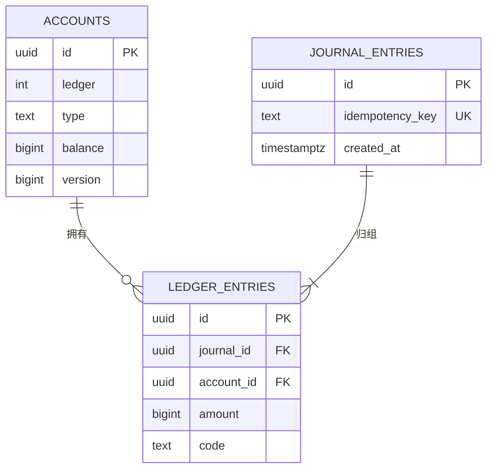
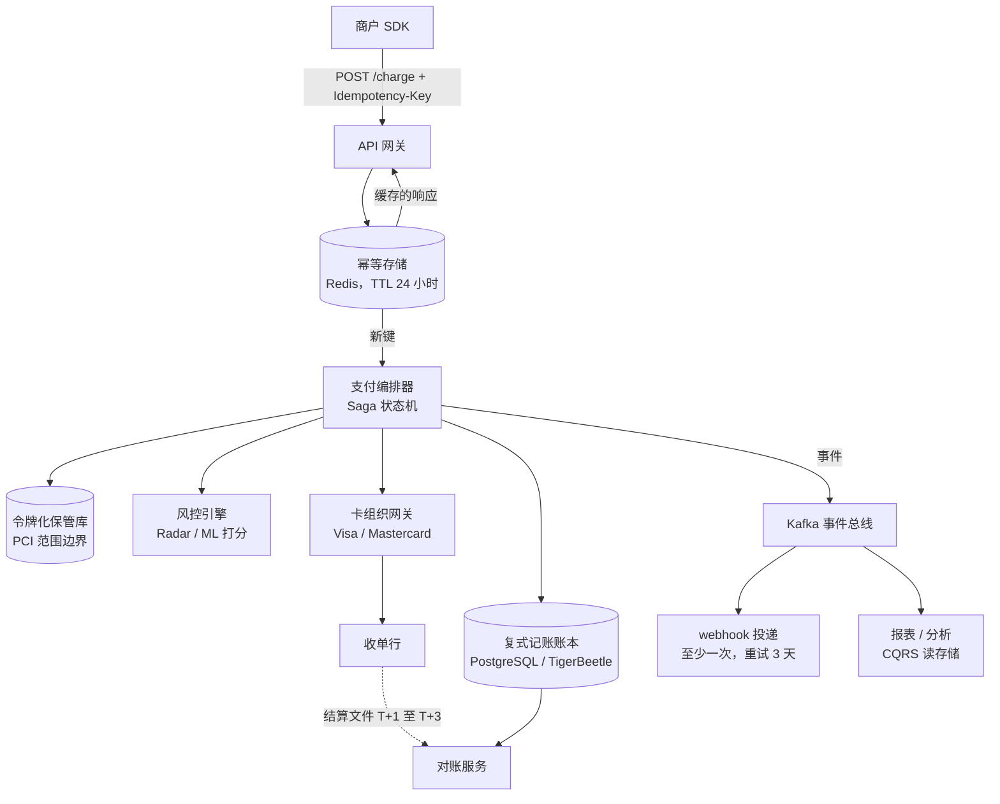
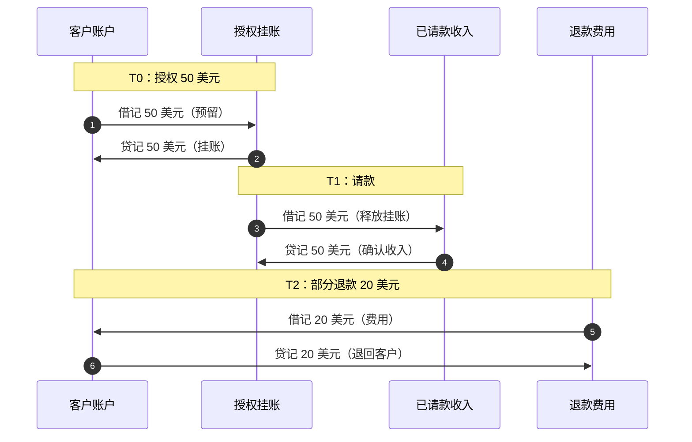
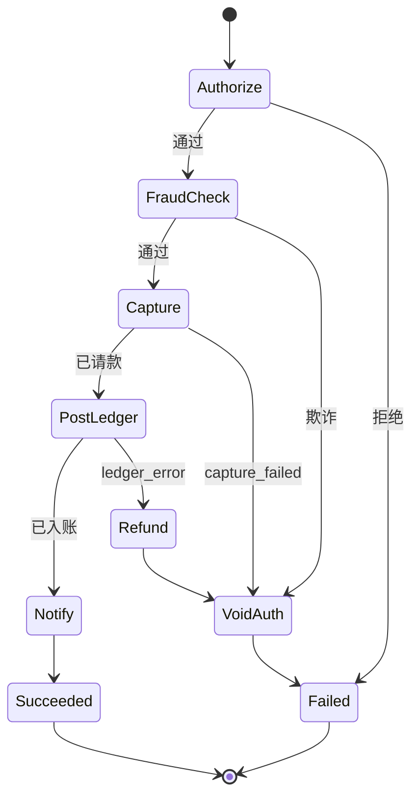

# 设计支付系统（Stripe / PayPal）

> **TL;DR.** 支付系统看起来就是 CRUD，直到你意识到每一次重试都可能变成重复扣款，每一次崩溃都可能丢掉一笔转账。架构最终收敛到三个原语：借贷双方永远轧平为零的复式记账账本；让重试变得安全的幂等键——它把响应缓存 24 小时[^1]；以及用显式补偿事务取代不可能的跨服务 2PC 的 Saga 编排[^2]。Stripe 靠这套模型每年处理 1.4 万亿美元[^3]。账本做对了，其余的自然跟上；做错了，你的职业生涯就耗在对账会议上。

## 学习目标

- [ ] 把支付流程建模成收支平衡的复式记账分录，并解释为什么不可变分录能取代 UPDATE 语句
- [ ] 设计幂等键层，避免网络重试造成重复扣款
- [ ] 用 Saga 模式在你并不拥有的多个服务之间编排授权、请款与结算
- [ ] 追踪四方卡组织流程，从授权一直到 T+2 结算
- [ ] 论证令牌化是缩小 PCI-DSS 范围的首要杠杆
- [ ] 设计对账循环，在 24 小时内发现账本与银行之间的偏差

## 直觉理解

支付看起来不值一提：从买家扣 50 美元，给卖家加 50 美元，完事。前 10 个客户，一个 Postgres 事务就够了。

到了每天 1000 万笔交易，三件事同时崩塌。第一，卡组织不是你的数据库。授权要花 1 到 2 秒，牵涉四个互相独立的参与方，几天之后才结算[^4]。你没法把它包进一个 BEGIN/COMMIT。第二，你自己服务之间的网络会丢消息、重复消息、乱序消息[^1]。响应超时并不代表扣款失败，它代表你不知道结果。第三，监管者和审计师要求每一分钱的流动及其原因都有永久、不可更改的记录。

解开这个设计的洞见已经有 700 多年历史：复式记账（double-entry bookkeeping）[^5]。每一笔资金流动都记成两条分录，一借一贷，相加为零。你从不修改历史，你只追加更正分录。这唯一的不变式——"这笔交易平不平？"——取代了几十条临时拼凑的校验规则，让对账从侦探工作变成机械比对。在此之上加幂等键，让重试安全；把跨服务流程包进带补偿的 Saga；把原始卡号推进令牌化保管库，让 PCI 范围保持在最小。整个架构就是这些。

## 需求

### 澄清提问

- **问：我们直接处理卡交易，还是走 Stripe/Adyen 这类网关？**
  假设：我们自己就是支付平台（类似 Stripe）。我们直连卡组织和收单行。
- **问：账本用哪种一致性模型？**
  假设：严格可串行化。钱不能是最终一致的。一笔交易要么已入账，要么没有。
- **问：支持多币种吗？**
  假设：支持。每个账本只以一种货币计价；外汇是账本之间的一笔独立转账。
- **问：授权延迟的 SLA 是多少？**
  假设：P99 在 2 秒以内，这个上限由卡组织的往返时间决定[^4]。
- **问：PCI-DSS 级别？**
  假设：Level 1（每年超过 600 万笔卡交易）[^6]。令牌化保管库在范围内；应用服务在范围外。
- **问：拒付和争议处理？**
  假设：需要。系统必须能从账本重建证据，并在 7 天内答复。

### 功能性需求

- 受理支付：授权、请款，并把这笔扣款记入账本。
- 退款：追加冲正分录，通知卡组织，把钱退给持卡人。
- 处理争议：重建原始交易、提交证据，败诉时记入拒付分录。
- 为异步事件（扣款成功、争议发起、打款完成）向商户投递 webhook 通知。
- 每日将内部账本与卡组织结算文件、银行对账单对账。

### 非功能性需求

- **负载：** 每天 1000 万笔交易，黑五峰值 5,000 TPS。
- **延迟：** 授权 P99 低于 2 秒；内部处理 P99 低于 200 ms。
- **可用性：** 授权链路 99.95%。
- **一致性：** 账本严格可串行化。对差一错误零容忍。
- **持久性：** 11 个 9。任何交易都不能丢，永远不能。

## 容量估算

| 指标 | 数值 | 推导 |
|--------|------:|------------|
| 每日交易数 | 1,000 万 | 需求给定 |
| 峰值 TPS | 5,000 | 黑五突发（平均值的 3-5 倍） |
| 平均交易金额 | 50 美元 | 中端电商 |
| 日交易额 | 5 亿美元 | 1000 万 x 50 美元 |
| 每日账本分录数 | 4000 万 | 每笔交易约 4 条分录（授权、请款、手续费、结算） |
| 每年账本存储 | 约 2.4 TB | 4000 万 x 365 x 每条约 160 B |
| 幂等存储键数 | 1000 万活跃 | 每笔交易一个键，24 小时 TTL[^1] |
| 幂等存储内存 | 约 1.6 GB | 1000 万 x 约 160 B（键 + 序列化响应） |
| 每日 webhook 投递数 | 3000 万 | 每笔交易约 3 个事件 |

Stripe 每天处理 5 亿次以上 API 请求[^7]，稳态约 5,800 RPS（据此推算）。PayPal 的 Kafka 集群在峰值日跨 1,500 多个 broker 处理 1.32 万亿条消息[^8]。我们 5,000 TPS 的目标，无论对账本还是事件总线，都稳稳落在单集群容量之内。

## API 与数据模型

### API 设计

```http
POST /v1/charges
  Idempotency-Key: <client-generated uuid>
  Body: { "amount": 5000, "currency": "usd", "payment_method": "tok_visa_4242", "merchant_id": "m_abc" }
  Returns: 201 { "id": "ch_xyz", "status": "succeeded", "amount": 5000 }
  Errors: 402 card_declined, 409 idempotency_conflict, 429 rate_limited

POST /v1/refunds
  Idempotency-Key: <uuid>
  Body: { "charge_id": "ch_xyz", "amount": 2000 }
  Returns: 201 { "id": "re_abc", "status": "succeeded" }

GET /v1/charges/{id}
  Returns: 200 { "id": "ch_xyz", "status": "succeeded", "amount": 5000, "refunded": 2000 }

GET /v1/ledger/accounts/{account_id}/entries?cursor=...&limit=100
  Returns: 200 { "entries": [...], "balance": 300000, "next_cursor": "..." }
```

每个写操作的端点都必须带 `Idempotency-Key` 头。服务端把这个键和完整响应存 24 小时；用同一个键重试时，直接回放缓存的响应[^1][^9]。

### 数据模型

```sql
-- 复式记账账本（PostgreSQL 或 TigerBeetle）
CREATE TABLE accounts (
  id            UUID PRIMARY KEY,
  ledger        INT NOT NULL,        -- 840 = USD, 978 = EUR
  type          TEXT NOT NULL,        -- asset, liability, income, expense
  balance       BIGINT NOT NULL DEFAULT 0,
  version       BIGINT NOT NULL DEFAULT 0
);

CREATE TABLE journal_entries (
  id            UUID PRIMARY KEY,
  idempotency_key TEXT UNIQUE,
  created_at    TIMESTAMPTZ NOT NULL DEFAULT now()
);

CREATE TABLE ledger_entries (
  id            UUID PRIMARY KEY,
  journal_id    UUID REFERENCES journal_entries(id),
  account_id    UUID REFERENCES accounts(id),
  amount        BIGINT NOT NULL,     -- positive = debit, negative = credit
  code          TEXT NOT NULL,        -- CARD_AUTH, CARD_CAPTURE, REFUND, FEE
  CONSTRAINT balanced CHECK (true)   -- enforced at journal level
);
-- Invariant: SUM(amount) = 0 for all entries sharing a journal_id
```



*每个日记账分录把若干必须相加为零的账本分录归成一组；accounts 表缓存当前余额，并在同一个事务里原子地更新。*

## 高层架构



*一笔扣款请求依次经过幂等去重、Saga 编排器和卡组织；请款之后，账本是下游唯一只追加的事实来源。*

**写路径。** 商户 SDK 带着幂等键发出扣款请求。网关先查 Redis 里有没有缓存的响应。未命中时，编排器启动一个 Saga：令牌化卡信息（保管库）、风控打分（风控引擎）、向卡组织授权、把分录写入账本。响应写入 Redis 缓存后返回。

**读路径。** 商户直接从主存储查询扣款状态和账本分录。CQRS 读存储承接分析与报表查询，不会压到账本上。

**异步路径。** Kafka 把事件分发给 webhook 投递（至少一次，重试 3 天[^10]）、对账服务和下游分析。

## 深入探讨

### 深入探讨 1：复式记账账本，以及为什么禁止 UPDATE

根本不变式：对每个日记账分录（journal entry），所有账本分录之和等于零[^5][^11]。一笔 50 美元的扣款记两条分录：借记客户的资产账户 50 美元，贷记商户的负债账户 50 美元。退款不是一次修改，而是一条符号相反的新日记账分录[^11][^12]。

为什么不能用 `UPDATE balance SET balance = balance - 50`？三个理由。第一，它摧毁了审计轨迹。没有历史，你无法回答"这个余额为什么是 4,982 美元而不是 5,000 美元？"[^13]。第二，并发更新会竞争。两个借记读到同一个余额时可能双双成功，把账户扣成负数[^13][^14]。第三，对账会从机械比对变成侦探工作。有了分录，你只需把日记账和银行的结算文件逐行比对。

**TigerBeetle** 是专门为这类场景打造的金融数据库，在存储引擎层面强制执行这些不变式。一次转账恰好有一个借记账户和一个贷记账户。复杂流程（分账、外汇）用 `LINKED` 链，要么全部成功，要么全部原子失败[^15]。基准测试显示，在普通商用硬件上能跑到 10 万到 50 万 TPS[^14]，而朴素的 Postgres 实现一旦有争用就只有 100 到 1,000 TPS[^14]。

**Square 的 Books** 跑在 Google Cloud Spanner 上，三张表：`books`（缓存余额 + 版本号）、`journal_entries`，以及与其父日记账交错（interleaved）存放的 `book_entries`[^13]。每次插入都在同一个 Spanner 事务里原子更新相关 books 的余额和版本号。三名工程师管理着 Square、Cash App 和 Caviar 共 20 TB 数据[^13]。



*授权、请款和退款在四个账户上共记六条平衡分录；每一步账本总和都保持为零。*

### 深入探讨 2：幂等键与安全重试

网络不可靠。客户端发出扣款请求，服务端也处理了，但响应在回程中丢了。客户端于是重试。没有幂等，客户就被扣了两次[^1]。

**机制。** 客户端生成一个 UUID，在每个写操作请求里作为 `Idempotency-Key` 发出。服务端把这个键和序列化的响应存进 Redis，TTL 24 小时[^1][^9]。重试时：

1. 键存在且操作已完成，返回缓存的响应。
2. 键存在但操作还在进行中，返回 409，或阻塞到完成为止。
3. 键不存在，正常执行并缓存结果。

**键的选择是承重的。** 如果客户端每次重试都生成新键，幂等就形同虚设；如果它在逻辑上不同的操作之间复用同一个键，就会拿到过期的响应。复用键时请求体不一致，Stripe 会直接报错[^9]。

**实现细节。** 幂等存储的检查和写入必须是原子的。两个同键并发请求之间的竞争，必须只导致一次执行。用 Redis `SET NX` 以该键作锁，完成时再写入缓存的响应，就能处理。Stripe 的 Ruby 客户端会自动重试，带指数退避、抖动，并沿用原始键[^1]。

**作用范围。** 幂等放在网关层，统一覆盖所有 POST 端点。下游各个服务不需要自己做去重，因为网关保证进入 Saga 的投递最多一次[^1][^9]。

### 深入探讨 3：在你并不拥有的服务之间做 Saga 编排

一次结账横跨五个系统：令牌化保管库、风控引擎、卡组织、账本、通知层。它们之间没有共享的事务管理器。2PC 不可行，因为卡组织的授权要 1 到 2 秒，这期间你得在所有参与方身上持锁[^4][^2]。

**Saga 模式。** 每一步本地提交，并有一个显式的补偿动作[^2]：

| 步骤 | 正向动作 | 补偿 |
|------|---------------|--------------|
| 1 | 授权卡 | 撤销授权 |
| 2 | 风控打分 | 释放风控占用 |
| 3 | 请款 | 发起退款 |
| 4 | 写入账本 | 记冲正分录 |
| 5 | 通知商户 | 发送取消 |

第 N 步失败时，补偿从 N-1 逆序跑到 1。每个补偿自身也要重试到成功，因为补偿必须是持久的[^2]。

**对支付而言，编排优于协同（choreography）**，因为状态在一个地方就能看到。一个中央编排器（Temporal、Step Functions，或自研状态机）发命令、跟踪进度。基于协同的 Saga 一旦超过五六步就无法调试，因为没有哪份日志能完整记录整个流程[^2]。



*任何一步失败都会触发逆序补偿；编排器会把每个补偿重试到成功。*

**隔离性注意事项。** 中间状态对其他 Saga 可见。客户在 Saga 进行中查余额，会看到授权挂账但看不到请款。对支付来说这是正确行为（挂账是真实存在的），但 UX 要小心：把"处理中"的扣款和"已完成"的扣款明确区分开。

### 深入探讨 4：卡组织流程与 PCI 令牌化

**四方模型。** 授权在 1 到 2 秒内穿过持卡人、商户、收单行、卡组织、发卡行[^4]。发卡行检查余额、信用额度和欺诈信号，然后批准或拒绝。清算在夜间进行：收单行和发卡行通过卡组织交换交易文件[^16]。结算是 T+1 到 T+3 个工作日之后，表现为银行之间真实的资金划转[^4][^17]。

授权"挂账"只占用信用额度，不移动资金。请款把挂账转成清算记录。对于卡不在场交易，未请款的授权通常 5 到 7 天后过期，具体取决于卡品牌和交易类型（Visa MIT：5 天；其余大多 7 天）；卡在场交易的挂账过期更早（2 到 5 天）。日本账户上的日元计价交易是特例，最多可挂 30 天[^4]。你的账本必须区分已授权、已请款和已结算三种状态，因为其中任何一种都仍可能被冲正[^17]。

**令牌化。** PCI-DSS 规定了卡数据如何存储、处理和传输。架构上的杠杆是缩小范围[^6]。卡数据通过一个通过 PCI 验证的保管库（Stripe Elements、VGS、Skyflow）进入，由它用不透明令牌替换原始 PAN。你的应用服务永远只看到令牌。这样你就能走 SAQ A（一份覆盖大约二十来项控制的简短问卷），而不是最严苛的自评问卷 SAQ D——后者覆盖 PCI DSS 的全部要求集[^6]。每年处理超过 600 万笔 Visa/Mastercard 交易的商户属于 Level 1，需要由合格安全评估师（QSA）每年做一次现场审计[^6]。

## 真实案例

### Stripe：靠幂等、账本和 Radar 撑起 1.4 万亿美元

Stripe 2024 年处理了 1.4 万亿美元的总支付额，约占全球 GDP 的 1.3%[^3]。平台每天处理 5 亿次以上 API 请求[^7]，在 30 多万计费客户名下管理着近 2 亿个活跃订阅[^3]。

**把幂等当作横切关注点。** 每个 POST 端点都接受 `Idempotency-Key` 头。服务端把响应在专用存储里缓存 24 小时[^1][^9]。这不是每个服务各做一套，而是在网关层，给所有客户端一份统一的契约。

**内部账本。** Ilya Ganelin 把 Stripe 的账本描述为一流的资金流动追踪系统[^7]。它只追加，是所有资金流动的事实来源。Radar 和报表从账本消费，而不是各自维护计数。

**Radar 的 ML 欺诈检测。** 在 Stripe 网络处理过的数千亿美元支付上训练，Radar 使用商户嵌入（类似 Word2Vec，所以在 Uber 上出现的欺诈模式能泛化到 Lyft）[^18]。网络上 90% 的卡被见过不止一次[^18]，这给 Radar 提供了单个商户无法复制的网络级信号。

**在线迁移。** Stripe 用双写、GitHub 的 Scientist 做读取比对、增量切换写流量，在不停机的情况下把数亿个订阅对象在存储之间迁移[^19]。没有维护窗口。规模化演进账本 schema 就是这么做的。

Uber 的 Gulfstream 平台走了互补的一条路：可审计的复式记账，一万亿条账本分录从 DynamoDB 迁移到分层的 LedgerStore，并带不可篡改的密码学证明[^20][^21]。

## 权衡

| 决策 | 选项 A | 选项 B | 我们的选择 | 理由 |
|----------|----------|----------|------------|-----|
| 账本模型 | 复式记账（只追加） | 单行余额更新 | 复式记账 | 审计轨迹、对账能力、700 多年的验证[^5][^13] |
| 账本引擎 | PostgreSQL | TigerBeetle | 起步用 PostgreSQL，扩展后换 TigerBeetle | Postgres 久经验证；TigerBeetle 面向 10 万+ TPS[^15][^14] |
| 幂等范围 | 网关层 | 每服务各自 | 网关层 | 所有客户端一份契约；重复更少[^1] |
| 跨服务协调 | 带编排器的 Saga | 2PC | Saga | 无法在卡组织之间持锁[^2] |
| Saga 形态 | 编排（Temporal） | 协同（事件） | 编排 | 状态可观测，超过 5 步仍可调试[^2] |
| PCI 范围 | 自己存卡 | 通过保管库令牌化 | 令牌化 | SAQ A 对 SAQ D；合规成本省下数百万[^6] |
| webhook 投递 | 最多一次 | 至少一次 + 去重 | 至少一次 | 3 天重试能吸收接收方故障[^10] |

最大的元决策：**账本路径上一致性优先于可用性。** [CAP 与 PACELC](../part-3-distributed-systems-theory/03-cap-and-pacelc.md) 为这个选择提供了框架。钱不能是最终一致的。如果账本不可用，宁可拒绝这笔扣款，也不冒险写入一条不平的分录。授权路径可以容忍短时间不可用（返回"请重试"），但绝不能容忍不一致。

## 扩展与故障模式

- **10 倍（50K TPS）：** PostgreSQL 账本在写争用下成为瓶颈。迁移到 TigerBeetle，或按 merchant_id 分片。幂等存储扩到 Redis Cluster。Kafka 分区从 32 增到 128。
- **100 倍（500K TPS）：** 单区域架构饱和。跨区域部署主备，账本做同步复制。Saga 编排器按 payment_id 分片。PayPal 在这个量级的架构跑着 85 个以上 Kafka 集群、1,500 多个 broker[^8]。
- **1000 倍：** 专用账本引擎（TigerBeetle 声称在商用硬件上能到 500K TPS[^14]）。分层存储：热数据（12 周）放 SSD，冷数据放对象存储并带密码学证明，正如 Uber 的 LedgerStore 所示[^21]。

**故障模式：**

- **卡组织超时：** 编排器把 Saga 标为"pending"。后台对账任务向卡组织查询授权状态。若确认成功，继续；若 30 分钟后仍未找到，则撤销并用新的幂等键重试。
- **账本写入失败：** Saga 补偿撤销卡授权，扣款没有入账，客户看不到这笔扣款。同时告警触发，等人工复核。
- **webhook 接收方宕机：** Stripe 最长重试 3 天，带指数退避[^10]。商户系统恢复后必须按 `event.id` 去重。事件可能乱序到达；`charge.refunded` 可能比 `charge.succeeded` 先到[^10]。

## 常见陷阱

> [!WARNING]
> **没有幂等键的重试。** 网络超时不代表扣款失败。没有幂等键，重试就会造成重复扣款。在网关层强制要求每个 POST 都带键[^1]。

> [!WARNING]
> **用 UPDATE 改余额而不是记分录。** 这会摧毁审计轨迹、在并发下竞争，并把对账变成侦探工作。Square 在解释为什么要迁移到复式记账时，明确提到"数据不一致，导致客户询问和存款延迟"[^13]。

> [!WARNING]
> **跨卡组织用 2PC。** 卡组织要 1 到 2 秒。在这段延迟里持锁会耗尽连接池，高负载下还会死锁。用带补偿的 Saga[^2]。

> [!WARNING]
> **webhook 处理逻辑不幂等。** Stripe 会重试 webhook 长达 3 天。如果你的处理逻辑每次投递都执行"给用户加钱"，用户就会被重复加钱。施加副作用之前先按 `event.id` 去重[^10]。

> [!WARNING]
> **PAN 存储蔓延。** 一个"在退款页面显示后四位"的需求，最后演变成存下了完整 PAN，把你整个数据库拖进 PCI 范围。只用令牌；后四位由保管库作为元数据返回[^6]。

> [!WARNING]
> **没有对账循环。** 缺少持续的账本对银行对账，偏差会悄无声息地累积好几个月。对账是一个功能，不是月末报表。任何超过 24 小时仍未匹配的分录都要告警。

## 追问

**1. 你怎么处理拒付和争议？**

卡组织发起拒付时，借记商户账户（冲正原来的贷记）。从不可变的账本分录重建证据：时间戳、妥投确认、IP 地址、3DS 认证结果。在 7 天内提交。如果你赢了（再请款 representment），记一笔贷记退回；如果输了，借记保留。账本记录每一次状态迁移。

**2. 你会怎么加多币种支持？**

每个账户只属于一个账本（一种货币）。外汇转账是一条日记账分录：借记源币种账户，贷记目标币种账户，汇率作为元数据记录。轧平为零的不变式在每条日记账分录内部仍然成立，因为金额分属不同账本（这个约束是账本内的，不是跨账本的）。

**3. 部分请款和分账怎么处理？**

授权时占用全额。请款可以只请其中一部分（部分请款），差额以撤销剩余挂账的方式释放。分账用链接转账：一条日记账分录里挂多个贷记账户（商户 A 拿 70%，商户 B 拿 30%），相加等于那笔借记。

**4. 区域故障切换时会发生什么？**

账本以主备方式运行，做同步复制。切换后，新的主节点拥有全部已提交事务。故障区域里正在进行的 Saga 从编排器的持久日志中恢复（Temporal 的持久化层）。Redis 里的幂等键会复制；切换期间任何重复重试都会安全地返回缓存响应。

**5. 你会怎么实现按用量计费（计量扣费）？**

把用量事件累积到流里（Kafka）。计费 worker 按账期聚合用量，在账期末发一笔扣款。聚合是幂等的（重放同一批事件得到同样的总量）。扣款本身用由 (customer_id, billing_period) 推导出的确定性幂等键，这样重试也安全。

**6. 怎么在不增加延迟的前提下防欺诈？**

让风控模型和令牌化并行跑（两者都在调用卡组织之前完成）。模型用预计算特征，打分在 50 ms 内完成。只在把请求发给卡组织之前才阻塞等结果。Stripe 的 Radar 用网络级信号实时评估每一笔交易[^18]。

## 练习

### 练习 1：拒付的账本分录

一位客户在付款 60 天后对一笔 50 美元的扣款提出争议，卡组织发起拒付。你的系统必须在 7 天内带着证据答复。如果败诉，你要承担这 50 美元外加 15 美元争议费。为以下三个阶段设计账本分录：(a) 原始扣款，(b) 拒付发起，(c) 争议败诉。

<details>
<summary>提示</summary>

想想每个阶段涉及哪些账户。原始扣款把钱从客户移到商户。拒付把这笔流动反向，并加了一笔费用。每一步都必须轧平为零。

</details>

<details>
<summary>解答</summary>

**(a) 原始扣款（50 美元）：**

- 借记：客户资产 50 美元
- 贷记：商户负债 50 美元

**(b) 拒付发起（从商户处挂起 50 美元）：**

- 借记：商户负债 50 美元（冲正原来的贷记）
- 贷记：拒付挂账 50 美元（资金挂起，待裁决）

**(c) 争议败诉（50 美元 + 15 美元费用）：**

- 借记：拒付挂账 50 美元
- 贷记：客户资产 50 美元（钱退回持卡人）
- 借记：商户负债 15 美元（争议费）
- 贷记：平台收入 15 美元（收到费用）

每条日记账分录相加都为零。商户余额总共减少 65 美元（50 美元退款 + 15 美元费用）。不可变分录构成完整的审计轨迹，精确显示每次资金流动发生在何时、原因为何。如果你在争议中获胜，则记：借记拒付挂账 50 美元，贷记商户负债 50 美元（资金释放回来）。

</details>

## 要点回顾

- **对钱来说，复式记账不是可选项。** 轧平为零的不变式取代了几十条临时校验，让对账变成机械比对[^5]。
- **幂等键应该放在网关。** 一层、一份契约、覆盖所有端点。TTL 24 小时，缓存完整响应[^1]。
- **Saga 取代 2PC**——当你无法拥有所有参与方的事务管理器时。补偿是显式的代码，不是隐式的回滚[^2]。
- **PCI 范围驱动架构。** 令牌化是你绕开 SAQ D 的方式。自建或采购一个保管库，但绝不要让 PAN 碰到应用服务[^6]。
- **对账是一个功能。** 持续的账本对银行匹配能在偏差变成危机之前抓住它。
- **卡组织不是你的数据库。** 授权、清算、结算是跨越数天的三个独立阶段。状态机要照着这个设计[^4]。

## 延伸阅读

- [Designing robust and predictable APIs with idempotency](https://stripe.com/blog/idempotency). Brandur Leach 的经典文章，讲清为什么每个支付 API 都需要幂等键，以及 Stripe 如何用 24 小时响应缓存实现它。
- [Accounting for Computer Scientists](https://martin.kleppmann.com/2011/03/07/accounting-for-computer-scientists.html). Martin Kleppmann 把复式记账表述为有向图：账户是节点，转账是边；对工程师来说这是最好的入门材料。
- [Books: an immutable double-entry accounting database service](https://developer.squareup.com/blog/books-an-immutable-double-entry-accounting-database-service). Square 基于 Spanner 的账本 schema、交错表设计，以及三名工程师如何管理 20 TB。
- [Engineering Uber's Next-Gen Payments Platform](https://www.uber.com/en-SE/blog/payments-platform/). Gulfstream 可审计、事件溯源的账本设计，以及零停机客户迁移。
- [Saga pattern](https://microservices.io/patterns/data/saga.html). Chris Richardson 的经典描述，含编排与协同的权衡、补偿语义。
- [TigerBeetle: Debit/Credit](https://docs.tigerbeetle.com/concepts/debit-credit/). 专用 OLTP 金融数据库的设计依据：在存储引擎层面强制转账平衡。
- [Scaling Kafka to Support PayPal's Data Growth](https://developer.paypal.com/community/blog/scaling-kafka-to-support-paypals-data-growth). 每天 1.32 万亿条消息、1,500 个 broker、85 个以上集群；1.68 万亿美元支付平台背后的事件总线架构。
- [A guide to PCI compliance](https://stripe.com/guides/pci-compliance). Stripe 对 SAQ 级别、令牌化缩小范围的讲解，以及为什么大多数商户根本不该碰原始卡数据。

## 记忆卡片

<details>
<summary><strong>问：复式记账账本的核心不变式是什么？</strong></summary>

答：对每个日记账分录（交易），所有账本分录（借与贷）之和等于零。这保证钱既不会被创造也不会被消灭，只在账户之间移动。[^5]

</details>

<details>
<summary><strong>问：幂等键如何防止重复扣款？</strong></summary>

答：客户端每个请求都带一个唯一键。服务端把这个键和完整响应缓存 24 小时。用同一个键重试时，服务端返回缓存的响应，而不是重新执行扣款。[^1]

</details>

<details>
<summary><strong>问：为什么 2PC 不适合支付流程？</strong></summary>

答：卡组织授权要 1 到 2 秒。2PC 会在最慢那个参与方的整个耗时里对所有参与方持锁。这会耗尽连接池，并在高负载下死锁。带补偿的 Saga 则每步本地提交。[^2]

</details>

<details>
<summary><strong>问：卡组织交易的三个阶段是什么？</strong></summary>

答：授权（1-2 秒，占用信用额度）、清算（夜间，交换交易文件）、结算（T+1 到 T+3，银行之间真实的资金划转）。[^4]

</details>

<details>
<summary><strong>问：令牌化如何缩小 PCI-DSS 范围？</strong></summary>

答：通过 PCI 验证的保管库在原始 PAN 到达应用服务之前就用不透明令牌替换它。应用永远看不到卡数据，从而能走 SAQ A（一份简短问卷）而不是最严苛的自评问卷 SAQ D——后者覆盖 PCI DSS 的全部要求集。[^6]

</details>

<details>
<summary><strong>问：为什么 webhook 处理逻辑必须幂等？</strong></summary>

答：Stripe 会以指数退避重试 webhook 投递长达 3 天。同一个事件可能到达多次。处理逻辑必须先按 event.id 去重，再施加副作用，避免重复加钱。[^10]

</details>

<details>
<summary><strong>问：Saga 模式里的补偿事务是什么？</strong></summary>

答：一个显式动作，用来撤销先前已提交步骤的效果。例如授权成功之后请款失败，补偿就是撤销授权。补偿逆序执行，并重试到成功为止。[^2]

</details>

<details>
<summary><strong>问：为什么退款被建模成新分录，而不是删除原始扣款？</strong></summary>

答：账本分录不可变、只追加。退款记入符号相反的新分录，完整保留审计轨迹。删除或修改分录会摧毁对账与审计的能力。[^11]

</details>

<details>
<summary><strong>问：Stripe 的年支付额是多少？</strong></summary>

答：2024 年为 1.4 万亿美元，约占全球 GDP 的 1.3%，每天 5 亿次以上 API 请求。[^3][^7]

</details>

<details>
<summary><strong>问：为什么支付 Saga 里编排优于协同？</strong></summary>

答：编排提供一个可观测的状态机，你能确切看到每笔支付走到哪一步。协同把状态分散在各个事件处理器里，流程超过五六步就无法调试。[^2]

</details>

## 参考文献

[^1]: Brandur Leach, "Designing robust and predictable APIs with idempotency", Stripe Blog, Feb 2017. https://stripe.com/blog/idempotency

[^2]: Chris Richardson, "Pattern: Saga", microservices.io. https://microservices.io/patterns/data/saga.html

[^3]: Stripe Newsroom, "Stripe's total payment volume reaches $1.4T", Feb 27 2025. https://stripe.com/newsroom/news/stripe-2024-update

[^4]: Mastercard, "Mastercard Switching explained: Authorization, Clearing, and Settlement". https://www.mastercard.com/eea/switching-services/our-technology/transaction.html

[^5]: Martin Kleppmann, "Accounting for Computer Scientists", Mar 2011. https://martin.kleppmann.com/2011/03/07/accounting-for-computer-scientists.html

[^6]: Stripe, "A guide to PCI compliance". https://stripe.com/guides/pci-compliance

[^7]: Ilya Ganelin, "Ledger: Stripe's system for tracking and validating money movement", Stripe Dev Blog, Feb 16 2024. https://stripe.dev/blog/ledger-stripe-system-for-tracking-and-validating-money-movement

[^8]: Monish Koppa, "Scaling Kafka to Support PayPal's Data Growth", PayPal Developer Blog, Sep 7 2023. https://developer.paypal.com/community/blog/scaling-kafka-to-support-paypals-data-growth

[^9]: Stripe API Reference, "Idempotent Requests". https://stripe.com/docs/api/idempotent_requests

[^10]: Stripe docs, "Receive Stripe events in your webhook endpoint". https://docs.stripe.com/webhooks

[^11]: TigerBeetle docs, "Financial Accounting". https://docs.tigerbeetle.com/coding/financial-accounting/

[^12]: TigerBeetle docs, "TigerBeetle in Your System Architecture". https://docs.tigerbeetle.com/coding/system-architecture/

[^13]: Lukasz Strzalkowski, "Books, an immutable double-entry accounting database service", Square Developer Blog, Oct 16 2019. https://developer.squareup.com/blog/books-an-immutable-double-entry-accounting-database-service

[^14]: TigerBeetle, "Financial Transactions Database". https://tigerbeetle.com

[^15]: TigerBeetle docs, "Debit/Credit: The Schema for OLTP". https://docs.tigerbeetle.com/concepts/debit-credit/

[^16]: Mastercard, "Mastercard Switching explained". https://www.mastercard.com/eea/switching-services/our-technology/transaction.html

[^17]: Plasma Learn, "What Happens Between Tapping Your Card and the Merchant Getting Paid?". https://www.plasma.to/learn/payment-settlement-process

[^18]: Stripe, "A primer on machine learning for fraud detection", last updated Dec 15 2021. https://stripe.com/guides/primer-on-machine-learning-for-fraud-protection

[^19]: Jacqueline Xu, "Online migrations at scale", Stripe Blog, Feb 2 2017. https://stripe.com/blog/online-migrations

[^20]: Uber Engineering, "Engineering Uber's Next-Gen Payments Platform". https://www.uber.com/en-SE/blog/payments-platform/

[^21]: Uber Engineering, "Migrating a Trillion Entries of Uber's Ledger Data from DynamoDB to LedgerStore". https://www.uber.com/ca/en/blog/migrating-from-dynamodb-to-ledgerstore/
