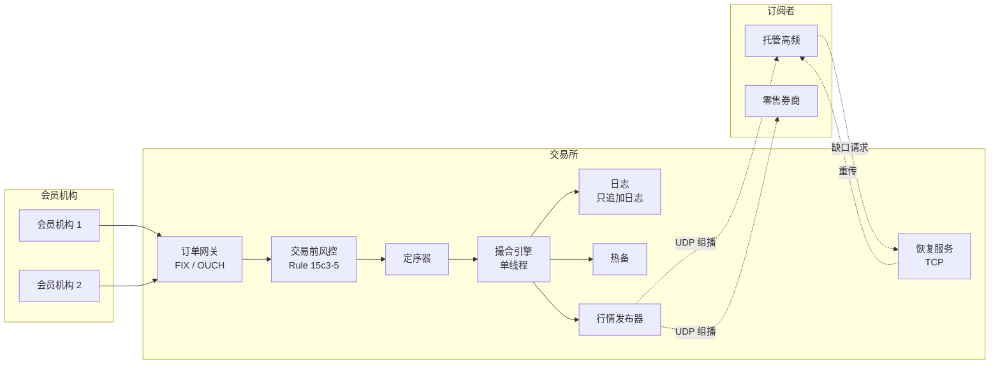
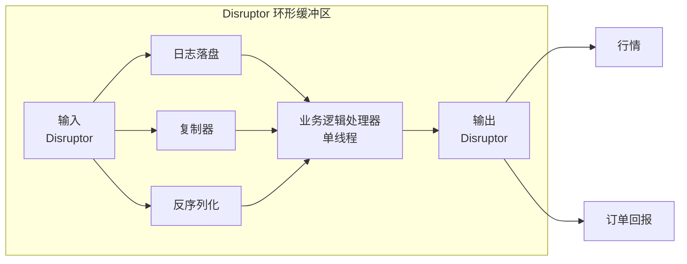
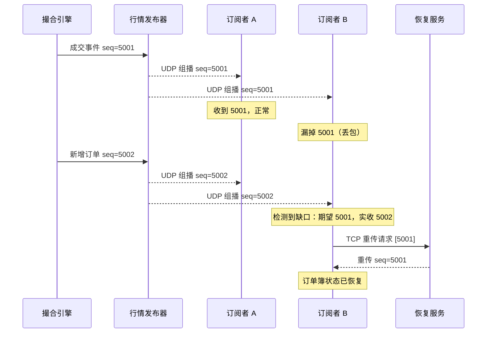
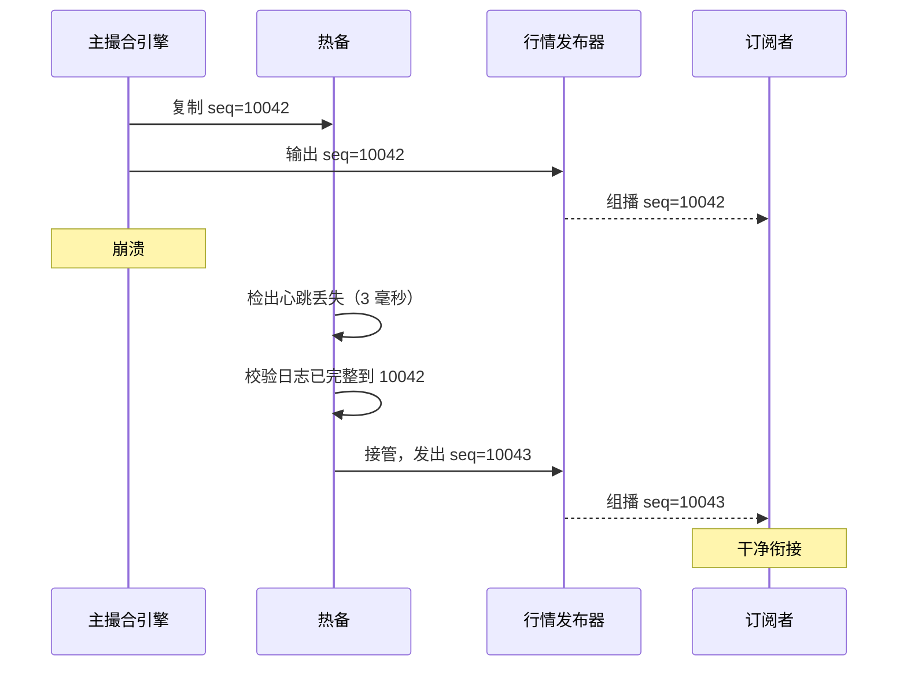
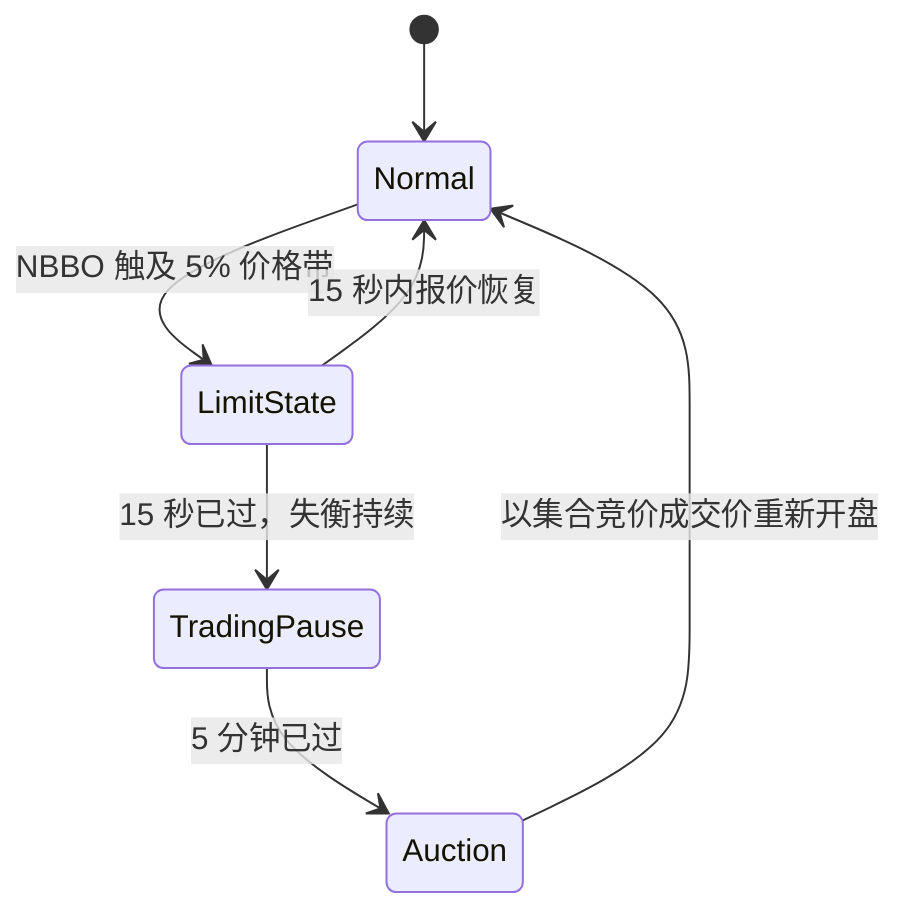

# 设计证券交易所（撮合引擎）

> **TL;DR.** 证券交易所的撮合引擎是一个罕见的分布式系统，它的正确答案是“不要分布式”。NASDAQ 的 INET 在每秒 100 万条消息以上、40 微秒以内完成撮合 [^1]。LMAX 在单线程上跑到每秒 600 万笔订单（在 2010 年代的硬件上实测）[^2]。这套架构本质上就是一条严格串行的事件日志：定序器（sequencer）给每笔订单盖上序号，单线程引擎按价格-时间优先在订单簿上撮合，输出再通过 UDP 组播扇出给数千个订阅者。最关键的权衡是确定性优先于并行——单个标的的撮合无法横向扩展，但任何故障都能一模一样地重放。

## 学习目标

学完本模块后，你将能够：

- [ ] 设计一个按价格-时间优先的 FIFO 订单簿，并说清它的确定性来自哪里
- [ ] 设计基于 UDP 组播的行情分发，包含缺口检测与恢复
- [ ] 论证撮合引擎的热备复制与亚秒级故障切换
- [ ] 解释为什么在这个负载下，单线程设计与内核旁路能胜过并行架构
- [ ] 指出 SEC Rule 15c3-5 强制要求的交易前风控，以及它们对架构的影响
- [ ] 为每秒处理 100 万条以上消息的生产级交易所做容量估算

## 直觉理解

证券交易所看起来就是个平庸的 CRUD 应用。接一笔订单、存下来、把买卖双方撮合到一起。一个大学生周末就能做出来。

现在加上真正要命的约束：两笔订单相隔 800 纳秒到达。第一笔必须先于第二笔成交。永远如此，且必须是确定的。如果明天重放同一份输入流，你必须拿到逐比特相同的输出。没有锁、没有重试、没有“最终一致”。订单簿是唯一真相来源，它跑在一个线程上，因为这是在不付协调开销的前提下保证全序的唯一办法。

朴素的多线程方案立刻就崩了。两个线程读同一个价位，竞争随之而来：到底哪一笔先成交？你可以加把锁，但在每秒 600 万次操作的量级上，锁的成本比撮合本身还高。你可以用乐观并发，但重试会毁掉确定性。这个行业几十年前试过并行，然后放弃了。

洞察是：把难的部分（撮合）串行化，其余一切并行（网络 I/O、日志落盘、行情发布、风控检查）。撮合引擎收缩成一个纯函数：进一个事件，出一批事件，没有副作用、没有 I/O、没有阻塞调用。外面的一切都可以并发，因为引擎已经把事件的权威顺序确立下来了 [^2]。

这就是 LMAX Disruptor 模式，如今每一个主流股票与期货交易所的生产系统都在用它。

## 需求

### 澄清问题

- **Q: 支持哪些资产类别？**
  假设：美股（NMS 股票）。单一交易场所，不做合并行情（consolidated tape）。
- **Q: 用什么撮合算法？**
  假设：价格-时间优先（FIFO）。美股和期货的主流算法 [^3]。
- **Q: 延迟目标是多少？**
  假设：撮合引擎的端到端（wire-to-wire）p99 在 50 微秒以内。NASDAQ INET 能做到 40 微秒以下 [^1]。
- **Q: 多少个标的？**
  假设：8,000 个上市标的，每个标的一本独立订单簿。
- **Q: 故障切换有什么要求？**
  假设：亚秒级切换且零丢单。切换快但丢一笔单，比慢一点但一笔都不丢更糟 [^2]。
- **Q: 需要托管机房（co-location）吗？**
  假设：需要。所有参与者都用等长光纤交叉连接，参照 NYSE Mahwah 机房的模式 [^4]。
- **Q: 有哪些监管约束？**
  假设：SEC Rule 15c3-5（交易前风控）、LULD 价格带，以及 Reg NMS 的各项义务。

### 功能性需求

- 通过 TCP 上的 FIX/OUCH 协议接收限价单、市价单与撤单
- 按严格的价格-时间优先撮合订单，并发出成交确认
- 通过 UDP 组播（ITCH 协议）向所有订阅者发布实时订单簿更新与成交
- 支持开盘与收盘集合竞价机制
- 执行 LULD 价格带，价格带被击穿时暂停交易 [^5]
- 为漏收组播报文的订阅者提供基于 TCP 的缺口恢复

### 非功能性需求

- **吞吐量：** 持续每秒 100 万条以上消息；峰值每秒 110 万条（NASDAQ 纪录：每秒 1,134,640 条）[^1]
- **延迟：** 撮合引擎端到端 p99 < 50 微秒
- **确定性：** 重放输入日志必须产出逐比特相同的输出
- **可用性：** 交易时段内 99.999% 可用（每天 6.5 小时、每年 252 个交易日）[^1]
- **持久性：** 主节点故障零丢单；日志落盘之后才回执
- **公平性：** 等长交叉连接，任何参与者都不占几何上的延迟优势 [^4]

## 容量估算

| 指标 | 数值 | 推导依据 |
|--------|------:|------------|
| 峰值消息/秒 | 1,134,640 | NASDAQ INET 公开纪录 [^1] |
| 峰值成交/秒 | 193,350 | NASDAQ INET 公开纪录 [^1] |
| 每日消息量 | 1.68B | NASDAQ 纪录日：1,684,103,265 [^1] |
| 每日订单量（典型） | 10M | 中等规模交易场所的基线 |
| 撤单∶成交比 | 约 20:1 | 美股典型值（估计区间 10:1 到 30:1）[^6] |
| 行情订阅者 | 1,000+ | 托管的高频机构 + 零售券商 |
| 订单簿深度（每标的） | 约 10,000 档 | 报价单位较大的品种；前 5 档占据主要流动性 |
| 每笔订单内存 | 约 128 B | price(8) + qty(8) + id(8) + timestamps(16) + pointers(16) + metadata |
| 内存中的活跃订单 | 约 2M | 8,000 标的 × 平均 250 笔挂单 |
| 热内存总量 | 约 256 MB | 能装进现代服务器的 L3 缓存 |

关键洞察：全部活跃状态都能装进 CPU 缓存。这就是单线程撮合可行的原因。在微秒级延迟下，瓶颈是缓存未命中，不是 CPU 周期。

## API 与数据模型

### API 设计

报单入口用 OUCH（NASDAQ 基于 SoupBinTCP 的二进制协议），或者为兼容性用 FIX [^7][^8]：

```text
-- OUCH 下单（二进制，定长 49 字节）
OrderToken:       14 bytes (客户端分配)
Side:              1 byte  (B=买, S=卖)
Shares:            4 bytes (数量)
Symbol:            8 bytes (右侧补位)
Price:             4 bytes (定点数，4 位小数)
TimeInForce:       4 bytes (DAY、IOC、GTC)
Display:           1 byte  (可见、隐藏、可归属)

-- OUCH 接单回执（交易所响应，66 字节）
OrderToken:       14 bytes
OrderRefNum:       8 bytes (交易所分配的序号)
Side, Shares, Symbol, Price, TimeInForce, Timestamp

-- OUCH 撤单
OrderToken:       14 bytes
Shares:            4 bytes (部分撤单数量)
```

行情走 ITCH，承载在 MoldUDP64（带序号的 UDP 组播）之上 [^9]：

```text
-- ITCH 新增订单（28 字节）
MessageType:       1 byte  ('A')
SequenceNumber:    8 bytes (单调递增，可检测缺口)
OrderRefNum:       8 bytes
Side:              1 byte
Shares:            4 bytes
Symbol:            8 bytes
Price:             4 bytes
```

### 数据模型

```text
-- 订单（内存中的侵入式链表节点）
struct Order {
    order_id:       u64,        -- 交易所分配的序号
    client_token:   [u8; 14],   -- 客户端引用
    symbol_id:      u16,        -- 标的表索引
    side:           Side,       -- Bid | Ask
    price:          i64,        -- 定点数（price * 10000）
    remaining_qty:  u32,
    timestamp_ns:   u64,        -- 定序器时间戳
    prev:           *Order,     -- 侵入式链表指针
    next:           *Order,
}

-- 价位（订单簿里每个不同价格一个）
struct PriceLevel {
    price:      i64,
    head:       *Order,     -- FIFO 队首（最早）
    tail:       *Order,     -- FIFO 队尾（最新）
    total_qty:  u64,        -- 可见数量合计
}

-- 订单簿（每个标的一本）
struct OrderBook {
    bids:       SortedMap<i64, PriceLevel>,  -- 按价格降序
    asks:       SortedMap<i64, PriceLevel>,  -- 按价格升序
    order_map:  HashMap<u64, *Order>,        -- O(1) 撤单查找
}
```

`order_map` 是关键：美股里撤单量大约是成交量的 20 倍 [^6]，所以靠哈希查找做到 O(1) 撤单，它的开销支配着整体性能。

## 高层架构



*订单流经风控与定序器，进入单线程的撮合引擎；输出再扇出到日志、热备和组播行情发布器。*

**写入路径（报单）。** 会员机构通过 TCP（OUCH/FIX）发来报单。网关解码并校验报文格式。交易前风控按 Rule 15c3-5 检查限额（胖手指数量、当日授信、重复报单检测）[^10]。定序器盖上单调递增的序号，确立权威全序。撮合引擎消费定序后的事件，更新订单簿，并产出输出事件（成交、入簿或撤单确认）。

**输出路径（行情）。** 行情发布器把输出事件序列化成 ITCH 报文，通过 UDP 同时组播给所有订阅者。每条报文都带序号。订阅者检测缺口，向恢复服务请求 TCP 重传 [^9]。

**故障切换路径。** 热备接收同一份定序后的输入流（通过 IP 组播或专用复制链路）。它逐条同样地处理每个事件，但丢弃自己的输出。主节点故障时，它在微秒级成为主 [^2]。

## 深入探讨

### 单线程撮合与 LMAX Disruptor

撮合引擎跑在一个线程上。不是因为工程师偷懒，而是因为这个做法对这个负载可证明是最优的。

**为什么单线程赢。** 每秒 600 万个事件，每个事件只分到约 167 纳秒的 CPU 时间 [^2]。一次到 DRAM 的缓存未命中要花约 100 纳秒。一对 mutex 加解锁在无争用时约 25 纳秒，有争用时约 1,000 纳秒。任何线程间的协调机制都会吃光事件本身的整个时间预算。

LMAX Disruptor 解决的是外围的并发问题。它是一个无锁环形缓冲区（长度取 2 的幂，这样算下标只需一次按位与，而不是一次取模除法）[^11]。多个消费者（日志落盘、复制、反序列化）并行地从环上读，不加锁。等所有消费者都处理完，业务逻辑处理器（也就是撮合线程）才消费这个事件。

```java
// 环形缓冲区下标：单周期的按位与替代取模
this.indexMask = bufferSize - 1;  // bufferSize 必须是 2 的幂
E element = entries[BUFFER_PAD + (int)(sequence & indexMask)];
```

缓存行填充防止生产者与消费者的序号计数器之间发生伪共享。热字段两侧各 64 字节的填充，保证每个计数器独占自己的缓存行 [^11]：



*Disruptor 把 I/O 消费者并行化，围绕一个单线程的撮合核心；业务逻辑处理器从不在 I/O 上阻塞。*

**确定性重放。** 因为撮合线程是它输入流的纯函数，复现 bug 变得轻而易举：把日志拷到开发机，重放，bug 就会一模一样地重现。LMAX 从每日快照加日志重放恢复，全程不到 60 秒 [^2]。

**硬天花板。** 一个核就是纵向上限。单个标的的撮合无法横向扩展。但你可以按标的做分片：每个标的的订单簿跑在自己的引擎实例上，由定序器按 symbol ID 路由。

### 组播行情与缺口恢复

撮合引擎把每一次订单簿更新和成交都作为二进制 ITCH 报文发到 UDP 组播组。这是唯一能扩展的做法：一个报文抵达全部 1,000+ 订阅者，引擎不必维护任何按订阅者的状态 [^9]。

**协议栈。** NASDAQ 用 MoldUDP64 作为 UDP 组播之上的定序层。每条报文都带单调递增的 64 位序号。订阅者跟踪期望的下一个序号；一旦出现缺口，就通过 TCP 向恢复服务请求重传 [^9]。位于互不相交网络路径上的冗余 A/B 双路行情，能在不发显式重传请求的情况下补掉大部分缺口。

**报文格式。** ITCH 是定长二进制：没有长度前缀、没有 varint、不需要解析。订阅者把指针强转成结构体就完成解码。在每秒 100 万条以上的量级上，解析成本是要算的 [^8]。



*订阅者靠单调序号发现缺口，并通过 TCP 请求重传；引擎从不为了等某个慢订阅者而阻塞。*

**为什么不用 TCP？** TCP 提供可靠性，但要求服务端维护按订阅者的状态。1,000 个订阅者、每秒 100 万条消息，引擎就得维护 1,000 条 TCP 连接，每条都有自己的发送缓冲、拥塞窗口和重传定时器。一个慢订阅者就会把背压顶回引擎。UDP 组播让引擎与订阅者的速度彻底解耦。

### 热备故障切换与确定性恢复

切换时零丢单是不可谈判的要求。LMAX 跑三个副本：两个在主数据中心，一个在灾备。全部通过 IP 组播接收定序后的输入流，全部同样地处理每一个事件。只有主的输出会被发布；备的输出被丢弃 [^2]。

**切换时序：**

1. 备节点发现主节点心跳丢失（通常 1 毫秒一次心跳，连丢 3 次即 3 毫秒检出）
2. 备节点确认自己已处理到已知最后一个序号的全部日志条目
3. 备节点把自己提升为主，开始发布输出
4. 行情发布器切换数据源；序号继续单调递增
5. 订阅者看到的要么是干净衔接，要么是一个小缺口（由标准缺口恢复处理）



*热备补放缺失的日志条目，带着延续的序号接管输出，订阅者通过标准的补洞机制恢复。*

**为什么不用 Raft/Paxos？** [共识协议](../part-3-distributed-systems-theory/00-consensus-protocols.md) 介绍过基于法定人数的复制。交易所拒绝在撮合引擎上用它，因为共识给每个事件加上至少一次往返（最少几十微秒）。替代做法是定序器单方面确立全序，副本确定性地跟随。代价是：切换时需要一个外部仲裁者（或人）来宣告主节点死亡，因为没有法定人数投票。这可以接受，因为故障切换一年一次，而不是每秒一次。

## 真实案例

### NASDAQ INET：规模化下的 40 微秒以内撮合

NASDAQ 的 INET 平台（2005 年收购而来）是 NASDAQ、数个北欧交易所和全球多个第三方交易场所背后的撮合引擎。

**规模数字。** INET 在 40 微秒以内完成撮合，每秒处理 100 万条以上消息 [^1]。它公开的纪录日处理了 1,684,103,265 条消息，峰值速率每秒 1,134,640 条消息、每秒 193,350 笔成交 [^1]。平台宣称 99.999% 可用。

**架构。** INET 用 C/C++ 写成，有两套截然不同的协议栈：报单用 OUCH over SoupBinTCP（可靠、有序的 TCP），行情用 ITCH over MoldUDP64（不可靠组播加缺口恢复）[^7][^8]。这个分离是刻意的：客户的订单不能丢（TCP），但也不能为了一个慢订阅者把整个市场停住（UDP）。

**托管机房。** NASDAQ 在 New Jersey 的 Carteret 运营。会员机构租用机柜，用等长光纤交叉连接到撮合引擎（沿用 NYSE 在 Mahwah 数据中心使用的同一套归一化距离模型 [^4]）。从托管机柜到引擎的往返据估计在亚微秒级。采用内核旁路（DPDK、Solarflare OpenOnload）的机构通过消除中断与上下文切换，把报文从网线到用户态的延迟压到亚微秒级。

**IEX 的对立面。** IEX 刻意拒绝速度竞赛。它那盘 38 英里（61 公里）的光纤线圈给进出的每条报文都加 350 微秒延迟 [^12][^13]。它不提供托管。这是一个架构宣言：“把延迟拉平”和“把延迟压到最低”一样，都是合法的设计维度。IEX 的 Discretionary Peg 订单类型用一个专有信号探测 NBBO 即将变化的时刻，并在那些瞬间拒绝成交，从而消除延迟套利的机会 [^13]。

## 权衡

| 方案 | 优点 | 缺点 | 适用场景 |
|----------|------|------|-------------|
| 单线程撮合 | 确定、对缓存友好、重放简单 [^2] | 只能纵向扩展；每个标的占一个核 | 所有生产级股票/期货交易所 |
| 多线程撮合 | 理论上的并行性 | 交错顺序不确定；锁开销；输入日志重放无法逐比特复现 | 仅用于仿真、回测或学术研究 |
| 组播行情（ITCH） | 低延迟、天然扇出、无按订阅者状态 [^9] | 不可靠；需要缺口恢复 | 受监管市场、专业订阅者 |
| WebSocket 行情 | 简单、可靠、能穿过防火墙 | 延迟更高、需要按订阅者状态 | 零售 API（Coinbase、Robinhood）[^14] |
| 热备 + 日志复制 | 微秒级切换、零丢单 [^2] | 三份实时副本、状态校验复杂 | 生产级交易所 |
| 温备 + 快照 | 更简单、更便宜 | 切换要几秒，存在短暂的数据丢失窗口 | 风险不高的或早期阶段的交易场所 |
| 内核旁路（DPDK/OpenOnload） | 亚微秒 I/O [^4] | 需要专用网卡、运维复杂、人才稀缺 | 有竞争压力的高频交易场所 |
| 减速带（IEX 模式） | 拉平延迟、消除某些高频策略 [^12] | 市场份额较低、路由复杂 | 把公平置于速度之上的场所 |

元决策：**速度 vs 公平**。NASDAQ 和 NYSE 优化最小延迟，靠速度吸引流动性。IEX 优化平等接入，吸引那些担心被逆向选择的机构订单流。两者都成立；架构跟着商业模式走。

## 扩展与故障模式

- **10 倍负载（每秒 1000 万条消息）：** 按标的组做分片。每个撮合引擎实例负责一部分标的。定序器变成按标的组的定序器。行情发布器跨组聚合。NASDAQ 已经这么做了：不同的标的区间跑在不同的引擎实例上。
- **100 倍负载（每秒 1 亿条消息）：** 对最热的标的转向基于 FPGA 的撮合。FPGA 彻底消除 JVM/OS 抖动，把撮合压到个位数微秒。这时日志成为瓶颈；用带电池备份的 NVMe 加直接 I/O。
- **1000 倍负载（加密货币峰值）：** 据称 Binance 在峰值处理每秒 100 万笔以上订单 [^15]。在这个量级上，架构在根本上仍然一样（每个标的一个单线程），只是独立引擎实例的数量涨到几百个。

**故障模式：**

- **主引擎在撮合中途崩溃：** 热备已经处理了崩溃点之前的全部定序输入。它提升为主并继续。那笔撮合到一半的订单从日志重放；因为撮合是确定的，备会产出完全相同的部分成交。订阅者看到短暂缺口，通过 TCP 重传恢复。
- **引擎与行情发布器之间的网络分区：** 引擎继续撮合（日志记下了一切），但订阅者的行情停住了。检测：心跳超时。恢复：发布器重连，从日志重放，订阅者补洞。
- **Knight Capital 式事故（算法失控）：** 某会员机构的订单路由器以最大速率狂发激进订单，持续 45 分钟 [^16]。检测：交易前风控（Rule 15c3-5）本应抓住异常的下单速率与规模 [^10]。紧急停止开关：交易所可以在数秒内禁用某个会员的端口。Knight 缺的正是这个，损失超过 4.6 亿美元 [^17]。

## 常见陷阱

> [!WARNING]
> **生产环境里跑着可达的死代码。** Knight Capital 那 4.6 亿美元损失，来自一个被挪作他用的功能开关，它在八台服务器中的一台上激活了废弃代码。删掉死代码。不要在没有重新认证的情况下复用开关。每一次生产部署都要有同行评审 [^18]。

> [!WARNING]
> **在撮合线程上做同步 I/O。** 任何阻塞调用（写盘、网络检查、打日志）都会卡住整个交易所。撮合线程必须在有界时间内、只靠内存完成每个事件。外部检查要建模成异步的输出事件 [^2]。

> [!WARNING]
> **组播缺口失忆。** 订阅者漏掉一个序号，没去请求重传，于是本地订单簿越漂越远。实现严格的单调校验；用收盘参考行情交叉对账；在互不相交的路径上使用 A/B 双路冗余行情 [^9]。

> [!WARNING]
> **撮合路径上的 GC 停顿。** 每秒 100 万事件时，一次 10 毫秒的 GC 停顿意味着 10,000 个事件排队。LMAX 用自定义集合（`LongToObjectHashMap`）避免老年代分配。生产级 C++ 引擎则彻底消除这个问题 [^2]。

> [!WARNING]
> **跨主机时钟偏移。** NTP 的漂移在毫秒级；监管报送（MiFID II、CAT）要求微秒级精度。部署 PTP（IEEE 1588）并配硬件时间戳网卡；把时钟锁定到 GNSS 主时钟 [^19]。

> [!WARNING]
> **忽略结算保证金风险。** Robinhood 2021 年 1 月的危机：GameStop 逼空期间 DTCC 要求约 30 亿美元保证金，而它手上只有约 7 亿美元 [^20]。架构上要有日内保证金监控，并保留应急授信额度。

## 追问

**1. 某个标的的成交量是平均水平的 100 倍（比如财报日的 AAPL），怎么处理？**

给它单独分配一个引擎实例。按预期深度预热订单簿。调大这个实例的环形缓冲区。该标的的行情走独立的组播组，避免对其他标的造成队头阻塞。

**2. 怎么在明池交易所旁边做一个暗池？**

暗池是另一台撮合引擎，没有交易前透明度（不公开订单簿）。在暗池里没撮上的订单“漏”到明池。定序器按订单类型（暗单 vs. 显示单）路由。暗池以 NBBO 的中点价成交，所以它需要一份明池最优买卖价的快速行情。

**3. 怎么加开盘集合竞价机制？**

盘前时段（美东时间 9:00-9:30）订单持续累积但不撮合。9:30 时，引擎计算能最大化可成交量的那个单一价格（“指示性撮合价”），把所有可交叉的订单在该价格上一次性成交，然后切换到连续撮合。

**4. 加密货币交易所和受监管的股票交易所，差异在哪？**

去掉 LULD 价格带和熔断机制（加密货币 7×24 交易，不暂停）。把 FIX/OUCH 换成 WebSocket/REST API，方便零售用户接入 [^14]。结算是链上完成（T+0），而不是通过 DTCC（T+1）[^20]。再加上钱包管理和冷热密钥托管。撮合引擎的架构本身完全一样。

**5. 怎么用软件而不是光纤实现 IEX 的减速带？**

软件延迟是不确定的（OS 调度抖动、中断合并）。IEX 选物理光纤，正是因为它的延迟可证明恒定且可审计 [^12]。软件实现需要内核旁路加一个按目标延迟校准的忙等待循环，还要持续监控以证明延迟落在容差范围内。

**6. 怎么防止闪电崩盘？**

LULD 价格带（一级股票 5%，二级 10%）阻止价格带之外的成交 [^5]。如果 NBBO 触及价格带并持续 15 秒，交易暂停 5 分钟。全市场熔断机制（标普 500 下跌 7%/13%/20%）会让所有交易停摆 [^21]。2010 年的闪电崩盘——一笔 41 亿美元的 E-Mini 卖单引发道指千点暴跌——正是这些控制措施的由来 [^21]。



*一级股票在 NBBO 触及 LULD 价格带时进入限价状态；若失衡在 15 秒内没有消除，就进入 5 分钟的交易暂停，之后再以集合竞价重新开盘。*

## 练习

### 练习 1：撮合中途的故障切换

主撮合引擎在 10:00:00.123456 崩溃，当时正在处理一笔市价买单，该单已部分成交（300 股中成交了 100 股，对手方是最优卖价）。热备必须接管。请设计交接：备如何知道自己该接管、如何保证自己拿到了崩溃点之前的全部订单、订阅者如何发现数据源切换、那笔部分成交的订单会怎样。

<details>
<summary>提示</summary>

想清楚崩溃点那一刻日志里有什么。定序器在引擎处理之前就已经给这笔市价买单盖了序号。引擎在崩溃前把部分成交写进日志了吗？答案决定了备是重放这次部分成交，还是把整笔订单重新执行一遍。

</details>

<details>
<summary>参考答案</summary>

**检测：** 备监控主的心跳（1 毫秒间隔）。连丢 3 次心跳（3 毫秒）后，宣告主节点死亡。

**状态校验：** 备一直在处理同一份定序输入流。它把自己最后处理的序号和日志中最后持久化的序号做比对。有两种情形：

1. **主在把部分成交输出写进日志之后崩溃：** 备已经处理过这笔输入订单，并产出了相同的部分成交（确定性）。它提升为主，把剩余的 200 股作为挂单发布出去，然后继续运行。

2. **主在把输出写进日志之前崩溃：** 备手上有输入事件（那笔市价买单），但还没见过输出。它从头重新执行这次撮合。因为订单簿状态完全相同（同一份输入流），它产出同样的 100 股部分成交和同样的 200 股剩余。

**对订阅者的影响：** 行情发布器切到备的输出流。序号继续单调递增。订阅者看到的要么是干净衔接，要么是短暂缺口（3-5 毫秒的静默），然后接上下一个序号。任何漏掉的报文由标准缺口恢复处理。

**关键不变量：** 那笔部分成交的订单永远不会被重复成交，因为在最后一个被完整处理的输入事件处，备的订单簿状态与主完全相同。确定性保证了这一点。

</details>

## 要点回顾

- **撮合这件事，单线程胜过线程池。** 在你必须一模一样地重放、且全部状态能装进 L3 缓存时，确定性比并行更值钱 [^2]。
- **定序器是唯一真相来源。** 全序靠盖序号确立，不靠共识投票。这是用单方面的速度换掉法定人数的延迟。
- **组播是唯一说得通的行情架构。** 一个报文抵达所有订阅者；引擎从不为一个慢消费者阻塞 [^9]。
- **内核旁路是最后那 10 微秒。** 建一个交易所不需要 DPDK，但要和 NASDAQ 竞争就需要 [^4]。
- **切换的正确性压倒切换的速度。** 快但丢一笔单的切换，在性质上比慢一点但一笔都不丢的更糟 [^2]。
- **交易前风控是架构的一部分，不是可选项。** Knight Capital 45 分钟亏掉 4.6 亿美元这件事证明，紧急停止开关和部署纪律是承重的基础设施 [^16][^18]。

## 延伸阅读

- [The LMAX Architecture](https://martinfowler.com/articles/lmax.html)。Martin Fowler 关于单线程、事件溯源式撮合的决定性文章，附实测吞吐数据；任何交易所设计的起点。
- [LMAX Disruptor technical paper](https://lmax-exchange.github.io/disruptor/disruptor.html)。环形缓冲区设计，含缓存行填充分析与伪共享防护；解释了为什么长度取 2 的幂很重要。
- [NASDAQ INET performance page](https://www.nasdaqtrader.com/snippets/inet2.html)。OUCH 与 ITCH 的真实公开吞吐与延迟纪录；每一个交易所设计都要对标的基准。
- [SEC/CFTC Flash Crash report (2010)](https://www.sec.gov/news/studies/2010/marketevents-report.pdf)。关于 2010 年崩盘的联合报告，LULD 与新版熔断机制由此而来；市场微观结构的必读材料。
- [SEC cease-and-desist against Knight Capital](https://www.sec.gov/news/press-release/2013-222)。部署失败案例研究，附带监管认定；交易所工程里最值得拿来教学的事故。
- [Databento ITCH protocol reference](https://databento.com/microstructure/itch)。对 NASDAQ 及衍生品所用二进制行情协议的简明、准确的解释。
- [IEX Exchange overview](https://www.iexexchange.io/)。减速带设计及其理由，由交易所自己讲述；对纯粹速度优化的架构反驳。

## 记忆卡片

<details>
<summary><strong>Q: 生产级交易所为什么用单线程撮合而不是多线程？</strong></summary>

A：确定性。单线程无需加锁就能保证全序。重放输入日志会产出逐比特相同的输出。多线程撮合会引入不确定的交错顺序，让重放与 bug 复现成为不可能。另外，整本订单簿能装进 L3 缓存，并行除了增加协调成本，换不来多少吞吐收益。[^2]

</details>

<details>
<summary><strong>Q: LMAX Disruptor 是什么，它解决了什么问题？</strong></summary>

A：一个无锁环形缓冲区，让多个消费者（日志落盘、复制、反序列化）并行地读事件而不加锁。它解决的是“围绕单线程撮合核心并行化 I/O”这个问题。长度取 2 的幂使得下标可以用按位与算出来；缓存行填充防止伪共享。[^11]

</details>

<details>
<summary><strong>Q: NASDAQ 的行情为什么用 UDP 组播而不是 TCP？</strong></summary>

A：TCP 需要按订阅者维护状态，还会让慢订阅者把背压顶回引擎。UDP 组播只发一个报文，同时抵达全部 1,000+ 订阅者，不保存任何按订阅者的状态。可靠性由单调序号加上独立的 TCP 恢复服务来兜。[^9]

</details>

<details>
<summary><strong>Q: 价格-时间优先（FIFO）撮合是什么？</strong></summary>

A：美股的主流撮合算法。可成交的来单先与价格最优的挂单成交。同一价位内，最早下单的先成交（FIFO 队列）。这奖励早挂单，带来更窄的价差和可见的排队队列。[^3]

</details>

<details>
<summary><strong>Q: Knight Capital 2012 年那 4.6 亿美元损失是怎么造成的？</strong></summary>

A：一次人工部署漏掉了八台服务器中的一台。那台服务器上还留着 2003 年的废弃“Power Peg”代码，被一个挪作他用的功能开关激活了。开盘后，旧代码向市场狂喷激进订单，持续 45 分钟才被识别并终止。154 只股票、400 万笔成交。[^16][^18]

</details>

<details>
<summary><strong>Q: LULD 是什么，为什么要有它？</strong></summary>

A：Limit Up-Limit Down（涨跌停价格带）阻止成交价超出相对 5 分钟参考价的一个百分比区间（标普 500 成分股 5%，其他 NMS 股票 10%）。如果 NBBO 触及价格带并持续 15 秒，交易暂停 5 分钟。它诞生于 2010 年闪电崩盘之后，用来防止股票以荒谬的价格成交。[^5][^21]

</details>

<details>
<summary><strong>Q: IEX 那盘 38 英里的光纤线圈，架构上是怎么起作用的？</strong></summary>

A：进出的每条报文都要走一遭 38 英里（61 公里）的单模光纤线圈，被强行加上 350 微秒延迟。这让所有参与者无论物理距离远近都拿到相同的延迟。它不提供托管。这个延迟是物理的、可证明恒定的，不像软件延迟那样受 OS 抖动影响。[^12][^13]

</details>

<details>
<summary><strong>Q: 交易所为什么拒绝在撮合引擎上用 Raft/Paxos？</strong></summary>

A：共识协议给每个事件至少加一次往返（几十微秒）。在 40 微秒以内的撮合延迟上，这会让关键路径翻倍还不止。替代做法是定序器单方面确立全序，副本确定性地跟随。代价是：故障切换需要一个外部仲裁者，而不是自动的主节点选举。

</details>

<details>
<summary><strong>Q: 美股的撤单∶成交比是多少，为什么它在架构上重要？</strong></summary>

A：大约 20:1。撤单量远远超过成交量，所以订单簿必须支持 O(1) 撤单——靠一张从订单 ID 到链表节点的哈希表。于是分配器纪律和链表指针管理，比撮合循环的吞吐更重要。[^6]

</details>

<details>
<summary><strong>Q: 内核旁路是什么，什么时候必须用？</strong></summary>

A：DPDK、Solarflare OpenOnload 这类技术跳过 Linux 网络栈，用用户态的轮询模式驱动消除中断与上下文切换。报文到用户态的延迟从微秒级降到几百纳秒。对托管在交易所的竞争性高频机构是必需的；建一个能用的交易所并不需要。[^4]

</details>

## 参考文献

[^1]: NASDAQ Trader, "INET Performance and Records." https://www.nasdaqtrader.com/snippets/inet2.html
[^2]: Martin Fowler, "The LMAX Architecture", 12 July 2011. https://martinfowler.com/articles/lmax.html
[^3]: Coinbase Developer Documentation, "Matching Engine (price-time priority)." https://docs.cdp.coinbase.com/exchange/concepts/matching-engine
[^4]: NYSE Chicago / NYSE National Federal Register Filing, "Connectivity Fee Schedule - Mahwah data center" (demonstrates normalized cross-connect distances as industry standard). https://www.federalregister.gov/documents/full_text/html/2023/08/01/2023-16244.html
[^5]: LULD Plan, "Overview and Price Band calculation." https://luldplan.com/
[^6]: WK Selph, "How to Build a Fast Limit Order Book." https://gist.github.com/halfelf/db1ae032dc34278968f8bf31ee999a25
[^7]: Databento, "OUCH protocol reference." https://databento.com/microstructure/ouch
[^8]: OnixS, "Understanding Origins, Industry Context, Usage, and Updates to the ITCH Protocol." https://www.onixs.biz/insights/itch-protocol-usage
[^9]: Databento, "ITCH protocol reference." https://databento.com/microstructure/itch
[^10]: SEC, "Risk Management Controls for Brokers or Dealers with Market Access" (Rule 15c3-5). https://www.sec.gov/rules-regulations/2011/06/risk-management-controls-brokers-or-dealers-market-access
[^11]: LMAX Disruptor technical documentation. https://lmax-exchange.github.io/disruptor/disruptor.html
[^12]: IEX Trading, "Signal: the 350 microsecond speed bump." https://iextrading.com/trading/signal/
[^13]: Wikipedia, "IEX" (Investors Exchange), accessed 2026. https://en.wikipedia.org/wiki/IEX
[^14]: Coinbase Exchange docs, "WebSocket Feed Overview." https://docs.cdp.coinbase.com/exchange/websocket-feed/overview
[^15]: Tech Interview Dot Org, "Financial Exchange and Matching Engine." https://www.techinterview.org/system-design-financial-exchange/
[^16]: Kosli (John Willis), "Knight Capital - A story about DevOps Automated Governance." https://www.kosli.com/blog/knight-capital-a-story-about-devops-automated-governance/
[^17]: SEC Press Release 2013-222, "SEC Charges Knight Capital With Violations of Market Access Rule", 16 October 2013 (documenting "a loss of more than $460 million"). https://www.sec.gov/news/press-release/2013-222
[^18]: SEC Administrative Proceeding, Release No. 34-70694, "In the Matter of Knight Capital Americas LLC", 16 October 2013. https://www.sec.gov/litigation/admin/2013/34-70694.pdf
[^19]: IEEE 1588-2019, "Precision Time Protocol (PTP) standard." https://standards.ieee.org/ieee/1588/6825/
[^20]: Quartz (via Wayback Machine), "GameStop trading nearly destroyed Robinhood" (DTCC collateral call), 2 July 2022. https://web.archive.org/web/20241204055728/https://qz.com/2184431/robinhood-nearly-defaulted-during-the-gamestop-short-squeeze
[^21]: Reuters, "Single US trade helped spark May's flash crash", 1 October 2010. https://www.reuters.com/article/idUKN0114164220101001/
