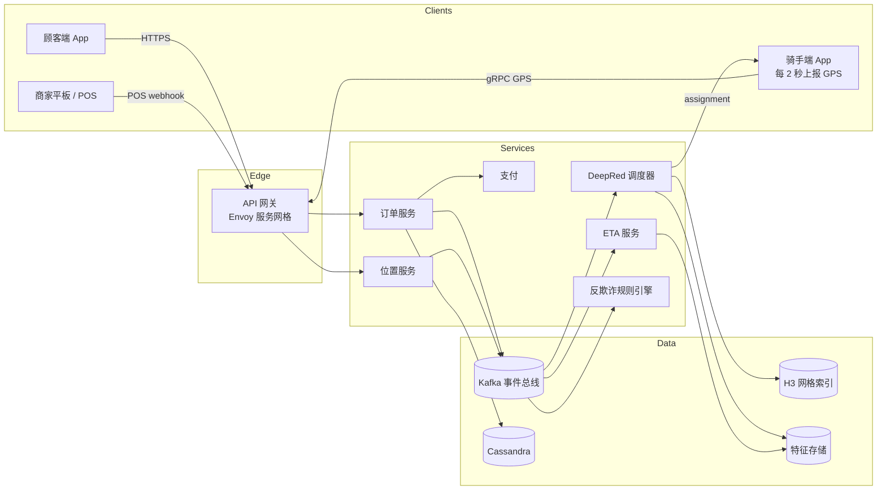
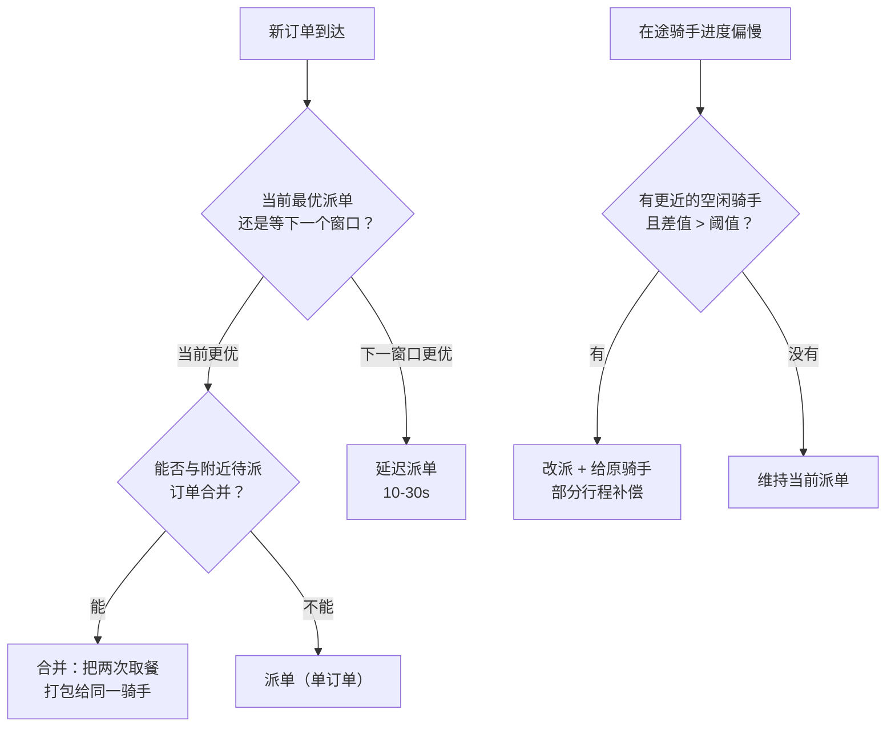
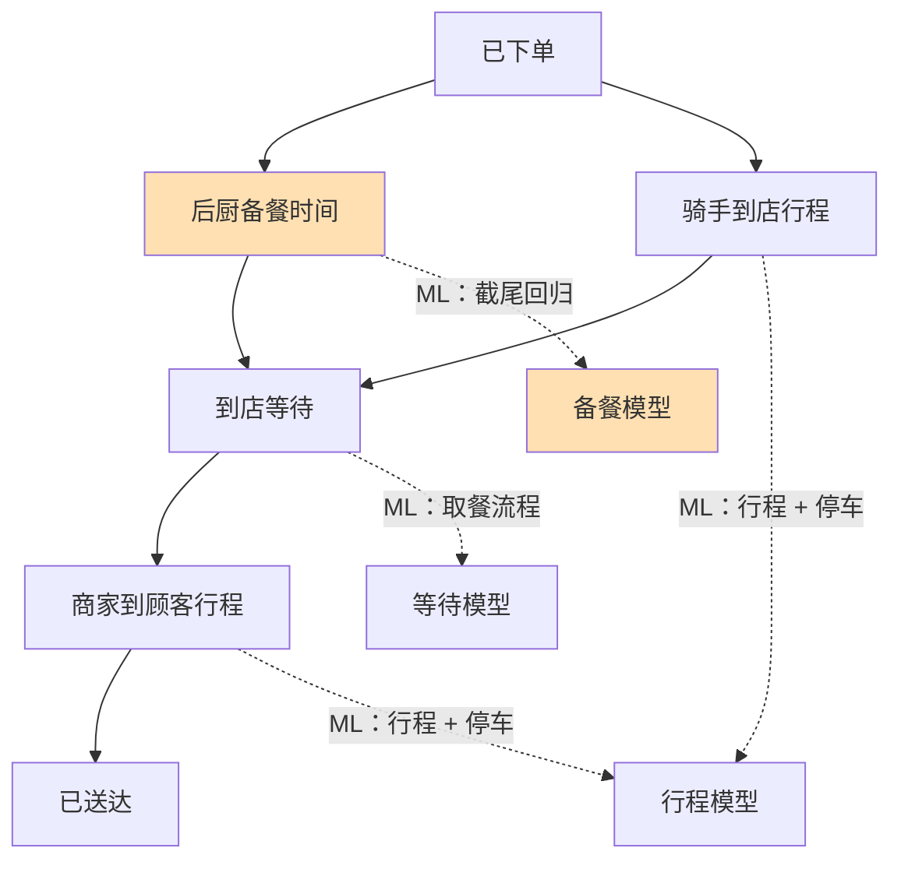
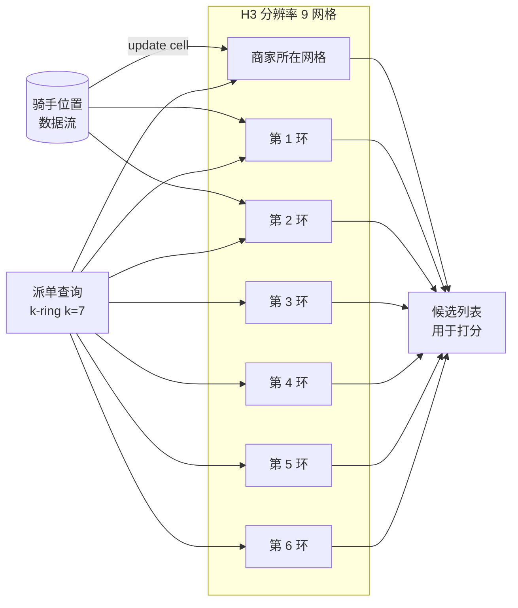

# 设计一个外卖配送服务（DoorDash / Swiggy）

> **TL;DR.** 外卖就是网约车多了一方，外加一个新鲜度时钟。DoorDash 每年处理 20 亿单以上 [^1]，跑在 1,000+ 个微服务上，峰值每秒 8,000 万+ 请求 [^2]。和网约车最关键的差别：这是一个三边市场（顾客、商家、骑手），调度算法必须合并订单、预测后厨备餐时间，并在三个互相独立的移动 App 之间协调一套状态机。核心权衡是带缓冲的批量调度（多出 10 到 30 秒的派单延迟）对贪心 FCFS，在高密度市场已有记录的效率提升是 15% 到 30% [^3]。

## 学习目标

- [ ] 设计一个调度算法：先缓冲订单，再在带合并约束的条件下求解二分图匹配问题
- [ ] 把配送 ETA 拆成四个独立建模的分量，并解释为什么后厨备餐这一项最难
- [ ] 论证候选召回和合并就近性为什么选 H3 六边形索引的分辨率 9
- [ ] 协调一个三边市场的状态机，让每个事件都扇出到三方
- [ ] 算清改派这笔账：什么时候该把订单从慢骑手手里拿走，以及其中的法律含义
- [ ] 为年订单 20 亿+、峰值 RPS 8,000 万+ 的平台做容量估算

## 直觉理解

一家只有一条电话线、一个配送员的披萨店，怎么都好办。顾客打电话，厨师开火，配送员等着，然后送出去。现在把规模放大到晚餐高峰：5 公里半径内有 50 家餐厅、20 个骑手、200 个并发订单。

最朴素的做法是订单一到，就把它派给最近的空闲骑手。这就是贪心 FCFS。单量低的时候它能跑。一到晚餐高峰就崩：骑手 A 被派去城另一头的餐厅 X，而骑手 B 刚在离餐厅 X 只有 100 米的地方完成一单，30 秒后才有空。同一时刻，餐厅 Y 有两单同时出餐，系统却派了两个不同的骑手过去，而不是把两次取餐合到一个人身上。

真正解开这个设计的洞察是：**把订单在缓冲区里压 10 到 30 秒，然后对所有待派订单和可用骑手同时求解一次全局分配。** 这不是网约车问题加挂一个餐厅。餐食有新鲜度时钟。备餐时间由商家掌控，平台只能间接观测。而且每一次失败都有三个爆炸半径：顾客、商家、骑手。

[Design a Ride-Hailing Service (Uber / Lyft)](./12-ride-hailing.md) 讲了双边匹配的基本盘。本章补上第三边、备餐时间约束，以及让外卖在架构上独立成一类的合并维度。

## 需求

### 澄清问题

- **Q: 这个市场有几方？**
  假设：三方。顾客下单，商家备餐，骑手（Dasher）配送。每一方都有专属的 App 或平板。
- **Q: 支持合并（叠单）配送吗？**
  假设：支持。一个骑手可以在同一趟里带上同一家或附近餐厅的两个订单。
- **Q: 派单延迟预算是多少？**
  假设：批量优化用 10 到 30 秒的缓冲窗口；求解器自身 p99 低于 2 秒。
- **Q: 要和餐厅的 POS 系统对接吗？**
  假设：要。约 75% 的市场订单走 POS 集成（Toast、Square、NCR）[^4]。
- **Q: 订单状态用什么一致性模型？**
  假设：状态迁移要强一致（Kafka 按 order_id 保序）；位置更新最终一致。
- **Q: 多地域部署？**
  假设：每个地域跑独立的调度进程，把状态规模控住。不做跨地域派单。

### 功能需求

- 顾客下单；结账前系统返回复合 ETA（备餐 + 行程）。
- 调度器在缓冲窗口内为订单指派骑手（可能和另一个订单合并）。
- 商家在平板或 POS 上收到订单，备餐完成时标记"出餐完成"。
- 骑手收到导航，取餐、送达，无接触交付时拍照确认。
- 三方都能看到实时的状态流转（已下单、备餐中、已取餐、配送中、已送达）。

### 非功能需求

- **负载：** 每年 20 亿+ 单 [^1]；晚餐高峰约每分钟 2 万单；全系统 8,000 万+ RPS [^2]。
- **延迟：** 复合 ETA 预测 p99 < 200 ms；每个窗口的派单求解 p99 < 2s。
- **可用性：** 订单链路 99.9%。宁可降级（退回贪心）也不拒绝服务。
- **一致性：** 单订单的事件顺序靠 Kafka 分区键保证；骑手 GPS 最终一致。
- **持久性：** 订单记录能扛住任意单个可用区故障。

## 容量估算

| 指标 | 数值 | 推导 |
|--------|------:|------------|
| 年订单量 | 20 亿+ | DoorDash 2024 年 [^1] |
| 日订单量（均值） | 约 550 万 | 20 亿 / 365 |
| 峰值每分钟订单 | 约 2 万 | 晚餐高峰为均值的 3.6 倍 |
| 骑手 GPS 更新/秒 | 约 25 万 | 50 万在线骑手 / 2 秒上报一次 |
| Kafka 吞吐量 | 8,000 万+ RPS | DoorDash 全系统峰值 [^2] |
| 订单记录大小 | 约 1.5 KB | 购物车条目 + 地址 + 元数据 |
| 每日存储 | 约 8.2 GB | 550 万 × 1.5 KB |
| 5 年存储 | 约 15 TB | 8.2 GB × 365 × 5 |
| ETA 预测/秒 | 约 10 万 | 每单一次 + 周期性刷新 |

**关键比例：**

- 写放大：每次订单状态迁移都扇出到 3 个 App + 5 个下游服务 = 8 倍事件放大。
- POS 集成覆盖率：约 75% 的订单能拿到"出餐完成"的真值时间戳 [^4]。
- 高密度市场的合并率：约 30% 的配送是叠单（一趟送两单）[^3]。

## API 与数据模型

### API 设计

```http
POST /v1/orders
  Body: { "customer_id": "uuid", "restaurant_id": "uuid", "items": [...], "address": {...} }
  Returns: 201 { "order_id": "uuid", "eta_minutes": 32, "status": "placed" }

GET /v1/orders/{order_id}
  Returns: 200 { "status": "en_route", "courier": {...}, "eta_updated": 28 }

POST /v1/orders/{order_id}/ready
  (Merchant POS webhook)
  Returns: 204

POST /v1/couriers/{id}/location
  Body: { "lat": 37.7749, "lng": -122.4194, "heading": 180, "speed_mps": 5.2 }
  Returns: 204

POST /v1/orders/{order_id}/delivered
  Body: { "photo_url": "s3://...", "signature": null }
  Idempotency-Key: <uuid>
  Returns: 200 { "status": "delivered", "tip_eligible": true }
```

订单历史的分页用游标式 `?before=<order_id>&limit=50`。限流：每个骑手每 2 秒 1 次位置更新（服务端去重）。

### 数据模型

```sql
-- 订单库（Cassandra，按 order_id 分区）
table orders (
  order_id        uuid PRIMARY KEY,
  customer_id     uuid,
  restaurant_id   uuid,
  courier_id      uuid,
  status          enum(placed, accepted, prepping, ready, picked_up, en_route, delivered, cancelled),
  items           json,
  pickup_cell     bigint,       -- H3 res 9
  dropoff_cell    bigint,       -- H3 res 9
  eta_seconds     int,
  created_at      timestamp,
  delivered_at    timestamp
)

-- 骑手位置（内存地理索引，底层数据来自 Kafka）
table courier_locations (
  courier_id      uuid,
  cell_id         bigint,       -- H3 res 9
  lat             double,
  lng             double,
  heading         smallint,
  speed_mps       float,
  updated_at      timestamp,
  partition_key:  cell_id
)

-- 餐厅目录（Elasticsearch 负责搜索 + Redis 缓存热门菜单）
table restaurants (
  restaurant_id   uuid PRIMARY KEY,
  name            text,
  cuisine_tags    list<text>,
  h3_cell         bigint,
  avg_prep_min    float,
  pos_integrated  boolean
)
```

## 高层架构



*每个订单事件都从 Kafka 扇出到三个 App，再加上调度、ETA、支付和反欺诈；正是这种写放大，使得单个共享服务的故障（支付、通知）会级联冲击市场的全部三方。*

**写路径：** 顾客通过 API 网关下单。订单服务落库到 Cassandra，向 Kafka 发布 `order.placed` 事件（按 `order_id` 分区），并返回预先算好的 ETA。调度器消费该事件，把它缓冲到下一个匹配窗口。

**读路径：** 骑手端 App 通过推送接收派单邀约。顾客端 App 轮询或订阅（WebSocket）状态流转。商家平板通过 POS 集成或 Kafka 消费者收到订单。

**异步路径：** 调度器每 10 到 30 秒跑一个匹配窗口。它查 H3 网格索引找出附近的骑手，用 ETA 服务和机器学习模型给候选打分，求解分配方案，然后把邀约推给选中的骑手。

## 深入探讨

### 调度算法：带缓冲的批量匹配（DeepRed）

调度器不是简单的"找最近骑手"查询。DoorDash 的 DeepRed 分三层 [^3]。Uber Eats 面对的是同一个张力：派得太早，骑手得干等出餐；派得太晚，餐就凉了 [^5]。

**第一层：候选生成。** 对每个新订单，在 H3 分辨率 9 上取 k=7 的 k-ring 内所有网格（半径约 1 到 1.5 公里）找骑手。同时找同一家或附近餐厅的其他待派订单，看能不能合并到同一趟配送里。

**第二层：机器学习打分。** 对每个（订单，骑手）候选对，跑四个模型：备餐时间预测、行程时间预测（含停车）、骑手接单概率，以及一个方差估计器。打分函数在配送速度和骑手效率之间取舍，并显式惩罚高方差的叠单路线 [^3]。

**第三层：MIP 优化。** 对缓冲窗口内所有候选对打分后，求解一个混合整数规划（Gurobi），最大化市场整体效用。求解器要考虑单订单邀约、合并（叠单）邀约，以及策略性延迟（等一个马上空出来的更优骑手）[^3]。



*DeepRed 每个窗口在四种动作里选一种；非 FCFS 的那几个决策（延迟、合并、改派）带来市场级的效率收益，但也增加了复杂度，并在骑手报酬上带来法律风险。*

**改派与叠单的权衡。** 叠单在高密度城市路网里很好用：骑手在餐厅 X 取订单 A 时，可以绕一点去附近餐厅 Y 取订单 B。DoorDash 的说法是"稍微延后送达时间，帮 Dasher 获得更多赚钱机会" [^3]。改派争议更大：把订单从慢骑手手里抽走，直接砍掉他的收入。纽约州总检察长因小费截留达成的 1,675 万美元和解 [^6] 说明，不透明的报酬操作会招来监管。把改派限制在明确的情形——原骑手延误超过预测行程的 N 个标准差——并支付部分行程费。

### 复合 ETA：后厨 + 骑手 + 等待 + 路况

对顾客展示的 ETA 是四个分量之和，每个分量各有一个模型 [^1]：

1. **后厨备餐时间**（最难：只能部分观测）
2. **骑手到店行程**（路径规划 + 停车）
3. **到店等待**（取餐流程）
4. **商家到顾客**（路径规划 + 送达点停车）



*把 ETA 拆成四个分量，每一项都能单独优化；后厨备餐（橙色）只能部分观测，是最大的单一误差来源。*

**为什么后厨备餐难。** 平台只能观测到"骑手到店"和"骑手取餐"。如果骑手第 10 分钟到店，而餐在第 5 分钟就出好了，真实备餐时间是 5 分钟，不是 10 分钟。这个标签是右截尾的。DoorDash 用截尾回归（censored regression），把到店时间当作下界而不是真值标签 [^7]。

**2024 年的 MoE 架构。** DoorDash 线上 ETA 用的是 MLP 门控的混合专家（mixture-of-experts），带三个并行编码器（DeepNet、CrossNet，以及跑在 5 分钟滚动时序特征上的 transformer）。它把配送时长建模成 Weibull 分布，用区间回归（interval regression）拟合，相对准确率比他们基于树的基线提升了 20% [^1]。针对长尾事件，非对称 MSE 损失（迟到比早到罚得更重）把准时率提升了 10% [^8]。

**用多任务学习保证一致性。** 顾客在店铺卡片上看到一次 ETA（探索阶段），结账时又看到一次。用不同数据训练的不同模型给出的估计不一致，会消耗信任。DoorDash 用序列式多任务训练解决这个问题：先训结账任务，冻结共享参数，再微调探索阶段的头 [^1]。

### 地理索引：用 H3 做候选召回

[Geospatial Indexing](../part-2-building-blocks/14-geospatial-indexing.md) 详细比较了 H3、S2 和 geohash。对外卖派单，DoorDash 选了 H3 分辨率 9（每格约 0.1 km^2，平均边长约 201 m），认为它是"计算复杂度与近似效果之间的经验最优平衡" [^9]。

**为什么选 H3 而不是 S2 或 geohash。** 六边形比正方形更接近圆，这跟配送半径的语义一致。H3 只有一类邻居（6 个等距邻居），候选召回时的 k-ring 扩展因此更简单。S2 的方形网格有两类邻居（边相邻和角相邻），会让等半径查询发生畸变 [^10]。

**内容发现的优化。** 除了派单，DoorDash 还用 H3 按六边形给门店分组做活动查询。他们不再逐店扇出，而是按六边形拉取活动，在高密度市场把扇出降低 200 倍、非密集区域降低 500 倍，省下约 50% 的 Cassandra/Redis 成本和约 75% 的 Kubernetes 托管成本 [^9]。



*在 H3 分辨率 9 上，商家所在网格加上 k=7 的邻居环覆盖大约 1 到 1.5 公里，正是典型的城市派单半径；可合并的候选天然落在这一环内。*

## 真实案例

**DoorDash，2024 财年到 2025 财年：年订单 20 亿+，营收 107.2 亿美元，美国市场份额 60.7%。**

DoorDash 2024 财年营收 107.2 亿美元（同比 +24%），撬动约 600 亿美元的商家销售额和 180 亿美元以上的 Dasher 收入 [^11]。2025 财年进一步加速：仅第四季度就完成 9.03 亿单（同比 +32%）、营收 40 亿美元（+38%），全年营收达 137 亿美元 [^12]。按 Earnest Analytics 的银行卡面板数据，到 2024 年 12 月美国市场份额达 60.7% [^13]。仅 2024 年就有超过 800 万人跑过单 [^14]。

**规模化后的基础设施。** DoorDash 在约 2,000 个 Kubernetes 节点上跑 1,000+ 个微服务，前面是自研的基于 Envoy 的服务网格 [^2]。这个网格是 2021 年一次重试风暴事故把整个平台拖垮两个多小时后，由大约 2 名工程师在 3 个月内建起来的 [^2]。他们否掉了 Istio（运维负担重）和 Linkerd2（功能有缺口），在 Envoy 上自建 xDS 控制面，实现了自适应并发和异常点检测。

**网络效应下的实验。** 经典 A/B 测试在市场型业务上失效，因为实验单元之间会互相影响（实验组里一个骑手接了单，对照组里的骑手就接不到）。DoorDash 用 switchback 测试：随机化的是"区域 × 时段"单元（比如"曼哈顿，周四 12:00-12:30"），而不是用户。他们同时跑大量 switchback 实验 [^15]。

**作为护城河的 POS 集成。** DoorDash Marketplace 上大约每四个餐厅订单就有三个走 POS 集成（Toast、Square、NCR、Checkmate、Otter、Deliverect）[^4]。Toast 的双向集成把 DoorDash 订单直接送进餐厅现有的平板工作流 [^16]。这给备餐模型提供了"出餐完成"的真值时间戳，是相对那些只能靠人工点平板的平台的一项战略优势。

## 设计决策

| 决策维度 | 方案 | 优点 | 缺点 | 适用场景 |
|---|---|---|---|---|
| 调度策略 | FCFS 派单 | 简单、感觉公平、延迟低 | 全局浪费；长尾迟到率上升 | 低单量市场、早期阶段 |
| 调度策略 | 带缓冲的批量派单 | 效率提升 15-30% [^3] | 派单延迟增加 10-30s | 规模化后的高密度城市市场 |
| 调度策略 | 叠单（合并）配送 | 骑手收入提高、边际成本下降 | 顾客 ETA 有风险；沟通复杂 | 订单重叠度高的密集区域 |
| 改派策略 | 不改派 | 与骑手的契约简单 | 骑手慢时订单搁浅 | 可靠性风险低的小市场 |
| 改派策略 | 激进改派 | 长尾场景下顾客体验最好 | 骑手报酬纠纷；监管风险 [^6] | 有清晰补偿政策的大市场 |
| ETA 模型 | 单一端到端 ETA 模型 | 只维护一条链路 | 误差来源不可解释；漂移信号差 | 早期阶段、尚未做 POS 集成 |
| ETA 模型 | 复合 ETA（后厨 + 路况） | 可解释；能定点优化 [^1] | 链路更多、模型更多、值班更重 | 规模化后的成熟生产系统 |
| 备餐时间模型 | 按菜系的静态备餐时间 | 实现简单 | 热门餐厅在高峰时段完全不准 | 新商家的兜底基线 |
| 备餐时间模型 | 基于 POS 信号的动态备餐 | 有埋点时很准 [^4] | 需要 Toast/Square/NCR 集成 | 集成深度足够的合作餐厅 |
| 地理索引 | H3 | 六边形更接近圆；只有一类邻居 [^9] | 每个分辨率有 12 个五边形；包含关系是近似的 | 就近匹配 + 半径查询 |
| 地理索引 | S2 | 精确的包含关系；经受过 Google 规模验证 | 两类邻居；每层粒度更粗 | 地块/多边形的包含判断场景 |

最重要的一个元决策：**贪心还是带缓冲的派单。** 稀疏市场（乡村、深夜）适合贪心，因为下一单可能要过几分钟才来。密集市场适合带缓冲，因为 30 秒窗口里会涌进 50 单。生产系统两套都跑，按每个 H3 网格的实时密度信号切换。

## 扩展与故障模式

**10 倍负载（年 200 亿单）：** 调度器的 MIP 求解器成为瓶颈。Gurobi 的求解时间随候选数增长得很差。缓解：按 H3 超级网格（分辨率 7）再做一层分片调度；每个分片跑独立的求解器实例；对最大的窗口改用 ruin-and-recreate 启发式而不是精确 MIP [^3]。

**100 倍负载（年 2,000 亿单）：** 按 order_id 分区的 Kafka 撑不住这样的事件扇出。缓解：按都市圈拆成分层 Kafka 集群；边缘本地派单，只有本地供给耗尽时才升级到区域层；在网格一级缓存预计算的路由表。

**1000 倍负载：** 架构转向完全边缘本地派单，相邻网格之间用 gossip 共享供给。中心平台只剩结算和分析。

**故障模式：**

- **重试风暴级联（有公开记录）。** DoorDash 2021 年中那次事故：支付服务延迟飙升，上游每个服务都重试，级联拖垮 1,000+ 个微服务超过 2 小时 [^2]。修复方式：带自适应并发和异常点检测的 Envoy 服务网格。
- **全站故障（有公开记录）。** 2022 年 5 月 12 日：3.5 小时的故障，期间骑手无法接单配送、顾客无法下单、商家备好的餐没人取 [^17]。DoorDash 给顾客退款，为被取消的订单向商家付款，并清除了故障窗口内的骑手低星评分。
- **数据泄露。** 2019 年：490 万顾客、骑手和商家的数据被窃，其中包含 10 万个驾照号码，起因是第三方供应商 [^18]。2022 年：数量未披露的顾客记录通过 Twilio/Oktapus 钓鱼被泄露（DoorDash 称受影响用户是"很小的一部分"）[^19]。

## 常见陷阱

> [!WARNING]
> **把外卖当成"网约车加一个餐厅"。** 第三方（商家）掌控备餐时间，而这是 ETA 最大的误差来源。忽略它，系统要么派得太早（骑手干等），要么派得太晚（餐凉了）。

> [!WARNING]
> **共享服务上的重试风暴。** 三边市场意味着每个共享依赖（支付、通知、位置）的上游调用方都是三倍。没有带自适应并发的服务网格，一个慢服务就能拖垮整个平台 [^2]。

> [!WARNING]
> **改派逻辑不透明。** 不说明补偿规则就把订单从骑手手里抽走，会招来监管。纽约州总检察长那笔 1,675 万美元和解 [^6] 就是范本。公开改派政策；支付部分行程费；给每个骑手每天设改派次数上限。

> [!WARNING]
> **低估后厨备餐。** 备餐标签是右截尾的（平台看到的是骑手到店，不是出餐时间）。用"到店即出餐"去训练会污染模型。改用截尾回归 [^7]，并用 POS 集成拿真值时间戳。

> [!WARNING]
> **浏览页和结账页的 ETA 不一致。** 探索阶段和结账阶段用不同模型，会给出不同的估计。结账时 ETA 突然跳了 15 分钟，信任立刻崩塌。用多任务学习和共享 embedding 修掉[^1]。

> [!WARNING]
> **被网络效应污染的 A/B 测试。** 在同一城市把骑手分进实验组和对照组，结果会有偏，因为单元之间在市场里互相作用。改用 switchback 测试（随机化"区域 × 时段"单元）[^15]。

## 追问

**1. 怎么处理幽灵厨房和虚拟品牌？**

幽灵厨房（ghost kitchen）是一个物理场所里挂着多个虚拟餐厅品牌。把它建模成一个 `kitchen_id` 下挂多个共享备餐产能的 `restaurant_id`。同一厨房的不同虚拟品牌的订单可以合并派单，因为取餐点是同一个。菜单 CMS 支持按品牌出图，通过 CDN 分发。

**2. 怎么给骑手做动态加价（peak pay）？**

按 H3 分辨率 7 的网格算供需比，用 EMA 平滑。当需求超过供给达到阈值，就给进入该区域的骑手发放"peak pay"奖励。设置奖励上限，并对反馈环做阻尼，防止震荡。这是 [Design a Ride-Hailing Service (Uber / Lyft)](./12-ride-hailing.md) 里乘客侧动态加价的骑手侧对应物。

**3. 怎么防退款滥用和虚假送达欺诈？**

送达时拍照确认（计算机视觉校验地址是否匹配）。骑手身份用实时自拍与身份证件比对来复验；每周有超过 10 万名骑手做复验 [^20]。入口处跑实时反欺诈规则引擎，做放行、限制、加强验证三类决策 [^21]。对商家自助入驻做速率校验（velocity check），揪出假商家。

**4. 怎么处理小费流程和小费博弈？**

小费在配送前就展示给骑手（激励接单），但在配送后才结算（允许顾客调整）。配送前可见小费会让骑手挑高小费订单；缓解办法是把小费纳入打分函数，让低小费订单靠基础报酬加成也能被派出去。绝不能截留骑手的消费（1,675 万美元和解的教训 [^6]）。

**5. 怎么支持 10 分钟送达（即时零售）？**

把餐厅备餐换成暗仓履约（城市里不接待堂食的微型仓）。从备餐到取餐的时长从约 20 分钟压到 5 分钟以内。把骑手预置在暗仓集群附近。Swiggy 的外卖业务覆盖印度 700+ 个城市，其 Instamart 的即时零售暗仓模式在主要都市圈可用 [^22]。调度算法还是同一套，只是时间约束更紧、库存提前铺好。

**6. 怎么在三边市场上做实验？**

Switchback 测试。随机化"区域 × 时段"单元（比如"班加罗尔南区，周二 18:00-18:30"），而不是单个用户或订单。DoorDash 同时跑多个 switchback 实验，用聚类稳健标准误（cluster-robust standard error）和事后回归来降方差 [^15]。

## 练习

### 练习 1：叠单流程

一个骑手在餐厅 X 取订单 A。在店里时，系统发现餐厅 Y（200 米外）有个订单 B，顾客收货点离订单 A 的顾客只有 500 米。设计这个叠单流程：写清约束（"附近"到底多近、订单 A 能接受多少额外延迟）、定价调整（多跑一站给多少额外报酬）、以及顾客沟通（订单 A 的 ETA 现在取决于订单 B）。

<details>
<summary>提示</summary>

想三个约束：(1) 订单 A 的顾客能接受的最大额外延迟（例如 8 分钟），(2) 骑手能接受的最大绕行距离（例如 1 km），(3) 骑手拒绝叠单的权利。打分函数必须把合并后的效用与单订单基线做比较。

</details>

<details>
<summary>参考答案</summary>

**约束：** 餐厅 Y 必须在餐厅 X 的 H3 分辨率 9 k=3 环内（约 500 m）。订单 A 顾客的预测额外延迟必须低于 8 分钟。订单 B 的餐必须在订单 A 取餐后的 5 分钟内出好（否则骑手等太久）。

**打分：** 调度器比较 `utility(A_single) + utility(B_single)` 与 `utility(A_stacked) + utility(B_stacked)`。当共享取送点的就近性省下的骑手分钟数，超过额外延迟在顾客满意度上的损失时，叠单胜出。

**定价：** 骑手拿到两个订单的基础报酬，外加叠单奖励（例如 2 到 4 美元）。订单 A 的顾客会看到"骑手正在取一份附近的订单"，并附上更新后的 ETA。透明很重要：藏着不说会消耗信任。

**拒绝处理：** 骑手拒绝叠单，订单 B 退回派单缓冲区，等下一个窗口。系统不因拒绝而惩罚骑手。

**接受的权衡：** 订单 A 的顾客多等 3 到 8 分钟。换来的是骑手收入更高、平台边际成本更低，以及订单 B 比等一个新骑手更快被派出。

</details>

## 要点回顾

- **三边市场的成本高于双边市场。** 每个事件扇出到三方，每次故障有三个爆炸半径。按每次状态迁移 8 倍写放大来设计。
- **密度超过阈值后，带缓冲的批量派单胜过 FCFS。** 把订单压 10 到 30 秒，全局求解。密集市场的效率提升是 15% 到 30% [^3]。
- **后厨备餐是最难的 ETA 分量。** 它只能部分观测、在训练数据里是右截尾的，还是最大的误差来源。POS 集成是战略护城河 [^4]。
- **H3 分辨率 9 是外卖派单的生产选型。** 每格约 0.1 km^2，匹配城市街区粒度；k-ring 扩展给出 O(k^2) 的候选召回 [^9]。
- **改派是一个会考验法律护栏的产品功能。** 透明的补偿政策和合规，和优化数学一样重要 [^6]。
- **在市场级规模上，服务网格不是可选项。** 共享服务上一次重试风暴就会级联到全部三方。自适应并发和异常点检测是入场券 [^2]。

## 延伸阅读

- [DoorDash: Using ML and Optimization to Solve DoorDash's Dispatch Problem](https://doordash.engineering/2021/08/17/using-ml-and-optimization-to-solve-doordashs-dispatch-problem/)。三层 DeepRed 的经典原文；每一段都对应本章的一个设计决策。
- [DoorDash: Deep Learning for Smarter ETA Predictions](https://careersatdoordash.com/blog/deep-learning-for-smarter-eta-predictions/)。2024 年那套 MLP 门控 MoE 架构，带 Weibull 输出和多任务学习；规模化复合 ETA 最好的公开描述。
- [DoorDash: Taming Content Discovery with Hexagons and Elasticsearch](https://doordash.engineering/2022/06/28/taming-content-discovery-scaling-challenges-with-hexagons-and-elasticsearch/)。H3 分辨率 9 的生产实践，实测扇出降低 200-500 倍；可直接套用到派单候选召回。
- [DoorDash: Improving ETA Prediction Accuracy for Long-tail Events](https://doordash.engineering/2021/04/28/improving-eta-prediction-accuracy-for-long-tail-events/)。非对称 MSE 损失与长尾处理；动手做任何必须对最坏送达时间诚实的 ETA 系统之前先读这篇。
- [How DoorDash Moved to a Service Mesh](https://blog.bytebytego.com/p/how-doordash-moved-to-a-service-mesh)。由 2021 年事故驱动的 Envoy 迁移，规模 8,000 万+ RPS；一个说明三边平台为什么需要服务网格的案例。
- [DoorDash: Switchback Tests Under Network Effects](https://careersatdoordash.com/blog/switchback-tests-and-randomized-experimentation-under-network-effects-at-doordash/)。为什么 A/B 在市场型业务上失效，以及替代方案；任何市场实验的必读。
- [Uber Eats: Trip Inferences and Machine Learning](https://www.uber.com/en-GB/blog/uber-eats-trip-optimization/)。Uber 视角下的行程状态模型和取餐派单优化；与 DoorDash 的做法对比很有价值。
- [H3 Documentation](https://h3geo.org/)。H3 库本身；实现时查分辨率表和 k-ring API。

## 记忆卡片

<details>
<summary><strong>Q: DoorDash 的 DeepRed 派单系统有哪三层？</strong></summary>

A: (1) 通过 H3 k-ring 扩展做候选生成；(2) 机器学习打分（备餐时间、行程时间、接单概率、方差）；(3) 用 Gurobi 做 MIP 优化，同时考虑单订单、合并和延迟邀约。

</details>

<details>
<summary><strong>Q: 复合配送 ETA 由哪四个分量组成？</strong></summary>

A: 后厨备餐时间、骑手到店行程、到店等待（取餐流程）、商家到顾客行程。每一项独立建模；后厨备餐最难，因为它只能部分观测。

</details>

<details>
<summary><strong>Q: 为什么后厨备餐时间在训练数据里是右截尾的？</strong></summary>

A: 平台只能观测到"骑手到店"和"骑手取餐"，观测不到"出餐完成"。如果骑手到店时餐已经出好了，观测到的到店时间只是真实备餐时间的下界，不是真实标签。截尾回归把它当作边界来处理。

</details>

<details>
<summary><strong>Q: DoorDash 派单用哪个 H3 分辨率，为什么？</strong></summary>

A: 分辨率 9（约 0.1 km^2，平均边长约 201 m）。它匹配城市街区粒度，能给候选召回提供高效的 k-ring 扩展，并经实测验证为计算复杂度与近似效果之间的最优平衡。

</details>

<details>
<summary><strong>Q: 带缓冲的批量派单和贪心 FCFS 有什么不同？</strong></summary>

A: FCFS 在订单到达时立刻派给最近的骑手。带缓冲的批量派单把订单压 10 到 30 秒，然后对所有待派订单和可用骑手同时求解一个全局分配（MIP），在密集市场能拿到 15-30% 的效率提升。

</details>

<details>
<summary><strong>Q: 为什么三边市场会放大故障的爆炸半径？</strong></summary>

A: 每次订单状态迁移都扇出到顾客端 App、骑手端 App、商家平板以及下游服务。共享依赖（支付、通知）一挂，三方同时受影响，DoorDash 2021 年那次重试风暴事故就是例证。

</details>

<details>
<summary><strong>Q: 什么是 switchback 测试，市场实验为什么需要它？</strong></summary>

A: Switchback 测试随机化的是"区域 × 时段"单元（例如"曼哈顿，周四 12:00-12:30"），而不是单个用户。之所以需要，是因为市场里的单元会互相作用：实验组的骑手接了单，对照组的骑手就接不到，经典 A/B 的估计因此有偏。

</details>

<details>
<summary><strong>Q: DoorDash 基于 H3 的内容发现是怎么降低基础设施成本的？</strong></summary>

A: 按 H3 六边形给门店分组，按六边形而不是按门店拉取活动，DoorDash 在高密度市场把扇出降低 200 倍、非密集区域降低 500 倍，省下约 50% 的 Cassandra/Redis 成本和约 75% 的 Kubernetes 托管成本。

</details>

<details>
<summary><strong>Q: DoorDash 2021 年那次全平台故障是什么引起的？</strong></summary>

A: 支付服务延迟飙升，导致上游每个服务都激进重试。没有统一的服务网格时，各团队自己的重试策略在 1,000+ 个微服务上叠乘放大了负载，把整个平台级联拖垮 2 小时以上。修复手段是自研的基于 Envoy 的服务网格，带自适应并发。

</details>

<details>
<summary><strong>Q: 激进改派订单有什么法律风险？</strong></summary>

A: 改派会削减骑手在已接订单上的收入。规模一大就像在操纵报酬，会招来监管。DoorDash 因小费截留与纽约州总检察长达成的 1,675 万美元和解就是范本。缓解方式：政策透明、支付部分行程费、给每个骑手设上限。

</details>

## 参考文献

[^1]: DoorDash Engineering, "Precision in Motion: Deep learning for smarter ETA predictions", 2024-10-01. https://careersatdoordash.com/blog/deep-learning-for-smarter-eta-predictions/

[^2]: ByteByteGo (summarizing DoorDash engineering), "How DoorDash Moved to a Service Mesh to Handle 80M Requests/Second", 2025-12-05. https://blog.bytebytego.com/p/how-doordash-moved-to-a-service-mesh

[^3]: Weinstein, A. (DoorDash Engineering), "Using ML and Optimization to Solve DoorDash's Dispatch Problem", 2021-08-17. https://doordash.engineering/2021/08/17/using-ml-and-optimization-to-solve-doordashs-dispatch-problem/

[^4]: DoorDash Merchant Learning Center, "Toast Integration with DoorDash". https://merchants.doordash.com/en-us/learning-center/toast-integration

[^5]: Uber Engineering, "How Trip Inferences and Machine Learning Optimize Delivery Times on Uber Eats", 2018. https://www.uber.com/en-GB/blog/uber-eats-trip-optimization/

[^6]: New York Attorney General Letitia James, "Attorney General James Secures $16.75 Million from DoorDash for Cheating Delivery Workers Out of Tips", 2025-02-24. https://ag.ny.gov/press-release/2025/attorney-general-james-secures-1675-million-doordash-cheating-delivery-workers

[^7]: DoorDash Engineering, "Solving for Unobserved Data in a Regression Model", 2020-10-14. https://doordash.engineering/2020/10/14/solving-for-unobserved-data-in-a-regression-model/

[^8]: Lu, D. and Parekh, P. (DoorDash Engineering), "Improving ETA Prediction Accuracy for Long-tail Events", 2021-04-28. https://doordash.engineering/2021/04/28/improving-eta-prediction-accuracy-for-long-tail-events/

[^9]: Gulecha, U. (DoorDash Engineering), "Taming Content Discovery Scaling Challenges with Hexagons and Elasticsearch", 2022-06-28. https://doordash.engineering/2022/06/28/taming-content-discovery-scaling-challenges-with-hexagons-and-elasticsearch/

[^10]: H3 Documentation, "Introduction to H3". https://h3geo.org/docs/

[^11]: DoorDash, "DoorDash Releases Fourth Quarter and Full Year 2024 Financial Results", 2025-02-11. https://ir.doordash.com/news/news-details/2025/DoorDash-Releases-Fourth-Quarter-and-Full-Year-2024-Financial-Results/default.aspx

[^12]: DoorDash, "DoorDash Releases Fourth Quarter and Full Year 2025 Financial Results", 2026-02-18. https://ir.doordash.com/news/news-details/2026/DoorDash-Releases-Fourth-Quarter-and-Full-Year-2025-Financial-Results/default.aspx

[^13]: Earnest Analytics, "DoorDash leads US delivery share but some cities still competitive", 2024 Dec data. https://www.earnestanalytics.com/insights/doordash-leads-us-delivery-share-but-some-cities-still-competitive

[^14]: DoorDash, "How DoorDash is Different", 2024-12. https://about.doordash.com/en-us/news/how-doordash-is-different

[^15]: Weinstein (DoorDash Engineering), "Switchback Tests and Randomized Experimentation Under Network Effects at DoorDash", 2018-02-13. https://careersatdoordash.com/blog/switchback-tests-and-randomized-experimentation-under-network-effects-at-doordash/

[^16]: Toast Support, "Get Started With the DoorDash Integration". https://support.toasttab.com/en/article/Getting-Started-DoorDash-Integration

[^17]: DoorDash Engineering, "DoorDash's May 12th Outage", 2022-05-13. https://careers.doordash.com/es/blog/doordashs-may-12th-outage/

[^18]: Whittaker, Z., "DoorDash confirms data breach affected 4.9 million customers, workers and merchants", TechCrunch, 2019-09-26. https://techcrunch.com/2019/09/26/doordash-data-breach

[^19]: TechCrunch, "DoorDash hit by data breach linked to Twilio hackers", 2022-08-25. https://techcrunch.com/2022/08/25/doordash-customer-data-breach-twilio/

[^20]: DoorDash, "Our Commitment to Maintaining a Safe and Trusted Platform", 2024-04. https://about.doordash.com/en-us/news/our-commitment-to-maintaining-a-safe-and-trusted-platform

[^21]: DoorDash Engineering, "Fighting Fraud at Scale: Insights from building a real-time rules engine", 2025-12. https://careersatdoordash.com/blog/doordash-fraud-insights-from-building-a-real-time-rules-engine/

[^22]: Swiggy Limited, Corporate Overview and Investor Relations (food delivery across 700+ Indian cities and Instamart quick-commerce dark-store network). https://www.swiggy.com/corporate/
