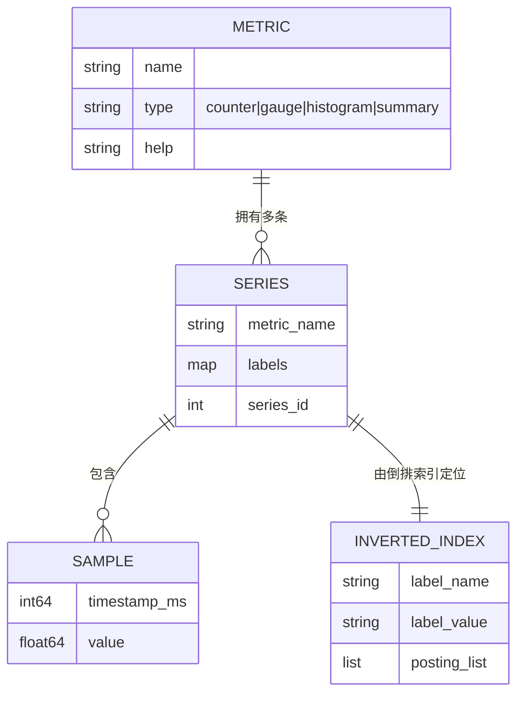
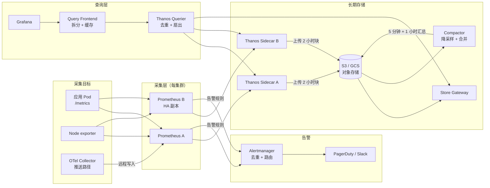
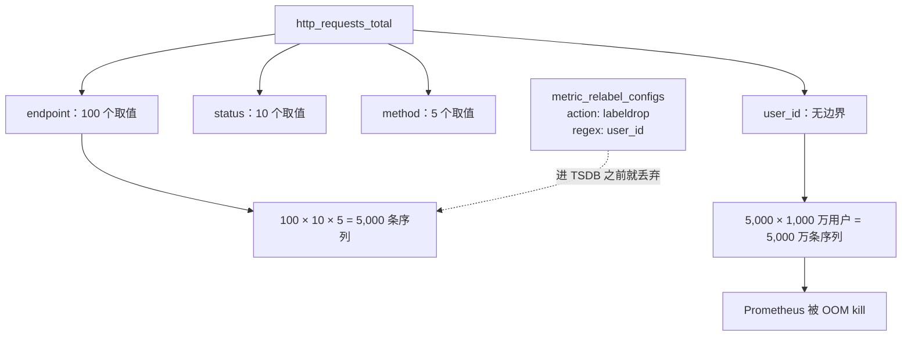
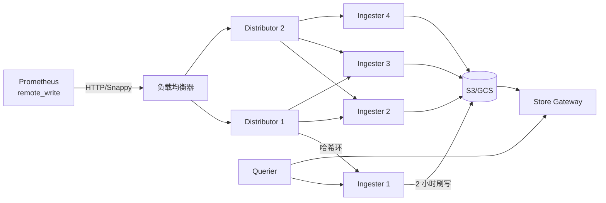

# 设计指标流水线（Prometheus / InfluxDB / Thanos）

> **TL;DR.** 指标流水线负责摄取、存储、查询整支舰队里每个服务上报的时间序列，并据此告警。单集群 1,000 万活跃序列时，Prometheus 用 Gorilla 风格的 XOR 编码把每个样本压到约 1.37 字节[^1]，但本地磁盘的保留期最多也就 2-4 周。最关键的权衡是基数与维度之间的取舍：每一种唯一的标签组合都是一条新序列，都要吃内存；一个没有取值边界的标签（比如 `user_id`）就足以在最需要监控的那次事故中把你的监控栈 OOM 掉[^2]。架构最终收敛为：每集群一套 Prometheus 负责采集，对象存储承载长期保留（Thanos 或 Mimir），分层降采样，再加上相互独立的故障域——这样指标流水线才能在它所观测的东西出问题时自己活下来。

## 学习目标

学完本模块后，你将能够：

- [ ] 设计一条拉取式的指标摄取流水线，单集群扛住 1,000 万以上活跃序列
- [ ] 识别基数爆炸风险，并在它把 Prometheus 打 OOM 之前用 relabel 手段拦下来
- [ ] 说清长期存储该选 Thanos（sidecar 联邦）还是 Cortex/Mimir（横向写入路径）
- [ ] 用量级估算（每秒样本数、每样本字节数、保留成本）推算指标流水线的容量
- [ ] 落地分层降采样（原始 → 5m → 1h），并解释它为什么能把存储降 10-20 倍
- [ ] 权衡推与拉两种摄取方式，说清各自在什么场景下胜出

## 直觉理解

单台 Prometheus 监控一个 Kubernetes 集群，看着毫无难度。装个 Helm chart，把 Grafana 指过去，完事。撑 10 个服务毫无压力。可到了 10,000 个服务、每个服务 50 个指标、20 个标签维度，你就有几百万条活跃时间序列，架构会在三个方向上同时塌掉。

第一是内存。每条活跃序列都要占一份内存里的 head chunk，外加一条倒排索引项。某个不小心的开发把 `request_id` 加成标签，你那条 5,000 序列的指标在一个发布周期里就变成 5,000 万序列。Prometheus 被 OOM kill。最需要看板的那次事故里，看板全黑[^3]。

第二是保留期。1,000 万序列、15 秒一个原始样本、存两年，压缩前每天约 84 GB。一年就是 30 TB 落在本地 NVMe 上。经济上不可能，运维上也脆弱。

第三是生存能力。如果 Prometheus 跑在它自己监控的那个集群里，一次集群级故障会把两者一起带走。Facebook 的 Gorilla 论文[^2]和 Google SRE 的监控章节[^4]都把这一点当作根本性的设计约束：监控系统必须是独立的基础设施。

解开这套设计的关键认知是：把指标流水线当成一套**分层存储系统**，配相互独立的故障域。热数据（最近 2 小时）放在 RAM 里，查询快。温数据（2 小时到 2 周）放在本地 SSD 上。冷数据（几周到几年）以降采样后的粒度放在对象存储里。每一层在成本、延迟、持久性上各有一套特性。采集层、存储层、查询层各自独立扩展。

## 需求

### 澄清问题

- **Q：舰队规模和数据基数是多少？**
  假设：5 个 Kubernetes 集群共 10,000 个采集目标，每集群 1,000 万活跃时间序列（合计 5,000 万）。

- **Q：需要保留多长时间的数据？**
  假设：原始数据 30 天（15 秒粒度），降采样数据 2 年（5 分钟和 1 小时粒度）。

- **Q：摄取用推还是拉？**
  假设：长生命周期服务用拉（Prometheus 采集）。Lambda 和批处理任务用推（通过 OpenTelemetry Collector 走 OTLP）。

- **Q：多租户还是单租户？**
  假设：多租户。各工程团队共享基础设施，但每个租户有基数上限。

- **Q：告警的 SLA 是什么？**
  假设：5,000 条规则每 30 秒评估一次。越过阈值后 60 秒内送达呼叫。

- **Q：指标流水线必须扛住整个集群停机吗？**
  假设：必须。监控栈跑在独立的故障域里，不与它观测的负载混部。

### 功能需求

- 按可配置间隔采集 `/metrics` 端点（本设计默认 15 秒；Prometheus 开源版默认 1 分钟）
- 存储 counter、gauge、histogram、summary 四类指标，带维度标签[^5]
- 评估告警规则，通过 Alertmanager 路由通知
- 为看板提供 PromQL 查询：1 小时区间 p99 亚秒级
- 把原始数据降采样到 5 分钟和 1 小时粒度，供长区间查询
- 支持多集群联邦：在单个 Grafana 里查询所有集群

### 非功能需求

- **摄取：** 每集群 100 万样本/秒（5 集群合计 5,000 万）
- **延迟：** 看板查询 1 小时区间 p99 < 1 秒；30 天区间 < 5 秒
- **可用性：** 查询路径 99.9%；告警路径必须扛住单节点故障
- **保留期：** 原始 30 天，降采样 2 年
- **基数上限：** 每租户每指标 100K 序列；超过阈值硬拒绝

## 容量估算

| 指标 | 数值 | 推导 |
|--------|------:|------------|
| 活跃序列（每集群） | 10M | 10K 目标 × 1,000 序列/目标 |
| 采集间隔 | 15 s | 设计选择（Prometheus 默认 1m） |
| 每秒样本数（每集群） | 667K | 10M / 15 |
| 每样本字节数（压缩后） | 1.37 B | Gorilla XOR + 二阶差分[^1] |
| 每样本字节数（原始） | 16 B | 8 B 时间戳 + 8 B float64 |
| 每天磁盘写入（每集群） | ~79 GB | 667K × 1.37 B × 86,400 |
| 30 天原始保留 | ~2.4 TB | 79 GB × 30 |
| 5 分钟降采样（2 年） | ~240 GB | 79 GB / (300/15) × 730 天 |
| 1 小时降采样（2 年） | ~20 GB | 79 GB / (3600/15) × 730 天 |
| 对象存储（5 集群，2 年） | ~14 TB | (2.4 TB + 0.24 TB + 0.02 TB) × 5 |
| WAL 段大小 | 128 MB | Prometheus 默认[^6] |
| 块刷盘间隔 | 2 小时 | Prometheus/Thanos 默认[^7] |

关键比值：

- **压缩比：** 11.7 倍（原始 16 B 压到 1.37 B）[^1]
- **降采样节省：** 5 分钟粒度 20 倍，1 小时粒度 240 倍
- **读写比：** 约 10:1（众多用户的看板每 5-30 秒刷新一次）
- **告警评估成本：** 5,000 条规则 × 30 秒间隔 = 每秒 167 次规则评估

## API 与数据模型

### API 设计

```http
GET  /api/v1/query?query=rate(http_requests_total[5m])&time=<ts>
GET  /api/v1/query_range?query=...&start=<ts>&end=<ts>&step=15s
POST /api/v1/write                    # 远程写入（Snappy 压缩的 Protobuf）
GET  /api/v1/labels                   # 列出所有标签名
GET  /api/v1/label/{name}/values      # 列出某个标签的所有取值
GET  /api/v1/status/tsdb              # 基数统计（head 序列数、标签对数量）
POST /api/v1/admin/tsdb/delete_series # 给匹配选择器的序列打墓碑
```

远程写入（Remote Write）是关键的集成点。Prometheus 在本地采集，然后把 Snappy 压缩的 Protobuf 批次推给长期后端[^8]。写入载荷是一串 `TimeSeries` 消息，每条包含标签和样本。

### 数据模型

一条时间序列由指标名加标签集合唯一确定：

```text
http_requests_total{method="GET", endpoint="/api/users", status="200", cluster="us-east-1"}
```

底层存储模型（Prometheus TSDB）[^6]：

```text
./data
  01BKGV7JBM69T2G1BGBGM6KB12/     # 2 小时块
    chunks/000001                   # 每个 chunk 段最大 512 MB
    index                           # 倒排索引：标签 -> posting list -> chunk 偏移
    tombstones
    meta.json
  chunks_head/000001                # mmap 的 head chunk（正在写入）
  wal/                              # 128 MB 的 WAL 段，用于崩溃恢复
    000000002
    checkpoint.00000001/
```



*每一种唯一的标签组合都会生成一条独立序列；倒排索引把标签匹配器映射到 posting list，让 PromQL 能快速定位到序列。*

## 高层架构



*一条基于 Thanos 的指标流水线：每集群一对 Prometheus 采集目标，sidecar 把 2 小时的块上传到对象存储，compactor 产出降采样层，querier 在 sidecar（近期数据）与 store gateway（历史数据）之间扇出，为 Grafana 提供查询。*

**写路径：** Prometheus 每 15 秒采集一次目标。样本先进 WAL（崩溃安全），再进内存里的 head block。每 2 小时，head 刷成一个不可变的磁盘块。Thanos sidecar 发现新块后上传到 S3/GCS[^9]。

**读路径：** Grafana 的查询打到 Query Frontend，它把长区间拆成按块的子查询并缓存结果。Querier 向 sidecar（最近 2 小时还在 Prometheus 里）和 store gateway（对象存储里的历史块）扇出。结果合并后去重（HA 对会产出重复样本）。

**告警路径：** Prometheus 每 30 秒在本地评估 recording 规则和告警规则。触发的告警送到 Alertmanager，它跨 HA 对去重、把相关告警分组，再路由到 PagerDuty 或 Slack。

## 深入探讨

### 深入探讨 1：基数控制，无声的杀手

标签取值的每一种唯一组合都会创建一条新的时间序列。指标 `http_requests_total{endpoint, status, method}` 若有 100 个 endpoint、10 种 status、5 种 method，就产出 5,000 条序列。再加一个 `user_id`、1,000 万用户，单个指标就变成 5,000 万条序列[^10][^11]。

**为什么这是灾难：** Prometheus 在写入时就付这笔成本。每条序列需要一份 head chunk（约 120 字节）、一个 memSeries 结构体，以及倒排索引里的 posting list 项。5,000 万序列时，光索引就要约 6 GB 内存，还没算 head chunk。Prometheus 直接 OOM。采集超时。告警停摆。值班工程师在最需要可见性的时候失去可见性[^3]。

**检测：** 对 `prometheus_tsdb_head_series` 超过按指标设定的阈值这件事告警。用 `rate(prometheus_tsdb_head_series_created_total[5m])` 跟踪突增。Datadog 在 Metrics without Limits 功能里，把这件事呈现为“摄取量 vs 索引量”的分歧[^12]。

**缓解手段：**

1. **采集时重打标签：** 用 `metric_relabel_configs` 配 `action: labeldrop`，在有问题的标签进入 TSDB 之前就把它去掉。执行 `POST /-/reload` 后无需重启[^13]。
2. **按租户的基数上限：** Cortex/Mimir 会拒绝超过可配置的“每租户序列数”上限的样本[^14]。
3. **自动抑制：** FreshTracks 的“Bomb Squad”模式监控序列创建速率，对超阈值的标签自动丢弃[^3]。



*一个没有边界的标签会按它的基数成倍放大序列数；relabel 配置在采集阶段、标签进入 TSDB 之前就介入。*

### 深入探讨 2：长期存储，Thanos 与 Cortex/Mimir

Prometheus 本地 TSDB 没有复制、没有集群，保留期受本地磁盘限制[^6]。要在 5 个集群上保留 2 年，你需要一层长期存储。

**Thanos（sidecar 联邦模型）：** 原生 Prometheus 一点都不改。一个 sidecar 进程盯着 TSDB 目录，把封好的 2 小时块上传到 S3/GCS，并暴露 gRPC StoreAPI。Querier 在各个 sidecar 与 store gateway 之间扇出。Compactor 以单例运行，合并块并产出 5 分钟和 1 小时粒度的降采样块[^15][^9]。

**Cortex/Mimir（横向写入路径）：** Prometheus 用远程写入发给无状态的 distributor。distributor 通过一致性哈希环对 `(tenant_id, series_labels)` 做哈希，把样本落到 N 个 ingester 上（复制因子 3）。ingester 在内存里保留 2 小时，再刷到对象存储。store gateway 服务历史查询。Grafana Mimir 在 2022 年的一次压测中把这条路扩到 10 亿活跃序列[^16][^17]。



*Cortex/Mimir 的横向写入路径：无状态 distributor 用哈希把序列分给半有状态的 ingester（复制因子 3），再把 2 小时的块刷到对象存储，供长区间查询。*

| | Thanos | Cortex/Mimir |
|---|---|---|
| 写入路径 | 不改动 Prometheus | 远程写入到 distributor |
| 运维复杂度 | 低（加 sidecar 即可） | 高（5 种以上组件类型）[^18] |
| 多租户 | 事后加装 | 从第一天就是原生能力 |
| 扩展天花板 | 受单台 Prometheus 内存限制 | 10 亿以上活跃序列[^16] |
| 最适合 | 已有 Prometheus 部署 | 全新建设、多租户平台 |

### 深入探讨 3：Gorilla 压缩，为什么每个样本只要 1.37 字节

Gorilla 论文（Facebook，VLDB 2015）[^2]提出的成对压缩，让内存里存时间序列这件事变得可行：

**时间戳用二阶差分（delta-of-delta）：** 采集间隔几乎恒定（15 秒）。一阶差分约为 15，二阶差分约为 0。二阶差分为 0 时只需 1-2 个比特来编码，而它几乎总是 0[^19]。

**float64 取值用 XOR：** 同一指标的连续样本通常很接近。`当前值 XOR 上一个值`得到的结果有大量前导零和尾随零。Gorilla 存的是：1 个控制位 + 5 位前导零个数 + 6 位有效位宽度 + 有效位本身[^20]。如果 XOR 结果恰好是 0（值没变），只写一个 0 比特。

**算例：** 两次连续采样，读数都是 `1.0`（IEEE 754：`0x3FF0000000000000`）。XOR = `0x0000000000000000`。编码：单个比特 `0`。代价：每样本 1 比特，而不是 64 比特。

**结果：** Facebook 的 Gorilla 做到了约 12 倍压缩（平均从每样本 16 字节降到约 1.37 字节）[^2][^19]。Prometheus 在生产中平均每样本 1.37 字节[^1]，而未压缩时是 16 字节。这就是为什么单台 Prometheus 节点能用 6-8 GB 内存装下 1,000 万活跃序列的 head block。

## 真实案例

**Uber M3：2,500 QPS，每秒服务 85 亿个数据点。**

Uber 的指标基础设施从 Graphite + WhisperDB（2014 年）出发，经历过一段痛苦的“救火”期，最终演进成 M3——一个专门为此打造的指标平台[^21]。到 2018 年 11 月，M3Query 每秒处理约 2,500 次查询，每次查询扫描 7 天滚动窗口，从 M3DB 每秒流式读出约 85 亿个数据点[^22][^23]。

M3 有三个组件：

1. **M3Coordinator + M3Aggregator：** 流式聚合，按 namespace 动态决定精度。基础设施团队的指标拿 2 天的 10 秒精度；业务团队拿 13 个月的 1 分钟精度。同一套摄取 API，不同的成本曲线[^21]。

2. **M3DB：** 分布式时间序列数据库，内嵌倒排索引。索引是关键的一块：它先把 PromQL 的标签匹配表达式解析成 posting list，再去碰样本，从而避免全表扫描。

3. **M3Query：** 兼容 PromQL 的引擎，从 M3DB 流式读取压缩块，并逐个数据点惰性解压。函数在解压过程中就地应用，把网络传输和内存分配降到最低[^22]。

Uber 团队的关键洞察是：**在同一个集群里放多个“保留期/精度”namespace**，就不需要再单独搞一套短期系统和一套长期系统。一条写入路径扇出到多个聚合窗口不同的 namespace。这种架构比 Thanos 的两层模型更简单，但代价是需要自研 TSDB（M3DB），不能用原生 Prometheus。

Netflix Atlas 走的是相反的路：一个内存中的维度 TSDB，为运维查询优化，热窗口只有 6 小时[^24][^25]。Atlas 优先保障运维查询（最近几个小时）而不是长保留期，这与 Gorilla 的理念一致——排查事故时，近期数据的价值远高于历史数据[^2]。

## 权衡

| 方案 | 优点 | 缺点 | 适用场景 |
|----------|------|------|-------------|
| 拉取（Prometheus 采集） | 目标端简单；`up{}` 免费得到；服务发现驱动目标列表[^13] | 短命任务需要 Pushgateway；防火墙/NAT 会有麻烦 | Kubernetes、长生命周期服务 |
| 推送（OTLP / StatsD） | 适用于 Lambda、IoT、批处理；时序由客户端控制[^26] | 接收端必须限流和鉴权；没有免费的存活信号 | 边缘、serverless、事件驱动 |
| Thanos sidecar | 保留原生 Prometheus；可增量引入；心智模型简单[^9] | store gateway 查深历史较慢；compactor 是单例 | 已在用 Prometheus，想加 S3 保留 |
| Cortex/Mimir 横向 | 多租户下可到 10 亿序列；真正的横向摄取[^16] | 要运维 5 种以上组件[^18] | 全新建设、多租户、>1,000 万序列 |
| VictoriaMetrics | 快、省资源、单二进制或集群部署皆可[^27] | MetricsQL 与纯 PromQL 有差异 | 成本敏感、运维偏好 |
| 原始数据保留 2 年 | 没有降采样 bug；查询简单 | 存储随基数线性膨胀 | 只有合规驱动时才选 |
| 降采样分层（原始/5m/1h） | 存储降 10-20 倍；长区间查询快[^15] | 查询引擎必须挑精度；有损 | 6 个月以上保留期的默认做法 |

最大的元决策是：**Thanos 还是 Mimir。** 如果你已经在跑 Prometheus，想增量加一层长期存储，Thanos 在运维简单性上胜出。如果你要从零搭一个多租户指标平台，并且预计单租户会超过 1,000 万序列，Mimir 的横向写入路径是更好的地基。两者用同样的块格式和同样的对象存储后端，区别只在写入路径落在哪里。

## 扩展与故障模式

**10 倍（1 亿活跃序列，5 个集群）：**

- 每集群单台 Prometheus 撞上内存天花板（2,000 万序列约需 32 GB）。缓解：用 hashmod relabeling 按 namespace 或服务拆分 Prometheus。每集群两台 Prometheus，各采一半目标。
- 对象存储的查询延迟上升。缓解：Query Frontend 加结果缓存（Memcached），并按时间区间拆分查询。

**100 倍（10 亿活跃序列）：**

- Thanos 架构开始撑不住（sidecar 太多，compactor 跟不上）。缓解：迁到 Mimir 的横向写入路径，用 split-and-merge 压缩[^17]。
- ingester 内存成为瓶颈。缓解：增加 ingester 数量，对非关键租户把复制因子从 3 降到 2。

**1000 倍（100 亿活跃序列）：**

- 架构需要重写：流式摄取（Kafka 承载写入路径）、存储层按租户隔离、在边缘做激进预聚合（先聚合再上报）。

**故障模式：**

- **基数爆炸导致 Prometheus OOM：** 检测：对 `prometheus_tsdb_head_series > threshold` 告警。处置：relabel-drop 掉有问题的标签，删除打了墓碑的序列，清理墓碑回收内存。恢复时间：自动化则分钟级，手工则小时级[^3]。
- **对象存储不可用：** 近期数据（最近 2 小时）仍由 sidecar/ingester 提供。历史查询优雅降级为部分结果。告警继续由本地 Prometheus 承担。
- **Ingester 故障（Mimir）：** 复制因子 3 意味着一台 ingester 挂掉不丢数据。哈希环把它的 token 区间重新分给存活的 ingester。在途样本由 distributor 重试。

## 常见陷阱

> [!WARNING]
> **没有边界的标签导致基数爆炸。** `request_id`、`user_id`，或者带动态段的完整 URL 路径，这类标签每个唯一取值都会创建一条序列。检测：对 `rate(prometheus_tsdb_head_series_created_total[5m]) > 10000` 告警。修复：用 `metric_relabel_configs` 配 `action: labeldrop`[^10][^11]。

> [!WARNING]
> **用 summary 而不是 histogram。** summary 在客户端算分位数，无法跨实例聚合。你没法从各实例的 p99 算出全局 p99，因为分位数不能取平均[^5]。修复：任何要聚合的指标都用 histogram；桶边界按对数选取。

> [!WARNING]
> **把监控栈和它监控的负载混部。** 一次集群级故障会同时打掉应用和采集它们的 Prometheus。指标流水线恰好在最需要的时候失效。修复：把监控当作独立基础设施，放进单独的故障域[^4]。

> [!WARNING]
> **对原因而不是症状告警。** CPU 到 80% 就呼叫，用户其实没感觉。而错误率飙升时却没人被叫。修复：对四大黄金信号（延迟、流量、错误、饱和度）告警[^4]。原因类指标留给排查，不要用来呼叫。

> [!WARNING]
> **只按时间设保留期，没有容量护栏。** 只写 `--storage.tsdb.retention.time=30d` 不写 `--storage.tsdb.retention.size`，磁盘占用会随基数线性增长。一次基数尖峰就能填满磁盘，写入停摆，告警停摆。修复：两个参数都设；容量护栏设在分配磁盘的 80-85%[^6]。

> [!WARNING]
> **给长生命周期服务误用 Pushgateway。** 推上去的指标会一直留到被显式删除。一个节点挂掉后，它的陈旧指标会无限期挂在看板上[^13]。修复：Pushgateway 只用于有明确“完成”信号的批处理任务。

## 追问

**1. 多区域指标聚合怎么做？**

每个区域一套 Prometheus 集群，各自的 Thanos sidecar 上传到共享的对象存储桶。一个全局 Thanos Querier 在各区域的 store gateway 之间扇出。给每台 Prometheus 加 `external_labels` 的集群/区域标签，用于去重。跨区域查询延迟由对象存储的访问时间决定，而不是区域间网络。

**2. 在共享平台里怎么做按租户的基数配额？**

Cortex/Mimir 的 distributor 通过基数 API 执行按租户的限制[^14]。租户超过序列配额后，新序列被以 HTTP 429 拒绝。租户能看到一个展示自己用量与配额的看板。分级执行：80% 警告，100% 软拒绝，120% 硬拒绝。

**3. 怎么从 Thanos 迁到 Mimir 而不丢数据？**

两者在对象存储上用同样的 TSDB 块格式。先让 Mimir 的 store gateway 指向已有的 Thanos 桶。再把远程写入流量逐步从 Thanos sidecar 转到 Mimir distributor。迁移期间双写。最后才切查询路径。

**4. histogram 的桶边界当初选得不好怎么办？**

原生 histogram（Prometheus 3.x 中属实验特性，需要 `--enable-feature=native-histograms`）用可配置分辨率的指数分桶，消除了固定桶边界的限制。对老式 histogram，添加新的桶边界，并接受历史数据仍用旧边界。永远不要删除已有的边界（会破坏 `histogram_quantile` 的连续性）。

**5. 如果要做 SaaS 指标产品（Datadog 模式），会有什么变化？**

按客户的摄取配额，超出部分计费。Datadog 的 Pro 套餐每主机包含 100 个自定义指标；Enterprise 是 200 个。对配置了 Metrics without Limits 的指标，超出所摄取自定义指标的部分按每 100 个 0.10 美元计费；对未配置的指标以及所有索引指标的超额，价格按客户合同执行[^12]。架构上要在摄取与存储之间加一层计量，按计费周期统计每个客户的唯一序列数。基数于是变成收入问题，而不只是运维问题。

**6. 怎么在 1,000 个实例的舰队上算出准确的 p99？**

用 histogram（不要用 summary），桶才可聚合。`histogram_quantile(0.99, sum(rate(request_duration_seconds_bucket[5m])) by (le))` 把各实例的桶计数加总，再插值，得到全舰队的 p99。要更高精度，就在客户端用 HDRHistogram 或 t-digest，服务端合并 sketch。

## 练习

### 练习 1：基数爆炸应急响应

凌晨两点。一次发布带了个 bug，给每条 `http_request_total` 指标都打上了 `request_id` 标签。你的 Prometheus 基数在 15 分钟内从 100 万条序列涨到 5,000 万条。Prometheus 开始 OOM。请设计应急响应：如何自动检测这次爆炸、如何在不重启 Prometheus 的前提下 relabel-drop 掉坏标签、如何把序列数收回来，以及如何防止复发。

<details>
<summary>提示</summary>

想想哪个告警会最先触发（`prometheus_tsdb_head_series`），哪个 API 端点能告诉你哪个指标炸了（`/api/v1/status/tsdb`），以及 Prometheus 的哪个特性让你不重启就能改采集配置（`POST /-/reload`）。恢复方面，你需要给老序列打墓碑，再清理墓碑来回收内存。

</details>

<details>
<summary>解答</summary>

**检测：** `prometheus_tsdb_head_series > 30M` 的告警触发。值班工程师查 `/api/v1/status/tsdb`，看到 `http_request_total` 有 4,900 万条序列，而原来是 5,000 条。

**立即止血：**

```yaml
# 加到 scrape 配置的 metric_relabel_configs 里：
- source_labels: [__name__]
  regex: http_request_total
  action: labeldrop
  regex: request_id
```

然后执行 `POST /-/reload` 在不重启的前提下生效。新的采集立刻停止创建带 `request_id` 的序列。

**恢复（回收内存）：**

```bash
# 给有问题的序列打墓碑
curl -X POST 'http://localhost:9090/api/v1/admin/tsdb/delete_series' \
  -d 'match[]=http_request_total{request_id=~".+"}'

# 回收磁盘和内存
curl -X POST 'http://localhost:9090/api/v1/admin/tsdb/clean_tombstones'
```

**预防：**

1. CI 检查：发布前 lint 指标定义，拒掉无边界标签
2. 告警：`rate(prometheus_tsdb_head_series_created_total[5m]) > 10000` 立即呼叫
3. 护栏：每个采集目标 `sample_limit: 50000`，拒绝突然暴露几百万条序列的目标
4. 在 Mimir/Cortex 里设按租户的基数上限作为兜底[^14]

**接受的权衡：** relabel-drop 会让新采集永久失去 `request_id` 这个维度。这是对的：`request_id` 本来就不该做指标标签。它属于 trace，不属于 metrics。

</details>

## 要点回顾

- **基数才是主要的扩展约束。** 不是磁盘，不是 CPU，不是网络。每个无边界标签都是一颗定时炸弹，在事故中引爆[^10]。
- **Gorilla 压缩让本地 TSDB 变得实用。** 每样本 1.37 字节（11.7 倍压缩），意味着 1,000 万序列只占个位数 GB 的内存[^1]。
- **对象存储是通用的长期后端。** Thanos、Mimir、VictoriaMetrics、M3 最终都以 S3/GCS 作为持久层，区别只在它上面的写入路径和查询路径。
- **要保留 2 年，降采样不是可选项。** 15 秒原始样本存两年，成本是分层的 5 分钟和 1 小时汇总的 20 倍[^15]。
- **指标流水线必须扛得住它所观测的东西。** 独立故障域，不与被监控的负载混部[^4]。
- **长生命周期服务用拉，短命任务用推。** 这不是信仰之争，是故障模式分析。拉让你免费得到 `up{}`；推适用于没有长驻 HTTP 服务器的地方[^13]。

## 延伸阅读

- [Pelkonen et al., "Gorilla: A Fast, Scalable, In-Memory Time Series Database" (VLDB 2015)](https://www.researchgate.net/publication/283189750_Gorilla)。每个指标工程师都该读的论文；XOR 与二阶差分压缩，以及 Prometheus、M3DB、VictoriaMetrics 都重新实现过的“内存优先”哲学。
- [Prometheus TSDB storage documentation](https://prometheus.io/docs/prometheus/latest/storage/)。块布局、WAL 段、保留期参数、远程读写配置的权威参考。
- [Ganesh Vernekar, "Prometheus TSDB: Compaction and Retention"](https://ganeshvernekar.com/blog/prometheus-tsdb-compaction-and-retention/)。关于 head block 生命周期、压缩区间和保留机制最好的深入解析，作者是 Prometheus 核心维护者。
- [Grafana Labs, "How we scaled Mimir to 1 billion active series"](https://grafana.com/blog/2022/04/08/how-we-scaled-our-new-prometheus-tsdb-grafana-mimir-to-1-billion-active-series/)。10 亿序列压测的具体方法论；涵盖 split-and-merge 压缩与 ingester 扩容。
- [Thanos quick tutorial](https://thanos.io/tip/thanos/quick-tutorial.md/)。把 sidecar、querier、compactor、store gateway 讲在一篇可读的走查里；从单台 Prometheus 走向多集群长期存储的最快路径。
- [Uber Engineering, "The Billion Data Point Challenge"](https://www.uber.com/en-BE/blog/billion-data-point-challenge/)。M3Query 用惰性解压和流式求值做到每秒 85 亿个数据点。
- [Google SRE Book: Monitoring Distributed Systems](https://sre.google/sre-book/monitoring-distributed-systems/)。四大黄金信号、症状与原因之分，以及为什么告警哲学比告警工具更重要。
- [FreshTracks, "Bomb Squad: Automatic Cardinality Explosion Detection"](https://web.archive.org/web/20210723035526/https://blog.freshtracks.io/bomb-squad-automatic-detection-and-suppression-of-prometheus-cardinality-explosions-62ca8e02fa32)。关于在生产 Prometheus 中自动检测与抑制基数炸弹的定论之作。

## 记忆卡片

<details>
<summary><strong>Q: Prometheus 的四类指标类型是什么？</strong></summary>

A：Counter（单调递增）、gauge（任意当前值）、histogram（客户端预分桶的分布，带 `_bucket`、`_sum`、`_count`）、summary（客户端算出的分位数，无法跨实例聚合）[^5]。

</details>

<details>
<summary><strong>Q: Gorilla 的 XOR 编码为什么能做到每样本约 1.37 字节？</strong></summary>

A：同一指标的连续浮点值通常很接近。连续值做 XOR 后会得到大量前导零和尾随零，因此只需要存有效位（通常 10-15 位）。值不变时只写 1 个比特。再加上时间戳的二阶差分编码（采集间隔恒定时也只要 1-2 个比特），平均值就从 16 字节降到约 1.37 字节[^1][^19]。

</details>

<details>
<summary><strong>Q: 给请求计数器加上 user_id 标签会发生什么？</strong></summary>

A：每个唯一用户都会创建一条新的时间序列。1,000 万用户时，单个指标就变成 1,000 万条以上序列，head chunk 和索引项要吃掉数 GB 内存。Prometheus OOM，你在事故期间失去可观测性[^10][^11]。

</details>

<details>
<summary><strong>Q: Thanos 与 Cortex/Mimir 在架构上的区别是什么？</strong></summary>

A：Thanos 给已有的 Prometheus 实例加 sidecar，把块上传到对象存储（联邦模型）。Cortex/Mimir 干脆替掉写入路径：Prometheus 远程写入到无状态 distributor，distributor 通过一致性哈希环把样本落到 ingester（横向写入模型）。Thanos 更容易上手；Mimir 能扩到 10 亿以上序列，且原生支持多租户[^16][^9]。

</details>

<details>
<summary><strong>Q: 为什么不能用各实例的 summary 算出全局 p99？</strong></summary>

A：summary 在客户端算分位数。分位数在数学上不能取平均（各实例 p99 的平均值不是全局 p99）。histogram 暴露的是原始桶计数，可以跨实例相加，再由 `histogram_quantile()` 从聚合后的桶里插值出正确的分位数[^5]。

</details>

<details>
<summary><strong>Q: 四大黄金信号是什么？</strong></summary>

A：延迟（请求耗时）、流量（系统承担的需求量）、错误（失败请求的比例）、饱和度（系统有多满）。对这四类症状告警，而不是对 CPU 百分比这类原因告警[^4]。

</details>

<details>
<summary><strong>Q: Thanos 如何在不改动 Prometheus 的前提下做到多年保留？</strong></summary>

A：sidecar 盯着 Prometheus 的 TSDB 目录，把封好的 2 小时块上传到 S3/GCS，并暴露 gRPC StoreAPI。Compactor 产出 5 分钟和 1 小时粒度的降采样块。Querier 在 sidecar（近期）与 store gateway（历史）之间扇出。Prometheus 本身不做任何改动[^15][^9]。

</details>

<details>
<summary><strong>Q: 凌晨两点遇到基数爆炸，第一反应做什么？</strong></summary>

A：（1）通过 `/api/v1/status/tsdb` 定位出问题的指标。（2）为那个无边界标签加 `metric_relabel_configs` 配 `action: labeldrop`。（3）`POST /-/reload` 不重启生效。（4）通过管理 API 给老序列打墓碑。（5）清理墓碑回收内存[^3]。

</details>

<details>
<summary><strong>Q: 为什么指标流水线必须跑在独立的故障域里？</strong></summary>

A：如果 Prometheus 与它监控的服务混部，一次数据中心级故障会把两者一起打掉。你在最需要可观测性的时候恰好失去它。Gorilla 的双区域部署和 Google SRE 的指导都要求监控使用独立的基础设施[^2][^4]。

</details>

<details>
<summary><strong>Q: 从 15 秒粒度降采样到 5 分钟粒度能拿到多少压缩比？</strong></summary>

A：20 倍。15 秒间隔在一个 5 分钟窗口里有 20 个样本；降采样成每 5 分钟一个聚合样本（min、max、sum、count），存储按比例下降。再叠上 1 小时汇总（240 倍），2 年保留期在经济上才成立[^15]。

</details>

## 参考文献

[^1]: Moncef Abboud, "Exploring Prometheus Internals: TSDB and XOR Encoding", 2025. https://cefboud.com/posts/prometheus-monitoring-alertmanager-internals-tsdb/

[^2]: Pelkonen et al., "Gorilla: A Fast, Scalable, In-Memory Time Series Database", VLDB 2015. https://www.researchgate.net/publication/283189750_Gorilla

[^3]: FreshTracks, "Bomb Squad: Automatic Detection and Suppression of Prometheus Cardinality Explosions", 2018. https://web.archive.org/web/20210723035526/https://blog.freshtracks.io/bomb-squad-automatic-detection-and-suppression-of-prometheus-cardinality-explosions-62ca8e02fa32

[^4]: Rob Ewaschuk, "Monitoring Distributed Systems" (Google SRE Book, Ch. 6). https://sre.google/sre-book/monitoring-distributed-systems/

[^5]: Prometheus 指标类型（counter、gauge、histogram、summary）。https://prometheus.io/docs/concepts/metric_types/

[^6]: Prometheus 存储（本地 TSDB、远程读写）。https://prometheus.io/docs/prometheus/latest/storage/

[^7]: Ganesh Vernekar, "Prometheus TSDB (Part 6): Compaction and Retention", 2021. https://ganeshvernekar.com/blog/prometheus-tsdb-compaction-and-retention/

[^8]: Prometheus remote write 1.0 规范。https://prometheus.io/docs/specs/remote_write_spec/

[^9]: Thanos 快速教程——sidecar、store gateway、compactor、querier。https://thanos.io/tip/thanos/quick-tutorial.md/

[^10]: Alexandre Vazquez, "High Cardinality And How To Fix It". https://alexandre-vazquez.com/prometheus-scalability/

[^11]: Openillumi, "Stop Blaming High Cardinality: Prometheus Performance Strategy Guide". https://openillumi.com/en/en-prometheus-high-cardinality-truth-design/

[^12]: Datadog, "Custom Metrics Billing". https://docs.datadoghq.com/account_management/billing/custom_metrics/

[^13]: Prometheus 简介与概览。https://prometheus.io/docs/introduction/overview/

[^14]: Grafana Mimir 配置参数（按租户限制，含 max_global_series_per_user）。https://grafana.com/docs/mimir/latest/references/configuration-parameters/

[^15]: Thanos 设计与存储。https://thanos.io/tip/thanos/design.md/

[^16]: Grafana Labs, "How we scaled our new Prometheus TSDB Grafana Mimir to 1 billion active series", 2022. https://grafana.com/blog/2022/04/08/how-we-scaled-our-new-prometheus-tsdb-grafana-mimir-to-1-billion-active-series/

[^17]: Grafana Labs, "How Grafana Mimir's split-and-merge compactor enables scaling metrics to 1 billion active series", 2022. https://grafana.com/blog/2022/04/19/how-grafana-mimirs-split-and-merge-compactor-enables-scaling-metrics-to-1-billion-active-series/

[^18]: Cortex 架构——distributor、ingester、querier、store gateway、compactor。https://cortexmetrics.io/docs/architecture/

[^19]: Database of Databases, "Beringei"（Gorilla 的开源实现）。https://dbdb.io/db/beringei

[^20]: dgryski/go-tsz——Gorilla 时间序列压缩的参考实现。https://github.com/dgryski/go-tsz

[^21]: M3 开源指标引擎（历史与组件）。https://m3db.io/about/

[^22]: Uber Engineering, "Building a Query Engine for High Cardinality Time Series Data", 2018. https://www.uber.com/en-BE/blog/billion-data-point-challenge/

[^23]: Uber Engineering, "The Billion Data Point Challenge". https://www.uber.com/en-MT/blog/billion-data-point-challenge/

[^24]: Netflix Atlas 文档——简介。https://netflix.github.io/atlas-docs/

[^25]: Netflix, "Introducing Atlas: Netflix's Primary Telemetry Platform", 2014. https://netflix.github.io/atlas-docs/overview/

[^26]: OpenTelemetry Metrics API. https://opentelemetry.io/docs/specs/otel/metrics/api/

[^27]: VictoriaMetrics, "how to generate 100 million samples/s of production-like data", 2023. https://victoriametrics.com/blog/benchmark-100m/
