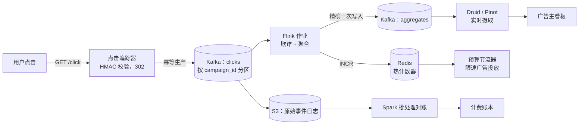
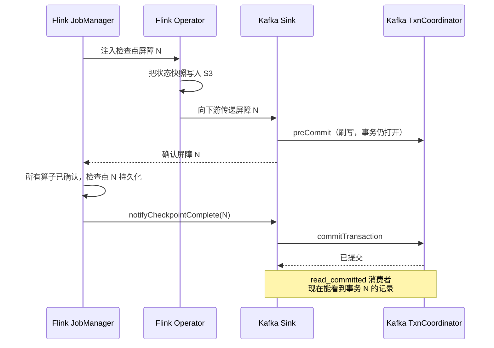
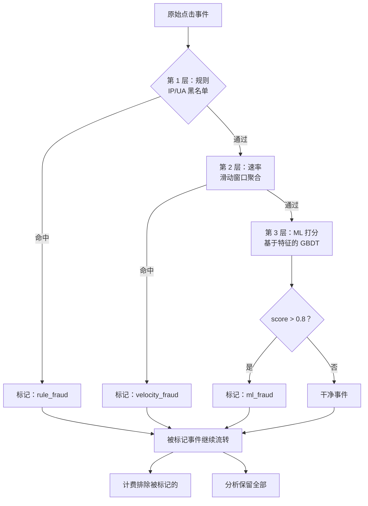
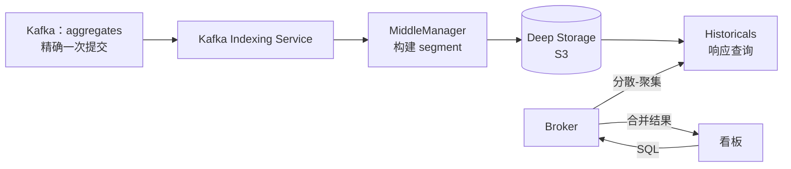
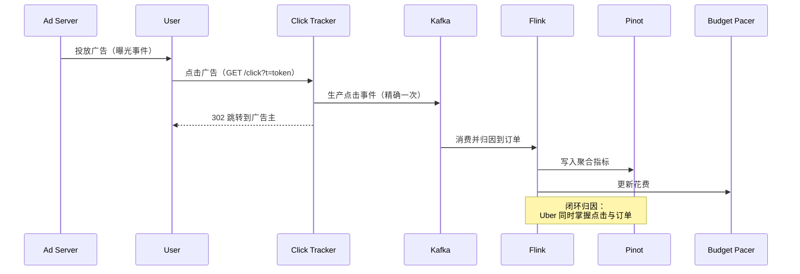

# 设计广告点击聚合（实时流处理）

> **TL;DR.** 广告点击聚合披着分析问题的外衣，内里是一条计费管线。峰值每秒 100 万次点击时，系统必须端到端提供精确一次（exactly-once）语义（Kafka 幂等生产者 + Flink 对齐检查点 + 幂等 sink），因为每一次点击都是一条发票行[^1]。架构在 Kappa 风格的流处理内核之上叠加三层欺诈过滤（规则、速率、ML），把聚合结果写入实时 OLAP 存储（Druid 或 Pinot）以支撑亚秒级看板查询[^2]，再与批处理审计链对账来保证计费正确。关键的权衡在于：精确一次会根据批量大小和提交间隔消耗 3-30% 的吞吐量，但省掉了退款纠纷[^3]。

## 学习目标

- 设计一条端到端的点击采集管线，在源端、状态和 sink 三处都达成精确一次语义
- 解释三段式链条（Kafka 事务、Flink 检查点、幂等 sink），以及任何一环缺失时会出什么问题
- 把分层欺诈检测（规则、速率聚合、ML 打分）实现为流内算子
- 论证在十亿行规模下，为什么为广告主看板选择实时 OLAP 存储而不是关系型数据库
- 为每天处理 100 亿次曝光、1 亿次点击的系统做容量估算
- 在广告主计费的语境下权衡新鲜度与正确性

## 直觉理解

统计点击听起来很简单。在 Postgres 表上跑一句 `GROUP BY campaign_id` 就能伺候 100 个广告主。可一旦每天 1 亿次点击、峰值每秒 100 万次，这套做法立刻塌掉，而且原因不只是数据量。原因是钱。

每一次点击都是可计费事件。少算 0.1%，在 Google 广告这种体量（2024 财年约 2640 亿美元）的平台上，一年就丢掉数百万收入[^4]。多算 0.1%，广告主会质疑发票、索要补偿、然后流失。一个把点击重复计数一小时的线上 bug，就是财报电话会上要交代的事故。

“至少一次 + 读取时去重”这种朴素做法行不通，因为读取时去重不可审计。如果管线在中间某处悄悄丢掉或重复了事件，你就没法向广告主证明他们的发票是对的。打开这个设计的洞见是：把点击管线当财务账本，而不是分析管线。每个事件都必须可证明地只处理一次，并用批处理对账作业充当审计链。

这意味着架构不是“Kafka 加一个消费者”。它是带事务生产者的 Kafka、带对齐检查点屏障（能原子地提交状态与 sink 事务）的 Flink，以及一个专门摄取预聚合、已过欺诈过滤、已精确一次提交记录的 OLAP 存储。这份复杂度是值得的，因为最终产出是发票。

## 需求

### 澄清问题

- **Q: 计费模型是什么？**
  假设：按点击计费（CPC）。每个有效点击产生一笔费用。无效点击（欺诈）必须在计费前剔除，但要保留下来用于审计。

- **Q: 广告主期望多高的新鲜度？**
  假设：看板在点击后 5 秒内刷新。计费对账每小时跑一次，最终发票每天出一次。

- **Q: 可接受的欺诈率是多少？**
  假设：计费点击中无效的比例应低于 0.5%。厂商估算搜索广告的原始无效流量在 14-22%[^5]；系统必须滤掉其中绝大部分。

- **Q: 多区域部署吗？**
  假设：是。点击来自全球边缘 PoP。处理按区域进行，计费做跨区域对账。

- **Q: 用什么归因模型？**
  假设：计费用末次点击（简单、可审计）。报表用数据驱动的多触点归因（要求每个广告系列有足够的转化量才能保证统计稳定；Google 建议 30 天内至少 200 次转化）[^6]。

- **Q: 有哪些隐私约束？**
  假设：iOS ATT 拒绝率约 75%[^7]。SKAdNetwork 回传延迟 24-48 小时才到达[^8]。Chrome 在 2025 年弃用了 Privacy Sandbox 归因报告（Attribution Reporting）；第三方 Cookie 仍然存在。对已拒绝追踪的用户，不保留按用户粒度的转化日志。

### 功能性需求

- 从边缘追踪器采集点击事件，并以精确一次交付到处理层
- 按广告系列、按广告主、按维度（国家、设备、位置）在 1 分钟的滚动窗口中聚合点击
- 在流内通过三层（规则、速率、ML）检测并标记无效流量
- 向广告主看板提供预聚合指标，查询延迟亚秒级
- 通过批处理把流式输出与原始事件日志对账，保证计费正确
- 支持预算节奏控制：实时花费计数器在预算接近耗尽时限速广告投放

### 非功能性需求

- **负载：** 每天 100 亿次曝光、1 亿次点击（CTR 1%），峰值每秒 100 万次点击
- **延迟：** 点击到看板可见小于 5 秒；查询 P99 小于 200 ms
- **准确性：** 可计费数据的事件准确率 99.999%（不重复计费、不丢点击）
- **可用性：** 采集路径 99.99%；看板查询路径 99.9%
- **持久性：** 零数据丢失；原始事件在对象存储中保留 7 年（审计）

## 容量估算

| 指标 | 数值 | 推导 |
|--------|------:|------------|
| 每日点击量 | 1 亿 | 100 亿次曝光 × 1% CTR |
| 峰值点击/秒 | 100 万 | 大事件期间为均值（1,157/秒）的 10 倍 |
| 点击事件大小 | 500 B | request_id、campaign_id、ad_id、user_cohort、geo、device、timestamp、token |
| 原始点击存储/天 | 50 GB | 1 亿 × 500 B |
| 曝光存储/天 | 5 TB | 100 亿 × 500 B |
| 5 年原始存储 | ~9 PB | (50 GB + 5 TB) × 365 × 5 |
| Flink 状态（1 分钟窗口） | ~50 GB | 50 万个广告系列 × 每个 100 KB 状态 |
| OLAP 存储（1 年，汇总表） | ~10 TB | 按广告系列/天/地域/设备预聚合 |
| Redis 热计数器 | ~4 GB | 50 万个广告系列 × 8 KB（当日花费 + 速率） |

关键比例：

- **曝光:点击** = 100:1（CTR 1%）。曝光主导存储；点击主导处理复杂度。
- **有效:无效** = 约 80:20。厂商估算约 14-22% 的原始点击是无效流量[^5]；过滤后，计费点击中属于欺诈的应低于 0.5%。
- **流:批** = 实时聚合给看板供数；批处理对账给计费供数。两者读的是同一个 Kafka topic（Kappa 架构）。

## API 与数据模型

### API 设计

```http
POST /v1/click?t=<signed_token>
  Response: 302 Location: <advertiser_landing_url>
  Side effect: click event produced to Kafka (idempotent)

GET /v1/campaigns/{id}/metrics?window=1h&dimensions=country,device
  Response: 200 { "clicks": 142000, "spend": 8520.00, "ctr": 0.012,
                  "breakdowns": [...], "as_of": "2026-05-04T12:00:05Z" }

GET /v1/campaigns/{id}/budget
  Response: 200 { "daily_budget": 50000, "spent_today": 32100,
                  "pacing_rate": 0.85, "estimated_exhaustion": "18:30Z" }

POST /v1/reports/reconciliation
  Body: { "date": "2026-05-03", "advertiser_id": "adv_123" }
  Response: 200 { "stream_total": 1420000, "batch_total": 1420003,
                  "delta": 3, "status": "within_tolerance" }
```

### 数据模型

```sql
-- Kafka click event (Avro schema, partitioned by campaign_id)
record ClickEvent {
  string   request_id;       -- idempotency key
  string   campaign_id;      -- partition key
  string   ad_id;
  string   advertiser_id;
  string   user_cohort;      -- privacy-safe cohort, not user_id
  string   geo_country;
  string   device_type;
  long     timestamp_ms;     -- event time
  string   click_token;      -- HMAC-signed, validates origin
  float    fraud_score;      -- populated by Flink (0.0 = clean)
  string   fraud_flags;      -- comma-separated rule IDs that fired
}

-- OLAP rollup table (Druid/Pinot segment schema)
table click_aggregates (
  campaign_id     string,     -- primary dimension
  window_start    timestamp,  -- 1-minute tumbling window
  geo_country     string,
  device_type     string,
  valid_clicks    long,
  invalid_clicks  long,
  spend_cents     long,
  unique_users    long        -- HyperLogLog sketch
)

-- Redis hot counters (per campaign, today)
HASH campaign:{id}:today {
  spend_cents: 3210000,
  click_count: 142000,
  last_click_ts: 1714824005000
}
```

## 高层架构



*从边缘追踪器到广告主看板的点击数据路径，以及一条并行为计费供数的批处理对账分支。*

**写入路径**：用户点了广告。边缘的点击追踪器校验 HMAC 签名的 token（拦住伪造点击），以 `enable.idempotence=true` 和 `acks=all` 把事件生产到 Kafka，然后返回 302 跳转到广告主的落地页。追踪器总延迟：个位数毫秒。

**流路径**：Flink 从 clicks topic 消费，执行欺诈检测（规则、速率、ML），按 `(campaign_id, geo, device)` 计算 1 分钟滚动窗口聚合，为预算节奏控制递增 Redis 热计数器，并通过精确一次事务把聚合结果写入第二个 Kafka topic。OLAP 存储从 aggregates topic 持续摄取。

**批路径**：原始事件经 Kafka Connect 落到 S3。Spark 作业每小时跑一次，从原始日志重新聚合并与流式输出比对。偏差超出容差就触发告警和计费调整。

## 深入探讨

### 精确一次语义：三段式链条

面试里最常见的错误是宣称“至少一次 + 幂等写 = 精确一次”。并不等价。幂等写能处理重复投递，但处理不了这种情况：Flink 处理了事件、更新了内部状态，却在 sink 提交之前崩溃。恢复后事件被重新处理，用的是过期状态，算出来的聚合值不同。真正的精确一次要求源端偏移量、算子状态和 sink 输出三者原子提交[^9]。

**组件 1：Kafka 幂等 + 事务生产者。** KIP-98（Kafka 0.11，2017 年）引入了 `producer_id` 和按分区的序列号[^3][^10]。broker 会拒绝生产者重试带来的重复。再加上 `transactional.id` 就能让这个身份跨重启存活：`TransactionCoordinator` 用 `producer_epoch` 隔离僵尸生产者，所以崩溃的生产者重启后无法提交过期事务[^10]。

**组件 2：Flink 对齐检查点屏障。** JobManager 往源流里注入一个屏障。屏障流过每个算子时，该算子把状态快照写到 S3。Kafka sink 会调用 `preCommit`（把待写数据刷到已打开的 Kafka 事务里），但此时还不提交[^9][^11]。

**组件 3：检查点成功后的原子提交。** 只有所有算子都确认了屏障，JobManager 才调用 `notifyCheckpointComplete`。sink 随后在 Kafka `TransactionCoordinator` 上调用 `commitTransaction`。设置为 `isolation.level=read_committed` 的消费者，只有在这个提交之后才能看到这些记录[^9][^3]。



*Kafka 事务协调器、Flink 检查点屏障和 sink 事务提交三者原子完成；任一阶段失败都会整体回滚。*

**成本：** Confluent 的基准显示，生产者相对至少一次（acks=all）有 3% 开销，而 Streams API 在短提交间隔（100 ms）下要到 15-30%；对检查点频繁的广告类负载，实测开销通常落在这个区间上沿[^3]。这就是“产出是发票”时为正确性付出的价格。

### 流内欺诈检测：规则、速率、ML

厂商估算无效流量占搜索点击的 14% 到 22%[^5]。系统必须在计费前滤掉绝大部分，同时保留所有事件用于审计。每一层都给事件打上 `fraud_flag`；没有任何一层删除数据。

**第 1 层：规则（无状态，P99 < 1 ms）。** IP 黑名单（已知数据中心、VPN 出口节点）、User-Agent 拒绝名单（无头浏览器、已知机器人特征）、点击 token 校验（拒绝过期或格式错误的 token）[^12]。这一层作为第一个 Flink 算子运行。Google 的 Ad Traffic Quality 团队也用类似的规则过滤器作为第一道防线[^13]。

**第 2 层：速率聚合（有状态，带窗口）。** Flink 滑动窗口计算：`same_ip_same_ad_clicks_in_10s`、`same_user_clicks_in_1m`、`new_campaign_click_rate_vs_baseline`。Count-Min Sketch 用来跟踪高基数维度（IP × ad_id）的近似频次，避免状态爆炸。阈值按广告系列的历史基线逐个调优。

**第 3 层：ML 打分（异步，P99 < 50 ms）。** 用标注过的无效流量数据训练一个梯度提升树（XGBoost/LightGBM），对每次点击在增强特征上打分：曝光后经过的时间、鼠标移动熵、设备指纹新颖度、地理位置与广告系列定向的不匹配。模型通过特征存储（Feast/Tecton）提供服务并异步调用；结果在窗口关闭前到达。



*每次点击依次穿过三层欺诈检测；每层只打标记、从不丢弃，于是计费可以排除被标记的事件，而分析侧保留完整数据用于审计。*

### 面向广告主看板的实时 OLAP

广告主每隔几秒就刷新一次看板。查询模式是：`SELECT SUM(valid_clicks), SUM(spend) FROM aggregates WHERE campaign_id = X AND window_start >= now() - 1h GROUP BY geo_country`。这是在数十亿条预聚合行上做高并发、低延迟的分析查询。

**为什么不用 Postgres？** 50 万个广告系列 × 每天 1440 分钟 × 5 个维度，汇总表每天增长 36 亿行。在这个体量上，Postgres 无法以亚秒级延迟支撑数千个并发分析查询。

**Druid** 把摄取（MiddleManagers）、查询服务（Historicals + Brokers）和协调（Coordinators + Overlords）拆开[^14]。Segment 是列式、位图索引、不可变的。通过 Kafka Indexing Service 做流式摄取，能在近实时内物化出新的 segment。查询延迟：在万亿行规模上亚秒级到几秒级[^15]。

**Pinot**（LinkedIn，SIGMOD 2018）走的是相近的路子，用基于 Helix 的集群管理和 star-tree 索引来预聚合多列汇总[^2]。LinkedIn 报告在做了智能路由优化后，可达数千 QPS 且 P99 低于 100 ms[^16]。

**ClickHouse** 用 MergeTree 列式存储加向量化执行。在偏批处理的 SQL OLAP 场景最强；在高并发实时摄取上不如 Druid/Pinot[^17]。

我们的选择：主看板路径用 **Druid**（面向高并发、实时摄取、亚秒查询做了优化）。ClickHouse 作为二级存储，服务分析师需要完整 SQL 表达力的即席查询。



*Druid 的摄取路径：Kafka Indexing Service 在 MiddleManagers 上构建不可变的列式 segment，发布到深度存储，再由 Historicals 通过 Broker 的分散-聚集层响应亚秒级查询。*

## 真实案例

**Uber Eats 广告：用 Flink + Kafka + Pinot 实现精确一次广告归因。**

Uber 的广告事件处理系统负责点击与曝光事件的流转，清洗事件、按广告系列聚合、把点击归因到 Uber Eats 订单，并同时为广告主报表和预算节奏控制供数[^1]。它公开的可靠性目标是广告归因 100% 准确，因为点击直接对应广告主扣费，重复计数就是计费事故。

这套架构和我们的设计如出一辙：Kafka 作为事实来源，Flink 做带精确一次检查点的有状态流处理，Pinot 作为实时 OLAP 服务广告主看板[^1]。Uber 明确选择精确一次而非至少一次，就是因为管线产出是财务性质的：一个重复的点击事件意味着多收了一家餐厅广告主的钱。

关键工程决策：

- **归因作业用 Flink 而非 Samza**，因为 Flink 的事件时间语义和 `TwoPhaseCommitSinkFunction` 能与 Kafka 的事务生产者干净地集成[^1][^9]。
- **用 Pinot 而非 Druid**，因为 Uber 已有 Pinot 平台在支撑数百个实时分析场景，运维上的熟悉度胜过了 Druid 略大的社区[^1][^18]。
- **归因是闭环的。** 与第三方广告网络不同，Uber Eats 自己就是交易市场。用户点广告并下单后，Uber 手上有订单的真实数据。归因正确性可以端到端验证，不必依赖第三方的转化像素。

非专家容易看漏的一点：Uber 做精确一次不是因为它在理论上优雅，而是因为替代方案（至少一次 + 对账）意味着每个计费周期都要给数千家餐厅广告主发补偿，那会摧毁广告主的信任。



*Uber 的闭环归因：因为 Uber Eats 拥有交易市场，Flink 作业能把点击事件与订单事件关联起来，准确率达到 100% 的真实数据。*

## 权衡

| 方案 | 优点 | 缺点 | 适用场景 |
|----------|------|------|-------------|
| 至少一次 + 幂等写 | 简单，95% 正确 | 边界情况导致漂移，难以审计 | 低风险分析、非计费场景 |
| 精确一次（Kafka + Flink） | 正确、可审计、无需补偿 | 复杂，吞吐量损失 20-30% | 可计费数据、涉及资金流转 |
| 只做规则式欺诈检测 | 快（< 1 ms）、确定、可审计 | 漏掉新模式，静态 | 基线层（始终保留） |
| ML 欺诈打分 | 能抓到新模式，可自适应 | 需要训练数据，模型漂移 | 有标注数据的成熟产品 |
| Druid 做看板 | 万亿行上亚秒、实时摄取 | 6 种服务类型、依赖 ZooKeeper、运维负担 | 高并发看板负载 |
| ClickHouse 做看板 | 向量化 SQL、运维更简单 | 实时并发能力有限 | 分析师即席查询、批式 OLAP |
| Lambda（批 + 流） | 正确且新鲜，经过验证 | 双份代码路径，对账复杂 | 迁移遗留管线 |
| Kappa（只留流，重放） | 单一代码路径，更简单 | 需要可重放的源（Kafka 保留期） | 全新项目（我们的选择） |

最上层的元决策：**精确一次还是至少一次**。至少一次更简单更快，但它把正确性的责任推给了下游对账。对广告计费来说，两条路都绕不开对账（审计要求），但精确一次把偏差从数千条事件压到个位数，让对账从“纠正步骤”变成“验证步骤”。

## 扩展与故障模式

**10 倍时（每天 10 亿次点击，峰值每秒 1000 万次）：**

- Kafka 分区要从每个 topic 约 100 个增加到约 1,000 个。Flink 并行度随分区数线性扩展。
- OLAP 摄取成为瓶颈。缓解办法：分层摄取，区域 Druid 集群加一个全局查询 broker。
- Redis 热计数器接近内存上限。缓解办法：按 advertiser_id 在 Redis Cluster 中分片。

**100 倍时（每天 100 亿次点击）：**

- 单个 Flink 作业装不下窗口状态。缓解办法：拆成按区域的作业加区域 Kafka 集群；跨区域聚合由一个轻量合并作业完成。
- 每秒 1 亿次的欺诈 ML 推理需要 GPU 加速服务，或是在特征存储里缓存预先打分的特征向量。

**1000 倍时（Netflix/Twitter 量级：每天数万亿事件）：**

- Netflix Keystone 运行着 15,000 多个 Flink 作业，每天处理超过 60 PB 数据[^19]。架构上的转变是：每个作业独立 Flink 集群（而非共享多租户）、用 S3 存检查点状态、以及一套声明式对账架构持续把作业驱向期望状态[^20]。

**故障模式：**

- **Flink 作业在检查点中途崩溃。** 恢复：Flink 从最近一次完成的检查点恢复。Kafka 消费者偏移量回滚到该检查点提交的位置。精确一次保证依然成立；唯一代价是重处理的延迟（几秒到几分钟，取决于检查点间隔）。
- **Kafka broker 故障。** 在 `acks=all` 和副本因子 3 下不丢数据。生产者通过幂等协议透明重试。消费者在存活 broker 之间重新均衡分区。
- **OLAP 摄取滞后。** 看板显示的是旧数据。缓解办法：在每个 API 响应里暴露 `as_of` 时间戳，让广告主知道数据新鲜度。滞后超过 30 秒就告警。

## 常见陷阱

> [!WARNING]
> **宣称“至少一次 + 去重 = 精确一次”。** 并不等价。幂等写能处理重复投递，但处理不了崩溃后算子状态与 sink 状态不一致的情况。真正的精确一次要求在源端偏移量、算子状态和 sink 输出之间原子提交[^9]。

> [!WARNING]
> **按 advertiser_id 分区会造出热键。** 一家大型零售商在闪购期间能贡献 40% 的点击。那个键对应的 Flink 子任务被压满，其他子任务却在空转。修法：首轮聚合用加盐键 `(campaign_id, rand(0, N))`，再做第二次 `keyBy(campaign_id)` 完成最终合并[^21]。

> [!WARNING]
> **空闲 Kafka 分区导致水位线停滞。** Flink 取所有源子任务中最小水位线。一个空闲分区（凌晨 3 点没有流量）就会让下游窗口永远不触发。修法：配置 `WatermarkStrategy.withIdleness(Duration.ofSeconds(30))`[^22]。

> [!WARNING]
> **预算耗尽引发惊群。** 预算归零时所有竞价方同时停手，然后在同一瞬间重试确认。修法：软预算阈值加抖动；DoorDash 的“Smooth Fast Finish”做法会在周期接近尾声时动态更新节奏限速比[^23]。

> [!WARNING]
> **永不关闭的归因窗口。** 30 天归因窗口要为每次点击保留 30 天状态。检查点体积单调增长，直到检查点超时、作业再也恢复不了。修法：用 RocksDB 状态后端加增量检查点；把冷归因状态卸载到键值存储，需要时再关联[^20]。

> [!WARNING]
> **数据模型里忽略隐私约束。** ATT 之后仍存储按用户的点击日志，违反 Apple 政策，有被下架 App Store 的风险。修法：持久化前先聚合到群体（cohort）粒度；小群体报表用差分隐私；把 SKAdNetwork 的 24-48 小时回传延迟当作设计约束接受下来[^7][^8]。

## 追问

**1. iOS 归因中 SKAdNetwork 回传有 24-48 小时延迟，你怎么处理？**

对 iOS 来说，流式管线没法仅凭事件时间关闭归因窗口。用两阶段方案：Android/Web 走即时的末次点击归因（实时），另有一个延迟的批处理作业在 48 小时后处理 SKAdNetwork 回传并校正 iOS 归因。在回传到达之前，看板把 iOS 数字标为“暂定”并附上置信区间。

**2. 大规模多触点归因怎么实现？**

在键值存储（Cassandra）里为每个用户（或每个群体）维护一份触点日志。转化到达时，查出归因窗口内的所有触点，套用选定的模型（线性、时间衰减，或数据驱动的 Shapley 值）。数据驱动模型要求足够的转化量才能保证统计稳定（Google 建议 30 天内至少 200 次转化）[^6]；低于这个阈值就退回末次点击。

**3. 欺诈模型对某个大广告主误判率很高时会怎样？**

绝不只凭 ML 自动拦截。ML 层只打分；一个可人工复核的阈值（例如 score > 0.95）才触发自动排除计费。0.8 到 0.95 之间的进入复核队列。给广告主提供“争议点击”自助门户，附 7 天补偿 SLA。Google 的做法是在后续发票上以负数行项目发放补偿[^12]。

**4. 怎么防止预算节奏控制来回震荡？**

DoorDash 关于每日预算节奏控制的 arXiv 论文描述了一种控制回路做法：用 `remaining_budget / remaining_time_in_period` 算出节奏乘数，再用指数移动平均平滑以抑制震荡[^23]。每分钟更新一次乘数，不是每次点击都更新。下发给竞价方时，把乘数表述为进入竞价概率，而不是硬开关。

**5. 怎么从 Lambda 迁移到 Kappa 架构？**

两条管线并行跑 30 天，每小时比对输出。当流式管线相对批处理的偏差稳定落在容差内（例如 < 0.001%），下线批计算路径。批处理对账作业永久保留作为审计机制，但不再作为计费的事实来源。

**6. 全球边缘追踪器之间的时钟偏移怎么处理？**

用 Kafka broker 的追加时间戳作为摄取时间，但保留追踪器的事件时间戳用于事件时间处理。Flink 水位线能容忍有界的乱序（配置 `forBoundedOutOfOrderness(Duration.ofSeconds(10))`）。迟到超过 5 分钟的事件走侧输出进批处理对账，而不是污染实时聚合[^24]。

## 练习

### 练习 1：检测分布式僵尸网络

出现了一种欺诈模式：一个僵尸网络从 10,000 个不同 IP 点击广告，每个 IP 每分钟点一次，分散在 500 个广告系列上。没有任何单个 IP 或单个广告系列会触发速率规则。请设计检测方案：你会计算哪些流式特征、用哪些模型输入，以及如何回溯性地给受影响的广告主补偿？

<details>
<summary>提示</summary>

单一维度上都不异常。信号藏在跨维度的模式里：同一批 IP 出现在互不相关的广告系列上，时间间隔异常均匀。想想哪些特征能把这种流量与 500 个广告系列里的正常流量区分开。

</details>

<details>
<summary>解答</summary>

**检测特征（在 Flink 中计算）：**

1. **跨广告系列的 IP 重叠：** 对每个 IP，统计过去一小时内点击过的不同广告系列数。正常用户很少跨 50 多个不相关的广告系列点击广告。用 Count-Min Sketch 近似 `distinct_campaigns_per_ip`，避免状态爆炸。
2. **点击时序熵：** 正常点击的到达间隔不规则。恰好每分钟一次的机器点击熵接近零。在滑动窗口内按 IP 计算 `stddev(inter_click_interval)`。
3. **IP 群体相似度：** 用局部敏感哈希按广告系列的点击向量对 IP 聚类。10,000 个 IP 全都点击同样 500 个广告系列的簇，对自然流量来说在统计上不可能出现。

**模型输入：** 把这三种特征连同常规信号（地域多样性、设备指纹新颖度、时段分布）一起喂给第 3 层 ML 打分器。模型会标出这个群体。

**回溯补偿：** 模式确认后，从 OLAP 存储里查出检测窗口内所有来自被标记 IP 集合的点击，按广告主汇总花费，在下一张发票上以负数行项目发放补偿。从检测到补偿的总延迟：24-48 小时（检测是实时的；补偿发放跟随每日计费周期）。

**接受的权衡：** 跨广告系列特征需要全局状态（而非按广告系列）。这会增大 Flink 检查点体积。缓解办法：把群体特征放到一个单独的低并行度作业里计算，由它把“可疑 IP 集合”写入共享黑名单，供主管线消费。

</details>

## 要点回顾

- **精确一次是真实存在的，但很贵。** 用在涉及资金流转的地方（计费）；0.01% 偏差可以接受的分析场景用至少一次。
- **欺诈检测是分层防御。** 规则快且可审计，速率聚合抓模式，ML 抓新花样。三者都不可少，单靠任何一层都不够[^12][^13]。
- **批处理作业不是故障模式，它就是审计链。** 没有它，你无法向广告主证明发票是对的。
- **OLAP 存储之所以存在，是因为 Postgres 无法同时做到“数十亿行、多个维度、亚秒查询、实时摄取”。**
- **隐私已经是一等架构约束。** iOS ATT、SKAdNetwork，以及跨站追踪 API 的退场，改变的不只是数据怎么展示，而是管线能保留哪些数据[^7]。
- **预算节奏控制是控制论问题。** 把它当成带阻尼的反馈回路，而不是阈值判断[^23]。

## 延伸阅读

- [Real-Time Exactly-Once Ad Event Processing (Uber)](https://www.uber.com/blog/real-time-exactly-once-ad-event-processing/)。公开资料中与本章设计最接近的对照；完整走了一遍用 Kafka + Flink + Pinot 做广告计费。
- [Exactly-Once Semantics Are Possible: Here's How Kafka Does It (Confluent)](https://www.confluent.io/blog/exactly-once-semantics-are-possible-heres-how-apache-kafka-does-it/)。关于 KIP-98、幂等生产者和事务消息的经典解释。
- [End-to-End Exactly-Once Processing in Apache Flink (Flink blog)](https://flink.apache.org/2018/02/28/an-overview-of-end-to-end-exactly-once-processing-in-apache-flink-with-apache-kafka-too/)。Nowojski 和 Winters 讲解 `TwoPhaseCommitSinkFunction` 与检查点屏障协议。
- [Pinot: Realtime OLAP for 530 Million Users (SIGMOD 2018)](https://dl.acm.org/doi/10.1145/3183713.3190661)。LinkedIn 对实时 OLAP 的论证；涵盖 star-tree 索引与摄取架构。
- [Apache Druid Architecture](https://druid.apache.org/docs/latest/design/architecture)。六种服务类型架构和 segment 生命周期的官方参考。
- [Preventing Overdelivery via Daily Budget Pacing at DoorDash (arXiv)](https://arxiv.org/abs/2509.07929)。生产环境的节奏控制论文，给出具体的控制回路设计和“Smooth Fast Finish”做法。
- [Netflix Keystone Real-time Stream Processing Platform](https://netflixtechblog.com/keystone-real-time-stream-processing-platform-a3ee651812a)。每天数万亿事件；每作业独立 Flink 集群；声明式对账架构。
- [Chrome Privacy Sandbox Attribution Reporting API (deprecated 2025)](https://privacysandbox.google.com/private-advertising/attribution-reporting/web)。后第三方 Cookie 时代的归因测量规范，曾一度重塑转化管线，其后 Google 又反转了方向。

## 记忆卡片

<details>
<summary><strong>Q: 在 Kafka + Flink 中实现端到端精确一次，必须原子提交哪三个组件？</strong></summary>

A: （1）Kafka 源端消费者偏移量；（2）Flink 算子状态快照；（3）Kafka sink 事务提交。漏掉任何一个都会断链，产生静默的正确性 bug[^9]。

</details>

<details>
<summary><strong>Q: 精确一次语义相对至少一次，吞吐量代价是多少？</strong></summary>

A: Confluent 的基准显示，生产者相对至少一次（acks=all）有 3% 开销，而 Streams API 在短提交间隔（100 ms）下为 15-30%[^3]。检查点频繁的广告类负载通常落在该区间上沿。代价来自事务协调开销和检查点屏障对齐。

</details>

<details>
<summary><strong>Q: 为什么广告点击管线要用三层欺诈检测，而不是只上 ML？</strong></summary>

A: 规则快（< 1 ms）、确定、可审计。速率聚合能抓到单事件分类器看不见的分布式模式。ML 能抓新模式，但需要训练数据且会漂移。每一层都在弥补其他层的短板[^12][^13]。

</details>

<details>
<summary><strong>Q: 搜索广告点击中估计有多少比例是无效流量？</strong></summary>

A: 厂商估算搜索广告点击中可能有 14-22% 是无效流量[^5]。过滤之后的目标是计费点击中无效比例低于 0.5%。

</details>

<details>
<summary><strong>Q: 为什么 PostgreSQL 撑不住广告平台规模的广告主看板？</strong></summary>

A: 50 万个广告系列、分钟级粒度、5 个维度，表每天增长数十亿行。这个体量下 Postgres 无法以亚秒延迟支撑数千个并发分析查询。OLAP 存储（Druid、Pinot）用列式存储、位图索引和预聚合，在万亿行上做到亚秒查询[^14][^15]。

</details>

<details>
<summary><strong>Q: Flink 里水位线停滞是什么引起的，怎么修？</strong></summary>

A: 一个空闲的 Kafka 分区（没有事件）会让它的水位线无法推进。由于 Flink 取所有子任务中最小水位线，一个空闲分区就会卡住下游所有窗口。修法：`WatermarkStrategy.withIdleness(Duration.ofSeconds(30))`，把空闲分区排除在全局水位线之外[^22]。

</details>

<details>
<summary><strong>Q: Kafka 幂等生产者如何在重试时防止重复写入？</strong></summary>

A: broker 给每个生产者分配 `producer_id`，并按分区跟踪单调递增的序列号。重试时 broker 识别出重复序列号并拒收。加上 `transactional.id` 后，这一机制能通过 TransactionCoordinator 的 `producer_epoch` 隔离跨生产者的重启而继续生效[^3][^10]。

</details>

<details>
<summary><strong>Q: 在广告点击聚合场景下，Lambda 与 Kappa 的架构差异是什么？</strong></summary>

A: Lambda 并行跑批处理和流处理两条管线再做对账。Kappa 只用一条流管线，靠可重放的源（长保留期的 Kafka）来做修正。全新项目选 Kappa，因为它消除了双份代码路径；已有遗留批管线的地方 Lambda 仍有生存空间[^25]。

</details>

<details>
<summary><strong>Q: iOS ATT 如何影响广告点击归因管线？</strong></summary>

A: 约 75% 的 iOS 用户选择退出确定性追踪[^7]。归因从按用户的转化日志转向聚合的、延迟的 SKAdNetwork 回传（24-48 小时）[^8]。管线必须处理“暂定归因”，几天后再校正。

</details>

<details>
<summary><strong>Q: 处理 Flink 热点分区的“加盐键”技术是什么？</strong></summary>

A: 给键加上随机后缀：`(campaign_id, rand(0, N))`。这样把热点广告系列分散到 N 个子任务做首轮聚合，再用第二次 `keyBy(campaign_id)` 把部分聚合合并成最终结果[^21]。

</details>

## 参考文献

[^1]: Uber Engineering. "Real-Time Exactly-Once Ad Event Processing with Apache Flink, Kafka, and Pinot." https://www.uber.com/blog/real-time-exactly-once-ad-event-processing/

[^2]: Im et al. "Pinot: Realtime OLAP for 530 Million Users." SIGMOD 2018. https://dl.acm.org/doi/10.1145/3183713.3190661

[^3]: Narkhede, Wang, et al. "Exactly-Once Semantics Are Possible: Here's How Kafka Does It." Confluent, 2017 (updated Mar 2025). https://www.confluent.io/blog/exactly-once-semantics-are-possible-heres-how-apache-kafka-does-it/

[^4]: Alphabet Inc. Form 10-K for fiscal year ended December 31, 2024 (filed Feb 5, 2025). Google advertising revenues: Google Search & other $198.1B + YouTube ads $36.1B + Google Network $30.4B = $264.6B. https://www.sec.gov/Archives/edgar/data/1652044/000165204425000014/0001652044-25-000014-index.htm

[^5]: TrafficGuard. "Protect Google Ads from Click Fraud with Smarter Detection." https://www.trafficguard.ai/blog/how-to-protect-your-google-ads-from-fraud-using-smarter-detection-tools

[^6]: Google Ads Help. "About data-driven attribution." https://support.google.com/google-ads/answer/6394265

[^7]: AdExchanger. "5 Years of ATT: What We've Learned." https://www.adexchanger.com/content-studio/5-years-of-att-what-weve-learned-and-what-the-future-of-ios-performance-looks-like/

[^8]: Apple Developer. "App Store Ad Attribution / SKAdNetwork." https://developer.apple.com/app-store/ad-attribution/

[^9]: Nowojski and Winters. "An Overview of End-to-End Exactly-Once Processing in Apache Flink (with Apache Kafka, too!)." Apache Flink blog, 28 Feb 2018. https://flink.apache.org/2018/02/28/an-overview-of-end-to-end-exactly-once-processing-in-apache-flink-with-apache-kafka-too/

[^10]: Apache Kafka. "KIP-98: Exactly Once Delivery and Transactional Messaging." https://cwiki.apache.org/confluence/display/KAFKA/KIP-98+-+Exactly+Once+Delivery+and+Transactional+Messaging

[^11]: Apache Flink source. "TwoPhaseCommitSinkFunction.java." https://github.com/apache/flink/blob/master/flink-streaming-java/src/main/java/org/apache/flink/streaming/api/functions/sink/legacy/TwoPhaseCommitSinkFunction.java

[^12]: Google Support. "About invalid traffic." https://support.google.com/google-ads/answer/11182074?hl=en

[^13]: Google Blog. "Google uses AI in new ways to fight invalid ad traffic." 2024. https://blog.google/products/ads-commerce/using-ai-to-fight-invalid-ad-traffic/

[^14]: Apache Druid. "Architecture." https://druid.apache.org/docs/latest/design/architecture

[^15]: Apache Druid. "Design." https://druid.apache.org/docs/latest/design/

[^16]: Pawar. "Pinot Joins Apache Incubator." LinkedIn Engineering, 12 Mar 2019. https://engineering.linkedin.com/blog/2019/03/pinot-joins-apache-incubator

[^17]: ClickHouse. "Real-time analytics platforms: a practical comparison." https://clickhouse.com/resources/engineering/real-time-analytics-platforms-a-practical-comparison

[^18]: Uber Engineering. "Rebuilding Uber's Apache Pinot Query Architecture." https://www.uber.com/blog/rebuilding-ubers-apache-pinot-query-architecture/

[^19]: Confluent Current 2024. "Building a Scalable Flink Platform: 15,000 Jobs at Netflix." https://current.confluent.io/2024-sessions/building-a-scalable-flink-platform-a-tale-of-15-000-jobs-at-netflix

[^20]: Netflix TechBlog. "Keystone Real-time Stream Processing Platform." Sep 2018. https://netflixtechblog.com/keystone-real-time-stream-processing-platform-a3ee651812a (see also [^19] for current architecture)

[^21]: Stack Overflow. "Flink: handle skew by partitioning by a field of the key." https://stackoverflow.com/questions/73006408/flink-handle-skew-by-partitioning-by-a-field-of-the-key

[^22]: Apache Flink. "Generating Watermarks." https://nightlies.apache.org/flink/flink-docs-master/docs/dev/datastream/event-time/generating_watermarks/

[^23]: Khan et al. "Preventing Overdelivery via Daily Budget Pacing at DoorDash." arXiv:2509.07929. https://arxiv.org/abs/2509.07929

[^24]: Apache Flink. "Windows." https://nightlies.apache.org/flink/flink-docs-master/docs/dev/datastream/operators/windows/

[^25]: Materialize blog. "Does Kappa architecture improve on Lambda architecture?" https://materialize.com/blog/does-kappa-architecture-improve-on-lambda/
