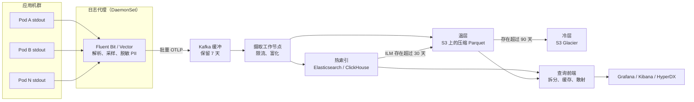
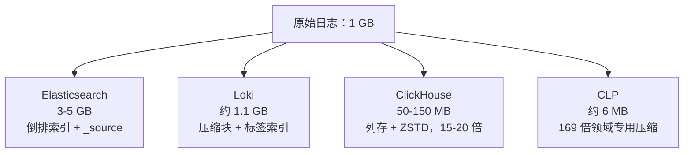
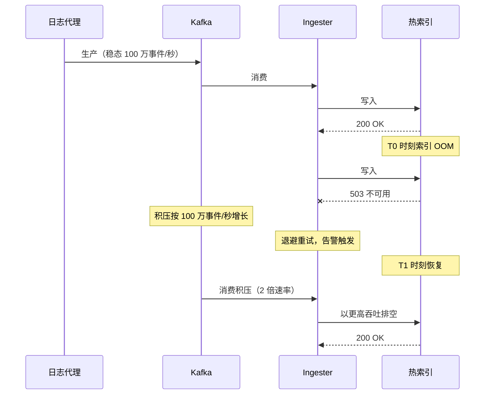
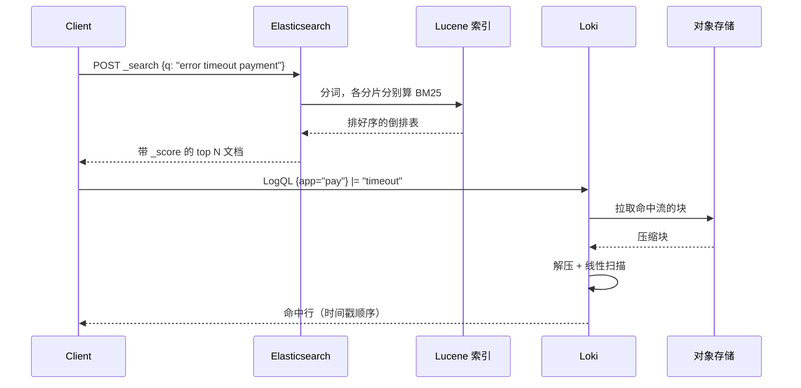
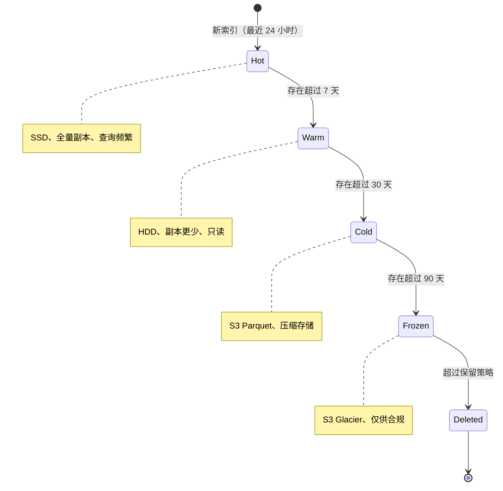

# 设计一个日志平台（ELK / Loki / Splunk）

> **TL;DR.** 日志平台要把应用机群吐出的每一条文本事件都收进来，用 Kafka 缓冲换取持久性，再写进倒排索引系统（Elasticsearch、Splunk）或标签索引的对象存储系统（Loki），并对外提供“几天数据、5 秒内返回”的查询能力。核心权衡是摄取时索引什么、查询时扫描什么：Elasticsearch 为每个字段建索引，存储成本是原始数据的 3-10 倍[^1]；Loki 只索引标签，查询时再对压缩块做 grep 扫描[^2]。到了超大规模，Meta 的 Scribe 摄取速率超过 2.5 TB/秒[^3]，Character.AI 每月处理 450 PB 原始日志[^4]，Uber 用 CLP 把 Spark 日志压到 169:1[^1]。最终的架构总是收敛到三件事：Kafka 缓冲区当持久性边界、分层保留（热/温/冷）、结构化日志当成本控制手段。

## 学习目标

学完本模块，你将能够：

- [ ] 设计一条带背压的日志摄取流水线，在下游故障时既不丢数据也不被打穿
- [ ] 比较基于索引（ELK）与基于标签（Loki）的存储架构，并为给定负载说明选型理由
- [ ] 用 BM25 评分理解全文日志检索是怎么排名的
- [ ] 用纸笔估算为一条每年 10 PB 的日志平台做容量规划
- [ ] 落地分层保留（热、温、冷、冻结），以最低成本满足合规要求
- [ ] 说明为什么大规模下结构化日志胜过非结构化自由文本

## 直觉理解

小规模时日志看着毫无难度。`kubectl logs` 能用，`tail -f` 能用，一台 Elasticsearch 节点就装得下整个创业公司的输出。然后你长到 3,000 个 Pod、500 个微服务，某个行为失常的重试循环开始每个 Pod 每秒吐 1,000 条错误。摊到一个 1,000 Pod 的部署上，这一个 bug 就是每秒 100 万条日志事件。你的 Elasticsearch 集群 OOM，Kafka 分区写满，值班工程师想查这次事故的日志，却发现事故本身已经先把日志平台干掉了。

朴素做法（把所有东西写进一个大索引）在三个地方翻车。第一是成本：给每条日志的每个字段都建索引，存储是原始数据的 3-10 倍[^1]，每年 10 PB 原始量就是 30-100 PB 索引存储。第二是持久性：生产者和索引之间没有缓冲区，下游一挂就等于丢日志。第三是查询速度：在 30 天未索引数据上做检索是全表扫描，单位是分钟而不是秒。

点破这道题的关键洞察是：**把持久性边界和查询边界拆开。** Kafka 不管多高的速率都能先接住，而且不管下游健康与否都能存几天。索引（或者块存储）负责服务查询。这两个系统独立扩展、独立故障、成本结构也各不相同。其余的一切——采集代理、解析器、分层、保留策略——都只是这两条边界之间的管道工程。

## 需求

### 澄清问题

- **Q：峰值摄取速率是多少？**
  假设：峰值 1,000 万事件/秒（均值 100 万/秒），稳态下单个服务约 3 MB/秒。

- **Q：保留期有什么要求？**
  假设：热存 30 天（快查），温存 90 天，冷存 13 个月（合规）。PCI-DSS 要求保留 12 个月，其中 3 个月可即时取用[^5]。

- **Q：要全文搜索，还是只要结构化过滤？**
  假设：两者都要。事故期间工程师需要自由文本关键词搜索，看板则用结构化标签过滤。

- **Q：多租户吗？**
  假设：是。每个服务团队有自己的摄取配额和查询并发上限。

- **Q：查询延迟目标是多少？**
  假设：跨 7 天热数据的查询 p99 低于 5 秒。

- **Q：日志里要处理 PII 吗？**
  假设：要。PCI-DSS 要求持卡人数据在落到持久存储之前就被清洗掉[^6]。

### 功能需求

- 从任何容器、虚机或 serverless 函数摄取结构化与非结构化日志
- 在流水线层面解析、富化日志，并可选采样
- 对热数据提供带相关性排序（BM25）的全文搜索
- 对近期日志提供亚秒级响应的标签过滤
- 分层保留，自动做生命周期迁移
- 按租户限流并执行配额

### 非功能需求

- **摄取：** 峰值 1,000 万事件/秒，2 倍突发下不丢数据
- **延迟：** 7 天查询 p99 < 5 秒；30 天查询 p99 < 30 秒
- **可用性：** 写路径 99.9%，读路径 99.95%
- **持久性：** 下游故障最长 24 小时内零日志丢失[^7]
- **合规：** SOX 7 年，HIPAA 6 年，PCI-DSS 12 个月[^5]

## 容量估算

| 指标 | 数值 | 推算 |
|--------|------:|------------|
| 峰值事件/秒 | 10M | 1,000 个服务 × 10K 事件/秒峰值 |
| 平均事件大小 | 1 KB | 带属性的 JSON 结构化日志 |
| 峰值摄取带宽 | 10 GB/秒 | 10M × 1 KB |
| 每日原始量 | 86 TB | 100 万均值事件/秒 × 1 KB × 86,400 |
| 30 天热存（带索引） | 2.6 PB | 86 TB × 30（压缩前） |
| 30 天热存（15 倍压缩） | ~170 TB | ClickHouse 式列存[^4] |
| 13 个月冷存（S3，压缩） | ~1.2 PB | 86 TB × 395 天 / 15 倍压缩 |
| Kafka 缓冲（保留 7 天） | 600 TB | 86 TB × 7 |
| 查询 QPS（热路径） | ~500 | 事故期间各工程团队 |

几个关键比例：

- **写读比：** 约 100:1（绝大多数日志永远不会被搜）
- **压缩率：** 列存上 ZSTD 通常 15-20 倍[^4]；领域专用的 CLP 能到 169 倍[^1]
- **索引开销（Elasticsearch）：** 倒排索引加 `_source` 使体积达到原始的 3-10 倍[^1]
- **规模化后的成本：** Datadog 约收 $0.10/GB 摄取费（只算摄取，索引另计）[^8][^9]；Splunk（2024 年 3 月被 Cisco 收购）标价 $150-225/GB/天[^10]

## API 与数据模型

### API 设计

```http
POST /v1/ingest
  Content-Type: application/x-protobuf (OTLP)
  Body: ExportLogsServiceRequest { resource_logs: [...] }
  Returns: 200 { "accepted": 50000 }
  Errors: 429 rate limited, 503 backpressure

GET /v1/search?query=error+timeout&start=2026-05-01T00:00:00Z&end=2026-05-04T00:00:00Z&limit=100
  Returns: 200 { "hits": [...], "total": 4521, "next_cursor": "..." }

GET /v1/streams?labels={app="checkout",env="prod"}&start=...&end=...&filter=|="timeout"
  Returns: 200 { "streams": [...], "stats": { "bytes_processed": "2.1GB" } }

POST /v1/tail
  WebSocket upgrade for live tail with label selector
  Returns: streaming log lines matching selector

GET /v1/retention/policies
  Returns: 200 { "policies": [{ "name": "hot", "days": 30 }, ...] }
```

### 数据模型

OpenTelemetry 的日志记录定义了标准 schema[^11]：

```text
LogRecord {
  timestamp:          uint64 (nanoseconds since epoch)
  observed_timestamp: uint64 (collection time)
  trace_id:           bytes (W3C correlation)
  span_id:            bytes
  severity_number:    int (1-24: TRACE/DEBUG/INFO/WARN/ERROR/FATAL)
  severity_text:      string
  body:               AnyValue (structured or free-text)
  resource:           { service.name, k8s.pod.name, ... }
  attributes:         map<string, AnyValue>
}
```

存储 schema 因后端而异：

| 后端 | 主键 | 分区策略 | 索引类型 |
|---------|------------|-------------------|------------|
| Elasticsearch | `_id`（自动） | 一天一索引，ILM 滚动 | 倒排（每个字段）[^12] |
| Loki | (tenant, label_set, timestamp) | 一致性哈希环路由到 ingester | 仅标签 TSDB[^13] |
| ClickHouse | (service, timestamp) | MergeTree，按天分区 | 稀疏主键 + bloom 跳数索引[^4] |

## 高层架构



*标准的日志流水线：代理在本机采集并脱敏，Kafka 提供持久性边界，摄取节点写入热索引，ILM 再让数据依次迁入温层和冷层。*

**写路径：** 代理跟随容器 stdout，解析成结构化记录，做 PII 脱敏，对 INFO 级别流量采样，再批量投递到 Kafka。摄取工作节点消费分区，执行按租户限流，写入热索引。Kafka 的 7 天保留意味着 24 小时的下游故障只会造成积压，不会丢数据[^7]。Meta 的 Scribe 架构用 40 多个不同组件才做到 2.5 TB/秒输入、7 TB/秒输出[^3]。

**读路径：** 查询前端收到检索请求，按时间范围切成子查询，扇出到热索引（近期）和温层（更早），合并结果并返回排序后的命中。对 Loki 这一类后端，前端会并行地从 S3 拉块。

**告警路径：** 在热索引上跑流式查询，按错误率阈值触发告警。告警规则每 30 秒评估一次；通知经 Alertmanager 路由到 PagerDuty 或 Slack。

## 深入探讨

### 基于索引与基于标签的存储

最根本的架构决策是：写入时你到底要索引多少东西。

> **生态现状（截至 2026-05）。** Elasticsearch 在 2021 年 1 月从 Apache 2.0 改为 ELv2+SSPL；2024 年 9 月 Elastic 又把 AGPL 加为第三个选项，使它重新成为 OSI 认可的开源软件。AWS 在 2021 年 4 月分叉出 OpenSearch；OpenSearch 于 2024 年 9 月交由 Linux 基金会托管。Splunk 在 2024 年 3 月被 Cisco 以 280 亿美元收购。新兴替代品包括 Datadog Logs（SaaS，按 GB 计价）、Grafana Loki（标签索引、对象存储原生）、VictoriaLogs（单二进制，内存占用比 Elasticsearch 少 30 倍）以及各类基于 ClickHouse 的栈。

**全字段索引（Elasticsearch、Splunk）：** 每条日志记录的每个字段都被分词并加进倒排索引。每个 Elasticsearch 索引切成若干分片，每个分片都是一个自包含的 Lucene 倒排索引，其中的倒排表把词项映射到文档 ID[^12][^14]。查任何字段都快，因为倒排表已经指向了命中的文档。代价是：存储是原始日志的 3-10 倍（倒排索引加上存储的 `_source` 字段），摄取端的 CPU 主要消耗在分词上[^1]。

**基于标签（Grafana Loki）：** 只索引一小撮流标签（每条流通常少于 15 个）[^15]。日志正文被压成块并刷到对象存储。写路径走一致性哈希环：distributor 按每条流的标签哈希到某个 ingester，ingester 按 (tenant, label_set) 构建压缩块，连同把标签映射到块偏移的 TSDB 索引一起刷到 S3/GCS[^13]。全文搜索就是并行 grep：querier 拉取符合标签选择器的块，解压，再线性扫描目标字符串。

**列存（ClickHouse）：** 没有传统索引。数据按列存储，用 LZ4/ZSTD 压缩，压缩比可达 15-20 倍[^4]。MergeTree 主键提供稀疏有序性；bloom filter 跳数索引加速高基数字段查找。Character.AI 在 ClickHouse Cloud 上每月处理 500 亿条采样日志，15 天范围的查询在秒级完成[^4]。



*同样 1 GB 原始日志，不同的索引策略下占用空间天差地别；ClickHouse 和 CLP 靠放弃逐字段倒排索引做到 7-169 倍压缩。*

权衡非常刺眼：Elasticsearch 给你亚秒级的任意查询，但存储成本是 Loki 的 10-50 倍；Loki 摄取便宜，全文搜索却慢。Character.AI 明确选了 ClickHouse 而不是 Loki，理由是标签式系统“必须提前知道日志的结构”，而事故期间工程师需要的是自由文本关键词搜索[^4]。

### 带背压的摄取流水线

从运行中的进程到持久存储这条路径，必须扛住三种故障：下游存储变慢、单个服务刷日志、代理与聚合器之间网络分区。

**代理层：** Fluent Bit 以 DaemonSet 运行，基线内存约 1 MB（Fluentd 约 40 MB）[^16]。它跟随容器日志文件，做解析（JSON、logfmt、正则），执行 PII 脱敏转换，再批量投递到 Kafka。代理端的磁盘缓冲能扛住 Kafka 的短暂不可用。

**Kafka 缓冲：** 这是关键的持久性边界。有了 7 天保留，几小时的下游故障只会变成有界积压，而不是日志丢失。Datadog 2023-03-08 的事故说明了这件事为什么重要：一次 systemd-networkd 重启导致从 06:00 UTC 起网络连通性中断；在 AWS 上约 60% 的实例到 08:00 UTC 已被终止并替换，恢复过程把流量推到平时吞吐的两倍左右，平台还得同时消化积压[^7]。按租户分区可以把吵闹邻居隔离开。

**背压与配额：** Meta 的 Scribe 按类目执行写配额：“配额超限后，Scribe 可以把某个类目拉黑、只接受它的一小部分日志，或者对生产者施加背压”[^3]。同样的套路在这里也适用：摄取节点按租户限流，超出的流量用 HTTP 429 拒掉，代理端指数退避。



*索引故障期间由 Kafka 接住摄取，把下游故障转换成有界积压；恢复后摄取节点以更高速率排空。*

**日志洪水治理：** 一个在死循环里打错误日志的服务（1,000 错误/秒 × 1,000 Pod = 单个 bug 每秒 100 万事件）足以打满整条流水线。防御手段：在 Kafka 生产者层按租户设摄取配额；在代理端对 INFO/DEBUG 做激进采样（Character.AI 对骨干服务的 INFO 日志按 1/10,000 采样[^4]）；对分区堆积设置熔断告警。

### 用 BM25 做搜索排序

当工程师在搜索框里敲下 `error timeout payment`，系统要在几百万条命中日志里按相关性排序。BM25（Best Matching 25）正是 Elasticsearch 和多数全文检索引擎使用的算法[^17]。

**公式：** 对每个查询词 q_i 和文档 D，BM25 的打分是：

```text
score(D, Q) = sum over q_i of:
  IDF(q_i) * (f(q_i,D) * (k1 + 1)) / (f(q_i,D) + k1 * (1 - b + b * |D| / avgDL))
```

其中 IDF(q_i) 惩罚常见词（在一堆错误里再出现一个“error”的日志行，加权更少），k1=1.2 控制词频饱和（一行里出现 50 次“timeout”不会得 50 倍分），b=0.75 做文档长度归一化（更长的日志行拿不到不公平的优势）[^17]。

**为什么对日志重要：** 大多数日志查询其实是结构化过滤（`service=checkout AND level=ERROR`），布尔匹配就够了。但事故期间，工程师搜的是他们从没见过的自由文本模式。BM25 把最相关的行顶到前面，省下几分钟的翻页。Loki 这类基于标签的系统做不到这点，它们只能通过 LogQL 流选择器按时间戳顺序返回行[^18]。

**局限：** BM25 依赖倒排索引。没有倒排索引的系统（Loki、ClickHouse）只能靠时间戳顺序或简单的 grep 匹配。这也正是基于索引的系统尽管昂贵却仍然存在的原因：按相关性排序的检索和过滤扫描是两种质不同的东西。Cloudflare 每秒 600 万 HTTP 请求的分析走 ClickHouse[^19]，但用的是按时间排序的结果，而非相关性排名。



*BM25 全文查询通过倒排表返回按相关性排序的结果；Loki 则先做标签匹配再 grep，线性拉取并扫描块，只返回按时间戳排序的结果。*

## 真实案例

**Uber：从 Elasticsearch 转向 CLP，169 倍压缩，年成本从 180 万美元降到 1 万美元。**

Uber 的 Spark 集群在 INFO 详细度下每天产出最多 200 TB 日志[^1]。原架构用 Elasticsearch，但这个量级下“Elasticsearch 的运维和硬件成本高得无法承受”[^1]。SSD 提前烧坏，因为 Log4j 会写出大量分散在作业时长内的小记录，造成写放大。临时的补丁是把详细度从 INFO 降到 WARN，代价是丢掉关键的调试可见性。

解法是 CLP（Compressed Log Processor，压缩日志处理器），分两期落地。一期在每个 JVM 内跑一个能识别 CLP 的 Log4j appender：把每行日志解析成时间戳、日志类型（静态模板）和变量（字典变量与非字典变量），再把解析后的中间表示写进 ZSTD 流，缓冲区 4 MB 并与 SSD 块对齐[^1]。写放大当场消失。

二期离线运行，把跨 JVM 的中间表示聚合成 CLP 的最终列式格式。结果是：30 天内 5.38 PB 未压缩 Spark 日志压到 31.4 TB，比例 169:1[^1]。CLP 的压缩比单独用 ZSTD 好 2.16 倍，比 Gzip 好 2.28 倍。OSDI 2021 的论文显示 CLP 的摄取性能比 Elasticsearch 和 Splunk 高出 13 倍以上[^20]。

成本影响：一期压缩上线后，30 天保留的年度成本从预估的 180 万美元降到 1 万美元。保留期从 3 天延长到 30 天，成本反而低 17 倍[^1]。对非 Spark 的 JSON 日志，Uber 迁到了 ClickHouse，因为它在结构化数据上靠列式压缩和稀疏索引，效率比 Elasticsearch 高得多。



*ILM 随索引变旧把它们逐层下推；每一层都是用查询速度换成本，对象存储比 SSD 热节点便宜 10-50 倍。*

## 权衡

| 方案 | 优点 | 缺点 | 适用场景 |
|----------|------|------|-------------|
| 全字段索引（ELK、Splunk） | 任意字段都快查、支持 BM25 排序 | 存储成本 3-10 倍、摄取 CPU 高[^1] | 安全、合规、频繁的临时检索 |
| 基于标签（Loki） | 摄取便宜、S3 原生存储 | 全文搜索慢、受标签基数限制[^15] | 调试、偶发检索、成本敏感 |
| 列存（ClickHouse） | 15-20 倍压缩、聚合快[^4] | 没有原生 BM25、需要调 schema | 海量结构化日志、分析场景 |
| 混合（Loki + ELK 热层） | 成本可控、近期数据快 | 要运维两套系统 | 规模大且负载多样的场景 |
| 分层下推到对象存储 | 冷数据便宜 10-50 倍 | 冷查更慢、需要回温时间 | 合规保留（SOX、HIPAA）[^5] |
| 结构化日志（OTLP） | 字段有类型、可与 trace 关联[^11] | 需要开发者配合改造 | 新服务 |
| 非结构化日志 | 接入容易、不改 SDK | 解析成本高、字段不一致 | 遗留系统 |

最大的元决策是：**基于索引还是基于标签。** 如果你的工程师每天事故期间都要搜日志、需要自由文本关键词搜索，那就为索引付费（Elasticsearch，或带 bloom filter 的 ClickHouse）。如果日志主要用于合规和偶尔排查，Loki 那 10-50 倍的成本优势就赢了。多数大型组织两套都跑：ELK 给安全与合规团队，Loki 给应用调试。

## 扩展与故障模式

**10 倍（1 亿事件/秒）：**

- Kafka 分区打满。缓解：提高每个 topic 的分区数，按服务命名空间拆开。
- Elasticsearch 热层因突发摄取 OOM。缓解：用 ILM 把热/温/冷分层，滚动粒度从一天一索引改成按小时[^12]。

**100 倍（10 亿事件/秒）：**

- 单个 Kafka 集群扛不住这个吞吐。缓解：按区域部署 Kafka 集群，跨区复制以支持合规查询。
- 查询前端成为瓶颈。缓解：结果缓存（Memcached）、按时间范围拆查询、按租户限并发。

**1000 倍（Meta/Uber 量级）：**

- 要大改架构：自研传输层（Scribe/LogDevice）、领域专用压缩（CLP）、在代理端激进预采样、按使用场景配专用查询引擎[^3][^1]。

**故障模式：**

- **索引集群 OOM：** Kafka 接住摄取；对分区堆积告警。恢复手段：扩热节点、强制合并 segment，或临时把流量引到温层。分片重分配可能级联压到相邻节点[^14]。
- **Kafka broker 故障：** 副本因子 3 意味着单 broker 挂掉不丢数据。生产者重试到 ISR 副本。恢复靠 controller 重新选举自动完成。
- **代理日志洪水循环：** 摄取端按租户配额拒掉超额部分。Scribe 的做法是把该类目拉黑，只接受一小部分[^3]。对 `fluentbit_output_errors_total` 告警，以捕捉静默丢弃。

## 常见陷阱

> [!WARNING]
> **Loki 里的高基数标签。** 像 `trace_id` 或 `user_id` 这样的标签会为每个请求造出一条新流。Loki 默认每条流 15 个标签的上限，而且“从设计到实现都不支持高基数标签值”[^15]。高基数属性要放进结构化元数据，不要做成标签。

> [!WARNING]
> **不清洗就记录 PII。** 开发者把含持卡人数据或 SSN 的整个请求体打进日志。PCI-DSS 要求持卡人数据无论在存储还是传输中都受保护，日志输出也算[^6]。要在数据离开主机之前由代理清洗；落库之后再脱敏已经太晚。

> [!WARNING]
> **代理与索引之间没有 Kafka 缓冲。** 没有持久缓冲，下游一挂就是丢日志。代理的内存缓冲是有界的，超了就静默丢弃。Kafka 保留期把故障转化成有界积压[^3]。

> [!WARNING]
> **对冷数据做宽泛的自由文本查询。** 在 Loki 里对 30 天数据跑一个 `|= "error"` 查询，等于扫描数 TB 的块。要按租户限制查询并发，要求标签选择器命中的流数小于 N，并在前端按时间范围拆查询[^15]。

> [!WARNING]
> **忽略代理层的丢弃指标。** Fluent Bit 和 Vector 在缓冲写满时会静默丢日志。把 `fluentbit_output_errors_total` 和 `vector_buffer_full` 作为指标暴露出来，只要非零就告警。这是你判断日志正在丢失的唯一信号。

## 追问

**1. 多区域日志聚合怎么做？**

每个区域各自有 Kafka 集群和摄取节点，写入本区域热索引。全局查询前端在跨区检索时向各区域扇出。冷层数据复制到每个合规区域各自的单个 S3 桶。跨区查询延迟受最慢那个区域的响应制约。

**2. 怎么做基于日志的告警，又不把索引压垮？**

在 Kafka（而不是索引）上跑流式查询做实时模式识别。用 Flink 或专门的告警消费者，在入库之前就对流评估正则和阈值规则。这样告警延迟就与索引写入延迟解耦了。

**3. 如果是 SaaS 日志产品（Datadog/Splunk Cloud 模式），要改什么？**

按客户设摄取配额并对超额计费（Datadog 是 $0.10/GB[^9]）。租户隔离做到 Kafka 分区级别。企业客户给专属索引分片。在摄取与存储之间加计量层，按租户按账期统计字节数。

**4. 日志怎么和 trace 关联？**

OpenTelemetry 的日志记录带 `trace_id` 和 `span_id` 字段[^11]。把它们作为结构化字段建索引。UI 可以从一行日志跳到对应的 trace span，也可以从一个 span 跳到该 span 期间产生的所有日志。前提是已经采纳结构化日志。

**5. 怎么落实 GDPR 的日志删除权？**

多数系统里日志是只追加、不可变的。用加密撕碎（crypto-shredding）：日志正文用按用户区分的密钥加密，密钥存在密钥管理服务里。“删除”某用户的日志就等于删掉他的密钥。另一种做法是让保留策略在 GDPR 响应窗口（30 天）内自然过期。

**6. 怎么从 Elasticsearch 迁到 Loki 而不丢搜索能力？**

迁移期双写，新日志同时打到两套系统。对自由文本搜索真正重要的热层（7 天）继续留 Elasticsearch。更老的数据只走 Loki 以省成本。随着各团队采纳带显式标签选择器的结构化日志，逐步缩短 Elasticsearch 的保留期。

## 练习

### 练习 1：突发摄取设计

你的机群稳态每秒产生 3 MB 日志。某次故障期间，一个库开始在循环里打错误日志，瞬间冲到 50 MB/秒。请设计摄取链路，要求：突刺期间不丢日志、下游索引不 OOM、运维团队在故障发生的那一刻仍能查日志。请明确说明：需要多长的 Kafka 保留期、摄取节点如何自动扩缩、以及哪个告警能告诉你摄取正在限速。

<details>
<summary>提示</summary>

想一想这个突刺可能持续多久（小时级，不是分钟级），按峰值速率覆盖这段时间需要多大的 Kafka 分区，以及摄取节点如何在不丢 Kafka 数据的前提下限制写入索引的速率。

</details>

<details>
<summary>解答</summary>

**Kafka 容量：** 峰值 50 MB/秒持续最长 24 小时，突刺总共约 4.3 TB。配合 7 天 Kafka 保留和 3 副本，每个 topic 的分区至少要能装下 4.3 TB。这样即使索引在整个突刺期间都挂着，也不会丢一条。

**摄取节点扩缩：** HPA 按 Kafka 消费堆积扩容。稳态下 2 个摄取节点处理 3 MB/秒。当堆积超过阈值（比如 5 分钟的积压量），HPA 扩到 10 个节点。每个节点写入索引的速率控制在索引能承受的水平（限到索引容量的 80%）。

**按租户限流：** 出问题那个服务所属租户触到配额（比如基线的 10 倍 = 30 MB/秒）。超出的部分要么采样（ERROR 全留、INFO 留 1%），要么用 429 拒掉。这样保护了其他租户。

**告警：** `kafka_consumer_group_lag_seconds > 300`（5 分钟积压）触发。第二条告警在单租户摄取速率超过基线 10 倍时触发。两条合起来告诉运维：“租户 X 在刷日志，而流水线正在 Kafka 里吸收它。”

**故障期间的查询：** 热索引照样服务已经入库的数据。Kafka 里那批突刺数据暂时查不到，但告警已经把情况告诉运维了。索引恢复后，摄取节点以 2 倍速率排空直到追平。

</details>

## 要点回顾

- **摄取时索引什么，就在摄取时为它付钱；查询时不索引什么，就在查询时为它付钱。** 这一个权衡决定了你的架构。
- **规模上来之后，Kafka 做持久缓冲不是可选项。** 它把下游故障转化成有界积压，而不是日志丢失[^3]。
- **结构化日志（OTLP）能把体验提升一个量级。** 要往上推；跟非结构化日志搏斗纯属浪费时间[^11]。
- **分层保留（热/温/冷）能把存储成本降 10-50 倍。** 审计人员很少需要在一年前的数据上做亚秒级查询[^5]。
- **按租户限流能防止单个失常服务干死整个平台。** Scribe 的配额模型是黄金标准[^3]。
- **BM25 相关性排序和按时间戳排序的 grep 是质不同的东西。** 这就是事故响应场景下倒排索引值得付费的理由[^17]。

## 延伸阅读

- [Scribe: Transporting petabytes per hour via a distributed, buffered queueing system](https://engineering.fb.com/2019/10/07/data-infrastructure/scribe/)。Meta 对 daemon+service+durable-log 模式在 2.5 TB/秒摄取下十二年实践的复盘。
- [Reducing Logging Cost by Two Orders of Magnitude using CLP](https://www.uber.com/blog/reducing-logging-cost-by-two-orders-of-magnitude-using-clp/)。Uber 169 倍压缩案例，含两阶段 Log4j appender 的设计。
- [CLP: Efficient and Scalable Search on Compressed Text Logs (OSDI 2021)](https://www.usenix.org/conference/osdi21/presentation/rodrigues)。原始论文，展示相对 Elasticsearch 和 Splunk 13 倍的摄取优势。
- [Grafana Loki architecture](https://grafana.com/docs/loki/latest/get-started/architecture/)。distributor、ingester、querier、块格式以及读写路径的权威文档。
- [Practical BM25, Part 2: The BM25 Algorithm and its Variables](https://www.elastic.co/blog/practical-bm25-part-2-the-bm25-algorithm-and-its-variables)。把 k1、b、IDF 和完整打分公式讲清楚，还带算例。
- [OpenTelemetry Logs Data Model](https://opentelemetry.io/docs/specs/otel/logs/data-model/)。结构化日志的标准 schema；SeverityNumber 那张表值得读，用来做跨语言归一化。
- [Scaling observability at Character.AI with ClickStack](https://clickhouse.com/blog/scaling-observabilty-for-thousands-of-gpus-at-character-ai)。每月 450 PB 原始量、15 倍压缩、靠 ClickHouse Cloud 与 OpenTelemetry Collector 省下 50% 成本。
- [Loki label cardinality best practices](https://grafana.com/docs/loki/latest/get-started/labels/cardinality/)。关于高基数标签为什么会搞坏 Loki、以及结构化元数据这个逃生口的权威解释。

## 记忆卡片

<details>
<summary><strong>Q：基于索引与基于标签的日志存储，根本权衡是什么？</strong></summary>

A：基于索引的系统（Elasticsearch、Splunk）在写入时给每个字段建索引，任意查询都快，但存储成本是 3-10 倍。基于标签的系统（Loki）只索引标签、只存压缩块，摄取便宜，但全文搜索慢（对块做并行 grep）[^1][^2]。

</details>

<details>
<summary><strong>Q：为什么规模化日志流水线里 Kafka 不可省？</strong></summary>

A：Kafka 在日志生产者和索引之间提供持久性边界。下游故障（索引 OOM、网络分区）期间，Kafka 以全速接住摄取并撑住数天。没有它，代理的有界缓冲一满就静默丢日志[^3][^7]。

</details>

<details>
<summary><strong>Q：BM25 打分的三个组成部分是什么？</strong></summary>

A：(1) IDF（逆文档频率）惩罚常见词。(2) 词频项的饱和由 k1=1.2 控制，防止一个词出现 50 次就拿到 50 倍分。(3) 文档长度归一化由 b=0.75 控制，防止长文档拿到不公平优势[^17]。

</details>

<details>
<summary><strong>Q：Uber 用 CLP 压缩 Spark 日志达到了什么压缩比？</strong></summary>

A：169:1。Uber 用 CLP 的两阶段方案（一期的流式 IR，二期的列式聚合）把 30 天 5.38 PB 的 Spark 日志压到 31.4 TB。这比单用 ZSTD 好 2.16 倍[^1]。

</details>

<details>
<summary><strong>Q：高基数标签为什么会搞坏 Loki？</strong></summary>

A：Loki 对每个唯一标签集建一条流。像 `request_id` 这样的标签会让每个请求各成一条流，造成流爆炸：细碎的块淹掉对象存储，索引无限膨胀，摄取变慢。Loki 建议标签保持静态、低基数（每条流少于 15 个）[^15][^21]。

</details>

<details>
<summary><strong>Q：日志的法定最短保留期是多少？</strong></summary>

A：PCI-DSS 要求 12 个月，其中 3 个月可即时取用。HIPAA 要求 6 年。SOX 要求 7 年。这些要求驱动了冷层架构：对象存储比热索引便宜 10-50 倍[^5]。

</details>

<details>
<summary><strong>Q：Meta 的 Scribe 怎么处理超出写配额的服务？</strong></summary>

A：Scribe 可以把该类目拉黑（丢掉所有新流量）、只接受一小部分日志，或者对生产者施加背压。这样单个吵闹服务就无法把流水线容量从其他租户手里抢光[^3]。

</details>

<details>
<summary><strong>Q：Elasticsearch 相对原始日志大小的典型存储开销是多少？</strong></summary>

A：3-10 倍。倒排索引（每个分词字段的倒排表）、存储的 `_source` 字段（原始 JSON）以及 segment 元数据都在贡献开销。Uber 明确迁移走人，就是因为每天 200 TB 下这个开销“无法承受”[^1][^12]。

</details>

<details>
<summary><strong>Q：ClickHouse 在日志数据上怎么做到 15-20 倍压缩？</strong></summary>

A：列存把同一字段的值聚在一起（时间戳挨着时间戳，严重级别挨着严重级别），让 LZ4/ZSTD 压缩极为有效。MergeTree 主键提供稀疏有序性，又不用付逐行索引的开销。Character.AI 报告某些列上能到 50 倍[^4]。

</details>

<details>
<summary><strong>Q：OpenTelemetry 的 SeverityNumber 范围是多少，为什么重要？</strong></summary>

A：SeverityNumber 是 1-24 的整数，分桶为 TRACE（1-4）、DEBUG（5-8）、INFO（9-12）、WARN（13-16）、ERROR（17-20）、FATAL（21-24）。它把不同语言、不同框架的级别命名（“Error”、“Critical”、“Severe”）统一起来，让采样和告警规则可以一致地生效[^11]。

</details>

## 参考文献

[^1]: Agrawal, Luo, "Reducing Logging Cost by Two Orders of Magnitude using CLP", Uber Engineering, Sep 2022. https://www.uber.com/blog/reducing-logging-cost-by-two-orders-of-magnitude-using-clp/

[^2]: Grafana Labs, "Loki overview". https://grafana.com/docs/loki/latest/get-started/overview/

[^3]: Karpathiotakis, Wernli, Stojanovic, "Scribe: Transporting petabytes per hour via a distributed, buffered queueing system", Meta Engineering, Oct 2019. https://engineering.fb.com/2019/10/07/data-infrastructure/scribe/

[^4]: ClickHouse, "Scaling observability at Character.AI: thousands of GPUs, 10x logs, and 50% lower cost with ClickStack", Aug 2025. https://clickhouse.com/blog/scaling-observabilty-for-thousands-of-gpus-at-character-ai

[^5]: Bloo, "Security Log Retention: Regulation, Risk, and Reality". https://bloo.io/blog/security-log-retention

[^6]: OWASP Cheat Sheet Series, "Logging Cheat Sheet" (sensitive data exclusion and masking in logs, including payment card data under PCI DSS). https://cheatsheetseries.owasp.org/cheatsheets/Logging_Cheat_Sheet.html

[^7]: Bernaille, "2023-03-08 incident: A deep dive into the platform-level impact", Datadog Engineering, May 2023. https://www.datadoghq.com/blog/engineering/2023-03-08-deep-dive-into-platform-level-impact

[^8]: Datadog, "Log Management Pricing" (per-GB ingestion and per-million-events indexing tiers). https://www.datadoghq.com/pricing/?product=log-management

[^9]: OneUptime, "The Real Cost of Datadog: A Breakdown for Engineering Teams", Feb 2026. https://oneuptime.com/blog/post/2026-02-16-the-real-cost-of-datadog/view

[^10]: Expanso, "Splunk Pricing in 2026: The Real Cost and How to Control It". https://expanso.io/blog/splunk-pricing-guide/

[^11]: OpenTelemetry, "Logs Data Model" (Stable). https://opentelemetry.io/docs/specs/otel/logs/data-model/

[^12]: Elastic, "Clusters, nodes, and shards". https://www.elastic.co/docs/deploy-manage/distributed-architecture/clusters-nodes-shards

[^13]: Grafana Labs, "Loki architecture". https://grafana.com/docs/loki/latest/get-started/architecture/

[^14]: Baeldung, "Shards and Replicas in Elasticsearch", Jan 2024. https://www.baeldung.com/java-shards-replicas-elasticsearch

[^15]: Grafana Labs, "Cardinality". https://grafana.com/docs/loki/latest/get-started/labels/cardinality/

[^16]: NXLog, "Fluent Bit vs Fluentd: How to choose the right tool for your log pipeline", 2025. https://nxlog.co/news-and-blog/posts/fluent-bit-vs-fluentd

[^17]: Connelly, "Practical BM25, Part 2: The BM25 Algorithm and its Variables", Elastic, Apr 2018. https://www.elastic.co/blog/practical-bm25-part-2-the-bm25-algorithm-and-its-variables

[^18]: Grafana Labs, "LogQL log queries". https://grafana.com/docs/loki/latest/query/log_queries/

[^19]: Cloudflare, "HTTP Analytics for 6M requests per second using ClickHouse", Mar 2018. https://blog.cloudflare.com/http-analytics-for-6m-requests-per-second-using-clickhouse/

[^20]: Rodrigues et al., "CLP: Efficient and Scalable Search on Compressed Text Logs", USENIX OSDI 2021. https://www.usenix.org/conference/osdi21/presentation/rodrigues

[^21]: Grafana Labs, "Label best practices". https://grafana.com/docs/loki/latest/get-started/labels/bp-labels/
