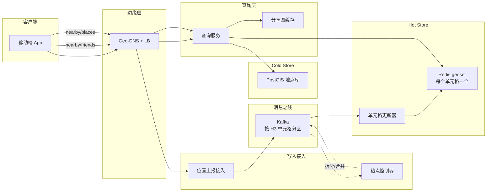
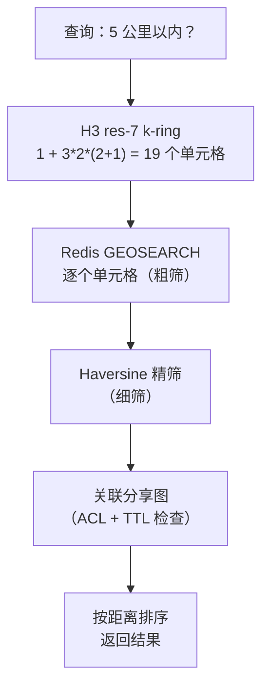
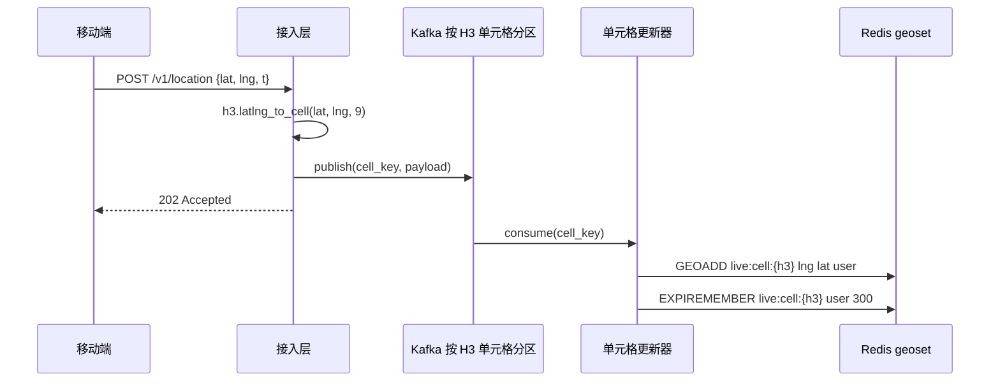
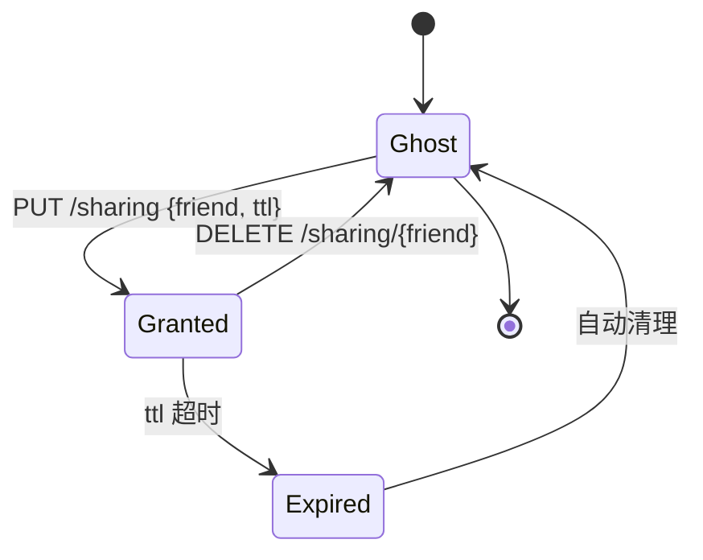

# 设计一个邻近服务（附近好友 / Yelp）

> **TL;DR.** 邻近服务要回答“谁 / 什么在我附近”，而它背后是两类截然不同的负载：静态 POI（Yelp，2.44 亿条评论 [^1]）和实时好友位置（Snap Map，月活超过 4 亿 [^2]）。架构因此拆成两层：由 PostGIS 支撑的地点搜索，以及由 Redis geoset 支撑的实时分享层，两者都用 H3 六边形单元格做索引。Kafka 按 H3 单元格 ID 分区，所以热点拆分是可操作的。关键的权衡在于：六边形让邻居距离均匀，半径扩张因此干净，但单元格边界必然产生误报，所以必须补一步“粗筛 + 精筛”的细化流程。

## 学习目标

- 设计一个双负载的邻近服务，在 1 亿用户规模下同时处理静态 POI 搜索和实时好友位置分享
- 对比 geohash、H3、S2、四叉树和 PostGIS 索引，并针对给定读写比为选型给出理由
- 为每秒 10 万次更新、且成员级 TTL 的 Redis geoset 写路径做容量规划
- 实现 k-ring 扇出的读路径，用 Haversine 精筛避免过量取数
- 在演唱会、抗议集会、灾害等场景下，用动态分辨率拆分检测并缓解单元格热点
- 用“逐个好友的 TTL”而不是“全局开关”来推理位置隐私

## 直觉理解

“找附近的好友”看起来就是个哈希查找。把每个用户的经纬度存起来，按距离查询。一张 PostgreSQL 表配 `ST_DWithin`，服务 100 个用户毫无压力。

但到了 100 万并发分享者、每人每 10 秒上报一次，这张表就要吃下每秒 10 万次写入。社区基准测试表明，单主库上 PostGIS 的 GiST 索引在每秒 1 万到 3 万次写入之后就会因为页锁争用而吃力。读侧更糟：演唱会散场，6 万人同时打开 App，每个查询都扇出到同一批地理单元格上。一个分片当场熔掉。

解开这个设计的第一个洞察：把两类负载彻底分开。静态 POI（餐厅、加油站）按小时变化，天生适合 PostGIS。实时好友位置每几秒就变，应该放进内存中的 geoset（Redis），并按空间单元格分区。Kafka 按单元格 ID 分区而不是按用户 ID，这样单个单元格的热点可以拆成更细分辨率的子单元格，而不用碰系统其余部分。

第二个洞察：没有哪种单元格索引是精确的。任何基于单元格的查询在边界处都会返回误报。通用的解法是两步精筛模式：先按单元格归属粗筛，再用 Haversine 精确距离 [^3] 精筛。接受这个成本。它是 O(候选数)，而候选数由单元格大小界定。

## 需求

### 澄清问题

- **问：做附近好友（动态）、附近地点（静态），还是两者都做？**
  假设：两者都做。它们共用查询 API，但在存储和新鲜度上分道扬镳。
- **问：半径固定还是用户自选？要不要支持 k-NN？**
  假设：用户自选半径（默认 5 公里）。k-NN 用于“最近的 20 家餐厅”。
- **问：实时分享的新鲜度目标是多少？**
  假设：好友共享位置 30 秒以内可见；地点发现 60 秒以内。
- **问：分享模型是什么？**
  假设：按好友逐个授权，可带 TTL。默认幽灵模式（主动选择加入才分享）[^4]。
- **问：GPS 精度还是基站精度？**
  假设：移动端用 GPS（5 米）；为保护隐私上报时粗化到单元格中心。
- **问：第一天就全球部署还是单区域？**
  假设：先单区域，多区域在路线图上。
- **问：移动端电量预算？**
  假设：按 10 秒一次请求设计；实际上 iOS 低电量时会把频率压到 20 到 60 秒一次。

### 功能性需求

- 移动客户端上报位置（纬度、经度、精度、时间戳）
- 拉取半径 R 内的好友，按分享关系和 TTL 过滤
- 按类目、查询串和半径搜索商家
- 按好友逐个授予分享权限，可配置过期时间
- 好友进入配置好的地理围栏半径时发出通知

### 非功能性需求

- **负载：** 1 亿用户，5000 万条好友关系，100 万并发分享者。位置更新峰值每秒 10 万次（通勤高峰每秒 20 万次）。
- **延迟：** 附近查询 P99 < 500 ms。位置上报 P99 < 100 ms。
- **可用性：** 读路径 99.95%，写路径 99.9%。
- **一致性：** 位置最终一致（30 秒陈旧可接受）。分享关系变更要求强一致。
- **隐私：** 服务端维护逐个好友的 TTL。24 小时无活动自动淡出 [^4]。静态加密。

## 容量估算

| 指标 | 数值 | 推导 |
|--------|------:|------------|
| 位置写入/秒（峰值） | 200k | 100 万分享者 / 10 秒间隔，通勤高峰再 ×2 |
| 附近好友读取/秒（均值） | 60 | 每天 500 万次浏览 / 86,400 |
| 附近好友读取/秒（演唱会尖峰） | 10k | 15 分钟突发 |
| 热集内存 | 320 MB | 500 万分享者 × 每个 geoset 成员 64 字节 |
| POI 存储 | 400 GB | 2 亿商家 × 2 KB |
| 入向带宽 | 20 MB/s | 每秒 10 万次写入 × 200 字节 |
| 出向带宽 | 50 MB/s | 读取返回 20 位好友 × 100 字节 × 峰值 10k QPS |

- **读写比（实时层）：** 稳态约 1:1,600；演唱会尖峰时反转为 100:1。
- **缓存命中率：** 热集能放进一个 Redis 节点（320 MB）。读扇出靠复制扛。
- **POI 索引：** 在 `geography(Point, 4326)` 上建 PostGIS GiST 索引，每个区域配只读副本。

## API 与数据模型

### API 设计

```http
POST /v1/location
  Body: { "lat": 37.7749, "lng": -122.4194, "accuracy_m": 5, "timestamp": "..." }
  Returns: 202 Accepted
  Rate limit: 1 per 3 seconds per user (server-side dedup)

GET /v1/nearby/friends?radius_m=5000
  Returns: 200 { "friends": [{"user_id": "...", "distance_m": 340, "last_seen_s": 12}], "next_cursor": "..." }

GET /v1/nearby/places?lat=37.77&lng=-122.41&radius_m=2000&category=restaurant&q=sushi
  Returns: 200 { "places": [...], "next_cursor": "..." }

PUT /v1/sharing
  Body: { "friend_id": "uuid", "ttl_seconds": 3600 }
  Returns: 200 { "expires_at": "..." }

DELETE /v1/sharing/{friend_id}
  Returns: 204 (revoke within 5 seconds)
```

### 数据模型

```sql
-- Redis geoset: one per H3 res-7 cell (~5.16 km^2)
-- Key: live:cell:{h3_cell_id}
-- Members: user_id with score = 52-bit geohash (GEOADD)
-- Per-member TTL: 300 seconds (5 min expiry on stale locations)

-- Sharing graph (Redis + Cassandra-backed)
-- Key: share:{user_id}
-- Value: hash { friend_id -> expiry_ts }

-- PostGIS places (static POI)
CREATE TABLE places (
  id          uuid PRIMARY KEY,
  name        text,
  category    text,
  geog        geography(Point, 4326),
  rating      numeric(2,1),
  review_count int
);
CREATE INDEX ON places USING GIST (geog);

-- Location history (Cassandra, optional analytics)
-- Partition: user_id, Cluster: bucket_ts (1-min), TTL 7 days
```

## 高层架构



*位置更新从左到右流过按单元格分区的 Kafka，进入每个单元格各自的 Redis geoset；查询则扇出到右侧的若干单元格，并在返回前关联分享图。*

**写路径：** 移动客户端把经纬度 POST 给位置上报接入服务。接入层计算分辨率 9 的 H3 单元格 ID，校验负载，然后以单元格为分区键发布到 Kafka。单元格更新器从 Kafka 消费，执行 `GEOADD live:cell:{h3} lng lat user_id`，并设置 300 秒的成员级 TTL [^5]。

**读路径：** 查询服务收到附近好友请求后，算出调用者所在的 H3 单元格，扩张一圈相邻单元格的 k-ring，并行向每个单元格对应的 Redis 分片发 `GEOSEARCH`，把结果与分享图做关联（检查 TTL 是否过期），再按精确 Haversine 距离精筛，最后返回排序后的结果。

**热点路径：** 热点控制器根据 Kafka 消费积压指标监控每个单元格的写入速率。当某个单元格超过阈值（每秒 1 万次写入），它触发从 res-7 到 res-8 子单元格的分辨率拆分，并更新 Kafka 分区映射。

## 深入探讨

### 地理索引选型：为什么是 H3

这个负载上有五个索引家族在竞争。选型取决于查询形态、写入速率和邻居语义。

**Geohash** 把经纬度比特沿 Z-order 曲线交错排列，再对结果做 base-32 编码 [^6]。Elastic 的文档指出，长度 12 的 geohash 单元格覆盖不到 1 平方米 [^7]。Redis 取这种交错的 52 位作为有序集合的 score，`GEOSEARCH` 因此做到亚毫秒级 [^5][^8]。致命缺陷：相距一米但跨在单元格边界两侧的两个点，可能一个前缀都不共享，因为 Z 曲线在赤道和子午线上并不连续 [^6]。单元格是矩形的，而且随纬度被拉长：经度一度在赤道是 111 公里，在北纬 60 度只有 56 公里 [^6]。

**H3**（Uber，2018 年）用六边形把球面铺满，共 16 个分辨率 [^9]。每个六边形恰好有 6 个等距邻居；正方形则不同，4 个边相邻、4 个对角相邻，后者距离是 sqrt(2) 倍 [^9]。`gridDisk(cell, k)` 原语返回 `1 + 3k(k+1)` 个单元格，是干净的圆形近似 [^10]。分辨率 7 平均每格 5.16 平方公里；分辨率 9 平均每格 0.105 平方公里 [^10]。每个分辨率的 12 个五边形在 Dymaxion 朝向下落在海上，永远不会影响城市查询 [^9]。

**S2**（Google）把球面投影到立方体的六个面，每面套一条 Hilbert 曲线，产出 64 位 `S2CellId`，含 31 级层次（0 级到 30 级，其中 `kMaxLevel = 30`）[^11]。数值相近的 ID 在空间上也相近，于是任何 B 树都能当地理索引用。Google Maps、MongoDB 2dsphere 和 CockroachDB 内部都在用 S2 [^11][^12]。它的 API 复杂（`S2RegionCoverer`、`min_level`、`max_level`、`max_cells`），而且因为跨立方体面的相邻单元格在数值上相隔很远，k-ring 扩张不如 H3 干净 [^11]。

**PostGIS GiST**（R 树）能处理精确距离、多边形和 KNN，靠 `<->` 运算符 [^13][^14]。静态 POI 搜索选它没错。但社区基准测试表明，GiST 的页锁把单主库写入限制在每秒 1 万到 3 万次左右。

**我们的选择：** 实时分享层用 H3（邻居均匀、k-ring 干净、64 位整数键）。静态 POI 搜索用 PostGIS（精确距离、多边形支持、SQL）。底层 Redis GEO 其实用的是 geohash 打分，但我们在外部按 H3 单元格分区，于是 geohash 的跨界问题被限制在每个单元格自己的有序集合里。



*两步精筛模式：H3 k-ring 提供粗筛，精确 Haversine 距离提供细筛，分享图负责落实隐私。*

### 写路径与热点围堵

写路径必须吃下每秒 10 万到 20 万次位置更新，同时不能让体育场里的人群把一个分片压垮。

**正常流程：** 接入层计算 `h3.latlng_to_cell(lat, lng, 9)`，以单元格 ID 为分区键发布到 Kafka。单元格更新器消费并执行 `GEOADD` [^5]。因为 Kafka 按单元格分区，同一地点附近的用户的所有更新都落到同一个分区，于是该单元格下游的 Redis 分片承担的写入速率是有界的，与单元格内人数成正比。

**热点检测：** 热点控制器盯每个分区的积压和写入速率指标。当某个 res-7 单元格超过每秒 1 万次写入（一座容纳 6 万球迷、按 10 秒间隔上报的体育场就是每秒 6,000 次，还不算场馆外的围观者），它就触发一次拆分。

**动态拆分：** 控制器算出这个热 res-7 单元格的 7 个 res-8 子单元格 [^10]，为每个子单元格建新的 Kafka 分区，并更新分区路由表。接入层开始为热区内的用户计算 res-8 单元格 ID。旧的 res-7 分区逐渐排空。查询则在更细的分辨率上透明地扩张自己的 k-ring。



*接入层算出 H3 单元格，Kafka 按单元格分区，更新器写入该单元格的 Redis geoset 并给每个成员打 5 分钟 TTL，陈旧位置会自动过期。*

### 读路径：k-ring 扇出与精筛

在 H3 分辨率 7（单元格边长约 1.4 公里）下，“5 公里内的好友”这个查询需要扩张 k=2 的 k-ring，得到 19 个单元格 [^10]。每个单元格映射到一个 Redis 分片。查询并行扇出。

**第一步：单元格扩张。** 算出调用者所在的 res-7 单元格。调用 `gridDisk(cell, 2)` 得到 19 个候选单元格。

**第二步：并行 GEOSEARCH。** 对每个单元格发 `GEOSEARCH live:cell:{c} FROMLONLAT lng lat BYRADIUS 5000 m` [^5]。Redis 返回该单元格包围盒内、且通过其内部 Haversine 校验的所有成员。这就是粗筛。

**第三步：关联分享图。** 对每个候选好友，检查 `share:{caller}` 里是否存在 `expiry_ts > now` 的有效授权。撤销能在 5 秒内生效，因为分享图放在 Redis 里，Cassandra 做持久化兜底。

**第四步：Haversine 精筛。** 对每个候选计算精确的大圆距离，超出请求半径的一律丢弃。Haversine 相对 WGS84 椭球的误差在 0.5% 以内 [^3]，对社交场景的邻近判断够用。

**第五步：排序返回。** 按距离升序排列。带上 `last_seen_s`（服务端时间减去最后一次更新时间戳），让客户端把过期的好友置灰。

### 隐私：逐个好友的 TTL 与幽灵模式

位置是大多数 App 存储的最敏感属性。Snap Map 在首次安装时默认开启幽灵模式；分享是按好友逐个主动开启的 [^4]。位置更新本身也不频繁（不打开 App 的用户会在 24 小时后消失），位置在 24 小时无活动后自动淡出 [^4]。

**逐个好友授权**才是正确的原语。一个全局开关（“与所有好友分享”）粒度太粗。分享图按用户存 `{friend_id -> expiry_ts}`。每次读路径关联都检查过期时间。撤销就是删除条目；传播受 Redis 复制延迟约束（亚秒级）。

**精度模糊化：** API 响应里永远不要返回原始 GPS 坐标。返回前先吸附到 H3 res-9 单元格中心（边长约 201 米，内切半径约 174 米，因此最坏吸附距离约 174 米到最近的边中点）。这样既阻止了地址级的跟踪，又保住了“在附近”的实用价值。

**自动过期：** Redis geoset 条目的 300 秒成员级 TTL 意味着，一个停止上报的用户（手机没电、进地铁）会在 5 分钟内从查询结果里消失。分享授权自身的 TTL 提供第二层保护：即使 geoset 条目还在，授权过期也会挡住这次读取。



*一次分享授权在 Ghost、Granted、Expired 三个状态间流转；撤销后几秒内回到 Ghost；逐个好友的 TTL 就是隐私原语。*

## 真实案例

**Uber H3 和 Snap Map 代表邻近光谱的两个极端。**

据报道，Uber 每 4 秒收到一次司机位置 [^15]。按估算的 500 万活跃司机算，峰值大约是每秒 125 万次更新 [^15]。匹配用 H3 分辨率 9（约 0.105 平方公里）；动态定价热力图用分辨率 7（约 5.16 平方公里）[^9][^10]。Kafka 按 H3 单元格分区，位置相近的司机落到同一个 broker，于是单元格内的查询不需要跨分区关联 [^9]。派单系统计算 `gridDisk(cell, 7)`（res 9 下 169 个单元格，覆盖约 1.3 公里），再按预测 ETA 给候选司机打分 [^15]。

Snap Map 走的是相反路线。它月活超过 4 亿 [^2]（第三方统计 2025 年第四季度约 4.35 亿 [^16]），平台日活 4.74 亿 [^16]，它把隐私排在新鲜度之前。幽灵模式是默认值；分享按好友逐个主动开启 [^4]。不打开 App 的用户在 24 小时无活动后从地图上消失 [^4]。展示出来的是带 Bitmoji 头像的风格化地图，而不是精确的坐标网格。Actionmap 把匿名的 snap 投稿聚合成热力图 [^2]。工程上的教训是：邻近类产品并不需要持续 GPS。低频、粗粒度的更新配合激进的 TTL，就能以很小的基础设施代价服务数亿用户。

Yelp 代表静态 POI 那类负载：2021 年底累计 2.44 亿条评论 [^1]，仅 2023 年又新增 2,200 万条 [^17]。每天有数百万访客通过 Yelp 搜索找商家 [^18]，而它的搜索同时融合相关性、邻近度、评分和评论数 [^18]。Foursquare 的 POI 数据集覆盖 200 多个国家的 1 亿个地点，含 160 亿次人工核验的签到 [^19]。

## 权衡

| 方案 | 优点 | 缺点 | 适用场景 |
|----------|------|------|-------------|
| Geohash（Redis GEO） | 字符串前缀天然表达层次；亚毫秒 GEOSEARCH [^5] | 边界跨界；矩形单元格在高纬度被拉长 [^6] | 用 Redis 做实时分享；单区域原型 |
| H3（Uber） | 6 个邻居等距；gridDisk(k) 干净；16 个分辨率 [^9][^10] | 每分辨率 12 个五边形；跨层级包含关系是近似的 | 社交邻近、派单、供需梯度 |
| S2（Google） | Hilbert 曲线生成 64 位键，任何 B 树可用；0 到 30 级（叶子约 1 厘米）[^11] | API 复杂；k-ring 不如 H3 干净 | 大规模地图；MongoDB 2dsphere；Foursquare |
| 四叉树 | 自适应密度；内存实现极简单 | 分裂依赖数据分布；难以确定性分片 | 游戏；单节点有界地图 |
| PostGIS GiST | SQL 精确距离；多边形；KNN 运算符 [^13][^14] | 单写入者上限约 10-30k QPS | 静态 POI；地理围栏；分析 |
| MongoDB 2dsphere | 与文档存储集成；内部用 S2 [^12] | 大范围查询性能下降 | 已在用 Mongo 的中等规模 POI |
| Tile38 | 地理围栏即服务；进入/离开事件用 WebSocket 推送 [^20] | 多一套运维面 | 实时车队围栏 |

最大的一个元决策是：实时层（Redis、按 H3 分区、写密集）和冷层（PostGIS、读密集、精确）的分界线画在哪。我们的答案：更新频率快于 5 分钟的一律进 Redis，其余全进 PostGIS。查询服务把两者藏在统一的 `/nearby/*` API 后面。

## 扩展与故障模式

**10 倍负载（每秒 100 万次更新，1000 万并发分享者）：** Redis 热集涨到 3.2 GB，单节点仍然可行。但热单元格（时代广场、机场）会打满单个分片。缓解手段：动态分辨率拆分（res-7 到 res-8），以及按单元格感知分配槽位的 Redis Cluster。

**100 倍负载（每秒 1000 万次更新）：** Kafka 分区数要扩到数千。光靠 Redis Cluster 不够；加一层区域边缘缓存（每个都市圈配只读副本），让附近好友查询就近完成。PostGIS 按区域配只读副本扛 POI 扇出。

**1000 倍负载：** 架构转向边缘本地解析邻近关系。每个都市圈跑自己的 Kafka 集群和 Redis 层。跨区域查询（好友在巴黎、查询者在纽约）走一层全局协调服务，从两个都市圈聚合结果。

**故障模式：**

- **Redis 分片故障：** Sentinel 在几秒内提升一个副本。故障切换期间，对该单元格的查询返回陈旧数据（最后一次复制的状态）。300 秒的 TTL 界定了陈旧程度。
- **Kafka 分区 leader 故障：** 消费组重新平衡。位置更新在客户端排队（移动端 SDK 缓冲 60 秒）。不丢数据；延迟出现 5 到 15 秒的尖峰。
- **热点控制器滞后：** 如果控制器没能及时拆分热单元格，该单元格的 Redis 分片会被打满。单元格更新器上的熔断器会丢弃这个热单元格的更新并告警值班。降级模式下，查询返回陈旧数据，直到拆分完成。

## 常见陷阱

> [!WARNING]
> **单元格边界的误报。** 一个“1 公里内”的查询会返回 1.3 公里外的用户，因为他们所在的那个边界单元格有一部分落在半径内。单元格查询之后一定要跑 Haversine 精筛。把分辨率调到单元格边长约为半径的 1/3 到 1/4。

> [!WARNING]
> **热点单元格压垮分片。** 一座体育场把 6 万用户塞进一个 res-7 单元格。没有动态拆分的话，一个 Redis 分片和一个 Kafka 分区要吃下全部流量。监控每单元格写入速率；当最大值/中位数超过 20 倍时告警。

> [!WARNING]
> **把陈旧位置当成当前位置。** 低电量下移动操作系统会激进地压低 GPS 更新频率。一个 3 分钟前的“最后已知位置”会误导查询者。以服务端接收时间为准；给每个 geoset 条目设 TTL；在响应里带上 `last_seen_s`。

> [!WARNING]
> **跨 180 度经线的问题。** 一艘越过 180 度经线的船会从 geohash 前缀搜索里消失，因为 Z 曲线在这条经线上不连续 [^6]。全球服务请用 H3 或 S2；geohash 只在单区域里安全。

> [!WARNING]
> **精度泄露隐私。** API 响应里六位小数的 GPS 坐标（亚米级）会暴露家庭住址。返回前吸附到单元格中心。默认幽灵模式。逐个好友的 TTL 必须在服务端强制，不能放在客户端 [^4]。

> [!WARNING]
> **Haversine 与 Vincenty 混用。** Haversine 假设地球是球（误差 0.5% 以内）；Vincenty 假设 WGS84 椭球（亚毫米级）[^3]。跨服务混用两种公式，会在长距离查询上造成无声漂移。统一标准：100 公里以内的半径过滤用 Haversine，法律边界用 Vincenty。

## 追问

**1. 怎么在支持逐个好友例外的同时实现幽灵模式？**

分享图就是唯一事实来源。幽灵模式 = 授权集合为空。某个好友的例外就是一条 `PUT /sharing {friend, ttl}` 记录。查询路径检查授权，不查全局开关。撤销是删除，不是切换模式。

**2. 要做地理围栏告警（“Alice 距家 200 米以内时通知我”）需要改什么？**

把地理围栏存成 H3 单元格覆盖集。每次位置更新时，检查用户的新单元格是否与任何活跃围栏的覆盖集相交。相交就用精确距离判定，然后通过推送通知发出 ENTER/EXIT 事件。Tile38 把这个做成了原语 [^20]。

**3. 在人口密集的城市里怎么做 50 公里半径的查询而不扇出爆炸？**

k-ring 扩张时换成更粗的分辨率（res 5，单元格约 252 平方公里）。接受粗筛带来的更高误报率。另一个办法是把结果上限压到最近的 k=50，长距离查询交给 PostGIS KNN（`<->` 运算符）。

**4. 怎么检测 GPS 伪造作弊？**

把上报位置与 IP 地理定位、基站三角定位交叉核对。标记那些 GPS 跳变超过物理可能速度的用户（例如 10 秒内移动 1,000 公里）。对单个时间间隔内跨单元格超过 k=3 的位置更新做限流。

**5. 这套东西能跑在边缘计算（Cloudflare Workers）上吗？**

读路径可以部分做到：把分享图缓存在边缘，附近好友查询用区域 Redis 副本就近服务。写路径不行：Kafka 接入和热点控制需要边缘 worker 不具备的有状态协调。混合方案：边缘负责读，源站负责写。

**6. 如果一次新的 H3 分辨率上线把位置数据搞坏了，回滚方案是什么？**

Kafka 保留 24 小时的原始位置事件。从最后一个已知良好的 offset 重放，写入一个分辨率正确的并行 Redis 集群。通过查询服务的单元格路由配置切换流量。坏掉的集群自然排空后下线。

## 练习

### 练习 1：演唱会热点容量估算

一场 Taylor Swift 演唱会散场。0.5 平方公里范围内的 6 万粉丝在 3 分钟内打开 App。每位粉丝平均有 8 个好友也在现场。估算服务该单元格的 Redis 分片上的读 QPS，并给出一个能把 P99 压在 500 ms 以内的缓解方案。

<details>
<summary>提示</summary>

每位粉丝都查一次附近好友。res-7 下 5 公里半径的 k-ring 会命中约 19 个单元格，但绝大部分好友在同一个单元格里。想想有多少条 GEOSEARCH 会打到这个热分片，以及如果在活动开始前就预先拆分会发生什么。

</details>

<details>
<summary>解答</summary>

**读 QPS：** 6 万粉丝 / 180 秒 = 每秒 333 次查询。每次查询都打到热单元格的 Redis 分片（还会打到邻居，但热单元格占绝对多数）。每位粉丝在同一单元格有 8 个好友，每次 GEOSEARCH 返回约 480 个候选（6 万个成员，经分享图过滤后）。这个量级下 Redis GEOSEARCH 每次调用约 1 到 2 ms。每秒 333 次 × 2 ms = 每秒 666 ms 的 CPU 时间，单核还有余量，但并发一高就很紧。

**缓解方案：** 活动开始前预先拆分单元格。场馆所在的 res-7 单元格是提前已知的。开门之前就把它拆成 7 个 res-8 子单元格。每个子单元格从 6 万用户降到约 8,500 用户，单分片读 QPS 降到每秒约 48 次。再给每个子单元格加一个只读副本兜底。

**接受的权衡：** 预拆分需要活动感知能力（日历集成或人工运维）。对于意料之外的热点，动态控制器只能被动处理，有 30 到 60 秒的检测滞后。

</details>

## 要点回顾

- **索引要贴合查询。** 实时的“附近有什么”用 H3（邻居均匀、k-ring 干净）。地点搜索用 PostGIS（精确距离、多边形）。两者可以共存于一个 API 后面。
- **Kafka 按单元格分区，不按用户分区。** 这让热点拆分变得可操作：把一个分区分裂成子分区，不用碰主题的其余部分。
- **逐个好友的 TTL 才是正确的隐私原语。** 全局开关太粗。Snap Map 的幽灵模式 + 逐个好友授权 + 24 小时自动淡出就是生产环境的范式 [^4]。
- **单元格查询之后一定要精筛。** 单元格索引在边界处必然误报。粗筛加细筛的模式（先单元格归属、再 Haversine）没有商量余地。
- **难的不是索引。** 是分享图、热点控制器，还有 iOS 在地下口袋里拒绝给你 GPS 更新这件事。

## 延伸阅读

- [H3: Uber's Hexagonal Hierarchical Spatial Index](https://www.uber.com/us/en/blog/h3/)。原始博客，讲清了为什么在邻近梯度上六边形胜过正方形，以及二十一立体的朝向如何把五边形放到海上 [^9]。
- [H3 Resolution Tables](https://h3geo.org/docs/core-library/restable/)。每个分辨率的单元格数量、边长和面积；量级估算要用的数字都在这儿 [^10]。
- [S2 Geometry Library](https://s2geometry.io/devguide/s2cell_hierarchy)。Google 的 Hilbert 曲线单元格层次、64 位单元格 ID 的位布局，以及 S2RegionCoverer API [^11]。
- [Redis Geospatial Documentation](https://redis.io/docs/latest/develop/data-types/geospatial/)。GEOADD、GEOSEARCH、GEODIST，带可运行的代码示例和复杂度分析 [^5]。
- [PostGIS ST_DWithin Reference](https://postgis.net/docs/ST_DWithin.html)。驱动静态 POI 搜索的索引加速半径过滤；包含 use_spheroid 语义 [^13]。
- [Foursquare Places API](https://foursquare.com/products/places-api/)。1 亿+ POI 数据集，带 Place Match 打分和 Movement SDK 的场所匹配 [^19]。
- [Tile38 Real-Time Geofencing](https://tile38.com/topics/network-protocols)。地理围栏进入/离开事件的 WebSocket 推送；实时车队跟踪的参考实现 [^20]。

## 记忆卡片

<details>
<summary><strong>Q: 为什么邻近查询中六边形胜过正方形？</strong></summary>

A: 六边形只有一类邻居（6 个等距邻居），用 gridDisk 扩张时距离均匀。正方形有两类（边相邻 vs 角相邻，后者距离是 sqrt(2) 倍），会把半径查询扭曲成菱形而不是圆形 [^9]。

</details>

<details>
<summary><strong>Q: 基于单元格的邻近查询中，两步精筛模式是什么？</strong></summary>

A: 第一步（粗筛）：在覆盖目标半径的 k-ring 单元格上查索引，取出所有成员。第二步（细筛）：对每个候选计算精确 Haversine 距离，丢弃超出请求半径的。

</details>

<details>
<summary><strong>Q: H3 的 gridDisk(cell, k) 返回多少个单元格？</strong></summary>

A: 1 + 3k(k+1)。所以 k=1 返回 7 个，k=2 返回 19 个，k=7 返回 169 个。

</details>

<details>
<summary><strong>Q: 为什么 Kafka 按 H3 单元格 ID 分区而不是按用户 ID？</strong></summary>

A: 按单元格分区让空间相邻的更新落在同一个分区，热点检测和动态拆分才可操作。按用户分区则会把位置相近的用户打散到所有分区。

</details>

<details>
<summary><strong>Q: geohash 的边界跨界问题是什么？</strong></summary>

A: 相距一米、分别落在 geohash 单元格边界两侧的两个点可能不共享任何前缀，因为 Z-order 曲线在单元格边界处不连续 [^6]。Redis GEOSEARCH 通过扫描 9 个单元格（中心加 8 个邻居）来缓解这个问题。

</details>

<details>
<summary><strong>Q: Snap Map 如何在默认设置上处理隐私？</strong></summary>

A: 首次安装即开启幽灵模式。分享按好友逐个主动开启。不打开 App 的用户在 24 小时无活动后消失 [^4]。

</details>

<details>
<summary><strong>Q: Haversine 公式相对 WGS84 椭球的误差是多少？</strong></summary>

A: 0.5% 以内。Haversine 假设地球是完美球体，而地球其实是扁球体。对 100 公里以内的半径过滤，这个误差可忽略。跨洋查询或法律边界查询要用 Vincenty [^3]。

</details>

<details>
<summary><strong>Q: 怎么处理热点单元格（体育场、演唱会）？</strong></summary>

A: 监控每单元格写入速率。超过阈值（例如每秒 1 万次写入）时，把这个 res-7 单元格拆成 7 个 res-8 子单元格。更新 Kafka 分区映射。查询在更细的分辨率上透明地扩张。

</details>

<details>
<summary><strong>Q: Uber 在匹配和动态定价上分别用哪个 H3 分辨率？</strong></summary>

A: 司机-乘客匹配用分辨率 9（约 0.105 平方公里，平均边长约 201 米）。动态定价热力图用分辨率 7（约 5.16 平方公里，平均边长约 1.4 公里）[^9][^10]。

</details>

<details>
<summary><strong>Q: 为什么 PostGIS 做实时位置只能撑到每秒 1-3 万次写入？</strong></summary>

A: GiST 索引维护在节点分裂时需要页级锁。写入并发一高，这些锁就成了瓶颈。静态 POI 可以接受，实时位置流不行。

</details>

## 参考文献

[^1]: Statista, "Yelp: cumulative number of reviews 2022". https://www.statista.com/statistics/278032/cumulative-number-of-reviews-submitted-to-yelp/

[^2]: Snap Inc., "Snap Map Grows to over 400 Million Monthly Active Users". https://newsroom.snap.com/2025-snap-map-mau

[^3]: Stack Overflow, "Is the Haversine Formula or the Vincenty's Formula better for calculating distance?". https://stackoverflow.com/questions/38248046/is-the-haversine-formula-or-the-vincentys-formula-better-for-calculating-distance

[^4]: Snap Inc., "Privacy by Product: Snap Map". https://values.snap.com/privacy/privacy-by-product#snap-map

[^5]: Redis, "Redis geospatial" (data type documentation). https://redis.io/docs/latest/develop/data-types/geospatial/

[^6]: Wikipedia, "Geohash" (precision per length table, edge cases, non-linearity at latitude). https://en.wikipedia.org/wiki/Geohash

[^7]: Elastic, "Geohash grid aggregation" (length 12 cells cover less than a square metre). https://www.elastic.co/docs/reference/aggregations/search-aggregations-bucket-geohashgrid-aggregation

[^8]: Redis source, src/geohash.c (canonical interleave64 and geohashNeighbors). https://github.com/redis/redis/blob/unstable/src/geohash.c

[^9]: Isaac Brodsky, "H3: Uber's Hexagonal Hierarchical Spatial Index", Uber Engineering Blog, 2018-06-27. https://www.uber.com/us/en/blog/h3/

[^10]: Uber H3 documentation, "Tables of Cell Statistics Across Resolutions". https://h3geo.org/docs/core-library/restable/

[^11]: Google S2 Geometry, "S2 Cells" and "S2 Cell Hierarchy" developer guide. https://s2geometry.io/devguide/s2cell_hierarchy

[^12]: MongoDB docs, "Geospatial Indexes" and "2dsphere Indexes". https://mongodb.com/docs/v7.0/core/indexes/index-types/index-geospatial/

[^13]: PostGIS, "ST_DWithin" reference. https://postgis.net/docs/ST_DWithin.html

[^14]: PostGIS performance tips (GiST spatial indexes). https://postgis.net/docs/performance_tips.html

[^15]: Tech Interview Dot Org, "Ride-Sharing Dispatch System (Uber/Lyft)". https://techinterview.org/system-design-rideshare-dispatch/

[^16]: Useqwitter, "Snapchat Users, Revenue, Demographics and Trends" (Q4 2025 MAU/DAU). https://useqwitter.com/snapchat-statistics/

[^17]: Yelp Trust and Safety Report 2023. https://trust.yelp.com/trust-and-safety-report/2023-report/

[^18]: Yelp for Business, "Understanding Yelp search". https://blog.yelp.com/businesses/the-guide-to-understanding-yelp-search/

[^19]: Foursquare, "Global POI Data for Developers". https://foursquare.com/products/places-api/

[^20]: Tile38, "Network Protocols" and AWS Location Service, "Geofences". https://tile38.com/topics/network-protocols
