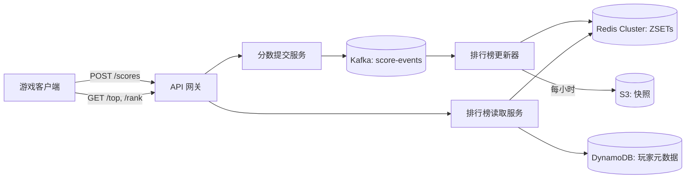
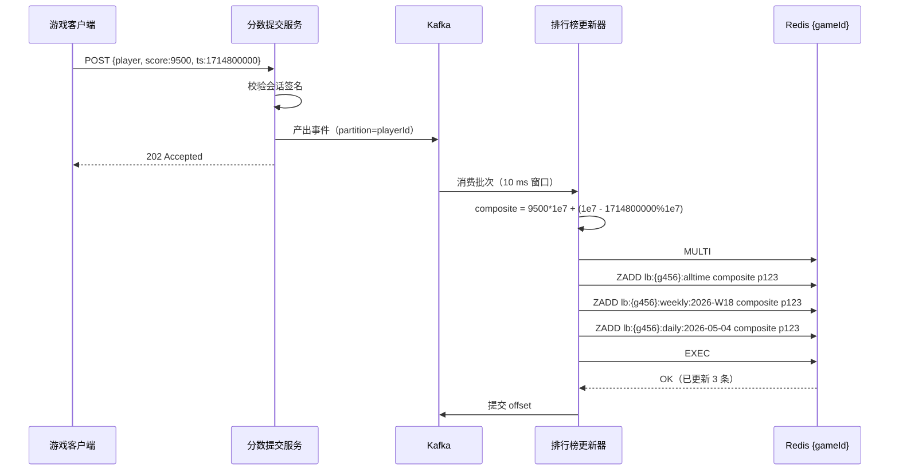
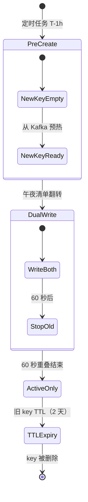
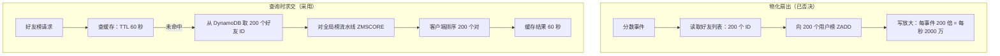

# 设计实时排行榜

> **TL;DR.** 实时排行榜把 1000 万玩家按分数排名，并在热路径上回答三类查询：top-K、玩家名次、近我邻居。Redis 有序集合在单节点上提供 O(log N) 插入与 O(log N + M) 范围读取，吞吐约每秒 10 万次操作[^1][^2]。核心权衡是持久性与速度之争：Redis 是投影层，Kafka 是事实来源，其余每个决定（组合分、窗口轮转、好友求交、长尾近似名次）都是为了驾驭有序集合在大规模下那些锋利的边角。

## 学习目标

- 在 Redis 有序集合上设计排行榜，并推演 1000 万条目下 ZADD/ZREVRANK 的代价
- 把并列裁决编码进单个组合分，同时不损失 IEEE-754 精度
- 用 key 轮转与零停机切换搭建按窗口划分的排行榜（每日、每周、全时段）
- 用查询时求交而不是按用户物化，解决好友榜的扇出问题
- 用 Count-Min Sketch 与 TOP-K 在长尾上以近似名次换掉精确名次
- 把持久事件日志（Kafka）与易失缓存（Redis）分离，并在数据丢失后恢复

## 直觉理解

排行榜看起来是个简单的 CRUD 问题。存下分数，排个序，返回前 10 名。一张 PostgreSQL 表加 `ORDER BY score DESC LIMIT 10` 就能轻松应对 100 个用户。

到了 1000 万玩家、每秒 10 万次分数更新，这个查询就崩了。朴素的 SQL 方案在 5 万到 50 万用户之间（取决于更新频率）就停止扩展[^3]。每次 INSERT 或 UPDATE 都触发索引重平衡；每次读 top-N 都要扫过整条 B 树叶子链。数据库花在维护排序顺序上的时间比服务请求还多。

解开这个设计的钥匙是跳表（skip list）——William Pugh 在 1990 年提出的概率数据结构[^4]——它给出 O(log N) 插入和 O(log N + M) 范围读取，却没有一整套关系引擎的开销。Redis 把它包装成有序集合（ZSET），1000 万条目只占约 640 MB 内存[^5]。一次 ZADD 更新玩家名次，一次 ZREVRANGE 返回前 100 名，一次 ZREVRANK 返回玩家位置。全都在微秒级完成。

但 Redis 是易失的。一次崩溃就全没了。而且当每个分数事件都要扇出到五个时间窗口时，单个有序集合撑不住每秒 50 万次写入。真正的设计问题不是“我该怎么给分数排序”，而是“我如何让一个易失缓存与一份持久日志保持一致、为吞吐而分片、处理并列、提供好友维度的视图，并为那 95% 永远进不了前 1000 的玩家优雅降级”。

## 需求

### 澄清问题

- **Q: 什么会触发分数更新？** 假设：游戏完成事件。分数单调递增（高分语义）；低分永远不会覆盖高分。
- **Q: 并列如何裁决？** 假设：先提交者胜。分数相同的两名玩家按谁先达成来排名。
- **Q: 用哪些时间窗口？** 假设：全时段、每周（周一重置）、每日。每个窗口再加一个好友维度视图。
- **Q: 1000 万玩家都要精确名次吗？** 假设：前 100 万给精确名次；长尾给近似百分位（“前 15%”）。
- **Q: 新鲜度目标？** 假设：top-N 读取反映 1 秒内的分数。好友视图可容忍 5 秒陈旧。
- **Q: 全局榜还是按游戏？** 假设：按游戏分榜。每个游戏在所有窗口上都有独立的榜。
- **Q: 锦标赛尖峰？** 假设：定时活动期间峰值流量是平均值的 3 倍。系统不得丢弃分数事件。

### 功能需求

- 为某玩家在某游戏中提交分数；系统持久化该分数并更新所有活跃窗口
- 取任意窗口的 top-N 玩家（含分数与元数据）
- 取玩家在任意窗口的名次、分数与百分位
- 取某玩家上下各 K 名邻居（“近我”视图）
- 取玩家在任意窗口的好友榜

### 非功能需求

- **负载：** 峰值每秒 10 万次分数更新；峰值 2 万读 RPS（top-N 与名次查询）
- **延迟：** top-10 读取 p99 < 50 ms；名次与近我查询 p99 < 100 ms
- **可用性：** 跨 Redis 节点故障保持 99.95%；分数事件绝不静默丢失
- **一致性：** 最终一致（读取最多陈旧 1 s）；好友视图最多 5 s
- **持久性：** Kafka 保留事件 90 天；Redis 丢失可通过重放恢复

## 容量估算

| 指标 | 数值 | 推导 |
|--------|------:|------------|
| 每游戏玩家数 | 1000 万 | 需求给定 |
| 每个 ZSET 条目内存 | ~64 B | member + score + 跳表节点开销（指针、层数）[^5] |
| 单窗口内存 | 640 MB | 1000 万 × 64 B |
| 总内存（3 个窗口 + 20 个区域） | ~15 GB | 23 个 ZSET × 640 MB |
| 峰值写 QPS（原始） | 10 万 | 需求给定 |
| 写放大（5 个窗口） | 每秒 50 万次 ZADD | 10 万 × 5 个活跃窗口 |
| Kafka 入口 | 10 MB/秒 | 10 万个事件 × 每个 100 B |
| Kafka 90 天保留 | ~75 TB | 10 MB/秒 × 86,400 × 90 |
| 读 QPS（峰值） | 2 万 | 100 万 DAU × 100 次读/天 / 86,400 × 17（峰值系数） |

- **读写比：** Redis 层约 1:25（50 万次 ZADD 对 2 万次读）。这是写占主导的负载。
- **单 Redis 节点容量：** 每秒约 10 万次操作[^2]。仅写路径最少就需要 5 个节点。
- **带宽：** 50 万次 ZADD × 每条命令 24 B = 约 12 MB/秒进入 Redis Cluster。

## API 与数据模型

### API 设计

```http
POST /v1/scores
  Body: { "playerId": "p123", "gameId": "g456", "score": 9500, "timestamp": 1714800000 }
  Returns: 202 Accepted { "eventId": "evt_abc" }
  Notes: Async. Write goes to Kafka; rank updates within 1 s.

GET /v1/leaderboards/{gameId}/top?window=weekly&limit=100
  Returns: 200 { "entries": [{ "rank": 1, "playerId": "...", "score": 9500, "name": "..." }], "window": "weekly:2026-W18" }

GET /v1/leaderboards/{gameId}/players/{playerId}?window=weekly
  Returns: 200 { "rank": 4217, "score": 7300, "percentile": 0.58, "window": "weekly:2026-W18" }

GET /v1/leaderboards/{gameId}/players/{playerId}/neighbors?window=weekly&k=5
  Returns: 200 { "above": [...], "player": {...}, "below": [...] }

GET /v1/leaderboards/{gameId}/friends?playerId=p123&window=weekly
  Returns: 200 { "entries": [...], "cached": true, "ttl": 55 }
```

所有读都由 Redis 提供。写是发后即忘地进入 Kafka 并返回 202。鉴权使用服务端签名的会话令牌，在 API 网关处校验。

### 数据模型

```text
-- Redis sorted sets (one per game per window)
Key: lb:{gameId}:{window}        -- e.g. lb:{g456}:alltime, lb:{g456}:weekly:2026-W18
Member: playerId                  -- string, 8-12 chars
Score: composite float            -- score * 10^7 + (MAX_TS - timestamp)

-- Player metadata (DynamoDB)
Table: players
  PK: playerId
  Attributes: name, avatar_url, country, friend_list[]

-- Durable event log (Kafka)
Topic: score-events
  Partition key: playerId
  Value: { gameId, playerId, rawScore, timestamp, sessionSignature }
```

Redis key 里的 `{gameId}` hash tag 花括号保证同一游戏的所有窗口落在同一个 Redis Cluster 节点上[^6]。这让跨窗口的 MULTI/EXEC 原子 ZADD 成为可能，而不会报跨槽错误。

## 高层架构



*分数事件经 Kafka 流到排行榜更新器，由它投影进分片的 Redis 有序集合；读直接从 Redis 提供，并与 DynamoDB 中的玩家元数据拼合。*

**写路径。** 游戏客户端提交分数。分数提交服务校验会话签名（服务端反作弊闸门），把事件按 `playerId` 分区写入 Kafka，返回 202。排行榜更新器批量消费，计算组合分，并发出一个流水线化的 MULTI，其中包含每个活跃窗口一条 ZADD。EXEC 成功后，消费者提交自己的 Kafka offset。

**读路径。** 排行榜读取服务处理 top-N（ZREVRANGE）、名次（ZREVRANK）、近我（先 ZREVRANK，再围绕该位置 ZREVRANGE）以及好友视图（流水线 ZMSCORE + 客户端排序）。玩家昵称与头像来自 DynamoDB 查询，在读取服务本地缓存 60 秒。

**恢复路径。** 如果 Redis 丢数据（节点故障、淘汰或人为误操作），更新器从 Kafka 中该游戏最早保留的 offset 开始重放。每小时一次的 S3 RDB 文件快照把重放时间从数小时压到数分钟。

## 深入探讨

### 深入探讨 1：组合分与精度天花板

问题：两名玩家拿到相同的原始分，谁排前面？Redis 对同分成员按成员名字典序排序[^1]，结果是任意且不稳定的顺序。

**组合分技巧。** 把原始分和一个并列裁决项编码进单个 64 位浮点数：

```python
MULTIPLIER = 10**7
MAX_TS = 10**7  # covers ~115 days of epoch seconds

def composite(raw_score: int, timestamp: int) -> float:
    return raw_score * MULTIPLIER + (MAX_TS - timestamp)
```

因为 `MAX_TS - timestamp` 随时间推进而变小，先提交的会得到更大的加项，在原始分相同时压过后提交的[^7][^8]。原始分可通过整数除法还原：`raw = int(composite) // MULTIPLIER`。

**精度天花板。** IEEE-754 双精度有 53 位尾数，只能精确表示到 9,007,199,254,740,992 的整数[^1]。时间戳部分占 7 位十进制，原始分必须低于约 9000 亿。多数游戏够用。对于分数无上限的游戏（放置类点击游戏），把乘数降到 10^5，接受更粗的并列裁决（10 秒粒度）。

**底层实现。** 跳表用 p = 0.25 的层概率（Redis 源码里的 `ZSKIPLIST_P`[^9]），得到几何分布的层数，每个节点以 0.25^(k-1) 的概率出现在第 k 层。最大高度封顶 32 层，Redis 源码注释称其“足以容纳 2^64 个元素”（p=0.25 时期望容量为 4^32 ~ 1.8 * 10^19）[^10]。查找从最高层开始，只要下一节点的分数更小就继续前进，否则降一层。Pugh 论文中的期望查找代价分析表明，在 N = 256 时超出期望时间 3 倍的概率降到 10^-6[^10]。



*单个分数事件通过组合分编码与流水线化的多窗口 ZADD，扇出到同一分片上的所有活跃窗口。*

### 深入探讨 2：时间窗口与 key 轮转

每个时间窗口都是一个独立的 ZSET，按窗口标识命名：`lb:{gameId}:daily:2026-05-04`、`lb:{gameId}:weekly:2026-W18`、`lb:{gameId}:alltime`[^8]。每个分数事件都向每个活跃窗口做一次 ZADD。这带来写放大：K 个活跃窗口就是每个事件 K 次 ZADD。

**轮转协议：**

1. 定时任务在切换前 1 小时创建下一个窗口的 key（例如 5 月 4 日 23:00 UTC 创建 `lb:{g456}:daily:2026-05-05`）。
2. 一个清单 key（`lb:{gameId}:current_daily`）保存当前活跃窗口名。读者以原子方式解引用它。
3. 午夜时清单翻到新 key。更新器在 60 秒重叠期内同时写旧 key 和新 key（双写），之后停止写旧 key。
4. 旧 key 设置 172,800 秒（2 天）的 TTL 供历史查询，之后自动过期[^8]。

**为什么重要：** 没有预创建这一步，在切换瞬间查询的客户端会看到空集合。没有清单这层间接，客户端必须自己知道当前窗口名，这就制造了一个分布式时钟同步问题。



*窗口轮转生命周期：下一个 key 在切换前预先创建并预热；60 秒的双写重叠避免了“空榜”竞态。*

**跨窗口聚合：** ZUNIONSTORE 配合 `AGGREGATE MAX` 可产出“每日榜中的个人最好成绩”用于周汇总。这是批处理操作，每天结束时跑一次，不在热路径上。

### 深入探讨 3：不做物化的好友榜

朴素做法：为每个用户维护一个 ZSET，只放他好友的分数。1000 万玩家、好友中位数 200 人，会造出 20 亿条目，并让每个分数事件强制写 200 次 ZADD（每秒 10 万事件时就是每秒 2000 万次写）。不可接受。

**查询时求交模式：**

1. 从 DynamoDB 取好友列表（约 200 个 ID，本地缓存 5 分钟）。
2. 对全局榜发一条流水线命令 `ZMSCORE lb:{gameId}:{window} friend1 friend2 ... friend200`。这花费 O(K)，K 是查询的好友数（约 200），因为每个查找都走内部哈希表，每成员 O(1)[^1]。一次往返即可完成。
3. 在客户端对约 200 个 (member, score) 对排序。
4. 按 (userId, gameId, window) 缓存结果，TTL 60 秒。

200 个好友时，即便走未命中缓存的路径也在 10 ms 内完成。60 秒缓存意味着大多数好友榜读取只是 O(1) 的 Redis GET。



*按用户物化的榜需要 O(P*F) 存储和 200 倍写放大；查询时求交用略慢的读取换来零额外存储和无写扇出。*

这与 [社交信息流](./06-social-media-feed.md) 中推与拉的争论相呼应，但方向相反：信息流扇出偏爱推，因为读占主导；而排行榜的好友视图偏爱拉，因为好友子集永远只是全局排名中极小的一片[^11]。

### 深入探讨 4：长尾的近似名次

经 ZREVRANK 得到的精确名次每次查询花 O(log N)。1000 万玩家下这很快。但为每个玩家在每个窗口维护精确名次，会为一项多数玩家从不查看的功能消耗内存。名次掉到 100 万之后，“前 15%”比“第 4,317,482 名”更有用。

**Count-Min Sketch + TOP-K 方案：**

- 为前 100 万玩家维护精确排名（完整 ZSET）。
- 其余 900 万玩家维护一个 Count-Min Sketch，估计分数频率分布[^12][^13]。Redis 内置 `CMS.INCRBY` 与 `CMS.QUERY` 命令，另有 TOP-K 模块用于重击者（heavy hitter）跟踪[^14]。
- 分数按对数分桶（100 个桶）。玩家的百分位由其所在桶的累计计数推导。

CMS 从不低估（误差是单侧的高估），所以被标为“前 15%”的玩家实际不会差于第 15 百分位[^12]。内存成本与玩家数无关：宽 2048、深 5 的 CMS 约用 40 KB。

**UX 权衡：** “你是 10,000,000 人中的第 4,317,482 名”看起来精确，实则毫无意义。“前 43%”既诚实又可行动。Duolingo 用了另一种解法：把联赛人数上限压到约 30 人，于是每个名次都精确且有含义[^15][^16]。它的 10 级体系（Bronze 到 Diamond）配合每周升降级，在不依赖全局排名的情况下制造了参与感[^17]。

## 真实案例

### Strava 赛段排行榜

Strava 运营着数千万个按赛段划分的排行榜，每个榜为某段具体公路或越野路段上的运动员排名。截至 2021 年，Strava 在 12 个月内处理了 18 亿次活动上传[^18]。

**架构。** Strava 基于 Kafka 重建了赛段排行榜基础设施，选它的理由是“复制、强顺序、高可用与分区”[^11]。活动作为事件流经管道；排行榜投影由消费者构建，消费者按赛段给成绩排名。这与我们的设计一致：Kafka 作事实来源，类 Redis 的投影作读层。

**反作弊。** Strava 的诚信项目在三轮清理中移除了 1485 万条异常活动（2025 年 5 月 445 万条跑步、2026 年 1 月 390 万条骑行、2024 年 12 月通过规则修复 650 万条）[^18]。系统在基于规则的快速拦截（不可能的配速、不可能的爬升率）之上叠加用社区举报样本训练的 ML 模型。他们明确的原则是“尽量减少误报，避免运动员因合法（且非凡）的表现受罚”[^18]。

**关键洞察。** 按赛段的排行榜（超本地竞争）对留存的拉动远大于全局排名。全球排第 50,000 名的用户毫无动力；同一个用户在当地爬坡段排第 3，就会天天回来看。Duolingo 用约 30 人的每周联赛应用同一原则[^15]：把竞争范围收窄，让它“可赢”。

## 权衡

| 方案 | 优点 | 缺点 | 适用场景 |
|----------|------|------|-------------|
| Redis 有序集合（ZSET） | O(log N)、内存内、久经验证 | 易失；需要事件日志保证持久性 | 通用排行榜，<1 亿条目[^1][^5] |
| SQL ORDER BY score | 简单、ACID 持久 | 写负载下 5 万到 50 万用户就崩[^3] | 小型游戏、后台看板 |
| 按 game-id 分片（hash tag） | 多窗口原子性，top-N 落在单分片 | 热门游戏变成热点节点 | 玩家数中等的按游戏榜[^6] |
| 按 player-id 分片 | 写分布均匀 | top-N 需要分散-聚合归并 | 写密集、按玩家查名次 |
| 物化好友榜 | O(1) 读延迟 | O(P*F) 存储，200 倍写放大 | 极小的好友图（<50 好友） |
| 查询时求交（ZMSCORE） | 零额外存储、一致 | 好友超过 1000 时变慢 | 通用好友图 + 缓存[^1] |
| 近似名次（CMS + TOP-K） | 内存恒定、单侧误差 | 只有百分位，拿不到精确名次 | 精确名次无 UX 价值的长尾[^12][^13] |

最大的一个权衡：**持久性与延迟**。Redis 给出亚毫秒读，但崩溃就丢数据。Kafka 给出持久性，却增加 100-500 ms 端到端延迟。生产答案是两者都要：Kafka 是事实来源，Redis 是投影，1 秒的陈旧窗口就是速度的代价。

## 扩展与失效模式

**10 倍（每秒 100 万次写）：** 单个 Redis 节点在每秒约 10 万次操作时饱和[^2]。按 `playerId` 分片到 10 个以上节点，并为每个游戏维护一个薄的 top-1000 汇总集合服务热读。Kafka 分区从 32 增到 256；消费者组扩到 50 个以上实例。

**100 倍（每秒 1000 万次写）：** 单靠 Redis Cluster 吸收不了每秒 5000 万次 ZADD（5 窗口 × 1000 万）。批量刷盘窗口从 10 ms 放宽到 100 ms。在 CDN 边缘缓存 top-10，TTL 1-5 秒。最热的游戏考虑按分数桶分片。

**1000 倍（每秒 1 亿次写）：** 架构转向区域集群加异步归并。每个区域跑独立的 ZSET；后台进程产出约 10 秒陈旧的全球视图。除前 10,000 名之外，近似名次取代精确名次。到这个量级，Halo 那套基于 saga 的异步工作流就变得相关：分数事件变成 saga 步骤，而不再是直接写[^19]。

**失效：Redis 节点挂掉。** 排行榜更新器通过消费滞后发现缺口。它从 Kafka 重放受影响的哈希槽。每小时一次的 S3 RDB 快照把重放从数小时压到数分钟。读降级为“陈旧”（从副本提供），而不是“不可用”。

**失效：Kafka 分区主节点选举。** 写会在分数提交服务排队最多 30 秒。不会丢数据，因为生产者启用了幂等投递并会重试。展示的名次冻结，但不会错乱。

**失效：锦标赛尖峰写饱和。** 定时活动前预先拆分 hash tag。在 API 网关做令牌桶限流（用 429 丢弃超额负载）。在更新器内部用 10-100 ms 的刷盘窗口批量 ZADD（多元素 ZADD 的每元素成本低于 N 次单元素 ZADD）[^6][^2]。

## 常见陷阱

> [!WARNING]
> **把 Redis 当持久存储。** `appendfsync everysec` 的 AOF 在崩溃时最多丢 1 秒写入[^20]。用 `appendfsync always` 吞吐要掉 10 倍。把 Kafka 当事实来源，把 Redis 当可重建的投影。

> [!WARNING]
> **忽略写放大。** 5 个活跃窗口 × 每秒 10 万事件 = 每秒 50 万次 ZADD 打在一个热门游戏分片上。只说“给每个窗口 ZADD 一下”而不估算放大的候选人，会在生产里撞上 Redis 的吞吐天花板。

> [!WARNING]
> **组合分精度溢出。** 原始分超过 10^6 时用 `score * 10^10`，会因 IEEE-754 的 53 位尾数上限被静默舍入[^1]。务必在分数区间上界做分数碰撞的单元测试。

> [!WARNING]
> **周轮转时的好友缓存踩踏。** 在重置时刻，所有已缓存的好友榜同时过期。按用户给 TTL 加 ±30 秒抖动，并在轮转前那一分钟预热高活跃用户的榜。

> [!WARNING]
> **物化好友排行榜。** 1000 万玩家、每人 200 好友时，物化要写 20 亿条目，强制每秒 2000 万次 ZADD。这就是扇出陷阱。永远优先用查询时求交加短 TTL 缓存[^11]。

> [!WARNING]
> **窗口边界的“查不到”竞态。** 每日窗口翻转的瞬间，如果新 key 还没有数据，客户端会看到空集合。切换前 1 小时预创建下一个窗口的 key，并用清单 key 做原子切换。

## 追问

**1. 怎么检测作弊？**

绝不信任客户端。分数由服务端根据游戏会话遥测计算。分数提交服务校验会话签名，拒绝未签名的载荷。规则引擎标记不可能的分数（超过理论上限、低于人类反应时间）。用社区举报样本训练的 ML 模型捕捉细微异常。Strava 的做法：先规则，再 ML，最后人工申诉[^18]。

**2. 如何原子地从所有活跃窗口撤回一个分数？**

向 Kafka 产出一条“分数撤回”事件。更新器在一个 MULTI/EXEC 块里对所有活跃窗口执行 ZREM。因为一个游戏的所有窗口共享 hash tag，这是单分片的原子操作。历史窗口（已过 TTL）忽略。

**3. 如果分数会下降（ELO/MMR）要改什么？**

组合分技巧仍然成立，但 ZADD 必须用 `XX` 标志（只更新已存在成员）而不是 `NX`（只插入）。“最高分获胜”的不变式不再成立，所以每个事件都无条件覆盖。按时间戳的并列裁决从“先达成者胜”变成“最近更新者胜”。

**4. 怎么加公会/战队榜？**

维护一个单独的 ZSET，key 为 `lb:{gameId}:guild:{window}`。每个玩家分数事件到来时，查出玩家所属公会，算出公会的聚合值（求和或平均），再 ZADD 公会的组合分。这让每个事件每个窗口多一次 ZADD。公会成员变动会触发从 Kafka 重放对该公会的全量重算。

**5. 多区域 active-active 怎么做？**

每个区域跑本地 Redis Cluster 与本地 ZSET。分数事件经 Kafka MirrorMaker 跨区复制。每个区域的更新器处理全部事件，因此所有区域在复制延迟（约 2-5 秒）内收敛。对于需要单一全球视图的锦标赛，指定一个区域为主，把所有读都路由过去。

**6. 怎么 A/B 测试评分公式的改动？**

把事件产出到两个 Kafka topic（或用单个 topic 加版本字段）。跑两组更新器实例，写入不同的 ZSET key 前缀（`lb:v1:{gameId}:...` 与 `lb:v2:{gameId}:...`）。读取服务按用户所属实验分组路由到对应前缀。对比两组之间的参与度指标（回访率、会话时长）。

## 练习

### 练习 1：估算锦标赛峰值

一款新游戏上线 24 小时锦标赛。预期：50 万同时在线玩家，持续每秒 5 万次分数提交，第 22 小时峰值每秒 20 万次。游戏有 3 个活跃窗口（全时段、每日、锦标赛专用）。你的 Redis Cluster 有 5 个节点，每个额定每秒 10 万次操作。它能扛过峰值吗？

<details>
<summary>提示</summary>

计算峰值时包含所有窗口写放大的 ZADD 总量。与集群总容量比较。记住 hash tag 分片会把一个游戏的所有窗口放在同一个节点上。

</details>

<details>
<summary>解答</summary>

峰值写放大：每秒 20 万事件 × 3 个窗口 = 每秒 60 万次 ZADD。用 `{gameId}` hash tag 分片时，这 60 万次 ZADD 全打在一个节点上（容量：每秒 10 万次操作）。节点超载 6 倍。

缓解：(1) 用 50 ms 刷盘窗口批量 ZADD，往返次数降约 10 倍。多元素 ZADD（`ZADD key score1 member1 score2 member2 ...`）一条命令处理 N 个成员，总复杂度 O(N log M)。(2) 把锦标赛预拆到 4 个 hash tag（`{gameId:0}` 到 `{gameId:3}`），把写分散到 4 个节点。top-N 变成 4 路归并，但仍在 10 ms 内。(3) 在 API 把提交限流到每秒 15 万次，超出的部分排队进 Kafka 延后处理（接受尖峰期间额外 2-3 秒的陈旧）。

正确的面试回答：承认瓶颈，提出批处理 + 预拆分，并明确说出陈旧性权衡。

</details>

## 要点回顾

- **有序集合是对的原语。** 其他做法要么扩展不了（SQL），要么拙劣地重造跳表。
- **并列裁决属于分数本身。** `score * 10^7 + (MAX_TS - timestamp)` 给出稳定排序，零额外存储[^7][^8]。
- **Redis 是缓存，Kafka 才是事实来源。** Redis 被清空应该只是麻烦（重放几分钟），而不是灾难（数据丢失）。
- **好友排行榜是扇出陷阱。** 在任何合理规模的好友图上，用 ZMSCORE 做查询时求交加 60 秒缓存，都胜过物化[^11]。
- **长尾的精确名次是虚荣。** 近似百分位才是长尾玩家想要的，也是你在恒定内存下负担得起的[^12]。
- **写放大是隐藏的瓶颈。** 5 窗口 × 10 万事件 = 每秒 50 万次 ZADD。按放大后的负载做容量规划，而不是按原始事件速率。

## 延伸阅读

- [Redis ZADD 命令参考](https://redis.io/docs/latest/commands/zadd/)。设计背后的原语；记录了分数精度限制与 O(log N) 复杂度保证。
- [Strava Engineering: Rebuilding the Segment Leaderboards, Part 3](https://medium.com/strava-engineering/rebuilding-the-segment-leaderboards-infrastructure-part-3-design-of-the-new-system-39fdcf0d5eb4)。以数十亿活动为量级、把 Kafka 当事实来源的排行榜生产实录。
- [Keeping Strava's Segment Leaderboards Fair](https://stories.strava.com/articles/keeping-stravas-segment-leaderboards-fair-an-engineers-perspective)。反作弊诚信长文，含具体清理数字与误报 SLO 的理念。
- [Pugh, "Skip Lists: A Probabilistic Alternative to Balanced Trees", CACM 1990](https://dl.acm.org/doi/abs/10.1145/78973.78977)。Redis ZSET 背后的奠基论文；读它理解 O(log N) 保证的概率分析。
- [Redis Cluster 扩展指南](https://redis.io/docs/latest/operate/oss_and_stack/management/scaling/)。hash tag、槽迁移与跨槽限制，这些约束着分片决策。
- [How Halo on Xbox Scaled to 10+ Million Players using the Saga Pattern](https://blog.bytebytego.com/p/how-halo-on-xbox-scaled-to-10-million)。游戏量级下基于 saga 的游戏服务架构。
- [Duolingo: How do Duolingo Leaderboards work?](https://blog.duolingo.com/duolingo-leagues-leaderboards/)。最简的正确设计：30 人封顶联赛加升降级。
- [Count-Min Sketch in Redis](https://redis.io/docs/latest/develop/data-types/probabilistic/count-min-sketch/)。内置概率模块，用于长尾的近似名次估计。

## 记忆卡片

<details>
<summary><strong>Q: 为什么 SQL 的 ORDER BY score LIMIT 10 在规模下会失效？</strong></summary>

A: 该查询在写入时要全索引扫描或排序。用户数到 5 万到 50 万之间时，每次 INSERT 的 B 树重平衡和每次 SELECT 的叶子链遍历成了瓶颈，高更新率下延迟超出可接受范围。

</details>

<details>
<summary><strong>Q: Redis 有序集合里 ZADD 和 ZREVRANGE 的时间复杂度是多少？</strong></summary>

A: ZADD 每元素 O(log N)，N 是集合大小。ZREVRANGE 是 O(log N + M)，M 是返回的元素数。两者都源自底层的跳表结构。

</details>

<details>
<summary><strong>Q: 组合分技巧如何编码并列裁决？</strong></summary>

A: 把原始分乘以 10^7 再加上 (MAX_TS - timestamp)。由于时间戳项随时间推进而变小，先提交的会得到更大的组合分，从而在并列时偏向先达成者。

</details>

<details>
<summary><strong>Q: Redis 为什么把跳表层概率设为 p=0.25？</strong></summary>

A: p=0.25 时，每个节点以 0.25^(k-1) 的概率出现在第 k 层。这给出 O(log N) 的期望查找代价，内存开销比 p=0.5 更低，同时保持 Pugh 1990 年论文中的概率平衡保证。

</details>

<details>
<summary><strong>Q: 按窗口分榜的写放大问题是什么？</strong></summary>

A: 每个分数事件都要向每个活跃窗口 ZADD（全时段 + 每周 + 每日 + 区域）。5 个活跃窗口时，每秒 10 万输入事件变成每秒 50 万次 ZADD。系统必须按放大后的负载定容，而不是按原始事件速率。

</details>

<details>
<summary><strong>Q: 好友榜为什么优先用查询时求交而不是物化？</strong></summary>

A: 1000 万玩家、每人 200 好友时，物化会造出 20 亿条目，并强制每个分数事件写 200 次 ZADD（峰值每秒 2000 万次写）。求交只需一次 ZMSCORE 往返处理约 200 个成员，10 ms 内完成，且零额外存储。

</details>

<details>
<summary><strong>Q: {gameId} hash tag 在 Redis Cluster 里起什么作用？</strong></summary>

A: Redis Cluster 只对花括号内的子串做哈希来确定槽位。共享同一 hash tag 的所有 key 落在同一节点上，从而让同一游戏多个窗口的 MULTI/EXEC 事务不会产生跨槽错误。

</details>

<details>
<summary><strong>Q: 持有排行榜数据的 Redis 节点崩溃时会发生什么？</strong></summary>

A: 排行榜更新器从 Kafka 中该游戏各窗口保留的 offset 重放。每小时一次的 S3 RDB 快照把重放时间从数小时压到数分钟。重放期间，读从副本提供陈旧数据，而不是返回错误。

</details>

<details>
<summary><strong>Q: Duolingo 如何避开大规模排行榜的复杂度？</strong></summary>

A: Duolingo 把联赛人数上限控制在约 30 人，按相似的学习习惯与时区分组。在约 30 人的集合上每个操作都便宜得不值一提。参与感来自升降级机制（前 10 名晋级、后 N 名降级），而不是给数百万人排名。

</details>

<details>
<summary><strong>Q: Count-Min Sketch 用于长尾玩家名次估计的优势是什么？</strong></summary>

A: CMS 的内存占用与玩家数无关，且从不低估（误差是单侧高估）。被标为“前 15%”的玩家保证不差于第 15 百分位。代价是长尾失去精确的数字名次。

</details>

## 参考文献

[^1]: Redis 文档，“ZADD”命令参考。https://redis.io/docs/latest/commands/zadd/

[^2]: Redis 文档，“Scale with Redis Cluster”（16,384 个槽、hash tag、分片）。https://redis.io/docs/latest/operate/oss_and_stack/management/scaling/

[^3]: Trophy.so 工程博客，“How to Scale a Leaderboard Beyond Basic Redis”（关于 SQL ORDER BY 天花板的那一节）。https://trophy.so/blog/scaling-leaderboards-redis-architecture

[^4]: William Pugh，“Skip Lists: A Probabilistic Alternative to Balanced Trees”，Communications of the ACM，33(6)，1990 年 6 月，第 668-676 页。https://dl.acm.org/doi/abs/10.1145/78973.78977

[^5]: OneUptime 博客，“How Redis Sorted Sets Work Internally (Skiplist and Listpack)”。https://oneuptime.com/blog/post/2026-03-31-redis-sorted-sets-work-internally-skiplist/view

[^6]: Percona 博客，“Distributing Data in a Redis/Valkey Cluster: Slots, Hash Tags, and Hot Spots”。https://www.percona.com/blog/distributing-data-in-a-redis-valkey-cluster-slots-hash-tags-and-hot-spots/

[^7]: System Design Sandbox，“Design a Real-Time Leaderboard”（组合分编码）。https://www.systemdesignsandbox.com/learn/design-leaderboard

[^8]: Antirez（Redis 社区），“Leaderboard Patterns”（组合分、按时间窗口分榜、TTL 轮转）。https://redis.antirez.com/community/leaderboards.html

[^9]: Redis 源码 `src/t_zset.c`，zskiplist 实现注释与 `zslRandomLevel`。https://github.com/redis/redis/blob/unstable/src/t_zset.c

[^10]: IISc，“3.8 Skip Lists”讲义，概述了 Pugh 在 CACM 1990 中的结果。https://gtl.csa.iisc.ac.in/dsa/node52.html

[^11]: Strava Engineering，“Rebuilding the Segment Leaderboards Infrastructure, Part 3: Design of the New System”。https://medium.com/strava-engineering/rebuilding-the-segment-leaderboards-infrastructure-part-3-design-of-the-new-system-39fdcf0d5eb4

[^12]: Redis 文档，“Count-min sketch”概率数据类型（CMS 特性、单侧误差保证）。https://redis.io/docs/latest/develop/data-types/probabilistic/count-min-sketch/

[^13]: Redis 文档，“Count-min sketch”概率数据类型。https://redis.io/docs/latest/develop/data-types/probabilistic/count-min-sketch/

[^14]: Redis 文档，Count-Min Sketch 与 TOP-K 命令概览。https://redis.io/blog/streaming-analytics-with-probabilistic-data-structures/

[^15]: Duolingo 博客，“How do Duolingo Leaderboards work?”（联赛结构、每周节奏、匹配）。https://blog.duolingo.com/duolingo-leagues-leaderboards/

[^16]: Duolingo 博客，“How do Duolingo Leaderboards work?”（10 个联赛、Diamond Tournament、XP 滥用监控）。https://blog.duolingo.com/duolingo-leagues-leaderboards/

[^17]: Duolingo Guides，“Compete & Track Your Language Progress”（10 个联赛、参赛资格）。https://duolingoguides.com/duolingo-leaderboard/

[^18]: Strava Stories，James Wang 的“Keeping Strava's Segment Leaderboards Fair: An Engineer's Perspective”。https://stories.strava.com/articles/keeping-stravas-segment-leaderboards-fair-an-engineers-perspective

[^19]: ByteByteGo，“How Halo on Xbox Scaled to 10+ Million Players using the Saga Pattern”。https://blog.bytebytego.com/p/how-halo-on-xbox-scaled-to-10-million

[^20]: Redis 文档，“Redis persistence”（RDB、AOF、fsync 策略）。https://redis.io/docs/latest/operate/oss_and_stack/management/persistence/
