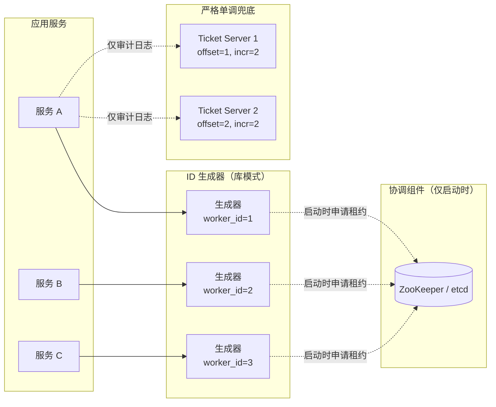
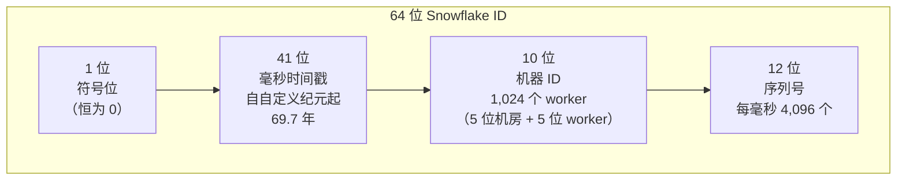
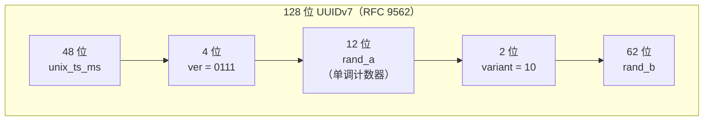
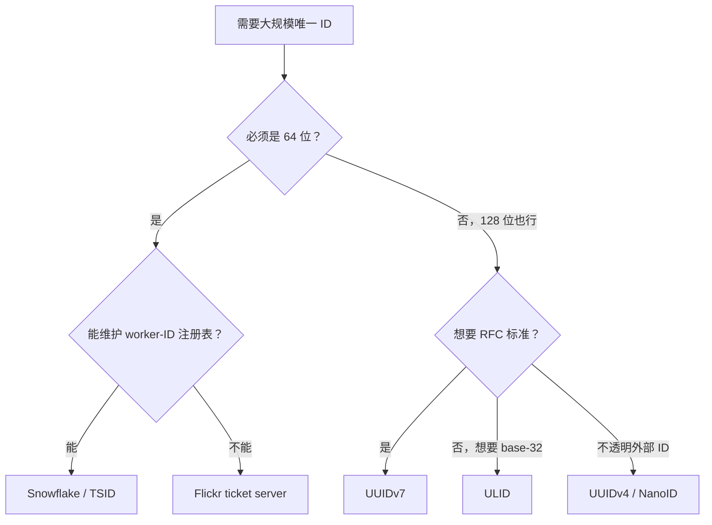
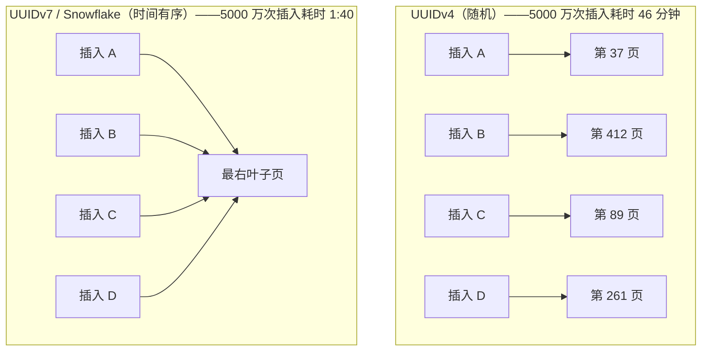

# 设计一个唯一 ID 生成器（Snowflake、ULID、TSID、UUIDv7）

> **TL;DR.** 唯一 ID 生成器背后是一个四维权衡：吞吐量、有序性、协调成本、ID 宽度。Twitter Snowflake 把 41 位毫秒时间戳、10 位机器 ID 和 12 位序列号装进 64 位，每个 worker 每毫秒产出 4,096 个 ID，热路径上零协调[^1]。UUIDv7（RFC 9562，2024）花了 128 位，换来同样的时间有序性，却不需要 worker-ID 注册表[^2]。关键决策在这里：如果 64 位很重要（十亿行时索引体积减半），用 Snowflake；如果零协调更重要，用 UUIDv7。

## 学习目标

- [ ] 能针对具体的工作负载特征，在 Snowflake、ULID、UUIDv7、TSID 和 ticket server 之间给出有依据的选型
- [ ] 能从 Snowflake 的位布局推算时间戳耗尽的年份和单 worker 的吞吐上限
- [ ] 为分布式 ID 生成器设计时钟偏移的容错方案（bound-wait、逻辑时钟兜底、NTP 告警）
- [ ] 论证时间可排序的 ID 为何比随机 UUID 的 B 树插入性能好 12–27 倍[^3]
- [ ] 设计跨多个数据中心的 worker-ID 分配方案，且生成 ID 时无需协调

## 直觉理解

生成唯一 ID 看起来不值一提。调一下 `uuid.v4()` 就完事了。10 个用户的时候，这确实够用。但在三个数据中心里每秒生成 1000 万个 ID 时，它会因为两个原因崩掉。

第一，随机 UUID 会毁掉你的数据库。credativ 在 PostgreSQL 18 上做过一次基准测试：向一张已有数据的表插入 5000 万条 UUIDv4，实际耗时 46 分钟。同样的负载换成时间有序的 UUIDv7，1 分 40 秒就跑完了[^3]。v4 的索引体积大了 26%，叶子页碎片率 50%，而 v7 是零[^3]。随机键会把插入打散到整棵 B 树上；时间有序的键则把写操作集中到最右侧的叶子页。

第二，协调会吃掉吞吐量。单个自增计数器把你锁死在一个数据库的插入速率上。分布式计数器（每个 ID 走一次 Raft 共识）会给每次写都加上毫秒级延迟。破解这个局面的关键洞察是：把时间放进高位，让 ID 天然有序；把机器标识放进中间位，让 worker 之间永不冲突；把本地序列计数器放进低位，让每个 worker 每毫秒生成几千个 ID，而不用和任何人通信。

这就是 Snowflake。这一章剩下的内容讲的是：什么时候该用它，什么时候该换别的方案，以及时钟不听话的时候哪里会崩。

## 需求

### 澄清问题

- **问：目标的总吞吐量是多少？**
  假设：总量 1000 万 ID/秒，单个 worker 峰值 10 万 ID/秒。

- **问：ID 必须装进 64 位吗？**
  假设：优先 64 位（能放进 `BIGINT`，索引体积只有 128 位的一半）。如果 128 位可以接受，UUIDv7 也行。

- **问：这套方案要用多久？**
  假设：从自定义纪元起至少 69 年（Snowflake 的 41 位毫秒时间戳正好给到这个数）[^4]。

- **问：要严格单调，还是近似有序？**
  假设：单个 worker 内单调。全局在时钟偏移范围内有序。只有特定流程（审计日志、发票号）才需要严格的全局单调。

- **问：多地域双活吗？**
  假设：是，3 个地域。热路径上不做任何协调。

- **问：能依赖 NTP 同步的时钟吗？**
  假设：能，误差约 10 ms 以内；但设计必须扛得住 1 秒的回拨，且不能产生重复 ID。

### 功能需求

- 每次调用生成一个唯一的 64 位 ID，热路径上零协调。
- ID 里嵌入可还原的毫秒时间戳，用于排障、TTL 过期和按时间范围分片。
- 单个 worker 崩溃后不重复签发任何已发出的 ID。
- 支持滚动重启 worker，并能安全地重新分配 worker-ID。

### 非功能需求

- **可用性：** 生成路径 99.999%（每次写入都会内联调用）。
- **延迟：** 本地 p99 低于 1 ms；如果做成服务、多一跳网络，低于 5 ms。
- **吞吐量：** 总量 1000 万 ID/秒，单 worker 10 万 ID/秒。
- **唯一性：** 任何单节点故障下零重复，包括 10 秒以内的时钟回拨。
- **有序性：** 单个 worker 内单调；全局在 worker 时钟偏移范围内有序。

## 容量估算

| 指标 | 数值 | 推导 |
|--------|------:|------------|
| 时间戳位数 | 41 | 自定义纪元以来的毫秒数；2^41 ms = 69.7 年[^4] |
| worker-ID 位数 | 10 | 5 位机房 + 5 位 worker = 1,024 个 worker[^1] |
| 序列号位数 | 12 | 2^12 = 每个 worker 每毫秒 4,096 个 ID[^1] |
| 单 worker 上限 | 409.6 万 ID/秒 | 4,096/ms × 1,000 ms |
| 总量上限 | 42 亿 ID/秒 | 1,024 个 worker × 409.6 万/秒 |
| 1000 万/秒时的余量 | 420 倍 | 42 亿 / 1000 万 |
| 单 worker 状态占用 | 约 16 字节 | last_timestamp_ms(8) + last_sequence(4) + worker_id(4) |
| Twitter 纪元耗尽 | 约 2080 年 | 2010-11-04 + 69.7 年[^5][^6] |
| Discord 纪元耗尽 | 约 2084 年 | 2015-01-01 + 69.7 年[^7] |

100 个活跃 worker、每个承担约 10 万 ID/秒，系统只跑到理论上限的 2.4%。也就是说，还有三个数量级的余量，才需要重新设计位布局。

## API 与数据模型

### API 设计

```text
# 本地库调用（延迟最低，首选）
id = snowflake.next_id()   # 返回 int64

# 远程服务（多语言环境用）
POST /v1/ids:generate
Body: { "count": 100 }
Response: { "ids": [7234567890123456789, ...], "issued_at_ms": 1735689600000 }

# 整段预分配（面向批处理任务）
POST /v1/ids:reserve-range
Body: { "count": 1000000 }
Response: { "start": 7234..., "end": 7234..., "ttl_ms": 60000 }
```

库形式走的是热路径。服务形式服务的是 Ruby、PHP 和短生命周期的 Lambda，它们没法安全地长期持有一个 worker-ID。整段预分配 API 则是为 ETL 和回填任务摊薄网络往返开销。

### 数据模型

```sql
-- worker 状态（本地持久化文件）
last_timestamp_ms   BIGINT   -- 最后签发 ID 的毫秒时间戳
last_sequence       INT      -- 该毫秒内的最后一个序列号
worker_id           INT      -- 启动时分配
custom_epoch_ms     BIGINT   -- 例如 2020-01-01 UTC 对应的毫秒数

-- worker-ID 注册表（ZooKeeper / etcd）
-- 路径：/id-gen/workers/{worker_id}
-- 值：{ "hostname": "...", "dc": "us-east-1", "lease_expires_at": "..." }
-- 带 30 秒 TTL 的临时节点
```

worker 启动时通过一个 ZooKeeper 临时节点抢占最小的空闲槽位[^1]。正常退出时释放节点。崩溃时租约到期，槽位重新可被认领。

## 高层架构



*每个应用服务都把 Snowflake 生成器作为库嵌入。ZooKeeper 只在启动时被访问一次用于分配 worker-ID；热路径是无锁的。ticket server 兜底路径负责那些要求严格单调的少数流程。*

**库模式（默认）：** ID 生成器是一个 JAR、crate 或 Go 包，链接进每个服务。它在启动时从 ZooKeeper 读取 worker-ID。热路径上只有对 `(timestamp, sequence)` 的一次 CAS。

**服务模式（多语言）：** 一小组 "id-service" pod 挂在负载均衡器后面。每个 pod 持有自己的 worker-ID。客户端每次调用批量请求 100 个 ID，摊薄 RPC 开销。

**Ticket server 模式（严格单调）：** 一个 MySQL 主库，用单行表加 `REPLACE INTO` 推进自增[^8]。只用于发票号、审计日志和面向客户的工单号这类严格有序是硬要求的场景。

**可观测性：** 上报 `ids_per_second_per_worker`、`clock_drift_ms`、`sequence_exhaustion_events`、`worker_id_reassignments` 四组指标。

## 深入剖析

### Snowflake 位布局解剖

64 位的 Snowflake ID 就是一道容量规划题，编码进了一个整数里。



*1+41+10+12 的位划分：每个字段都靠移位和掩码打包、解包。符号位让 ID 作为有符号 BIGINT 保持正数。*

构造只需三次移位和两次或运算：`id = ((now_ms - epoch) << 22) | (worker_id << 12) | sequence`[^4]。解包同样便宜：`timestamp = (id >> 22) + epoch`[^7]。

**Twitter 的纪元**是 `1288834974657` ms（2010-11-04T01:42:54.657Z）[^5][^6]。这让 Twitter 的 ID 能用到大约 2080 年。Discord 用的纪元是 `1420070400000`（2015-01-01），把耗尽时间推到约 2084 年[^7]。

**Instagram 的变体**重新分配了位：41 位时间戳 + 13 位分片 ID + 10 位序列号[^9]。分片 ID 进了 ID 本身，意味着应用拿到一个 ID 就能知道该查哪个 PostgreSQL 分片，不用再查元数据。权衡在于：每分片上限降到每毫秒 1,024 个 ID（10 位序列号），而 Snowflake 是 4,096 个[^9]。

**Sonyflake** 用 39 位、10 ms 精度（174 年寿命）、8 位序列号（每 10 ms 256 个 = 每台机器每秒 25,600 个）、16 位机器 ID（65,536 台机器）[^10]。它的机器 ID 取自私有 IPv4 地址的低 16 位——在一个被分配了 /16 CIDR 的 AWS VPC 里，这 16 位是全局唯一的[^10]。

### 时钟偏移容错

真正的故障模式是时钟偏移（时间往回跳），而不是时钟漂移（时钟走得慢）。当 NTP 把时间往回拨，天真的生成器会签发重复 ID 或者产出乱序的序列[^1][^2]。

RFC 9562 第 6.2 节定义了三种单调性方法[^2]：

1. **定长计数器**：每个新的时间戳刻度用随机值做种子。
2. **单调随机**：时间戳没前进时，用一个随机增量往上加。
3. **亚毫秒分数**：用时钟的小数部分替换随机位的最高几位。

对 Snowflake 风格的生成器来说，生产系统会把两种策略组合起来：

**Bound-wait：** 如果 `now_ms < last_timestamp_ms` 且差值很小（10 ms 以内），就睡到时间追上为止。百度 uid-generator 和美团 Leaf 这些后续衍生方案用的就是这个套路；而 Twitter 最初的 `IdWorker.scala` 走的是下文描述的更严格的"拒绝签发"路径[^1]。

**逻辑时钟兜底：** 把 `last_timestamp_ms` 当成 Lamport 式的单调计数器。墙钟往回走了，就继续递增存储的时间戳和序列号。ID 依然唯一且有序，只是内嵌的时间戳比现实稍微超前一点。

**拒绝签发：** 偏移超过阈值（比如 10 秒）就快速失败并告警。一个死等"时间前进"的生成器在大幅回拨时可能死锁。Twitter 最初的 `IdWorker.scala` 无条件走这条路径：只要发生回拨就抛 `InvalidSystemClock`，消息是 "Clock moved backwards. Refusing to generate id for N milliseconds"[^1]。

2012 年的闰秒事件是这方面最经典的真实参照。2012 年 6 月 30 日，一次闰秒插入让 Reddit、LinkedIn 以及多个 Cassandra 集群的 Linux 内核活锁[^11][^12]。依赖 `clock_gettime` 的系统要么挂住，要么产出乱序的时间戳。任何跑在那版内核上的 Snowflake 类生成器都是脆的。

**检测：** 监控 `clock_drift_ms = now_ms - last_timestamp_ms`。出现负值或差值超过 1 秒就告警。

ULID 用另一种方式处理单调性：同一毫秒内，80 位随机部分在最低位上加 1[^13]。这样不需要 worker-ID 注册表也能保证排序。权衡在于：如果随机部分溢出（一毫秒内 2^80 个 ID，实际上不可能达到），生成器会抛错，而不是静默回绕[^13]。

### 跨数据中心的 worker-ID 分配

10 位的 worker-ID 字段支撑 1,024 个并发生成器。无冲突地把这些 ID 分下去，是整个系统里唯一的协调问题。

生产环境中有四种做法：

1. **ZooKeeper 临时节点：** 先到先得，带租约。最初由 Twitter Snowflake 使用[^1][^4]。启动时抢占最小的空闲槽位。崩溃后租约到期（30 秒 TTL），槽位重新可被认领。

2. **Kubernetes StatefulSet 序号：** Pod `id-gen-0` 拿 worker-ID 0，`id-gen-1` 拿 1。零外部协调，但只适用于专用 ID 服务的部署形态。

3. **从 IP 派生（Sonyflake）：** 取私有 IPv4 地址的低 16 位。在分配了 /16 CIDR 的 AWS VPC 里可行，因为这时低 16 位在整个 VPC 内唯一[^10]。不需要任何外部服务。

4. **环境变量 / 静态配置：** 写死在部署清单里。简单但脆弱；一个手误就静默造成冲突。TSID 的库从环境里读 `TSIDCREATOR_NODE`，取不到就退回随机值[^14]。

5+5 的位拆分（5 位机房 + 5 位 worker）支持 32 个机房、每个机房 32 个 worker。另一种 3+7 拆分支持 8 个机房、每个机房 128 个 worker。按你的部署拓扑来选。

**基于租约的回收**对蓝绿发布至关重要。1,024 个槽位、50 个 Kubernetes 集群同时滚动更新时，短 TTL（30 秒）能保证退役的 worker 在新 worker 需要槽位之前就归还了 ID[^4]。

### UUIDv7 与 Snowflake：现代选型

UUIDv7 于 2024 年 5 月被 RFC 9562 标准化[^2]，是一个 128 位、时间有序的 UUID：48 位 Unix 毫秒时间戳、4 位版本号、12 位 `rand_a`（常用作单调计数器）、2 位变体、62 位 `rand_b`。



*RFC 9562 规定的 UUIDv7 布局：48 位时间戳前缀保证 B 树局部性；12 位 rand_a 字段提供毫秒内的单调性。*

PostgreSQL 18 原生提供 `uuidv7()` 和 `uuid_extract_timestamp()` 函数[^3]。在 credativ 的基准测试里，UUIDv7 主键索引的页序相关性完美（`pg_stats` 里是 1.0），而 UUIDv4 是 -0.002[^3]。叶子页碎片率：v7 是 0%，v4 约 50%[^3]。

**UUIDv7 胜出的场景：** 全新系统、多语言环境、没有可用的 worker-ID 注册表、128 位可以接受。零协调、IETF 标准、数据库原生支持。

**Snowflake 胜出的场景：** 64 位很重要（十亿行时索引体积减半）、你能承担 worker-ID 协调的成本、并且需要内嵌的机器 ID 来排障或路由（Instagram 的分片 ID 套路[^9]）。



*选型决策树：64 位还是 128 位是第一个分叉，协调是否可行是第二个。*

## 真实案例

Twitter 在 2010 年做了 Snowflake，用来替换一个跟不上推文量的 MySQL 版 ID 生成器[^1]。设计目标是"以高可用的方式每秒产出几万个 ID"[^1]。实际的上限（每毫秒 4,096 个 = 每 worker 每秒 410 万）比最初的目标高了好几个数量级。

Twitter 把 Snowflake 当作独立的 Thrift 服务运行，通过 ZooKeeper 协调[^1]。客户端向一组 Snowflake 节点发 RPC；每个节点持有一个由 ZooKeeper 分配的 worker-ID 和本地单调计数器。这个项目在 2021 年被归档，附注说 Twitter 正在基于 Finagle 和 Twitter-server 重写它[^15]。

Instagram 在 2012 年为他们的分片 PostgreSQL 架构改造了这套布局[^9]。他们的 `next_id()` PL/pgSQL 函数与 `INSERT` 内联执行，在写入行的同时原子地生成 ID：

```sql
CREATE OR REPLACE FUNCTION insta5.next_id(OUT result bigint) AS $$
DECLARE
    our_epoch bigint := 1314220021721;
    seq_id bigint;
    now_millis bigint;
    shard_id int := 5;
BEGIN
    SELECT nextval('insta5.table_id_seq') % 1024 INTO seq_id;
    SELECT FLOOR(EXTRACT(EPOCH FROM clock_timestamp()) * 1000) INTO now_millis;
    result := (now_millis - our_epoch) << 23;
    result := result | (shard_id << 10);
    result := result | (seq_id);
END;
$$ LANGUAGE PLPGSQL;
```

关键洞察是：把分片 ID 嵌进 ID 里，每次读都省掉一次元数据查询。服务收到一个 ID，从中抽出第 10–22 位，就知道这一行属于哪个 PostgreSQL 分片[^9]。以 Instagram 当时的体量（2012 年每秒 25 张照片、90 个赞，今天则高出几个数量级），这每天省下的路由查询数以十亿计。

Discord 采用了类似的 64 位 Snowflake 布局（42 位时间戳 + 5 位 worker + 5 位进程 + 12 位序列号），用在每条消息、每个用户、每个频道和每个服务器的 ID 上[^7]。在 ScyllaDB 集群里存着数以万亿计的消息（从 177 个 Cassandra 节点迁到 72 个 ScyllaDB 节点，p99 读延迟从 125 ms 降到 15 ms）[^16]，snowflake 里的时间戳直接充当按时间分桶存储消息的分片键。Discord 在 JSON 里把 ID 序列化成十进制字符串，避免 JavaScript 客户端的 64 位整数溢出[^7]。

Snowflake 的各种变体之外，其他生产系统做了不同的取舍。MongoDB 的 ObjectId 用 12 字节（4 字节秒级时间戳 + 5 字节随机 + 3 字节计数器）[^17]，是为 BSON 文档存储优化的。Segment 造的 KSUID 是 160 位（32 位秒级时间戳 + 128 位随机），面向 S3 对象键——那里抗碰撞比紧凑更重要[^18]。Firebase 的 push ID 用 120 位（48 位毫秒时间戳 + 72 位随机），并在客户端重连时做单调性校正[^19]。

## 权衡

| 方案 | 位宽 | 协调方式 | B 树局部性 | 我们的选择 |
|---|---|---|---|---|
| 自增（单库） | 32–64 | 集中式（一个库持有计数器） | 极佳（严格顺序） | 单地域、低写入速率 |
| Flickr ticket server（奇偶）[^8] | 64 | 两台 MySQL ticket server，奇偶偏移 | 极佳（近似单调） | 需要严格单调 ID，且能接受一个中心服务 |
| Twitter Snowflake[^1] | 64 | worker-ID 注册表（ZooKeeper / etcd）+ NTP | 极佳（41 位时间前缀） | 每秒写入超过 100 万、且硬性要求 64 位的分片系统 |
| Instagram 分片 ID[^9] | 64 | 每分片一个 Postgres 函数（内嵌分片 ID） | 单分片内极佳（时间前缀） | 重度 Postgres 分片；从主键直接路由分片 |
| Sonyflake[^10] | 64 | 机器 ID（AWS VPC 上从私有 IP 派生）；10 ms 刻度 | 极佳（39 位时间前缀） | AWS VPC 内机器数超过 1,024，或需要超过 69 年寿命 |
| ULID[^13] | 128 | 无（随机 + 毫秒时间戳）；毫秒内单调 | 极佳（48 位时间前缀） | 客户端生成、用户可见的 ID |
| UUIDv7[^2] | 128 | 无（RFC 9562；Postgres 18 原生 `uuidv7()`） | 极佳（48 位时间前缀） | 全新系统、多语言技术栈、标准工具链 |
| KSUID[^18] | 160 | 无（32 位时间 + 128 位随机） | 极佳（32 位时间前缀） | S3 对象键、抗碰撞优先于紧凑的事件日志 |
| UUIDv4[^2] | 128 | 无（纯随机） | 被摧毁（5000 万次插入 46 分钟 vs 1:40）[^3] | 低写入速率、不透明的外部 ID |

最大的一个元决策是：**64 位还是 128 位**。十亿行的时候，64 位主键索引比 128 位的小约 8 GB。如果你的系统有几十张十亿级的表，这个差值会累积成几百 GB 的热索引内存。如果你表少一些，或者能容忍多出来的存储，UUIDv7 的零协调特性就消除了一整类运维故障。



*B 树插入的局部性：UUIDv4 把插入打散到随机页面上，引发页分裂和碎片；时间有序的 ID 顺序追加到最右叶子页，插入快 27 倍[^3]。*

## 扩展与故障模式

**10 倍负载（每秒 1 亿 ID）：** 1,024 个 worker 的上限开始有意义了。100 个 worker、每个每秒 100 万，占用 24% 的容量。不需要改布局，但 worker-ID 租约管理要能应对更快的周转。

**100 倍负载（每秒 10 亿 ID）：** 你需要超过 1,024 个 worker。可选做法：加宽 worker-ID 字段（从序列号借位，降低单 worker 上限），或者按租户分片，每个租户一套独立的生成器池。

**1000 倍负载：** 41 位时间戳本身成了约束。考虑加宽到 128 位（UUIDv7），或者采用分层方案——顶层协调器给各区域的子生成器分配纪元区间。

**故障模式：**

- **时钟回跳（NTP 步进）：** 生成器停摆整个偏移时长（bound-wait），或者走逻辑时钟兜底。偏移超过阈值就直接失败。2012 年的闰秒事故让业界多个系统崩掉[^11][^12]。
- **worker-ID 冲突（两个 worker 抢到同一个 ID）：** 两者发出的 ID 机器位完全相同。如果它们在同一毫秒用同一序列号生成，ID 就撞了。检测：启动时向 ZooKeeper 校验。缓解：带 TTL 的临时节点[^1]。
- **毫秒内序列号耗尽：** 单个 worker 想在一毫秒内发出超过 4,096 个 ID。正确的兜底是自旋等到下一毫秒，而不是溢出[^1]。监控 `sequence_exhaustion_events`。

## 常见陷阱

> [!WARNING]
> **大规模场景下拿 UUIDv4 当主键。** 随机插入会把写打散到整棵 B 树上。PostgreSQL 18 的基准显示，相比 UUIDv7，插入慢 27 倍、索引大 26%[^3]。任何写密集的表都该换成时间有序的方案。

> [!WARNING]
> **把时间可排序的 ID 当成不可猜测的 ID。** Snowflake、ULID、UUIDv7、KSUID 都把墙钟时间嵌在高位。一个公开 URL 比如 `/photos/7234567890123456789`，任何知道纪元的人都能反推出创建时间[^2]。面向公众的标识符请用 UUIDv4 或带密钥的 HMAC。

> [!WARNING]
> **从主机名哈希派生 worker-ID 而不做冲突检测。** 两个落到同一个桶的主机名会静默产出重复 ID。启动时务必对着注册表校验所认领的 ID[^1][^10]。

> [!WARNING]
> **忽视序列号位耗尽。** 一个在紧循环里生成 ID 的批处理任务，可能在一毫秒内耗尽 4,096 个名额。生成器必须自旋等到下一毫秒，绝不能静默溢出[^1]。

> [!WARNING]
> **以为时钟只会向前漂。** NTP 步进、虚拟机迁移、闰秒都可能让时间倒退。2012 年的闰秒事件让 Reddit、LinkedIn 和多个 Cassandra 集群的 Linux 内核活锁[^11][^12]。要显式地为回跳做设计。

> [!WARNING]
> **忘了规划纪元耗尽。** Twitter 的 41 位毫秒时间戳大约在 2080 年用完[^4]。如果你选 2020 年做纪元，2089 年用完。上线之前就把耗尽日期和迁移路径写进文档。

## 追问

**1. 如何在不中断服务的前提下从 UUIDv4 迁移到 Snowflake？**

在现有 UUID 主键旁边加一列 `snowflake_id`。每次插入同时写两个 ID。用合成的 snowflake ID 回填历史行（用 `created_at` 时间戳重建时间部分）。回填完成后，在非锁表的 DDL 迁移里切换主键，然后删掉 UUID 列。

**2. 如果某个 worker 在 sequence=4095 时于毫秒中途崩溃后重启，会怎样？**

重启时，worker 从持久化状态文件里读 `last_timestamp_ms`。如果当前墙钟还落在那一毫秒内，它就等到下一毫秒再签发。如果没有状态文件（全新部署），无条件等 1 ms。这样保证已耗尽的序列号不会被复用。

**3. 如何给位布局加一个按租户划分的分片 ID？**

从 worker-ID 或序列号里借位。41+8+6+9 的布局给出 256 个租户、64 个 worker、每 worker 每毫秒 512 个 ID。权衡是单 worker 吞吐下降。另一种做法是按租户分池，各自使用独立的 worker-ID 空间。

**4. 能让 Snowflake ID 对外不可猜测吗？**

不能。它们在构造上就嵌入了时间戳和 worker-ID。对外暴露的标识符要另外生成一个不透明的 token（NanoID[^20]、UUIDv4，或者对 Snowflake ID 做 HMAC），并保存映射关系。Stripe 用的是带前缀的 ID（`cus_`、`ch_`），对外不透明[^21]。

**5. 十亿行规模下，随机 UUIDv4 相比 Snowflake 的写放大大多少？**

UUIDv4 会强制随机页分裂。在 credativ 的基准里，`pg_stats` 的相关性对 v4 是 -0.002（基本等于随机），对 v7 是 1.0（完全有序）[^3]。这意味着每次 v4 插入都可能触发一次页分裂，而 v7/Snowflake 的插入是追加到最右叶子页。十亿行时，光是索引体积的差异就约 8 GB。

**6. ticket server 模式怎么做高可用？**

跑两台 MySQL，设 `auto_increment_increment=2`。1 号服务器用 offset 1（奇数 ID），2 号服务器用 offset 2（偶数 ID）[^8]。客户端轮询。挂掉一台，活下来的那台以一半的 ID 空间速率继续发号。Flickr 从 2006 年 1 月就这么跑着[^8]。

## 练习

### 练习 1：设计一套自定义位布局

你的系统要支持 200 个数据中心、每个机房 50 个 worker、每个 worker 每毫秒至少 500 个 ID。你只有 64 位。设计位布局，并以 2025 年为纪元推算时间戳耗尽日期。

<details>
<summary>提示</summary>

200 个机房至少需要 8 位（2^8 = 256）。50 个 worker 至少需要 6 位（2^6 = 64）。每毫秒 500 个 ID 至少需要 9 位（2^9 = 512）。剩下 64 - 1 - 8 - 6 - 9 = 40 位给时间戳。

</details>

<details>
<summary>解答</summary>

**布局：** 1 位符号 + 40 位时间戳 + 8 位机房 + 6 位 worker + 9 位序列号 = 64 位。

**时间戳耗尽：** 2^40 ms = 1,099,511,627,776 ms ≈ 34.8 年。以 2025 年为纪元，大约在 2060 年前后耗尽。这比 Snowflake 的 69.7 年短。

**单 worker 上限：** 2^9 = 512 ID/ms = 每秒 512,000 个 ID。刚好满足每毫秒 500 个的要求，余量极小。

**总量上限：** 256 个机房 × 64 个 worker × 512/ms = 8,388,608 ID/ms ≈ 每秒 84 亿个 ID。

**接受的权衡：** 34.8 年的寿命比理想值短。如果系统必须撑 50 年以上，可以考虑从机房位借 1 位（128 个机房）给时间戳（41 位，69.7 年）。或者接受 2060 年的迁移截止日期，现在就把它写进文档。

</details>

## 要点回顾

- **64 位重要、并且你能解决 worker-ID 分配时，用 Snowflake。** 128 位可以接受、且想要零协调时，用 UUIDv7。
- **位布局就是一道容量规划题。** 上线之前先算清楚时间戳耗尽日期和单 worker 吞吐上限。
- **故障模式是时钟偏移，不是时钟漂移。** 要为时间回跳做设计（bound-wait、逻辑时钟兜底），而不只是应对走得慢的时钟。
- **时间可排序的 ID 能让 B 树插入性能提升 12–27 倍**，远超随机 UUID[^3]。仅凭这一点，就足以让任何规模化场景的主键选择 Snowflake/ULID/UUIDv7 而不是 UUIDv4。
- **ticket server 没有过时。** 当严格单调是硬要求时（审计日志、发票号、面向客户的工单号），它就是正确答案。

## 延伸阅读

- [Announcing Snowflake (Twitter Engineering, 2010)](https://blog.x.com/engineering/en_us/a/2010/announcing-snowflake)。最初的博客文章，也是位布局的权威参考；解释了 ZooKeeper 协调模型。
- [Sharding and IDs at Instagram (2012)](https://web.archive.org/web/20210112134155/https://instagram-engineering.com/sharding-ids-at-instagram-1cf5a71e5a5c)。内嵌分片 ID 的变体，附完整 PL/pgSQL 源码；展示了 ID 设计如何驱动数据库路由。
- [RFC 9562: Universally Unique IDentifiers (2024)](https://datatracker.ietf.org/doc/rfc9562/)。权威标准；废弃 RFC 4122，定义 v6、v7、v8 以及单调性方法。
- [A deeper look at UUIDv4 vs UUIDv7 in PostgreSQL 18 (credativ, 2025)](https://www.credativ.de/en/blog/postgresql-en/a-deeper-look-at-old-uuidv4-vs-new-uuidv7-in-postgresql-18/)。最严谨的 Postgres 基准，对比插入性能、索引体积和碎片率。
- [Ticket Servers: Distributed Unique Primary Keys on the Cheap (Flickr, 2010)](https://code.flickr.net/2010/02/08/ticket-servers-distributed-unique-primary-keys-on-the-cheap/)。从 2006 年跑到现在的双 MySQL 服务器戏法。
- [ULID Specification](https://github.com/ulid/spec)。48+80 位布局、Crockford base-32 编码，以及毫秒内单调的规则。
- [How Discord Stores Trillions of Messages (2023)](https://discord.com/blog/how-discord-stores-trillions-of-messages)。Snowflake ID 在生产中的规模背景：177 个 Cassandra 节点迁到 72 个 ScyllaDB 节点。
- [Sonyflake (Sony)](https://github.com/sony/sonyflake)。39+8+16 变体，机器 ID 从 VPC 内 IP 派生；研究替代位分配的好参考。

## 记忆卡片

<details>
<summary><strong>Q: Twitter Snowflake ID 的位布局是什么？</strong></summary>

A: 1 位符号 + 41 位毫秒时间戳（自自定义纪元起）+ 10 位机器 ID（5 位机房 + 5 位 worker）+ 12 位序列号。合计 64 位。每 worker 每毫秒产出 4,096 个 ID。

</details>

<details>
<summary><strong>Q: 41 位毫秒时间戳能撑多久，Twitter 的 Snowflake 什么时候耗尽？</strong></summary>

A: 2^41 ms ≈ 69.7 年。Twitter 的纪元是 2010-11-04，所以大约在 2080 年耗尽。Discord 的 2015 年纪元能延到约 2084 年。

</details>

<details>
<summary><strong>Q: 为什么时间有序的 ID（Snowflake、UUIDv7）在数据库插入上比随机 UUID 快得多？</strong></summary>

A: 时间有序的 ID 把写集中在最右侧的 B 树叶子页（顺序追加）。随机 UUID 把插入打散到所有叶子页，引发页分裂和碎片。PostgreSQL 18 的基准显示 UUIDv7 比 UUIDv4 插入快 27 倍、索引小 26%。

</details>

<details>
<summary><strong>Q: Snowflake 生成器处理时钟偏移的三种策略是什么？</strong></summary>

A: （1）Bound-wait：小幅回跳时睡到时钟追上。（2）逻辑时钟兜底：把存储的时间戳当单调计数器继续递增。（3）拒绝签发：偏移超过阈值就快速失败并告警。

</details>

<details>
<summary><strong>Q: Instagram 如何把分片 ID 嵌进 64 位 ID，为什么？</strong></summary>

A: 布局是 41 位时间戳 + 13 位分片 ID + 10 位序列号。ID 里的分片 ID 告诉应用这一行属于哪个 PostgreSQL 分片，从而省掉每次读的元数据查询。

</details>

<details>
<summary><strong>Q: Flickr 的 ticket server 模式是什么？</strong></summary>

A: 两台 MySQL，设 `auto_increment_increment=2`。1 号服务器发奇数 ID（offset=1），2 号服务器发偶数 ID（offset=2）。客户端轮询。一台挂掉，另一台以一半速率继续。每台服务器各自保证严格单调。

</details>

<details>
<summary><strong>Q: 什么时候该选 UUIDv7 而不是 Snowflake？</strong></summary>

A: 当 128 位可以接受、你想要零协调（没有 worker-ID 注册表，没有 ZooKeeper）、并且看重标准化（RFC 9562，Postgres 18 原生支持）。64 位重要且你能承担协调成本时，Snowflake 更好。

</details>

<details>
<summary><strong>Q: 哪个真实事故证明了时钟偏移对 ID 生成器的危害？</strong></summary>

A: 2012-06-30 的闰秒事件让 Reddit、LinkedIn 和多个 Cassandra 集群的 Linux 内核活锁。依赖 `clock_gettime` 的系统挂住或产出乱序时间戳。任何跑在受影响内核上的 Snowflake 类生成器都是脆的。

</details>

<details>
<summary><strong>Q: Sonyflake 如何在不依赖外部协调的情况下得到机器 ID？</strong></summary>

A: 它用私有 IPv4 地址的低 16 位。在分配了 /16 CIDR 的 AWS VPC 内，这些位在整个 VPC 内全局唯一，于是成了无冲突的机器 ID，不需要 ZooKeeper 或 etcd。

</details>

<details>
<summary><strong>Q: Snowflake 生成器在单毫秒内耗尽序列号位时会发生什么？</strong></summary>

A: 12 位序列号的上限是每毫秒 4,096 个 ID。耗尽时，生成器必须自旋等到下一毫秒。它绝不能静默溢出或让序列计数器回绕，那会产出重复 ID。

</details>

## 参考文献

[^1]: Twitter Engineering, "Announcing Snowflake", 2010. https://blog.x.com/engineering/en_us/a/2010/announcing-snowflake (archived: https://web.archive.org/web/20231225025931/https://blog.twitter.com/engineering/en_us/a/2010/announcing-snowflake)

[^2]: Davis, Peabody, Leach, "RFC 9562: Universally Unique IDentifiers (UUIDs)", IETF, May 2024. https://datatracker.ietf.org/doc/rfc9562/

[^3]: Josef Machytka (credativ), "A deeper look at old UUIDv4 vs new UUIDv7 in PostgreSQL 18", 2025-12-05. https://www.credativ.de/en/blog/postgresql-en/a-deeper-look-at-old-uuidv4-vs-new-uuidv7-in-postgresql-18/

[^4]: twitter-archive/snowflake repo (archived 2021). https://github.com/twitter-archive/snowflake

[^5]: ksuid.net, "Snowflake Generator", referencing Twitter epoch 1288834974657. https://ksuid.net/snowflake

[^6]: Gist demonstrating Twitter epoch 1288834974657 ms. https://gist.github.com/mqudsi/334741b453bac3d6d21e94434a4bdf81

[^7]: Discord Developer Documentation, "API Reference - Snowflakes". https://discord.com/developers/docs/reference#snowflakes

[^8]: Kay Kremerskothen (Flickr), "Ticket Servers: Distributed Unique Primary Keys on the Cheap", 2010-02-08. https://code.flickr.net/2010/02/08/ticket-servers-distributed-unique-primary-keys-on-the-cheap/

[^9]: Instagram Engineering, "Sharding & IDs at Instagram", 2012. https://web.archive.org/web/20210112134155/https://instagram-engineering.com/sharding-ids-at-instagram-1cf5a71e5a5c (original: https://instagram-engineering.tumblr.com/post/10853187575/sharding-ids-at-instagram)

[^10]: sony/sonyflake v2 README. https://github.com/sony/sonyflake

[^11]: Cade Metz (Wired), "The Inside Story of the Extra Second That Crashed the Web", 2012-07-03. https://www.wired.com/2012/07/leap-second-glitch-explained/

[^12]: Joab Jackson (Computerworld), "Leap second bedevils Web systems over weekend", 2012-07-02. https://www.computerworld.com/article/2723048/leap-second-bedevils-web-systems-over-weekend.html

[^13]: ulid/spec, "Universally Unique Lexicographically Sortable Identifier". https://github.com/ulid/spec

[^14]: f4b6a3/tsid-creator README. https://github.com/f4b6a3/tsid-creator

[^15]: twitter-archive/snowflake README.mkd (retired). https://github.com/twitter-archive/snowflake/blob/master/README.md

[^16]: Discord Engineering, "How Discord Stores Trillions of Messages", 2023. https://discord.com/blog/how-discord-stores-trillions-of-messages

[^17]: MongoDB Documentation, "ObjectId() (mongosh method)". https://www.mongodb.com/docs/manual/reference/method/ObjectId/

[^18]: Segment, "ksuid: K-Sortable Globally Unique IDs". https://github.com/segmentio/ksuid

[^19]: Michael Lehenbauer (Firebase), "The 2^120 Ways to Ensure Unique Identifiers", 2015-02-11. https://firebase.googleblog.com/2015/02/the-2120-ways-to-ensure-unique_68.html

[^20]: ai/nanoid README. https://github.com/ai/nanoid

[^21]: Clerk Engineering, "Generating sortable Stripe-like IDs with Segment's KSUIDs". https://clerk.com/blog/generating-sortable-stripe-like-ids-with-segment-ksuids
