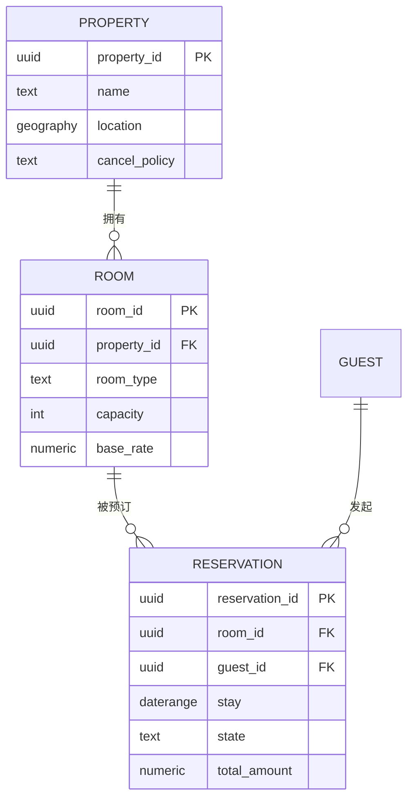
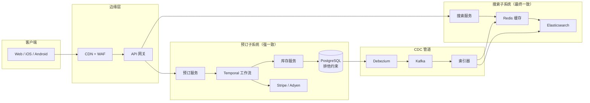
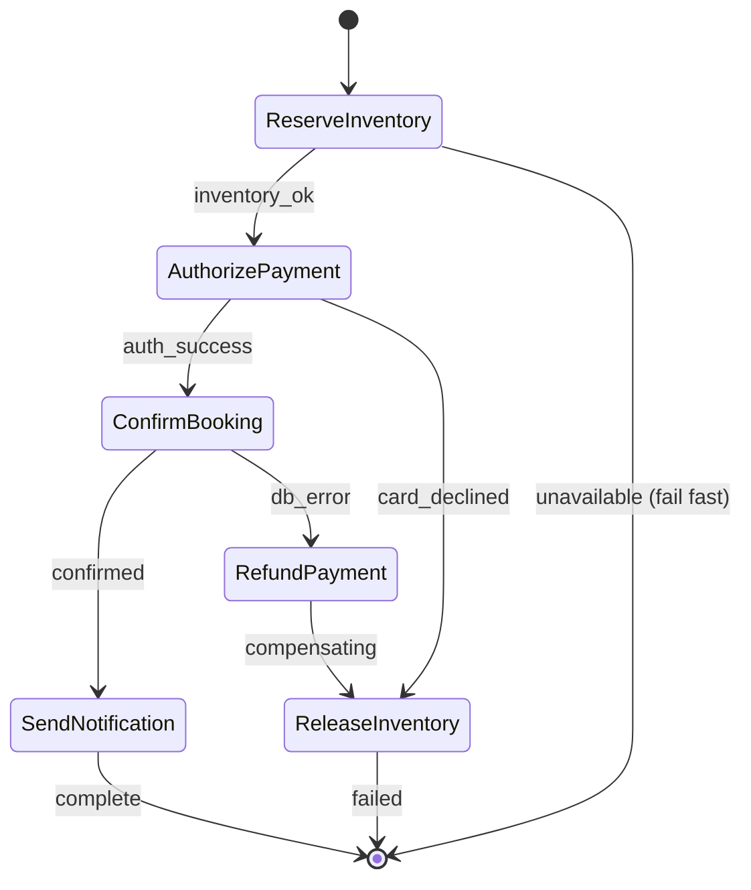
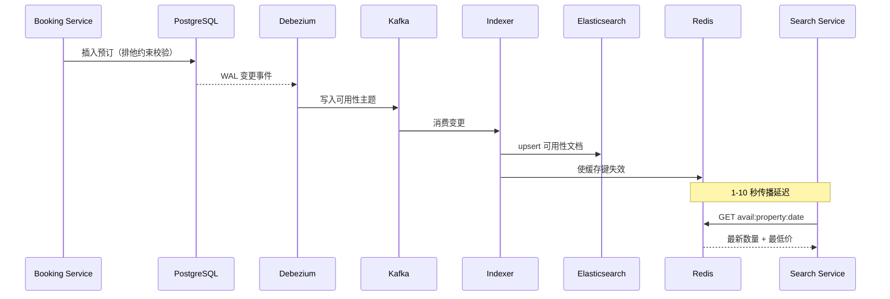

# 设计酒店预订系统（Booking.com / Airbnb）

> **TL;DR.** 酒店预订平台会拆成两个一致性需求相反的子模块：读多写少的搜索面（Elasticsearch + Redis，最终一致，85K QPS）和写多读少的预订面（PostgreSQL 加排他约束，强一致，1.7K QPS）。与售票系统的关键差别在日期区间语义：3 晚住宿必须原子地占用 3 行库存；超售是刻意为之（用来抵消 1-5% 的未入住）[^1]；支付采用“下单预授权、离店请款”，线上持卡人发起的交易授权窗口为 7 天[^2]。Booking.com 服务 2800 万个房源[^3]，其特征平台在 25 ms p99.9 下跑到 200K RPS[^4]。

## 学习目标

- 设计一个拆成“最终一致的搜索子系统”与“强一致的预订子系统”的预订平台，并说清这条边界的理由
- 用 PostgreSQL 的 `daterange` 排他约束，让区间重叠的预订在数据库层面结构上不可能发生
- 用 Temporal 编排预订 saga（占库存、预授权、确认、通知），并在失败时正确补偿
- 为 Booking.com 量级（每天约 300 万间夜[^5]）的平台做容量估算
- 分析 CDC 延迟、缓存新鲜度，以及“下单时复核”这个模式如何用一点“已售罄”概率换读吞吐
- 对比酒店库存（房型 × 日期 × 价格方案，刻意超售）与售票库存（离散座位，零容忍重复售卖）

## 直觉理解

酒店预订系统乍看就是个带日历的 CRUD 应用：建一间房，把日期标成可售，让客人下单。10 家门店时它工作得很好。到 2800 万个房源、Booking Holdings 旗下各品牌每天约 300 万间夜（仅 2026 年第一季度就有 3.38 亿间夜）[^5]时，它就崩了，原因在于读写不对称。

每一次预订背后大约有 100 次搜索。用户搜“巴黎，3 晚，200 美元以内”，系统要扫过几百万个房源，按地理位置、日期、价格、设施过滤，并在 500 ms 内返回排序结果。这种搜索不可能打到事务型数据库上，否则数据库直接熔掉。但紧接着的那次预订又必须保证同一间实体房绝不会被卖两次，哪怕某条爆款房源下有 50 个用户在同一秒点了“预订”。

解开这个设计的洞察是：把两条路径彻底分开。搜索从反范式化的 Elasticsearch 索引读，容忍几秒的陈旧。预订写 PostgreSQL，用排他约束让日期区间重叠在结构上不可能出现。两个系统之间只有一条 CDC 管道，把库存变化从 Postgres 推到搜索索引。

与[设计售票系统（BookMyShow / Ticketmaster）](./18-ticketing-system.md)不同——那里的库存是离散座位，对重复售卖零容忍——酒店库存有三个独有性质：（1）一次预订跨一个日期区间，而不是单个原子单位；（2）超售是刻意的，因为有 1-5% 的客人不会到店[^1]；（3）支付模型是“先预授权、离店再请款”，线上持卡人发起的交易授权窗口为 7 天[^2]。

## 需求

### 澄清问题

- **Q：聚合平台（Booking.com 式）还是单一经营方？**
  假设：聚合平台，从 100 万以上房源获取权威库存。
- **Q：即时确认，还是等酒店确认？**
  假设：支付预授权成功即即时确认。
- **Q：取消模型？**
  假设：按房源单独配置（免费取消、不可退、阶梯式）。
- **Q：支付时点？**
  假设：下单时预授权，入住/离店时请款。支持“到店付”。
- **Q：多房与团体预订？**
  假设：v1 不做。每次预订一间房。
- **Q：数据驻留？**
  假设：欧盟与美国双主区，PII 受 GDPR 约束。
- **Q：允许超售吗？**
  假设：允许。酒店会刻意超售，通常在 2-10% 之间，用来同时抵消未入住（1-5%）和临时取消[^1][^6]。

### 功能需求

- 按地点、日期区间、人数、价格、设施搜索，返回排序结果
- 查看房源详情，含实时逐晚可用性
- 为某个日期区间预订指定房型，即时确认
- 通过 PSP 支付（下单预授权，入住请款）
- 取消或修改，按政策计算退款
- 接收预订确认、提醒与入住指引

### 非功能需求

- **负载：** 1000 万间房 / 100 万房源。搜索 85K QPS，预订 1.7K QPS（峰值 8.5K）
- **延迟：** 搜索 p99 < 500 ms；预订确认 p99 < 3 s
- **可用性：** 预订路径 99.99%，搜索路径 99.9%
- **一致性：** 搜索最终一致（最多 30 s 延迟）；库存提交强一致
- **持久性：** 零重复预订；可用性缓存可以落后，但预订一定会复核

## 容量估算

| 指标 | 数值 | 推导 |
|--------|------:|------------|
| 房源数 | 28M | Booking.com 量级[^3] |
| 间夜/天 | ~3,000,000 | Booking Holdings 2026 Q1：3.38 亿间夜 / 90 天[^5] |
| 搜索 QPS（均值） | 85,000 | 浏览与下单比约 100:1（按单品牌切量估算） |
| 搜索 QPS（峰值） | 250,000 | 高峰时段为均值的 3 倍 |
| 预订 QPS（均值） | ~35 | 300 万间夜/天 / 86,400 |
| 预订 QPS（峰值） | ~300 | 约为均值 8 倍（周末与节假日高峰） |
| 可用性索引大小 | 730 GB | 1000 万间房 × 365 天 × 200 B |
| Redis 缓存（180 天） | 110 GB | 热门房源，未来 6 个月 |
| 预订量/年 | ~1.1B | Booking Holdings 全口径：300 万/天 × 365 |
| 存储/年 | ~1.1 TB | 11 亿 × 每笔预订约 1 KB |

**关键比例：** 读写比约 50:1。搜索索引承接 98% 的流量。预订写入 QPS 不高，但热门房源的争用很激烈。一次 3 晚预订会原子地触碰 3 行库存。仅 2026 年第一季度，Booking Holdings 就处理了 538 亿美元的总预订额[^5]。

## API 与数据模型

### API 设计

```http
GET /v1/search?location=paris&checkin=2026-06-01&checkout=2026-06-04&guests=2&max_price=200&cursor=...&limit=20
  Returns: 200 { "properties": [...], "next_cursor": "..." }

GET /v1/properties/{id}/availability?checkin=2026-06-01&checkout=2026-06-04
  Returns: 200 { "room_types": [{"type": "double", "available": 3, "rate": 189}] }

POST /v1/bookings
  Idempotency-Key: <uuid>
  Body: { "property_id": "p-123", "room_type": "double",
          "checkin": "2026-06-01", "checkout": "2026-06-04",
          "guest_id": "u-abc", "payment_method_id": "pm_stripe" }
  Returns: 201 { "booking_id": "b-xyz", "status": "confirmed", "total": 567.00 }
  Errors: 409 room unavailable, 402 payment declined, 429 rate limited

POST /v1/bookings/{id}/cancel
  Returns: 200 { "refund_amount": 567.00, "refund_status": "pending" }

POST /v1/webhooks/payment
  Idempotent on stripe_event_id. Async PSP callbacks.
```

`/availability` 端点就是“下单时复核”模式：预订服务在提交前拿它去打 PostgreSQL（不是搜索索引）。搜索端点读的则是 Elasticsearch。

### 数据模型

```sql
CREATE EXTENSION IF NOT EXISTS btree_gist;

CREATE TABLE properties (
  property_id   UUID PRIMARY KEY,
  name          TEXT NOT NULL,
  location      GEOGRAPHY(POINT) NOT NULL,
  currency      TEXT DEFAULT 'USD',
  cancel_policy TEXT DEFAULT 'flexible'
);

CREATE TABLE rooms (
  room_id       UUID PRIMARY KEY,
  property_id   UUID REFERENCES properties,
  room_type     TEXT NOT NULL,
  capacity      INT NOT NULL,
  base_rate     NUMERIC(10,2)
);

CREATE TABLE reservations (
  reservation_id UUID PRIMARY KEY,
  room_id        UUID NOT NULL REFERENCES rooms,
  guest_id       UUID NOT NULL,
  stay           DATERANGE NOT NULL,
  state          TEXT NOT NULL DEFAULT 'confirmed',
  payment_id     TEXT,
  total_amount   NUMERIC(10,2),
  created_at     TIMESTAMPTZ DEFAULT now(),
  EXCLUDE USING GIST (room_id WITH =, stay WITH &&)
);
```

*`(room_id, stay)` 上配重叠运算符 `&&` 的排他约束，让同一房间插入日期重叠的两条预订在结构上不可能[^7]。应用层就算有 bug，也造不出重复预订。*

`DATERANGE` 类型用开区间的上界：`[2026-06-01, 2026-06-04)` 意味着 6 月 4 日离店不阻塞 6 月 4 日的新入住，这跟酒店现实一致——客房部当天就能翻房[^8]。



*核心实体关系：房源拥有房间，房间拥有预订，日期区间不重叠由排他约束保证。*

## 高层架构



*搜索与预订是两个独立子系统，只共享 PostgreSQL 这个最终的事实来源；CDC 负责在几秒内把库存变化同步到搜索索引。*

**写路径：** 客人点“预订”。预订服务启动一个 Temporal saga。第一个活动调用库存服务，执行 `INSERT INTO reservations`，由排他约束做最终裁决。成功后，saga 通过 Stripe 做支付预授权，再确认预订。

**读路径：** 搜索请求先打 Redis（热门房源 10 ms 以内），再打 Elasticsearch 做地理 + 分面 + 价格排序。CDN 缓存房源图片与静态元数据。Booking.com 的特征平台在 ElastiCache 上以 200K RPS 跑到 25 ms p99.9 以内[^4]。

**异步路径：** Kafka 把预订事件扇出到通知（邮件、短信）、分析、积分累积，以及多渠道房源在多个 OTA 上的渠道管理器同步。

## 深入探讨

### 带日期区间语义的库存锁定

这是酒店预订与售票系统分道扬镳最明显的地方。[设计售票系统（BookMyShow / Ticketmaster）](./18-ticketing-system.md)里，一个座位就是一个原子单位：一个 Redis 键、一把锁。而一间房住 3 晚是 3 行日期数据，必须原子地占住，且重叠语义并不简单。

**PostgreSQL 排他约束（exclusion constraint）** 是这个设计的主角。借助 `btree_gist`，你这样声明：

```sql
EXCLUDE USING GIST (room_id WITH =, stay WITH &&)
```

它对 PostgreSQL 说的是：“凡是 `room_id` 等于已有行、且 `stay` 日期区间与已有行重叠的插入，一律拒绝”[^7]。GiST 索引让这个检查即使在上百万行下也很高效。应用层被攻破或有 bug，也造不出重叠，因为数据库直接不认[^9]。

**为什么不在应用层检查？** 三个理由：（1）`SELECT` 之后再 `INSERT`，两条语句之间存在竞态窗口；（2）用版本列做乐观并发控制，需要重试逻辑，而一旦涉及日期区间就变得很复杂；（3）排他约束是声明式的，新来的开发者不可能不小心绕过它。

**结算页用 Redis 占位（hold）：** 用户填支付信息的那段时间（人的速度，1-10 分钟），用 Redis `SETNX` 占位、TTL 10 分钟，避免别人看到这间房还是可订的。键是每晚一个 `hold:{room_id}:{date}`。用户放弃，TTL 自动释放。用户继续，saga 提交到 PostgreSQL，最终裁决权在排他约束手里。

**超售：** 酒店按预测出的比例刻意超售。行业报告的未入住率在 1-5%[^1]，而聪明的超售能给精品酒店带来 8-15% 的收入提升[^6]。系统通过允许房源在房型上设置 `overbooking_factor` 来支持这件事。排他约束作用于已经确认的实体房间分配，而不是针对房型池的“软”预订。转店补偿（把客人安排到合作酒店）从计划性调剂的 150 美元到突发状况的 300 美元以上不等[^6]。

### 基于 Temporal 的预订 saga

[分布式事务](../part-3-distributed-systems-theory/06-distributed-transactions.md)解释了为什么 2PC 在独立服务之间走不通。Stripe 无法作为资源管理器参与；你没法对一个刷卡预授权做 `PREPARE`。答案是 saga 模式。



*saga 串起四个幂等活动，补偿按逆序展开；任何一步崩溃都会借 Temporal 的持久化工作流历史回放重来[^10]。*

每个活动都按 `saga_id` 幂等。补偿清单随活动成功逐步累积，失败时逆序回退[^10][^11]。几个关键设计决策：

- **占库存** 带排他约束插入 PostgreSQL。若房间自用户搜索后已被卖掉，saga 快速失败，返回“抱歉，刚刚售出”。
- **支付预授权** 调 Stripe，带 `capture_method=manual` 与幂等键[^12]。对线上持卡人发起的交易（CIT），在 Visa/Mastercard/Amex/Discover 上授权可冻结资金最长 7 天。注意：Visa 的商户发起交易（MIT）过期更快，为 5 天（严格说是 4 天 18 小时）[^2]。酒店在入住时请款。
- **确认预订** 把预订状态置为 `confirmed` 并发布一条 Kafka 事件。
- **发通知** 是 fire-and-forget，至少一次投递。发出去的邮件收不回来，只能用一封“预订已取消”的后续邮件纠正。

**补偿不是回滚。** 退款是一笔新的业务操作。它会出现在客户账单上，可能要 5-10 个工作日，而且它自己也可能失败。saga 处理补偿失败的方式是升级到死信队列[^11]。

**授权过期的坑：** 客人提前 14 天订了一个不可退的价格。授权在第 7 天过期[^2]。解法：用 Stripe 的延长授权（最长 30 天），或者对不可退价格立即请款、若在政策期内取消再退款。

### 搜索链路与 CDC 新鲜度

搜索子系统必须在 85K QPS 下回答地理 + 日期 + 价格 + 设施的组合查询。PostgreSQL 直接扛不住。架构上用 CDC 让一份反范式化的 Elasticsearch 索引保持新鲜。



*PostgreSQL 的写入经 Debezium 与 Kafka 传播到 Elasticsearch；搜索读在几秒内最终一致[^13][^14]。*

**下单时复核模式：** 搜索结果可能已经陈旧几秒。用户点“预订”时，预订服务一定会直接回查 PostgreSQL。若房间自搜索后已被卖掉，用户看到“抱歉，刚刚售出，这里还有相似房源”。这是用小比例的“抱歉”换数量级的读吞吐。

**批量更新时的 CDC 延迟：** 收益经理推了一次 100 万行的季节性调价。索引器跟不上了。缓解办法：为 `price` 与 `availability` 变更分设 Kafka 主题，这样调价不会把可用性新鲜度饿死。在摄入侧施加背压。支付前展示一个“价格已复核”的步骤。

**Elasticsearch 模式：** 每个 `(property_id, date_bucket)` 一个文档，字段包含 geo_point、可用房型、最低价、设施、星级。地理查询用 `geo_distance` 过滤。分面聚合支撑侧边栏的筛选器。

## 真实案例

**Booking.com 的机器学习特征平台**

Booking.com 在全球运营 2800 万个住宿房源[^3]，整个 Booking Holdings 旗下各品牌每天处理约 300 万间夜。2026 年第一季度，Booking Holdings 报告了 3.38 亿间夜与 538 亿美元总预订额[^5]。

公司的机器学习特征平台建在 Amazon ElastiCache 上，每秒服务 20 万次请求，客户端侧 p99.9 延迟低于 25 ms[^4]。特征（价格、可用性信号、用户历史、欺诈评分）通过 Kafka 摄入，每个特征组每秒 5 万条记录[^4]。Snowflake、Flink、Spark 这类外部系统负责计算特征，再发布到各组对应的 Kafka 主题。

这套架构做的是负载隔离：每个用例一个 ElastiCache 集群，于是欺诈评分流量的尖峰无法拖慢搜索排序的延迟[^4]。序列化上，Key-JSON 用于人类可读的部分更新，Key-Kryo 用于紧凑二进制——当 p99 延迟比可调试性更重要时选后者[^4]。

关键洞察是：Booking.com 把可用性当成一个特征，而不只是数据库里的一列。可用性信号与价格、评价、用户偏好一起喂进排序模型。只剩 1 间房的房源会被加权（“仅剩 1 间！”），这不只是为了制造紧迫感的交互，而是因为模型学到了稀缺性与转化率相关。

**渠道管理：** 在多个 OTA（Booking.com、Expedia、酒店官网）上挂牌的房源，用 SiteMinder 这类渠道管理器[^15]做近实时的库存同步。没有渠道管理器、只靠 iCal 同步的房东，面对的是 2-4 小时的刷新间隔，于是产生了重复预订窗口[^16][^17]。

## 权衡

| 方案 | 优点 | 缺点 | 适用场景 |
|----------|------|------|-------------|
| Elasticsearch 可用性索引 | 大规模下地理 + 分面 + 价格都灵活 | CDC 延迟、重建成本 | 需要多分面搜索的聚合平台 |
| Postgres 物化视图 | 强一致 | 在 250K QPS 下地理 + 分面表现差 | 单体酒店 PMS |
| ES 前面加 Redis 缓存 | 热门读 10 ms 以内 | 多一层陈旧 | 高 QPS、用户可容忍 |
| PG 排他约束（GiST） | 数据库强制、防 bug[^7] | GiST 比 B-tree 慢 | 日期区间库存（本设计选它） |
| 乐观并发（版本号） | 无锁、吞吐高 | 争用下要重试 | 单行争用低 |
| Redis SETNX 占位 + DB 提交 | 10 万 ops/sec、TTL 天然释放 | 故障切换时丢锁 | 面向用户的 10 分钟占位（本设计选它） |
| 用 Temporal 跑 saga | 有补偿、有回放历史[^10] | 运维复杂度 | 多服务 + 支付（本设计选它） |
| iCal 日历同步 | 开放标准、无锁定 | 2-4 小时刷新、有重复预订风险[^16] | 独立房东 |
| 渠道管理器（SiteMinder） | OTA 近实时同步[^15] | 供应商成本 | 上 3 个以上 OTA 的专业酒店 |

更高一层的决策是：强一致只放在钱与唯一性交汇的那一点（提交时的库存行），其余一切都可以最终一致。这与售票是同一个原则，但这里的一致性边界是一条日期区间排他约束，而不是单键原子交换。

> [!NOTE]
> **为什么没有“支付 + 库存跨系统 2PC”这一行。** 两阶段提交要求每个参与者都作为支持 `PREPARE` 的资源管理器行事。Stripe、Adyen 这类支付服务商并不暴露 XA 语义（你无法对一个刷卡预授权做 `PREPARE`），所以跨支付与库存的经典 2PC 根本不在可选菜单上。上面那行 saga 就是替代它的机制。想看这件事为什么能推广到酒店之外，参见[分布式事务](../part-3-distributed-systems-theory/06-distributed-transactions.md)一章。

## 扩展与故障模式

**10 倍（每天 1200 万间夜，搜索 850K QPS）：** Elasticsearch 按地理网格（H3 或 S2）分片。Redis 用集群模式横向扩展。PostgreSQL 按月份 + 区域给 reservations 分区。CDC 管道为每个主题增加消费者组。

**100 倍（每天 1.2 亿间夜）：** 瓶颈变成预订服务。按房源所在区域切分 Temporal 命名空间。支付扇出到多个 PSP 集成。搜索索引转向分层架构：热（未来 30 天）放内存，温（30-180 天）放 SSD，冷（180 天以上）归档。

**1000 倍：** 架构转向 CDN 优先的读——可用性变成通过失效通知更新的静态资产。只有预订提交才回源。

**故障模式：**

- **CDC 管道延迟尖峰：** 搜索显示过期的可用性。用户在结算时更常看到“已订满”。检测：按主题的消费者延迟指标。应对：优雅降级，展示“价格可能已变动”的横幅。
- **PostgreSQL 主节点故障切换：** 进行中的 saga 对新主节点重试。副本上的排他约束在提升期间防止重复预订。爆炸半径：单个区域 5-30 秒的预订失败。
- **PSP 故障（Stripe 挂 10 分钟）：** saga 靠 Redis TTL 保持库存占用。TTL 到期后占位自动释放。Stripe 恢复时，webhook 的惊群打进来。缓解：按预订 ID 给 webhook 消费者分区，按 `stripe_event_id` 去重[^12]。

## 常见陷阱

> [!WARNING]
> **拿搜索索引做预订决策。** 搜索索引是最终一致的。如果你省掉对 PostgreSQL 的复核，流量尖峰期间 CDC 一延迟，你就会重复售卖。永远在预订 saga 的第一个活动里复核库存。

> [!WARNING]
> **用 `SELECT FOR UPDATE` 管日期区间库存。** 悲观行锁会把热门房源上的所有下单者串行化。改用排他约束：它让 PostgreSQL 在插入时直接拒绝重叠，而不必在整个结算流程中持锁[^7]。

> [!WARNING]
> **把授权冻结时长设成和入住时长一样。** 线上持卡人发起的刷卡预授权在 Visa/MC/Amex/Discover 上是 7 天过期（Visa 的商户发起交易过期更早，5 天）[^2]。入住前 14 天下单的预订，到请款时授权已经过期。对不可退价格用延长授权，或立即请款。

> [!WARNING]
> **把超售当 bug。** 酒店会刻意超售（行业惯例跨 2-10%），用来抵消 1-5% 的未入住加上临时取消[^1][^6]。系统必须支持按房型配置超售系数，并把每次转店 150-300 美元以上的补偿当成一项明码成本来预算[^6]。

> [!WARNING]
> **所有 CDC 事件塞进一个 Kafka 主题。** 一次批量调价（100 万行）会把可用性变更的传播饿死。为 `price` 与 `availability` 分设主题、各自独立消费者组，才能避免一个阻塞另一个。

> [!WARNING]
> **忽视价格一致性的法律约束。** 欧盟 C-264/23 案裁定，OTA 与酒店之间的窄幅最惠国（MFN）条款可能构成反竞争[^18]。系统设计必须能承载按渠道定价，而不是在技术上强制价格一致。

## 追问

**1. 如何支持“到店付款”而不预先扣款？**

用 `capture_method=manual` 对首晚房费（或未入住违约金金额）做一笔预授权冻结。这笔冻结占用卡的可用额度但不结算。客人未入住就请款违约金；客人到店就作废授权，离店时按整单收款。延长授权最长支持 30 天[^2]。

**2. 酒店报告一间房卖给了两位客人。你的排查手册是什么？**

查事件溯源的审计日志（Kafka 落到不可变存储），找出该 `(room_id, date)` 上的所有状态变迁。检查排他约束是否被绕过（不改 schema 不可能）、超售是否开启，或者这次重复预订是否来自渠道管理器同步的空档（iCal 的 2-4 小时窗口）[^17]。

**3. 渠道管理器集成怎么做，才能让同一间房在你的平台和三个 OTA 上都卖而不重复？**

渠道管理器（SiteMinder[^15]）维护单一库存池。任一渠道产生预订，它在几秒内把可用性更新推给所有其他渠道。我们的系统对外开放一个 webhook 接收入站可用性更新，出站变更则通过 CDC 管道发布。

**4. 如何上线一次定价算法变更而不污染可用性缓存？**

把新算法放在特性开关后面，写入一个影子 Kafka 主题。用 24 小时对比影子价格与线上价格。放量时索引器切换主题。陈旧的缓存条目会随其 60 秒 TTL 自然过期。

**5. 某区域与主场区断连一小时。用户还能搜索吗？还能预订吗？**

搜索继续，走本地 Elasticsearch 与 Redis 副本（陈旧但可用）。主场区不可达的房源，预订会失败。系统返回降级响应：“该房源暂时无法预订，请稍后重试。”不做跨区域预订写入，避免库存脑裂。

**6. 如何接会员体系（Marriott Bonvoy，2 亿以上会员）？**

会员服务是独立的限界上下文，在结算时被查询。它套用等级权益（延迟退房、升级优先级），计算可累积积分，并把积分兑换预订当作一种非现金价格码处理。Marriott Bonvoy 在 2024 年突破 2 亿会员[^19]，据报道会员贡献了相当大比例的间夜[^20]。

## 练习

### 练习 1：多晚住宿的原子性

客人订了 5 晚（6 月 1 日至 6 日）。你的系统按每晚一行存库存。另一位客人同时预订同一间房的第 3 至 5 晚。你如何避免出现部分重叠——A 客人拿到第 1-3 晚、B 客人拿到第 3-5 晚，结果 A 的住宿不完整？

<details>
<summary>提示</summary>

想一想：你把库存建模成按日期的独立行，还是建模成单个 daterange？PostgreSQL 的排他约束作用在什么之上？如果你用逐晚行配 `SELECT FOR UPDATE`，与用单个 `daterange` 列相比，会发生什么？

</details>

<details>
<summary>解答</summary>

每笔预订用一个 `DATERANGE` 列，而不是逐晚行。A 客人的预订是 `[2026-06-01, 2026-06-06)`（开区间上界）。B 客人试图在同一 `room_id` 上插入 `[2026-06-03, 2026-06-06)`，触发排他约束（`stay WITH &&` 检测到重叠），插入被原子拒绝[^7][^8]。

若用逐晚行，你就得在单个事务里对全部 5 行做 `SELECT FOR UPDATE`，这会把所有并发下单者串行化，并且当两个事务以不同顺序加锁时有死锁风险。daterange 方案既更简单也更快：一行、一条约束、一次原子检查。

接受的权衡：daterange 模型让“只订第 3 晚”这类查询稍复杂一点（需要做区间包含判断），但对多晚住宿来说，原子性保证值这个代价。

</details>

## 要点回顾

- **把搜索和预订拆开。** 两者的一致性需求相反，不可能共享同一条热路径。搜索能容忍几秒陈旧；预订要求库存行上强一致。
- **PostgreSQL 排他约束是一行代码解决的主角。** `EXCLUDE USING GIST (room_id WITH =, stay WITH &&)` 让重复预订在数据库层面结构上不可能[^7]。
- **预订 + 支付要用 saga，不要用 2PC。** 支付服务商不会说 2PC，也永远不会。Temporal 提供持久化回放与补偿[^10]。
- **下单时复核模式** 用一点“抱歉，售罄”的比例换数量级的读吞吐。永远不要拿搜索索引做预订决策。
- **超售是特性，不是 bug。** 酒店会刻意超卖来抵消 1-5% 的未入住[^1]。把转店补偿当成一项明码成本来预算。
- **日期区间语义是酒店与售票的分水岭。** 3 晚住宿是一个原子 daterange，不是 3 把独立的锁。

## 延伸阅读

- [Inside Booking.com's ultra-low latency feature platform with Amazon ElastiCache](https://aws.amazon.com/blogs/database/inside-booking-coms-ultra-low-latency-feature-platform-with-amazon-elasticache/)。一手数据：Booking.com 20 万 RPS 特征存储架构。
- [PostgreSQL Range Types documentation](https://www.postgresql.org/docs/current/rangetypes.html)。关于 `daterange`、GiST 索引与排他约束在预订系统里的权威参考。
- [PostgreSQL DateRange and Efficient Time Management (Hashrocket)](https://hashrocket.com/blog/posts/postgresql-daterange-and-efficient-time-management)。完整的酒店预订示例，含开区间与闭区间边界的讨论。
- [Build a trip booking application in Python (Temporal)](https://learn.temporal.io/tutorials/python/trip-booking-app/)。参考版 saga 实现，覆盖酒店、租车、航班的补偿。
- [Place a hold on a payment method (Stripe)](https://docs.stripe.com/payments/place-a-hold-on-a-payment-method)。授权有效期、手动请款，以及面向酒店的延长冻结。
- [Designing robust and predictable APIs with idempotency (Stripe)](https://stripe.com/blog/idempotency)。让 PSP 重试变得安全的幂等键契约。
- [Debezium PostgreSQL connector documentation](https://debezium.io/documentation/reference/stable/connectors/postgresql.html)。Postgres 到 Kafka 再到 Elasticsearch 这条 CDC 管道的实现。
- [OTA Channel Manager: The Ultimate Guide (SiteMinder)](https://www.siteminder.com/r/ota-channel-manager/)。OTA 库存同步在实践中的运作方式。

## 记忆卡片

<details>
<summary><strong>Q：哪个 PostgreSQL 特性能在数据库层面阻止日期区间重复预订？</strong></summary>

A：配 `btree_gist` 的排他约束：`EXCLUDE USING GIST (room_id WITH =, stay WITH &&)`。`&&` 运算符检测 daterange 重叠，PostgreSQL 会拒绝任何会造成重叠的插入。

</details>

<details>
<summary><strong>Q：为什么酒店预订用 daterange 列而不是逐晚库存行？</strong></summary>

A：单个 daterange 列让多晚原子性变得平凡（一行、一次约束检查）。逐晚行需要在事务里锁 N 行，争用下有死锁与串行化的风险。

</details>

<details>
<summary><strong>Q：什么是下单时复核模式？</strong></summary>

A：搜索读的是最终一致的索引（Elasticsearch/Redis），但预订 saga 的第一个活动一定回查 PostgreSQL 校验库存。若房间自搜索后已售出，用户看到“抱歉，刚刚售出”。这是用小比例失败换极大的读吞吐。

</details>

<details>
<summary><strong>Q：酒店为什么要刻意超售？</strong></summary>

A：行业未入住率是 1-5%。按预测比例超售可以弥补空房带来的收入损失。转店补偿（每次 300 美元以上）作为明码成本预算，而不当成系统 bug。

</details>

<details>
<summary><strong>Q：线上酒店预订的刷卡授权窗口是多久？</strong></summary>

A：Visa/MC/Amex/Discover 的线上持卡人发起交易为 7 天。延长授权最长支持 30 天。酒店必须在这个窗口内请款，否则授权过期，卡就扣不了了。

</details>

<details>
<summary><strong>Q：为什么酒店预订加支付不能用 2PC？</strong></summary>

A：支付服务商（Stripe、Adyen）无法作为资源管理器参与分布式事务。你没法对一个刷卡预授权做 PREPARE。带补偿动作的 saga 模式才是正确替代。

</details>

<details>
<summary><strong>Q：CDC 如何把库存变化传到搜索索引？</strong></summary>

A：Debezium 读取 PostgreSQL 的预写日志，把行级变更事件发到 Kafka。索引器消费者把变更转换成反范式化的 Elasticsearch 文档。典型传播延迟为 1-10 秒。

</details>

<details>
<summary><strong>Q：在多 OTA 挂牌的房东为什么会出现重复预订？</strong></summary>

A：iCal 同步的刷新间隔是 2-4 小时。在一个平台上的预订要等到下次刷新才会传给别人，于是同一个晚上可能被两个平台确认。渠道管理器用近实时推送同步解决这个问题。

</details>

<details>
<summary><strong>Q：酒店库存与售票库存的区别是什么？</strong></summary>

A：售票是离散座位（一个键、一把锁，对重复售卖零容忍）。酒店库存跨日期区间（多晚原子性），允许刻意超售，并用“先预授权、后请款”的支付方式、授权窗口 7 天。

</details>

<details>
<summary><strong>Q：Booking.com 的特征平台如何在 25 ms p99.9 以下跑到 200K RPS？</strong></summary>

A：每个用例一个 ElastiCache 集群，隔离负载。特征通过 Kafka 摄入，每组每秒 5 万条。Kryo 二进制序列化压低热路径延迟。工作负载隔离避免跨用例干扰。

</details>

## 参考文献

[^1]: "How to prevent hotel no-show and last-minute cancellations?", Hospitality Net, Oct 2024. https://www.hospitalitynet.org/news/4124422/how-to-prevent-hotel-no-show-and-last-minute-cancellations

[^2]: "Place a hold on a payment method," Stripe documentation, 2024. https://docs.stripe.com/payments/place-a-hold-on-a-payment-method

[^3]: "Booking.com warns customers of possible data and security breach," ABC News, Apr 2025. https://www.abc.net.au/news/2026-04-13/booking-com-data-security-breach-personal-details/106557630

[^4]: Schaefers, Eskili, Hudara, Celozzi, "Inside Booking.com's ultra-low latency feature platform with Amazon ElastiCache," AWS Database Blog, Jan 2026. https://aws.amazon.com/blogs/database/inside-booking-coms-ultra-low-latency-feature-platform-with-amazon-elasticache/

[^5]: "Booking Holdings Q1 CY2026 Earnings Results," StockStory, Apr 2026. https://markets.financialcontent.com/stocks/article/stockstory-2026-4-28-bookings-nasdaqbkng-q1-cy2026-earnings-results-revenue-in-line-with-expectations

[^6]: "Overbooking In Hotels: AI-Driven ROI Guide For 2026," Vynta.ai, Oct 2025. https://vynta.ai/blog/overbooking-in-hotels/

[^7]: "Range Types (Section 8.17)," PostgreSQL 18 documentation. https://www.postgresql.org/docs/current/rangetypes.html

[^8]: Matt Polito, "PostgreSQL DateRange and Efficient Time Management," Hashrocket, Mar 2024. https://hashrocket.com/blog/posts/postgresql-daterange-and-efficient-time-management

[^9]: "3 Logic Errors You Can Finally Delete Using Postgres Range Types and EXCLUDE Constraints," loke.dev, 2025. https://web.archive.org/web/20260615013527/https://loke.dev/blog/postgres-range-types-exclude-constraints

[^10]: "Build a trip booking application in Python," Temporal learn, Jul 2024. https://learn.temporal.io/tutorials/python/trip-booking-app/

[^11]: "Saga Design Pattern Explained for Distributed Systems," Temporal blog, May 2023. https://temporal.io/blog/saga-pattern-made-easy

[^12]: "Designing robust and predictable APIs with idempotency," Stripe blog. https://stripe.com/blog/idempotency

[^13]: "Debezium connector for PostgreSQL," Debezium documentation. https://debezium.io/documentation/reference/stable/connectors/postgresql.html

[^14]: "Real-Time Search Indexing with CDC: Debezium to Elasticsearch vs RisingWave," RisingWave, 2025. https://risingwave.com/blog/cdc-search-indexing-debezium-elasticsearch-risingwave/

[^15]: "OTA Channel Manager: The Ultimate Guide," SiteMinder, 2025. https://www.siteminder.com/r/ota-channel-manager/

[^16]: "How to Sync Airbnb Calendar with Booking.com," Houst, 2025. https://www.houst.com/blog/how-to-sync-airbnb-calendar-with-booking-com

[^17]: "Reducing double bookings on Airbnb and other channels," Guesty blog, 2024. https://www.guesty.com/blog/reducing-double-bookings-on-airbnb-and-other-channels/

[^18]: "Case C-264/23 Booking.com - Ancillary Restraints and Market Definition in the Platform Economy," Wolters Kluwer Competition Blog, Nov 2024. https://legalblogs.wolterskluwer.com/competition-blog/case-c-26423-bookingcom-ancillary-restraints-and-market-definition-in-the-platform-economy/

[^19]: Sean O'Neill, "Marriott Bonvoy Adds 200 Millionth Member as Hotel Loyalty Race Heats Up," Skift, Feb 2024. https://skift.com/2024/02/26/marriott-bonvoy-adds-200-millionth-member-as-hotel-loyalty-race-heats-up/

[^20]: "Marriott's Bonvoy Loyalty Engine Powers Scalable Premium Pricing," AInvest, Apr 2025. https://www.ainvest.com/news/marriott-bonvoy-loyalty-engine-powers-scalable-premium-pricing-fashion-wellness-partnerships-2604/
