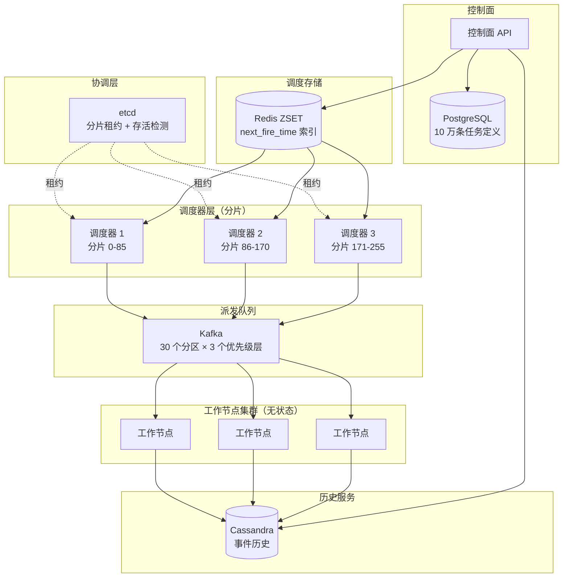
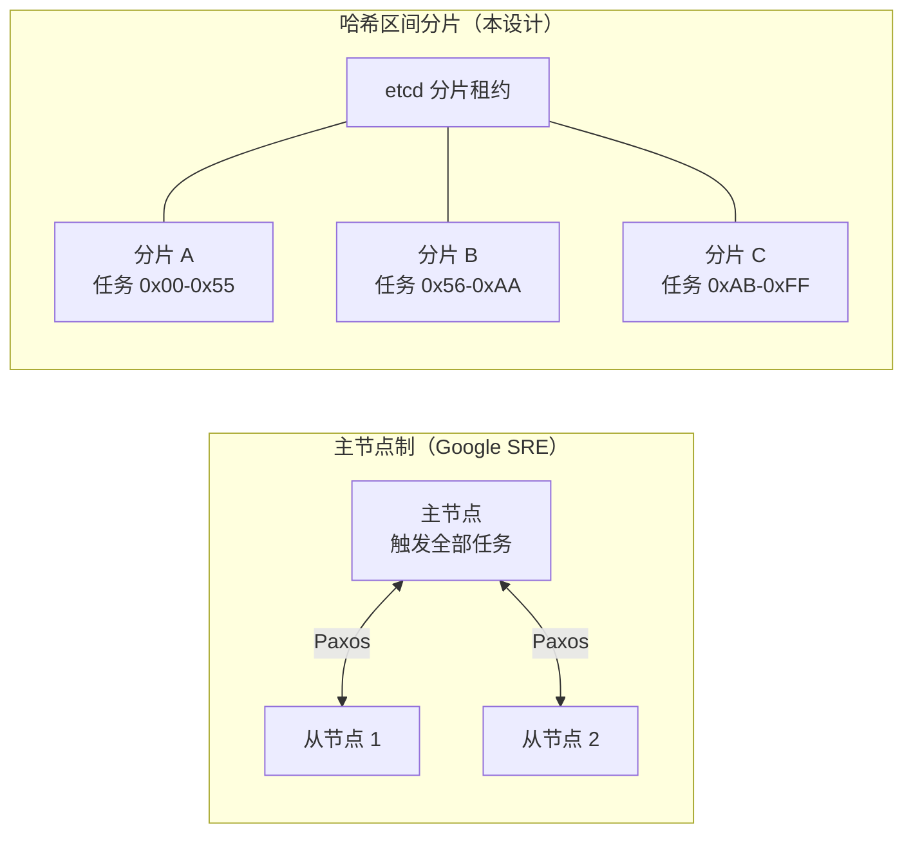
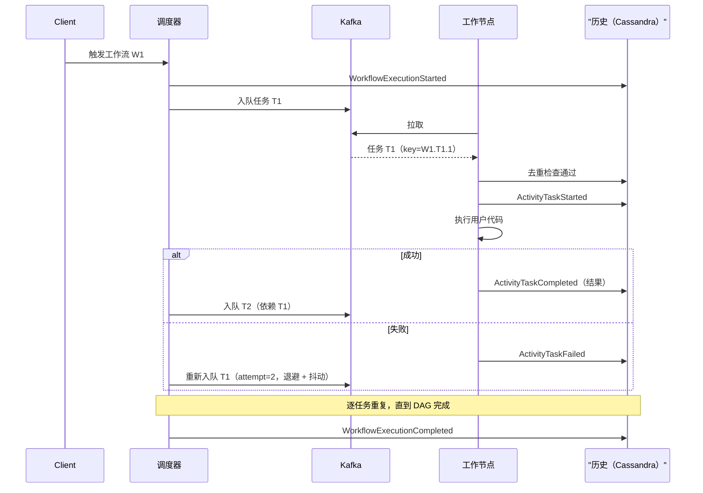
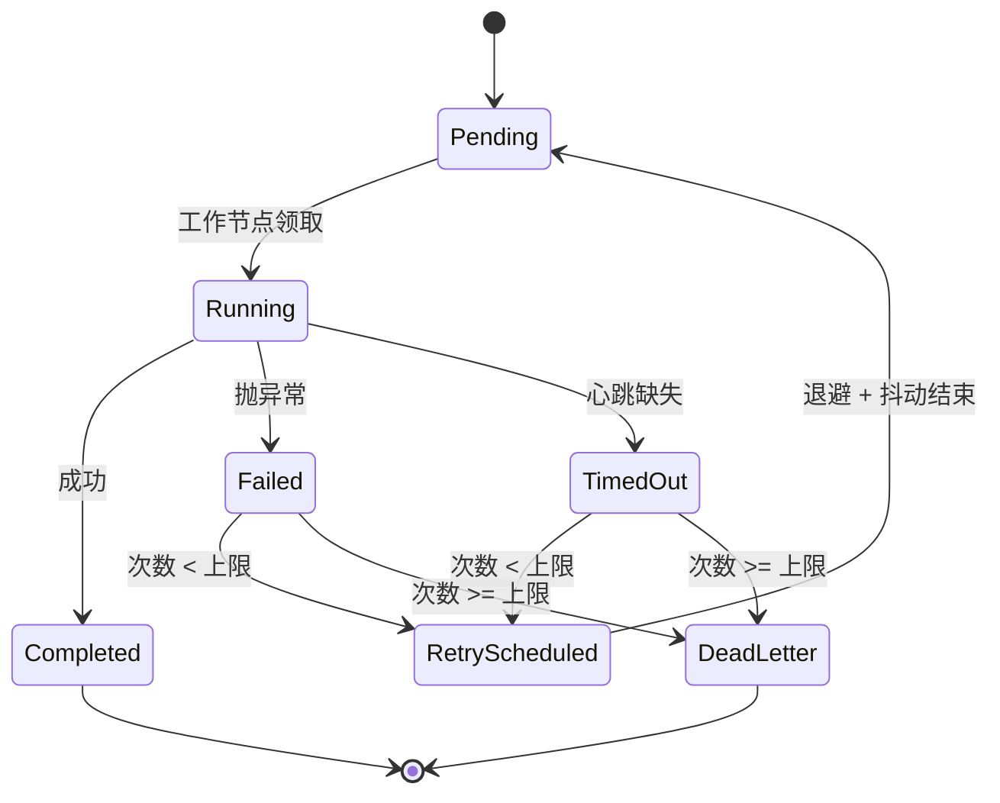

# 设计分布式任务调度器（Airflow / Temporal / 分布式 Cron）

> **TL;DR.** 分布式任务调度器可以拆成三块彼此独立的部分：决定*何时*触发的调度层、把触发与执行解耦的派发队列，以及带幂等键去重、无状态地跑用户代码的工作节点集群。在 10 万个注册任务、每秒 1 万次执行的规模下，单个主节点会压住吞吐上限，因此要把调度器实例挂在 etcd 租约上、按哈希区间分片，才能横向扩展。恰好一次执行是工作节点侧的属性：至少一次投递，加上以 `{workflow_id, task_id, attempt}` 为键的幂等副作用。事件溯源的工作流历史（Temporal 的模型）从只追加日志重放，而不是给可变状态拍快照，从而消除了任务执行中途崩溃带来的错乱。

## 学习目标

- [ ] 设计调度器—派发器—工作节点的拆分，让任何单个组件挂掉都不会拖垮全局
- [ ] 在基于主节点与哈希区间分片两种调度器拓扑之间做出选择，并在每秒 1 万次执行的规模下说明理由
- [ ] 用幂等键和工作节点侧去重，保证任务恰好执行一次
- [ ] 应用漏跑/迟跑策略（跳过、补跑、只跑最近一次），对齐 cron、Airflow 与 Temporal 的语义
- [ ] 论证事件溯源的工作流历史为何能替代“把 DAG 状态存在数据库里”
- [ ] 估算每秒 1 万个工作流、每个 50 个事件时历史写入的容量

## 直觉理解

一台机器上的 cron 守护进程显然是对的。它按点触发任务，故障域就是那一台机器[^1]。10 个用户的时候，这样跑得很好。到了 10 万个注册任务、每秒 1 万次执行，它会从三个方向塌掉。

第一，一台机器没法每秒评估 10 万个调度计划、再派发 1 万个任务还不落后。第二，这台机器一死，所有计划中的任务都停了，直到有人发现。第三，工作节点在任务中途崩溃，要么丢掉这次工作（至多一次），要么重跑一遍（至少一次，非幂等的副作用可能被执行两次，比如重复扣信用卡）。

天真的修法是“再加一台调度器”。但现在两台可能在同一瞬间触发同一个任务，造成重复执行；也可能在故障切换期间两台都不触发，造成漏跑。Google 的生产 cron 用 Paxos 解决这个问题：“我们放在 Paxos 里最重要的状态，就是哪些 cron 任务已被启动。每次计划启动的开始和结束，我们都同步告知法定人数（quorum）的副本”[^1]。

解开整个设计的洞见是：把“决定触发”和“执行用户代码”分开。调度器决定何时；持久化队列承载这个决定；无状态工作节点带着幂等键执行，作为最后一道安全网。每一层都能独立扩展、独立升级、独立失败。

## 需求

### 澄清提问

- **问：只要 cron 式的周期触发，还是要有依赖和分支的 DAG？**
  假设：完整 DAG，最多 1 万个节点，支持单任务重试与条件分支。

- **问：执行语义要求到什么程度？**
  假设：可观测效果上恰好一次。用至少一次投递加工作节点侧幂等来实现。

- **问：调度精度有多严？**
  假设：p99 触发延迟 < 5 秒，从计划时刻算起。

- **问：调度器宕机期间的漏跑怎么处理？**
  假设：按任务分别配置：跳过、补齐所有漏掉的区间，或者只跑最近一次。

- **问：单区域还是多区域？**
  假设：单区域 + 多可用区冗余。跨区域留作后续。

- **问：任务最长能跑多久？**
  假设：从亚秒级（事件触发）到几天（需要人工审批的步骤）。

### 功能性需求

- 注册、更新、删除、暂停任务定义（cron、固定间隔、事件触发或 DAG）[^2]
- 触发手动执行，回填已经关闭的时间窗口
- 执行最多 1 万个节点的 DAG，支持单任务重试、条件分支、扇出/扇入[^3]
- 输出单任务日志、单工作流血缘（lineage），以及完成/失败回调
- 支持向等待中的工作流注入信号（Temporal 风格），以及带可选补偿的取消操作[^4]

### 非功能性需求

- **负载：** 10 万个注册任务，峰值派发每秒 1 万次执行
- **延迟：** p99 触发延迟 < 5 秒；p99 任务领取延迟 < 200 ms
- **可用性：** 控制面 99.99%；执行路径 99.9%
- **一致性：** 工作节点崩溃的情况下仍保证恰好一次的可观测效果
- **持久性：** 已触发的执行不会被静默丢弃；永久失败落入 DLQ

## 容量估算

| 指标 | 数值 | 推导 |
|--------|------:|------------|
| 调度计划评估次数/秒 | 100K | 10 万个任务按最坏情况 1 Hz |
| 派发 QPS（峰值） | 10K | 需求给定 |
| 历史事件/秒 | 500K | 每工作流 50 个事件 × 每秒 1 万个工作流 |
| 历史写入带宽 | 250 MB/s | 50 万个事件 × 平均 500 B |
| 任务定义存储 | 1 GB | 10 万个任务 × 平均 10 KB |
| 在途任务行数（峰值） | 1M | 每秒 1 万 × 平均时长 100 秒 |
| Kafka 分区数（派发） | 30 | 每秒 1 万 / 每分区约 400/秒 |
| 5 年历史存储 | ~40 TB | 250 MB/s × 86,400 × 365 × 5，压缩后 |

- **读写比：** 历史路径 1:50（写占主导）；控制面 API 10:1（读占主导）
- **热路径：** 每秒 250 MB 的历史写入决定了必须用以 `workflow_id` 分片的 Cassandra；单个 PostgreSQL 实例吃不下这个量
- **元数据 vs 历史：** 任务定义（1 GB）一个 PostgreSQL 实例就够；*历史*才是那张大表

## API 与数据模型

### API 设计

```http
POST /v1/jobs
  Body: { "name": "nightly-etl", "schedule": "0 2 * * *",
          "dag_spec": {...}, "retry_policy": {...}, "missed_run_policy": "skip" }
  Returns: 201 { "job_id": "j_abc", "next_fire_time": "..." }

POST /v1/executions
  Idempotency-Key: <uuid>
  Body: { "job_id": "j_abc", "trigger": "manual", "params": {...} }
  Returns: 202 { "execution_id": "e_xyz", "status": "pending" }

GET /v1/executions/{id}
  Returns: 200 { "execution_id": "e_xyz", "status": "running",
                  "tasks": [{ "task_id": "t1", "status": "completed" }, ...] }

POST /v1/executions/{id}/cancel
  Returns: 200 { "status": "cancelling" }

POST /v1/executions/{id}/signal
  Body: { "signal_name": "approval", "payload": {...} }
  Returns: 200
```

列表接口用不透明游标（opaque cursor）分页。限流：API 网关处每个调用方每秒 1,000 次请求。`missed_run_policy` 字段接受 `skip`、`catchup`、`most_recent`。Quartz 支持整数形式的触发器优先级：“如果同时有 N 个触发器要触发，而当前只有 Z 个工作线程可用，那么优先级最高的前 Z 个触发器会先执行”[^5]。Sidekiq 支持在具名队列之间做严格顺序或加权随机的出队排序[^6]。

### 数据模型

```sql
-- 任务定义（PostgreSQL，单实例）
CREATE TABLE jobs (
  job_id        UUID PRIMARY KEY,
  name          TEXT NOT NULL,
  schedule      TEXT,            -- cron 表达式；事件触发时为 NULL
  dag_spec      JSONB,           -- 任务图定义
  retry_policy  JSONB,
  missed_run_policy TEXT DEFAULT 'skip',
  state         TEXT DEFAULT 'active',  -- active | paused | deleted
  shard_key     INT GENERATED ALWAYS AS (hashtext(job_id::text) % 256) STORED
);

-- 调度索引（Redis 有序集合）
-- Score：next_fire_time 的 Unix 时间戳
-- Member：job_id
-- 调度器的热循环：ZRANGEBYSCORE schedules -inf <now> LIMIT 0 100

-- 执行历史（Cassandra，按 workflow_id 分区）
CREATE TABLE execution_events (
  workflow_id   UUID,
  event_id      TIMEUUID,
  event_type    TEXT,    -- WorkflowStarted, ActivityScheduled, ActivityCompleted, ...
  payload       BLOB,
  PRIMARY KEY (workflow_id, event_id)
) WITH CLUSTERING ORDER BY (event_id ASC);

-- 任务状态（Cassandra，按 workflow_id 分区）
CREATE TABLE task_state (
  workflow_id     UUID,
  task_id         TEXT,
  attempt         INT,
  status          TEXT,    -- pending | running | completed | failed | dead_letter
  idempotency_key TEXT,   -- {workflow_id}.{task_id}.{attempt}
  worker_id       TEXT,
  heartbeat_at    TIMESTAMP,
  PRIMARY KEY (workflow_id, task_id, attempt)
);
```

## 高层架构



*持有分片的调度器轮询 Redis 找出到期任务，经 Kafka 派发，无状态工作节点把执行事件写入 Cassandra。etcd 负责协调分片归属。*

**写路径。** 控制面 API 把任务注册进 PostgreSQL，并把它的 `next_fire_time` 插入一个 Redis 有序集合[^7]。每个调度器实例通过 etcd 租约持有一段分片键区间（0-255）。每一轮 tick，调度器对自己分片的调度条目执行 `ZRANGEBYSCORE`，弹出到期任务，算出下一次触发时间，然后向 Kafka 生产一条以 `workflow_id` 为键的派发消息。

**执行路径。** 工作节点从 Kafka 消费，拿幂等键去查 Cassandra 的 `task_state` 表，执行用户代码，然后向历史写入一条 `ActivityTaskCompleted` 事件。失败时，工作节点写 `ActivityTaskFailed`，调度器以递增的 attempt 加指数退避重新入队。

**协调路径。** etcd 租约在 10 秒后过期。某个调度器死掉，它的分片会在一个租约 TTL 内被重新分配给存活实例。工作节点不受影响，因为它们通过 Kafka 解耦。

## 深入探讨

### 调度器拓扑：主节点制与哈希区间分片

主节点制调度器（通过 Paxos 或 etcd 租约保证只有一个活跃实例）是最简单的正确设计。Google 的分布式 cron 用的正是这一套：“主节点是唯一会主动启动 cron 任务的副本”[^1]。故障切换在约 60 秒内完成[^1]，对 cron 一分钟的粒度来说可以接受。

到了每秒 1 万次执行，单个主节点就跟不上了。替代方案是哈希区间分片：每个调度器实例持有 256 个槽位的哈希环上一段连续区间。任务 ID 哈希到某个槽位，该槽位的持有者是唯一有权触发这个任务的进程。



*主节点制被单机吞吐封顶；哈希区间分片把负载摊到 N 个活跃调度器上，每个分片的爆炸半径有界。*

**脑裂风险。** 租约续期期间，两个实例可能短暂地都以为自己持有同一个分片。工作节点侧的幂等检查（Cassandra 里按 `{workflow_id, task_id, attempt}` 去重）是最后一道安全网。Google 的 cron 则是靠“启动前先经 Paxos 同步写入”来应对：“在收到 Paxos 法定人数已收到启动通知的确认之前，实际的 cron 任务启动不会继续”[^1]。

**优雅升级。** 新实例加入 etcd。协调器把分片从旧实例上迁走。被排空的调度器冲刷完在途写入后退出。工作节点继续运行，因为持久化状态不在调度器进程里。

### 用幂等键实现恰好一次执行

网络上不存在恰好一次投递[^1][^8]。工作节点总有可能在执行完副作用、还没来得及确认之间崩溃。业界标准的解法：至少一次投递，加幂等副作用。

调度器给每条派发消息打上幂等键：`{workflow_id}.{task_id}.{attempt}`。工作节点在执行前拿这个键查 `task_state` 表。如果键已存在且状态是 `completed`，工作节点直接短路返回确认，不再重跑。

**Celery 的做法。** 不开 `acks_late=True` 时，Celery 在收到消息时就确认；任务中途崩溃就丢了这次工作[^9]。开了 `acks_late=True` 再加 `reject_on_worker_lost=True`，一个 SIGKILL 会让消息重新入队[^9]。Sidekiq Pro 的 `super_fetch` 用 Redis 的 `LMOVE` 让任务一直待在 Redis 里，直到工作节点确认完成；孤儿回收靠心跳过期触发（60 秒）[^10]。

**Step Functions 的分裂。** AWS Step Functions 的 Standard 工作流在状态转换之间持久化状态，同名重复执行会返回幂等响应[^8]。Express 工作流因为“执行状态不会在状态转换之间持久化”[^8]退化到至少一次，用持久性换来了“每秒最多 10 万次状态转换”[^11]。

**工作节点心跳。** 工作节点每 10 秒发一次心跳。历史服务如果连续 3 个间隔（30 秒）没看到心跳，就把任务标记为超时，调度器以 `attempt + 1` 重新入队。Sidekiq Pro 的毒丸检测会在一个任务 72 小时内被回收 3 次时自动杀掉它[^10]。

### 持久化执行与事件溯源的工作流历史

Airflow 把 DAG 状态存在 PostgreSQL 里：任务状态行原地更新。在“任务跑完了”和“状态更新了”之间崩溃，系统就留在模糊状态。Airflow 的 HA 调度器用 `SELECT ... FOR UPDATE` 把临界区串行化[^7]，但这也把吞吐封在了一行数据库锁能撑住的水平。

Temporal 走的是完全不同的路子：事件溯源的工作流历史。“每个工作流执行都会发出一系列命令（Command），并处理一系列事件（Event），这些事件被记录在事件历史（Event History）里”[^12]。事件包括 `ActivityTaskScheduled`、`ActivityTaskCompleted`、`TimerStarted`、`WorkflowExecutionSignaled`[^13]。

工作节点重启时，Temporal“不会从快照恢复内存。它从头开始跑工作流代码，逐步重放事件历史，用这段历史把代码引回和之前完全相同的状态”[^12]。活动（activity）在重放时返回记录下来的结果，而不是重新执行。



*一次工作流执行：从触发、扇出、带幂等检查的单任务重试、历史事件写入，直到最终完成。*

**权衡。** 每个活动至少写两个事件（scheduled + completed）。一个 50 步的工作流要写约 100 个事件。到了每秒 1 万个工作流，就是每秒约 50 万次事件写入[^13]。这就是为什么历史存储必须是 Cassandra 或 DynamoDB，不能是 PostgreSQL。

**确定性约束。** 重放逼着工作流代码避开非确定性构造（直接读时钟、随机数、网络调用）。Temporal 的 SDK 提供了重放安全的包装[^12]。这是持久化执行的心智模型成本。

### 漏跑/迟跑策略与 cron 边界情况

当调度器从 08:29 停到 10:21，就漏掉了 112 次分钟级触发。恢复时，有三种策略：

- **跳过（Skip）：** 只触发下一个计划时刻。Kubernetes CronJob 的默认行为。
- **补跑（Catchup）：** 把漏掉的每个区间都补一遍。Airflow 2.x 的 `catchup=True` 默认值（Airflow 3.0 改成了 `False`），这是宕机后突发风暴的经典来源。

- **只跑最近一次（Single-most-recent）：** 只补最后一个漏掉的区间。务实的折中。

Kubernetes CronJob 把漏掉的调度次数上限设为 100：“如果错过的调度超过 100 次，这个 CronJob 就不再被调度”[^14]。控制器会打出 `too many missed start times` 然后停下，从而阻止风暴。



*单任务状态机：任务经历带指数退避的重试，直到成功或进入死信。*

**cron 的边界情况。** 夏令时（DST）切换可能让一个凌晨 2 点的任务触发两次（回拨），或者一次都不触发（前拨）。Kubernetes 强制要求 `.spec.timeZone`（v1.27 起稳定）并使用 Go 的时区数据库；在 cron 表达式里写 `CRON_TZ` 会被拒绝[^14]。Quartz 用每个触发器自己的指令处理误触发：`MISFIRE_INSTRUCTION_FIRE_NOW`、`MISFIRE_INSTRUCTION_DO_NOTHING`，以及按类型区分的策略[^15]。

**午夜的惊群。** 5 万个配置成 `0 0 * * *` 的每日任务全在 00:00 UTC 触发。Google 的 cron 加了一个 `?` 通配符，把任务配置哈希成允许范围内的一个确定值，把启动时刻均匀摊开[^1]。Marc Brooker 的“全抖动”（Full Jitter）公式 `sleep = random(0, min(cap, base * 2^attempt))` 能把争用减少一半以上[^16]。

## 真实案例

### Temporal 与 Uber Cadence 的大规模实践

Temporal 最初是从 Uber 的 Cadence 分叉出来的[^17]，而 Cadence 在 Uber 支撑着“一千多个服务”，每月处理超过 120 亿次执行、2700 亿次动作[^18]。Stripe、Netflix、HashiCorp 和 Datadog 都用 Temporal 做持久化执行[^19]。截至 2026 年 2 月，仅 Temporal Cloud 就累计处理了 9.1 万亿次动作执行，每月新增安装超过 2000 万次[^26]。

**架构。** 一个 Temporal 集群拆成四种服务角色：Frontend（gRPC API）、History（持有工作流状态的分片）、Matching（持有任务队列）和 Worker（跑内部系统工作流）[^13]。持久化存储可插拔：Cassandra、MySQL 或 PostgreSQL。用户自己的工作节点进程轮询任务队列，对照事件历史确定性地执行工作流代码，并运行活动（真正产生副作用的部分）[^12]。

**核心洞见：重放，而不是快照。** “Temporal 不会从快照恢复内存。它从头开始跑工作流代码，逐步重放事件历史”[^12]。这意味着崩溃的工作节点能从最后一个一致事件继续，不需要任何检查点基础设施。活动在重放时返回记录下来的结果，而不是重新执行，从而实现恰好一次的可观测效果。

**与 Airflow 的对比。** Airflow 的 HA 调度器用的是数据库行级锁：“我们使用数据库行级锁（`SELECT ... FOR UPDATE`）”[^7]。它明确拒绝了共识算法：“因为不在调度器之间做直接通信或共识算法（Raft、Paxos 等），也不引入别的共识工具（比如 Apache Zookeeper 或 Consul），我们把‘运维表面积’压到了最小”[^7]。代价是：Airflow 需要 PostgreSQL 12+ 或 MySQL 8.0+ 才能用 `SKIP LOCKED`；MariaDB 10.6 之前的版本不支持 HA[^7]。规模上去之后 DAG 解析耗时是公认的瓶颈。Airflow 由 Maxime Beauchemin 于 2014 年 10 月在 Airbnb 启动，2015 年 6 月公开发布，用来管理“复杂的数据管道”[^20][^3]；而当纯 cron 系统退化成临时拼凑的发布/订阅编排时，Netflix 造了 Conductor 作为基于 JSON 蓝图的替代方案[^21]。

**与 Step Functions 的对比。** AWS Step Functions 的 Standard 工作流提供恰好一次语义，每百万次状态转换 25 美元，持续 StartExecution 速率 300/秒（突发 1,300），主要区域（美国东部、美国西部、欧洲爱尔兰）的状态转换速率 5,000/秒[^22]。Express 工作流能达到“每秒最多 10 万次状态转换”，每百万次调用 1.00 美元（另加时长和内存），但语义降为至少一次[^11]。双产品线的思路是把“长时持久”和“高吞吐”分开，而不是逼一个运行时两头都干[^8]。

## 权衡

| 方案 | 优点 | 缺点 | 适用场景 |
|----------|------|------|-------------|
| 纯 cron（K8s CronJob） | 极简；不需要额外基础设施；与 K8s batch API 集成 | 没有 DAG；没有重试；必须自己保证幂等[^14] | 孤立的周期任务、备份 |
| DAG 调度器（Airflow） | DAG 语义丰富；算子生态庞大；社区巨大 | 状态以调度器为中心存在关系库里；大规模下 DAG 解析耗时长[^7] | 夜间 ETL、数据管道 |
| 工作流即代码（Temporal） | 持久化执行；事件溯源重放；百万级并发[^18] | 新的心智模型；事件历史的存储成本；确定性约束[^12] | 长跑的业务工作流、Saga |
| 主节点制调度器 | 简单；单一事实来源；Paxos 保证正确性[^1] | 单机吞吐上限；故障切换有窗口 | 小规模集群（< 1 千任务） |
| 哈希区间分片 | 横向扩展；爆炸半径有界 | 要处理脑裂；重平衡有延迟 | 1 万+ 任务，每秒 1 千+ 执行 |
| 队列派发（Kafka/SQS） | 解耦；背压；支持 DLQ[^23][^24] | 多一跳；受分区顺序约束 | 每秒 1 万+ 执行的生产系统 |

cron 不是 DAG 引擎，DAG 引擎也不是工作流引擎。选匹配你真实依赖形态的那个模型。在每秒 1 万次执行、DAG 最大 1 万节点的场景下，哈希区间分片的调度器 + Kafka 派发 + Temporal 风格的事件溯源历史，是对的组合。

## 扩展与故障模式

**10 倍（每秒 10 万次执行）：** 历史写入达到 2.5 GB/s。缓解手段：加 Cassandra 节点、提高副本数、激进压缩。Kafka 分区扩到 300 个。调度器分片扩到 30 个实例。

**100 倍（每秒 100 万次执行）：** 单区域 Kafka 吃不下每秒 100 万次写入。缓解手段：多区域 Kafka 集群加地理路由。历史存储改用按需计费的 DynamoDB 拿到弹性吞吐。调度计划评估本身成了瓶颈；改为批量预计算下一次触发时间，而不是每轮 tick 现算。

**1000 倍：** 架构转向分层模型：边缘调度器在本地完成 cron 评估，只把派发决策转发给中心历史服务。工作节点靠 Kubernetes HPA 按队列深度自动扩缩。

**故障：调度器分片在 tick 中途死亡。**
etcd 租约在 10 秒内过期。存活实例接管孤儿分片。那些已经派发但还没被工作节点确认的任务会被重新派发；幂等键阻止重复执行。调度精度最多退化一个租约 TTL（10 秒），对多数任务仍在 5 秒 p99 目标之内。Quartz 的集群 JDBC 存储通过 `clusterCheckinInterval`（默认 15 秒）发现失效节点并重新分配它们的触发器[^25]。

**故障：历史数据库分区热点。**
某个突然走红的工作流每秒触发 1 万个实例，全都键在同一个实体上。一个 Cassandra 分区被打满。缓解手段：复合分区键 `{workflow_id, bucket}`，其中 bucket 是 `hash(task_id) % 16`。这和 Kafka 用户处理热键用的是同一招。

**故障：Kafka 消费者积压飙升。**
cron 风暴期间工作节点落后。事务型执行（支付结算）被拖慢。检测：消费者滞后 > 1 万。缓解手段：用优先级 topic 保证高优先级任务有专属消费组，永远不会被大批量作业饿死。

## 常见陷阱

> [!WARNING]
> **午夜的惊群。** 5 万个 `0 0 * * *` 任务同时触发，打爆一个调度器分片，并淹掉下游服务。修法：给每个任务加触发时刻抖动。Google 的 `?` 通配符把任务配置哈希开来，均匀摊开启动时刻[^1]。

> [!WARNING]
> **退避同步导致的雪崩重试。** 1,000 个任务在同一瞬间因为同一个瞬时依赖失败。没有抖动的话，它们会在完全相同的指数间隔上一起重试，把依赖打成 DoS。修法：每次退避都加全抖动[^16]。

> [!WARNING]
> **主节点交接时重复触发。** 主节点 A 触发了任务 J，在把“J 已启动”写进日志之前崩溃。主节点 B 上位后又触发了一次 J。修法：启动*之前*先经共识同步写入[^1]。工作节点侧幂等是最后的网。

> [!WARNING]
> **宕机后的补跑风暴。** Airflow 2.x 的 `catchup=True` 默认值会在恢复时把漏掉的每个区间都触发一遍（Airflow 3.0 已把默认值改为 `False`）。一个分钟级 DAG 停 2 小时，就会产生 120 个并发执行。修法：默认用 `skip` 或 `most_recent`；把补跑变成运维的显式选择。

> [!WARNING]
> **心跳放大。** 10 万个并发任务每 10 秒发一次心跳，在历史库上产生每秒 1 万次纯粹的存活数据写入。修法：心跳走 Redis（临时存储）；只有当心跳缺失超过领取超时，才翻成持久状态。

> [!WARNING]
> **非幂等的副作用。** Google SRE 书对非幂等的 cron 任务明确“倾向于 fail closed，以避免系统性地造出坏状态”[^1]。如果你的任务要扣信用卡，幂等键就不是可选项。

## 追问

**1. 有些任务必须在特定地理区域执行，你怎么支持跨区域的 DAG 执行？**

给每个任务打一个 `region` 约束标签。派发器路由到对应区域的 Kafka topic。各区域的工作节点只消费本地 topic。历史服务保持中心化（或做跨区域复制），这样调度器才能跟踪全局 DAG 进度。

**2. 当旧版本还有在途执行时，你怎么上线一个破坏性的工作流定义变更？**

Temporal 的版本模型用补丁：新代码检查 `workflow.patched("v2")` 然后分支。旧执行按旧代码路径重放，新执行走新路径。不需要 schema 迁移[^12]。

**3. 如果 Kafka 整体挂掉，你的设计如何在不丢已触发执行的前提下恢复？**

调度器发现 Kafka 不可用后，把派发消息缓冲到本地磁盘的 WAL（预写日志）里。Kafka 恢复后重放 WAL。幂等键保证重放不会造成重复。

**4. 一个不断给自己重新排期的失控 DAG，你怎么限制它的成本？**

设置按工作流的执行上限（历史最多 1 万个事件，最多 1 千个并发任务）。Temporal 对历史大小有默认上限，超过就终止工作流。再在调度器层面给每个任务加每日执行次数上限。

**5. 某个走红的工作流把历史库的单个分区撑到上限，会发生什么？**

在 `{workflow_id, hash(task_id) % N}` 上再做子分区。监控单分区写入延迟，自动切分热分区。极端情况下，把这个热工作流路由到专属的 Cassandra keyspace。

**6. 需要人工审批、可能暂停几天的步骤，你怎么支持？**

用 Temporal 的持久化定时器：工作流调用 `workflow.sleep(Duration.ofDays(7))`，定时器事件被持久化。没有工作节点占着线程。定时器到期或收到信号时，工作流从记录的事件继续[^12]。把 DAG 状态存在 Postgres 里的方案做不到这一点，除非为“等待”单开一个调度器。

## 练习

### 练习 1：支付结算调度器的容量估算

一家金融科技公司每天处理 50 万笔支付结算。每笔结算是一个 3 任务 DAG（校验、转账、对账）。每个任务平均耗时 2 秒。系统必须保证恰好一次执行。请估算：峰值派发 QPS、历史写入吞吐，以及最少工作节点数。

<details>
<summary>提示</summary>

由日总量算出平均 QPS，再对日终结算窗口施加 5 倍峰值系数。每个 DAG 产生约 6 个历史事件（每任务 2 个：scheduled + completed）。工作节点一次处理一个任务，每个 2 秒。

</details>

<details>
<summary>解答</summary>

**派发 QPS：**

- 每天 50 万笔结算 ≈ 平均每秒 6 笔
- 峰值（日终 2 小时窗口）：500k / 7,200s ≈ 每秒 70 笔
- 每笔结算 3 个任务：峰值 70 × 3 = 每秒 210 次任务派发

**历史写入：**

- 每笔结算 6 个事件（每任务的 scheduled + completed）+ 2 个工作流事件 = 8
- 峰值：70 × 8 = 每秒 560 次事件写入
- 每个事件 500 B：280 KB/s（对 Cassandra 是小菜）

**工作节点数：**

- 每个任务耗时 2 秒。峰值每秒 210 个任务，需要 210 × 2 = 420 个并发任务槽
- 按 80% 利用率目标：420 / 0.8 = 525 个工作节点（或者更少的多线程节点）
- 再留 2 倍余量给重试：约 1,050 个任务槽

**幂等性：** 每个任务的键是 `{settlement_id}.{task_name}.{attempt}`。转账任务（真正动钱的那个）在调用银行 API 前先检查这个键。转账之后、确认之前崩溃会触发一次重试，而重试会在已存在的键上短路返回。

</details>

## 要点回顾

- **调度器、派发器、工作节点是三件不同的事。** 把它们分开，各自才能独立扩展、独立升级、独立失败。
- **恰好一次是工作节点侧的去重属性，不是网络属性。** 幂等键 `{workflow_id, task_id, attempt}` 就是那份契约。
- **规模上去之后，哈希区间分片胜过主节点制。** 单个 Paxos 主节点被单机吞吐封顶；分片把负载摊开，爆炸半径还有界。
- **事件溯源的历史（Temporal 模型）用存储换持久性。** 从只追加日志重放，消除了可变状态调度器身上那些任务中途崩溃的老毛病。
- **漏跑策略是按任务配置的，不是系统默认值。** 跳过、补跑、只跑最近一次服务于不同场景；三个都要暴露出来。
- **每次重试和每个 cron 表达式都必须加抖动。** 否则同步重试和午夜风暴是必然的。

## 延伸阅读

- [Google SRE Book, Chapter 24: Distributed Periodic Scheduling with Cron](https://sre.google/sre-book/distributed-periodic-scheduling/)。关于 Paxos 分布式 cron 的权威公开材料；现代系统都以它作为对照标尺。
- [Apache Airflow Scheduler docs](https://airflow.apache.org/docs/apache-airflow/stable/administration-and-deployment/scheduler.html)。用数据库行级锁实现的 HA 调度器设计；部署最广的 DAG 引擎。
- [Temporal Workflows encyclopedia](https://docs.temporal.io/workflows)。来自权威持久化执行引擎的确定性重放与事件历史说明。
- [AWS Step Functions: choosing workflow type](https://docs.aws.amazon.com/step-functions/latest/dg/choosing-workflow-type.html)。关于 Standard 与 Express 权衡最清晰的公开文章。
- [Kubernetes CronJob](https://kubernetes.io/docs/concepts/workloads/controllers/cron-jobs/)。最小可用的周期任务原语，以及它自带的坑（startingDeadlineSeconds、100 次漏跑上限）。
- [Marc Brooker: Exponential Backoff and Jitter](https://aws.amazon.com/blogs/architecture/exponential-backoff-and-jitter/)。关于如何用全抖动公式防止重试风暴的定论性短文。
- [Sidekiq Reliability wiki](https://github.com/sidekiq/sidekiq/wiki/Reliability)。super_fetch、孤儿回收、毒丸检测；低基础设施一端靠 Redis 的队列可靠性实践。
- [Netflix Conductor: A microservices orchestrator](https://netflixtechblog.com/netflix-conductor-a-microservices-orchestrator-2e8d4771bf40)。基于 JSON 蓝图的 DAG 编排；与工作流即代码形成有益对照。

## 记忆卡片

<details>
<summary><strong>问：分布式任务调度器里三个彼此独立的部分是什么？</strong></summary>

答：(1) 调度层决定*何时*触发。(2) 派发队列把这个决定持久地带走。(3) 工作节点集群带着幂等键去重来执行用户代码。三者各自独立扩展、独立失败。

</details>

<details>
<summary><strong>问：为什么恰好一次投递不可能，那怎么做到恰好一次的效果？</strong></summary>

答：工作节点可能在执行完副作用、还没来得及确认之间崩溃。修法是：至少一次投递，加上以稳定去重令牌（`{workflow_id, task_id, attempt}`）为键的幂等副作用。

</details>

<details>
<summary><strong>问：Temporal 如何在不做快照的前提下实现持久化执行？</strong></summary>

答：Temporal 为每个工作流写一份只追加的事件历史。重启时逐事件重放历史；活动返回记录下来的结果，而不是重新执行。状态是从日志推导出来的，不是从检查点恢复的[^12]。

</details>

<details>
<summary><strong>问：主节点制调度器的吞吐上限在哪，怎么突破？</strong></summary>

答：单个 Paxos 主节点被单机吞吐封顶。哈希区间分片把任务 ID 摊到 N 个活跃调度器上，每个调度器通过 etcd 租约持有一个分片。出故障时爆炸半径限于一个分片。

</details>

<details>
<summary><strong>问：为什么 Airflow 的 HA 调度要求 PostgreSQL 12+？</strong></summary>

答：Airflow 的 HA 调度器用 `SELECT ... FOR UPDATE SKIP LOCKED` 在多个调度器之间串行化临界区。`SKIP LOCKED` 在更老的 PostgreSQL 和 MariaDB 10.6 之前都不可用[^7]。

</details>

<details>
<summary><strong>问：Kubernetes CronJob 漏掉超过 100 次调度会怎样？</strong></summary>

答：控制器打出 “too many missed start times” 并彻底停止调度这个 CronJob[^14]。这阻止了补跑风暴，但需要人工介入才能恢复。

</details>

<details>
<summary><strong>问：Google 的分布式 cron 如何在主节点故障切换时防止重复触发？</strong></summary>

答：启动前后都经 Paxos 同步写入。在法定人数确认启动通知之前，启动不会继续[^1]。新的主节点可以通过检查 Paxos 日志来裁决部分失败。

</details>

<details>
<summary><strong>问：cron 调度器的惊群问题是什么，怎么缓解？</strong></summary>

答：成千上万个 `0 0 * * *` 任务在午夜同时触发。Google 的 `?` 通配符把任务配置哈希开来，把启动时刻摊散到整个小时里[^1]。另一个办法是在注册时给每个任务加触发时刻抖动。

</details>

<details>
<summary><strong>问：Sidekiq Pro 如何检测毒丸任务？</strong></summary>

答：同一个任务在 72 小时内被回收 3 次，Sidekiq Pro 就自动杀掉它并放进 Dead 集合[^10]。这避免了无限重试循环堵住队列。

</details>

<details>
<summary><strong>问：AWS Step Functions 的 Standard 与 Express 工作流有什么区别？</strong></summary>

答：Standard：最长 1 年，状态持久化、恰好一次，主要区域每秒 5,000 次状态转换，每百万次转换 25 美元。Express：最长 5 分钟，至少一次，每秒最多 10 万次转换，每百万次调用 1 美元另加时长/内存[^8][^11][^22]。按持久性需求与吞吐的取舍来选。

</details>

<details>
<summary><strong>问：为什么心跳应该走 Redis 而不是历史数据库？</strong></summary>

答：10 万个并发任务每 10 秒发一次心跳，就是每秒 1 万次临时存活数据的写入。把这些灌进持久历史库会饿死真正的事件写入。Redis 廉价地吸收它们；只有心跳缺失才触发一次持久状态转换。

</details>

## 参考文献

[^1]: Stepan Davidovic, "Distributed Periodic Scheduling with Cron", Site Reliability Engineering, O'Reilly, 2016. https://sre.google/sre-book/distributed-periodic-scheduling/

[^2]: "Writing a CronJob spec: Schedule syntax", Kubernetes documentation. https://kubernetes.io/docs/concepts/workloads/controllers/cron-jobs/#schedule-syntax

[^3]: Maxime Beauchemin, "Airflow: a workflow management platform", Airbnb Engineering & Data Science, 2015. https://medium.com/airbnb-engineering/airflow-a-workflow-management-platform-46318b977fd8 （需付费阅读；项目历史另见 [^20]）

[^4]: "Temporal Event History" encyclopedia entry, Temporal documentation. https://docs.temporal.io/encyclopedia/event-history

[^5]: "Lesson 4: More About Triggers", Quartz Scheduler tutorial. https://www.quartz-scheduler.org/documentation/quartz-2.3.0/tutorials/tutorial-lesson-04.html

[^6]: "Best Practices", Sidekiq wiki. https://github.com/sidekiq/sidekiq/wiki/Best-Practices

[^7]: "Scheduler", Apache Airflow documentation (v3.2.1). https://airflow.apache.org/docs/apache-airflow/stable/administration-and-deployment/scheduler.html

[^8]: "Choosing workflow type in Step Functions", AWS Step Functions Developer Guide. https://docs.aws.amazon.com/step-functions/latest/dg/choosing-workflow-type.html

[^9]: "Tasks", Celery documentation. https://docs.celeryq.dev/en/main/userguide/tasks.html

[^10]: "Reliability", Sidekiq wiki. https://github.com/sidekiq/sidekiq/wiki/Reliability

[^11]: "Building cost-effective AWS Step Functions workflows", AWS Compute Blog, 2022. https://aws.amazon.com/blogs/compute/building-cost-effective-aws-step-functions-workflows/

[^12]: "Temporal Workflow", Temporal Encyclopedia. https://docs.temporal.io/workflows

[^13]: "Temporal Service", Temporal documentation. https://docs.temporal.io/temporal-service

[^14]: "CronJob", Kubernetes documentation. https://kubernetes.io/docs/concepts/workloads/controllers/cron-jobs/

[^15]: "Lesson 6: CronTrigger", Quartz Scheduler tutorial. https://www.quartz-scheduler.org/documentation/quartz-2.3.0/tutorials/tutorial-lesson-06.html

[^16]: Marc Brooker, "Exponential Backoff And Jitter", AWS Architecture Blog, 2015. https://aws.amazon.com/blogs/architecture/exponential-backoff-and-jitter/

[^17]: "Temporal", GitHub README, temporalio/temporal. https://github.com/temporalio/temporal

[^18]: "Announcing Cadence 1.0: The Powerful Workflow Platform Built for Scale and Reliability", Uber Engineering Blog, 2023. https://www.uber.com/en-IN/blog/announcing-cadence/

[^19]: "Mastering Durable Execution in Distributed Systems", Temporal blog, 2024. https://temporal.io/blog/durable-execution-in-distributed-systems-increasing-observability

[^20]: "Project: History", Apache Airflow documentation. https://airflow.apache.org/docs/apache-airflow/stable/project.html

[^21]: Viren Baraiya and Vikram Singh, "Netflix Conductor: A microservices orchestrator", Netflix TechBlog, 2016. https://netflixtechblog.com/netflix-conductor-a-microservices-orchestrator-2e8d4771bf40 （该 URL 可能不可用；另见 https://github.com/Netflix/conductor）

[^22]: "Step Functions service quotas", AWS Step Functions Developer Guide. https://docs.aws.amazon.com/step-functions/latest/dg/service-quotas.html

[^23]: "Amazon SQS visibility timeout", AWS SQS Developer Guide. https://docs.aws.amazon.com/AWSSimpleQueueService/latest/SQSDeveloperGuide/sqs-visibility-timeout.html

[^24]: "Using dead-letter queues in Amazon SQS", AWS SQS Developer Guide. https://docs.aws.amazon.com/AWSSimpleQueueService/latest/SQSDeveloperGuide/sqs-dead-letter-queues.html

[^25]: "Configuration Reference: JDBC Clustering", Quartz Scheduler documentation. https://www.quartz-scheduler.org/documentation/quartz-2.4.x/configuration/ConfigJDBCJobStoreClustering.html

[^26]: "Temporal Raises $300M Series D to Make Agentic AI Real for Companies", Temporal, Feb 2026 (9.1T lifetime actions, 20M installs/month). https://temporal.io/news/temporal-raises-300M-to-make-agentic-ai-real-for-companies
