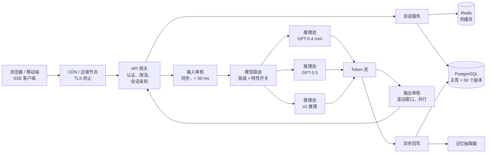
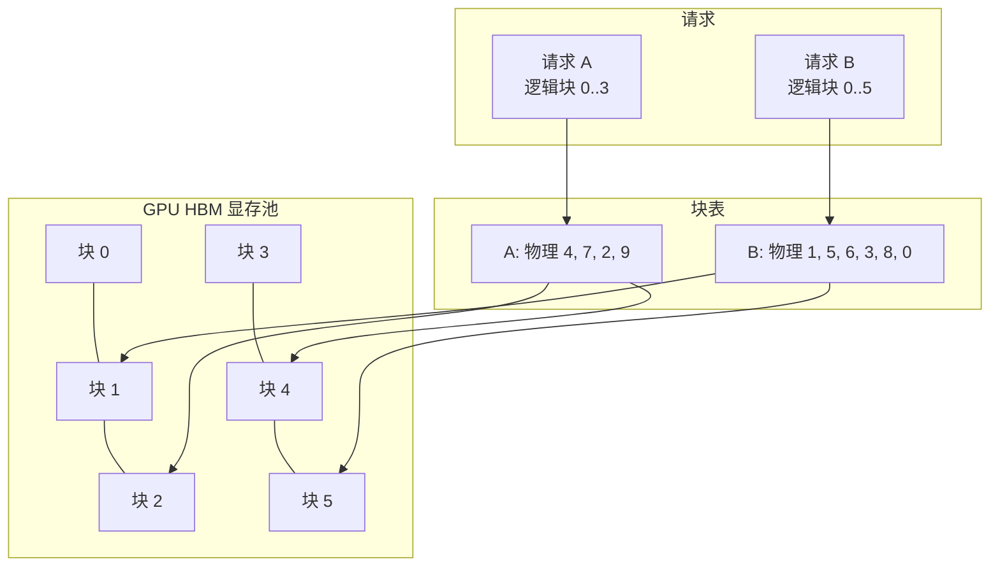
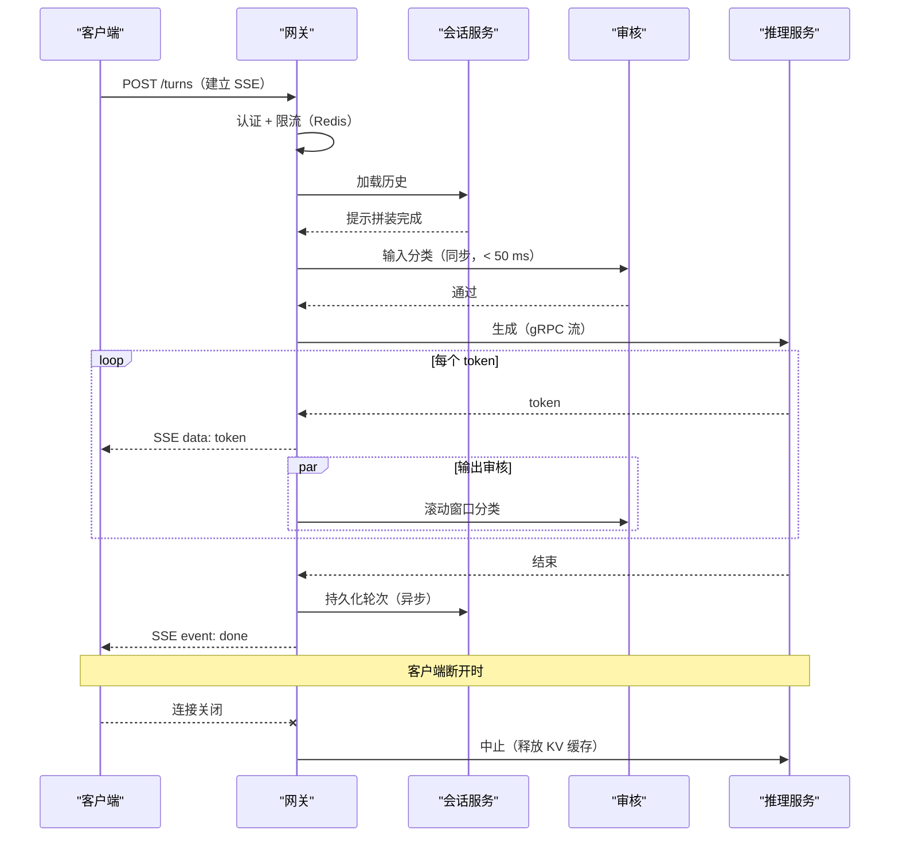
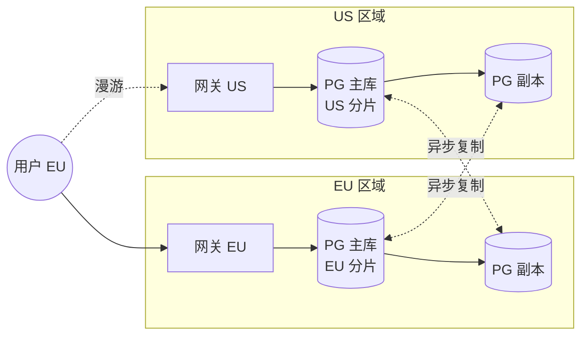

# 设计 ChatGPT（大规模对话式 AI）

> **TL;DR.** ChatGPT 首先是一个流式推理系统，其次才是一个模型系统。到了 9 亿以上周活用户[^1]的规模，难的地方在于：把首个 token 的延迟压在 2 秒以内，同时把几十万个并发解码槽位塞进稀缺的 GPU；在单个 PostgreSQL 主库加约 50 个只读副本[^2]上跨区域保住会话状态；以及用 SSE 把 token 流给用户，而不让代理缓冲毁掉体验。最关键的权衡是分层模型路由：免费用户走 $0.75/百万输入 token 的 GPT-5.4 mini[^3]，付费用户走 $5.00/百万输入 token 的 GPT-5.5[^24]，把免费层的单位成本砍掉约 7 倍。

## 学习目标

- 设计一个多租户 LLM 网关，把免费流量和付费流量路由到不同的模型池，且不让两个层级之间互相拖慢延迟
- 从 token 吞吐需求反推 GPU 集群容量，并把连续批处理（continuous batching）和 PagedAttention 带来的增益算进去
- 搭一条从推理服务器经网关到浏览器的 SSE 流式管道，处理好背压和取消
- 论证为什么会话存储选 PostgreSQL 追加写加只读副本，而不是分片的双活布局
- 在不把端到端延迟翻倍的前提下放置输入与输出两道审核关卡
- 在多轮对话中权衡提示缓存（prompt caching）、分层摘要和全量上下文重放

## 直觉理解

对话式 AI 系统看起来就是个聊天框。收一条消息，生成一段回复，显示出来。十个人用毫无压力。到了 9 亿周活用户它就会崩，而且原因不在模型本身，而在三条互相叠加的约束。

第一，自回归解码是受显存带宽限制的。一块 HBM 带宽 3.35 TB/s 的 H100[^5]，跑 70B 参数模型时每个流大约只能到 24 token/秒，再往上带宽就饱和了。你没法用一块 GPU 服务一万个并发用户。你需要几千块 GPU，而且每浪费一个字节的 KV 缓存，都会减少单次前向传播能塞下的请求数。

第二，每个 token 一解码出来就得送到用户眼前。一段 500 token 的回复按 50 token/秒算需要 10 秒。如果你把整段回复缓冲到最后再发，用户就对着空白屏幕干等 10 秒。流式不是可选项，流式就是产品本身。

第三，对话是有状态的。用户明天回来，指望模型记得之前说过什么。但模型本身是无状态的。每一轮都必须把完整对话上下文重新拼进提示里，这意味着会话存储、摘要层、提示拼装流水线的重要程度和 GPU 集群一样。

天真的单机设计在这三个维度上会同时失效。真正可行的架构把连接层（SSE 网关）、推理层（带分页 KV 缓存和连续批处理的 GPU 集群）、状态层（PostgreSQL + Redis）拆开，各自独立扩展。

## 需求

### 澄清问题

- **Q: 免费层、付费层还是企业版？**
  假设：三者都要。免费走便宜模型；付费走前沿模型；企业版固定某个版本并满足数据驻留要求。
- **Q: 会话保留策略？**
  假设：付费用户永久保留；免费用户 30 天；企业版可配置。
- **Q: 首 token 延迟目标？**
  假设：付费 p99 < 800 ms，免费 p99 < 2 s。
- **Q: 需要多区域吗？**
  假设：需要。在包括 EU、US、日本在内的 10 个区域满足数据驻留[^6]。
- **Q: 流式传输用什么协议？**
  假设：HTTP 上的 SSE。对 CDN 友好、能被代理兼容、可通过 Last-Event-ID 自动重连[^7]。
- **Q: 安全要求？**
  假设：每一轮都必须做输入和输出审核。输出审核不能增加 TTFT。

### 功能需求

- 多轮对话，历史不限长度，token 以流式返回
- 用户级长期记忆（从对话中抽取事实，按需检索）
- 按层级选择模型（免费、付费、推理），并配租户级限流
- 会话分享、组织工作区、附件上传

### 非功能需求

- **用户量：** 9 亿以上 WAU[^1]，稳态约 1 万轮/秒，峰值 3 万/秒
- **延迟：** 付费 TTFT p99 < 800 ms，免费 < 2 s；TPOT p99 < 80 ms
- **可用性：** 控制面 99.9%；推理集群在 GPU 压力下优雅降级
- **持久性：** 会话状态 11 个 9；轮次日志只追加
- **数据驻留：** EU、UK、US、加拿大、日本、韩国、新加坡、印度、澳大利亚、阿联酋[^6]

## 容量估算

| 指标 | 数值 | 推导 |
|--------|------:|------------|
| 轮次写入 | 1 万/秒 | 9 亿 WAU，约 3% 并发，平均每 30 秒 1 轮 |
| 输入 token/秒 | 500 万 | 1 万轮 x 平均 500 输入 token |
| 输出 token/秒 | 800 万 | 1 万轮 x 平均 800 完成 token |
| 并发解码槽位 | 约 16 万 | 800 万输出 tok/s / 每槽位 50 tok/s |
| 轮次日志写入 | 200 MB/s | 1 万轮 x 约 20 KB/轮 |
| 轮次日志一年 | 约 6 PB | 200 MB/s x 86,400 x 365 |
| 热会话缓存 | 约 300 GB | 600 万活跃会话 x 50 KB 工作集 |
| 并发 SSE 连接 | 约 600 万 | 2 亿 DAU 的 3% |

关键比例：

- **GPU 集群规模：** 前沿模型在一块 H100 上约 8 个解码槽位，光付费层就要约 2 万块 H100。
- **出口流量受连接数限制，而不是受字节数限制：** 800 万 token/秒 x 4 B/token = 32 MB/s，微不足道。真正的瓶颈是 600 万条并发 SSE 连接。
- **成本不对称：** GPT-5.4 mini 每输入 token 比 GPT-5.5 便宜约 7 倍[^3][^24]。把免费流量导到便宜模型，是单位经济模型上最大的一根杠杆。

## API 与数据模型

### API 设计

```http
POST /v1/conversations
  Body: { "model": "gpt-5.5", "system_prompt": "..." }
  Returns: 201 { "conversation_id": "uuid", "region": "us-east" }

POST /v1/conversations/{id}/turns
  Headers: Authorization: Bearer ***
  Body: { "role": "user", "content": "..." }
  Returns: 200 (SSE stream)
    event: token\ndata: {"text": "Hello"}\n\n
    event: done\ndata: {"turn_id": "...", "usage": {...}}\n\n

POST /v1/conversations/{id}/cancel
  Returns: 204 (aborts in-flight generation, releases KV cache)

GET /v1/conversations/{id}?before=<cursor>&limit=50
  Returns: 200 { "turns": [...], "next_cursor": "..." }

PATCH /v1/users/{id}/memory
  Body: { "add": ["prefers metric units"], "remove": ["fact_id_123"] }
  Returns: 200
```

限流用 Redis 里的令牌桶计数器，对每个用户同时约束 RPM（每分钟请求数）和 TPM（每分钟 token 数），而在 LLM 负载里 TPM 才是真正卡住的那个约束[^8]。

### 数据模型

```sql
-- 会话（PostgreSQL 主库，约 50 个只读副本）
CREATE TABLE conversations (
  conversation_id  UUID PRIMARY KEY,
  user_id          UUID NOT NULL,
  org_id           UUID,
  model            TEXT NOT NULL,
  region           TEXT NOT NULL,
  created_at       TIMESTAMPTZ DEFAULT now(),
  last_turn_at     TIMESTAMPTZ
);

-- 轮次（只追加，按月分区）
CREATE TABLE turns (
  turn_id          UUID,
  conversation_id  UUID NOT NULL,
  role             TEXT NOT NULL,  -- user | assistant | tool
  content          TEXT,
  token_count      INT,
  moderation_verdict JSONB,
  created_at       TIMESTAMPTZ DEFAULT now(),
  PRIMARY KEY (conversation_id, turn_id)
) PARTITION BY RANGE (created_at);

-- 用户记忆（向量索引，用于 top-k 检索）
CREATE TABLE user_memory (
  user_id    UUID,
  fact_id    UUID,
  text       TEXT,
  embedding  vector(1536),
  created_at TIMESTAMPTZ,
  PRIMARY KEY (user_id, fact_id)
);
```

热会话缓存在 Redis 里（`conv:{id}` -> 最近 N 轮 + 滚动摘要，TTL 24 小时，读取时续期）。限流状态放在 Redis 令牌桶里，key 为 `(user_id, tier, window)`。

## 高层架构



*一轮对话从浏览器出发，经 CDN 和网关进入按层级路由的推理池，输出审核并行执行，结果异步回写到分片的轮次日志。*

**写路径：** 客户端通过 `POST /turns` 建立 SSE 连接。网关做认证、在 Redis 里检查限流、把 `conversation_id` 解析到它所属的归属区域、从会话服务加载历史、同步跑输入审核、路由到对应的推理池，然后以 SSE 事件的形式把 token 流回去。输出审核在一个滚动的 token 窗口上并发执行。

**读路径：** 历史拉取打到 PostgreSQL 只读副本（跨区域共 50 个）[^2]。活跃会话直接从 Redis 缓存返回。冷会话则落到离用户最近的副本上。

**异步路径：** 完成的轮次追加进轮次日志。记忆抽取器在已结束的会话里挖出可长期保留的用户事实，做 embedding 后存起来，供后续 top-k 检索。

## 深入探讨

### KV 缓存管理与 PagedAttention

KV 缓存是 LLM 推理里占大头的那块显存开销。每个请求，模型都要为每一层、每一个 token 位置保存 key 和 value 张量。一个 70B 参数模型、4K token 上下文、FP16，单个请求大约吃掉 2.5 GB KV 缓存。到 128K 上下文就膨胀到约 80 GB，超过一块 H100 的 80 GB HBM[^5]。

天真的做法是按最大序列长度为每个请求预分配连续内存。但实际长度差异极大（有的回复 50 token，有的 4000），内部碎片会浪费 60-80% 的 GPU 显存[^9]。

**PagedAttention**（vLLM，Kwon 等，SOSP 2023）的办法是把 KV 缓存当作操作系统的虚拟内存来管[^9]。物理显存被切成固定大小的块（通常 16 token）。块表把每个请求的逻辑块映射到物理块。块按需分配，请求一结束立刻释放。这样碎片没了，还顺带带来：

- **显存共享：** 并行采样和 beam search 通过写时复制共享物理块
- **灵活调度：** 调度器可以把低优先级请求的块换到 CPU 内存，从而抢占它们
- **更大的批：** 相比 FasterTransformer 和 Orca 基线，吞吐提升 2-4 倍[^9]



*PagedAttention 把逻辑 KV 块映射到 HBM 里不连续的物理块，消除碎片，并让多个并行采样之间可以写时复制共享。*

**连续批处理**（Orca，Yu 等，OSDI 2022）把增益又叠了一层[^10]。静态批处理把所有请求补齐到最长序列，并且一直占着 GPU 槽位直到整批跑完。Orca 的迭代级调度每一步都把已完成的请求吐出来、并中途接纳新请求，在 GPT-3 175B 上同等延迟下吞吐达到 FasterTransformer 的 36.9 倍[^10]。

```mermaid
gantt
    title 连续批处理 vs 静态批处理
    dateFormat X
    axisFormat %L
    section 静态批
    请求 A - 8 个 token      : 0, 8
    请求 B - 3 个 token 补到 8 : 0, 8
    请求 C 等待              : 8, 12
    section 连续批
    请求 A - 8 个 token      : 0, 8
    请求 B - 3 个 token      : 0, 3
    请求 C 第 3 步接入       : 3, 9
    请求 D 第 8 步接入       : 8, 12
```



*连续批处理每次迭代都把完成的请求还回去，并中途接纳新请求，让 GPU 利用率保持在高位。静态批处理则把周期浪费在给短请求补位上。*

**投机解码（speculative decoding）** 是第三根杠杆。一个小草稿模型并行提出 K 个 token，大模型用一次前向传播验证全部 K 个。Medusa-2 用联合训练的多个解码头，在不同模型上报告了 2.3-3.6 倍的加速区间[^11]。vLLM 这类生产引擎把投机解码（EAGLE、n-gram、Medusa）作为可配置选项提供[^12]。

**量化**用精度换容量。INT4 的 AWQ（Activation-Aware Weight Quantization，激活感知权重量化）把显存降约 50%，质量只掉 1-3%[^13]，等效于每块 GPU 的批大小差不多翻倍。H100 上的 TensorRT-LLM 吞吐是 A100 的 4.6 倍[^14]，在 H200 上跑 Llama2-13B 能到约 12,000 token/秒[^14]。DeepSpeed Inference 报告相比此前最先进方案延迟最多降低 7.3 倍[^15]。

### 流式 SSE 管道

所有主流 LLM 厂商在 token 流式上都收敛到了 HTTP 上的 Server-Sent Events[^7]。在这个负载下 SSE 胜过 WebSocket：它是单向的（模型到客户端），原生走 HTTP（无需升级协商就能穿过 CDN 和代理），并且浏览器自带基于 `Last-Event-ID` 的重连能力。

**架构：** 网关持有客户端那条 SSE 连接，同时消费推理服务器侧的 gRPC 流。每解码出一个 token 就作为一条 SSE `data:` 事件转发出去。推理服务器以 50-100 token/秒 生成，网关绝不能缓冲。

**背压：** 到 80-100 token/秒 时，模型会比慢客户端跑得快。网关施加协作式背压：当 `res.write()` 返回 false（Node.js）或异步生成器卡住（Python/FastAPI）时，就暂停上游生成。这样避免网关侧内存膨胀[^7]。

**代理缓冲是线上的第一大故障。** Nginx、Cloudflare、AWS ALB 默认都缓冲 HTTP 响应。不显式关掉 `proxy_buffering off` 并加上 `X-Accel-Buffering: no`，token 就会在响应末尾一次性成批到达，流式体验直接毁掉[^7]。每条 SSE 路由都需要：

```nginx
proxy_buffering off;
add_header X-Accel-Buffering no;
proxy_read_timeout 300s;
```

**取消：** 用户关掉标签页时，网关必须把取消信号传到推理服务器，释放 KV 缓存块。不传的话，被放弃的请求会一直占着显存直到完整生成结束。网关监听连接关闭，向上游发中止信号，推理服务器立刻释放块[^7]。



*一轮对话经过认证、历史加载、输入审核、带并行输出审核的流式解码，以及异步持久化。客户端断开会向上游传播，把 GPU 资源释放掉。*

### 模型路由与成本控制

各模型层之间的价差是单位经济模型上最大的一根杠杆。GPT-5.4 mini 每百万 token 收 $0.75 输入 / $4.50 输出[^3]。GPT-5.5 每百万 token 收 $5.00 输入 / $30.00 输出[^24]。推理模型 o1 每百万 token 收 $15 输入 / $60 输出[^16]。把免费层流量路由到 GPT-5.4 mini，输入和输出的单轮成本相比 GPT-5.5 都降约 7 倍。

**路由逻辑：** 网关里的一个组件把 `(user_tier, feature_flag, experiment_arm)` 映射到模型池。免费层永远走 GPT-5.4 mini。付费层默认 GPT-5.5，推理类任务可选开启 o1。企业层固定某个模型版本以保证可复现。

**限流：** Redis 支撑的令牌桶对每个用户同时约束 RPM 和 TPM[^8]。在 LLM 负载里 TPM 是硬约束，因为一个长上下文请求就可能吃掉 10 万 token。网关在转发到推理之前先查桶；超配额直接返回 429，一个 GPU 周期都不消耗。

**GPU 压力下主动丢弃：** 推理队列深度超过阈值时，路由先丢免费层流量（返回“忙”），然后降级付费层——路由到更小的模型，最后才把推理层请求排队。这样即使在需求尖峰期，付费层的延迟 SLO 也守得住。

**提示缓存：** Anthropic 的提示缓存把账算得很清楚：缓存读取只收基础输入价格的 10%，对长的已缓存提示最多降低 90% 成本、最多减少 85% 的 TTFT[^17]。在 Anthropic 公开的例子中，一段 10 万 token 的已缓存系统提示把 TTFT 从约 11.5 秒降到约 2.4 秒（降幅 79%）[^17]。对 ChatGPT 来说，这意味着把系统提示和工具定义在同一会话的轮次间缓存起来，之后每一轮都同时省延迟和省钱。

## 真实案例

**OpenAI ChatGPT：18 个月从 2 亿涨到 9 亿周活用户。**

ChatGPT 在 2024 年 8 月达到 2 亿周活用户[^18]，2025 年 10 月突破 8 亿，到 2026 年 2 月跨过 9 亿周活用户[^1]。会话存储跑在一台 Azure PostgreSQL flexible server 主库上，配近 50 个分散在各区域的只读副本[^2]。这不是分片的双活集群，而是单写者架构：主库承担全部轮次追加，副本在全球分担读流量。

状态层的架构刻意做得很朴素。会话是以 `conversation_id` 为键的只追加日志。写入是顺序追加；重新生成和编辑都是新轮次，指回原始轮次。这个设计用 PostgreSQL 的物理复制就能干净地复制出去，而且让重试可审计[^2]。

复杂度集中在推理层。OpenAI 运营着分层的模型池：免费用户用 GPT-5.4 mini（每百万 token $0.75/$4.50）[^3]，付费用户用 GPT-5.5（每百万 token $5.00/$30.00）[^24]，推理用 o1（每百万 token $15/$60）[^16]。（OpenAI 已于 2026 年 2 月 13 日把 GPT-4o-mini 从 ChatGPT 下线；尽管 ChatGPT 自身现在改为对单一默认模型做限流，分层路由这个模式依然是标准做法。）路由组件执行租户级 token 预算，并在 GPU 压力下先丢便宜的流量。

数据驻留覆盖 10 个区域。使用 EU 驻留项目的企业客户，其 API 请求在区域内处理且零数据保留：请求和响应都不落盘[^19]。这样不用为模型集群单独部署一套 EU 环境，就满足了 GDPR 级别的要求。



*会话在创建时就钉在归属区域的主库上。跨区域异步复制支撑故障切换；漫游用户多走一跳路由，而不是把状态分叉。*

非专家最容易漏掉的关键点：会话存储是刻意做得无聊的。单个 PostgreSQL 主库加只读副本就够了，因为会话写入是只追加的、相对读的扇出量来说吞吐很低，而且能按会话干净地切分。真正难的扩展问题是 GPU 集群，不是数据库。

## 设计决策

| 决策维度 | 方案 | 优点 | 缺点 | 适用场景 |
|---------------|----------|------|------|-------------|
| 层级路由 | 所有层级共用一个前沿模型 | 路由简单，质量一致 | 免费层在规模化后不赚钱 | PMF 之前，用户数 < 10 万 |
| 层级路由 | 分层模型路由 | 免费层成本降约 7 倍[^3][^24] | 对比时质量差距肉眼可见 | 10 万以上 DAU 且层级混合 |
| 会话存储 | 每轮把完整会话塞进提示 | 记忆完美，实现简单 | token 成本平方级增长；撞上下文上限 | 仅适合短对话 |
| 会话存储 | 滑动窗口 + 分层摘要 | 提示长度有界；历史不限长 | 摘要漂移；回忆有损 | 长对话（生产环境默认） |
| 流式传输 | SSE 流式 | 原生 HTTP、对 CDN 友好、自动重连[^7] | 单向；取消需要单独的 POST | ChatGPT 式 token 流 |
| 流式传输 | WebSocket 流式 | 双向，分帧开销低 | 代理不兼容，需要会话保持 | 实时多方（语音） |
| 区域布局 | 单区域部署 | 简单，唯一事实来源 | 无法满足数据驻留；远距离用户延迟高 | 单一市场产品 |
| 区域布局 | 多区域 + 会话亲和 | 归属区域 TTFT 低；满足数据驻留[^6] | 漫游时跨区跳转；复制延迟 | 全球化受监管产品 |
| 审核 | 同步输入 + 同步输出审核 | 安全性最强 | 输出关卡拖累 TTFT | 高风险领域 |
| 审核 | 异步输出审核 + 流中中止 | 不拖 TTFT[^20] | 存在短暂未审核窗口 | 大规模消费级聊天 |
| 提示缓存 | 不做提示缓存 | 每轮成本稳定 | 重复前缀上成本 10 倍、延迟 5 倍 | 极短提示 |
| 提示缓存 | 显式提示缓存 | 最多省 90% 成本、降 85% TTFT[^17] | 缓存写入溢价；失效管理复杂 | 长系统提示、工具定义 |

最大的元决策是分层路由。不做分层，免费层的单位经济模型会让产品在 9 亿用户规模上无法持续。做了分层，你要接受层级之间肉眼可见的质量差距，但生意能活下去。

## 扩展与失效模式

**10 倍负载（8 万轮/秒）：** PostgreSQL 主库的写入吞吐会饱和。缓解办法：按 `conversation_id` 哈希把轮次日志分片到多个主库，每个主库带自己的副本集。会话服务把写路由到正确的分片。

**100 倍负载（80 万轮/秒）：** GPU 集群成为硬约束。缓解办法：激进量化（INT4 的 AWQ 把显存降约 50%，批大小差不多翻倍[^13]）、投机解码（Medusa-2 的 2.3-3.6 倍[^11]），以及把更多流量推向便宜模型的多模型路由。

**1000 倍负载：** 架构转向联邦式：区域推理集群半独立运行，全局控制面只管路由和计费，不再有跨区域推理流量。

**失效模式：生成途中 GPU 节点崩溃。** 网关检测到 gRPC 流终止，在同一池内的另一台节点上重试。新节点从已缓存的提示重跑预填充（不迁移 KV 缓存）。用户会看到 TTFT 短暂尖峰，但不丢数据。已经流出去的部分 token 不会撤回；重试从最后一次持久化的检查点继续。

**失效模式：区域 PostgreSQL 主库故障。** 最近的只读副本被提升为主库。提升完成后新的轮次写入恢复（写路径会有几秒到几分钟不可用）。读路径由其他副本继续，不中断。故障期间创建的会话落在故障切换后的区域[^2]。

**失效模式：Redis 缓存驱逐风暴。** 新会话突然激增，超出 Redis 容量。缓解办法：会话服务穿透到 PostgreSQL 副本。延迟上升（缓存未命中多约 20 ms）但正确性不受影响。自动扩容会在几分钟内加上 Redis 节点。

## 常见陷阱

> [!WARNING]
> **代理缓冲会吃掉流式。** Nginx、Cloudflare、AWS ALB 默认缓冲响应。没有 `proxy_buffering off` 和 `X-Accel-Buffering: no`，token 会在最后一次性成批到达。这是线上流式的第一大故障[^7]。

> [!WARNING]
> **串行输出审核会毁掉 TTFT。** 生成完再跑审核，通常给每一轮加上几十到几百毫秒[^20]。把输出审核放在滚动 token 窗口上并行跑；只有在分类器触发时才中止流。像 Llama Guard[^21] 这样的开放权重方案可以自托管审核，不引入第三方延迟。

> [!WARNING]
> **KV 缓存碎片会限制批大小。** 按最大序列长度预分配连续内存会浪费 60-80% 的 GPU 显存。用 PagedAttention（vLLM）做分块分配；论文报告吞吐提升 2-4 倍[^9]。

> [!WARNING]
> **取消不传递会漏掉 KV 缓存槽位。** 用户关掉标签页时，网关必须把取消传到上游。不传的话，被放弃的请求会一直占着显存直到完整生成结束，舰队容量随时间被慢慢吃掉[^7]。

> [!WARNING]
> **限流时忽略 TPM 与 RPM 的区别。** 一个长上下文请求就能吃掉 10 万 token。只按 RPM 限流等于允许单个用户独占 GPU 容量。永远把 TPM 当作硬约束[^8]。

> [!CAUTION]
> **发散攻击会泄漏训练数据。** 把同一个 token 重复很多遍会让模型发散，有时会以比正常生成高至 150 倍的比率吐出记忆下来的训练数据[^22]。在网关处检测并拒绝重复 token 模式。

## 延伸问题

**1. 怎么做零停机的模型升级（GPT-5.5 到 GPT-5.5 Instant）？**

把新模型版本作为一个独立的池部署。用特性开关按百分比灰度（canary）。监控 TTFT、输出质量（抽样评测）和错误率。验证通过后切到 100% 流量。老池上正在进行的流会自然跑完，不做流中途切换。会话服务不依赖模型版本。

**2. 你会怎么设计数据管道，让企业客户能选择不参与训练？**

在写入时为已退出组织的所有轮次打上 `training_eligible: false`。训练管道按这个标记过滤。EU 驻留项目走零数据保留：请求和响应都不落盘[^19]。审计日志用来证明合规。

**3. 怎么防提示注入攻击？**

输入审核在用户轮次到达 GPU 之前就做分类[^20]。另有一套系统提示完整性校验，检测覆盖指令的企图。输出审核则拦下回复里泄漏的系统提示。纵深防御：任何单独一层都不够。

**4. 要扩展到支持语音（语音输入、语音输出）需要改什么？**

在会话服务之前加一个语音转文字服务（Whisper），在 token 流之后加一个文字转语音服务（TTS）。TTFT 预算会收紧（语音用户期望 < 500 ms）。投机解码和提示缓存变得关键。SSE 传输的内容从文本 token 变成音频块。

**5. 换成 100 万 token 上下文窗口（Gemini 3.1 Pro 的量级）会有什么变化？**

每个请求的 KV 缓存按比例增长。到 100 万 token，单个请求可能吃掉一块 GPU 的大部分 HBM。缓解办法：序列并行（把 KV 缓存切到多块 GPU 上）、更激进的摘要以避免撞满窗口，以及超出常规长度就加价的分层定价。Gemini 1.5 Pro 在 100 万 token 上保持了 99.7% 的“大海捞针”召回率[^23]；Gemini 3.1 Pro（2026 年 2 月 19 日发布）保留了同样的 100 万 token 窗口，并对超过 20 万 token 的部分采用分层定价。

**6. 会话的多区域双活怎么做？**

创建时把每个会话钉到一个归属区域。该分片的 PostgreSQL 主库就在这个区域内；其他区域通过异步复制看到它[^2]。跨区域漫游的用户多走一跳，而不是把状态分叉。故障切换时提升最近的一个健康副本。这比双活简单，也免去了冲突解决。

## 练习

### 练习 1：GPU 集群规模测算

你的产品有 100 万并发用户，每人平均每分钟产生 1 轮。每轮有 500 token 的输入和 800 token 的完成。推理集群用 H100 跑前沿模型，每个解码槽位 50 token/秒，每块 GPU 8 个并发槽位（连续批处理 + PagedAttention）。解码集群需要多少块 H100？

<details>
<summary>提示</summary>

先算总输出 token/秒。再除以每块 GPU 的 token/秒（槽位数 x 每槽吞吐）。别忘了预填充和解码抢同一块 GPU，所以要为预填充加 20% 的余量。

</details>

<details>
<summary>解答</summary>

1. **轮次速率：** 100 万用户 / 60s = 约 16,700 轮/秒
2. **输出 token/秒：** 16,700 x 800 = 1330 万 token/秒
3. **每块 GPU 吞吐：** 8 个槽位 x 50 tok/s = 400 tok/s 每块 GPU
4. **裸 GPU 数：** 1330 万 / 400 = 33,250 块
5. **加上 20% 预填充开销：** 33,250 x 1.2 = 约 40,000 块 H100

这是个巨大的集群。实际做法是：(a) 把 80% 流量路由到便宜模型（GPT-5.4 mini），它每块 GPU 吞吐约高 4 倍，能把前沿集群压到约 8,000 块；(b) 上投机解码拿 2-3 倍增益；(c) 用 INT8/INT4 量化把批大小翻倍。真实答案更接近前沿层 5,000-10,000 块 H100。

接受的权衡：量化损失 1-3% 质量[^13]；投机解码增加草稿模型的复杂度；分层路由给免费用户带来可见的质量差距。

</details>

## 要点回顾

- **ChatGPT 首先是流式系统。** TTFT 和连接管理决定了网关设计；模型质量只是入场券。
- **PagedAttention 是必需品。** 分块 KV 缓存分配带来 2-4 倍吞吐[^9]；没有它，60-80% 的 GPU 显存被浪费。
- **分层路由是单位经济的杠杆。** 免费用 GPT-5.4 mini（$0.75/百万）对付费用 GPT-5.5（$5.00/百万），是约 7 倍的成本差[^3][^24]。
- **输出审核并行跑，绝不串行。** 串行审核给 TTFT 加不低的延迟，直接破坏 SLO[^20]。
- **会话存储刻意做得很无聊。** 单个 PostgreSQL 主库加 50 个只读副本能扛住 9 亿 WAU，因为会话写入是只追加的，而且相对读来说吞吐很低[^2]。
- **代理缓冲是流式第一大故障。** 每条 SSE 路由都需要显式 `proxy_buffering off`[^7]。

## 延伸阅读

- [Efficient Memory Management for Large Language Model Serving with PagedAttention (Kwon et al., SOSP 2023)](https://arxiv.org/abs/2309.06180)。vLLM 的奠基论文；设计推理服务基础设施的人必读。
- [Orca: A Distributed Serving System for Transformer-Based Generative Models (Yu et al., OSDI 2022)](https://www.usenix.org/conference/osdi22/presentation/yu)。引入迭代级（连续）批处理；正是这项技术释放了现代 LLM 服务的吞吐。
- [Anthropic: Prompt caching with Claude](https://www.anthropic.com/news/prompt-caching)。提示缓存的成本与延迟具体数字；关于缓存经济性最好的公开基准。
- [OpenAI: Scaling PostgreSQL to power 800 million ChatGPT users](https://openai.com/index/scaling-postgresql/)。罕见的公开架构文章，展示了单主库 + 50 副本的布局。
- [The Streaming Infrastructure Behind Real-Time Agent UIs](https://tianpan.co/blog/2026-04-10-streaming-real-time-agent-uis-sse-backpressure-reconnection)。SSE 背压、代理缓冲、取消与重连模式的实战指南。
- [Medusa: Simple LLM Inference Acceleration Framework (Cai et al., ICML 2024)](https://arxiv.org/html/2401.10774v2)。多 token 解码头讲得最清楚的一篇，报告 Medusa-2 有 2.3-3.6 倍加速区间。
- [Llama Guard: LLM-based Input-Output Safeguard for Human-AI Conversations](https://arxiv.org/html/2312.06674)。对话式 AI 输入输出安全分类器的参考设计。
- [NVIDIA TensorRT-LLM performance overview](https://nvidia.github.io/TensorRT-LLM/performance/perf-overview.html)。H100 和 H200 的具体硬件吞吐数字；可作容量规划的参照。

## 记忆卡片

<details>
<summary><strong>Q: 为什么自回归 LLM 解码受显存带宽限制，而不是受算力限制？</strong></summary>

A: 每生成一个 token 都要把全部模型参数从 HBM 搬到 SRAM。在带宽 3.35 TB/s 的 H100 上，70B 模型 FP16（约 140 GB）每个流只能产出约 24 token/秒，再往上带宽就饱和，跟有多少 FLOPS 无关[^5]。

</details>

<details>
<summary><strong>Q: PagedAttention 解决了什么问题，带来多少吞吐提升？</strong></summary>

A: PagedAttention 用固定大小的块（类似操作系统虚拟内存页）管理 GPU 显存，从而消除 KV 缓存碎片。它通过支持更大的批和灵活的内存共享，相比此前系统实现 2-4 倍吞吐提升[^9]。

</details>

<details>
<summary><strong>Q: 为什么所有主流 LLM 厂商的 token 流式都用 HTTP 上的 SSE 而不是 WebSocket？</strong></summary>

A: SSE 是单向的（模型到客户端的 token 足够用）、原生走 HTTP（无需升级协商就能穿过 CDN 和代理），并且浏览器自带基于 Last-Event-ID 的重连。WebSocket 的双向能力在这个负载里纯属多余开销[^7]。

</details>

<details>
<summary><strong>Q: GPT-5.4 mini 和 GPT-5.5 的成本差多少，为什么这在架构上很重要？</strong></summary>

A: GPT-5.4 mini 每百万输入 token $0.75，GPT-5.5 是 $5.00，差约 7 倍[^3][^24]。这让分层模型路由成为单位经济上最大的一根杠杆：把免费用户导到便宜模型，产品在 9 亿用户规模上才撑得住。

</details>

<details>
<summary><strong>Q: 连续批处理（Orca）和静态批处理有什么不同？</strong></summary>

A: 静态批处理把所有请求补齐到最长序列，并一直占着 GPU 槽位直到整批结束。连续批处理每次迭代都把完成的请求还回去，并中途接纳新请求，在同等延迟下吞吐达到 FasterTransformer 的 36.9 倍[^10]。

</details>

<details>
<summary><strong>Q: 为什么输出审核必须与解码并行，而不是放在解码之后？</strong></summary>

A: 串行输出审核通常给每一轮的 TTFT 加上几十到几百毫秒[^20]。把它放在滚动 token 窗口上与解码并行，只要不触发就是零延迟，从而守住 TTFT 的 SLO。

</details>

<details>
<summary><strong>Q: OpenAI 的 ChatGPT 会话存储是怎么撑到 9 亿周活用户的？</strong></summary>

A: 一台 Azure PostgreSQL flexible server 主库，配约 50 个跨区域只读副本[^2]。会话是只追加日志；写入相对读来说吞吐很低。副本在全球分担读流量。

</details>

<details>
<summary><strong>Q: 部署 SSE token 流式时线上的第一大故障是什么？</strong></summary>

A: 代理缓冲。Nginx、Cloudflare、AWS ALB 默认缓冲响应。不显式设置 `proxy_buffering off` 和 `X-Accel-Buffering: no`，token 就会在响应末尾一次性成批到达[^7]。

</details>

<details>
<summary><strong>Q: 投机解码（Medusa-2）能拿到多少加速，靠什么？</strong></summary>

A: Medusa-2 报告 2.3-3.6 倍[^11]。多个轻量解码头并行预测接下来的 K 个 token；大模型通过树形注意力在一次前向传播里验证全部 K 个候选，从而摊薄显存带宽成本。

</details>

<details>
<summary><strong>Q: Anthropic 的提示缓存怎么降低成本和延迟？</strong></summary>

A: 缓存读取只收基础输入价格的 10%。对一段 10 万 token 的已缓存系统提示，TTFT 从约 11.5 秒降到约 2.4 秒（降幅 85%），成本最多降 90%[^17]。缓存写入按基础输入价格上浮 25% 计费。

</details>

## 参考文献

[^1]: Sam Altman 在 X/OpenAI 的公告；OpenAI，“Scaling AI for everyone”（报告 2026 年 2 月 9 亿 WAU）。https://openai.com/index/scaling-ai-for-everyone/

[^2]: OpenAI，“Scaling PostgreSQL to power 800 million ChatGPT users”。https://openai.com/index/scaling-postgresql/

[^3]: OpenAI，“Introducing GPT-5.4 mini and nano”，2026（定价 $0.75/$4.50 每百万输入/输出 token；取代 GPT-4o-mini，后者已于 2026 年 2 月 13 日从 ChatGPT 下线）。https://openai.com/index/introducing-gpt-5-4-mini-and-nano/

[^5]: Nvidia，“Nvidia Hopper Architecture In-Depth”（H100 SXM5 HBM3 规格）。https://developer.nvidia.com/blog/nvidia-hopper-architecture-in-depth/

[^6]: OpenAI，“Expanding data residency access to business customers worldwide”。https://openai.com/index/expanding-data-residency-access-to-business-customers-worldwide/

[^7]: Tian Pan，“The Streaming Infrastructure Behind Real-Time Agent UIs”，2026。https://tianpan.co/blog/2026-04-10-streaming-real-time-agent-uis-sse-backpressure-reconnection

[^8]: Grizzly Peak Software，“Rate Limiting Strategies for LLM APIs”（RPM 与 TPM）。https://grizzlypeaksoftware.com/library/rate-limiting-strategies-for-llm-apis-iu7x8db2

[^9]: Kwon et al.，“Efficient Memory Management for Large Language Model Serving with PagedAttention”，SOSP 2023。https://arxiv.org/abs/2309.06180

[^10]: Yu et al.，“Orca: A Distributed Serving System for Transformer-Based Generative Models”，OSDI 2022。https://www.usenix.org/conference/osdi22/presentation/yu

[^11]: Cai et al.，“Medusa: Simple LLM Inference Acceleration Framework with Multiple Decoding Heads”，ICML 2024。https://arxiv.org/html/2401.10774v2

[^12]: vLLM，README.md。https://github.com/vllm-project/vllm/blob/main/README.md

[^13]: Spheron Network，“AWQ Quantization Guide”（AWQ 约 50% 显存降低）。https://www.spheron.network/blog/awq-quantization-guide-llm-deployment/

[^14]: Nvidia TensorRT-LLM，“Performance overview”（H100 是 A100 的 4.6 倍，H200 约 12k tok/s）。https://nvidia.github.io/TensorRT-LLM/performance/perf-overview.html

[^15]: Microsoft Research，“DeepSpeed Inference: Enabling Efficient Inference of Transformer Models at Unprecedented Scale”。https://www.microsoft.com/en-us/research/publication/deepspeed-inference-enabling-efficient-inference-of-transformer-models-at-unprecedented-scale/

[^16]: curlscape.com，“OpenAI API Pricing Guide”（o1 每百万 token $15/$60）。https://curlscape.com/blog/openai-api-pricing-guide-2026

[^17]: Anthropic，“Prompt caching with Claude”，2024。https://www.anthropic.com/news/prompt-caching

[^18]: Reuters，“OpenAI says ChatGPT's weekly users have grown to 200 million”，2024-08-29。https://www.reuters.com/technology/artificial-intelligence/openai-says-chatgpts-weekly-users-have-grown-200-million-2024-08-29/

[^19]: OpenAI，“Introducing data residency in Europe”。https://openai.com/index/introducing-data-residency-in-europe/

[^20]: OpenAI，“New and improved content moderation tooling”。https://openai.com/index/new-and-improved-content-moderation-tooling/

[^21]: Inan et al.，“Llama Guard: LLM-based Input-Output Safeguard for Human-AI Conversations”。https://arxiv.org/html/2312.06674

[^22]: Nasr et al.，“Scalable Extraction of Training Data from (Production) Language Models”，2023。https://arxiv.org/abs/2311.17035

[^23]: Gemini Team Google，“Gemini 1.5: Unlocking multimodal understanding across millions of tokens of context”。https://arxiv.org/html/2403.05530v2

[^24]: OpenAI，“Introducing GPT-5.5”（API 定价：每百万 token $5.00 输入 / $30.00 输出），2026 年 4 月。https://openai.com/index/introducing-gpt-5-5/
