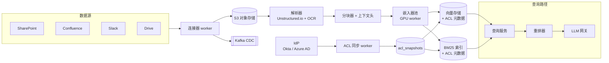
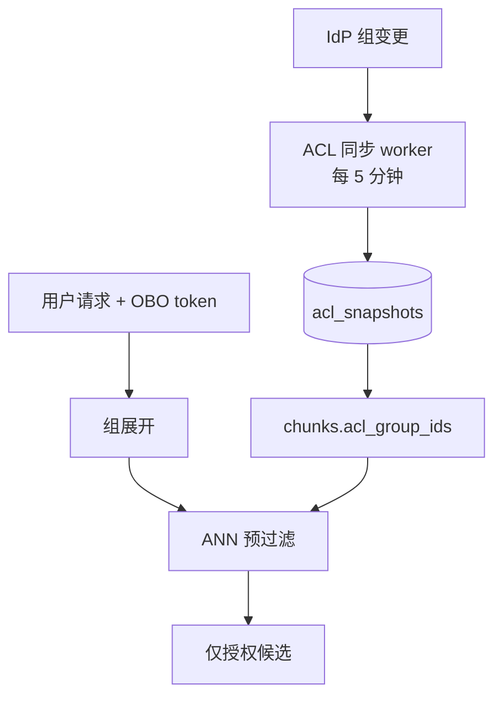
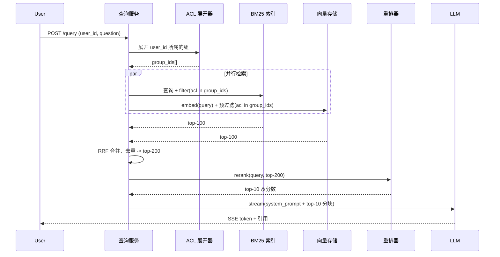
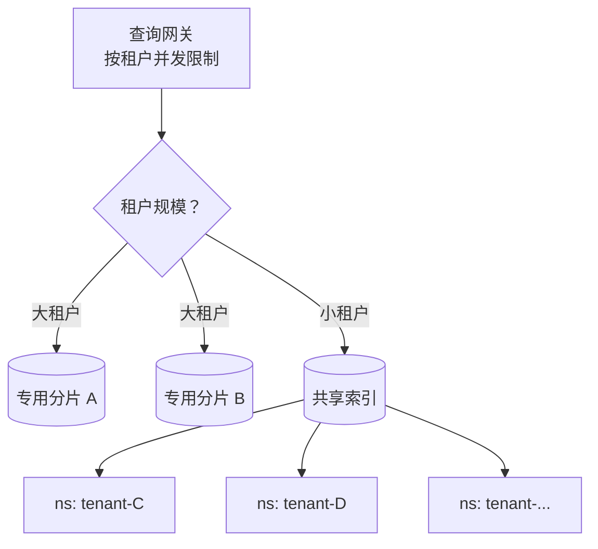

# 设计企业级 RAG 系统

> **TL;DR.** 企业级 RAG 系统把 LLM 的回答锚定在公司私有语料上，同时在查询这一侧执行按用户的访问控制。在 1,000 个租户、每租户 1,000 万份文档、每租户 100 QPS 的规模下，有三股力量主导设计：租户隔离（长尾租户用按租户命名空间，大客户用按租户分片）、ACL 感知的检索（在 ANN 层预过滤，绝不后过滤）、以及用 CDC 驱动的重新嵌入换来的亚小时级新鲜度。BM25 + 稠密向量 + 交叉编码器重排的混合检索，相比纯稠密检索把检索失败率降低 67%[^1]。核心权衡：检索正确性与延迟之争，由重排预算来调节。

## 学习目标

- 设计一条从异构 SaaS 连接器到分块、嵌入、带 ACL 标签的向量的摄取流水线，支撑每租户 1,000 万份文档的规模
- 把稠密向量检索、BM25 稀疏检索和交叉编码器重排组合成一条 1.5 秒以内的回答路径
- 把按文档的访问控制元数据传递到检索环节，让 ACL 检查发生在查询时而不是事后
- 选择租户隔离模型（按租户命名空间 vs 按租户分片），并在 1,000 租户规模下论证其权衡
- 用 RAGAS（faithfulness、answer relevance、context precision）评估 RAG 系统，并在 CI 中拦住回归
- 估算一个 100 亿分块的多租户向量平台所需的存储、算力与带宽

## 直觉理解

一个天真的企业问答系统看着很简单：把所有文档塞进提示词，问 LLM。50 页的时候还行。到了每租户 1,000 万份文档，语料比任何上下文窗口都大三个数量级。你需要检索（retrieval）[^2]。

但企业里的检索不是搜索引擎。它是一个永远不能把 Alice 在 SharePoint 里打不开的文档露给她的搜索引擎。它永远不能把 Bob 上周二退出的那个 Slack 频道里的分块塞给他。而且它要在每租户每秒 100 次查询、总共 1,000 个租户的条件下做到这些，答案还要落在有出处的引用上，不能编。

打通这个设计的关键洞察：ACL 不是一个后处理步骤，而是烧进 ANN 查询本身的检索期过滤条件。后过滤 ACL 会毁掉 Recall@K：你召回 100 个候选，删掉 80 个用户无权看的，LLM 只能拿 20 个平庸分块去接地。预过滤 ACL 意味着 ANN 索引从一开始就只在被允许的分块里找，从而在真正重要的地方保住召回率[^3]。

第二个洞察：没有哪种单一检索方法能通吃。稠密嵌入会漏掉 "Error code TS-999" 这类精确词项查询。BM25 会漏掉改述。混合检索加交叉编码器重排是生产默认，因为它同时覆盖了这两类失败模式[^1][^4]。

## 需求

### 澄清性问题

- **Q: 有哪些源系统？**
  假设：SharePoint、Confluence、Slack、Google Drive、Jira、Notion、S3、邮件。这决定了连接器库与解析器的组合。
- **Q: 谁掌握 ACL？哪个身份提供方？**
  假设：Okta 或 Azure AD。组与权限每 5 分钟同步一次。
- **Q: 新鲜度 SLA 是多少？**
  假设：多数内容亚小时级；Slack 和 Jira 走 webhook，5 分钟以内；归档文件共享每晚同步。
- **Q: 回答的契约是什么？**
  假设：流式返回 token，带行内引用（源文档 + 页码）。没有可接地来源就拒答。绝不编造引用 URL。
- **Q: 由哪个 LLM 作答？**
  假设：Claude Sonnet 4.6 / Opus 4.7 或 GPT-5.5，统一走网关。按租户做模型路由以控制成本。
- **Q: 多区域还是单区域？**
  假设：按租户做数据驻留（US、EU、APAC）。每个区域跑一套完整栈。

### 功能需求

- 从至少六种 SaaS 连接器增量同步摄取，外加直接上传
- 把 PDF、DOCX、XLSX、HTML、Markdown、图片（OCR）和原始邮件解析成干净的文本分块
- 为每个分块建嵌入与索引，并带上完整的源元数据：文档 ID、章节、时间戳、作者、ACL 标签
- 提供 `POST /query`，返回带行内引用与排序来源列表的流式回答
- 遵守按用户的 ACL：只有当查询者能打开源文档时，该分块才会被返回
- 提供租户管理控制台，覆盖连接器健康、重建索引触发、评估看板和成本

### 非功能需求

- **语料：** 每租户 1000 万份文档，1,000 个租户，全平台约 800 亿分块
- **负载：** 每租户持续 100 QPS，突发 10 倍；平台峰值约 100k QPS
- **延迟：** 端到端 p95 低于 1.5 s（TTFT 低于 800 ms）
- **新鲜度：** 95% 的更新在 1 小时内对检索可见；Slack 在 5 分钟以内
- **可用性：** 每租户 99.9%；强制隔离吵闹租户的影响
- **合规：** GDPR、SOC 2 Type II；按租户的数据驻留

## 容量估算

| 指标 | 数值 | 推导 |
|--------|------:|------------|
| 分块总数 | 80B | 10M 文档 × 8 分块/文档 × 1,000 租户 |
| 向量存储（原始） | ~176 TB | 80B × 1024 维 float16（2 KB/向量 + 200 B 元数据） |
| 向量存储（PQ） | ~22 TB | 乘积量化带来 8 倍压缩 |
| BM25 索引 | ~10 TB | 分词后的文本 + ACL 元数据 |
| 对象存储（原始文档） | 5-10 PB | 所有租户的 PDF、DOCX、图片 |
| 每日重嵌入（1% 变更） | 800M 分块 | 80B × 1% |
| 每日嵌入成本 | ~$16k | 800M 分块 × 1024 token × $0.02/1M token[^5] |
| 峰值查询 QPS | 100k | 100 QPS × 1,000 租户 |
| 单次查询 LLM 成本 | ~$0.01 | 约 2k 输入 + 500 输出 token，按 Sonnet 定价 |

延迟预算（合计 1,500 ms）：检索 250 ms（并行 BM25 + ANN + ACL 过滤）+ 重排 150 ms + 上下文组装 100 ms + LLM TTFT 800 ms + 引用后处理 100 ms + 网络 100 ms。

## API 与数据模型

### API 设计

```http
POST /v1/tenants/{tenant_id}/query
  Headers: Authorization: Bearer ***
  Body: { "question": "...", "history": [], "filters": {}, "stream": true }
  Returns: SSE stream of tokens + final { "sources": [{ "doc_id", "title", "url", "snippet", "score" }] }

POST /v1/tenants/{tenant_id}/connectors
  Body: { "type": "sharepoint", "oauth_token": "...", "sync_policy": "incremental", "acl_sync": true }
  Returns: 201 { "connector_id": "...", "status": "syncing" }

POST /v1/tenants/{tenant_id}/documents
  Body: multipart/form-data (file + metadata)
  Returns: 201 { "doc_id": "...", "chunks_created": 8 }

GET /v1/tenants/{tenant_id}/eval/runs/{run_id}
  Returns: 200 { "faithfulness": 0.87, "context_precision": 0.91, "answer_relevance": 0.83 }

POST /v1/tenants/{tenant_id}/feedback
  Body: { "query_id": "...", "signal": "wrong_citation" | "missed_source" | "thumbs_down" }
  Returns: 202 Accepted
```

每个端点都携带租户级 mTLS，外加一个用户级 OBO token，用于驱动 ACL 查询。

### 数据模型

```sql
-- 文档表（行存，按租户划分 keyspace）
table documents (
  doc_id        uuid PK,
  tenant_id     uuid,
  source_system varchar,
  url           text,
  title         text,
  checksum      bytea,
  acl_snapshot_id uuid FK,
  updated_at    timestamp
)

-- 分块表（行存）
table chunks (
  chunk_id      uuid PK,
  doc_id        uuid FK,
  tenant_id     uuid,
  seq           int,
  text          text,
  token_count   int,
  context_header text,   -- Contextual Retrieval 前置上下文
  embedding_version int
)

-- 向量索引（按租户划分命名空间）
-- chunk_id -> vector(1024) + metadata { tenant_id, doc_id, acl_group_ids[], updated_at }

-- ACL 快照（每 5 分钟从 IdP 刷新）
table acl_snapshots (
  group_id      varchar PK,
  member_ids    uuid[],
  synced_at     timestamp
)
```

## 高层架构



*连接器把原始文件送进 S3，随后解析—分块—嵌入流水线把结果带 ACL 标签双写到向量索引与 BM25 索引；一条 IdP 旁路保持访问控制快照最新。*

写路径是事件驱动的：连接器把 CDC 事件发到 Kafka，触发解析—分块—嵌入流水线。解析层（Unstructured.io，PDF 用 `hi_res` 策略做版面感知抽取，OCR 用 Tesseract[^6]）兜住企业文档格式的长尾。读路径并行扇出到 BM25 和向量检索（两者都做了 ACL 预过滤），用 RRF 合并，用交叉编码器重排，组装上下文，然后流式输出带引用的 LLM 回答。

ACL 同步 worker 每 5 分钟追一次 IdP 的组变更并重写 `acl_snapshots`。分块把 `acl_group_ids[]` 作为一等元数据携带。查询时，用户的 OBO token 被展开成组 ID，成为两条检索路径上的预过滤条件。

## 深入探讨

### 深入探讨 1：ACL 感知的检索

企业 RAG 的决定性约束是访问控制。一份只对 People 团队可见的 HR 文档，它的分块绝不能出现在工程师的答案里，哪怕只是作为重排候选。

**为什么后过滤会失败：** ANN 索引在不考虑 ACL 的情况下返回 top-K。下游过滤器删掉被禁止的分块，列表变短甚至为空。Recall@K 崩塌。更糟的是时间侧信道会泄露信息：一次 50 ms 返回的查询（大量分块被过滤）与一次 200 ms 返回的查询（少量被过滤），本身就暴露了"哪些东西存在"[^3]。

**在 ANN 层预过滤：** Amazon Kendra 把它形式化为 user-context filtering——文档的 ACL 与内容一起建索引，用户 token 在候选生成阶段就被评估[^3]。对向量数据库而言，Weaviate 的 filtered HNSW 和 Pinecone 的命名空间级元数据过滤原生支持预过滤[^7][^8]。

**实现方式：** 查询时，查询服务通过 ACL 展开器把用户的 OBO token 展开成 `group_ids[]` 集合。这个集合作为元数据过滤条件同时传给向量存储（`filter: { acl_group_ids: { $in: group_ids } }`）和 BM25 索引。ANN 搜索只遍历那些 ACL 元数据与用户所属组有交集的图节点。



*IdP 的组变更经 ACL 同步流到分块元数据；查询路径上的 OBO token 驱动组展开与预过滤，保证只有被授权的分块进入候选集。*

**ACL 组爆炸：** 企业 IdP 里一个用户常常身处 100-500 个组。Pinecone 的 `$in` 过滤上限是 10,000 个值[^7]。缓解办法：把组编码成位图，在索引内做交集运算；或者用两段式过滤（先用顶层组做便宜的预过滤，再对 top-K 做精确检查）。

**ACL 过期：** 用户在 SharePoint 里被收回了权限，但 RAG 系统还没同步，分块就泄露了。缓解：5 分钟的紧凑同步 SLA；Kendra 的 `CreateAccessControlConfiguration` 模式，不重建内容索引就能改写 ACL[^9]；以及在两个同步窗口之间挂一个"已撤销文档"的负缓存。

### 深入探讨 2：混合检索与重排流水线

稠密嵌入擅长改述匹配，但在产品编号、错误码、缩写这类精确词项查询上失灵。BM25 处理精确词项，却漏掉语义相似。生产默认是混合检索加交叉编码器重排[^1][^4]。

**第 1 阶段：并行检索。** BM25 与稠密向量检索并行跑，各自返回 top-100 候选（都经过 ACL 预过滤）。BM25 用标准的词频模型加长度归一化。稠密检索在 1024 维嵌入上用 HNSW[^10]。

**第 2 阶段：倒数排序融合（RRF）。** 两个结果列表用 RRF 合并：`score = sum(1 / (k + rank))`，`k=60`[^11]。这种免训练的融合在多数基准上优于学习式融合，被 Elasticsearch、Azure AI Search、Milvus 和 SQL Server 采用[^11]。

**第 3 阶段：交叉编码器重排。** 交叉编码器（Cohere rerank-v4.0，支持最多 10,000 份文档、32,768 token 的联合上下文[^12]）把合并后的 top-200 候选与查询一起联合打分。这是检索里最贵的一步（50-200 ms），但杠杆最高：Anthropic 的测试显示，在上下文化嵌入 + 上下文化 BM25 之上再加重排，相比纯稠密检索把检索失败率降低 67%[^1]。



*查询流程：并行的预过滤 BM25 与向量检索、RRF 合并、交叉编码器重排，以及带引用后处理的流式 LLM 生成。*

**上下文化检索（Contextual Retrieval）：** Anthropic 的技术是在嵌入和 BM25 建索引之前，给每个分块前置一段 50-100 token、由 LLM 生成的定位上下文。仅用嵌入时这把检索失败率降低 35%，加上上下文化 BM25 后降低 49%[^1]。配合提示缓存，一次性建索引成本是每百万文档 token $1.02[^1]。

### 深入探讨 3：租户隔离与多租户

1,000 个租户的语料规模天差地别（有的 10 万份文档，有的 5,000 万份），没有哪种单一隔离模型能通吃。

**按租户命名空间（共享索引）：** Pinecone 在 Standard 和 Enterprise 套餐的 serverless 索引上默认支持每个索引 100,000 个命名空间，联系支持可达百万级[^7][^13]。每个命名空间独立存储，查询只命中一个命名空间。成本：每扫描 1 GB 计 1 RU，所以一个 1 GB 的命名空间花 1 RU，而基于 100 GB 过滤的方案要花 100 RU[^7]。租户退租只是一次 `delete(namespace=...)` 调用。

**按租户分片（专用索引）：** Weaviate 给每个租户分配独立分片，各有自己的 HNSW 索引、倒排索引和对象存储。一个 9 节点集群可承载约 170,000 个活跃租户[^8]。租户状态（ACTIVE / INACTIVE / OFFLOADED）允许把冷数据下沉到 S3[^8]。查询性能与其他租户的规模无关。

**混合模型（我们的选择）：** 大租户（前 5%，超过 5M 文档）拿专用分片，换取爆炸半径隔离与可预测性能。长尾租户共享一个带命名空间的索引。查询网关执行按租户的并发上限，防止吵闹邻居把资源吃满。



*混合模型：大租户用专用分片，长尾租户用带命名空间的共享索引；网关执行按租户的并发限制，避免吵闹邻居效应。*

**开通时的尖峰：** 一个新租户带 1,000 万份文档进来，触发 8,000 万分块的首次嵌入作业。不加限流，这会打满嵌入器池，饿死现有租户。缓解：按租户的开通配额；向量追平之前只提供 BM25 检索；回填阶段用 MRL 截断嵌入（512 维）加快建索引[^14][^15]。

### 深入探讨 4：CDC 驱动的重新嵌入换取新鲜度

每晚全量重建索引撑不住亚小时级新鲜度 SLA。生产模式是在分块粒度做 CDC。

连接器把按文档的 CDC 事件发到 Kafka。一个脏标记 worker 按租户攒批，只为变化的分块重算嵌入（按分块内容哈希做 diff），并以单调递增的 `embedding_version` 写穿到向量存储与 BM25 存储。Slack 和 Jira 走 webhook，达到 5 分钟以内的新鲜度；SharePoint 和 Drive 走 change token API，达到 1 小时以内。

分块层用 LangChain 的 `RecursiveCharacterTextSplitter`，分隔符为 `["\n\n", "\n", " ", ""]`，1024 token，重叠 128 token[^16][^17]。它尽可能保住段落与句子边界，同时让分块大小保持一致，便于嵌入标定。

关键优化：分块级哈希。如果一份文档被重新抓取但只有一个段落变了，就只重算那一个分块的嵌入。在 80B 分块上每天 1% 的变更率，意味着每天 8 亿次重嵌入而不是 800 亿次，成本降 100 倍。

## 真实案例

**Anthropic Contextual Retrieval：一次技术层面的基准评测**

Anthropic 在 2024 年 9 月公布了企业 RAG 检索质量方面最严谨的公开评测[^1]。研究覆盖代码库、小说、arXiv 论文和科学论文，用 1 - recall@20 作为失败率指标。

基线（纯稠密嵌入）的检索失败率是 5.7%。给每个分块加一段 50-100 token、由 LLM 生成的定位上下文（用 Claude Haiku，对整个文档做提示缓存），失败率降到 3.7%，降幅 35%。再加上上下文化 BM25（同样的定位上下文在 BM25 分词前前置），用 RRF 合并，失败率降到 2.9%，降幅 49%。最后叠加 Cohere 重排，失败率降到 1.9%，总降幅 67%[^1]。

配合提示缓存的建索引成本：每百万文档 token $1.02[^1]。在企业规模下（100 亿分块，每块约 1024 token），单租户首次建索引成本约 $10,000，摊到语料生命周期里。提示缓存把单次调用成本降低最多 90%，延迟降低 2 倍以上[^1]。

架构是这样：一次 Claude Haiku 调用生成定位上下文。这段上下文在嵌入和 BM25 建索引之前前置到分块上。检索时取回 top-150 候选（稠密 + 稀疏合并后 RRF 融合），再由 Cohere 重排选出 top-20 交给生成器。非专家容易错过的洞察：上下文是建索引时加的，不是查询时加的，所以检索阶段一分钱不多花。

## 权衡

企业 RAG 的设计空间由四个维度组成：租户隔离、ACL 过滤、检索模型、索引新鲜度。下表每一行都只是其中某一个维度上的合法选项。

| 方案 | 优势 | 劣势 | 适用场景 |
|----------|------|------|-------------|
| 按租户命名空间（共享索引） | 便宜、运维简单，默认 100k、按需可达百万级[^7][^13] | 在旧的 pod-based 索引上租户共享 ANN 算力；serverless 命名空间物理隔离，厂商文档称"无吵闹邻居"[^7] | 5k 以下小租户，跑在 serverless 上 |
| 按租户分片（专用） | 隔离强、删除快[^8] | 受厂商上限约束（约 170k）；单租户成本更高 | 受监管行业、大语料 |
| 分片 + 命名空间混合 | 贴合真实租户分布 | 路由更复杂；规模增长时要重新分片 | 500 以上租户、规模长尾 |
| 在 ANN 层预过滤 ACL | 召回正确；单次往返[^3] | 需要 filtered HNSW 支持 | 多租户 RAG 的默认 |
| 纯稠密检索 | 简单；能处理改述 | 漏掉精确词项查询 | 仅原型阶段 |
| BM25 + 稠密 + 重排混合 | 在企业语料上最优[^1][^4] | 三个组件都要调 | 生产默认 |
| 每晚全量重建索引 | 简单、可预测 | 撑不住亚小时级 SLA | 仅归档语料 |
| CDC 分块级重嵌入 | 亚小时级新鲜度；算力开销小 | 需要分块哈希 | 生产默认 |

最大的单一权衡：**检索正确性 vs 延迟**。三段式流水线（BM25 + 稠密 + 重排）给出最好的召回，但吃掉 1,500 ms 预算里的 400 ms。砍掉重排能省 150 ms，却显著抬高检索失败率[^1]。真实公司的解法是调节送进重排的候选数（质量敏感租户用 200，延迟敏感租户用 50）。

> [!WARNING]
> **后过滤 ACL 从构造上就在泄露数据。** 天真的实现先跑 ANN 查询，再按调用者的 ACL 过滤 top-k 结果。两种失败模式让它在任何受监管或多租户场景里都不安全：(1) *召回破损*——如果 k 个最近邻恰好全是你无权看的文档，用户就拿到空结果，哪怕索引更深处存在他有权限的匹配；(2) *时间泄露*——"top-k 内有授权匹配"与"授权匹配在更深处"这两种情况在响应延迟上存在可测量的差异，攻击者据此可以推断他读不到的文档是否存在、以及大致相似度。正确做法是在 ANN 层预过滤 ACL（即上表默认行），在最近邻计算开始之前就把搜索空间限制在已授权的分块上[^3]。

## 扩展与故障模式

**10 倍负载（1M QPS）时：** 重排器成为瓶颈。缓解：把候选集相近的并发查询合并成批重排请求；按区域部署 GPU 加速的重排器副本。

**100 倍负载（10M QPS）时：** 向量索引饱和。缓解：按租户 ID 范围把索引分片到多个集群；加语义缓存（查询向量嵌入相似度 > 0.95），据报告在 FAQ 型负载上能拿到 30-70% 的命中率[^18]。缓存响应以个位数毫秒返回，而完整流水线要 500-2000 ms[^18]。

**1000 倍负载时：** 架构转向对高频查询预计算答案。在类 ChatGPT 系统里约 31% 的查询与此前的查询语义相近[^19]。激进的预热语义缓存覆盖头部，完整流水线兜住长尾。

**故障模式：ACL 同步滞后。** 用户在 SharePoint 里被收回权限，但 RAG 系统在最多 5 分钟内仍然返回该文档。检测：用审计日志比对 T 时刻的 IdP 成员关系与分块的 `acl_group_ids[]`。应对：已撤销文档的负缓存；面向安全事件的紧急 ACL 冲洗 API。

**故障模式：开通期嵌入器池饱和。** 新租户 8,000 万分块的回填饿死现有租户的新鲜度 SLA。检测：嵌入器队列深度超过阈值；现有租户的新鲜度指标下滑。应对：按租户的开通配额；向量追平之前只提供 BM25 检索。

**故障模式：检索到了但 LLM 仍然幻觉。** 模型给出一个看似合理却无出处的断言。检测：引用后处理器找不到与该断言匹配的源分块。应对：压制无引用的断言；只返回有引用的部分，并说明"我没找到这方面的来源"。

## 常见陷阱

> [!WARNING]
> **用后过滤 ACL 代替预过滤。** ANN 索引在无 ACL 意识的情况下返回 top-K，然后你再过滤。召回崩塌。时间侧信道泄露文档是否存在。永远在 ANN 查询路径上预过滤[^3]。

> [!WARNING]
> **分块缺上下文。** "营收比上季度增长 3%" 检索得分很高，但毫无用处——因为公司和季度都不在这个分块里。用 Anthropic 的上下文化检索（每块 50-100 token 的定位上下文）把这类失败模式降低 35%[^1]。

> [!WARNING]
> **租户开通引发嵌入雪崩。** 一个 1,000 万文档的租户就是 8,000 万分块的首次嵌入作业。不限流，这会打满嵌入器池、饿死现有租户。强制执行按租户的开通配额，并在回填期间提供仅 BM25 的可用性。

> [!WARNING]
> **迷失在中间（lost-in-the-middle）的上下文腐化。** LLM 对长上下文的首尾注意最多，中间的块会被忽略[^20]。重排到 top-10 或 top-20 块，不要 top-50。Anthropic 的测试是在显式测量之后才决定用 top-20 而不是 top-10[^1]。

> [!WARNING]
> **ACL 快照过期。** ACL 同步是与内容同步分离的周期任务。5 分钟滞后意味着一个刚被解雇的员工在被撤销后还能查 5 分钟。收紧同步 SLA，并在同步窗口之间挂一个已撤销文档的负缓存。

> [!WARNING]
> **在企业语料上用纯稠密检索。** 企业文档里满是产品编号、错误码和缩写，稠密嵌入会全部漏掉。BM25 + 稠密的混合是检索栈的最低配置[^1][^4]。

## 追问

**1. 如何在不撑爆上下文窗口的前提下加入跨文档推理？**

把问题拆成子查询（Azure AI Search 的 agentic retrieval 报告在复杂问题上最多有 40% 提升[^21]）。每个子查询独立跑一遍，各自取回相关分块，再组装成合并上下文。对于全局性理解类问题（"主要主题有哪些？"），考虑 GraphRAG 的社区摘要路线[^22]。

**2. 有用户反馈一份敏感的 HR 文档出现在了同事那里。带我走一遍审计路径。**

拉出查询链路（查询 ID、用户 ID、展开的 group_ids[]、取回的 chunk_ids[]）。把查询时该分块的 `acl_group_ids[]` 与那一时刻用户真实的 IdP 组做比对。根因通常是：ACL 同步滞后（最常见）、连接器 ACL 抽取 bug、或 IdP 组配置错误。

**3. 遇到禁止使用第三方 LLM 的租户怎么办？**

LLM 网关把请求路由到部署在该租户 VPC 里的自托管开放权重模型（Llama、Mistral）。检索流水线仍然共享（向量按租户加密落盘）。只有生成这一步变了。成本因自托管 GPU 开销上升约 3 倍。

**4. 如何支持按租户微调重排器？**

收集按租户的反馈信号（点赞/点踩、"引用错误"）。在基础交叉编码器上为每个租户微调一个 LoRA 适配器。用支持多 LoRA 的推理框架按需加载适配器来服务。成本：显存里只放一份基础模型，每个适配器约 10 MB。

**5. 如何把它扩展成 agentic RAG？**

LLM 在生成中途判断自己需要更多上下文，于是发出一个工具调用（`retrieve(subquery)`），查询服务再跑一轮检索，结果追加到上下文里。延迟翻倍（两轮检索），所以把 agentic 模式留给分类器识别出的复杂查询。

**6. 某租户要求按 GDPR 第 17 条"遗忘"一个用户。需要重写哪些东西？**

从对象存储删除该用户撰写的所有文档。从向量索引和 BM25 索引删除对应分块。从 `acl_snapshots` 里清掉该用户。让引用了这些文档的语义缓存条目失效。最坏情况：该用户写了 10 万份文档，即两个索引合计 80 万分块删除，用批量删除 API 几分钟内可以完成。

## 练习

### 练习 1：ACL 过滤器设计

一个用户属于 300 个组。你的向量数据库 `$in` 过滤每个条件上限 10,000 个值[^7]。该用户查询时希望检索在 250 ms 以内。设计 ACL 过滤策略。

<details>
<summary>提示</summary>

想一想你是否真的需要把 300 个组塞进一个过滤条件，或者用层级化组结构（包含子组的顶层组织组）能否降低过滤基数。再想一想如果按组子集把查询拆成多个并行子查询会怎样。

</details>

<details>
<summary>解答</summary>

**方案 A：层级化组编码。** 多数企业 IdP 有嵌套组。拍平成顶层"访问域"（每个用户通常 10-30 个）。按访问域过滤，而不是按原始组过滤。这把过滤基数从 300 降到约 20。

**方案 B：位图编码。** 给每个组分配一个 bit 位置。每个分块存一个允许组的位图。查询时计算用户的位图，在索引里做按位与。Weaviate 和 Milvus 支持可实现这一点的自定义过滤函数。

**方案 C：两段式过滤。** 先用用户最宽的 5 个组做预过滤（覆盖约 90% 的可访问文档）。用这个粗过滤跑 ANN。再对 top-200 结果按完整的 300 组集合做后过滤。召回不受损，因为粗过滤是宽松的，而对 200 个候选做精确检查很便宜。

**我们的选择：** 多数部署选方案 C。它适配任何向量数据库已有的过滤设施，不需要自定义索引扩展，对 200 个候选的后过滤增加不到 5 ms。

</details>

## 要点回顾

- **ACL 是检索期的约束，不是后过滤。** 不在 ANN 查询里预过滤，就会毁掉召回并经由时间泄露信息[^3]。
- **稠密 + BM25 + 重排的混合是生产默认。** 纯稠密漏精确词项；纯 BM25 漏改述；重排把失败率降低 67%[^1]。
- **租户隔离是个混合问题。** 大租户用专用分片，长尾用带命名空间的共享索引，所有人都受网关强制的并发上限保护。
- **新鲜度要求在分块粒度做 CDC。** 每晚重建索引根本行不通；分块级哈希把每日重嵌入成本降低 100 倍。
- **上下文化检索是杠杆最高的单项技术。** 建索引时每块前置 50-100 token，检索失败率降 35-49%，查询期成本几乎为零[^1]。
- **一切都由评估把关。** CI 里的 RAGAS faithfulness 与 context precision 能在回归上线前拦住它[^23]。

## 延伸阅读

- [Anthropic, "Introducing Contextual Retrieval"（2024 年 9 月）](https://www.anthropic.com/engineering/contextual-retrieval)。那份 35/49/67% 检索失败率下降的研究；对企业 RAG 质量而言最可落地的一项技术。
- [Lewis et al., "Retrieval-Augmented Generation for Knowledge-Intensive NLP Tasks"（NeurIPS 2020）](https://arxiv.org/abs/2005.11401)。RAG 原始论文，定义了参数化 + 非参数化记忆架构。
- [Malkov and Yashunin, "HNSW"（arXiv 1603.09320）](https://arxiv.org/abs/1603.09320v4)。每个生产向量数据库背后的经典 ANN 算法。
- [Edge et al., "From Local to Global: A Graph RAG Approach"（arXiv 2404.16130）](https://arxiv.org/abs/2404.16130)。面向全局理解类查询的图增强 RAG；昂贵但独有能力。
- [Pinecone 多租户文档](https://docs.pinecone.io/guides/index-data/implement-multitenancy)。按租户命名空间的模式，附带具体的成本与规模数字。
- [Weaviate 多租户概念](https://docs.weaviate.io/weaviate/concepts/data)。按租户分片，以及租户状态（ACTIVE/INACTIVE/OFFLOADED）与运维上限。
- [RAGAS 文档](https://docs.ragas.io/)。RAG 评估的经典开源框架：faithfulness、answer relevance、context precision/recall。
- [Gao et al., "HyDE"（arXiv 2212.10496）](https://arxiv.org/abs/2212.10496)。通过假设文档嵌入做零样本稠密检索；对查询扩展有用。

## 记忆卡片

<details>
<summary><strong>Q: 为什么 ACL 过滤必须发生在 ANN 查询时，而不是检索之后？</strong></summary>

A: 后过滤 ACL 从 top-K 里删掉被禁止的分块，导致 Recall@K 崩塌，LLM 拿到的是平庸甚至空的上下文。它还会通过时间侧信道泄露文档的存在性。预过滤保证只有被授权的分块进入候选集。

</details>

<details>
<summary><strong>Q: 生产级企业 RAG 流水线有哪三个检索阶段？</strong></summary>

A: (1) 并行 BM25 稀疏检索 + 稠密向量检索，两者都做 ACL 预过滤。(2) 倒数排序融合（RRF）合并，k=60。(3) 交叉编码器重排（例如 Cohere rerank-v4.0），把合并后的 top-200 候选与查询联合打分。

</details>

<details>
<summary><strong>Q: 什么是上下文化检索，它带来多大提升？</strong></summary>

A: Anthropic 的技术是在建索引时给每个分块前置一段 50-100 token、由 LLM 生成的定位上下文。仅用嵌入时检索失败率降低 35%，加上上下文化 BM25 后降低 49%，再叠加重排后降低 67%。

</details>

<details>
<summary><strong>Q: 按租户命名空间与按租户分片隔离有什么区别？</strong></summary>

A: 按租户命名空间让多个租户共享一个索引里的 ANN 算力（便宜，默认 100k 个命名空间、按需可达百万级，但有吵闹邻居风险）。按租户分片给每个租户独立的 HNSW 索引（隔离强、性能互不影响，但厂商上限约每集群 170k 个租户）。

</details>

<details>
<summary><strong>Q: RRF 的公式是什么，标准 k 值是多少？</strong></summary>

A: RRF 得分 = 各检索器 1/(k + rank) 之和，按 Cormack 等人（SIGIR 2009）取 k=60。除 k 之外没有参数，被 Elasticsearch、Azure AI Search、Milvus 和 SQL Server 采用。

</details>

<details>
<summary><strong>Q: CDC 驱动的重新嵌入如何做到亚小时级新鲜度？</strong></summary>

A: 连接器把按文档的 CDC 事件发到 Kafka。worker 只为变化的分块重算嵌入（按内容哈希 diff 识别），写穿到向量存储和 BM25 存储。未变化的分块被跳过，使每日重嵌入量相比全量重建索引减少约 100 倍。

</details>

<details>
<summary><strong>Q: 企业 RAG 负载的语义缓存命中率是多少？</strong></summary>

A: FAQ 型负载上 30-70%。在类 ChatGPT 系统里约 31% 的查询与此前查询语义相近。缓存响应 3-8 ms 返回，而完整流水线要 500-2000 ms。

</details>

<details>
<summary><strong>Q: 为什么纯稠密检索在企业语料上会失败？</strong></summary>

A: 企业文档里满是产品编号、错误码、缩写和精确标识符，稠密嵌入把它们映射到向量空间里泛泛的区域。BM25 能处理这些精确词项查询；混合检索同时覆盖两类失败模式。

</details>

<details>
<summary><strong>Q: 1,500 ms 的企业 RAG 响应，延迟预算怎么拆？</strong></summary>

A: 检索 250 ms（并行 BM25 + ANN + ACL 过滤）+ 重排 150 ms + 上下文组装 100 ms + LLM TTFT 800 ms + 引用后处理 100 ms + 网络 100 ms。

</details>

<details>
<summary><strong>Q: 开通新租户时的嵌入雪崩怎么处理？</strong></summary>

A: 对嵌入器池执行按租户的开通配额。在向量追平之前提供仅 BM25 的检索可用性。回填期间用 MRL 截断嵌入（512 维）加快建索引，之后再在后台批量升级到全维度嵌入。

</details>

## 参考文献

[^1]: Anthropic，"Introducing Contextual Retrieval"，2024 年 9 月。https://www.anthropic.com/engineering/contextual-retrieval

[^2]: Patrick Lewis et al.，"Retrieval-Augmented Generation for Knowledge-Intensive NLP Tasks"，NeurIPS 2020。https://arxiv.org/abs/2005.11401

[^3]: Amazon Kendra，"Filtering on user context"。https://docs.aws.amazon.com/kendra/latest/dg/user-context-filter.html

[^4]: Microsoft Azure AI Search，"Outperforming vector search with hybrid retrieval and reranking"。https://techcommunity.microsoft.com/blog/azure-ai-foundry-blog/azure-ai-search-outperforming-vector-search-with-hybrid-retrieval-and-reranking/3929167

[^5]: OpenAI，"New embedding models and API updates"。https://openai.com/index/new-embedding-models-and-api-updates/

[^6]: Unstructured.io，"Partitioning strategies"。https://docs.unstructured.io/open-source/concepts/partitioning-strategies

[^7]: Pinecone，"Implement multitenancy"。https://docs.pinecone.io/guides/index-data/implement-multitenancy

[^8]: Weaviate，"Data concepts and multi-tenancy"。https://docs.weaviate.io/weaviate/concepts/data

[^9]: Amazon Kendra，`CreateAccessControlConfiguration` API。https://docs.aws.amazon.com/kendra/latest/dg/API_CreateAccessControlConfiguration.html

[^10]: Malkov and Yashunin，"Efficient and robust approximate nearest neighbor search using Hierarchical Navigable Small World graphs"，arXiv:1603.09320v4。https://arxiv.org/abs/1603.09320v4

[^11]: Microsoft Azure SQL Devblog，"Hybrid Search in SQL Server with RRF"。https://devblogs.microsoft.com/azure-sql/enhancing-search-capabilities-in-sql-server-and-azure-sql-with-hybrid-search-and-rrf-re-ranking/

[^12]: Cohere，"Rerank Best Practices"。https://docs.cohere.com/docs/reranking-best-practices

[^13]: Pinecone，"Database limits: Namespaces per serverless index"。https://docs.pinecone.io/reference/api/database-limits#namespaces-per-serverless-index

[^14]: Kusupati et al.，"Matryoshka Representation Learning"，arXiv:2205.13147。https://arxiv.org/abs/2205.13147

[^15]: Supabase，"Faster OpenAI vector search using Adaptive Retrieval"。https://www.supabase.com/blog/matryoshka-embeddings

[^16]: LangChain，`RecursiveCharacterTextSplitter` 源码。https://github.com/langchain-ai/langchain/blob/master/libs/text-splitters/langchain_text_splitters/character.py

[^17]: DataStax RAGStack，"Split Documents"。https://docs.datastax.com/en/ragstack/default-architecture/splitting.html

[^18]: Spheron Network，"Semantic Caching for LLM Inference"。https://www.spheron.network/blog/semantic-cache-llm-inference-gpu-cloud/

[^19]: Gill et al.，"MeanCache: User-Centric Semantic Caching for LLM Web Services"，IPDPS 2025，arXiv:2403.02694。https://arxiv.org/abs/2403.02694

[^20]: Liu et al.，"Lost in the Middle: How Language Models Use Long Contexts"，TACL 2023，arXiv:2307.03172。https://arxiv.org/abs/2307.03172

[^21]: Microsoft Azure，"Introducing agentic retrieval in Azure AI Search"。https://techcommunity.microsoft.com/blog/azure-ai-services-blog/introducing-agentic-retrieval-in-azure-ai-search/4414677

[^22]: Edge et al.，"From Local to Global: A Graph RAG Approach to Query-Focused Summarization"，arXiv:2404.16130。https://arxiv.org/abs/2404.16130

[^23]: Ragas 文档。https://docs.ragas.io/
