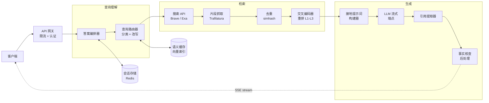
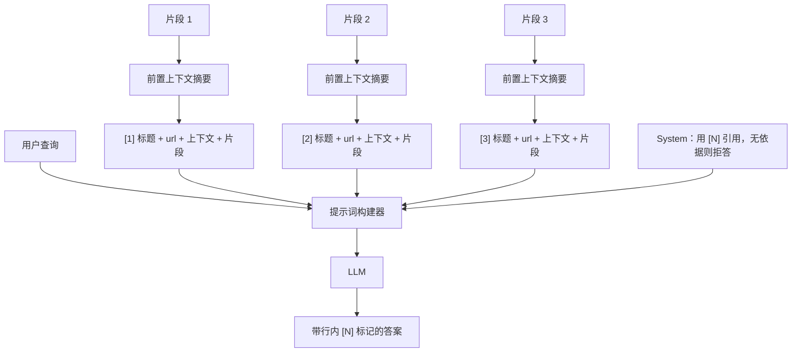
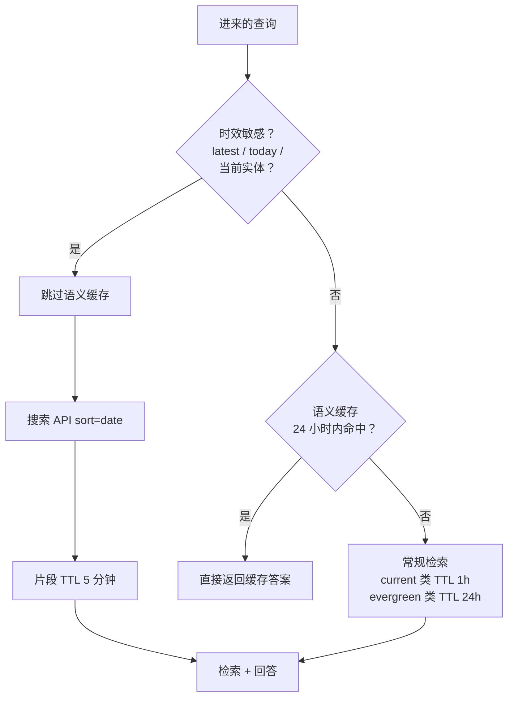
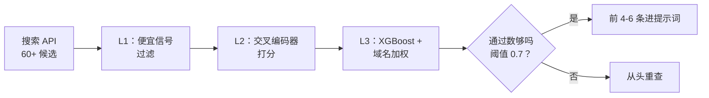

# 设计 Perplexity（带引用的 AI 搜索）

> **TL;DR.** AI 答案引擎是一条延迟受限的 RAG 流水线：检索承担了大部分工作，LLM 只在预先选好的证据上做受限的综合。在每月 7.8 亿次查询（截至 2026 年初）、端到端延迟低于 2 秒[^1]的约束下，架构是一条六阶段流水线：查询分类、搜索 API 扇出、片段提取、交叉编码器重排、带引用接地的提示词组装、流式 LLM 综合。核心权衡是成本—质量—延迟：更深的检索能提升接地质量，但增加开销和串行延迟；缓存能降成本，却会牺牲新闻类查询的时效性。

## 学习目标

- 设计一个查询路由器，对意图分类（直接回答、单跳、多跳、拒答）并决定检索深度
- 在 600 毫秒预算内搭出来源检索流水线：搜索 API、并行片段抓取、去重、交叉编码器重排
- 写出强制行内 `[N]` 标记、并消除无依据论断的引用接地提示词
- 应用时效性路由，让时间敏感查询绕过语义缓存
- 推演多轮追问的状态，判断何时重新检索、何时沿用已有来源
- 增加事实核查后处理器，在流式输出结束前抓出编造的引用

## 直觉理解

朴素的 AI 搜索看起来很简单：拿用户的问题调一次 LLM，返回答案。对于模型训练时记住的常识性问题，这能用。但一旦有人问“今天市场发生了什么”，它就失败了，因为模型知识有截止日期；当有人问一个细微的事实性问题时，它同样会失败，因为模型会自信地编出一个听起来合理的答案，却没有任何来源。

解法是检索。搜索实时网页、抓取真实页面、抽取相关文本，然后强制 LLM 只基于这些来源做综合，并带上行内引用。此时问题换了一个：你只有大约 2 秒的实际时间，其中 LLM 生成要占 1 到 1.5 秒，你必须把查询理解、网页搜索、页面抓取、去重和重排塞进剩下的 500 到 800 毫秒里。

真正打开设计思路的洞察只有一条：LLM 不是你要优化的瓶颈，检索流水线才是。你在搜索和抽取上省下的每一毫秒，都可以花在更深的重排或更强的模型上。胜出的系统是最快拿到最好的 4 到 6 个片段的那个，而不是上下文窗口最大的那个。

## 需求

### 澄清问题

- **问：我们要自建网页爬虫和索引吗？**
  假设：不自建。我们用商用搜索 API（Brave、Bing、Exa）拿到广泛覆盖，只为有差异化的来源（学术、代码）建垂直索引。
- **问：延迟 SLA 是多少？**
  假设：P99 下首 token 低于 800 毫秒，完整答案低于 2 秒。
- **问：要支持多轮追问吗？**
  假设：要。追问占真实流量的 30% 到 40%，合适时必须复用已有来源。
- **问：答案需要多新？**
  假设：新闻类查询需要最近一小时的来源。长期有效（evergreen）的查询可以接受 24 小时前的缓存答案。
- **问：付费墙或被反爬拦截的内容怎么办？**
  假设：遵守 robots.txt。整页抓取失败时回退到搜索 API 的元数据片段。
- **问：用哪个 LLM？**
  假设：多模型路由。简单查询用快模型（GPT-5.4 mini 级别），复杂多跳用强模型（Claude Sonnet 4.6 / GPT-5.5 级别）。

### 功能需求

- 接受自然语言查询，返回带行内 `[1][2]` 标记、指向来源 URL 的引用答案
- 支持多轮追问，把上下文带下去，不重复搜同一块内容
- 处理时效性在 1 小时以内的新闻查询
- 提供“Deep Research”模式，跑 10 到 20 个子查询并综合出一篇带引用的长篇报告[^2]

### 非功能需求

- **负载：** 5000 万 MAU，峰值 5K QPS（答案请求），含追问和重新生成共 20K QPS
- **延迟：** P99 首 token 低于 800 毫秒，P99 完整答案低于 2 秒
- **可用性：** 99.9%
- **成本：** 单次标准查询低于 $0.02（搜索 + LLM 合计）
- **引用准确率：** 目标 80% 以上（业界最好成绩是 CJR 来源识别测试的 63%[^3]）

## 容量估算

| 指标 | 数值 | 推导过程 |
|--------|------:|------------|
| 日查询量 | 432M | 5K QPS × 86,400 秒 |
| 日输入 token | 1.5T | 432M × 每查询 3K token（片段 + 提示词） |
| 日输出 token | 216B | 432M × 每答案 500 token |
| 日搜索 API 成本 | $2.16M | 432M × 每 1K 次查询 $5（未计缓存） |
| 40% 缓存后的搜索成本 | $1.3M | 长期有效查询的语义缓存命中率 40% |
| 日 LLM 成本（路由后） | $5.4M | 70% 便宜模型（$1/M）+ 30% 强模型（输出 $15/M） |
| 片段存储（临时） | 5 TB/day | 6 片段 × 2 KB × 432M（TTL 1 小时） |
| 会话存储 | 430 GB/day | 每会话一行：查询 + 来源 + 答案 |

成本大头是 LLM 推理和搜索 API 开销。模型路由（直接回答用便宜模型、多跳用强模型）和语义缓存是两个杠杆最大的降本手段。

## API 与数据模型

### API 设计

```http
POST /v1/search
  Headers: Authorization: Bearer ***
  Body: { "query": "...", "session_id": "uuid", "mode": "standard|deep", "freshness": "auto" }
  Returns: SSE stream of { "type": "token|citation|done", "content": "...", "sources": [...] }

GET /v1/sessions/{session_id}/history
  Returns: 200 { "turns": [{ "query", "answer", "sources", "timestamp" }] }

POST /v1/search/feedback
  Body: { "query_id": "uuid", "signal": "wrong_citation|hallucination|stale|thumbs_up" }
  Returns: 202 Accepted
```

限流响应头：`X-RateLimit-Remaining`、`X-RateLimit-Reset`。按用户计的月度成本预算在网关层强制执行。

### 数据模型

```sql
-- 会话存储（带持久化的 Redis）
key: session:{session_id}
value: {
  turns: [{ query, rewritten_query, sources: [{url, title, snippet, citation_id}], answer }],
  citation_registry: { 1: "url_a", 2: "url_b", ... },
  created_at, last_active_at, user_id
}
TTL: 24h (extended on activity)

-- 语义缓存（向量索引）
key: embedding(query)
value: { answer, sources, created_at, freshness_class }
TTL: 5min (news) | 1h (current) | 24h (evergreen)

-- 查询分析（只追加、列式存储）
table query_log (
  query_id     uuid PK,
  user_id      uuid,
  query        text,
  mode         enum(standard, deep),
  freshness    enum(news, current, evergreen),
  sources_used int,
  latency_ms   int,
  cost_usd     decimal,
  created_at   timestamp
)
```

## 高层架构



*编排器驱动一条六阶段流水线：查询理解决定检索深度，检索扇出抓取并重排片段，生成阶段把带引用接地的答案流式推回客户端。*

写入路径就是查询本身。编排器保持 SSE 连接打开，依次调用查询理解（200 到 400 毫秒）、检索（400 到 600 毫秒）、提示词组装（50 毫秒）和 LLM 流式生成（800 到 1500 毫秒）。会话存储为追问保留轮次状态。语义缓存则为近乎重复的长期有效查询短路掉整条流水线。

## 深入探讨

### 深入探讨 1：引用接地提示词与幻觉防治

引用接地提示词是把 AI 搜索引擎和聊天机器人区分开的产品特性。没有它，模型会编造 URL，把论断挂到并不支持该论断的来源上。CJR Tow Center 用来源识别任务、每题 200 次查询测了 8 个 AI 搜索引擎，发现 Perplexity 的错误率是 37%（同类最佳），而 Grok 3 在 94% 的查询上答错[^3]。

提示词模板把来源呈现为带明确分隔符的编号块：

```text
System: You are a search assistant. Cite every factual claim inline using [N].
If no source supports a claim, say so rather than guessing.

Sources:
[1] Title: "Perplexity raises $500M"
    URL: https://example.com/article
    Context: <50-100 token situating summary>
    Snippet: <1-3 paragraphs of extracted text>

[2] Title: ...
    ...

Question: <user query>
```

`Context:` 这一行在检索时用 Anthropic 的上下文检索（Contextual Retrieval）技术生成：由一个便宜模型（Claude Haiku）读完整篇来源页面，写出 50 到 100 token 的摘要，把该片段在文档中的位置交代清楚[^4]。这让 top-20 检索失败率在搭配上下文 BM25 时下降 49%，与重排组合时下降 67%[^4]。

**缓解“迷失在中间”（lost-in-the-middle）：** Liu 等人（2023）发现 LLM 的准确率呈 U 形曲线，对位置 1 和位置 N 的引用可靠，中间位置明显退化[^5]。对策是：片段数控制在 4 到 6 条，把重排得分最高的放在位置 1、次高的放在位置 N。这是顺着首因和近因偏差走，而不是跟它对抗。

**输出解析：** LLM 流式输出带行内 `[N]` 标记的原始 markdown。引用提取器逐个解析到达的标记，到来源注册表里解析，并对任何指向不存在来源 ID 的 `[N]` 打标。后处理器再核查论断中的关键实体和数字是否出现在被引片段的文本里。



*LLM 永远看不到裸 URL；每个来源都是有编号的块，并附带一段交代位置的上下文摘要，这就消除了编造引用这种失败模式。*

### 深入探讨 2：时效性路由与语义缓存

时效性是在检索之前做出的路由决策。查询一旦走进缓存路径，时效性这一仗就已经输了。

一个分类器在查询进入时检测时间敏感信号：“latest”“today”“current”这类词、指向当前事件的命名实体、比分、股票代码[^1]。时效位一旦置上，编排器完全跳过语义缓存，强制搜索 API 按日期排序，并把片段抓取的 TTL 设为 5 分钟。

查询属于长期有效类型时，编排器到语义缓存的向量索引里查最近 24 小时的近重复查询。长尾长期有效查询的缓存命中率通常在 30% 到 50% 之间[^1]，LLM 开销和搜索开销同时下降。



*时效性分类发生在任何检索之前；把新闻类查询误判为长期有效，就会产出过期答案，这是用户最能感知到的失败模式。*

**命名实体失效：** 重大事件发生时（财报发布、选举结果），所有提到受影响实体的缓存答案都过期了。多数系统选择容忍 TTL 窗口内的陈旧。更激进的做法是走一条实体失效旁路：用一条突发新闻实体的流式信号，触发定向的缓存清理。

### 深入探讨 3：来源检索流水线与重排级联

检索流水线要把一条改写后的查询，在 600 毫秒预算内变成 4 到 6 条质量最高的片段。

**阶段 1：搜索 API 调用（200 到 300 毫秒）。** 编排器调用商用搜索 API。Brave Search 的标准结果收 $3 到 $5 CPM[^6]。Exa（神经搜索）收每 1000 次请求 $7[^7]。在微软于 2025 年 8 月 11 日下线 Bing Search API[^8]之后，Brave 成了 AI 搜索创业公司默认的 Bing 继任者。

**阶段 2：并行片段抓取（300 到 500 毫秒）。** 对前 6 到 10 条结果并行抓取实时页面，单次抓取超时 500 毫秒。Trafilatura 在标准模式下的 HTML 转文本 F1 为 0.909（精确率 0.914，召回率 0.904）；精确模式以召回换精确，F1 为 0.902（精确率 0.932，召回率 0.874）[^9]。对 AI 搜索来说往往更偏好精确模式，因为把导航栏文字塞进接地提示词，比少一段正文更糟。

**阶段 3：去重。** 两个 URL 可能指向同一篇联合发布（syndicated）的文章。先去重规范化后的 URL，再用内容 simhash 去近重复。

**阶段 4：三层重排。** Perplexity 用 L1 到 L3 的级联[^1]。L1 是便宜的信号过滤。L2 是交叉编码器打分（Cohere `rerank-v4.0-fast` 或等价方案[^10]）。L3 是一个 XGBoost 模型，加域名加权和接近 0.7 的质量阈值。如果通过 L3 的候选不足 30%，系统会丢弃整个结果集重新查询，而不是拿弱引用硬答[^1]。



*L1-L3 重排器是一条级联，越往后花的算力越多、精确率越紧，最后以一个失效保护收尾：宁可丢弃整个结果集，也不交付弱引用。*

### 深入探讨 4：多轮追问与引用 ID 稳定性

追问查询（“价格呢？”“刚才那些总结一下”）占真实流量的 30% 到 40%。追问的路由器多一个分支：“沿用已有来源”（不重新检索）、“细化原查询”（带着合并后的上下文重新搜索）或“新话题”（走全新流水线）[^1]。

关键不变量是引用 ID 稳定。如果第 1 轮的 `[1]` 指向维基百科，那么当该来源仍然存在时，第 2 轮的 `[1]` 必须指向同一个 URL。Redis 里按会话维护的引用注册表维持这个映射。追问轮次中新发现的来源追加新 ID（`[7]`、`[8]`），绝不重排原有 ID。

上下文窗口管理：来源会跨轮次累积。当 3 到 4 轮累积的上下文超过 20K token，编排器会丢弃最旧的来源，或把它们摘要进一个滚动缓冲区。风险在于：摘要可能恰好丢掉追问真正需要的那一段。

## 真实案例

**Perplexity：从 Bing API 到自建索引，每月 7.8 亿次查询**

Perplexity 于 2022 年上线，检索用的是 Bing Web Search API。到 2026 年初，它已增长到每月约 7.8 亿次查询、4500 万 MAU[^1][^11]，在跨 11 轮融资共募得 17.2 亿美元后估值 226 亿美元（2026 年 1 月）[^12][^13]。

架构经历了三个阶段演进。阶段 1（2022 到 2023）：Bing API 加 OpenAI 模型，标准 RAG。阶段 2（2024）：迁移到自建索引，覆盖数千亿网页，每秒数万次索引更新[^1]。阶段 3（2025）：自研 embedding（pplx-embed-v1 为 0.6B 参数，pplx-embed-context-v1 据二手资料为基于 Qwen3 的 4B 参数），在 ConTEB 上得分 81.96%，而 Voyage 为 79.45%[^1]。综合模型 Sonar 基于 Llama 3.3 70B 构建，跑在 Cerebras 推理设施上，速度 1200 token/秒[^14]。

非专家容易忽略的关键工程决策：

- **INT8 量化**让每 GB 能装的索引页多 4 倍；二值量化最高 32 倍[^1]
- **失效保护式重排器：** 若通过 L3 阈值的候选不足 30%，丢弃结果集重新查询，而不是交付弱引用[^1]
- **Focus Modes**（学术、社交、视频）在检索时施加硬性来源过滤，不是事后过滤[^1]
- **引荐转化：** Perplexity 给发布方带去 14.2% 的点击率，而 Google 是 2.8%（据 LLMrefs 数据），差 5 倍[^1]

法律维度在架构上是相关的。新闻集团（News Corp）于 2024 年 10 月起诉 Perplexity[^15][^16]，纽约时报在 2025 年 12 月 5 日跟进[^17]，福布斯和 Wired 则指控它无视 robots.txt[^18]。应对分两步演进：最初的 Publisher Program 于 2024 年 7 月启动，给出两位数百分比的广告收入分成[^19]；2025 年 8 月扩展为 Comet Plus——每月 $5 的订阅档，收入按 80% 给发布方伙伴、20% 给 Perplexity 拆分，资金池规模 4250 万美元[^20]。

产品侧，Perplexity 于 2025 年 7 月 9 日发布 Comet——一个基于 Chromium 的 AI 原生浏览器，先支持 Windows 和 macOS，Android 于 2025 年 11 月跟进，iOS 在 2026 年 3 月[^21]。Comet 把搜索问答流水线集成到浏览器层，而不是做成覆盖层，于是每次页面访问都成了潜在的检索上下文。

变现方面，Perplexity 在 2025 年底试过赞助式追问，但在 2026 年 2 月以用户信任为由彻底放弃广告。公司转向订阅优先的模式，目标年化订阅收入 5 亿美元，把自己定位成 Google 和 ChatGPT 之外的无广告选项[^22]。

## 权衡

| 方案 | 优点 | 缺点 | 适用场景 |
|----------|------|------|-------------|
| 商用搜索 API（Brave、Exa、Google PSE） | 快、覆盖广、不用管爬虫运维 | 每查询 $0.003-$0.025，有速率限制[^7][^6]；微软已于 2025 年 8 月 11 日下线 Bing Search API[^8] | B 轮之前的创业公司 |
| 自建网页抓取 + 索引 | 上规模后单位经济性好，排名可定制 | 100+ 工程师年，十亿美元级资本开支 | Google、Bing、D 轮之后 |
| 混合：商用 + 垂直索引 | 覆盖常见场景，在细分领域做差异 | 两套系统要维护 | 垂直 AI 搜索（Elicit、Consensus） |
| 非智能体查询路由（正则） | 零延迟、零成本 | 处理不了多跳，拆解能力差 | MVP、内部工具 |
| 智能体查询路由（小模型） | 支持多跳、可拆解、回退更好 | 200-400 毫秒延迟，模型成本[^1] | 上规模的商用 AI 搜索 |
| 不重排（直接用搜索 API 顺序） | 少一跳 | 答案质量掉 10-20%[^1] | 对延迟极度敏感 |
| 接地前做交叉编码器重排 | 引用质量最好 | 多 30-80 毫秒，占 GPU 成本[^10] | 高级档的默认配置 |
| 带行内 `[N]` 的流式 markdown | 首 token 延迟最低 | 结构保证较弱 | 面向消费者的 B2C 产品 |
| JSON 模式结构化输出 | 模式有保证 | 首 token 慢 10-20% | 企业 API 产品 |

最大的单一权衡：**成本与引用质量的取舍**。更深的检索（更多搜索调用、更多片段抓取、更强的重排器、更强的 LLM）产出接地更好的答案，但每查询成本高 5 到 10 倍。真实公司用模型路由化解：简单查询走便宜模型，复杂查询走强模型，长尾长期有效查询靠激进的语义缓存。

## 扩展与故障模式

**10 倍负载（50K QPS）：** 搜索 API 的速率限制成为瓶颈。缓解：多供应商扇出（Brave 主、Exa 备）、按供应商的熔断器、以及激进语义缓存把对外搜索调用减少 40%。

**100 倍负载（500K QPS）：** LLM 推理集群饱和。缓解：快模型上 speculative decoding、相似查询间共享 KV 缓存、为 top 10,000 个热查询预计算答案层（每 5 分钟刷新）。

**1000 倍负载：** 架构转向自持索引。在 Perplexity 的规模（每月 7.8 亿次查询）下，自建索引彻底消除了按查询计的搜索 API 成本[^1]。

**故障模式：搜索 API 挂了。** 主供应商返回 5xx。响应：10 秒内 3 次失败后熔断器跳开，流量切到副供应商。降级模式：即使对时效性查询也从语义缓存出答案，并在 UI 上打过期警示标记。

**故障模式：片段抓取被拦。** 某发布方部署了激进的反爬检测。响应：回退到搜索 API 的元数据片段（标题 + 两句话描述）。质量下降，但答案仍有引用。

**故障模式：LLM 编造引用。** 模型输出 `[3]`，但该论断并不出现在来源 3 的文本里。响应：事实核查后处理器给该标记打标，要么抑制它，要么在 UI 里追加“[unverified]”。

## 常见陷阱

> [!WARNING]
> **编造的引用。** 模型输出看似合理的 `[N]` 标记，指向不存在的 URL 或不支持该论断的来源。修法：结构化的编号块提示词、明确的拒答指令，以及一个核查论断与被引片段实体重叠度的后处理器[^3]。

> [!WARNING]
> **中段被忽略导致的引用不足。** 6 片段提示词里位于位置 3 和 4 的相关证据会被系统性地忽略。修法：片段数上限 4 到 6 条，最好的放位置 1，次好的放位置 N[^5]。

> [!WARNING]
> **接地提示词里混进付费墙文字。** 抓取器撞上付费墙，抽出“Subscribe to continue reading”，模型把它当证据引用。修法：对已知付费墙做按域名规则、监控抽取文本长度、回退到元数据片段[^18]。

> [!WARNING]
> **时效性查询命中缓存。** “当前 AAPL 股价”返回了昨天的答案，因为时效性分类器漏了信号。修法：激进的时间词检测、新闻片段用短 TTL（5 分钟）、实体失效旁路。

> [!WARNING]
> **跨轮次引用 ID 漂移。** 第 2 轮的 `[1]` 因为检索重排，悄悄指向了另一个 URL。修法：按会话维护引用注册表，URL 一旦拿到 ID，在整个会话内就保持该 ID。

> [!WARNING]
> **Deep Research 被滥用导致成本爆掉。** 单个用户跑了 50 次 Deep Research，每次 $0.80。修法：按用户的月度成本预算，预算接近上限时优雅降级（更深的缓存、更便宜的模型、截断来源）[^2]。

## 追问

**1. 你会怎么加多模态搜索（图片、视频、PDF）？**

为图片搜索加一条并行检索路径（Google Images API 或基于 CLIP 的方案）。PDF 走片段抓取阶段，配一个 PDF 解析器（Unstructured.io）。视频需要抽取转写文本（Whisper）并做到时间戳级引用。每加一种模态，检索预算多 200 到 500 毫秒。

**2. 50 多种语言的查询怎么处理？**

在查询理解阶段做语种检测。高资源语种用对应语种的搜索 API。低资源语种先把查询翻成英文、搜索，再把片段翻回来。跨语种 embedding（multilingual-e5）可以让单一索引覆盖多语种检索。

**3. 做私有数据的企业部署要改什么？**

在网页搜索之外加一条私有语料检索路径，用 RRF 合并结果。对私有 chunk 做 ACL 预过滤（完整模式见 [设计企业级 RAG 系统](./31-enterprise-rag.md)）。接地提示词把来源标成“web”或“internal”，让用户知道出处。

**4. 怎么检测和缓解对抗性 SEO 投毒？**

对手会造页面，专门针对 AI 搜索查询做排名优化，内容带误导。检测：跨来源一致性校验（5 个来源里 4 个一致、1 个不同，就标记那个离群者）。缓解：在 L3 重排器里做域名信誉打分，加上用户举报“来源错误”的反馈闭环。

**5. 内容抽取的法律风险怎么处理？**

严格遵守 robots.txt。对屏蔽抓取的发布方，用搜索 API 的元数据片段（属于合理使用）而不是整页抽取。收入分成计划（Perplexity 的 Comet Plus 把订阅收入归池，80% 分给发布方伙伴[^20]）。引用时给出显眼的来源链接，为发布方带去引荐流量。

**6. 跑 10-20 个子查询的 Deep Research 模式怎么实现？**

查询路由器把问题拆成一份搜索计划。子查询串行执行（不并行，因为后面的查询依赖前面的发现）。每个子查询跑完整的检索流水线。来源累积进会话级注册表。最终的综合提示词看到所有累积片段（可能上百条[^2]），输出预算更长（1500 词）。

## 练习

### 练习 1：Deep Research 的成本治理

你的产品上线了“Deep Research”模式：跑 10 到 20 个子查询，综合出一篇 1500 词带引用的报告。一个用户在一小时内跑了 50 次 Deep Research，每次在 LLM 和搜索上花 $0.80。同时，机器人从同一个 IP 以 100 QPS 打公开的答案端点，每次查询 $0.02。请设计限流、配额和成本归集系统。

<details>
<summary>提示</summary>

考虑三层：边缘限流（按 IP，抓机器人）、应用层按用户成本预算（抓重度用户滥用）、以及优雅降级（合法用户接近预算时怎么办）。还要考虑多轮追问的成本如何归集回原始会话。

</details>

<details>
<summary>参考答案</summary>

**第 1 层：边缘限流（Cloudflare/WAF）。** 按 IP 限到 10 QPS。单 IP 每分钟 50 次请求触发人机验证（CAPTCHA）。这一层以近乎零的成本挡住机器人。

**第 2 层：按用户月度成本预算。** 免费档：每月 $5 预算（约 250 次标准查询或 6 次 Deep Research）。Pro 档：每月 $50。企业档：定制。网关在 Redis 里跟踪每个用户的累计成本（每次查询完成时按实际成本累加）。

**第 3 层：优雅降级。** 预算用到 80%：切更便宜的模型、片段数从 6 降到 3、加长缓存 TTL。预算到 95%：关闭 Deep Research，只允许走激进缓存的标准查询。到 100%：返回 429 并提示升级。

**多轮归集：** 每个会话有一个 `session_cost` 计数器。追问继承会话 ID，成本累加到同一份预算上。计费系统在会话粒度而非单查询粒度归集成本，所以一段 5 轮的对话在配额上算作一次逻辑交互。

**IP 之外的机器人检测：** User-agent 指纹、请求间隔熵（机器人的间隔规律得不自然）、行为信号（机器人从不点来源链接、从不发追问）。

</details>

## 要点回顾

- **AI 搜索就是预算 2 秒的 RAG。** LLM 吃掉一半，检索流水线去抢剩下的那一秒。
- **引用接地提示词是产品特性，不是小技巧。** 编号块来源、明确的拒答指令、后处理事实核查，把 63% 的来源识别准确率和 6% 区分开来[^3]。
- **时效性是早早做出的路由决策。** 查询一旦走进缓存路径，时效性这一仗就输了。
- **对任何不是 Google 的公司，商用搜索 API 都是正确的选择。** 自持爬虫是数百名工程师的长期投入，在极大规模之前没有回报[^1]。
- **多轮追问是多数 AI 搜索系统显得很蠢的地方。** 靠按会话的注册表保证引用 ID 稳定，是“搜索”和“对话”之间的结构性差别。

## 延伸阅读

- [Perplexity Engineering Blog](https://www.perplexity.ai/hub/blog). 来自亲历团队关于 Sonar、Deep Research 和 Publisher Program 的架构文章。
- [Anthropic: Contextual Retrieval (Sep 2024)](https://www.anthropic.com/engineering/contextual-retrieval). 那条把检索失败率降低 49%/67% 的技术，任何生产级 RAG 流水线都该评估。
- [Liu et al., "Lost in the Middle" (arXiv 2307.03172)](https://arxiv.org/abs/2307.03172). 长上下文 LLM 位置偏差的经典论文；解释了模型为何更愿意引用位置 1 和 N 而非中间。
- [Gao et al., "HyDE" (arXiv 2212.10496)](https://arxiv.org/abs/2212.10496). 用假设文档 embedding 做零样本稠密检索；弥补查询与文档的长度差。
- [Brave Search API documentation](https://api-dashboard.search.brave.com/app/documentation/web-search/get-started). 2025 年 8 月 Bing API 下线后最常被提及的继任者的定价与端点。
- [CJR Tow Center: AI Search Citation Audit (Mar 2025)](https://www.cjr.org/tow_center/we-compared-eight-ai-search-engines-theyre-all-bad-at-citing-news.php). 用每题 200 次查询测了 8 个 AI 搜索引擎的独立研究；做引用系统的人必读。
- [Trafilatura evaluation](https://trafilatura.readthedocs.io/en/latest/evaluation.html). 这个内容抽取库的 F1 基准，多数生产级 AI 搜索系统用它做片段抓取。
- [Cohere Rerank documentation](https://docs.cohere.com/docs/rerank). 托管的交叉编码器方案（v4.0 pro 与 fast），多数生产系统拿它和 BGE 对比。

## 记忆卡片

<details>
<summary><strong>问：一次 AI 搜索查询的典型延迟预算怎么拆？</strong></summary>

答：查询理解 200-400 毫秒，搜索 API + 片段抓取 400-600 毫秒，重排 30-80 毫秒，提示词组装 50 毫秒，LLM 首 token 800-1500 毫秒。合计 2 秒以内。LLM 占掉预算的一半到三分之二。

</details>

<details>
<summary><strong>问：引用接地提示词的模式是什么？</strong></summary>

答：把来源呈现为带清晰分隔符的编号块（`[1] 标题 + URL + 上下文 + 片段`）。系统提示词要求：“用 [N] 为每条事实性论断做行内引用；若无来源支持该论断，则拒答。”这迫使 LLM 把论断落在具体的检索文档上。

</details>

<details>
<summary><strong>问：什么是迷失在中间效应，怎么缓解？</strong></summary>

答：LLM 的准确率呈 U 形曲线，对位置 1 和 N 引用可靠，中间位置退化（Liu 等，2023）。缓解：片段上限 4-6 条，重排最高的放位置 1，次高的放位置 N。

</details>

<details>
<summary><strong>问：AI 搜索里的时效性路由怎么工作？</strong></summary>

答：分类器检测时间敏感信号（时间词、当前事件实体、股票代码）。判定为时效性时：跳过语义缓存、强制搜索 API 按日期排序、片段 TTL 设为 5 分钟。判定为长期有效时：查语义缓存（命中率 30-50%），用 1-24 小时的 TTL。

</details>

<details>
<summary><strong>问：Perplexity 的 L1-L3 重排级联是什么？</strong></summary>

答：L1 是便宜的信号过滤。L2 是交叉编码器打分。L3 是带域名加权的 XGBoost 模型，质量阈值接近 0.7。若通过 L3 的候选不足 30%，系统丢弃结果集重新查询，而不是交付弱引用。

</details>

<details>
<summary><strong>问：为什么多轮 AI 搜索里引用 ID 稳定很重要？</strong></summary>

答：没有按会话的引用注册表时，第 2 轮的 `[1]` 可能因为检索重排而悄悄指向与第 1 轮不同的 URL。会话级注册表分配稳定 ID：URL 一旦拿到 ID 就一直保留，新来源拿新 ID。

</details>

<details>
<summary><strong>问：什么是上下文检索，能带来多少提升？</strong></summary>

答：Anthropic 的技术，在 embedding 和 BM25 建索引之前，给每个 chunk 前置一段 50-100 token 的 LLM 生成的位置上下文。单用 embedding 时检索失败率降 35%，配上上下文 BM25 降 49%，再与重排组合降 67%。索引成本：配合提示缓存是每百万 token $1.02。

</details>

<details>
<summary><strong>问：AI 搜索的每查询成本结构是怎样的？</strong></summary>

答：搜索 API：每查询 $0.003-$0.025。LLM（路由后）：视模型 $0.005-$0.05。标准查询合计：$0.01-$0.05。Deep Research（10-20 个子查询）：$0.50-$1.00。语义缓存 40% 命中率能把总成本降 30-40%。

</details>

<details>
<summary><strong>问：Perplexity 是怎么从 Bing API 演进到自建索引的？</strong></summary>

答：阶段 1（2022-2023）：Bing API + OpenAI 模型。阶段 2（2024）：自建索引，数千亿页面，每秒数万次更新。阶段 3（2025）：自研 embedding（pplx-embed，4B 参数，ConTEB 上 81.96%）以及在 Cerebras 上以 1200 token/秒运行的 Sonar 综合模型。

</details>

<details>
<summary><strong>问：重排产出弱候选时的失效保护行为是什么？</strong></summary>

答：若通过 L3 质量阈值（约 0.7）的候选不足 30%，系统丢弃整个结果集从头重查，而不是交付一个接地于弱引用的答案。这是用延迟换引用质量。

</details>

## 参考文献

[^1]: Ishtiaque Ahmed, "How Perplexity AI Answers Work: Retrieval, Ranking, and Citation Pipeline", ZipTie.dev, 2026. https://ziptie.dev/blog/how-perplexity-ai-answers-work/

[^2]: Perplexity, "Introducing Perplexity Deep Research". https://www.perplexity.ai/hub/blog/introducing-perplexity-deep-research

[^3]: Klaudia Jazwinska and Aisvarya Chandrasekar, "AI Search Has a Citation Problem", Columbia Journalism Review Tow Center, March 2025. https://www.cjr.org/tow_center/we-compared-eight-ai-search-engines-theyre-all-bad-at-citing-news.php

[^4]: Anthropic, "Introducing Contextual Retrieval", September 19, 2024. https://www.anthropic.com/engineering/contextual-retrieval

[^5]: Liu, Lin, Hewitt, Paranjape, Bevilacqua, Petroni, Liang, "Lost in the Middle: How Language Models Use Long Contexts", arXiv 2307.03172, TACL 2023. https://arxiv.org/abs/2307.03172

[^6]: Brave, "Brave Search API vs the Bing API". https://brave.com/ai/brave-search-api-vs-bing-api/

[^7]: Exa, "API Pricing". https://exa.ai/pricing

[^8]: Microsoft, "Bing Search APIs Retiring on August 11, 2025". https://learn.microsoft.com/en-us/lifecycle/announcements/bing-search-api-retirement

[^9]: Adrien Barbaresi, "Trafilatura Evaluation". https://trafilatura.readthedocs.io/en/latest/evaluation.html

[^10]: Cohere, "Rerank API (v2)". https://docs.cohere.com/docs/rerank

[^11]: "Perplexity AI Statistics 2026", AI Business Weekly. https://aibusinessweekly.net/p/perplexity-ai-statistics

[^12]: "Perplexity Statistics 2026", Gradually.ai. https://www.gradually.ai/en/perplexity-statistics/

[^13]: "Perplexity AI Valuation 2026", AI Business Weekly. https://aibusinessweekly.net/p/perplexity-ai-valuation-2026

[^14]: Perplexity, "Meet New Sonar". https://www.perplexity.ai/hub/blog/meet-new-sonar

[^15]: "Content kleptocracy: News Corp outlets sue Perplexity over scraped stories", TechCrunch, October 21, 2024. https://techcrunch.com/2024/10/21/content-kleptocracy-news-corp-outlets-sue-perplexity-over-scraped-stories

[^16]: "Major publishers sue Perplexity AI for scraping content", The Register, October 22, 2024. https://www.theregister.com/2024/10/22/publishers_sue_perplexity_ai/

[^17]: "New York Times sues AI startup for illegal copying of millions of articles", The Guardian, December 5, 2025. https://www.theguardian.com/technology/2025/dec/05/new-york-times-perplexity-ai-lawsuit

[^18]: "The Perplexity AI Drama Explained in 60 Seconds", Business Insider, June 2024. https://www.businessinsider.com/perplexity-ai-forbes-wired-explained-2024-6

[^19]: "Perplexity AI to share revenue with publishers after plagiarism storm", CNBC, July 30, 2024. https://www.cnbc.com/2024/07/30/perplexity-ai-to-share-revenue-with-publishers-after-plagiarism-accusations.html

[^20]: "How Perplexity's new revenue model works", Digiday, August 2025. https://digiday.com/media/how-perplexity-new-revenue-model-works-according-to-its-head-of-publisher-partnerships/

[^21]: "Perplexity launches Comet, an AI-powered web browser", TechCrunch, July 9, 2025. http://techcrunch.com/2025/07/09/perplexity-launches-comet-an-ai-powered-web-browser

[^22]: "Perplexity vs AI Max in 2026: How the Ad-Model Race Reversed", Anjin Digital, April 2026. https://www.anjin.digital/blog-posts/perplexity-vs-ai-max-ad-model
