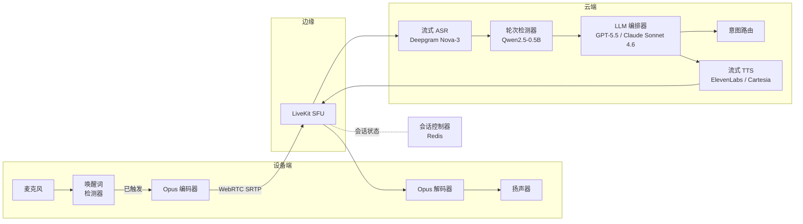
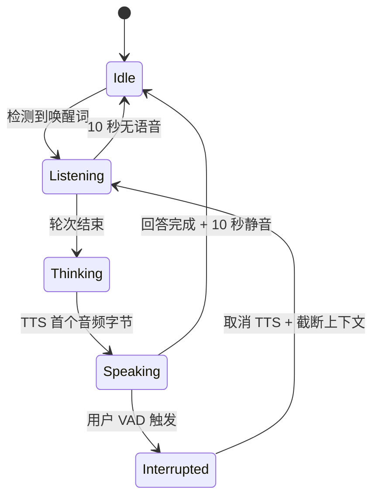
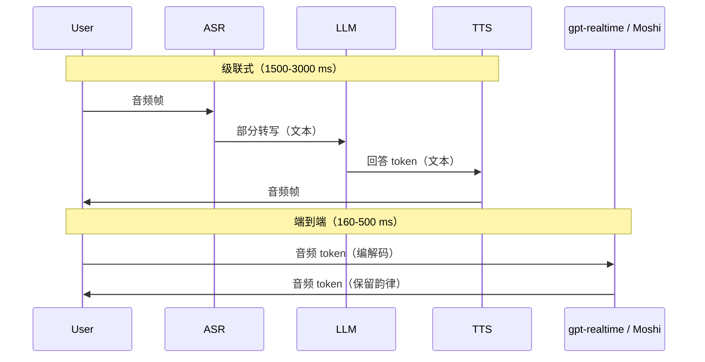

# 设计语音智能体（Alexa / Siri 级实时交互）

> **TL;DR.** 语音智能体首先是分布式系统问题，然后才是机器学习问题。在 1 亿台设备、5 万路并发对话的规模下，真正硬的约束是“用户说完话到智能体吐出第一个音频字节”这 700 ms 预算[^1]。你要用 WebRTC 把三个模型首尾相接地流式串起来（ASR、LLM、TTS），让每一环一有结果就吐部分输出；把轮次切换建模成显式状态机，并把打断当作一等公民的转换；再把设备路由到最近的区域，把网络跳数压到 50 ms 以内。关键的权衡是级联流水线（灵活，P50 约 1,500 ms）对端到端语音到语音（黑盒，低于 500 ms）[^2]。

## 学习目标

- 通过把延迟预算拆到 ASR、LLM、TTS 和网络各阶段，设计出低于 700 ms 的轮次切换流水线
- 用丢包和抖动的论据，说明实时音频传输为什么选 WebRTC 而不是 WebSocket
- 把对话轮次切换建模成状态机，包含打断、取消和优雅超时三类转换
- 比较级联式（ASR + LLM + TTS）与端到端语音到语音架构，按延迟、成本和控制力需求做选择
- 为 5 万路并发语音会话做容量估算，并从每阶段的推理预算推导 GPU 集群规模

## 直觉理解

语音智能体看着很简单。录音、转文字、问 LLM、把答案念出来。服务一个用户毫无问题。放到 1 亿台设备上它就崩了，而原因不是模型，是延迟预算。

人类跨 10 种语言的平均应答间隔约为 230 ms[^2]。超过 700 ms 就显得迟钝，超过 2 秒就像坏了。你总共只有 700 ms，而在这笔预算里要串行跑三个神经网络（ASR、LLM、TTS），每个都在 GPU 上，每个背后都有一跳网络，每个都有自己的冷启动和排队延迟。

朴素设计会同步调用每个模型：等 ASR 吐出完整文本，发给 LLM，等完整回答，发给 TTS，等完整音频。加起来最少 3-5 秒。能跑通的架构是把一切流式化：ASR 每 100 ms 吐一次部分假设，轮次检测器在用户还没完全停下时就点火 LLM，LLM 流式吐 token，TTS 在 LLM 还在生成第二句时就开始合成第一句。真正重要的是每个阶段的首块延迟（first-chunk latency），总处理时间不重要。

第二个压力来自传输。音频走 TCP（WebSocket）时，任何一个丢包都会造成队头阻塞，一次重传就是 200 ms 以上。WebRTC 走 UDP，用抖动缓冲（jitter buffer）优雅地掩盖丢包。Azure 的实测显示，同样的语音负载，WebRTC 约 100 ms，WebSocket 约 200 ms[^3]。

第三个压力是轮次切换。固定 500 ms 静音计时器会在用户话说到一半时把他掐断。语义轮次检测器（一个小 LM 读部分转写文本）能把过早打断减少 39%[^4]，但要额外付出 50-160 ms 推理时间[^5]。而当用户真的插话（打断，barge-in）时，你必须在 100 ms 内取消进行中的 TTS、排空播放缓冲、并截断对话上下文，否则智能体就会压着用户说话。

## 需求

### 澄清问题

- **问：常听唤醒词，还是按住说话？**
  假设：设备端唤醒词（“Alexa”、“Hey Siri”）。唤醒确认之前音频不离开设备。
- **问：需要完整离线模式吗？**
  假设：完整能力假定有网络。离线时由设备端回退处理简单命令（计时器、智能家居）。
- **问：通用助手还是领域专用？**
  假设：通用助手，支持工具调用（智能家居、问答、智能体工作流）。
- **问：第一天就要多区域吗？**
  假设：是。设备分布在 6 个以上区域；出于隐私，音频留在本区域。
- **问：要支持 PSTN 电话，还是只做设备原生？**
  假设：以设备原生为主。电话（SIP/Twilio）作为客服类场景的次要通道。
- **问：隐私契约是什么？**
  假设：默认不保留音频。只记转写文本，音频需显式选择加入才记录。

### 功能需求

- 设备端唤醒词检测，误触发率低于每台设备 24 小时 1 次
- 流式 ASR 在语音起始后 200 ms 内吐出部分转写
- 流式 TTS 在 LLM 首个 token 之后 300 ms 内发出首个音频包
- 打断：用户可在智能体说话中途插话，且 100 ms 内被听到
- 会话内保留多轮上下文（空闲 TTL 约 10 分钟）
- 多设备身份：同一用户在手机、音箱、车机上被识别为同一账号

### 非功能需求

- **设备量：** 1 亿台活跃设备，峰值 5 万路并发对话
- **延迟：** p95 轮次延迟低于 700 ms（从说完话到首个音频字节）
- **可用性：** 云端流水线 99.95%；故障时优雅降级到设备端回退
- **隐私：** 唤醒词确认前音频不出设备；数据按区域驻留
- **传输：** 单向音频延迟低于 150 ms；能容忍蜂窝网络 2% 丢包

## 容量估算

| 指标 | 数值 | 推导 |
|--------|------:|------------|
| 并发会话 | 50K | 1 亿台设备，峰值约每 2,000 台有 1 台活跃 |
| 音频带宽（上行） | 800 Mbps | 50K × 16 kbps Opus |
| 音频带宽（下行） | 1.2 Gbps | 50K × 24 kbps TTS |
| ASR 分块/秒 | 500K | 50K 路 × 10 块/秒（100 ms 节拍） |
| LLM token/秒（全集群） | 15K | 50K 会话 × 约 3 轮/分 × 100 token/轮 ÷ 60 |
| 唤醒词误触发 | 1,150/秒 | 1 亿 × 1 次/天 ÷ 86,400 |
| 会话状态（热数据） | 5 GB | 50K 会话 × 100 KB 工作集 |

关键比例：

- **ASR 的 GPU 集群：** 5 万路流，每 100 ms 分块约 10 ms 推理 = 约 500 GPU·秒/秒，仅 ASR 就要约 100 张 A10G。
- **TTS 的 GPU 集群：** 神经网络 TTS 在 A10G 上约为 0.1 倍实时，也就是一张 GPU 带约 10 路并发流。5 万路流需要约 5,000 张 TTS GPU（成本大头）。
- **成本上限：** OpenAI Realtime API 按 $0.06-0.24/分钟计[^6]，意味着 5 万路并发整月不间断（50K × 60 × 24 × 30 = 2.16B 会话分钟）大约要付 $130M-$520M/月的 API 费用。即便只按 10% 占空比算，也是 $13M-$52M/月。自建的话，Deepgram（STT $0.0048/分钟）[^7] 加开源 TTS，每分钟便宜 10-50 倍。Deepgram 托管的 Voice Agent API 按 $0.075/分钟[^8]，介于两者之间，是个折中选项。

## API 与数据模型

### API 设计

```http
POST /v1/session
  Body: { "device_id": "...", "account_id": "..." }
  Returns: 201 { "session_id": "uuid", "livekit_url": "wss://...", "join_token": "..." }

DELETE /v1/session/{id}
  Returns: 204 (end session, release resources)

GET /v1/routing/hint?device_id=...&lat=...&lon=...
  Returns: 200 { "region": "us-west-2", "sfu_url": "..." }

POST /v1/device/{id}/register
  Body: { "account_id": "...", "model_type": "echo_dot_5", "wake_word_version": "3.2" }
  Returns: 201
```

内部 gRPC（热路径）：

```protobuf
service StreamingAsr {
  rpc Recognize(stream AudioChunk) returns (stream Hypothesis);
}
service TurnDetector {
  rpc Detect(stream Hypothesis) returns (stream TurnEvent);
}
service LlmOrchestrator {
  rpc Generate(GenerateRequest) returns (stream Token);
}
service StreamingTts {
  rpc Synthesize(stream TokenChunk) returns (stream AudioFrame);
}
```

### 数据模型

```sql
-- Session state (Redis, keyed by session_id, TTL 10 min)
{
  "session_id": "uuid",
  "device_id": "uuid",
  "region": "us-west-2",
  "state": "listening",  -- idle | listening | thinking | speaking | interrupted
  "conversation": [
    {"role": "user", "text": "...", "ts": 1714800000},
    {"role": "assistant", "text": "...", "ts": 1714800002}
  ]
}

-- Device registry (PostgreSQL)
CREATE TABLE devices (
  device_id    UUID PRIMARY KEY,
  account_id   UUID NOT NULL,
  model_type   TEXT,
  region       TEXT,
  wake_word_v  TEXT,
  last_seen_at TIMESTAMPTZ
);

-- Turn audit log (S3 + Parquet, 1% sample)
-- turn_id, session_id, asr_transcript, llm_prompt_hash,
-- tool_calls[], latency_breakdown{}, consent_level
```

## 高层架构



*音频热路径是一条穿过 ASR、轮次检测器、LLM 和 TTS 的直线。会话控制器管状态，但不待在逐帧的关键路径上。*

**写路径（用户说话）：** 设备采集 20 ms 的 Opus 帧，通过 WebRTC SRTP 发到最近的 LiveKit SFU。SFU 转给 ASR 服务，后者每 100 ms 左右吐一次部分假设。轮次检测器盯着这些部分结果，在用户说完时点火“轮次结束”事件。LLM 立刻开始生成，把 token 流给 TTS。TTS 缓冲到一个韵律上站得住的短语（约 75-90 ms 模型推理[^9][^10]），再把音频帧经 SFU 流回设备。流式并行意味着总延迟由最慢那个阶段的首块时间决定，而不是各阶段之和[^11]。

**打断路径：** 智能体播放期间 VAD 保持生效。检测到用户说话时，会话控制器把状态切到 `interrupted`，取消进行中的 LLM 生成、排空 TTS 缓冲，并截断对话上下文，把用户没听到的音频剔除[^12]。

**路由：** `/routing/hint` 端点根据设备地理位置返回最近的健康 SFU 和云区域。会话状态按 `session_id` 固定在该区域的 Redis 集群上。

## 深入探讨

### 轮次切换状态机与打断

轮次切换是用户体验上最重要的单一差异点。朴素的固定静音计时器（300-500 ms）会在用户思考到一半时把他掐断。语义轮次检测器能把过早打断减少 39%[^4]。

对话以五状态机运转：



*打断是从 Speaking 到 Interrupted 的一等状态转换，先触发 TTS 取消和上下文截断，然后才回到 Listening。*

**轮次结束检测**在生产中有三种策略：

1. **仅 VAD：** 300-800 ms 静音计时器。快，但会切掉思考中的停顿[^13]。
2. **STT 端点检测：** 用服务商的“一句话结束”事件（Deepgram、AssemblyAI 都提供）[^13]。
3. **语义模型：** LiveKit 提供一个跑在 CPU 上的 Qwen2.5-0.5B-Instruct 轮次检测器，延迟 50-160 ms，在 14 种语言上真阳率 99% 以上[^5]。

**打断的机制：** 流水线在智能体播放期间保持 VAD 活跃。一旦检测到用户说话：(1) 取消 LLM 生成流，(2) 停止 TTS 合成，(3) 排空设备上的播放抖动缓冲，(4) 截断会话条目，把用户没听到的音频剔除。OpenAI Realtime 正是为此提供了 `conversation.item.truncate`[^12]。

### 延迟预算拆解

700 ms 的目标要拆到各阶段。真正要看的是每个阶段的首块延迟，而不是总处理时间，因为一切都是流式的。

```mermaid
gantt
    title 轮次延迟预算（用户说完话后的毫秒数）
    dateFormat X
    axisFormat %L
    section 目标 700ms
    端点检测    :0, 100
    ASR 收尾    :100, 150
    LLM 首 token    :150, 500
    TTS 首个音频    :500, 600
    网络 + 抖动    :600, 700
    section 生产 P50
    端点检测    :0, 200
    ASR 收尾    :200, 350
    LLM 首 token    :350, 1100
    TTS 首个音频    :1100, 1350
    网络 + 抖动    :1350, 1500
```



*理想情况是 700 ms 预算，现实是 400 万通以上生产通话测得的 P50 约 1,500 ms[^1]。两种情况里 LLM 首 token 都是大头。*

LLM 阶段吃掉总预算的 50-70%。缓解手段：

- **投机生成：** 在轮次结束确认之前，就基于部分 ASR 结果启动 LLM 生成。如果用户继续说，取消重来。
- **更小的路由模型：** 把简单意图（智能家居命令）路由到 1B 以下的模型，100 ms 内就能应答。
- **端到端语音模型：** Moshi 彻底去掉文本瓶颈，理论延迟 160 ms[^2]。

### 级联式与端到端语音到语音

两套架构在语音智能体市场上竞争：

**级联式（ASR + LLM + TTS）：** 每个阶段是独立服务，用 gRPC 流连接。LiveKit Agents、Pipecat 和 Retell 都用这个模式[^5][^14]。优点：每阶段都能挑最好的组件、全链路可观测、换模型不用重训。缺点：三跳网络带来串行延迟；每一处文本边界都丢掉韵律和情绪[^2]。

**端到端语音到语音：** 单个多模态模型直接吃音频 token、吐音频 token。OpenAI gpt-realtime[^12]、Moshi[^2] 和 Sesame CSM[^15] 属于这一类。



*级联式在每两个阶段之间都插了一道文本瓶颈。端到端全程搬运音频 token，保住韵律，也省掉了串行跳数。*

**Moshi**（Kyutai，7B 参数）把对话建模成 12.5 Hz 的并行 token 流，使用 1.1 kbps 的 Mimi 神经编解码器[^2]。它把双方说话都作为同时进行的流来跑，彻底去掉轮次边界，理论延迟 160 ms、实际 200 ms。与音频 token 对齐的“内心独白”（Inner Monologue）文本流能大幅提升语言质量（没有它 WebQ 上是 9.2%，有它是 26.6%）[^2]。

**OpenAI Realtime API** 提供 WebRTC（约 100 ms 延迟）或 WebSocket（约 200 ms）会话[^3]。服务端 VAD 可配置阈值和静音时长，在说完话时自动点火生成[^12]。成本：gpt-realtime-mini 为 $0.06-0.10/分钟，gpt-realtime 为 $0.18-0.24/分钟[^6]。

**结论：** 生产系统需要可观测性、多供应商灵活性和成本控制，用级联式。要最快上市、能接受厂商锁定和黑盒调试，用端到端（OpenAI Realtime 或 Gemini Live）。

### WebRTC 传输与回声消除

WebRTC 是实时语音的正确传输层。它用 SRTP over UDP 加 Opus 编解码器（浏览器互通必备），用 ICE 做 NAT 穿透，用抖动缓冲（20-100 ms）平滑包间隔[^16]。目标：抖动低于 20 ms、丢包低于 1%、单向 RTT 低于 150 ms[^1]。

WebSocket 强制走 TCP，任何丢包都会队头阻塞。Azure 的实测证实：同样的语音负载，WebRTC 约 100 ms，WebSocket 约 200 ms[^3]。在丢包 2% 以上的蜂窝网络上，WebSocket 会话听起来像坏了，WebRTC 会话听起来正常。

**回声消除（AEC）** 是那个藏在暗处的可靠性问题。智能体 TTS 的音频漏进麦克风时，VAD 会误触发，要么把智能体自己掐断，要么检测不到用户真正的插话。Hamming 对 400 万通以上通话的分析把 AEC 失效列为打断失败的三大原因之一[^1]。缓解办法：在 `getUserMedia()` 里强制 `echoCancellation: true`，免提模式加 RNNoise，电话链路则依赖运营商自己的回声消除器。

## 真实案例

**LiveKit Agents + Deepgram + ElevenLabs：2025-2026 年的生产级级联技术栈。**

LiveKit 提供 WebRTC SFU 和一个开源的 Agents SDK，把 STT、VAD、轮次检测器、LLM 和 TTS 组合成流水线。智能体作为 LiveKit 房间里的一个参与者运行，像其他 WebRTC 对端一样收发音频轨[^5]。

轮次检测器是一个在对话结束样本上微调过的 Qwen2.5-0.5B-Instruct 模型，跑在 CPU 上，占约 500 MB 内存。英语真阳率 99% 以上，13 种非英语语言为 99.3-99.4%[^5]。动态端点检测会根据会话的停顿统计，把静音阈值在 0.5-3.0 秒之间自适应。

Deepgram Nova-3 负责流式 ASR，处理延迟低于 300 ms，单语种 $0.0048/分钟[^7]。ElevenLabs Flash v2.5 的 TTS 模型推理延迟约 75 ms（实际 TTFA 因区域而异，通常 100-200 ms）[^9]。Cartesia Sonic 基于状态空间模型而不是 transformer，TTFA（首个音频时间）达 90 ms[^10]。

电话场景下，Twilio Media Streams 把 8 kHz G.711 音频经 WebSocket 转给智能体。OpenAI Realtime 直接接受 `audio/pcmu`，所以热路径里不需要转码[^17]。Pipecat（GitHub 12k stars）是 Daily 打造的另一个 Python 编排框架[^14]。

Hamming 在这个生态里分析了 400 万通以上生产语音通话，发现 P50 往返约 1.5 秒、P95 约 5 秒[^1]。生产故障中 70% 出在网络层（ICE/STUN/TURN）而不是 AI 流水线。长尾的打断漏检率则来自免提设备上糟糕的回声消除。

## 权衡

| 方案 | 优点 | 缺点 | 适用场景 |
|----------|------|------|-------------|
| 级联流水线（ASR + LLM + TTS） | 每阶段可取最优组件、换模型便宜、全链路可观测 | 三跳网络、P50 约 1,500 ms、文本边界丢韵律 | 需要控制力和多模型灵活性 |
| 端到端语音模型（gpt-realtime、Moshi） | 低于 500 ms、原生打断、代码更简单 | 厂商锁定、调试黑盒、成本更高 | 追求最快上市 |
| 纯设备端流水线 | 私密、可离线、零网络成本 | 模型小（1-8B）、能力有天花板 | 简单命令、强监管市场 |
| 设备端加云端混合 | 常见意图走本地保隐私，长尾靠云端 | 拆分逻辑复杂、要维护两套栈 | 消费级产品（Alexa、Siri）[^18] |
| WebRTC 传输 | 约 100 ms、带抖动缓冲、UDP 容忍丢包 | ICE/STUN/TURN 复杂、要 SFU 基础设施 | 任何实时语音（默认选择） |
| WebSocket 传输 | 简单、对防火墙友好、443 端口 | 队头阻塞、约 200 ms、2% 以上丢包就崩 | UDP 被封时的回退[^3] |
| 仅 VAD 的轮次检测 | 零额外延迟、算力极低 | 思考停顿时会掐断用户 | MVP、受限设备[^13] |
| 语义轮次检测器（LLM） | 理解轮次是否结束、能处理停顿 | 50-160 ms 额外开销、需要流式 STT | 在意体验的生产级智能体[^5] |

最大的那个元决策：级联还是端到端[^19]。级联给你控制力、可观测性和成本优化空间（Deepgram $0.0048/分钟对 OpenAI Realtime $0.06-0.24/分钟）[^7][^6]。端到端给你延迟和简洁，代价是每分钟贵 10-50 倍。

## 扩展与故障模式

**10 倍（50 万并发）：** 先饱和的是 TTS 的 GPU 集群（神经网络 TTS 一张 A10G 约带 10 路，意味着 5 万张 GPU）。缓解：TTS 推理做批处理，改用跑得比 transformer TTS 更快的 SSM 类模型（Cartesia Sonic），或把简单回答路由到轻量的拼接式系统。

**100 倍（500 万并发）：** LiveKit SFU 节点（每个 500-1,000 个房间）全球需要 5,000-10,000 个边缘节点。LLM 推理成为成本瓶颈。缓解：激进的意图路由把 80% 的轮次送到 1B 以下的模型，只有复杂查询才打 GPT-5.5。

**1000 倍（5,000 万并发）：** 架构转向大多数轮次在设备端推理。云端退化为长尾查询的回退。Apple Intelligence 约 3B 的设备端模型[^18]以零网络成本处理简单意图。

**故障：ASR 在静音上幻觉。** Whisper 喂进静音时会吐出幽灵文本（“感谢观看”）[^20]。缓解：用 VAD 给 ASR 做门控，只在检测到语音时才送帧。

**故障：区域 SFU 故障。** 该区域所有会话都失去音频。缓解：5 秒内 DNS 故障切换（failover）到次近区域。会话通过 ICE 重启重连。对话状态在 Redis 里存活（跨区域复制）。

**故障：TTS 音色在句中突变。** 负载均衡器把请求路由到冷加载了另一个说话人模型的节点。缓解：按 `session_id` 哈希做 TTS 会话保持路由。

## 常见陷阱

> [!WARNING]
> **硬编码静音端点检测会掐断用户。** 固定 300-500 ms 阈值分不清思考停顿和轮次结束。用语义轮次检测器，或 500-3,000 ms 自适应区间的动态端点检测[^5]。

> [!WARNING]
> **不做打断取消。** VAD 再次触发后 TTS 还在播，智能体就压着用户说话。必须在 100 ms 内取消 LLM 生成、停止 TTS 合成、排空播放缓冲[^12]。

> [!WARNING]
> **主音频链路用 WebSocket 而不是 WebRTC。** 2% 丢包的蜂窝会话在 WebSocket 上很难受（队头阻塞），在 WebRTC 上却正常（抖动缓冲掩盖）。同样负载下 WebRTC 约 100 ms，WebSocket 约 200 ms[^3]。

> [!WARNING]
> **按用户而不是按会话做区域亲和。** 用户在旧金山打开手机，走到厨房，Echo 打到了另一个 Redis 集群。会话状态要按 `session_id` 固定，不是 `user_id`[^1]。

> [!WARNING]
> **默认记录原始音频。** 隐私和合规风险（HIPAA、双方同意录音的州、TCPA）[^21]。默认只记转写文本；音频仅在显式同意时记录。

> [!WARNING]
> **回声消除失效导致打断死循环。** 智能体 TTS 漏进麦克风，VAD 触发，智能体打断自己。强制客户端 AEC，免提模式再加 RNNoise[^1]。

## 追问

**1. 如何支持 PSTN 电话（呼入与呼出）？**

Twilio Media Streams 或 Telnyx 把 8 kHz G.711 音频经 WebSocket 转给智能体。OpenAI Realtime 原生接受 `audio/pcmu`，所以不需要转码[^17]。呼出场景下，STIR/SHAKEN 认证能避免被标成骚扰电话[^22]。TCPA 合规要求电话营销通话事先取得同意[^21]。

**2. 用户在一句话中间切换语言，怎么处理？**

用多语种 ASR（Deepgram Nova-3 多语种 $0.0058/分钟[^7]，或覆盖 99 种语言的 Whisper[^20]）。轮次检测器也必须是多语种的；LiveKit 的模型覆盖 14 种语言、准确率 99.3% 以上[^5]。

**3. 如何避免智能体压着同一房间里的第二个人说话？**

对 ASR 输出做说话人分离（diarization）以区分不同说话人。只有已注册的声纹（说话人 ID）才触发轮次检测。背景说话人会被转写，但除非被明确点名，否则不回应。

**4. 加上视频（摄像头画面）会有什么变化？**

SFU 本来就处理视频轨（LiveKit 是完整的 WebRTC SFU）。加一个视觉编码器处理关键帧，把视觉上下文注入 LLM 提示。延迟预算会收紧，因为视频编码要加 50-100 ms。

**5. 如何在不侵犯隐私的前提下用真实对话训练？**

唤醒词和 VAD 的改进用设备端联邦学习。云端模型只用选择加入的用户的转写文本，训练前做 PII 脱敏。再基于匿名化的对话模式生成合成数据填补空白。

**6. 客户在线 45 分钟，按 $0.24/分钟会发生什么？**

设会话时长上限（OpenAI 上限 30 分钟[^12]）。长通话改用 Deepgram（$0.0048/分钟）加开源 TTS 的级联流水线，而不是端到端。如果意图已经解决，5 分钟后切到更便宜的模型。

## 练习

### 练习 1：延迟预算分配

产品经理要求 p95 轮次延迟压到 500 ms 以下（原来是 700 ms）。你现在的拆解是：端点检测 150 ms、ASR 收尾 100 ms、LLM 首 token 600 ms、TTS 首个音频 100 ms、网络 100 ms。你砍哪些阶段，又牺牲了什么？

<details>
<summary>提示</summary>

LLM 阶段以 600 ms 占了大头。想想如果能在用户说完话之前就启动 LLM 生成（投机生成），或者干脆去掉文本边界，会发生什么。

</details>

<details>
<summary>解答</summary>

两条可行路径：

1. **投机生成：** 在用户说了 200 ms 之后，就基于部分 ASR 结果启动 LLM 推理。如果用户继续说，取消并重启。这样把 LLM 首 token 和用户剩余话语重叠起来，实际藏掉 200-400 ms 的 LLM 延迟。权衡：被取消的投机白烧 GPU（实践中约 30% 的启动会被取消）。

2. **端到端语音模型：** 用 OpenAI Realtime 或 Moshi 替换级联流水线。Moshi 去掉文本边界，总延迟 160-200 ms[^2]。权衡：厂商锁定、失去逐阶段可观测性、每分钟成本更高。

3. **混合方案：** 复杂查询保留级联，但把简单意图（智能家居、计时器）路由到设备端 1B 以下的模型，端到端 100 ms 内响应。如果 60% 的查询是简单的，混合后的 p95 就降到 500 ms 以下。

</details>

## 要点回顾

- **轮次延迟就是产品本身。** 你多加的每 100 ms 都会反映在用户评分上。把 TTFA（Time To First Audio，首个音频时间）当作北极星指标来测，死守 700 ms 预算。
- **要么全程流式，要么失败。** ASR、LLM、TTS 都必须流式吐首块输出。总处理时间无关紧要，首块延迟就是一切。
- **用 WebRTC，不用 WebSocket。** 基于 UDP 加抖动缓冲的传输能容忍那种让 TCP 音频在蜂窝网络上不可用的丢包[^3]。
- **打断是状态机。** 把对话建模成显式状态（idle、listening、thinking、speaking、interrupted），取消是一等转换[^12]。
- **要控制力选级联，要速度选端到端。** 需要可观测性和成本优化就选级联。当低于 500 ms 的延迟值回厂商锁定的代价时，选端到端。
- **会话绑区域，不是用户绑区域。** 对话状态必须落在会话所在区域，才能拿到 10 ms 以内的 Redis 访问。

## 延伸阅读

- [OpenAI Realtime API reference (Azure)](https://learn.microsoft.com/en-us/azure/foundry/openai/how-to/realtime-audio). 语音到语音会话的权威规范：WebRTC 传输、服务端 VAD 配置、打断事件和工具调用。
- [Moshi paper (Defossez et al., Kyutai 2024)](https://arxiv.org/html/2410.00037v1). 全双工语音到语音的决定性论文：Mimi 编解码器、并行 token 流和 Inner Monologue。
- [LiveKit turn-detector documentation](https://docs.livekit.io/agents/logic-structure/turns/turn-detector/). 用小的开放权重 LM 在 CPU 上做语义轮次检测的生产模式。
- [Hamming WebRTC voice agent debugging guide](https://hamming.ai/blog/debug-webrtc-voice-agents-troubleshooting-guide). 来自 400 万通以上通话的生产阈值：ICE 诊断、RTP 指标和流水线延迟拆解。
- [Sesame CSM technical post](https://sesame.com/research/crossing_the_uncanny_valley_of_voice). 单阶段多模态 TTS，带上下文韵律，以 Apache 2.0 开源。
- [Deepgram streaming STT pricing and benchmarks](https://deepgram.com/pricing). Nova-3 价格、词错误率和 Voice Agent API 的托管定价。
- [Pipecat framework (GitHub)](https://github.com/pipecat-ai/pipecat). Daily 打造的开源 Python 语音智能体编排框架，LiveKit Agents 的替代品。
- [Apple Intelligence foundation models](https://machinelearning.apple.com/research/apple-intelligence-foundation-language-models). 关于约 3B 设备端模型与 Private Cloud Compute 分工的权威参考。

## 记忆卡片

<details>
<summary><strong>问：什么是 TTFA，为什么它是语音智能体的北极星指标？</strong></summary>

答：Time To First Audio（首个音频时间），即从用户说完话到智能体回答的第一个可听字节之间的时长。它与感知到的对话自然度直接相关；自然对话的阈值约 500-700 ms，正好对上人类跨语言约 230 ms 的平均应答时间。

</details>

<details>
<summary><strong>问：语音智能体轮次切换状态机里的五个状态是什么？</strong></summary>

答：Idle、Listening、Thinking、Speaking 和 Interrupted。打断是从 Speaking 到 Interrupted 的转换，会触发 TTS 取消和上下文截断，然后才回到 Listening。

</details>

<details>
<summary><strong>问：实时语音为什么 WebRTC 比 WebSocket 表现更好？</strong></summary>

答：WebRTC 走 UDP，抖动缓冲能优雅地掩盖丢包。WebSocket 跑在 TCP 上，丢一个包就把整条流队头阻塞住。Azure 实测在同样负载下 WebRTC 约 100 ms，WebSocket 约 200 ms。

</details>

<details>
<summary><strong>问：生产环境里级联式语音智能体的真实 P50 端到端延迟是多少？</strong></summary>

答：约 1.5 秒，基于 400 万通以上生产通话测得。LLM 首 token 阶段以 600-1,000 ms 占大头。受排队和冷启动抖动影响，P95 会到约 5 秒。

</details>

<details>
<summary><strong>问：Moshi 如何做到 160 ms，而级联式要 1,500 ms？</strong></summary>

答：Moshi 用 Mimi 编解码器把对话建模成 12.5 Hz 的并行音频 token 流，从而去掉文本边界。双方都以同时进行的流来跑，没有显式轮次边界，也就没有了 ASR→LLM→TTS 的串行跳数。

</details>

<details>
<summary><strong>问：生产语音智能体的打断失败是什么造成的？</strong></summary>

答：首因是回声消除（AEC）失效。智能体的 TTS 音频漏进麦克风，VAD 在回声上误触发，结果要么过早掐断智能体，要么检测不到用户真正的插话。Chrome AEC3 的几次改动曾反复弄坏语音智能体。

</details>

<details>
<summary><strong>问：为什么会话状态应该按 session_id 而不是 user_id 固定？</strong></summary>

答：一个用户可能在不同区域有多台设备。按 user_id 固定会导致用户换设备时跨区域缓存未命中。按 session_id 固定能让对话状态留在会话创建的那个区域。

</details>

<details>
<summary><strong>问：OpenAI Realtime 和自建级联流水线的成本差多少？</strong></summary>

答：OpenAI Realtime 是 $0.06-0.24/分钟。用 Deepgram STT（$0.0048/分钟）加开源 TTS 的级联流水线每分钟大约便宜 10-50 倍，是大流量部署的经济选择。

</details>

<details>
<summary><strong>问：语义轮次检测器相比仅 VAD 的端点检测好在哪？</strong></summary>

答：语义轮次检测器（例如 LiveKit 的 Qwen2.5-0.5B 模型）读部分转写文本，判断用户是否在语义上已经说完，相比固定静音 VAD 能把过早打断减少 39%。代价是额外 50-160 ms 推理延迟。

</details>

<details>
<summary><strong>问：Whisper 在静音上会幻觉出什么，怎么防？</strong></summary>

答：Whisper 喂进静音时会吐出幽灵转写，例如“感谢观看”“请订阅”，因为它训练时用的网络音频里就有这类内容。防法：在 Whisper 前面加 VAD 门控，只让检测到语音的帧进 ASR 模型。

</details>

## 参考文献

[^1]: Sumanyu Sharma, "Debug WebRTC Voice Agents: Complete Checklist & Troubleshooting Guide", Hamming.ai, 2026 年 1 月. https://hamming.ai/blog/debug-webrtc-voice-agents-troubleshooting-guide

[^2]: Alexandre Defossez et al., "Moshi: a speech-text foundation model for real-time dialogue", Kyutai, 2024. https://arxiv.org/html/2410.00037v1

[^3]: Microsoft Learn, Azure OpenAI Realtime 连接方式（WebRTC 约 100 ms，WebSocket 约 200 ms）. https://learn.microsoft.com/en-us/azure/foundry/openai/how-to/realtime-audio

[^4]: LiveKit blog, "Improved end-of-turn model cuts Voice AI interruptions 39%", 2025-12. https://blog.livekit.io/improved-end-of-turn-model-cuts-voice-ai-interruptions-39/

[^5]: LiveKit, "Turn detector plugin" 文档，含模型卡、基准测试和语言支持. https://docs.livekit.io/agents/logic-structure/turns/turn-detector/

[^6]: Forasoft, "Integrating OpenAI Realtime API with WebRTC, SIP, and WebSockets", 2026. 每分钟成本按 OpenAI 的 token 计费折算. https://www.forasoft.com/blog/article/openai-realtime-api-webrtc-sip-websockets-integration

[^7]: Deepgram 定价页，Nova-3、Aura-2 与 Voice Agent API 价格. https://deepgram.com/pricing

[^8]: Deepgram, "Real-Time STT, TTS, and Orchestration in One API (Voice Agent API GA)", 2025 年 6 月. https://www.deepgram.com/learn/voice-agent-api-generally-available

[^9]: ElevenLabs, "Latency optimization and model latency" 文档. https://elevenlabs.io/docs/eleven-api/guides/how-to/best-practices/latency-optimization

[^10]: Cartesia 文档，称 Sonic 流式合成首个音频时间 90 ms. https://docs.cartesia.ai/

[^11]: ElevenLabs, "Understanding audio streaming". https://elevenlabs.io/docs/eleven-api/concepts/audio-streaming

[^12]: Microsoft Learn, "Use the GPT Realtime API for speech and audio with Azure OpenAI", 2026-03. https://learn.microsoft.com/en-us/azure/foundry/openai/how-to/realtime-audio

[^13]: LiveKit docs, "Turn detection overview". https://docs.livekit.io/agents/logic-structure/turns/turn-detector/

[^14]: Pipecat, "Introduction" 文档与 GitHub 仓库（pipecat-ai/pipecat，12k stars）. https://github.com/pipecat-ai/pipecat

[^15]: Sesame AI, "Crossing the uncanny valley of conversational voice", 2025 年 2 月. https://sesame.com/research/crossing_the_uncanny_valley_of_voice

[^16]: SignalWire, "FreeSWITCH And The Opus Audio Codec". https://developer.signalwire.com/freeswitch/FreeSWITCH-Explained/Modules/mod-opus/FreeSWITCH-And-The-Opus-Audio-Codec_12517398/

[^17]: AssemblyAI, "Twilio phone agent with AssemblyAI Universal-3 Pro Streaming". https://web.archive.org/web/20260616075820/https://www.assemblyai.com/blog/twilio-phone-agent-with-assemblyai-universal-3-pro-streaming

[^18]: Apple Machine Learning Research, "Apple Intelligence Foundation Language Models", 2024. https://machinelearning.apple.com/research/apple-intelligence-foundation-language-models

[^19]: Jesse Hall, "Turn Detection for Voice Agents: VAD, Endpointing, and Model-Based Detection", LiveKit blog, 2026 年 2 月. https://livekit.com/blog/turn-detection-voice-agents-vad-endpointing-model-based-detection

[^20]: OpenAI, "Introducing Whisper"（68 万小时训练数据，99 种语言）. https://openai.com/index/whisper/

[^21]: Duane Morris, "The Fifth Circuit Green Lights Oral Consent Under The TCPA For Telemarketing Calls", 2026 年 3 月. https://blogs.duanemorris.com/classactiondefense/2026/03/02/the-fifth-circuit-green-lights-oral-consent-under-the-tcpa-for-telemarketing-calls/

[^22]: SIPnex, "STIR/SHAKEN: The Operator's Guide"，讲呼出电话认证. https://www.sipnex.ca/compliance/stir-shaken
