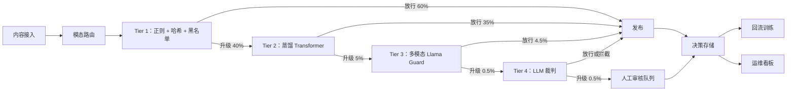
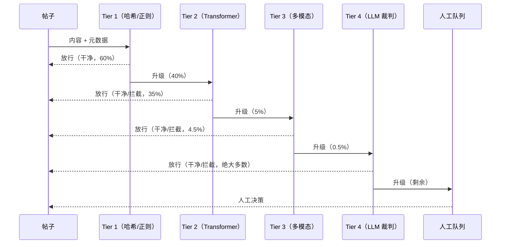
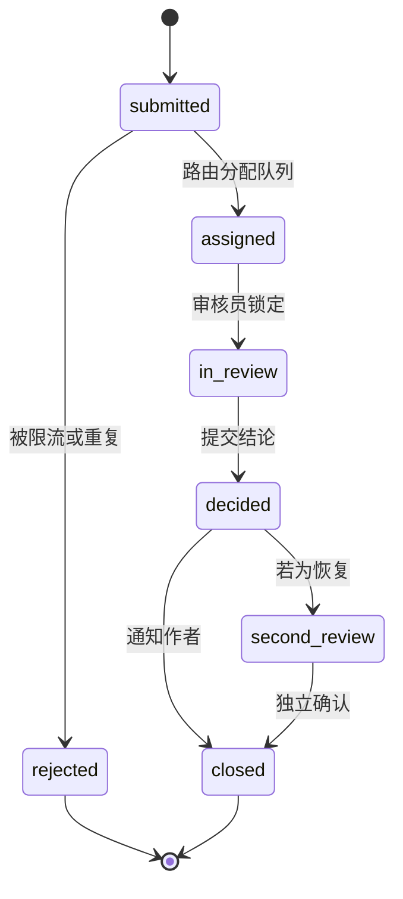
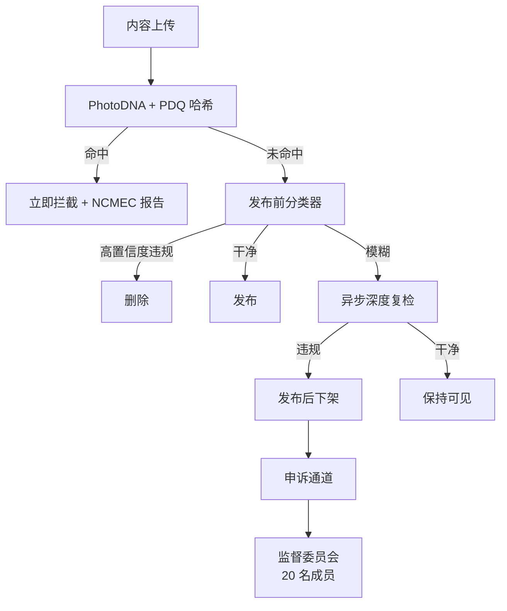

# 设计一个大规模内容审核系统

> **TL;DR.** 每天 5 亿条帖子，发布前只有硬邦邦的 200 ms 预算，你不可能对每条帖子都跑一个 12B 参数的多模态模型。答案是分类器级联（classifier cascade）：便宜的正则和哈希过滤器在 0.1 ms 内放行 60% 的流量，小号 Transformer 处理 35%，只有 0.5% 会落到人工审核员手里[^1][^2]。真正的权衡点在速度约束下的精确率与召回率之争：对“删除”这个动作做到 95% 精确率，每一百万次操作里仍然有 50,000 次误判，每一次都会变成一条申诉。TikTok 2024 年在信任与安全上花了超过 20 亿美元[^2]；Meta 仅 2024 年第一季度就处置了 1600 万条仇恨言论[^1]。在这个量级上，级联是唯一能同时调和成本、延迟和准确率的架构。

## 学习目标

- 设计一套分类器级联，把单条成本压在 1 美分以内，同时打到 200 ms 的 p99
- 为策略分类体系建模，把严重级别分层映射到处置动作（放行、降权、删除、升级）
- 构建审核员工作流，支持按地区、语言、专业方向路由，并加上防倦怠的轮换机制
- 定义一套申诉状态机，可审计、延迟有上界、且能抵抗围攻式刷申诉
- 能推演 PR 曲线驱动的阈值调优，以及对抗压力下的校准漂移（calibration drift）
- 把文本链路扩展到图片（感知哈希、CLIP）和视频（抽帧 + 音频转写）

## 直觉理解

一条帖子用多模态模型分类要 50 ms。乘以每天 5 亿条，你需要每秒 290,000 GPU·秒，任何现存集群在物理上都做不到。与此同时，YouTube 每分钟大约接收 500 小时视频[^3]，NCMEC 2023 年收到 3620 万份疑似儿童性剥削报告，涉及超过 1 亿个文件[^4]。这个量级同样没有任何人力团队审得过来。

朴素方案（每条帖子都跑一个大模型）在每天 1 万条时能用。到了 5 亿条，它在三个方面同时崩掉：延迟（单条 50 ms 直接堵死发布路径）、成本（LLM 推理按每百万条 150 美元算，光判决就要 75,000 美元/天）、召回（单个模型无法同时把文本、图片、视频和 200 多种语言都覆盖好）。

解开这个设计的洞察是：绝大多数内容是良性的。如果你能在最便宜的两层（正则、哈希匹配、小 Transformer）就把 95% 的流量放行，那么昂贵的模型和人工只需要面对真正模糊的那 5%。级联不是一种优化，它是唯一贴合这道题物理约束的架构。

## 需求

### 澄清问题

- **问：范围包含哪些内容类型？**
  假设：文本、图片、视频、音频和直播。每种都有自己的预处理链路，最终汇入共享的级联。
- **问：发布前拦截，还是发布后异步处理？**
  假设：两者都要。高置信度的严重违规（CSAM、恐怖主义）在发布前拦截。模糊内容走发布后异步复检。
- **问：一套全球统一策略，还是按市场区分？**
  假设：按市场叠加本地规则。欧盟 DSA 第 17 条要求给出处置理由说明[^5]；德国 NetzDG 规定 24 小时删除窗口；英国《2023 年在线安全法》要求做风险评估并履行安全义务，由 Ofcom 执法（行为准则 2025 年起生效）[^29]。
- **问：精确率目标是多少？**
  假设：关键层级（CSAM、恐怖主义、自残）的“删除”动作精确率 >95%。召回率按类别单独商定。
- **问：申诉通道必须第一天就有吗？**
  假设：必须。DSA 第 20 条规定欧盟境内的内部投诉处理不是可选项[^5]。
- **问：直播在范围内吗？**
  假设：在。它会把延迟预算从 200 ms 改写成“每个分片几秒”，配合抽帧处理。

### 功能需求

- 把每条帖子归入策略分类体系（仇恨、骚扰、自残、色情、暴力、垃圾信息、CSAM、恐怖主义、虚假信息），并标注严重级别
- 执行处置动作：放行、打标、降权、年龄限制、删除、升级人工、移交执法
- 把模糊的 0.5% 按层级 SLA 路由给审核员（关键级 <30 分钟，低危级 <48 小时）
- 受理申诉，由第二名审核员双盲复核，恢复被误删的内容
- 追踪跨关联账号的累犯，并逐级加重处置
- 提供透明度 API，支撑 DSA 要求的季度报告

### 非功能需求

- **负载：** 每天 5 亿条；选举或热点事件期间峰值 15K/秒
- **延迟：** 发布前 p99 < 200 ms；95% 的帖子在 Tier 2 就出结果
- **人工审核：** 0.5% 流量（约 250 万条/天）；关键级 p50 决策时间 < 30 分钟
- **精确率：** 关键类别“删除”动作 >95%
- **成本：** 全口径 < 0.001 美元/条（分类器 + 存储 + 分摊的审核人力）
- **可用性：** 同步链路 99.99%；故障时优雅降级为“先放行 + 异步复检”

## 容量估算

| 指标 | 数值 | 推导 |
|--------|------:|------------|
| 平均写入 QPS | 5,787 | 5 亿 / 86,400 |
| 峰值写入 QPS | 15,000 | 3 倍突发系数 |
| Tier 1 放行（60%） | 3 亿/天 | 正则 + 哈希 + 黑名单，约 0.1 ms |
| Tier 2 放行（35%） | 1.75 亿/天 | 蒸馏 Transformer，约 10 ms |
| Tier 3（4.5%） | 2250 万/天 | 多模态模型，约 50 ms |
| Tier 4 LLM 裁判（0.5%） | 250 万/天 | 每条约 200 ms |
| Tier 5 人工（0.5%） | 250 万/天 | 每位审核员约 60 条/小时 |
| 所需审核员 FTE | ~250 | 250 万 / (60 × 24 × 7/5 轮班) |
| 存储（元数据） | 500 GB/天 | 5 亿行 × ~1 KB |

按层级看每百万条的成本：Tier 1 约 $0.01，Tier 2 约 $2，Tier 3 约 $20，Tier 4 约 $150，Tier 5 约 $8,000。级联之所以能把混合成本压到每百万条 1 美元以下，是因为 95% 的流量根本走不到 Tier 2 之后。按每天 5 亿条算：Tier 1-2 是 500 美元/天，加上 Tier 3 的 4,500 美元、Tier 4 的 375 美元、Tier 5 的 20,000 美元（人力在这里占了大头）。

## API 与数据模型

### API 设计

```http
POST /moderate/v1/evaluate
  Body: { "content_id": "uuid", "author_id": "uuid", "modalities": ["text","image"],
          "text": "...", "media_refs": ["s3://..."], "locale": "en", "surface": "feed" }
  Returns: 200 { "decision": "allow|block|review", "policy_tags": ["hate"],
                  "confidence": 0.97, "tier_reached": 2, "latency_ms": 12 }
  SLA: 200 ms p99

POST /moderate/v1/appeals
  Body: { "content_id": "uuid", "author_id": "uuid", "reason": "..." }
  Returns: 201 { "appeal_id": "uuid", "state": "submitted" }

POST /internal/reviewers/decisions
  Body: { "reviewer_id": "uuid", "content_id": "uuid",
          "outcome": "remove|restore", "rationale_tags": ["hate_speech"] }
  Returns: 200 { "state": "decided" }

GET /moderate/v1/decision/{content_id}
  Returns: 200 { "final_decision": "removed", "policy_tags": [...],
                  "appeal_available": true }
```

### 数据模型

```sql
-- 决策存储（ClickHouse，用于分析，只追加）
table content_moderation_decisions (
  content_id       UUID,
  author_id        UUID,
  created_at       DateTime64,
  final_decision   Enum('allow','remove','label','downrank'),
  policy_tags      Array(String),
  tier_reached     UInt8,
  classifier_scores JSON,
  reviewer_id      Nullable(UUID),
  appeal_id        Nullable(UUID)
) ENGINE = MergeTree() ORDER BY (created_at, content_id)

-- 审核员队列（Redis Streams，按 queue_id 分区）
-- queue_id = hash(严重级别, 语言, 专业方向)
-- 字段：content_id, enqueued_at, priority_score, locked_by, locked_until

-- 申诉（PostgreSQL，状态机）
table appeals (
  appeal_id        UUID PRIMARY KEY,
  content_id       UUID,
  author_id        UUID,
  state            Enum('submitted','assigned','in_review','decided','closed'),
  original_decision VARCHAR,
  appeal_decision  Nullable(VARCHAR),
  reviewer_id      Nullable(UUID),
  created_at       TIMESTAMP,
  decided_at       Nullable(TIMESTAMP)
)
```

## 高层架构



*每一层级联都用极低成本放行大部分流量；只有真正模糊的 0.5% 会到达人工审核员，从而把单条成本压在 0.001 美元以下。*

写入路径在 Tier 1-2 是同步的（合计 p99 < 15 ms）。如果 Tier 2 判定需要升级，该条目会进入异步队列等 Tier 3-4 处理，同时帖子被挂在“待定”状态（尚不可见）。对于短暂曝光可以接受的面（长文类内容），帖子直接发布，Tier 3-4 在发布后运行，发现违规再异步下架。

CSAM 链路是隔离的：Tier 1 中会用 PhotoDNA 对 NCMEC 数据库做哈希比对。一旦命中，条目立刻拦截，账号冻结，并自动提交 CyberTipline 报告[^6][^7]。这条链路里没有 LLM 裁判（提示注入在这里会是灾难）。

## 深入探讨

### 级联架构与阈值经济学

级联的存在源于一个简单的不等式。对每天 5 亿条帖子全部跑 Llama Guard 4（12B 参数[^8]），专用 GPU 集群的算力成本约 1,000 万美元/天（即便按纯文本裁判的 API 价也要约 75,000 美元/天）。而跑一个蒸馏过的 50M 参数 BERT，单条成本只有它的百分之一。级联利用的正是“绝大多数内容毫无歧义”这个事实。

每一层都会输出一个置信度分数。置信度超过高阈值（干净，或明确违规），条目就出结果；落进模糊区间，就升级。阈值是逐类别、逐场景做 PR 曲线分析的产物。信息流场景能容忍更多误报（激进删除），私信场景则不能（隐私敏感）。

OpenAI 报告过，用 GPT-4 来解读策略文档，把策略更新周期从几个月压缩到几小时[^9]。这正是 Tier 4 的价值主张：对新策略零样本可用，且理由可读。但 LLM 裁判的单条成本是小 Transformer 的 100-1000 倍，还额外引入提示注入面[^10]。所以架构绝不允许 LLM 裁判成为唯一的闸门。



*基于置信度的升级机制确保 95% 的流量永远碰不到吃 GPU 的大模型；每层的阈值都按类别用 PR 曲线分析调出来。*

漂移检测至关重要。一个上线当天精确率 95% 的分类器，几周内就可能悄悄退化到 80%，因为对手一直在试探它的缝隙[^11]。缓解手段：每周用审核员标注的数据重训，每月刷新带版本的对抗评测集，影子部署，以及 PR 曲线回归时自动回滚。

### CSAM 链路与强制上报

CSAM 审核在架构上与通用级联分开。它有法律强制要求（18 USC 2258A[^6]），设计上是确定性的，而且两种错误的代价都极高：漏报意味着儿童剥削继续发生，误报意味着无辜账号被毁。

链路是这样：(1) 每张上传的图片在落存储之前先用 PhotoDNA 计算哈希[^12]。(2) 哈希与 NCMEC 数据库、GIFCT 哈希共享数据库（2024 年底有 408,000 条恐怖主义/CSAM 条目[^13]）比对。(3) 命中后上传被拦截、账号被冻结，并通过 NCMEC 的 REST API 提交 CyberTipline 报告，其中包含法律要求的字段：IP 地址、URL、邮箱、身份信息[^6][^7]。(4) 由专职审核员（不是普通审核员）在隔离的 CSAM 队列里确认命中。

Meta 在 2019 年开源了 PDQ：一个 256 位、基于 DCT 的感知哈希，推荐匹配阈值为汉明距离 ≤ 31，质量分下限为 50（PDQ 的 README 建议丢弃质量 ≤ 49 的哈希）[^14]。基于 FAISS 的参考版 PDQ 匹配器单进程能处理 4,000 张图片/秒[^14]。视频方面，TMK+PDQF 生成 256 KB 的签名；vPDQ 按匹配帧的占比判定命中[^14]。

审核员的心理健康是架构问题，不是 HR 问题。肯尼亚有 140 多名前 Facebook 审核员在审过 CSAM 和血腥内容后被诊断出严重 PTSD[^15]。缓解措施：硬性轮换上限（CSAM 每天最多 4 小时）、默认模糊化并在操作时显式“取消模糊”的工具、驻场心理咨询、供应商合同里的报酬下限[^16]。

### 对抗性规避与多语言缺口

对手不会站住不动。TokenBreak 类攻击会注入零宽空格和同形字来改变分词结果，让分类器看到的 token 和人读到的不一样[^11]。Algospeak 则在社区里造黑话词典（用 “unalive” 指自杀，用 “le$bian” 绕过性取向过滤），分类器必须学会把它们映射回规范形式[^17]。2024 年的一篇论文证明，同形字攻击通过改变 token 的对数似然，能有效绕过 AI 生成内容检测器[^18]。

缓解手段构成纵深防御：分词前做 Unicode 规范化（NFKC），用 Unicode TR39 的同形字混淆表做映射，把图片内嵌文字 OCR 出来走同一条文本链路，训练时做对抗样本增广，以及每月刷新带版本的红队评测集，一旦回归就拦住发布。

多语言缺口让问题雪上加霜。国际特赦组织记录到，Meta 的算法从 2012 年起就“主动放大和推广”针对罗兴亚人的内容，助长了 2017 年导致 70 多万罗兴亚人流离失所的种族清洗[^19][^20]。根因是：缅甸语审核能力比英语审核低了一个数量级。监督委员会 2025 年的评估指出，“美国以外的用户体验到的内容审核，针对其所在地区做的适配是有限的”[^21]。

架构上的解法：用多语言主干模型（XLM-R 这一级），对前 20 种语言做分语言微调；长尾语言靠地区专职审核员池；按语言分别追踪精确率/召回率，任一语言跌破阈值就告警。低资源语言（阿姆哈拉语、缅甸语、提格里尼亚语）需要与本地 NGO 合作获取红队数据[^22]。

### 申诉状态机与反围攻

申诉不是事后补丁。DSA 第 20 条把内部投诉处理定为强制义务[^5]，而申诉也是衡量误报率最主要的标注数据来源。状态机如下：`submitted` → `assigned`（路由器按类别和语言挑队列），`assigned` → `in_review`（审核员锁定条目），`in_review` → `decided`（提交结论），`decided` → `closed`（通知作者）。如果结论是“恢复”，在关闭前会触发一次双盲复核。



*延迟有上界的申诉生命周期，恢复类结论走双盲复核；限流在入口处就拒掉围攻式刷申诉。*

反围攻：一个高关注度账号被处置时，同一秒内会涌进几万条申诉（作者本人 + 围攻者 + 机器人）。缓解：按作者限流（每个 content_id 只能申诉一次）、按 (author_id, content_id) 去重、对来自关联账号的 N 阶举报做折扣的反围攻过滤器、以及对重复提交做优先级延后。监督委员会受理的案件反复涉及这类高关注度处置引发的下游围攻[^23]。

## 真实案例

**Meta 社区标准执行报告（2019-2025）**

Meta 运营着公开记录最完整的超大规模审核系统。2024 年第一季度，Meta 在 Facebook 和 Instagram 上处置了约 1600 万条仇恨言论[^1]。这套系统采用混合模式：高置信度的严重违规走发布前拦截，其余走发布后异步复检。

2025 年 1 月，Meta 宣布在美国终止第三方事实核查项目（该项目自 2016 年 12 月起运行），替换为众包的 Community Notes 模式[^30]。这一变化把专业事实核查员从美国的审核链路中移出，但针对政策违规（仇恨言论、暴力、CSAM）的自动执法仍然保留。国际事实核查合作继续存在。Meta 报告称，从 2024 年第四季度到 2025 年第一季度，美国的执法错误减少了约 50%，部分归功于申诉与度量体系的改进[^25]。

这套技术栈部分开源。Meta 在 ThreatExchange 仓库里放出 PDQ 和 TMK+PDQF，以及可部署到 AWS 的 Hasher-Matcher-Actioner（HMA）平台[^14]。架构是：接入层抽取模态，发布前的分类器包括文本 Transformer（多语言）、图片感知哈希、CLIP 风格的图像理解；发布后由更重的模型重新打分，剩余的交人工审核员。

监督委员会（2026 年为 20 名成员，2020 年起运作）复核有争议的决策。2021 年 1 月至 2025 年 12 月间，Meta 回应了 326 条委员会建议，其中约 65% 被完全或部分落实[^24][^31]。2024 年，Meta 采纳了委员会关于给 AI 生成或修改内容打标的建议[^23]。

经典失败案例：2019 年克赖斯特彻奇枪击案的直播，在 17 分钟的直播期间观看者不到 200 人，却在 24 小时内被重新上传 150 万次[^26][^27]。自动检测失效，因为画面是新颖的第一人称执法记录仪视角。克赖斯特彻奇事件之后，Meta 用警察/军方的执法记录仪素材重训了系统来识别这种模式[^28]。



*Meta 的混合打法：哈希匹配在上传前挡住已知的坏内容；分类器捕捉新型违规；有争议的剩余部分交给监督委员会。*

## 权衡

| 方案 | 优点 | 缺点 | 适用场景 |
|----------|------|------|-------------|
| 每条帖子都跑单阶段 LLM | 简单；只需一个模型 | 5 亿条/天约 $75K/天；达不到 200 ms 目标 | 每天 <1000 万条的平台 |
| 分类器级联（从便宜到重） | 95%+ 在便宜层放行；每条不到 1 美分 | 阈值漂移会悄悄把它弄坏 | 每天超过 1 亿条的任何平台 |
| 只做发布前拦截 | 坏内容永远到不了用户 | 每条都要挤 200 ms 预算；故障时阻塞发布 | 直播、未成年人可访问的信息流 |
| 只做发布后异步 | 没有延迟预算；可以用更重的模型 | 坏内容会可见几分钟到几小时 | 长内容 |
| 发布前 + 发布后异步混合 | 板上钉钉的快速拦截，模糊的深挖 | 两条链路；对账复杂 | Meta、YouTube 等成熟平台 |
| 只用规则过滤 | 确定、可解释、便宜 | 抓不到新花样 | 级联的 Tier 1；需搭配 ML 层以覆盖已知模式之外的情形 |
| 每个模糊条目都上 LLM 裁判 | 有细微判断力、理由可读、零样本 | 提示注入；幻觉；成本 | Tier 4，仅作用于约 1% 真正模糊的内容 |

最大的一个权衡是**速度约束下的精确率与召回率**。高精确率（误报少）意味着更多有害内容留在线上。高召回率（漏报少）意味着更多无辜内容被删，招来申诉、侵蚀信任。真实平台按类别给出不同答案：CSAM 追求最大召回（可疑就拦，之后再分拣）；政治表达追求最大精确率（只有高置信度才删，接受部分有害内容短期留在线上）。

## 扩展与故障模式

**10 倍负载（每天 50 亿条）：** Tier 2 的 GPU 集群会饱和。缓解：抬高 Tier 1 的放行阈值（更激进的正则/哈希匹配），加上以队列深度为触发的 GPU 自动扩缩，以及优雅降级——抬高 Tier 2 的置信度阈值（更多条目直接以“干净”放行，转入异步复检）。

**100 倍负载（每天 500 亿条）：** 人工审核成为瓶颈。即便按 0.5% 算，也是每天 2.5 亿条要人看。缓解：转向 LLM 辅助审核，模型先给出标注、人来确认或否决（单审核员吞吐提升 10 倍）；对低危类别接受更高的自动化率。TikTok 在 2025 年开始这一转型：在英国和德国裁掉数百名人工审核员，同时提高 AI 驱动的审核比例，尽管英国《在线安全法》带来了新的义务[^33]。

**1000 倍负载：** 架构转向边缘优先分类。轻量模型在设备端、上传前运行；只有通过端侧筛查的内容才会到达服务端级联。Apple 的设备端 CSAM 扫描（2021 年提出、后搁置）是这一模式的早期尝试。

**故障模式：分类器服务不可用。** 应对：优雅降级为“先放行 + 异步复检”。所有帖子立即发布，同时积压队列不断堆积，等分类器恢复后重打分。检测：Tier 2-3 端点的健康检查失败。恢复：在 SLA 内清空积压（关键内容 30 分钟内重打分）。

**故障模式：克赖斯特彻奇式病毒式重传。** 应对：启动 GIFCT 事件响应框架[^13]。几分钟内把紧急哈希注入 Tier 1。临时降低匹配阈值（接受更多误报）。开启跨平台哈希共享。GIFCT 在 2024 年启用过这套协议七次[^13]。

## 常见陷阱

> [!WARNING]
> **每条帖子都跑 LLM 裁判。** 每百万条 150 美元、每天 5 亿条，光推理成本就是每天 75,000 美元，而且还达不到 200 ms 的延迟目标。级联的存在正是为了避开这个坑。

> [!WARNING]
> **把 CSAM 当普通审核处理。** CSAM 需要法律上隔离的链路：链路里不能有 LLM（提示注入风险）、必须在数小时内向 NCMEC 强制上报[^6]、审核员要专职且带轮换上限、访问控制要单独一套。把它和仇恨言论审核混在一起，等于主动招揽法律责任。

> [!WARNING]
> **忽视对抗性漂移。** 上线当天 95% 精确率的分类器，几周内可能退化到 80%，因为攻击者在不断找新绕过[^11]。没有每周重训、每月刷新红队评测、PR 曲线漂移告警，你就是在盲飞。

> [!WARNING]
> **全球规模下只用英语分类器。** 缅甸语、阿姆哈拉语这些低资源语言才是灾难性失败集中的地方。缅甸的种族清洗就是审核覆盖度与风险分布倒挂后果的经典案例[^19]。

> [!WARNING]
> **设计审核工具时不考虑心理健康约束。** 肯尼亚有 140 多名审核员被诊断出严重 PTSD[^15]。硬性轮换上限、默认模糊、驻场心理咨询、报酬下限，这些都是架构要求，不是 HR 的补丁。

> [!WARNING]
> **没有申诉通道。** DSA 第 20 条让欧盟境内的内部投诉处理成为强制义务[^5]。抛开合规不谈，申诉还是发现系统性分类错误的标注数据来源。省掉申诉，你就无法度量自己的误报率。

## 追问

**1. CSAM 链路与通用级联有什么不同？**

上传前做基于 PhotoDNA/PDQ 的哈希匹配，按 18 USC 2258A 强制向 NCMEC 上报，审核员池隔离且 4 小时轮换上限，链路里不放 LLM 裁判。这条链路是确定性的、法律强制的；它不与通用级联共享基础设施。

**2. 明天要上线一条新策略（“AI 生成的深度伪造必须声明”）。说说你的发布过程。**

把策略加进带版本号的分类体系，设定生效日期。先部署规则型 Tier 1 过滤（检查 C2PA 元数据）。在标注好的深度伪造数据上训练 Tier 2 分类器。影子部署一周，度量精确率/召回率。带着宽限期上线（先警告、后执法）。同步更新审核员评分细则和对外文档。

**3. 对手用零宽空格和同形字绕过 Tier 2。你怎么补这个缺口？**

分词前做 Unicode NFKC 规范化，剥掉零宽字符。用同形字混淆表（Unicode TR39）把视觉相似的字符归一。把对抗样本加进训练集。红队评测集必须包含这些攻击模式；出现回归就阻断发布。

**4. 你的 LLM 裁判幻觉出一条理由，删掉了一条合规帖子。用户申诉了。系统如何暴露这次幻觉？**

申诉审核员会同时看到 LLM 给出的理由、原始内容和策略原文。LLM 理由与策略原文不一致时自动标记。这个幻觉信号会作为负样本回流给 LLM 裁判，并触发阈值调整（少往那个裁判类别路由条目）。

**5. 某国政府要求下架一批政治敏感内容，而它并不违反你的策略。架构如何支持这种请求？**

单独开一条“法律删除”路径，与策略审核分离。法律请求记进隔离的审计轨迹，只做地域限制（不在全球删除），并写进透明度报告。内容在请求辖区之外保持可用。有争议的法律请求可由监督委员会或同等机构复核。

**6. 欧盟 DSA 要求按国家给出季度下架统计。你怎么设计分析链路？**

每条审核决策在写入时就打上辖区标签。ClickHouse 按（国家、类别、动作、季度）聚合。定时任务生成提交给 DSA 透明度数据库的数据。数字可审计，因为决策存储是只追加、记录不可变的。2025 年 12 月对 X 开出的 1.2 亿欧元罚单（因违反 DSA 透明度要求）[^32]说明，这些报告义务背后是真实的执法风险。

## 练习

### 练习 1：级联阈值调优

你的 Tier 2 分类器在仇恨言论上，当前阈值下精确率 96%、召回率 88%。产品要把召回率提到 93%。从 PR 曲线上看，要做到 93% 召回，精确率会掉到 89%。请计算：(a) 在每天 5 亿条的量级下（假设仇恨言论的基础比例为 0.1%），每天多出多少误报；(b) 这会给人工审核带来多少额外负载。

<details>
<summary>提示</summary>

误报数 =（1 − 精确率）× 被标记为违规的条目数。被标记的条目数 =（召回率 × 真实违规数）+ 误报数。想一下每个精确率水平下分类器会标记多少条目。

</details>

<details>
<summary>解答</summary>

真实仇恨言论帖子：5 亿 × 0.1% = 500,000 条/天。

精确率 96%、召回率 88% 时：被标记条目 = 500,000 × 0.88 / 0.96 = 458,333。误报 = 458,333 − 440,000 = 18,333 条/天。

精确率 89%、召回率 93% 时：被标记条目 = 500,000 × 0.93 / 0.89 = 522,472。误报 = 522,472 − 465,000 = 57,472 条/天。

多出的误报：57,472 − 18,333 = 39,139 条/天。按每位审核员每小时 60 条算，等于每天多 652 个审核工时，在 24/7 轮班下约需多 82 个 FTE。这就是为什么阈值调优是产品决策，而不只是 ML 决策：召回率提 5 个点，代价是 82 个人头。

</details>

## 要点回顾

- **级联是物理约束，不是优化技巧：** 在 200 ms 下处理每天 5 亿条，LLM 太贵也太慢。真正的功夫在于挑升级阈值，把 95%+ 的流量留在便宜的层里。
- **CSAM 是独立链路：** 法律强制、确定性、链路里没有 LLM。把它当基础设施，而不是一个功能。
- **对抗性漂移是无声杀手：** 上线那天的准确率不构成长期保证。持续红队演练和 PR 曲线监控是唯一持久的防线。
- **人工审核员是标注数据生成器：** 把审核工具设计成数据采集系统，而不只是一个队列。他们的判断让分类器保持校准。
- **申诉是一等架构：** DSA 合规、用户信任、误报率度量，全都依赖设计良好的申诉状态机。
- **多语言覆盖会反转风险：** 最严重的失败集中在服务最少的语言上。按语言分别追踪精确率/召回率是必须的。

## 延伸阅读

- [Meta Community Standards Enforcement Report](https://transparency.meta.com/reports/community-standards-enforcement/)。季度结构化透明度数据；了解大型平台执法数字最详细的公开视角。
- [facebook/ThreatExchange on GitHub](https://github.com/facebook/ThreatExchange)。PDQ、TMK+PDQF、vPDQ，以及 Hasher-Matcher-Actioner（HMA）参考平台，BSD 许可开源。
- [OpenAI, “Using GPT-4 for content moderation”](https://openai.com/index/using-gpt-4-for-content-moderation/)。LLM 裁判如何解读策略文档，把策略更新周期从几个月压到几小时。
- [Inan et al., “Llama Guard: LLM-based Input-Output Safeguard”](https://arxiv.org/abs/2312.06674)。开放权重的 LLM 审核方案；Tier 3-4 的代表性架构，分类体系可配置。
- [EU Digital Services Act (Regulation 2022/2065)](https://eur-lex.europa.eu/eli/reg/2022/2065/oj)。欧洲申诉、透明度与通知-行动机制的法律基线；第 17、20、24 条。
- [Amnesty International, “The Social Atrocity”](https://www.amnesty.org/en/documents/asa16/5933/2022/en/)。大规模多语言审核失败的经典复盘，以及 Meta 在罗兴亚危机中的角色。
- [GIFCT Annual Report 2024](https://gifct.org/2025/07/23/our-impact-in-2024/)。恐怖主义哈希共享数据库统计、事件响应框架启用次数、跨平台协同情况。
- [OWASP LLM Top 10 (2025)](https://genai.owasp.org/llm-top-10/)。LLM 在环审核系统面临的提示注入与对抗攻击面。

## 记忆卡片

<details>
<summary><strong>问：为什么不能在每天 5 亿条的量级上对每条帖子都跑一个大 LLM？</strong></summary>

答：成本（按每百万条 150 美元算，约 75,000 美元/天）和延迟（单条 50 ms 以上，乘以队列深度后远超 200 ms 的发布前预算）。级联通过在便宜层放行 95% 的流量同时解决这两个问题。

</details>

<details>
<summary><strong>问：内容审核级联的五个层级分别是什么？</strong></summary>

答：Tier 1：正则 + 哈希 + 黑名单（约 0.1 ms）。Tier 2：蒸馏 Transformer（约 10 ms）。Tier 3：多模态模型（约 50 ms）。Tier 4：LLM 裁判（约 200 ms）。Tier 5：人工审核员（SLA 约 30 分钟）。

</details>

<details>
<summary><strong>问：PDQ 是什么，Meta 推荐的匹配阈值是多少？</strong></summary>

答：PDQ 是 Meta 在 2019 年开源的、256 位、基于 DCT 的图片感知哈希。推荐匹配阈值为汉明距离 ≤ 31，质量分下限为 50（PDQ 的 README 建议丢弃质量 ≤ 49 的哈希）。

</details>

<details>
<summary><strong>问：为什么 CSAM 链路在架构上与通用审核分开？</strong></summary>

答：法律强制（18 USC 2258A 要求向 NCMEC 上报）、链路里没有 LLM（提示注入会是灾难）、审核员专职且带轮换上限、访问控制隔离以限制接触范围。

</details>

<details>
<summary><strong>问：克赖斯特彻奇直播期间发生了什么，暴露了哪些审核缺口？</strong></summary>

答：那段 17 分钟的直播实时观看者不到 200 人，却在 24 小时内被重新上传 150 万次。自动检测失效，因为画面是新颖的第一人称执法记录仪视角，分类器没被训练过这种模式。

</details>

<details>
<summary><strong>问：TokenBreak 类攻击如何绕过文本分类器？</strong></summary>

答：它们注入零宽空格、同形字和标点来改变分词结果，让分类器看到的 token 与人读到的不一样。缓解：分词前做 Unicode NFKC 规范化，并用同形字混淆表做归一。

</details>

<details>
<summary><strong>问：Meta 监督委员会是什么，它在架构上扮演什么角色？</strong></summary>

答：一个 20 名成员的独立机构（截至 2026 年），复核有争议的审核决策。它是申诉的最终层级，其裁决具有约束力并形成策略先例。截至 2025 年 12 月，Meta 已回应 326 条委员会建议，约 65% 被完全或部分落实。

</details>

<details>
<summary><strong>问：DSA 第 20 条对平台提出了什么要求？</strong></summary>

答：对内容审核决策提供内部投诉处理（申诉）机制。平台必须为用户提供质疑删除的通道，对自动化决策安排人工复核，并发布透明度报告。

</details>

<details>
<summary><strong>问：Meta 在缅甸的审核为什么失败？</strong></summary>

答：缅甸语的审核能力比英语低一个数量级。再加上奖励煽动性内容的排序算法，放大了反罗兴亚内容，助长了 2017 年导致 70 多万人流离失所的种族清洗。

</details>

<details>
<summary><strong>问：级联各层每百万条帖子的成本分别是多少？</strong></summary>

答：Tier 1（哈希/正则）：约 $0.01。Tier 2（Transformer）：约 $2。Tier 3（多模态）：约 $20。Tier 4（LLM 裁判）：约 $150。Tier 5（人工）：约 $8,000。级联通过让 95% 的流量在 Tier 1-2 出结果，把混合成本压在每百万条 1 美元以下。

</details>

## 参考文献

[^1]: Meta, "Integrity Reports, First Quarter 2024". https://transparency.meta.com/reports/integrity-reports-q1-2024/

[^2]: TikTok Newsroom, "Bringing even more transparency to how we protect our platform", Dec 2024. https://newsroom.tiktok.com/en-us/bringing-even-more-transparency (archived: https://web.archive.org/web/20250108003644/https://newsroom.tiktok.com/en-us/bringing-even-more-transparency)

[^3]: About Chromebooks (citing YouTube/Google stats), "How Many Videos Are Uploaded to YouTube a Day (2025)". https://www.aboutchromebooks.com/how-many-videos-are-uploaded-to-youtube-a-day/

[^4]: NCMEC, "CyberTipline Data 2023". https://www.missingkids.org/gethelpnow/cybertipline/cybertiplinedata

[^5]: European Commission, "How the Digital Services Act enhances transparency online". https://digital-strategy.ec.europa.eu/en/policies/dsa-brings-transparency

[^6]: 18 U.S.C. 2258A, "Reporting requirements of providers". https://www.law.cornell.edu/uscode/text/18/2258A

[^7]: NCMEC, "CyberTipline Reporting API Technical Documentation". https://report.cybertip.org/ispws/documentation/

[^8]: Hugging Face, "RedHatAI/Llama-Guard-4-12B model card". https://huggingface.co/RedHatAI/Llama-Guard-4-12B

[^9]: OpenAI, "Using GPT-4 for content moderation", Aug 2023. https://openai.com/index/using-gpt-4-for-content-moderation/

[^10]: OWASP LLM Top 10 (2025). https://genai.owasp.org/llm-top-10/

[^11]: Information Security Newspaper, "How TokenBreak Technique Hacks OpenAI, Anthropic, and Gemini AI Filters", Jun 2025. https://www.securitynewspaper.com/2025/06/16/how-tokenbreak-technique-hacks-openai-anthropic-and-gemini-ai-filters-step-by-step-tutorial/

[^12]: Wikipedia, "PhotoDNA" (summarizing Microsoft Research and Hany Farid, 2009). https://en.wikipedia.org/wiki/PhotoDNA

[^13]: GIFCT, "Our Impact in 2024", Jul 2025. https://gifct.org/2025/07/23/our-impact-in-2024/

[^14]: facebook/ThreatExchange on GitHub: top-level README and pdq/README.md. https://github.com/facebook/ThreatExchange

[^15]: The Guardian, "More than 140 Kenya Facebook moderators diagnosed with severe PTSD", Dec 2024. https://www.theguardian.com/media/2024/dec/18/kenya-facebook-moderators-sue-after-diagnoses-of-severe-ptsd

[^16]: Wired, "Meta's Gruesome Content Broke Him. Now He Wants It to Pay", 2023. https://www.wired.com/story/meta-kenya-lawsuit-outsourcing-content-moderation/

[^17]: Wikipedia, "Algospeak". https://en.wikipedia.org/wiki/Algospeak

[^18]: Creo et al., "Evading AI-Generated Content Detectors using Homoglyphs", arXiv:2406.11239. https://arxiv.org/abs/2406.11239v1

[^19]: Amnesty International, "The Social Atrocity: Meta and the right to remedy for the Rohingya", Sep 2022. https://www.amnesty.org/en/documents/asa16/5933/2022/en/

[^20]: Amnesty International, "Myanmar: Facebook's systems promoted violence against Rohingya", Sep 2022. https://www.amnesty.org/en/latest/news/2022/09/myanmar-facebooks-systems-promoted-violence-against-rohingya-meta-owes-reparations-new-report/

[^21]: Oversight Board, "From Bold Experiment to Essential Institution", 2025. https://www.oversightboard.com/news/from-bold-experiment-to-essential-institution/

[^22]: Lees et al., "A New Generation of Perspective API: Efficient Multilingual Character-level Transformers", KDD 2022. https://dl.acm.org/doi/10.1145/3534678.3539147

[^23]: Oversight Board, "2024 Annual Report Highlights Board's Impact in the Year of Elections", 2025. https://www.oversightboard.com/news/2024-annual-report-highlights-boards-impact-in-the-year-of-elections/

[^24]: Oversight Board, "2023 Annual Report Shows Board's Impact on Meta", Jun 2024. https://www.oversightboard.com/news/2023-annual-report-shows-boards-impact-on-meta/

[^25]: Meta Newsroom, "More Speech and Fewer Mistakes", 2025. https://about.fb.com/news/2025/01/meta-more-speech-fewer-mistakes/

[^26]: AIAAIC Repository, "Facebook fails to manage Christchurch mosque shooting livestreaming". https://www.aiaaic.org/aiaaic-repository/ai-algorithmic-and-automation-incidents/facebook-fails-to-manage-christchurch-mosque-shooting-livestreaming

[^27]: Washington Post, "New Zealand shooter's live stream", Mar 2019. https://web.archive.org/web/2019/https://www.washingtonpost.com/technology/2019/03/19/fewer-than-people-watched-new-zealand-massacre-live-hateful-group-helped-it-reach-millions/

[^28]: The Guardian, "Facebook trained its AI to block violent live streams after Christchurch attacks", Oct 2021. https://www.theguardian.com/technology/2021/oct/29/facebook-trained-its-ai-to-block-violent-live-streams-after-christchurch-attacks

[^29]: Ofcom, "Online safety regulatory documents and guidance", 2025. https://www.ofcom.org.uk/online-safety/illegal-and-harmful-content/online-safety-regulatory-documents

[^30]: Meta Newsroom (Mark Zuckerberg), "More Speech and Fewer Mistakes", Jan 2025. https://about.fb.com/news/2025/01/meta-more-speech-fewer-mistakes/

[^31]: Meta, "H2 2025 Report on the Oversight Board". https://transparency.meta.com/oversight/meta-H2-2025-bi-annual/

[^32]: European Commission, "The Digital Services Act in action: Recent developments and why they matter", 2026. https://data.europa.eu/it/news-events/news/digital-services-act-action-recent-developments-and-why-they-matter

[^33]: The Guardian, "Hundreds of TikTok UK moderator jobs at risk despite new online safety rules", Aug 2025. https://www.theguardian.com/technology/2025/aug/22/tiktok-uk-moderator-jobs-at-risk-despite-new-online-safety-rules
