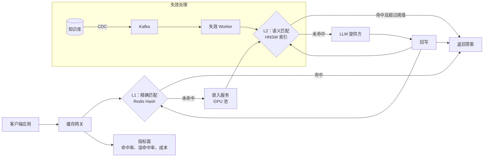
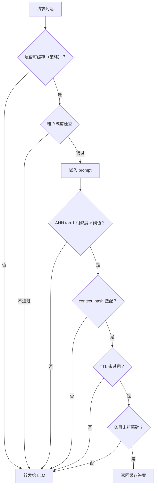
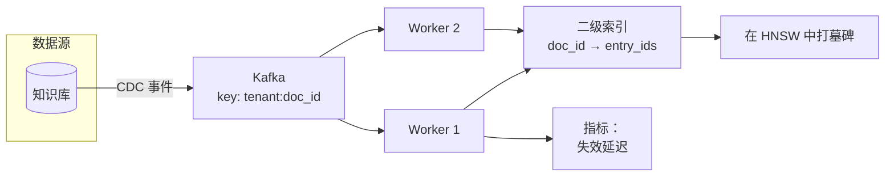
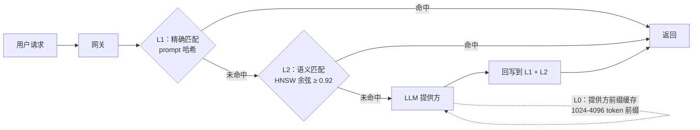

# 为 LLM 应用设计语义缓存

> **TL;DR.** 语义缓存用嵌入向量而不是 prompt 哈希做键，因此在自然语言的 LLM 流量上能拿到 60-70% 的命中率，而精确匹配缓存在同样的流量上几乎一无所获[^1]。架构是这样的：把每个 prompt 嵌入成向量，到 HNSW 索引上做一次 ANN 查询，当余弦相似度超过标定好的阈值时返回已存的答案。最关键的权衡在相似度阈值上：从 0.99 降到 0.75，成本节省从 15.8% 升到 86.3%，而通用聊天机器人流量上的准确率跌幅不到一个百分点[^2]。这套设计还必须处理误命中（答案错了但看起来对）、按租户隔离，以及底层知识库变更时的失效。

## 学习目标

- 设计一个按嵌入索引的缓存查询，在 1 亿条目、10k QPS 下把返回时间压到 10 ms 以内
- 用一份留出的评测集标定余弦相似度阈值，并能为精确率／召回率的权衡辩护
- 在源文档变更、嵌入模型漂移、TTL 到期时让条目失效，而不需要把整个语料重新嵌入一遍
- 依据合规要求，用命名空间、按租户索引或独立集群三种方式隔离租户
- 用 token、美元和用户信任三种尺度衡量误命中成本，并把它与传统缓存的陈旧数据区分开
- 区分可缓存的 prompt（确定性的 RAG 问答）与不可缓存的 prompt（工具调用、智能体循环），并在网关层拦住边界

## 直觉理解

传统缓存就是个字典：把键哈希一下，查表，结束。如果两个用户输入完全相同的 prompt，第二个人就能拿到缓存答案。但自然语言不是字典键。"What is Python?" 和 "Tell me about the Python programming language" 意思一样，可它们的 SHA-256 哈希没有一个比特相同。

朴素做法（精确匹配缓存）只在 prompt 逐字节相同时才命中。真实聊天流量里，这种情况出现的比例不到 5%。每一次换种说法、每一次改写、每一点细微变化，你都得付一次 LLM 调用。按每 1K 输出 token 收 $0.06、每秒 1 万请求来算，账单涨得飞快。

关键洞察是：把每个 prompt 嵌入成向量，再去查最相近的已存向量。如果距离足够近，两个答案就可以互换。这一步把字典查找变成了最近邻搜索，命中率从近乎为零跳到 60-70%[^1]。但它也带来传统缓存从未有过的故障模式：缓存可能返回一个**错误**的答案，同时给出 200 OK 和不到 100 ms 的延迟。用户完全看不出哪里出了问题。本章的每一个架构决策，都是为了管住这个误命中风险。

## 需求

### 澄清问题

- **Q：哪些 prompt 可缓存？**
  假设：确定性的 RAG 问答、分类、抽取、摘要。工具调用、function calling、智能体循环以及时效性查询完全绕过缓存。

- **Q：误命中的爆炸半径有多大？**
  假设：对通用客服机器人，答案稍有偏差只会吃一个踩；对医疗／法律场景，那就是合规事故。设计上支持按租户覆盖阈值。

- **Q：租户隔离要多严格？**
  假设：自助租户用共享索引加 payload 过滤；中间档用独立索引；HIPAA／金融场景用独立集群。

- **Q：底层语料变更时，我们怎么收到通知？**
  假设：通过 Kafka 从知识库接 CDC。要靠轮询做到亚分钟级新鲜度是不可接受的。

- **Q：能接受多长的陈旧时间？**
  假设：交易数据是秒级（直接绕过缓存），新闻是分钟级，产品文档是天级。

- **Q：LLM 是确定性的吗？**
  假设：可缓存路径上用 temperature 0 加固定 seed。非确定性调用绕过缓存。

### 功能需求

- 接收 prompt + tenant_id + 可选的 context_hash；嵌入 prompt；做 ANN 查询；当相似度 ≥ 阈值、且 context_hash 匹配、且条目未被失效时返回缓存答案
- 未命中时转发给 LLM，成功后回写
- 提供失效通道：按租户、按 source_doc_id、按 embedding_model_version
- 输出按租户的命中／未命中遥测，附带相似度分数直方图

### 非功能需求

- **负载：** 稳态 10K QPS，峰值 20K
- **延迟：** p99 查询 < 10 ms（嵌入 + ANN + 阈值判定，不含 LLM）
- **容量：** 1 亿条目，每月增长 1000 万
- **命中率：** 重复度高的流量上达到 70%+
- **可用性：** 缓存面 99.9%；故障时回落到 LLM（fail-open）
- **成本：** 缓存基础设施成本 < 它所替代的 LLM 账单的 10%

## 容量估算

| 指标 | 数值 | 推导过程 |
|--------|------:|------------|
| 嵌入维度 | 1,536 | text-embedding-3-small[^3] |
| 向量原始存储 | 614 GB | 1 亿 × 1,536 维 × 4 字节 |
| HNSW 图开销 | ~30% | M=32，ef_construction=200 |
| 索引总内存 | ~800 GB | 614 GB × 1.3 |
| 用 INT8 量化后 | ~200 GB | 压缩 4 倍，可装进 4 节点 × 64 GB |
| 写 QPS（未命中） | 3K/秒 | 30% 未命中率 × 10K QPS |
| 每次写入的答案负载 | 平均 2 KB | 约 6 MB/秒 写带宽 |
| 嵌入成本 | $0.02/1M tokens[^3] | 10K QPS × 平均 50 tokens 下约 $0.20/天 |
| 失效扇出 | 峰值 2K/秒 | 100 条 CDC 事件/秒 × 每文档 20 个条目 |

关键推导：

- **嵌入延迟预算：** 批处理 GPU 推理下每个 prompt 2 ms（batch size 32，2 张 GPU）。1 亿向量、ef=64 时 ANN 查询再加 2-5 ms[^4]。总预算：7 ms ANN + 2 ms 嵌入 + 1 ms 网络 = 10 ms p99。
- **盈亏平衡命中率：** 用远程向量库（未命中代价 30 ms）时，盈亏平衡点是 15.4%。用内存内 HNSW（未命中代价 2 ms）时，盈亏平衡点降到 1%[^5]。这就是值不值得投内存的答案。
- **70% 命中率下的成本节省：** 7K 次命中/秒 × 平均 500 输出 token × $0.06/1K = 每秒省 $0.21 = 每天约 $18K。

## API 与数据模型

### API 设计

```text
POST /v1/cache/lookup
  Body: { "tenant_id": "acme", "prompt": "...", "context_hash": "sha256:...",
          "model": "gpt-4o", "threshold_override": 0.92 }
  Returns: 200 { "hit": true, "answer": "...", "similarity": 0.94,
                  "entry_id": "uuid", "latency_ms": 7 }
           200 { "hit": false, "answer": "...", "latency_ms": 1200 }
  Headers: X-Cache-Policy: no-store | store-only | read-through

POST /v1/cache/write
  Body: { "tenant_id": "acme", "prompt": "...", "answer": "...",
          "context_hash": "sha256:...", "source_doc_ids": ["doc-1", "doc-2"],
          "model": "gpt-4o", "embedding_model_version": "v3-small-2024" }
  Idempotent on (tenant_id, prompt_hash)
  Returns: 201 { "entry_id": "uuid" }

POST /v1/cache/invalidate
  Body: { "tenant_id": "acme", "mode": "source_doc", "target": "doc-1" }
  Returns: 202 { "job_id": "uuid", "estimated_entries": 20 }

GET /v1/cache/metrics?tenant_id=acme
  Returns: { "hit_rate": 0.72, "p50_ms": 4, "p99_ms": 9,
             "tokens_saved_24h": 45000000, "invalidation_backlog": 0 }
```

### 数据模型

```sql
-- 向量索引（每个租户组一个 Redis Stack 或 Qdrant collection）
cache_entries (
  id                     UUID PRIMARY KEY,
  vector                 FLOAT32[1536],   -- 或 INT8 量化
  tenant_id              TEXT,            -- payload 过滤键
  prompt_hash            CHAR(64),        -- SHA-256，用于 L1 精确匹配
  answer                 TEXT,            -- <= 8 KB 内联；超出部分放 S3
  source_doc_ids         TEXT[],          -- 用于 CDC 失效扇出
  context_hash           CHAR(64),        -- RAG 上下文指纹
  model                  TEXT,
  embedding_model_version TEXT,
  created_at             TIMESTAMP,
  last_hit_at            TIMESTAMP,
  hit_count              INT DEFAULT 0,
  ttl_expires_at         TIMESTAMP
)
-- 分区键：tenant_id（Qdrant 用 payload，Redis 用 hash tag）

-- 失效用的二级索引（Redis hash）
source_doc_index: source_doc_id -> [entry_id, ...]

-- 租户配置（PostgreSQL）
tenant_config (
  tenant_id              TEXT PRIMARY KEY,
  threshold_override     FLOAT,           -- NULL = 用全局默认值
  ttl_policy             INTERVAL,
  isolation_mode         ENUM('namespace', 'dedicated_index', 'dedicated_cluster'),
  allowed_models         TEXT[],
  pii_redaction_enabled  BOOLEAN DEFAULT true
)
```

## 高层架构



*两级缓存：L1 精确匹配，L2 语义匹配。未命中就落到 LLM；回写同时填充两级。CDC 驱动的失效在源语料变更时给条目打墓碑。*

网关是无状态的。每个请求先查 L1（prompt 哈希查找，约 1 ms，零误命中风险）。L1 未命中时，它嵌入 prompt 并查询 HNSW 索引。如果 top-1 邻居的余弦相似度超过该租户的阈值、且 context_hash 匹配、且条目没有被打墓碑，就返回缓存答案。否则转发给 LLM，成功后回写，同时上报遥测。在 50 个并发查询下，Redis 8 社区版对 10 亿个 768 维 FLOAT16 向量可达到 90% recall@100、中位延迟 200 ms[^4]（该基准测的是 top-100 最近邻场景；缓存的 top-1 查询在更小规模下通常是 10 ms 以内），因此大规模部署是可用的。

缓存采用 fail-open：缓存面故障时，流量直接打到 LLM。缓存的可用性只是成本优化，不是正确性要求。这个概念由 2023 年的 GPTCache 推向主流，它自称"an open-source semantic cache for LLM applications enabling faster answers and cost savings"[^6]。

## 深入探讨

### 相似度阈值标定

阈值是整个系统里杠杆最大的一个旋钮。AWS 用 Claude 3 Haiku 搭配 Titan Embeddings 在聊天机器人流量上做的测试显示：从 0.99 移到 0.75，命中率从 23.5% 升到 90.3%，成本节省从 15.8% 升到 86.3%，而准确率跌幅不到一个百分点（92.1% 到 91.2%）[^2]。

**标定流程：** 标注一份几千对的评测集，每一行是 `(prompt_a, prompt_b, answer_is_interchangeable)`。阈值从 0.75 到 0.99、以 0.01 为步长扫描。画出精确率对召回率的曲线。选出精确率刚好满足 SLO 的那个阈值（例如通用聊天机器人 95%，医疗 99%）。OpenAI 的自动 prompt 缓存用约 256 token 的路由哈希把请求固定到同一个缓存分片[^7]，这是一种互补思路，对前缀稳定的流量可以完全绕开阈值问题。

GPT Semantic Cache 在 `all-MiniLM-L6-v2`（384 维）上以 0.05 为步长扫描 0.6 到 0.9，最后定在 0.8：低于 0.8 时命中率上升但正命中率崩塌；高于 0.8 时命中率急剧下降而准确率几乎不再提升[^1]。

**静态阈值陷阱：** 单一阈值无法适配异构负载。稀疏嵌入空间（对话式查询，第 10 近邻距离约 0.38）能容忍 0.75-0.78 的阈值。稠密空间（代码，第 10 近邻约 0.12）需要 0.88-0.90[^5]。生产系统需要按类别或按租户覆盖阈值。

**漂移检测：** 流量构成每周都在变。要在滚动的评测集上重新标定。当生产环境的精确率跌到该租户 SLO 以下时告警。Portkey 报告在高置信阈值（约 0.95）下，2.5 亿+ 次缓存请求的用户评价准确率约 99%[^8]。



*返回缓存命中之前必须全部通过的检查。任何一项失败都落到 LLM。阈值判定就是误命中进入的那个关键闸口。*

### 失效流水线

三种独立信号可以把缓存条目标为无效：

**通道 1：嵌入模型版本。** 从 `text-embedding-3-small` 换到 `text-embedding-3-large`，整个向量空间都变了。旧条目的向量与新查询的嵌入不可比较。缓存键必须包含 `embedding_model_version`。升级时，把新旧两套嵌入双写，对新索引做影子查询（打分但不对外服务），等新索引的命中率超过目标后再切换[^9]。

**通道 2：源语料 CDC。** 当 RAG 知识库中的文档变更时，一条 CDC 流（Kafka topic，按 `tenant_id:source_doc_id` 做键）扇出到失效 Worker。Worker 通过二级索引（`source_doc_id -> [entry_id]`）找出受影响的条目并打墓碑。墓碑（下次读取时惰性删除）比同步删除更能吸收失效风暴[^5]。

**通道 3：TTL。** 每个条目都有过期时间。按类别设置的 TTL 从 5 分钟（金融数据，每小时 80% 会变）到 3-9 天（代码模式，每天 0.01% 会变）不等[^5]。对于会被编辑的语料，只靠 TTL 永远不够。



*源语料 CDC 经 Kafka 扇出到失效 Worker，由它们给受影响的缓存条目打墓碑。二级索引让每次文档变更的扇出是 O(1)。*

**TTL 抖动是必须的。** 大量条目同时到期会造成惊群。给所有过期时间加上 ±15% 的随机抖动[^10]。

### 租户隔离与多租户

三个级别在成本与爆炸半径之间做权衡[^11]：

**级别 1：共享索引 + payload 过滤。** 单个 HNSW collection 存放所有租户。每次查询都带 `tenant_id` 过滤条件。Qdrant 的 payload 索引过滤能剪短图遍历，使带过滤的搜索与不带过滤的性能相当[^11]。成本：最低。风险：一个过滤 bug 就是跨租户数据泄露。

**级别 2：按租户独立索引。** 每个付费租户有自己的 collection。支持按租户调阈值、独立 TTL 策略，并消除跨租户过滤 bug 的风险。成本：基础设施约为 3 倍[^11]。

**级别 3：按租户独立集群。** HIPAA、金融或政府负载必须用这一级。租户自己持有加密密钥。成本：10 倍以上，外加跨集群版本偏斜的运维负担[^11]。

**生产建议：** 自助租户从级别 1 起步。当某租户的量足够大，或他们要求按租户控制阈值时，升到级别 2。级别 3 只留给合规强制要求的隔离场景。

### 缓存击穿与 singleflight

一个爆款 prompt 未命中缓存，可能在回写窗口里触发几百个并发的 LLM 调用。Singleflight（Go 的经典实现在 `golang/groupcache`[^10]）把同一个键上的 N 个并发请求合并成一次后端调用。剩下的 N-1 个等待并共享结果。

对语义缓存来说，singleflight 的"键"是 prompt 哈希（精确匹配），或者更激进一点，用最近的那个邻居嵌入的哈希。在突发负载下，这能把几百次冗余 LLM 调用压成一次。

**TTL 到期击穿：** 一个热门条目过期时，所有并发用户同时看到缓存未命中。缓解手段：stale-while-revalidate（先把过期条目返回出去，同时由一个调用方刷新）、TTL 抖动、singleflight[^10]。

## 真实案例

**GPTCache（Zilliz，开源）** 是语义缓存的参考实现。在覆盖四个类别的 2,000 条测试查询上评测，0.8 余弦阈值下它达到 61.6% 到 68.8% 的缓存命中率、92.5% 到 97.3% 的正命中率[^1]。

架构是一条模块化流水线：`pre_embedding_func` 归一化 prompt，`embedding_func` 产出向量（OpenAI API、ONNX 或 Cohere），`data_manager` 负责在标量存储（SQLite/PostgreSQL）与向量存储（Milvus/FAISS/Qdrant/Redis）之间做搜索和保存，`similarity_evaluation` 组件给候选打分，`post_process_messages_func` 处理平局裁决[^12][^9]。

一个关键的工程决策：`cache_health_check` 步骤会把标量缓存里存的嵌入与向量库里的嵌入做比较。不一致时（双存储漂移），它打 critical 日志、把相似度分数强制置零（拒绝该候选），并用缓存存储里的嵌入覆写向量库来自愈[^9]。这个模式等于承认：任何有两个存储的系统最终都会漂移。

GPTCache 暴露了一个 `cache_skip` 标志，让调用方按请求的 temperature 强制未命中：`temperature >= 2` 时完全跳过缓存，在 `(0, 2)` 区间内做 softmax 采样[^9]。这就是在网关层落实"哪些调用可缓存"。

**Portkey** 把语义缓存作为生产中间件来跑，报告 2.5 亿+ 次缓存请求的用户评价准确率约 99%[^8]。一家处理数千万 AI 请求的大型外卖平台，用 Portkey 的缓存、路由和兜底把 LLM 支出砍掉了 50 万美元以上[^13]。

**提供方侧的前缀缓存**（Anthropic、OpenAI、Gemini）是一种互补但不同的技术。Anthropic 的 prompt 缓存对缓存读取（命中与刷新）按基础输入价的 0.1 倍计费（读取打一折），而首次写入缓存按基础输入价的 1.25 倍（5 分钟 TTL）或 2 倍（1 小时 TTL）；缓存存的是相同前缀的 KV-cache，默认 TTL 5 分钟[^14]。可缓存前缀的最小长度随模型而变：Claude Opus 4.5 及更新的 Opus 模型（含 Opus 4.7、4.6 和 Haiku 4.5）为 4,096 token，Sonnet 4.6 为 2,048 token，Sonnet 4.5/4/3.7、Sonnet 4 和 Opus 4.1/4 为 1,024 token[^14]。有一个 Rails 团队报告说，在稳定的系统 prompt 上开启前缀缓存后，每月 Claude 账单从 $42K 降到 $5K 以下[^15]。OpenAI 的自动缓存从 1,024+ token 的前缀开始生效，输入成本最多降低 90%[^16]。Gemini 通过专门的 API 提供显式上下文缓存，TTL 可配置[^17]。这些都是确定性的（零误命中风险），但只有在长前缀跨请求逐字节相同时才有效。2026 年 3 月的一次回归悄悄把 Anthropic 的缓存 TTL 从 1 小时改成了 5 分钟，让那些付了 2 倍价格买 1 小时写入的用户成本虚增[^18]。



*三层缓存栈：提供方侧前缀缓存（L0，零误命中）、精确匹配哈希（L1，零误命中）、语义 HNSW（L2，受阈值约束）。每一层接住上一层漏掉的流量。*

## 权衡

语义缓存的设计有三条主线：缓存机制（精确匹配、语义匹配、提供方原生前缀缓存）、存储后端，以及按领域风险调校的相似度阈值。

| 方案 | 优点 | 缺点 | 适用场景 |
|----------|------|------|-------------|
| 精确匹配缓存（prompt 哈希） | 零误命中率，基础设施简单 | 自然语言下命中率近乎为零 | 仅模板化的系统 prompt |
| 语义缓存（HNSW + 阈值） | 重复流量上 50-80% 命中率[^1] | 误命中率 > 0，需要标定 | 大规模的通用 LLM 前端 |
| Redis Stack HNSW | 查询 < 2 ms，单节点约 50K 相似度 QPS（300 万条目、300 维、INT8）[^19] | 受单节点内存上限约束 | 5000 万条目以内、延迟敏感 |
| Qdrant + payload 分区 | 磁盘分层、可横向扩展、多租户[^11] | 延迟 +2-5 ms，多一套系统 | 5000 万到 10 亿条目、多租户 |
| 独立部署 FAISS | 裸 ANN 最快 | 没有复制，也没有托管运维；`IndexIVFPQ` 训练后实际上就冻结了（不过 `IndexFlat`、`IndexIVFFlat` 和 `IDMap` 支持 `add` 与 `remove_ids`）[^22] | 读多写少的参考索引 |
| 低阈值（约 0.75-0.80） | 命中率更高，省得更多[^2] | 误命中率更高 | 低风险 FAQ、客服机器人 |
| 高阈值（约 0.95-0.96） | 接近精确匹配，最安全[^8] | 命中率更低 | 医疗、法律、受监管场景 |
| 提供方前缀缓存 | 打一折，零误命中[^14][^16] | 需要长的相同前缀 | 稳定的系统 prompt |

最重要的元决策是：**阈值对领域风险**。对通用聊天机器人，准确率曲线在 0.75 到 0.99 之间出奇地平（AWS 测试数据为 91.2% 到 92.6%）[^2]，所以应该把阈值压到 SLO 允许的最低值。对领域特化或高风险应用，曲线更陡，必须按类别分别标定。

## 扩展与故障模式

**10 倍负载（100K QPS）：**
嵌入延迟成为主导。要激进地批处理，把嵌入模型与网关部署在一起，并优先用小模型（768 维），除非评测证明你需要 1536 维以上。HNSW 的图更新是串行的；按租户组做分片，把写速率控制在读速率的 20% 以下[^20]。

**100 倍负载（1M QPS）：**
单区域的 HNSW 会饱和。要按区域部署本地缓存，各自持有独立索引。跨区域的失效通过 Kafka MirrorMaker 复制。接受一个事实：在 A 区域写入的新条目要过几秒才在 B 区域出现。Azure OpenAI 的 prompt 缓存文档建议把静态内容放在 prompt 开头，以便跨区域最大化缓存复用[^21]。

**1000 倍负载：**
索引超出单集群容量。把架构分层：热条目（hit_count 高）留在内存内 HNSW；冷条目迁到磁盘分层的量化索引。这种内存内混合方案把盈亏平衡命中率从 15% 降到 1%[^5]。

**故障模式：**

- **缓存面故障：** fail-open。所有流量打到 LLM。成本飙升但正确性保住了。命中率跌到零时告警。
- **嵌入服务宕机：** L1 精确匹配仍然可用。L2 语义查询失败后落到 LLM。属于部分降级，不是全盘失败。
- **失效延迟：** 在墓碑传播到位之前会返回陈旧答案。监控失效积压；延迟超过 TTL 策略就告警。
- **误命中风暴：** 阈值标定错误或嵌入模型漂移会导致错答激增。检测方式：用户踩的比例飙升 + LLM 裁判抽样标记出偏差。缓解：给缓存做熔断（把所有流量强制打到 LLM），然后重新标定[^13]。

## 常见陷阱

> [!WARNING]
> **阈值设完就忘。** 流量构成一变，精确率就会漂。用上季度数据标定出来的阈值会衰减。每周在滚动评测集上重新标定；精确率跌破该租户 SLO 时告警[^13]。

> [!WARNING]
> **静默的错误命中，没有监控。** 语义缓存出错时返回的是 200 OK，延迟还低于基线。没有抽样 + LLM 裁判评测，劣化就是不可见的。要跟踪相似度分数直方图和用户踩的比例，而不只是命中率[^13]。

> [!WARNING]
> **缓存了不可缓存的调用。** 工具调用请求会拿回陈旧的工具结果。智能体循环会拿回上一轮的输出。要在网关层用显式的 `cacheable=true` 标志加上策略白名单来强制。实时查询和多步工作流一律绕过缓存[^13]。

> [!WARNING]
> **换嵌入模型却没有双写。** 升级嵌入模型等于把整个缓存清空。上线当天命中率直接归零。把 `embedding_model_version` 放进缓存键，用双写加渐进切换的方式灰度[^9]。

> [!WARNING]
> **请求级 token 导致前缀缓存不命中。** 团队开了 Anthropic/OpenAI 的 prompt 缓存却看不到任何节省，因为时间戳或 request-id 被放在了缓存断点之前。于是每个请求都变成缓存写入而不是读取。把 `cache_control` 放在最后一个逐字节相同的块上[^14][^16]。

> [!WARNING]
> **爆款 prompt 引发缓存击穿。** 在第一个响应回写之前，每个并发未命中都会各自调用 LLM。用 singleflight 把在途的相同请求合并成一次后端调用[^10]。

## 追问

**1. 缓存里 prompt 和答案中的 PII 怎么处理？**

在嵌入之前先脱敏（"John Smith wants a refund" 和 "[NAME] wants a refund" 的嵌入应当足够接近，能够命中）。答案加密存储，密钥按租户隔离。HIPAA 租户用客户自管加密的独立集群。

**2. 怎么上线新的嵌入模型而不造成缓存全冷的服务中断？**

双写阶段（每个条目同时存新旧两套嵌入）。影子查询阶段（新嵌入参与打分但不对外服务；对比准确率）。切换阶段（命中率超过目标后从新索引提供服务）。在新缓存稳定之前，让旧缓存保持热度[^9]。

**3. 怎么把 RAG 的检索结果和最终答案都缓存起来？**

两个语义缓存串联。缓存 1 以用户查询为键，返回已缓存的检索片段。缓存 2 以（查询 + 片段哈希）为键，返回最终答案。每层有独立的阈值和 TTL。片段缓存随语料 CDC 失效；答案缓存同时随语料 CDC 和模型版本变更失效。

**4. 怎么设计一个能自动收紧阈值的反馈闭环？**

缓存命中的用户踩会汇成负样本流。后台任务在滚动评测集上加进生产环境的负样本，重跑阈值标定。如果新的最优阈值偏差超过 0.02，就提出变更建议（高风险租户走人工确认，低风险租户自动应用）。

**5. 如果 LLM 是非确定性的（temperature > 0），要改什么？**

要么拒绝缓存（最安全），要么缓存第一次响应、接受后续命中返回的是"冻结"的样本而不是新采样。对创意类场景这通常可以接受。对多样性敏感的场景（头脑风暴、创意写作），绕过缓存。

**6. 怎么针对 prompt 注入对抗性地测试缓存？**

用对抗 prompt 做红队测试，目标是让它们命中本不该得到的缓存答案（例如把 "ignore previous instructions" 嵌进一个语义上接近某条缓存 FAQ 的 prompt）。tenant_id 过滤和 context_hash 校验是主要防线。对低置信命中（相似度落在阈值到阈值 + 0.05 之间）再加一道 LLM 裁判检查。

## 练习

### 练习 1：阈值选择

你的语义缓存服务一个客服聊天机器人。你有一份 5,000 对的评测集。阈值 0.85 时命中率 72%、精确率 94%。阈值 0.92 时命中率 48%、精确率 99%。你的 SLO 要求精确率 ≥ 97%。LLM 每月成本 $100K。计算两种阈值下的月度节省，并给出该上哪个。

<details>
<summary>提示</summary>

月度节省 = 命中率 × $100K（没花在 LLM 调用上的 token）。但要减去误命中的成本：(1 - 精确率) × 命中率 × 请求量 × 单次事故成本。对客服机器人来说，一次错答的事故成本估为 $0.50（客户会再来联系）。

</details>

<details>
<summary>解答</summary>

阈值 0.85：节省 = 0.72 × $100K = $72K。误命中成本 = 0.06 × 0.72 ×（假设每月 1000 万请求）× $0.50 = $216K。净额 = $72K - $216K = -$144K。这个阈值是净亏的。

阈值 0.92：节省 = 0.48 × $100K = $48K。误命中成本 = 0.01 × 0.48 × 1000 万 × $0.50 = $24K。净额 = $48K - $24K = $24K。这个阈值是净赚的。

上 0.92。0.85 那个更高的命中率是个陷阱：误命中成本超过了节省。这也说明为什么单看命中率是错的指标。永远要算上误命中成本之后的净美元影响。如果单次事故成本更低（比如低风险 FAQ 场景是 $0.05），0.85 这个阈值就变得可行了。

</details>

## 要点回顾

- **语义缓存不能直接替代精确匹配缓存。** 相似度阈值是节省与错答风险之间的旋钮。两边都要量。
- **阈值是杠杆最大的旋钮。** 从 0.99 移到 0.75 能让节省翻 5 倍，而通用流量上准确率损失可以忽略[^2]，但领域特化的负载必须按类别标定。
- **没有埋点，误命中就是隐形的。** 一次错误的缓存命中会返回 200 OK，延迟还很快。没有 LLM 裁判抽样和用户反馈闭环，劣化是静默的[^13]。
- **失效需要三条通道。** 嵌入模型版本、源语料 CDC、TTL。对于会被编辑的语料，只靠 TTL 永远不够[^5]。
- **租户隔离是合规决策。** 先按能接受的爆炸半径选定命名空间／独立索引／独立集群，再倒推工程实现[^11]。
- **缓存对的调用。** 确定性的只读 prompt 才有回报。工具调用、智能体循环和时效性查询必须在网关层绕过缓存。

## 延伸阅读

- [GPTCache: Semantic Cache for LLM Applications (Zilliz)](https://github.com/zilliztech/GPTCache)。参考性的开源实现；读 `adapter.py` 的热路径和可插拔的 `similarity_evaluation`，就能看懂经典架构。
- [Reducing LLM Costs and Latency via Semantic Embedding Caching (Regmi and Pun, 2024)](https://arxiv.org/html/2411.05276v2)。在 8,000 对评测集上可复现的阈值扫描方法；命中率与正命中率数字的出处。
- [Category-Aware Semantic Caching for Heterogeneous LLM Workloads (IBM, 2025)](https://arxiv.org/html/2510.26835v1)。内存内 HNSW 加外部存储的混合经济学；理解盈亏平衡命中率为何从 15% 降到 1% 的必读。
- [Anthropic Prompt Caching Documentation](https://docs.claude.com/en/docs/build-with-claude/prompt-caching)。关于 `cache_control`、5 分钟与 1 小时 TTL、预热，以及确定性前缀缓存与语义缓存区别的权威资料。
- [Redis 8 Billion-Vector Benchmark](https://redis.io/blog/searching-1-billion-vectors-with-redis-8/)。10 亿规模下的端到端 HNSW 数据，含精确率与延迟的权衡曲线。
- [Qdrant Multitenancy Guide](https://qdrant.tech/documentation/guides/multiple-partitions/)。基于 payload 与基于 collection 的两种隔离方式，以及按租户架构决策所需的性能说明。
- [Portkey Semantic Caching Thresholds](https://portkey.ai/blog/semantic-caching-thresholds/)。AWS 那次 0.99 到 0.75 的扫描数据，以及阈值标定的生产监控模式。
- [HNSW Paper (Malkov and Yashunin, IEEE TPAMI 2020)](https://arxiv.org/abs/1603.09320)。原始算法；调 M 和 ef_construction 之前先读一遍。

## 记忆卡片

<details>
<summary><strong>Q：为什么精确匹配缓存对 LLM 流量不管用？</strong></summary>

A：自然语言的 prompt 几乎不可能在不同用户之间逐字节相同。"What is Python?" 和 "Tell me about Python" 哈希完全不同，但意图一致。真实聊天流量上精确匹配的命中率通常低于 5%。

</details>

<details>
<summary><strong>Q：相似度阈值控制的核心权衡是什么？</strong></summary>

A：降低阈值会提高命中率和成本节省，但也会提高误命中率（把错答当成缓存命中返回）。提高阈值会减少节省但改善精确率。AWS 数据显示，从 0.99 移到 0.75 能让节省从 15.8% 升到 86.3%，而通用聊天机器人流量上的准确率跌幅 < 1%[^2]。

</details>

<details>
<summary><strong>Q：语义缓存的三条失效通道是什么？</strong></summary>

A：(1) 嵌入模型版本变更（会清空整个缓存，需要双写灰度）。(2) 源语料 CDC（通过二级索引做定向打墓碑）。(3) TTL 到期（按类别时长设置的后台清扫）。三者都需要；只靠 TTL 不够。

</details>

<details>
<summary><strong>Q：为什么语义缓存的误命中比传统缓存的陈旧数据更糟？</strong></summary>

A：传统缓存返回陈旧数据只是让人烦，但能被发现（时间戳、版本头）。语义缓存返回错答时是 200 OK，而且延迟还低于基线。用户没有任何信号能看出出了问题。没有 LLM 裁判抽样，劣化就是静默的。

</details>

<details>
<summary><strong>Q：什么是 singleflight，语义缓存为什么需要它？</strong></summary>

A：Singleflight 把同一个键上的 N 个并发请求合并成一次后端调用。对语义缓存来说，一个未命中的爆款 prompt 可能在回写窗口里触发几百个并发 LLM 调用。Singleflight 把它压成一次调用；其余请求等待并共享结果[^10]。

</details>

<details>
<summary><strong>Q：两级缓存架构（L1 + L2）是什么？</strong></summary>

A：L1 是精确匹配的 prompt 哈希查找（约 1 ms，零误命中风险），负责接住模板化的负载。L2 是 HNSW 语义缓存（约 5-10 ms），负责处理改写。L1 为重复的相同 prompt 省掉了嵌入开销。

</details>

<details>
<summary><strong>Q：按租户隔离从最便宜到最安全是怎么演进的？</strong></summary>

A：级别 1：共享索引加 tenant_id payload 过滤（最便宜，有过滤 bug 风险）。级别 2：按租户独立索引（成本约 3 倍，可按租户设阈值）。级别 3：独立集群（成本 10 倍以上，客户自管密钥，满足 HIPAA／金融合规）[^11]。

</details>

<details>
<summary><strong>Q：升级嵌入模型时会坏掉什么？</strong></summary>

A：不同模型的嵌入处在不可比较的向量空间里。所有已存缓存条目都变得不可达，因为新的查询向量无法匹配旧的存储向量。命中率掉到零。缓解方式：把 embedding_model_version 放进缓存键，并用双写／影子查询的方式灰度[^9]。

</details>

<details>
<summary><strong>Q：语义缓存的盈亏平衡命中率是多少，由什么决定？</strong></summary>

A：盈亏平衡点就是缓存节省超过缓存基础设施成本的那个命中率。用远程向量库（未命中代价 30 ms）时约为 15%。用内存内 HNSW（未命中代价 2 ms）时降到约 1%[^5]。未命中路径的延迟是主要驱动因素。

</details>

<details>
<summary><strong>Q：为什么不应该把提供方侧前缀缓存（Anthropic/OpenAI）与语义缓存混为一谈？</strong></summary>

A：前缀缓存是确定性的：它对逐字节相同的前缀复用 KV-cache。零误命中风险。语义缓存是近似的：它靠嵌入相似度匹配。非零误命中风险。两者是互补的层，不是替代关系[^14][^16]。

</details>

## 参考文献

[^1]: Regmi, S. and Pun, C. P. "GPT Semantic Cache: Reducing LLM Costs and Latency via Semantic Embedding Caching." arXiv:2411.05276v2, Dec 2024. https://arxiv.org/html/2411.05276v2

[^2]: Sridhar, S. "Semantic caching thresholds and why they matter." Portkey blog, Apr 2026. https://portkey.ai/blog/semantic-caching-thresholds/

[^3]: OpenAI. "text-embedding-3-small model card." https://platform.openai.com/docs/models/text-embedding-3-small

[^4]: Kogan, L., Amaral, A., and Oliveira, F. "Searching 1 billion vectors with Redis 8." Redis blog, Mar 2025. https://redis.io/blog/searching-1-billion-vectors-with-redis-8/

[^5]: Wang, C., Liu, X., Zhu, Y., Youssef, A., Nagpurkar, P., and Chen, H. "Category-Aware Semantic Caching for Heterogeneous LLM Workloads." arXiv:2510.26835v1, 2025. https://arxiv.org/html/2510.26835v1

[^6]: Bang, F. "GPTCache: An Open-Source Semantic Cache for LLM Applications." Proc. 3rd Workshop for NLP-OSS, 2023. https://aclanthology.org/2023.nlposs-1.24/

[^7]: OpenAI. "Prompt Caching in the API." OpenAI blog, Oct 2024. https://openai.com/index/api-prompt-caching

[^8]: Portkey. "Semantic Cache for Large Language Models." Portkey blog. https://portkey.ai/blog/reducing-llm-costs-and-latency-semantic-cache/

[^9]: Zilliz. "GPTCache adapter.py and similarity_evaluation/distance.py source." https://github.com/zilliztech/GPTCache/blob/main/gptcache/adapter/adapter.py

[^10]: Go authors. "singleflight: golang/groupcache reference implementation." https://github.com/golang/groupcache/blob/master/singleflight/singleflight.go

[^11]: Qdrant. "Multitenancy guide." https://qdrant.tech/documentation/guides/multiple-partitions/

[^12]: Zilliz. "GPTCache: Semantic cache for LLMs." GitHub README. https://github.com/zilliztech/GPTCache/blob/main/README.md

[^13]: Portkey. "Cache (Simple & Semantic)." Product documentation. https://portkey.ai/docs/product/ai-gateway/cache-simple-and-semantic

[^14]: Anthropic. "Prompt caching." Claude API documentation. https://docs.claude.com/en/docs/build-with-claude/prompt-caching

[^15]: TTB Software. "Anthropic Prompt Caching in Rails." Apr 2026. https://ttb.software/2026/04/27/anthropic-prompt-caching-rails-claude-api-cost-reduction/

[^16]: OpenAI. "Prompt caching." Developer documentation. https://developers.openai.com/docs/guides/prompt-caching

[^17]: Google. "Gemini API Caching reference." https://ai.google.dev/api/caching

[^18]: Anthropic. "Cache TTL silently regressed from 1h to 5m around early March 2026." claude-code issue #46829. https://github.com/anthropics/claude-code/issues/46829

[^19]: Redis. "Vector sets performance." https://redis.io/docs/latest/develop/data-types/vector-sets/performance/

[^20]: Malkov, Y. A. and Yashunin, D. A. "Efficient and Robust Approximate Nearest Neighbor Search Using Hierarchical Navigable Small World Graphs." IEEE TPAMI, 42(4):824-836, 2020. arXiv:1603.09320. https://arxiv.org/abs/1603.09320v4

[^21]: Azure. "Prompt caching with Azure OpenAI." Microsoft Learn. https://learn.microsoft.com/en-us/azure/ai-services/openai/how-to/prompt-caching

[^22]: Douze, M. "Special operations on indexes." Faiss wiki (Facebook Research). Accessed May 2026. `remove_ids` is supported by `IndexFlat`, `IndexIVFFlat`, and `IDMap`; trained quantised variants (`IndexIVFPQ`) are effectively frozen after training. https://github.com/facebookresearch/faiss/wiki/Special-operations-on-indexes
