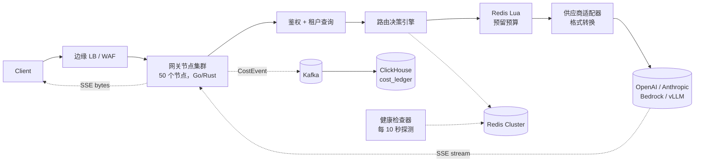
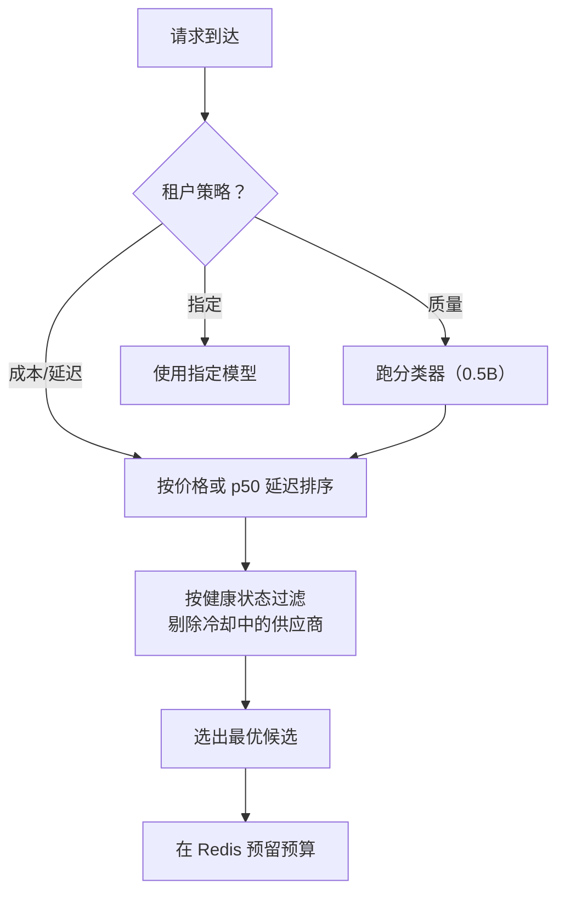
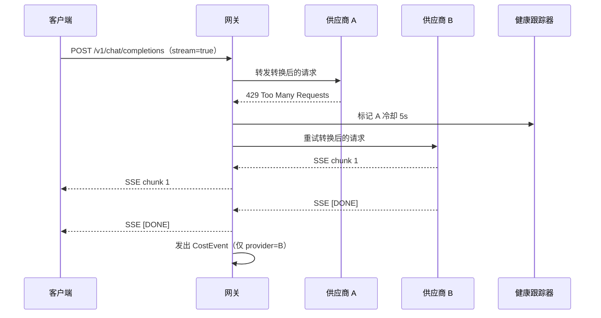
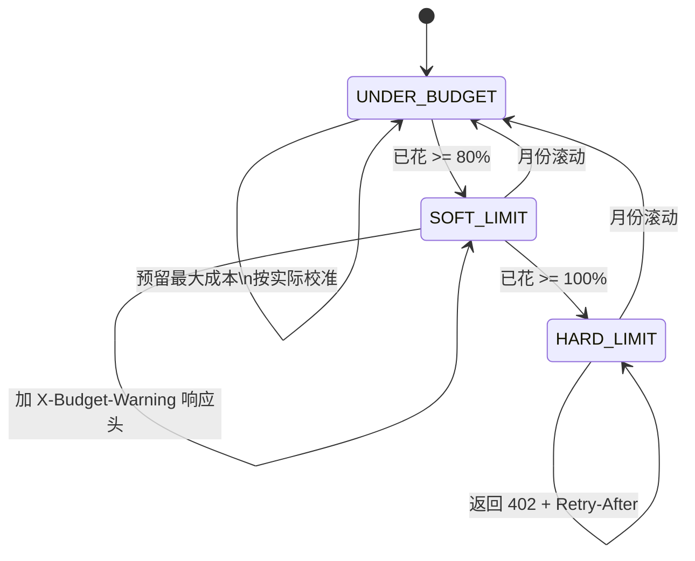

# 设计模型路由器与网关（OpenRouter / LiteLLM）

> **TL;DR.** 模型路由器是为 LLM 流量特化的 API 网关：每个请求的成本天差地别（GPT-5.5 这类前沿模型比小型开源模型贵几百倍）、SSE 流式响应要持续好几秒、上游十几种互不兼容的报文格式。它的架构是一组无状态网关节点，通过对价格表、延迟表、健康表做一次排序扫描，在 30 ms 内选定目标；token 原样透传不做缓冲；在首字节之前完成对用户不可见的故障切换；并把每一个计费 token 都写进 ClickHouse 的成本账本。基于分类器的路由（RouteLLM、FrugalGPT）相比一律走强模型可降成本 85%～98%[^1][^2]，但引入了一个你必须在故障时绕开的依赖。参考系统：OpenRouter（400+ 模型，按价格平方反比加权）[^3][^4]、LiteLLM Proxy（4 CPU / 8 GB 上跑 5,000 QPS）[^5]、Portkey（可组合的兜底配置）[^6]。

## 学习目标

- [ ] 设计一个路由决策引擎，在成本、延迟、质量三个维度上于 30 ms 内选定模型与供应商
- [ ] 构建 SSE 流式透传，在保住首字节延迟的前提下计量每个请求的成本
- [ ] 实现带健康跟踪的供应商故障切换，重试时不会重复计费
- [ ] 用 Redis 令牌桶加预留-校准（reservation-and-reconciliation）执行按租户的预算
- [ ] 通过追加式事件流把每个请求的成本归因到租户、项目和模型，写入 ClickHouse
- [ ] 用按比例路由和自动急停开关对新模型做金丝雀发布

## 直觉理解

模型路由器看着不值一提：收请求、选模型、转发。一台单机代理服务 10 个用户毫无压力。

到了 20,000 QPS，问题在三个方向上变了形，而这三个方向经典 API 网关一个都不碰。第一，成本逐请求变化：GPT-5.5 一次调用输出 token 要 $30/M，而 Llama 3.1 8B 在 OpenRouter 上只要 $0.05/M，相差 600 倍[^7][^8]。把不该给的提示词路由到不该用的模型，要么烧钱，要么吐垃圾。第二，响应不是一点即到的 JSON 块，而是持续 2 到 15 秒的 SSE 流。你要是缓冲下来检查，用户的体感延迟就毁了。第三，每个上游供应商讲不同的报文格式：OpenAI 的 `chat/completions` SSE、Anthropic 的 `message_start`/`content_block_delta` 事件[^9]、AWS Bedrock 的 `ConverseStream` 事件[^10]。网关必须逐帧转换，还不能让流停下来。

打开整个设计的那个洞见是：把网关当成一根带旁路取数的流式管道，而不是请求-响应代理。token 原样流过。成本记账、配额执行、健康跟踪都在热路径之外异步完成。唯一同步的工作是路由决策，而它必须在 30 ms 内做完，否则网关自己就成了它本来要消除的那个瓶颈。

## 需求

### 澄清问题

- **Q: 多租户公网网关，还是单公司内部代理？**
  假设：公网、多租户（OpenRouter 形态）。原则一样，只是配额和滥用防护更难。
- **Q: 多少家供应商、多少个模型？**
  假设：10 家供应商、50+ 个模型。OpenAI、Anthropic、Google、Mistral、Cohere、Groq、Together、Fireworks、本地 vLLM、AWS Bedrock。
- **Q: 客户端自带密钥（BYOK）吗？**
  假设：两种都有。企业租户用 BYOK（我们只路由，上游他们自己付钱）。零售租户用充值额度（我们付上游，再向他们收费）。
- **Q: 流式报文格式用哪种？**
  假设：对客户端一律 OpenAI 兼容的 SSE。非 OpenAI 供应商的响应逐帧转换[^9]。
- **Q: 路由延迟的 SLO 是多少？**
  假设：路由开销 p99 <30 ms。端到端延迟由供应商主导。
- **Q: 网关做内容审核吗？**
  假设：可选中间件，默认关闭。同步审核会毁掉首字节延迟。

### 功能需求

- 接受 OpenAI 兼容的 `/v1/chat/completions` 请求（流式与非流式），返回补全结果
- 按租户的路由策略（成本、延迟、质量或指定模型）选定模型与供应商
- 把请求转换成所选供应商的报文格式，并把响应转回来
- 以低于 20 ms 的首字节开销把 SSE token 流式发给客户端
- 遇到 429/5xx 换一家供应商重试，且不向租户重复计费
- 执行每个租户的月度美元预算；超额时以 402 拒绝
- 把每个请求记入成本账本，含模型、供应商、token 数、美元金额、租户和延迟

### 非功能需求

- **吞吐量：** 持续 20,000 QPS，峰值 50,000 QPS
- **路由延迟：** 从收到请求到向上游发起连接 p99 <30 ms
- **首字节开销：** 在供应商自身 TTFT 之上增加 <20 ms[^5]
- **可用性：** 99.95%。单一供应商故障不能把网关一起带走
- **成本准确性：** 100% 的计费 token 都被记录，不允许静默丢失
- **配额准确性：** 与配置的月度预算误差在 1% 以内

## 容量估算

| 指标 | 数值 | 推导 |
|--------|------:|------------|
| 并发流 | 160,000 | 20K QPS × 平均流时长 8s |
| token 出流量 | 10M tokens/秒 | 20K QPS × 每响应 500 tokens |
| 出网带宽 | ~15 Gbps | 10M tokens × 约 4 B + SSE 帧开销 |
| Redis 配额操作/秒 | 40,000 | 20K QPS × 2 次检查（预留 + 校准） |
| 成本账本行数/天 | 1.7B | 20K × 86,400 |
| ClickHouse 存储/天 | ~30 GB | 300 GB 原始数据 / 10:1 压缩 |
| 90 天保留期 | ~3 TB | 30 GB × 90 |

**路由路径预算拆解：**

- 分类器（可选，质量模式）：约 5 ms
- 策略查询：约 1 ms
- 配额检查（Redis Lua）：约 0.5 ms[^11]
- 供应商健康查询：约 0.1 ms
- 合计：约 6.6 ms，离 30 ms 的预算还很宽裕

## API 与数据模型

### API 设计

```http
POST /v1/chat/completions
  Authorization: Bearer ***
  Body: { "model": "gpt-4o", "messages": [...], "stream": true,
          "router": { "strategy": "cost", "fallback_models": ["claude-sonnet-4-6"] } }
  Returns: 200 SSE stream (Content-Type: text/event-stream)
           402 budget exceeded, 429 rate limited

GET /v1/models
  Returns: 200 { "data": [{ "id": "gpt-4o", "pricing": {...}, "p50_latency_ms": 850 }] }

GET /v1/usage
  Returns: 200 { "month_spend_usd": 1247.50, "by_model": [...], "budget_remaining": 752.50 }

POST /v1/keys
  Body: { "project": "search-team", "monthly_limit_usd": 500 }
  Returns: 201 { "key": "sk-...", "key_id": "vk_abc" }
```

### 数据模型

```sql
-- 控制面（PostgreSQL）
tenants (tenant_id, plan, monthly_budget_usd, default_strategy, byok_keys JSONB)
models  (model_id, provider, input_price_per_1k, output_price_per_1k, max_context, quality_tier)

-- 热路径（Redis Cluster）
provider_health:{provider}  -> HASH {healthy, error_rate, p99_ms, last_429_at}  TTL 30s
quota:{tenant}:{month}      -> HASH {usd_reserved, usd_spent, tokens_in, tokens_out}

-- 成本账本（ClickHouse，按天分区）
cost_ledger (request_id, ts, tenant, project, model, provider,
             input_tokens, output_tokens, cached_tokens, usd_cost,
             ttft_ms, total_latency_ms, failover_count, status)
```

## 高层架构



*请求从左到右穿过鉴权、路由、预算预留和供应商适配；SSE 流直接回给客户端，而成本事件异步流进 ClickHouse。*

**写路径。** 网关先认证租户，跑一次路由决策（策略 + 健康 + 价格排序），在 Redis 里预留预算，把请求转换成所选供应商的格式，再建立上游连接。token 原样穿过网关流回来。

**异步路径。** 流结束时，网关向 Kafka 发一个 `CostEvent`，带上真实 token 数和美元金额。ClickHouse 的消费者按 10 秒窗口批量写入。配额校准器把预留额调整成实际开销。Langfuse[^12] 和 Helicone[^13] 这类可观测性平台就接在这一层，提供按 trace 的成本归因和延迟拆解。

**故障路径。** 如果供应商在首字节之前返回 429 或 5xx，网关在健康跟踪器里标记它，并重试下一个候选。如果 Redis 不可达，网关失效开放（放行请求），之后再校准。

## 深入探讨

### 路由决策引擎

路由器有三类输入：租户的策略（成本、延迟、质量或指定模型）、提示词的难度分级（可选）、每个候选实时的健康/价格/延迟。输出是一份排好序的 (model, provider) 元组列表。

**基于规则的路由（默认）。** OpenRouter 的生产策略按价格的平方反比给候选加权：$1/M token 的供应商被选中的概率是 $3/M 那家的 9 倍[^4]。最近 30 秒内出过故障的供应商会被降权，但不剔除[^4]。整个决策只是对一张有序表做一次遍历，5 ms 内完成。

**基于分类器的路由（按需开启）。** RouteLLM 用 Chatbot Arena 的偏好数据训练一个小模型，预测一条提示词是需要强模型，还是用便宜模型就能应付。那个矩阵分解路由器在 Arena 数据上训练、并用 LLM 裁判做过数据增强，在 MT Bench 上达到 GPT-4 质量的 95%，而真正调用 GPT-4 的只有 14%；LMSYS 作者给出的结论是：这一配置比 50/50 随机基线便宜 75%，比把每条提示词都送给 GPT-4 便宜 85% 以上[^1][^14]。FrugalGPT 的级联做法是从最便宜到最贵依次调用，某个打分函数认可答案时就停下，报告的成本降幅最高到 98%[^2]。

**决策缓存。** 对采用质量优先路由的租户，网关把分类器的决策按 `(tenant, prompt_hash)` 缓存 60 秒。重试风暴因此不会反复跑分类器。



*路由决策按租户策略分叉；基于分类器的分支多花约 5 ms，但相比一律走强模型能把成本砍掉 85% 以上。*

LiteLLM 提供多种路由策略：simple-shuffle（默认，官方推荐）、基于延迟、最少忙碌、感知限速（另有 async v2 版本）、最低成本，以及可插拔的自定义策略[^15]。它的文档明确警告：基于用量的（感知限速的）路由“不建议用于生产”，因为每请求为跟踪 TPM/RPM 而做的 Redis 操作会带来可测的延迟[^15]。Kong AI Gateway 是同类形态，把原生熔断器和语义路由做进了代理层[^16]。

### SSE 流式透传

网关持有一对半双工流。上游供应商送来一个 SSE 帧（`data: {...}\n\n`）时，网关直接刷进客户端 socket。一个非阻塞计数器从每个 chunk 里解析出 token 增量，累加到用于成本记账的实时总数。

**格式转换。** 客户端永远收到 OpenAI 格式的 SSE：`data: {"choices":[{"delta":{"content":"..."}}]}`。非 OpenAI 供应商发出的事件形状各不相同：Anthropic 用 `content_block_delta` 事件[^9]，Bedrock 用 `ConverseStream` 事件[^10]。供应商适配器逐帧转换，不缓冲完整响应。

**缓冲为什么致命。** 一个为了做内容审核或 JSON Schema 校验而缓冲的网关，等于把流式端点变成了非流式端点。首 token 时间从 200 ms 跳到 4 秒以上。OpenRouter 和 Portkey 都因此默认关闭同步审核[^6][^4]。

**流中错误。** LiteLLM 的 `FallbackStreamWrapper` 处理两种情况[^17]：首字节之前的错误，用原始提示词透明重试。首字节之后的错误，抛出 `MidStreamFallbackError`；客户端 SDK 带上一段续写提示词重试，其中通过 `"prefix": True` 把已产出的部分输出带进去[^17]。Portkey 的文档讲的是同一个约束：跨目标兜底只有在第一个 chunk 之前才干净可用[^6]。

**开销预算。** 新增的首字节延迟主要来自一次 TLS 握手（已经由 HTTP/2 连接池化）和一次 goroutine 跳转：通常 5 到 15 ms[^5]。LiteLLM 2026 年一季度的目标是把代理开销做到亚毫秒，办法是 sidecar 架构，把热路径从 Python 里拆出去，交给原生转发层[^5]。

### 供应商故障切换与冷却

供应商的故障有三种形态：被限速（429）、服务端错误（5xx）、超时。网关必须能发现、隔离并恢复，同时不向租户收两次钱。

**冷却状态机。** LiteLLM 的路由器按部署（deployment）做冷却：遇到 429、认证错误，或当前分钟内失败率超过 50%，该部署默认被摘除 5 秒[^15]。冷却时长按优先级取值：部署配置 > 供应商返回的 `Retry-After` 头 > 路由器默认值[^17]。OpenRouter 的做法更温和：最近 30 秒内出过故障的供应商会被挪到候选列表末尾，而不是彻底剔除[^4]。



*首字节之前的故障切换对客户端透明；供应商 A 的 429 触发冷却并重试到供应商 B，只产生一条计费事件。*

**可组合的兜底。** Portkey 的配置允许嵌套策略：一个兜底目标本身可以是一个负载均衡器，里面又套着另一层兜底[^6]。于是可以写出这种模式——“主集群是 OpenAI 的三个区域，只有当整个主集群都挂了，才退到 Anthropic 集群”。

**对冲为什么是错的。** 对冲（同时打给两家、取先返回的）在经典 RPC 里能把长尾延迟砍一半。放到 LLM 调用上，它让计费 token 翻倍。LiteLLM 通过 `abatch_completion_fastest_response` 支持这个能力，但一贯警告不要在生产使用[^17]。

### 按租户的配额执行

配额层用的是 Redis Lua 令牌桶，容量以美元美分计，而不是 token[^11]。收到请求时，网关先估算最大可能开销：`prompt_tokens * input_price + max_new_tokens * output_price`，然后原子地预留这个额度。请求结束时，再按实际开销校准。



*配额状态机在一开始预留最坏情况的开销，结束时校准；软上限只警告，硬上限以 402 拒绝。*

Lua 脚本在 Redis 上原子执行，杜绝两个网关节点都看到 `tokens=1` 然后双双成功的情况[^11]。单次 EVAL 连上同机房 Redis 的往返也在亚毫秒级[^11]，配额检查塞进 30 ms 的路由预算里绰绰有余。

**全局 Redis 还是区域 Redis。** 全局 Redis 给出单一事实来源，但跨区域要 50 到 200 ms。区域 Redis 加快周期校准很快（约 0.5 ms），代价是分区期间某个区域可以超支 N 秒[^11][^18]。默认方案：零售租户用区域 Redis，只有硬性账单上限才走全局 Redis。

## 真实案例

### OpenRouter：400+ 模型上的平方反比路由

OpenRouter 暴露一个 OpenAI 兼容的端点，把请求路由到横跨数百家供应商的 400+ 个模型[^3]。它的生产路由策略把本章的原则在真实规模上演示了一遍。

**默认路由。** 路由器先把最近 30 秒内出过故障的供应商过滤掉，再按价格的平方反比对存活者加权[^4]。$1/M token 的供应商拿到的流量是 $3/M 那家的 9 倍。这形成一条平滑的成本梯度：流量向便宜的供应商集中，同时在贵的那些上保留一点尾巴，用来持续采到新鲜的延迟数据。

**客户端覆盖。** 调用方可以指定 `provider.order`（显式列表）、`provider.sort`（"price" | "throughput" | "latency"）、基于百分位的 `preferred_max_latency` 截断，以及量化过滤（`provider.quantizations: ["fp8"]`）[^4]。没达到百分位阈值的供应商只是被降权，不会被排除，所以即使所有供应商都慢，请求仍然会完成。

**自动路由。** `openrouter/auto` 这个模型标识会委派给 Not Diamond——一个预测式路由器，它估算哪个模型能对给定提示词给出最好的回答[^19][^20]。这就是基于分类器的路由，只是被打包成了一次模型选择。

**指标基础设施。** OpenRouter 按 (model, provider) 组合，在滚动 5 分钟窗口上跟踪 p50/p75/p90/p99 延迟[^4]。响应时间、错误率和可用性实时监控，并回流到路由决策里[^21]。5 分钟窗口意味着一个把价格砍半的供应商最多要等 5 分钟才会被偏好，这是为了路由稳定性可以接受的陈旧度权衡。

**与 LiteLLM 对比。** OpenRouter 是托管式多租户网关，LiteLLM 是开源、跑在集群内的代理。它早期在约 1,000 QPS 就饱和；目前基线是 4 CPU / 8 GB 的实例上跑 5,000 QPS[^5]。它的 sidecar 架构提案把 Python 部分（校验、模型选择、回调）和原生转发层（连接池、超时、指标）拆开[^5]。2025 到 2026 年间的多起公开事故暴露了这套运维面的坑：缓存淘汰把正在使用的 HTTP 客户端关掉、成本表重载后通配符被封禁、护栏日志把密钥类请求头泄露出去[^22]。

## 权衡

LLM 网关由四个维度组合而成：路由策略、流式与缓冲的边界、故障切换策略，以及配额存储的布局。

| 方案 | 优点 | 缺点 | 何时使用 |
|----------|------|------|-------------|
| 基于规则的路由（价格/延迟表） | 决策 <5 ms，确定性强 | 不感知提示词难度 | 成本与延迟策略的默认选择[^4][^15] |
| 基于分类器的路由（RouteLLM/FrugalGPT） | 省 45%～98% 成本[^2][^1] | 增加 5～10 ms 延迟，分类器会漂移 | 主动开启质量优先的租户 |
| 流式透传 | 首字节开销 <20 ms | 无法在流中做变换 | 对话补全一律使用[^6] |
| 缓冲响应 | 能上安全过滤、改写 | 毁掉 TTFT（200 ms 变 4 秒以上） | 仅非流式或强制审核场景 |
| 首字节前故障切换 | 供应商故障对客户端不可见 | 对流中故障无能为力 | 所有请求的默认行为[^6][^17] |
| 对冲请求 | 长尾延迟最低 | 每次对冲调用让计费 token 翻倍[^17] | 内部工具和不计量的免费层——那里长尾延迟比单 token 成本更重要；付费 token 的路径上不要用 |
| 全局 Redis 存配额 | 单一事实来源 | 跨区域 50～200 ms | 仅硬性账单上限[^11] |
| 区域 Redis + 定期校准 | 本地检查约 0.5 ms | 分区期间超支 N 秒 | 零售租户预算的默认方案[^11] |

最大的一个元决策：**流式透传还是缓冲检查**。任何要碰到完整响应的中间件（内容审核、PII 脱敏、JSON 校验）都会逼你缓冲。把它们挪到异步审计路径，或者做成流式友好的实现。网关的职责是在延迟路径上隐形。

## 扩展与故障模式

- **10 倍（200K QPS）：** 连接池耗尽。HTTP/2 每条连接复用约 100 条并发流。跨 50 个节点共 1.6M 条并发流时，连接池大小配错就会撞上 `GOAWAY` 风暴。把网关集群扩到 200 个节点，并提高对每个供应商的长连接数。
- **100 倍（2M QPS）：** 上游供应商的速率限制变成瓶颈。一个热点租户就能把 OpenAI 的 tier-5 TPM 配额抽干。缓解手段：在派发之前执行按租户、按供应商的令牌桶。
- **1000 倍：** 瓶颈不再是网关本身，而是供应商的产能。架构转向市场模式：网关在几十个跑在异构硬件上的微调模型部署之间做经纪。

**故障模式：**

- **单一供应商故障（例如 OpenAI 连续 3 分钟 5xx）：** 健康跟踪器标记冷却。受影响模型的全部流量转向兜底供应商。爆炸半径：配好兜底则是零。代价：兜底供应商可能更贵。
- **Redis 集群分区：** 配额检查失效开放。租户可能在副本提升之前超支 5 到 30 秒。告警触发。月度校准把这部分差额找回来。
- **分类器模型崩溃：** 质量优先路由卡住。缓解：失效开放到一个固定的中端默认模型。分类器是用来省钱的，它绝不能阻塞请求[^1][^20]。
- **ClickHouse 写入背压：** Kafka 吸收突发。消费者按 10 秒窗口或 10 万行批量写入，先到者为准。成本归因会延迟，但永远不会丢。

## 常见陷阱

> [!WARNING]
> **为了中间件而缓冲整个流。** 首 token 时间会从 200 ms 跳到 4 秒以上。把审核做成流式友好的，或者挪到异步审计路径[^13][^6]。

> [!WARNING]
> **流中故障切换导致双重计费。** 朴素重试会在兜底供应商上把整个提示词再跑一遍；两家都向租户收钱。只在首字节之前切换；首字节之后，抛错让客户端 SDK 自己重试[^17]。

> [!WARNING]
> **在生产上用对冲请求。** 对冲让每个请求的计费 token 翻倍。把它留给那些成本无关紧要的延迟关键路径[^17]。

> [!WARNING]
> **配额 Redis 的热点租户集中。** 一个大租户 5K QPS 的配额检查全都哈希到同一个 Redis 分片。把键按 `{tenant_id}:{hour_bucket}` 切开，让写入分散到每天 24 个键上[^11]。

> [!WARNING]
> **成本表陈旧。** 供应商调价是异步发生的。给每一行账本打上 `pricing_version`，每小时刷新一次，每月对着供应商账单校准[^23]。

> [!WARNING]
> **把分类器当硬依赖。** 如果那个小模型挂了，而质量优先路由又是必需的（不是尽力而为），每个请求都会失败。失效开放到一个固定的默认模型，把分类器当优化项，而不是关卡[^1]。

## 追问

**1. 如何处理不想让提示词正文被存储的 BYOK 租户？**

提供无日志档位。成本账本只记 token 数和美元金额，绝不记提示词或响应。让请求走一条关闭审计的代码路径。把这个变更写进租户的数据处理协议里。

**2. 某个租户因为脚本写错，一小时内烧掉月度预算的 90%，你怎么发现？**

预算告警在 50%、80%、95% 三个点触发，由控制面发出。租户可以配置按天的子限额。到 95% 时，网关自动把路由降级到最便宜的模型档，直到告警被确认。

**3. 供应商在输出 3,000 个 token 后断连，你怎么在流中做故障切换？**

做不到透明切换。向客户端抛一个 SSE 错误事件，带上已产出的 token 数。客户端 SDK 重试时把部分输出作为续写前缀放进提示词[^17]。这就是 LiteLLM 的 `MidStreamFallbackError` 实现的同一套模式。

**4. 什么能阻止一个滥用型租户通过网关对某一家供应商发起 DDoS？**

由同一层 Redis 配额执行按租户、按供应商的限流。租户会先撞上网关的 429，远早于供应商那边撞上限制。

**5. 供应商还没出账单的请求，你怎么定价？**

用请求时刻的公开每 1K 定价，并打上 `pricing_version` 标签。每月对着真实账单校准。差额在下一个账期补收或退还[^23]。

**6. 你怎么判断一个新模型够格从金丝雀升为默认？**

离线评测关卡（在黄金集上的 LLM-as-judge 得分）加线上 A/B 关卡（5% 流量跑 48 小时，租户反馈的差评率不退化）。质量退化时急停开关立刻回滚。

**7. Anthropic 的提示词缓存按不同费率计费，你怎么处理？**

成本账本把 `cached_tokens` 作为独立字段记下来。计价公式变成 `input_tokens * input_price + cached_tokens * cached_price + output_tokens * output_price`。不做这件事的话，在缓存命中率高的负载上成本归因会漂移 10%～50%[^23]。

## 练习

### 练习 1：级联路由成本分析

某租户每天发 10,000 条提示词。70% 是简单的（Llama 4 Scout 就能答，$0.60/M token），20% 是中等（需要 Claude Sonnet 4.6，$3/M），10% 是很难的（需要 GPT-5.5，$30/M）。平均每条提示词输入 500 token、输出 500 token。比较三种策略的日成本：(a) 全部走 GPT-5.5；(b) 有完美分类器的规则路由；(c) FrugalGPT 级联，先试 Llama 4 Scout，置信度不足就升级（假设 15% 的简单提示词被不必要地升级）。

<details>
<summary>提示</summary>

按 `(input_tokens + output_tokens) * price_per_token` 算每个请求的成本。级联要加上那些升级掉的 Llama 4 Scout 调用所浪费的成本（Scout 和升级目标你都得付）。然后比总数。

</details>

<details>
<summary>解答</summary>

**每个请求的 token 数：** 1,000（500 输入 + 500 输出）。

**(a) 全走 GPT-5.5：** 10,000 × 1,000 × $30/1M = $300/天。

**(b) 完美分类器：** 7,000 × $0.60/1M × 1,000 + 2,000 × $3/1M × 1,000 + 1,000 × $30/1M × 1,000 = $4.20 + $6.00 + $30.00 = $40.20/天。成本降幅：87%。

**(c) FrugalGPT 级联：** 简单提示词：7,000 次调用 Llama 4 Scout。其中 15% 升级（1,050 次），要付 Scout 加升级目标的钱。假设升级的简单提示词走 Sonnet 4.6。成本：7,000 × $0.60/1M × 1,000 = $4.20（Scout）。升级浪费：1,050 × $0.60/1M × 1,000 = $0.63（白付的 Scout）+ 1,050 × $3/1M × 1,000 = $3.15（Sonnet 4.6）。中等：2,000 × $0.60/1M × 1,000（先试一次）+ 2,000 × $3/1M × 1,000（升级）= $1.20 + $6.00。困难：1,000 × $0.60/1M × 1,000 + 1,000 × $3/1M × 1,000 + 1,000 × $30/1M × 1,000 = $0.60 + $3.00 + $30.00。合计：约 $48.78/天。成本降幅：84%。

**结论：** 级联相比完美分类器多付约 15% 的溢价，多付的部分就是那些白跑的便宜模型调用，但相比朴素的 GPT-5.5 全量路由仍然省 84%。真实世界里的权衡在延迟：级联在升级之前要先等便宜模型把整个响应生成完。

</details>

## 要点回顾

- **三个属性定义了这个问题的形状：** 逐请求变化的成本、流式响应、互不兼容的报文格式。所有设计决策都从这三点推出来。
- **token 直接透传。** 为了解析 JSON 而缓冲，是这类系统里对 TTFT 伤害最大的一件事。
- **故障切换在首字节之前很便宜，在流中则不可能。** 让客户端 SDK 带部分输出重试，而不是指望网关回到过去。
- **成本归因是一套计费系统，不是遥测。** 按追加式处理，每月校准，存进列式数仓。
- **分类器路由是优化项，不是必需品。** 分类器不可用时失效开放到静态默认值。
- **配额放在 Redis，预算放在控制面。** 在热路径上执行配额，在仪表盘上展示预算。

## 延伸阅读

- [OpenRouter Provider Routing documentation](https://openrouter.ai/docs/guides/routing/provider-selection)。关于平方反比价格加权、百分位阈值和兜底顺序在生产级多租户路由器里的权威说明。
- [LiteLLM Proxy Architecture: Life of a Request](https://docs.litellm.ai/docs/proxy/architecture)。请求全流程的范本式走查，从虚拟密钥校验一路到路由、再到成本事件发出。
- [Chen, Zaharia, Zou: "FrugalGPT" (2023)](https://arxiv.org/abs/2305.05176)。级联路由的奠基论文，98% 成本降幅的标题数字，以及质量-成本帕累托前沿。
- [Ong et al.: "RouteLLM" (2024)](https://arxiv.org/abs/2406.18665)。用偏好数据做分类器路由；四种路由器变体，以及跨模型对的迁移结果。
- [Portkey AI Gateway: Fallbacks](https://portkey.ai/docs/product/ai-gateway/fallbacks)。可组合的兜底目标、触发状态码和嵌套策略配置。
- [Redis Token-Bucket Rate Limiter tutorial](https://redis.io/docs/latest/develop/use-cases/rate-limiter/)。配额层所依赖的 Lua 脚本模式；解释了原子性保证。
- [Anthropic Messages streaming](https://docs.anthropic.com/en/api/messages-streaming)。网关必须逐帧转换的非 OpenAI SSE 报文格式。
- [LiteLLM blog: Achieving Sub-Millisecond Proxy Overhead](https://litellm.vercel.app/blog/sub-millisecond-proxy-overhead)。Python + sidecar 的架构方向，附 5,000 QPS 的基准测试背景。

## 记忆卡片

<details>
<summary><strong>Q: 哪三个属性让模型路由器区别于经典 API 网关？</strong></summary>

A: (1) 逐请求变化的成本（模型价格相差 60 倍），(2) 持续数秒的 SSE 流式响应，(3) 各供应商互不兼容、需要逐帧转换的报文格式。

</details>

<details>
<summary><strong>Q: OpenRouter 的默认路由策略是什么？</strong></summary>

A: 先滤掉最近 30 秒内出过故障的供应商，再按价格的平方反比对剩余候选加权。$1/M token 的供应商拿到的流量是 $3/M 那家的 9 倍。

</details>

<details>
<summary><strong>Q: RouteLLM 的矩阵分解路由器在 MT Bench 上实现了多少成本降幅？</strong></summary>

A: 成本降低 75%——只调用 14% 的 GPT-5.5，同时保持 GPT-5.5 质量的 95%。

</details>

<details>
<summary><strong>Q: 为什么为了中间件检查而缓冲 SSE 流会毁掉体感延迟？</strong></summary>

A: 它把流式端点变成了非流式端点。首 token 时间从约 200 ms 跳到 4 秒以上，因为网关必须等整个响应到齐才能往下发。

</details>

<details>
<summary><strong>Q: 网关什么时候能透明地把请求切到另一家供应商？</strong></summary>

A: 只在第一个字节发给客户端之前。首字节之后，客户端已经收到部分输出；切换需要客户端 SDK 带着包含部分响应的续写提示词重试。

</details>

<details>
<summary><strong>Q: 配额层如何处理输出 token 数的不确定性？</strong></summary>

A: 预留-校准。收到请求时预留最坏情况成本（prompt_tokens × input_price + max_new_tokens × output_price）。结束时按实际开销校准，并释放没用掉的预留额。

</details>

<details>
<summary><strong>Q: 基于分类器的路由器为什么应该失效开放而不是失效关闭？</strong></summary>

A: 分类器的职责是省钱，不是让路由成为可能。它挂了，退到一个静态的中端默认模型，请求依然能正确服务，只是更贵。失效关闭会把一个优化项变成单点故障。

</details>

<details>
<summary><strong>Q: LiteLLM 的默认冷却时长和触发条件是什么？</strong></summary>

A: 5 秒，触发条件是每个部署出现 429、认证错误（401/404/408），或当前分钟内失败率超过 50%。

</details>

<details>
<summary><strong>Q: 为什么对冲（同时打两家、取先返回的）不适合 LLM 流量？</strong></summary>

A: 它让每个请求的计费 token 翻倍。经典 RPC 里一份冗余请求的代价可以忽略，而 LLM 调用按 token 计费，输出 token 的单价能到 $30/M。

</details>

<details>
<summary><strong>Q: 成本账本如何处理 Anthropic 提示词缓存这种缓存 token 单价不同的情况？</strong></summary>

A: 账本把 `cached_tokens` 作为独立字段记下来，配自己的计价系数。不做这件事，在缓存命中率高的负载上成本归因会漂移 10%～50%。

</details>

## 参考文献

[^1]: Ong 等，"RouteLLM: Learning to Route LLMs with Preference Data"，arXiv:2406.18665（2024）。https://arxiv.org/abs/2406.18665
[^2]: Chen, Zaharia, Zou，"FrugalGPT: How to Use Large Language Models While Reducing Cost and Improving Performance"，arXiv:2305.05176（2023）。https://arxiv.org/abs/2305.05176
[^3]: OpenRouter，"Access 400+ AI Models Through One API"。https://openrouter.ai/docs
[^4]: OpenRouter，"Provider Routing"。https://openrouter.ai/docs/guides/routing/provider-selection
[^5]: LiteLLM 博客（Hamir, Dholakia, Jaffer），"Achieving Sub-Millisecond Proxy Overhead"，2026 年 2 月。https://litellm.vercel.app/blog/sub-millisecond-proxy-overhead
[^6]: Portkey，"AI Gateway: Fallbacks"。https://portkey.ai/docs/product/ai-gateway/fallbacks
[^7]: OpenAI，"API Pricing"（GPT-5.5 输出 $30/M token）。https://openai.com/api/pricing/
[^8]: OpenRouter，"Meta: Llama 3.1 8B Instruct" 模型页（定价与供应商路由）。https://openrouter.ai/meta-llama/llama-3.1-8b-instruct
[^9]: Anthropic，"Messages streaming"。https://docs.anthropic.com/en/api/messages-streaming
[^10]: AWS，"Carry out a conversation with the Converse API operations"。https://docs.aws.amazon.com/bedrock/latest/userguide/conversation-inference.html
[^11]: Redis，"Token bucket rate limiter with Redis"。https://redis.io/docs/latest/develop/use-cases/rate-limiter/
[^12]: Langfuse，"Observability & Application Tracing"。https://langfuse.com/docs/observability/overview
[^13]: Helicone，"Quickstart" 与 AI Gateway 文档。https://docs.helicone.ai/getting-started/quick-start
[^14]: LMSYS，"RouteLLM: An Open-Source Framework for Cost-Effective LLM Routing"（2024）。https://lmsys.org/blog/2024-07-01-routellm/
[^15]: LiteLLM，"Router - Load Balancing"（路由策略、冷却、重试）。https://docs.litellm.ai/docs/routing
[^16]: Kong Inc.，"AI Proxy Advanced plugin"。https://developer.konghq.com/plugins/ai-proxy-advanced/
[^17]: BerriAI，litellm/router.py 源码（Router 类、流式迭代器、兜底处理器）。https://github.com/BerriAI/litellm/blob/main/litellm/router.py
[^18]: LiteLLM，"Proxy - Load Balancing" 与预算文档。https://docs.litellm.ai/docs/proxy/load_balancing
[^19]: OpenRouter，"Smart AI Model Selection (Auto Router)"。https://openrouter.ai/docs/guides/routing/routers/auto-router
[^20]: Not Diamond，"What is Model Routing?"。https://docs.notdiamond.ai/docs/what-is-model-routing
[^21]: OpenRouter，"Uptime Optimization"。https://openrouter.ai/docs/guides/best-practices/uptime-optimization
[^22]: LiteLLM 变更日志 / 事故报告，2025 至 2026 年。https://litellm.vercel.app/blog
[^23]: LiteLLM，"Life of a Request"。https://docs.litellm.ai/docs/proxy/architecture
