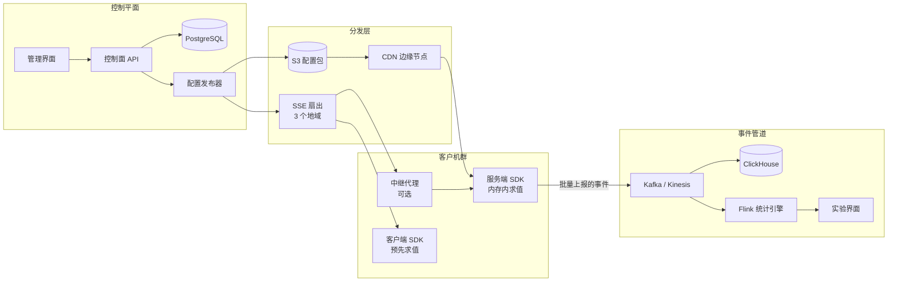
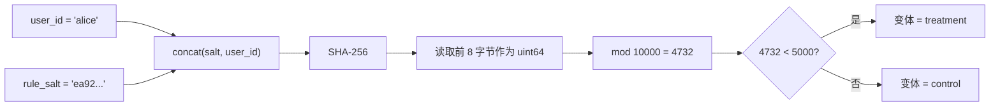
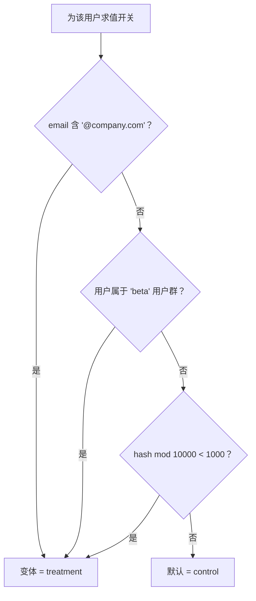
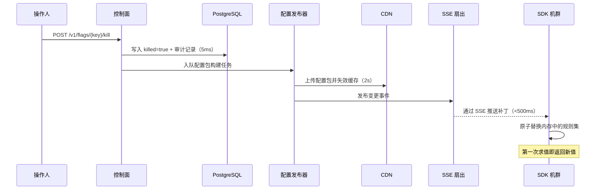

# 设计一个特性开关服务（LaunchDarkly / Harness FME / Unleash）

> **TL;DR.** 特性开关（feature flag）把部署期的条件判断换成运行期决策，让主干开发、灰度放量、紧急开关和 A/B 测试共存于一个平台。LaunchDarkly 每天处理约 20 万亿次开关求值[^1]，可用性目标是 99.999%。决定性的架构选择是“SDK 侧求值 + 流式配置分发”：开关检查退化为亚毫秒级的本地函数调用，SDK 靠最近一次已知可用的缓存扛过控制面全面故障，紧急开关则通过 SSE 流在 60 秒内传遍全球。

## 学习目标

- 设计一套 SDK 侧求值架构，以亚毫秒延迟承接每秒 5000 万次开关检查
- 用 `SHA-256(salt + user_id) mod 10000` 实现确定性用户分桶，避免多个开关的放量相互关联
- 设计配置分发层（SSE 流 + CDN 轮询），让紧急开关在 60 秒内传播到 1 万台服务器
- 为每天 250 TB 的求值事件管道做容量规划，又不至于压垮分析存储[^1]
- 讲清楚实验统计：序贯检验（SPRT）、CUPED 方差缩减，以及规模化下的错误发现率校正
- 优雅处理 SDK 版本错位，让未知的规则算子安全回退，而不是把生产环境搞崩

## 直觉理解

特性开关看起来微不足道。`if (flag.isOn("new-checkout", user)) { ... }`。一个初级工程师用一张数据库表和一次 API 调用就能做出来，服务 10 个用户毫无问题。

到了 1 万台服务器、每台在每次请求里检查 500 个开关时，架构会同时在三个方面崩掉。第一是延迟：每次开关检查一次 10 ms 的 RPC，乘以每次页面加载的 500 次检查，光开关求值就多出 5 秒[^2]。第二是可用性：那个中心化的开关服务，现在成了整个机群的单点故障。第三是传播：当支付 bug 正在烧穿生产环境、你伸手去扳紧急开关时，“60 秒内最终生效”和“立刻生效”的差别，就是小抽风与首页级事故的差别。

让整个设计豁然开朗的那句话：**把规则推到 SDK，而不是把答案推给服务器。** SDK 下载完整的定向规则集，在本地以亚毫秒时间求值，并通过一条流式连接接收更新。开关服务由此从“回答查询的数据面”变成“发布配置的控制面”。这也是 LaunchDarkly、Statsig 以及每一个成熟平台最终收敛到的架构[^3][^4][^5]。

## 需求

### 澄清问题

- **Q：用 SDK 侧求值，还是每次检查都做一次客户端到服务端的调用？**
  假设：服务端 SDK 采用 SDK 侧求值（下载完整规则集）。客户端 SDK 拿预先算好的值，规则不下发到浏览器，避免泄露。

- **Q：支持哪些开关类型？**
  假设：布尔型（发布开关 / 紧急开关）、字符串变体型（A/B/n 实验）、JSON blob 型（动态配置）。三者共用一套求值引擎。

- **Q：紧急开关的传播 SLA 是多少？**
  假设：全球 p99 低于 60 秒。流式是硬要求；只靠轮询的下限是 30-60 秒[^5]。

- **Q：多租户 SaaS 还是单公司内部使用？**
  假设：多租户 SaaS，数千家客户共享一套控制面，配置与事件按租户隔离[^1]。

- **Q：实验能力的范围？**
  假设：经典 A/B 加序贯检验，互斥层支撑 1 万个并发实验，支持 CUPED 方差缩减。

- **Q：合规要求？**
  假设：SOC 2 审计日志（谁在什么时候改了什么）、按环境划分的 RBAC、面向欧盟与联邦租户的数据驻留[^6]。

### 功能性需求

- 开关的增删改查，带定向规则（属性谓词、用户群成员、百分比放量）
- 确定性用户分桶：同一用户在同一开关上永远拿到同一变体
- 紧急开关，全球传播低于 60 秒
- A/B 实验分流，带曝光日志与统计分析
- 每一次开关变更都有不可篡改的审计日志
- 10 种以上语言的 SDK，具备离线安全的最近已知可用回退

### 非功能性需求

- **求值量：** 每天 20 万亿次（峰值约每秒 2.3 亿次）[^1]
- **SDK 求值延迟：** 亚毫秒（本地函数调用，不走网络）
- **紧急开关传播：** 全球 p99 < 60 秒
- **控制面可用性：** 99.999%[^1]
- **事件摄入：** 每天 250 TB[^1]
- **租户规模：** 数千家客户，单个企业租户最多 10 万个开关

## 容量估算

| 指标 | 数值 | 推导 |
|--------|------:|------------|
| 峰值求值次数/秒 | 230M | 20 万亿/天 ÷ 86,400 |
| 配置包大小（典型） | 2 MB | 1 万开关 × 10 条规则 × 200 B 压缩后 |
| 配置包大小（企业级最大） | 200 MB | 10 万开关 × 10 条规则 × 200 B |
| 事件摄入 | 250 TB/天 | LaunchDarkly + Kinesis 管道[^1] |
| 控制面写入 | 约 1 万次开关变更/天 | 所有租户合计；吞吐可忽略 |
| SDK 轮询负载（单租户） | 333 RPS | 1 万个 SDK × 每 30 秒轮询一次；由 CDN 吸收 |
| 流式连接数（全球） | 约 50 万 | 1.5 万租户 × 平均约 33 个 SDK 实例 |

关键比值：

- **读写比：** 约 1,000,000:1（求值次数对开关变更次数）
- **CDN 命中率：** 配置包 >99%（变更本身很稀疏）
- **事件采样：** 默认 10%，处于进行中实验的开关采 100%
- **传播预算：** 60 秒总量 = 写 DB（5 ms）+ 构建配置包（200 ms）+ CDN 失效（2 s）+ SSE 推送（500 ms）+ SDK 替换（瞬时）+ 余量

## API 与数据模型

### API 设计

```http
POST /v1/flags
  Body: { "key": "new-checkout", "variants": ["control","treatment"], "rules": [...] }
  Returns: 201 { "key": "new-checkout", "version": 1 }

PATCH /v1/flags/{key}
  Body: { "rules": [...], "comment": "ramp to 50%" }
  Returns: 200 { "version": 42 }
  Side-effect: triggers config publish + SSE push

POST /v1/flags/{key}/kill
  Returns: 200 { "killed": true, "propagation_started": "2026-05-04T..." }
  Bypasses approval workflow; <60s SLA

GET /sdk/v1/config?env_key={key}&etag={version}
  Returns: 200 (full config bundle, gzipped) | 304 Not Modified
  Served from CDN edge

SSE /sdk/v1/stream?env_key={key}
  Pushes: { "type": "patch", "path": "/flags/new-checkout", "data": {...} }

POST /sdk/v1/events
  Body: [{ "flag_key": "new-checkout", "variant": "treatment", "user_hash": "a3f2...", "ts": 1714800000 }]
  Fire-and-forget; batched by SDK every 30s
```

### 数据模型

```sql
-- 真相源（PostgreSQL，每租户一个 schema）
CREATE TABLE flags (
  tenant_id   UUID NOT NULL,
  key         TEXT NOT NULL,
  version     BIGINT NOT NULL,
  variants    JSONB NOT NULL,
  rules       JSONB NOT NULL,  -- 有序的定向谓词列表
  default_variant TEXT NOT NULL,
  killed      BOOLEAN DEFAULT FALSE,
  PRIMARY KEY (tenant_id, key)
);

CREATE TABLE segments (
  tenant_id   UUID NOT NULL,
  key         TEXT NOT NULL,
  user_ids    TEXT[],           -- 显式成员
  rules       JSONB,            -- 基于属性的成员
  PRIMARY KEY (tenant_id, key)
);

CREATE TABLE audit_log (
  id          BIGSERIAL PRIMARY KEY,
  tenant_id   UUID NOT NULL,
  actor       TEXT NOT NULL,
  flag_key    TEXT NOT NULL,
  old_version BIGINT,
  new_version BIGINT,
  diff        JSONB NOT NULL,
  created_at  TIMESTAMPTZ DEFAULT NOW()
);
```

配置包按 `(tenant_id, environment_id, version)` 构建，签名、gzip 压缩后存进 S3，前面套一层 CDN。求值事件经 Kafka 按 `tenant_id` 分区后灌进 ClickHouse，供实验分析使用。

## 高层架构



*控制面写入通过 CDN（轮询）和 SSE（流式）传播到 SDK；求值事件则反向经 Kafka 流向 ClickHouse 和实验引擎。*

**写路径：** 运维人员在管理界面改动某条开关规则。API 写入 PostgreSQL（递增开关版本号，并追加一条审计日志），然后把一个配置发布任务放进队列。配置发布器构建出新的按环境配置包，上传到 S3，失效 CDN 缓存，并向 SSE 扇出服务发布一条变更事件。

**读路径（服务端 SDK）：** 启动时 SDK 建立 SSE 连接，收到当前配置包。开关检查都是针对内存中规则集的本地函数调用。SSE 流推送补丁时，SDK 原子地替换掉内存里的规则集。如果流断开，SDK 回退到每 30 秒轮询一次 CDN，再不行就回退到磁盘上的最近已知可用缓存[^5]。

**读路径（客户端 SDK）：** 浏览器和移动端 SDK 不能接收完整规则集（那会泄露定向逻辑和用户白名单）。改由服务端针对具体用户求值，再通过按连接定制的 SSE 流推送算好的值[^3]。

## 深入探讨

### 确定性分桶：防止结果抖动的哈希

求值的核心原语：给定 `(flag_key, user_id, rollout_percentage)` 三元组，在没有任何服务端状态的前提下确定性地把用户分配到某个变体。

**算法：**

```typescript
function bucket(unitID: string, salt: string): number {
  const hash = SHA256(salt + unitID)
  const head = hash.readBigUInt64BE(0)
  return Number(head % 10000n)  // 0-9999
}
```

这个桶值（0-9999）拿去和放量阈值比较。如果 `bucket < rollout_pct * 100`，用户拿到 treatment 变体[^4]。

**salt 为什么是承重结构：** 如果只对 `user_id` 做哈希，同一个用户在每个开关上都落在同一个桶里。哈希排序最靠前的 10% 用户会同时看到每一个新特性，造成多个特性的放量相互关联。把每开关一个 salt 掺进去，跨开关的分配就解耦了。Statsig 在实验里用模 10,000，在互斥层里用模 1,000[^4]。

**为什么这样不会抖动：** 把一个开关从 0% 拉到 50%、退回 0%、再拉到 50%，每次暴露的都是同一批 50% 用户。完全不需要服务端的 `user -> bucket` 缓存。Statsig 提到，有些客户试过在 Redis 里记忆分配结果，最后花在 Redis 上的钱比整个开关服务还多[^4]。



*把每规则一个的 salt 掺进哈希，既让跨开关的放量相互解耦，也保证同一用户在多次重新拉取后仍落在同一个桶里。*

**规则求值顺序：** 规则是一个有序谓词列表，自上而下求值，命中第一条即短路[^7]。典型开关的规则是：(1) 内部员工 100% 拿 treatment；(2) beta 用户群拿 treatment；(3) 外部用户 10% 拿 treatment；(4) 默认 control。



*定向规则自上而下短路，第一条命中的规则决定变体。*

### 紧急开关传播：60 秒 SLA

生产环境着火时，紧急开关必须在 60 秒内传遍全球。传播链上的每一条边都会吃掉 SLA；SLA 是各条边最坏情况之和，而不是平均值。

**传播时序：**



*传播链上的每一条边都计入 60 秒的紧急开关 SLA；走流式的 SDK 不到 3 秒就收到变更，纯轮询的 SDK 最多要等 30 秒。*

**惊群问题：** LaunchDarkly 早期的一个设计是在流上推一条“有东西变了”的 ping，结果每台连着的 SDK 同时去重新拉全量配置。用他们自己的话说：“我们造出了一种可以对自己发起 DDoS 的能力”[^3]。修法有两处：(1) 重连时加随机抖动，避免 SDK 一拥而上；(2) 改用按连接定制的流，直接推送算好的值，SDK 根本不需要重新拉取[^3]。

**多地域流式：** LaunchDarkly 在三个地域（北美、欧洲、亚太）部署 SSE 扇出，用 Route 53 按延迟路由。从单地域改成三地域后，亚太区的流初始化延迟下降了 75% 以上[^8]。

**中继代理（relay proxy）：** 对 SDK 机群规模很大（数万个实例）的客户，中继代理维持一条到上游的 SSE 连接，再在本地扇出给各个 SDK。一个空闲的中继只占约 11 MiB 内存，能撑住数万个并发 SDK 连接[^9][^10]。

### 实验统计：规模化下诚实地窥探结果

一旦开关用来承载 A/B 测试，平台就要接手一堆纯基础设施工程师很少碰到的统计问题。

**序贯检验（SPRT）：** 产品经理不管统计学家怎么说，都会中途去看结果。基于混合 SPRT 的序贯检验产出“永远有效”的 p 值，中途窥探不会抬高假阳性率[^11][^12]。代价是置信区间比固定样本量的检验更宽；好处是效应显著时可以提前收工，省下数周运行时间。

**CUPED 方差缩减：** 由微软的研究者在 WSDM 2013 提出，CUPED 用一个实验前的协变量（通常是实验前同一指标的值）把方差压缩 `1 - rho^2` 倍，其中 `rho` 是协变量与结果指标的相关性[^13][^14]。对相关性好的指标，实测能缩 30-70%，所需样本量同比例下降。Statsig 的云产品把每个用户曝光前 7 天的窗口作为默认协变量[^15]。CUPED 如今在 Netflix、Booking、Meta、Airbnb 和 Statsig 都是标配[^14]。

**错误发现率（FDR）：** 1 万个并发实验、alpha=0.05 时，预期会出现约 500 个假发现。Benjamini-Hochberg 方法（1995）通过对 p 值排序来控制 FDR，比 Bonferroni 保守得少，是同时跑几百到几千个检验时的正确平衡点[^16]。

**样本比例失衡（SRM）：** 对实际分配比例与计划比例做卡方检验。如果一个 50/50 的实验以统计显著的 51/49 到货，说明分流管道有偏。Statsig 把 SRM 当作硬性停止信号，因为 CUPED 修不了有偏的分流[^4][^13]。

**互斥层：** 为避免同一块界面上的实验互相打架，把分桶空间切成互不重叠的层。Statsig 的层用模 1,000：同层内的实验互斥，跨层的实验相互独立[^4]。

## 真实案例

**LaunchDarkly：从每天 40 亿次到每天数万亿次求值。**

LaunchDarkly 的架构经历过三个截然不同的阶段。早期它每天服务约 40 亿次开关求值，用的是纯轮询模型：SDK 定时去拉一个 JSON 配置包[^17]。到 2020 年 7 月，LaunchDarkly 公开表示每天求值“超过 3 万亿个开关”[^3]。更近的 AWS 案例材料引用的数字约为每天 20 万亿次求值、每天经 Amazon Kinesis 摄入 250 TB 事件数据[^1]。各家营销材料和时间点快照给出的数字并不一致；从架构角度看，真正重要的是趋势方向——大约十年间，从个位数十亿级走到数十万亿级。

从轮询迁到流式，是被紧急开关的 SLA 逼出来的。轮询的下限就是轮询间隔，30-60 秒。对支付链路上的紧急开关来说，这不可接受。LaunchDarkly 转向 SSE 流式，最初从第三方买这套基础设施，后来规模超出对方能力就自研了[^3]。

最关键的架构决策是**为客户端 SDK 提供按连接定制的流**。服务端 SDK 拿全量规则集，在本地求值；但把定向规则发到浏览器会泄露用户 ID 白名单和内部逻辑。于是服务端针对每个连上来的用户求值，只通过该用户的 SSE 流推送适用的值[^3]。

LaunchDarkly 是刻意选了 SSE 而不是 WebSocket。SSE 是单向的服务端到客户端协议，能穿透的代理和 CDN 比 WebSocket 升级多得多——后者需要 HTTP Upgrade 协商，而很多企业代理会拦掉[^18]。

中继代理解决的是最后一公里问题：拥有 5 万个以上 SDK 实例的企业客户没法维持 5 万条上游 SSE 连接。单个中继代理维持一条到 LaunchDarkly 的连接，在本地扇出，空闲时约占 11 MiB[^9][^10]。

## 权衡

| 方案 | 优点 | 缺点 | 使用场景 |
|----------|------|------|-------------|
| SDK 侧求值 + 流式（SSE） | 亚毫秒求值；亚秒推送；靠最近已知可用配置扛过故障 | 多语言 SDK 复杂；重连期间有配置滞后 | 生产环境默认选择[^3][^5] |
| SDK 侧求值 + 轮询（30-60s） | 简单；负载可预测；可被 CDN 缓存 | 30-60 秒传播下限；紧急开关 SLA 差 | 一代平台、非关键开关[^3] |
| 每次调用都做客户端-服务端求值 | 永远最新；每次求值都有中心化审计 | 每次检查 10-20 ms；中心单点故障；机群 5000 万 RPS | 只用于极关键的紧急开关[^2][^5] |
| 推到边缘（Vercel Edge Config、Cloudflare KV） | 全球亚秒；现成的边缘基础设施 | 供应商锁定；KV 有大小限制 | 已经在用 Vercel/Cloudflare 的团队[^19] |
| 只有布尔型开关 | DSL 极简；配置包极小 | 没有多变体实验，也没有 JSON 配置 | 只做紧急开关，不构成平台[^20] |
| 中继代理（客户侧部署） | 解决 NAT 端口耗尽；只需一条上游连接 | 额外的运维负担；多一个故障点 | SDK 机群很大（1 万以上实例）[^9] |

最大的元决策是**SDK 侧求值还是客户端-服务端求值**。通用场景下 SDK 侧赢得很彻底，因为它把开关服务从运行时依赖里摘了出去。客户端-服务端求值只留给少数场景：你需要每一次求值的中心化审计日志（合规），或者完全无法容忍配置滞后（事故进行中的支付紧急开关）。

## 扩展与故障模式

**10 倍（每天 200 万亿次求值）：**

- SSE 扇出服务器会撞上连接数上限。缓解：增加地域级扇出集群；Route 53 按延迟路由本来就支持这种扩展[^8]。
- 事件管道的 Kafka 分区变热。缓解：增加分区数；按 `(tenant_id, flag_key)` 重新分区键以获得更好的分布。

**100 倍（每天 2000 万亿次求值）：**

- 超大租户的配置包大小超出 SDK 的实用内存。缓解：分片订阅（SDK 只订阅自己引用到的开关）；长尾开关改为服务端求值。
- 高变更租户的 CDN 失效风暴。缓解：对开关变更做按租户限流；在边缘用 stale-while-revalidate。

**1000 倍：**

- 需要架构重写：转向分层求值模型——热点开关（前 1%）在 CDN 的 PoP 上求值，温开关走 SDK 侧求值，冷开关（很少被检查）按需拉取。

**故障模式：**

- **控制面故障：** SDK 继续用内存里的最近已知可用配置求值。在需要改开关之前，用户完全无感。恢复：控制面恢复后，SDK 用指数退避自动重连。
- **SSE 扇出故障：** SDK 回退到 CDN 轮询（30 秒间隔），紧急开关 SLA 从 3 秒退化到 30 秒。检测：SDK 上报 `stream_disconnected` 指标。
- **配置变更引发惊群：** 通过重连抖动、按连接定制的流、按租户的 CDN 限流来缓解[^3]。

## 常见陷阱

> [!WARNING]
> **跨部署复用开关键。** Knight Capital 在 45 分钟内亏掉 4.6 亿美元，原因是一个被复用的开关键把十年前写的测试数据生成代码在八台服务器中的一台上重新启用[^21][^22]。在控制面强制键唯一；创建开关前先跑一遍代码引用扫描。

> [!WARNING]
> **开关债越积越多。** 创建开关很便宜，删除它却要代码评审和决心。10 个独立开关给出 2^10 = 1,024 种测试组合[^23]。给发布类开关设过期日期；在开关创建时就自动开一张清理工单。

> [!WARNING]
> **配置发布引发惊群。** 一条没有抖动的“有东西变了”ping 会让每台 SDK 同时去重新拉取[^3]。用按连接定制的流直接推值，并在重连时加随机抖动。

> [!WARNING]
> **只测打开状态。** 团队测完新特性，就想当然认为老路径还能用。压力之下，“关闭”分支会悄悄腐化[^20]。CI 里关键路径必须把开关打开和关闭两种状态都跑一遍。

> [!WARNING]
> **SDK 版本错位在未知算子上崩溃。** 新规则算子（`regex_ci`）上线，老 SDK 抛异常，把客户应用搞挂。未知算子必须回退到安全的默认值并打警告日志，绝不能抛异常[^24]。

> [!WARNING]
> **无视样本比例失衡。** 50/50 的实验以 51/49 到货，说明分流有偏。CUPED 修不了这个，它是叫停实验的信号[^4]。

## 追问

**1. 移动端应用离线好几天，怎么处理？**

SDK 在每次成功拉取后把最近已知可用配置持久化到磁盘。没有网络的冷启动就从磁盘加载。开关值可能是旧的，但应用能用。恢复连接后 SDK 拉取最新配置并原子替换。陈旧程度的上界是离线时长，而不是任何服务端 TTL。

**2. 怎么让错误率超过基线的开关自动回滚？**

事件管道按开关变体计算滚动错误率。如果 treatment 的错误率连续 5 分钟超出 control 3 个 sigma，系统自动关掉该开关并呼叫负责人。这要求 SDK 在上报错误时打上当时生效的开关变体标签（曝光关联）。

**3. 特性开关能取代灰度发布吗？**

不能。[部署策略](../part-6-reliability-and-operations/05-deployment-strategies.md) 讲了原因：灰度发布把关的是二进制产物（新代码对老代码），开关把关的是同一个产物内部的代码路径。开关粒度更细，但要求代码先部署上去。两者都用：先灰度部署，再拉动开关。

**4. 怎么给开关之间建模依赖（A 打开时才有 B）？**

别这么做。开关依赖会构成一张有向图，规模一大没人能推理清楚。如果 B 确实依赖 A，就把 `flag_a == true` 写进 B 的定向规则里当一个谓词，求值引擎会把它当嵌套检查处理。依赖深度最多两级，更深的图就是设计有问题的信号。

**5. 面向欧盟的数据驻留要改什么？**

在欧盟地域单独跑一套控制面实例。SDK 密钥按地域隔离，事件数据不离开该地域。LaunchDarkly 分别运营联邦、欧盟和商业三套实例，拓扑略有差异[^6]。

**6. 怎么防止实验之间相互污染？**

用互斥层切分桶空间。同层内的实验互斥（一个用户最多落在一个里），跨层的实验相互独立。Statsig 的层用模 1,000[^4]。同一个页面上的结算实验和定价实验必须放在同一层。

## 练习

### 练习 1：设计紧急开关的传播路径

你的支付服务每小时处理 1000 万美元。新的结算流程（由开关 `new-checkout-v2` 控制）有 bug，导致 5% 的交易失败。请设计从“运维点下紧急开关”到“第一台 SDK 把该开关求值为 OFF”的传播路径。列出每一条边、它的最坏延迟，以及总 SLA。

<details>
<summary>提示</summary>

想一遍这个序列：API 写入、审计日志、配置发布器、CDN 失效、SSE 推送、SDK 原子替换。哪些边可以并行？哪条是瓶颈？如果 SSE 挂了、回退到轮询，会怎样？

</details>

<details>
<summary>解答</summary>

**传播链各条边：**

1. API 写入 PostgreSQL + 审计日志：5-10 ms
2. 配置发布器构建新配置包：100-200 ms
3. 并行：(a) 上传 S3 + CDN 失效：1-2 s，(b) 发布到 SSE 扇出：50-100 ms
4. SSE 把补丁送到 SDK：100-500 ms（网络延迟）
5. SDK 原子替换内存规则集：<1 ms

**总计（流式路径）：** 典型 2-3 秒，p99 低于 5 秒。
**总计（轮询回退）：** 最多 30 秒（等下一次轮询）。
**SLA：** 60 秒的余量足以容纳流式重连抖动再加一个完整轮询周期。

**接受的权衡：** 60 秒 SLA 是保守的。走流式的 SDK 2-3 秒就能看到变更。这个 SLA 覆盖的是最坏情况：SDK 刚断开、带抖动重连、然后才收到变更。对支付链路上的开关，强制要求只使用流式 SDK，以保住 5 秒路径。

</details>

## 要点回顾

- **难的不是那个 `if`。** 难的是传播延迟、SDK 安全、确定性分桶，以及规模化之后的实验统计。
- **SDK 侧求值 + 流式配置是默认答案。** 亚毫秒检查、没有中心单点故障、靠最近已知可用配置扛过控制面故障[^5]。
- **把开关键掺进分桶哈希。** 这一个细节就能避免放量相互关联，并保证会话一致性，不需要任何服务端状态[^4]。
- **紧急开关的 SLA 是各条边最坏情况之和，不是平均值。** 要按流式重连的场景设计，而不是按顺利路径设计。
- **开关债是沉默的杀手。** Knight Capital 因为复用一个开关键亏了 4.6 亿美元[^21]。强制过期日期、键唯一、代码引用扫描。
- **1 万个实验意味着必须直面统计。** 序贯检验、CUPED、FDR 校正、互斥层，在规模化时都不是可选项[^11][^13][^16]。

## 延伸阅读

- [Pete Hodgson, “Feature Toggles (aka Feature Flags)”](https://martinfowler.com/articles/feature-toggles.html)。权威分类（发布、实验、运维、权限）与实现模式参考，所有开关平台都建立在这套东西上。
- [LaunchDarkly's Evolution from Polling to Streaming](https://launchdarkly.com/blog/launchdarklys-evolution-from-polling-to-streaming/)。商业化开关平台扩容的经典公开复盘，包括自我 DDoS 的故事和转向按连接定制流的决策。
- [AWS Case Study: LaunchDarkly and Kinesis](https://web.archive.org/web/20250126000138/https://aws.amazon.com/solutions/case-studies/launchdarkly-case-study/)。具体数字：每天 20 万亿次求值、每天摄入 250 TB、可用性目标 99.999%。
- [Sujeet Jaiswal on Statsig SDK Architecture](https://sujeet.pro/articles/statsig-experimentation-overview)。第三方对确定性分桶、DataAdapter 模式与 bootstrap 初始化的密集分析。
- [OpenFeature Specification](https://openfeature.dev/specification/)。CNCF 孵化中的厂商中立 SDK 规范，可移植开关求值正在形成的标准。
- [Netflix ABlaze: It's All A/Bout Testing](https://netflixtechblog.com/its-all-a-bout-testing-the-netflix-experimentation-platform-4e1ca458c15)。Netflix 的实验平台，15 万到 45 万 RPS，分层抽样，分配数据落在 Cassandra 上。
- [Deng, Xu, Kohavi, Walker, “Improving Sensitivity of Online Controlled Experiments” (WSDM 2013)](https://exp-platform.com/Documents/2013-02-CUPED-ImprovingSensitivityOfControlledExperiments.pdf)。那篇把微软的实验周期砍掉一半的 CUPED 论文，如今已是全行业标配。
- [Benjamini & Hochberg, 1995](https://rss.onlinelibrary.wiley.com/doi/10.1111/j.2517-6161.1995.tb02031.x)。FDR 控制的原始论文；等你同时跑 100 个以上实验时就必读。

## 记忆卡片

<details>
<summary><strong>Q：为什么分桶哈希里必须带上开关键（或每条规则一个 salt）？</strong></summary>

A：不带的话，`hash(user_id) mod 10000` 在每个开关上给出同一个桶，哈希排序最靠前的 10% 用户会同时看到所有新特性，放量就相互关联了。带上开关键能让跨开关的分配解耦[^4]。

</details>

<details>
<summary><strong>Q：开关实验的标准分桶算法是什么？</strong></summary>

A：`bucket = SHA256(salt + user_id).readUint64() mod 10000`，再把桶值和放量阈值比较。Statsig 在实验里用模 10,000，在互斥层里用模 1,000[^4]。

</details>

<details>
<summary><strong>Q：LaunchDarkly 为什么从轮询改成流式？</strong></summary>

A：轮询的传播下限是轮询间隔，30-60 秒。对支付链路上的紧急开关，这个延迟不可接受。改用 SSE 流式后，变更不到 3 秒就能送达[^3]。

</details>

<details>
<summary><strong>Q：配置分发里的惊群风险是什么，怎么缓解？</strong></summary>

A：一条“有东西变了”的 ping 会让每台 SDK 同时重新拉取，可能把源站 DDoS 掉。缓解手段：重连时加随机抖动；用按连接定制的流直接推值（无需重新拉取）；按租户做 CDN 限流[^3]。

</details>

<details>
<summary><strong>Q：SDK 侧求值怎么扛过控制面整体故障？</strong></summary>

A：SDK 把最近已知可用配置保存在内存里并持久化到磁盘。故障期间开关检查继续对着缓存规则集跑。在需要改开关之前，用户无感[^5]。

</details>

<details>
<summary><strong>Q：CUPED 是什么，为什么对开关实验重要？</strong></summary>

A：CUPED 用一个实验前的协变量（通常是实验前同一指标的值）把方差压缩 `1 - rho^2` 倍，其中 `rho` 是协变量与结果指标的相关性。对相关性好的指标实测能缩 30-70%，所需样本量同比例下降。Statsig 默认用曝光前 7 天的窗口[^13][^14][^15]。

</details>

<details>
<summary><strong>Q：样本比例失衡（SRM）是什么，为什么是硬性停止信号？</strong></summary>

A：SRM 用卡方检验发现实际分配比例偏离计划（比如 51/49 而不是 50/50）。它说明分流有偏，任何统计校正都救不回来。实验必须停下，管道必须排查[^4]。

</details>

<details>
<summary><strong>Q：客户端 SDK 为什么拿预先求值的值，而不是完整规则集？</strong></summary>

A：把定向规则发到浏览器会泄露用户 ID 白名单、内部员工定向和业务逻辑。改由服务端针对具体用户求值，只推送适用的值[^3]。

</details>

<details>
<summary><strong>Q：2012 年 Knight Capital 出了什么事，带来什么开关卫生的教训？</strong></summary>

A：一次不完全部署中，一个被复用的开关键（“Power Peg”）把十年前写的测试数据生成代码在八台服务器中的一台上重新启用。公司在 45 分钟内亏掉 4.6 亿美元，最终因资不抵债被收购[^21][^22]。教训是：强制开关键唯一、跑代码引用扫描、绝不复用键。

</details>

<details>
<summary><strong>Q：中继代理是什么，什么时候该部署？</strong></summary>

A：它是客户侧部署的服务，维持一条到开关平台的上游 SSE 连接，再扇出给本地数千个 SDK 实例。当 SDK 机群规模超过上游连接的实际上限（NAT 端口耗尽、负载均衡器上限）时就该部署。LaunchDarkly 的中继空闲时约占 11 MiB[^9][^10]。

</details>

## 参考文献

[^1]: AWS Case Study, "Scaling to Ingest 250 TB from 1 TB Daily Using Amazon Kinesis Data Streams with LaunchDarkly", 2023. https://web.archive.org/web/20250126000138/https://aws.amazon.com/solutions/case-studies/launchdarkly-case-study/

[^2]: Brock Lumbard, "The ultimate guide to building an internal feature flagging system", Statsig blog, 27 January 2025. https://statsig.com/blog/build-feature-flags

[^3]: Dawn Parzych, "LaunchDarkly's Evolution from Polling to Streaming", LaunchDarkly blog, 21 July 2020. https://launchdarkly.com/blog/launchdarklys-evolution-from-polling-to-streaming/

[^4]: Sujeet Jaiswal, "Statsig Experimentation Platform: SDK Architecture and Rollouts". https://sujeet.pro/articles/statsig-experimentation-overview

[^5]: LaunchDarkly docs, "LaunchDarkly architecture". https://launchdarkly.com/docs/home/getting-started/architecture

[^6]: LaunchDarkly docs, "LaunchDarkly architecture (federal and EU topology)". https://launchdarkly.com/docs/home/getting-started/architecture

[^7]: Statsig docs, "Feature Gate rule criteria". https://docs.statsig.com/feature-flags/conditions/

[^8]: Shalini Singh, "Server-Side Streaming Goes Multiregion", LaunchDarkly blog, 18 September 2023. https://www.launchdarkly.com/blog/server-side-streaming-goes-multiregion/

[^9]: LaunchDarkly Field Guide, "LD Relay Scaling and Performance". https://launchdarkly-labs.github.io/ps-flag-book/ldrelay/scaling-and-performance.html

[^10]: LaunchDarkly docs, "The Relay Proxy". https://launchdarkly.com/docs/sdk/relay-proxy

[^11]: Statsig docs, "Sequential Probability Ratio Tests". https://docs.statsig.com/experiments-plus/sprt

[^12]: Metricgate, "Sequential Testing: Always-Valid Inference". https://metricgate.com/blogs/sequential-testing-always-valid-inference/

[^13]: Alex Deng, Ya Xu, Ron Kohavi, Toby Walker, "Improving the Sensitivity of Online Controlled Experiments by Utilizing Pre-Experiment Data", WSDM 2013. https://exp-platform.com/Documents/2013-02-CUPED-ImprovingSensitivityOfControlledExperiments.pdf

[^14]: Matteo Courthoud, "Understanding CUPED". https://matteocourthoud.github.io/post/cuped/

[^15]: Statsig docs, "CUPED - Controlled-experiment Using Pre-Existing Data". https://docs.statsig.com/stats-engine/methodologies/cuped/

[^16]: Yoav Benjamini and Yosef Hochberg, "Controlling the False Discovery Rate", Journal of the Royal Statistical Society B, 57(1), 1995. https://rss.onlinelibrary.wiley.com/doi/10.1111/j.2517-6161.1995.tb02031.x

[^17]: StackShare, "Redux: Scaling LaunchDarkly From 4 to 200 Billion Feature Flags Daily", June 2022. https://stackshare.io/launchdarkly/redux-scaling-launchdarkly-from-4-to-200-billion-feature-flags-daily

[^18]: LaunchDarkly support, "Common misconceptions about LaunchDarkly architecture". https://support.launchdarkly.com/hc/en-us/articles/12191302538139-Common-misconceptions-about-LaunchDarkly-architecture

[^19]: Vercel docs, "Using Edge Config with Split". https://vercel.com/docs/edge-config/edge-config-integrations/split-edge-config

[^20]: Pete Hodgson, "Feature Toggles (aka Feature Flags)", martinfowler.com, 09 October 2017. https://martinfowler.com/articles/feature-toggles.html

[^21]: SiliconAngle, "How poor DevOps culture led to a $465M trading loss for Knight Capital", 25 October 2013. https://siliconangle.com/2013/10/25/how-poor-devops-culture-lead-to-a-465m-trading-loss-for-knight-capital/

[^22]: Statsig, "How to lose half a billion dollars with bad feature flags". https://statsig.com/blog/lose-half-a-billion-dollars-with-bad-feature-flags-knight-capital

[^23]: AlgoCademy, "Why Your Feature Flags Are Making Code Maintenance Harder". https://algocademy.com/blog/why-your-feature-flags-are-making-code-maintenance-harder/

[^24]: Harness FME docs (formerly Split.io), ".NET SDK: older SDK versions and rule-based segments". https://help.split.io/hc/en-us/articles/360020240172--NET-SDK
