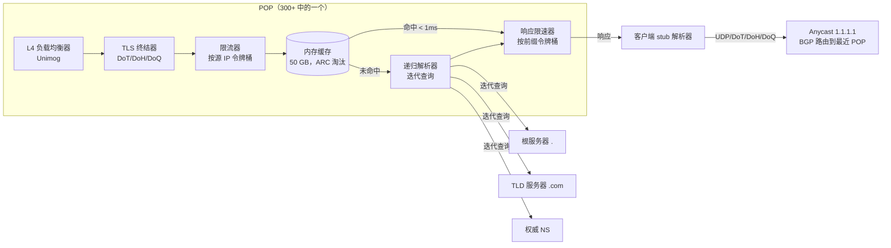
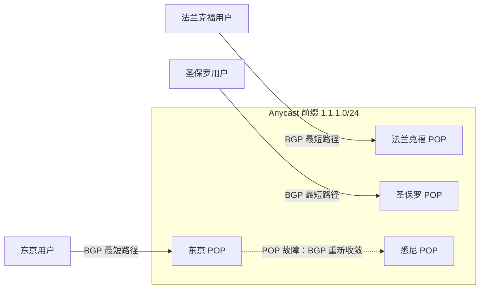
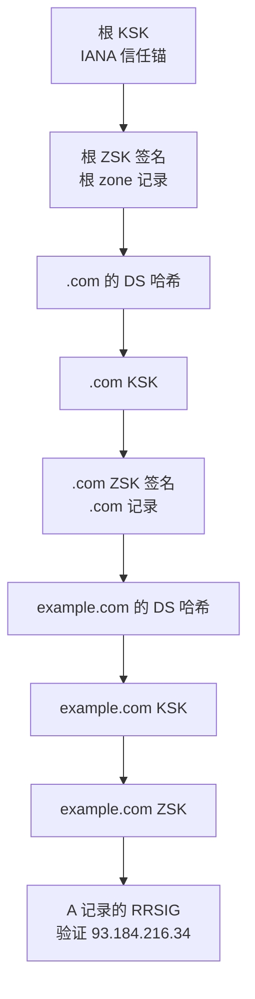
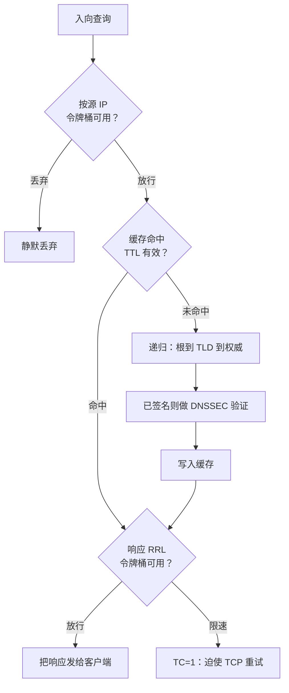

# 设计一个 DNS 服务（Cloudflare 1.1.1.1 / Google 8.8.8.8）

> **TL;DR.** 公共服务递归解析器回答的，是互联网上每一次 TCP 连接之前的那次查询。Cloudflare 1.1.1.1 每天从 300+ 个 anycast POP 处理 1.9 万亿次查询[^1]，Google 8.8.8.8 据称每天服务超过 1 万亿次[^2]。难的不是解析一个名字；难的是用一个 IPv4 地址服务整个互联网，把 P99 压在 20 ms 以内，扛住每秒数 Tbit 的放大式 DDoS，在延迟预算内完成 DNSSEC 验证，还要让每个 POP 那 50 GB 缓存在没有全局协调的情况下保持自洽。核心权衡在于：延迟（你不可能每次未命中都花 300 ms 从根开始走一遍）对生存能力（你的开放解析器本身就是一件可被武器化的放大器）。

## 学习目标

- 设计一个支持 2200 万+ qps 的全球 anycast 递归解析器，并能推算单个 POP 的容量
- 走完一次递归解析：从根到 TLD 再到权威服务器，每一步都做 DNSSEC 验证
- 对比 UDP/53、TCP/53、DoT/853、DoH/443、DoQ/853，并给出传输方式选择的理由
- 设计一个按 TTL 限定陈旧度的单 POP 缓存，包含否定缓存与抗扫描的淘汰策略
- 用源地址校验、响应限速（Response Rate Limiting）与 anycast 分流缓解放大式 DDoS
- 估算 Cloudflare 级别的解析器所需的存储、带宽与查询扇出

## 直觉理解

单机 DNS 解析器对家庭网络完全够用。装个 BIND，把路由器指向它，每个名字都能在几毫秒内从缓存里解析出来。10 个用户，这毫无难度。

到了 1000 万并发用户，三股力量会击垮这种朴素做法。第一是延迟。缓存未命中就要走根、TLD、权威三级，每一跳可能都在 50 ms 之外。面对数百万个不同域名，冷未命中占主导，P99 会冲过 500 ms。第二是 DDoS。单个 IP 上的开放解析器就是一件武器：攻击者发出带伪造源地址的 60 字节查询，你的服务器就朝着受害者反射出 4 KB 的 DNSSEC 签名响应。放大的倍数可以超过 50 倍。第三是可用性。单机单地域意味着一条 BGP 路径、一路供电、一个故障域。2016 年 Dyn 的权威 DNS 挂掉时，Twitter、Netflix、Reddit 全都不通[^6]。

打开这个设计的洞见是：用 BGP anycast 从 300 个地点同时宣告同一个 IP 地址。每个客户端的数据包都会路由到拓扑上最近的 POP，客户端零配置。DDoS 流量被摊到所有 POP 上，而不是集中打一个。每个 POP 跑自己的缓存、自己的限流器、自己的递归解析器。没有全局协调、没有分布式锁、没有跨 POP 失效通知。以 TTL 为边界的陈旧度是唯一的自洽保证，而这完全没问题，因为 DNS 从诞生第一天起就被设计成最终一致的系统[^5]。

## 需求

### 澄清问题

- **Q:** 是递归解析器（1.1.1.1）还是权威服务器（Route 53）？
  假设：递归。我们解析互联网上的任意名字，不托管 zone 文件。

- **Q:** 从第一天就要 DNSSEC 验证吗？
  假设：是。zone 已签名时验证信任链；未签名的 zone 直接返回不做验证。

- **Q:** 支持哪些加密传输？
  假设：默认 UDP/53，另加 DoT（RFC 7858）、DoH（RFC 8484）和 DoQ（RFC 9250）[^7][^8][^9]。

- **Q:** 隐私策略如何？
  假设：客户端 IP 日志留存不超过 24 小时。启用 QNAME 最小化（RFC 9156），限制泄露给根/TLD 服务器的信息[^17]。

- **Q:** 性能 SLA 是什么？
  假设：缓存命中 p50 < 10 ms、p99 < 20 ms；缓存未命中 p99 < 500 ms。在 POP 侧测量。

- **Q:** 第一天铺多少个 POP？
  假设：300+ 个地点，每个地址族一条 anycast /24 前缀。

### 功能需求

- 在 UDP/53、TCP/53、DoT/853、DoH/443、DoQ/853 上接受查询
- 解析 A、AAAA、CNAME、MX、TXT、NS、SRV、CAA 以及全部标准记录类型
- 逐级跟随 NS 委派，从根走到权威服务器
- 正向响应按其 TTL 缓存；NXDOMAIN/NODATA 按 RFC 2308 缓存[^15]
- zone 发布 DS/DNSKEY 记录时做 DNSSEC 验证
- DNSSEC 信任链断裂时返回 SERVFAIL，而不是悄悄返回未验证的数据

### 非功能需求

- **负载：** 稳态 2200 万 qps（每天 1.9 万亿次查询），事件期间峰值 2-3 倍[^1]
- **延迟：** 缓存命中 p50 < 10 ms、p99 < 20 ms；冷未命中 p99 < 500 ms
- **可用性：** 单 POP 99.99%；靠 anycast 故障切换在全球层面实际接近 100%
- **缓存命中率：** POP 层面 > 80%[^1]
- **DDoS 生存能力：** 在不降低服务质量的前提下吸收数 Tbps 的放大攻击

## 容量估算

| 指标 | 数值 | 推导 |
|--------|------:|------------|
| 每日查询量 | 1.9 万亿 | Cloudflare 1.1.1.1 于 2025 年 2 月公布[^1] |
| 稳态 QPS | ~22M | 1.9T / 86,400 |
| POP 数量 | 300+ | Cloudflare 网络[^1] |
| 单 POP 平均 QPS | ~73K | 22M / 300（分布不均；头部 POP 高出 5-10 倍） |
| 平均查询大小 | ~100 B | 12 B 头部 + 问题段 |
| 平均响应大小 | ~250 B | A 记录 + 权威段 + 附加段 |
| 入向带宽（全球） | ~2.2 GB/s | 22M × 100 B |
| 出向带宽（全球） | ~5.5 GB/s | 22M × 250 B |
| 单 POP 缓存条目 | ~1 亿 | 互联网上的活跃域名数 |
| 每条目内存 | ~500 B | qname + rrset + 元数据 + TTL |
| 单 POP 缓存内存 | ~50 GB | 1 亿 × 500 B |
| 缓存命中率 | > 80% | Cloudflare 公布数据[^1] |
| 上游扇出（未命中） | ~4.4M qps | 22M × 20% 未命中率 |

关键推导：

- **传输方式构成：** 86.6% UDP、9.6% DoT、2.0% TCP、1.7% DoH（2025 年 2 月）[^1]。DoQ 在增长，但仍不足 1%。
- **否定缓存：** RFC 2308 对 NXDOMAIN 规定默认 300 s TTL[^15]。没有它，拼写错误的洪流会直接砸向 TLD 权威服务器。
- **DNSSEC 开销：** 每次缓存未命中多约 10 ms 做签名验证；实际只有不到 20% 的查询落到已签名的 zone[^1]。

## API 与数据模型

### API 设计

DNS 用的是二进制线格式协议（RFC 1035），不是 REST。所谓“API”就是查询/响应的格式：

```text
QUERY (UDP/53, DoT/853, DoH/443, DoQ/853):
  Header: ID(16b), QR=0, RD=1, QDCOUNT=1
  Question: QNAME=example.com, QTYPE=A, QCLASS=IN

RESPONSE:
  Header: ID(match), QR=1, AA=0, RA=1, RCODE=NOERROR
  Answer: example.com A 93.184.216.34 TTL=3600
  Authority: example.com NS ns1.example.com
  Additional: ns1.example.com A 198.51.100.1

DoH variant (RFC 8484):
  POST https://1.1.1.1/dns-query
  Content-Type: application/dns-message
  Body: <wire-format query>
  Response: 200 OK, application/dns-message

  GET https://1.1.1.1/dns-query?dns=<base64url-encoded-query>
```

设计要点：

- **EDNS0（RFC 6891）：** 把 UDP 的 512 B 上限扩到 4096 B；带 RRSIG 的 DNSSEC 响应必须靠它。
- **TC 标志：** 响应超出协商缓冲时置 TC=1，客户端改用 TCP 重试。
- **0x20 编码：** 在 QNAME 里混用大小写（`eXaMpLe.CoM`）作为额外熵，对抗缓存投毒[^14]。

### 数据模型

```text
-- Per-POP in-memory cache (concurrent hash map)
key:   (qname, qtype, qclass, DO_bit, CD_bit)
value: {
    rrset:       []ResourceRecord,
    rrsig:       []RRSIG,          -- if DNSSEC-signed
    ttl_expiry:  unix_timestamp,
    insert_time: unix_timestamp,
    cache_class: POSITIVE | NXDOMAIN | NODATA | SERVFAIL
}
-- Partition key: fnv64(qname, qtype, DO, CD)[^16]
-- Eviction: ARC (scan-resistant, no single scan evicts working set)

-- Negative cache (separate store, shorter TTLs)
key:   (qname, qtype)
value: {
    soa_minimum: uint32,           -- from SOA MINIMUM field
    ttl_expiry:  unix_timestamp,
    nxdomain:    bool
}

-- Rate-limit state (per-POP shared memory)
key:   source_ip_prefix (/32 for IPv4, /48 for IPv6)
value: {
    tokens:      float64,
    last_refill: unix_timestamp
}
```

## 高层架构



*每个 POP 都是一个带自己缓存的独立解析器。anycast 把客户端路由到最近的 POP，无需 GSLB，也无需客户端配置。DDoS 会自动摊到全部 300+ 个 POP 上。*

**写路径（填充缓存）：** 缓存未命中时，解析器迭代查询根、TLD 与权威服务器。每个响应都做校验（已签名则验 DNSSEC），然后按权威 TTL 写入本地缓存。不存在跨 POP 传播。

**读路径（缓存命中）：** 查询到达，穿过限流器，在 1 ms 内命中缓存，再穿过响应限速器，返回客户端。超过 80% 的查询走这条路径[^1]。

**DDoS 路径：** 入向限流在流量抵达缓存之前就丢弃洪流。出向的响应限速（RRL）对发往同一 /24 前缀的重复响应进行限速，迫使正常客户端改用 TCP 重试，同时丢弃放大流量[^4]。

## 深入探讨

### Anycast 路由与 BGP 存活能力

每个 POP 都与本地 transit 和 IXP 建立 BGP 对等，宣告同一条 /24 前缀（1.1.1.0/24）[^18]。客户端所属的 ISP 按最短 AS 路径选出拓扑上最近的源。没有 GeoDNS，没有 GSLB，也没有客户端侧的故障切换逻辑。

**为什么 anycast 适合 DNS：** DNS 查询是无状态的 UDP 数据报。TCP 不一样——连接中途改路由会直接把会话搞坏；而一次 DNS 查询-响应只用一个往返就结束。某个 POP 挂了，BGP 在数秒到数分钟内重新收敛，后续查询自然走次近的 POP。客户端还会自己重试（stub 解析器在 1-5 秒后重试）。

**BGP 风险：** anycast 的阿喀琉斯之踵就是 BGP 本身。路由泄露和劫持可以让这条前缀在全球范围内被黑洞。2018 年 5 月，上线约八周后，AS58879（上海安畅网络）短暂宣告了 1.1.1.0/24；Hurricane Electric（AS6939）在其他对等体过滤之前先把这条泄露传播了出去，劫持持续不到两分钟[^20]。Cloudflare 2024-06-27 的事故则是劫持加路由泄露，使一小部分用户的 1.1.1.1 服务质量下降[^18]。2025 年，一次内部配置变更意外撤销了前缀 62 分钟[^19]。

**缓解手段：** 为该前缀配置 RPKI 路由源授权（ROA）；自动化 BGP 监控，秒级发现异常撤销；要求对等体只接受 RPKI 校验通过的源；以及为快速重新宣告准备运维手册。



*anycast 把每个客户端路由到拓扑上最近的 POP。POP 故障时 BGP 重新收敛，流量在数秒内切到次近的源。*

### DNSSEC 信任链与验证

DNSSEC 提供密码学证明：一个 DNS 响应在权威服务器与解析器之间没有被篡改[^12]。没有它，缓存投毒攻击（Kaminsky 2008，CVE-2008-1447）就能靠灌入伪造响应，把 `bank.com` 指向攻击者控制的 IP[^14]。

**信任链：** IANA 根 KSK 是信任锚。每个 zone 有一个密钥签名密钥（KSK）签 DNSKEY RRset，一个 zone 签名密钥（ZSK）签其他所有记录。父 zone 发布 DS 记录，里面是子 zone KSK 的哈希。验证过程逐级走：根 KSK 签根 DNSKEY，根 ZSK 签 `.com` 的 DS，`.com` KSK 签 `.com` DNSKEY，`.com` ZSK 签 `example.com` 的 DS，一路下到目标的 RRSIG[^12]。

**性能代价：** 每次缓存未命中多约 10 ms 做密码学验证。验证一次后，结果连同 RRSIG 一起缓存，后续命中不再付验证成本。实践中不到 20% 的查询落到已签名 zone[^1]。约 93% 的 gTLD 已签名，ccTLD 只有约 65%[^1]。

**故障模式：** 单条配错的签名（RRSIG 过期、DS 哈希不对）会让所有做验证的解析器对该域名返回 SERVFAIL。DNSSEC 是“非常不宽容的”[^13]。Cloudflare 实现了否定信任锚（Negative Trust Anchor），对已知配置错误的 zone 临时跳过验证，避免运维失误变成用户可见的故障。



*根 KSK 锚定信任。每层父 zone 发布子 zone KSK 的 DS 哈希，构成一条到目标记录 RRSIG 的不断链的密码学链条。*

### DDoS 缓解与响应限速

开放递归解析器天生可被武器化。攻击者发出一个 60 字节的查询，源地址伪造成受害者 IP；解析器就把 4 KB+ 的 DNSSEC 签名响应发往受害者。放大倍数超过 50 倍[^4]。解析器在自己毫不知情的情况下变成了一个打流量工具。

**防御分层：**

1. **BCP 38 源地址校验：** 上游 ISP 应丢弃源地址伪造的包。并未普遍部署，但能缩小攻击面。
2. **入向按源 IP 限流：** 令牌桶以源 /32（IPv4）或 /48（IPv6）为键。在洪流消耗解析器 CPU 之前就丢弃。
3. **出向响应限速（RRL）：** 来自 ISC Technical Note 2012-1 的经典机制[^4]。令牌桶以（源前缀，响应类别）为键。每个重复响应扣一个令牌；桶空时响应被丢弃或截断（置 TC=1，迫使正常客户端改用 TCP 重试）[^21]。
4. **anycast 稀释：** 攻击流量被摊到 300+ 个 POP，没有单个 POP 需要承受全部流量。
5. **丢弃 ANY 查询：** `ANY` 查询类型返回一个名字下的全部记录，能产出最大的响应。现代解析器只返回最小答案，或者干脆拒绝 ANY[^21]。

**Dyn 的教训：** 2016-10-21，Mirai 僵尸网络（约 10 万台 IoT 设备）在两波主要攻击窗口加后续余震中冲击 Dyn 的权威 DNS；Dyn 观测到包流突增到正常值的 40-50 倍，并指出外界约 1.2 Tbps 的估计无法用他们自己的数据核实[^6][^22]。Twitter、Netflix、GitHub、Reddit 全部不可达。爆炸半径之所以被放大，是因为很多站点只用了 Dyn 的 nameserver。设计教训：多供应商冗余与 shuffle-sharding（Route 53 用 2,048 个虚拟 nameserver，组合出约 7300 亿种分片方案）[^3] 对权威 DNS 是必需的。



*入向查询先过按源 IP 的限流，再走缓存快路径。响应在出向之前先过 RRL。被限速的响应置 TC=1，迫使正常客户端改用 TCP 重试，而放大流量被丢弃。*

### 缓存架构与否定缓存

缓存是性能引擎。超过 80% 的查询在 1 ms 内由缓存答复[^1]。设计难点在于：既要把命中率做到最高，又要抗扫描攻击，还要优雅地处理 TTL 过期。

**缓存结构：** 单 POP 内存哈希表，约 1 亿条目、每条约 500 B（约 50 GB）。缓存键包含（qname、qtype、DO 位、CD 位），因为支持 DNSSEC 和不支持的客户端对同一个名字可以合法地收到不同答案[^16]。

**淘汰：** Cloudflare 的 BigPineapple 使用自适应替换缓存（ARC），靠维护最近被淘汰条目的影子列表来抗扫描攻击[^16]。一次 zone 枚举扫描无法把工作集冲掉。

**否定缓存（RFC 2308）：** NXDOMAIN 与 NODATA 响应用 SOA 的 MINIMUM 字段作为 TTL 缓存（默认 300 s）[^15]。没有否定缓存，一个拼错的域名或恶意软件的信标反复查询 `random123.example.com` 上百万次，就会把 `.com` TLD 的权威服务器打垮。

**TTL 过期时的惊群：** 一个热门域名的 TTL 到期时，300+ 个 POP 会同时向上游发查询。缓解办法：stale-while-revalidate（先把过期记录再发几秒，同时异步刷新）；在 TTL 到期前预取热门条目；在 POP 内对进行中的查询去重，使同一个（qname，qtype）即使同时有上千个客户端在问，也只发一次上游调用[^16]。

**POP 内的一致性哈希：** 同一注册域名下的查询被导向 POP 内同一批节点，减少重复的上游查询，从而提高缓存命中率[^16]。

## 真实案例

**Cloudflare 1.1.1.1（BigPineapple）** 于 2018 年 4 月 1 日上线，建立在 CZ NIC 的 Knot Resolver 之上，看重的是它久经考验的 DNSSEC 验证能力[^11]。团队在外面套上了 Cloudflare 的边缘技术栈：Unimog（L4 负载均衡器）在 POP 内分发查询，TLS 终结器处理 DoT/DoH，Quicksilver 在数秒内把配置推到全球。

此后团队把 C 语言写的核心换成了跑在 tokio 异步运行时上的 Rust 解析器，重写插件系统改用 WebAssembly 沙箱（借助 Wasmer），并用基于 ARC 的缓存替换了 LMDB 缓存，以抗 zone 枚举扫描[^16]。Wasm 插件运行在隔离的内存空间中，可以通过 Quicksilver 全球热切换，其内存拷贝开销由实例化时的共享内存映射摊薄。

**规模（2025 年 2 月）：** 每天 1.9 万亿次查询（稳态约 2200 万 qps），来自约 250 个国家的 300+ 个 POP[^1]。缓存命中率超过 80%。传输构成：86.6% UDP、9.6% DoT、2.0% TCP、1.7% DoH。QNAME 最小化自上线起默认开启[^11]。隐私承诺：不存储客户端 IP，日志 24 小时内删除，并经独立审计。

**塑造了这套架构的故障：** 2024 年一次 BGP 劫持加路由泄露使一小部分用户的服务质量下降[^18]。2025 年一次内部配置变更意外撤销 anycast 前缀 62 分钟[^19]。2026 年一次代码变更重排了 CNAME 记录顺序，导致部分客户端解析失败[^23]。每次事故都推动了改进：BGP 异常自动检测、前缀撤销熔断器、更严格的响应排序测试。

非专家最容易漏掉的一点：对 DNS 来说 DDoS 不是边缘情况，它就是设计驱动力。每一个架构决策（anycast、RRL、POP 相互独立、不做跨 POP 状态）之所以存在，都是因为这个服务必须扛住持续不断的攻击。

## 权衡

| 方案 | 优点 | 缺点 | 适用场景 |
|----------|------|------|-------------|
| Anycast DNS | 低延迟，能吸收 DDoS，客户端零配置 | 依赖 BGP；单 POP 排障痛苦 | 公共解析器（1.1.1.1、8.8.8.8、9.9.9.9） |
| 单播 + GeoDNS | 路由简单；单个 POP 便于排障 | 延迟更高；需手工故障切换；依赖 GSLB | 企业内网 DNS |
| DoT（RFC 7858） | 加密；专用端口便于过滤 | 握手 1-3 个 RTT；部分网络会封 | 注重隐私的移动 OS 默认配置 |
| DoH（RFC 8484） | 与 HTTPS 无法区分，难以封锁 | 把 DNS 集中到浏览器；破坏 ISP 的管控 | 浏览器内置解析器 |
| DoQ（RFC 9250） | 0-RTT 恢复；无 TCP 队头阻塞 | 生态尚早期；采用率 < 1% | 下一代加密传输 |
| 明文 UDP/53 | 1 个 RTT，开销极小，普遍支持 | 可伪造源，无隐私，大响应要靠 TC 回退 | 兼容旧系统、内网 |
| DNSSEC 验证 | 击退缓存投毒；密码学完整性 | 每次未命中多约 10 ms；配置错误的 zone 直接不通 | 以安全为先的解析器（Quad9） |

最关键的元决策：**POP 独立 vs. 跨 POP 协调。** POP 独立意味着没有全局锁、没有分布式缓存失效、没有单点故障。代价是以 TTL 为边界的陈旧度和跨 POP 的重复上游查询。跨 POP 的 gossip 能提升缓存效率，但会把写路径放大 300 倍，并引入一种协调失败模式。所有生产环境的公共解析器都选择 POP 独立。

## 扩展与故障模式

**10 倍负载（2.2 亿 qps）：**

- 单 POP 平均 QPS 升到约 73 万。头部 POP 达到 300-700 万 qps。POP 内横向扩展（Unimog 后面加更多解析节点）可以应对。
- 随着长尾域名被查询，缓存内存压力上升。ARC 淘汰让工作集保持热态。
- 上游权威服务器看到的未命中多 10 倍。预取和 stale-while-revalidate 削平尖峰。

**100 倍负载（22 亿 qps）：**

- anycast 前缀需要从 1000+ 个 POP 宣告，才能维持每个 POP 的余量。
- DoH/DoT 的 TLS 终结成为 CPU 瓶颈。需要硬件加速（AES-NI、内核 TLS offload）。
- BGP 收敛时间更关键：100 倍负载下，60 秒的重新收敛意味着故障 POP 上 60 秒的查询丢失。

**1000 倍负载（220 亿 qps）：**

- 架构转变：边缘计算模式，解析器跑在每一台 CDN 边缘服务器上（Cloudflare 已经是这样）。没有专门的“DNS POP”，每台服务器都是解析器。

**故障模式：**

- **BGP 劫持/泄露：** 上游 AS 宣告了解析器的前缀，把流量黑洞掉。应对：RPKI ROA、自动监控、快速重新宣告。爆炸半径受 anycast 限制（只有受影响的 AS 失去服务）[^18][^19]。
- **DNSSEC 密钥轮换失败：** KSK/ZSK 配错会让整个 zone 在验证型解析器上不可用。应对：否定信任锚对该 zone 临时跳过验证[^13]。
- **放大式 DDoS：** 攻击者把解析器当武器打向受害者。应对：出向 RRL、上游 BCP 38、anycast 稀释[^4]。

## 常见陷阱

> [!WARNING]
> **把 DNS 当成简单查询。** DNS 是一个分布式、最终一致、分层的数据库，带缓存、委派、密码学验证和限流。候选人一句“去问 nameserver 就行了”，就把整个设计空间跳过去了。

> [!WARNING]
> **把 DDoS 当补充章节。** 对公共解析器来说 DDoS 是设计驱动力，不是第 9 节才该操心的事。限流和 RRL 是承重结构，不是可选功能[^4]。

> [!WARNING]
> **以为需要跨 POP 缓存失效。** DNS 本来就是按 TTL 限定陈旧度设计的。加跨 POP gossip 会引入一种协调失败模式，并把写放大 300 倍，换来的新鲜度收益微乎其微。

> [!WARNING]
> **忘了否定缓存。** 没有 RFC 2308 否定缓存，一个拼写错误或一个恶意软件信标，就能用数百万次相同的 NXDOMAIN 查询把 TLD 权威服务器打垮[^15]。

> [!WARNING]
> **只用一家 DNS 供应商。** Dyn 2016 的宕机证明了单供应商的权威 DNS 就是单点故障。多供应商或 shuffle-sharding 是必需的[^6][^3]。

> [!WARNING]
> **忽视 Kaminsky 攻击。** 2008 年之前的解析器用的是可预测的事务 ID。源端口随机化、0x20 编码和 DNSSEC 都不是可选项，而是生产解析器的最低门槛[^14]。

## 追问

**1. 你会怎么设计一个权威 DNS 服务（Route 53 的数据平面）？**

用 shuffle-sharding 把 2,048 个虚拟 nameserver 分成组，可以组合出约 7300 亿种唯一分片方案[^3]。每个客户的 zone 从不同的 shard 组里分到 4 个 nameserver。针对某个客户 zone 的 DDoS 无法完全影响到另一个 zone，因为任意两个客户最多只有 2 个 nameserver 相同。

**2. Chrome 的 Secure DNS 在 DoH 失败时怎么回退？**

Chrome 先向配置的解析器尝试 DoH。超时（2 s）后回退到系统解析器，走明文 UDP。用户会看到短暂延迟，但不会硬失败。有这条回退路径，意味着 DoH 不是可达性的硬依赖。

**3. 你会怎么实时检测并缓解大规模缓存投毒尝试？**

监控 TXID 不匹配率和每个源的未经请求响应量。出现尖峰就说明有投毒尝试。缓解：临时提高源端口熵、对目标域名启用 0x20 编码、即使 zone 未签名也强制 DNSSEC 验证（宁可返回 SERVFAIL，也不返回被投毒的数据）。

**4. 跨多地域部署时，你怎么实现基于 DNS 的负载均衡？**

权威服务器根据解析器的 EDNS Client Subnet（ECS）或解析器自身 IP 返回不同的 A 记录。加权、基于延迟、基于地理位置的策略来引导流量。健康检查把不健康的 IP 从响应集合中剔除。CDN 视角见 [内容分发网络](../part-2-building-blocks/02-cdns.md)。

**5. 一个必须拦截恶意域名的企业解析器，有哪些权衡？**

Quad9（9.9.9.9）聚合了 25+ 家威胁情报供应商，对已知恶意域名返回 NXDOMAIN[^10]。权衡：误报会挡掉正常站点；把过滤版（9.9.9.9）和不带过滤版（9.9.9.10）分到不同 IP，让用户自己选。RPZ（Response Policy Zones）是本地部署时 BIND 原生的替代方案。

**6. 你怎么处理 IPv6 过渡和双栈解析？**

同时返回 A 和 AAAA 记录。客户端用 Happy Eyeballs（RFC 8305）让 IPv4 与 IPv6 连接赛跑，优先 IPv6，但在 250 ms 内回退到 IPv4。解析器在上游路径上也要同时处理两个地址族。

## 练习

### 练习 1：为新 POP 做容量估算

你要在孟买上线一个新 POP，峰值服务 50 万 qps。初期缓存命中率预计 75%（低于全球的 80%，因为缓存是冷的）。缓存需要多少内存？预热期间每秒有多少上游查询打到权威服务器？

<details>
<summary>提示</summary>

想想第一个小时内会被查询的不同域名有多少、平均条目大小（500 B），以及在 75% 命中率下 50 万 qps 对应的未命中率。

</details>

<details>
<summary>解答</summary>

**缓存内存：** POP 会先看到最热门域名的查询。假设头几个小时缓存填满 5000 万条唯一条目。按每条 500 B：5000 万 × 500 B = 25 GB。按全球单 POP 标准预留 50 GB，也为增长留空间。

**上游扇出：** 命中率 75%，则 50 万 qps 的 25% = 12.5 万 qps 打到权威服务器。每次未命中走 2-4 跳（根几乎总在缓存里，所以通常是 TLD + 权威 = 每次未命中 2 次上游查询）。上游总计：12.5 万 × 2 = 预热期每秒 25 万次上游查询。

**预热时长：** 随着缓存填充，命中率会爬向 80%+。以 50 万 qps 服务约 1 小时后，最热门的域名都已缓存，上游负载降到稳态 50 万 × 0.2 × 2 = 20 万 qps。

**接受的权衡：** 25 GB 够预热用，但你要备 50 GB，因为域名长尾会在几天里持续增长。预热期 12.5 万 qps 的上游负载可以接受，因为它会分散到全球数十万台权威服务器上。

</details>

## 要点回顾

- **anycast 用一个 IP 服务整个互联网。** GeoDNS 要用很多 IP。公共解析器选 anycast，因为它零客户端配置，且能自动分散 DDoS。
- **DDoS 是设计驱动力，不是补丁。** 限流、RRL、anycast 吸收，对任何开放解析器都是承重结构。
- **每个 POP 相互独立。** 没有跨 POP 协调、没有全局锁、没有分布式缓存。以 TTL 为边界的陈旧度是唯一的自洽保证。
- **否定缓存保护整个层级。** RFC 2308 的 NXDOMAIN 缓存防止拼写错误洪流把 TLD 权威服务器打垮。
- **DNSSEC 是唯一完整的缓存投毒防御。** 源端口随机化和 0x20 编码只是抬高门槛；DNSSEC 把它变成密码学问题。
- **五种传输方式各有位置。** UDP（默认）、TCP（回退）、DoT（隐私）、DoH（抗审查）、DoQ（下一代加密传输，带 0-RTT）。

## 延伸阅读

- [Introducing DNS Resolver 1.1.1.1](https://blog.cloudflare.com/dns-resolver-1-1-1-1/)。上线博文，覆盖 Knot Resolver 的选型、QNAME 最小化、DoT/DoH 与激进的否定缓存。
- [How Rust and Wasm power Cloudflare's 1.1.1.1](https://blog.cloudflare.com/big-pineapple-intro/)。BigPineapple 内部细节：ARC 缓存、tokio 运行时、Wasm 插件沙箱、POP 内一致性哈希。
- [Some TXT about new DNS insights on Cloudflare Radar](https://blog.cloudflare.com/new-dns-section-on-cloudflare-radar/)。2025 年查询量、传输构成、缓存命中率与 DNSSEC 采用率的权威数字。
- [Workload isolation using shuffle-sharding](https://aws.amazon.com/builders-library/workload-isolation-using-shuffle-sharding/)。Colm MacCarthaigh 讲 Route 53 如何用 2,048 个虚拟 nameserver 做 DDoS 隔离。
- [ISC Technical Note 2012-1: Response Rate Limiting](https://www.isc.org/pubs/tn/isc-tn-2012-1.txt)。最初的 RRL 规范，用来保护权威服务器不被放大滥用。
- [RFC 4033: DNS Security Introduction and Requirements](https://www.rfc-editor.org/rfc/rfc4033)。DNSSEC 架构规范。
- [DDoS attacks on Dyn (Wikipedia)](https://en.wikipedia.org/wiki/DDoS_attacks_on_Dyn)。2016-10-21 Mirai 事件的公开记录，那次事故让美国东海岸半个互联网下线。

## 记忆卡片

<details>
<summary><strong>Q: 公共服务 DNS 解析器为什么用 anycast 而不是 GeoDNS？</strong></summary>

A: anycast 通过 BGP 从 300+ 个 POP 宣告同一个 IP。客户端零配置就路由到最近的 POP，DDoS 流量自动摊到所有 POP。GeoDNS 需要给客户端暴露多个 IP，还要手写故障切换逻辑。

</details>

<details>
<summary><strong>Q: 什么是响应限速（RRL），为什么它对 DNS 必需？</strong></summary>

A: RRL 是一个以（源前缀，响应类别）为键的令牌桶。它限速发往同一 /24 的重复响应，丢弃放大流量，同时通过 TC=1 迫使正常客户端改用 TCP 重试。没有 RRL，开放解析器就是一件 50 倍放大器。

</details>

<details>
<summary><strong>Q: DNSSEC 如何阻止缓存投毒？</strong></summary>

A: DNSSEC 用 RRSIG 记录对 RRset 签名。信任从 IANA 根 KSK 出发，经每一级委派的 DS 记录往下传递。解析器验证整条密码学链；伪造响应无法通过签名验证，会被丢弃。

</details>

<details>
<summary><strong>Q: 什么是否定缓存（RFC 2308），为什么重要？</strong></summary>

A: 否定缓存把 NXDOMAIN 和 NODATA 响应缓存起来，TTL 取自 SOA 的 MINIMUM 字段（默认 300 s）。没有它，拼写错误和恶意软件信标会用数百万次对不存在域名的相同查询把 TLD 权威服务器打垮。

</details>

<details>
<summary><strong>Q: 为什么公共解析器不在 POP 之间同步缓存？</strong></summary>

A: 跨 POP 失效会把写路径放大 300 倍，并引入一种协调失败模式。DNS 本来就是按 TTL 限定陈旧度设计的。每个 POP 独立运行；唯一的自洽保证就是 TTL 到期。

</details>

<details>
<summary><strong>Q: 2016 年的 Dyn DDoS 攻击发生了什么？</strong></summary>

A: Mirai 僵尸网络（约 10 万台 IoT 设备）在两波主要攻击窗口中冲击 Dyn 的权威 DNS，包流突增到正常值的 40-50 倍（外界报告约 1.2 Tbps，但 Dyn 无法核实）。Twitter、Netflix、GitHub、Reddit 不可达，因为它们只用了 Dyn 的 nameserver。教训：多供应商的 DNS 冗余是必需的。

</details>

<details>
<summary><strong>Q: 什么是 QNAME 最小化（RFC 9156）？</strong></summary>

A: 做最小化的解析器不会把完整查询名发给层级里的每台服务器，而是只问拿到下一级 NS 委派所需的那几个标签。根服务器只看到“com”，看不到“secret.internal.example.com”。这限制了隐私泄露。

</details>

<details>
<summary><strong>Q: 五种 DNS 传输协议及各自端口是什么？</strong></summary>

A: UDP/53（默认，1 个 RTT）、TCP/53（大响应的回退）、DoT/853（TLS 封装，RFC 7858）、DoH/443（HTTPS 隧道，RFC 8484）、DoQ/853（基于 QUIC，RFC 9250，支持 0-RTT 恢复）。

</details>

<details>
<summary><strong>Q: Kaminsky 攻击怎么工作，如何缓解？</strong></summary>

A: 2008 年之前的解析器使用 16 位事务 ID 和固定源端口。攻击者灌入伪造响应，对 TXID 做生日攻击。缓解手段：源端口随机化（增加 16 位熵）、QNAME 的 0x20 大小写编码、DNSSEC 验证。

</details>

<details>
<summary><strong>Q: Cloudflare BigPineapple 的缓存淘汰策略是什么，为什么这么选？</strong></summary>

A: BigPineapple 使用自适应替换缓存（ARC），维护最近被淘汰条目的影子列表。ARC 抗扫描攻击：一次 zone 枚举扫描无法冲掉工作集，而 LRU 会把所有热条目都淘汰掉。

</details>

## 参考文献

[^1]: David Belson et al., "Some TXT about, and A PTR to, new DNS insights on Cloudflare Radar", Cloudflare Blog, 2025-02-27. https://blog.cloudflare.com/new-dns-section-on-cloudflare-radar/

[^2]: "Google Public DNS", Platform Engineering, 2024. https://platformengineering.org/tools/google-public-dns

[^3]: Colm MacCarthaigh, "Workload isolation using shuffle-sharding", Amazon Builders' Library. https://aws.amazon.com/builders-library/workload-isolation-using-shuffle-sharding/

[^4]: "Response Rate Limiting in the Domain Name System (DNS RRL)", ISC Technical Note 2012-1. https://www.isc.org/pubs/tn/isc-tn-2012-1.txt

[^5]: P. Mockapetris, "Domain Names - Concepts and Facilities", RFC 1034, 1987. https://www.rfc-editor.org/rfc/rfc1034

[^6]: "DDoS attacks on Dyn", Wikipedia. https://en.wikipedia.org/wiki/DDoS_attacks_on_Dyn

[^7]: Z. Hu et al., "Specification for DNS over Transport Layer Security (TLS)", RFC 7858, 2016. https://www.rfc-editor.org/rfc/rfc7858

[^8]: P. Hoffman and P. McManus, "DNS Queries over HTTPS (DoH)", RFC 8484, 2018. https://www.rfc-editor.org/rfc/rfc8484

[^9]: C. Huitema et al., "DNS over Dedicated QUIC Connections", RFC 9250, 2022. https://www.rfc-editor.org/rfc/rfc9250

[^10]: "Quad9: A public and free DNS service", Quad9 Foundation. https://quad9.net/

[^11]: Olafur Gudmundsson, "Introducing DNS Resolver, 1.1.1.1 (not a joke)", Cloudflare Blog, 2018-04-01. https://blog.cloudflare.com/dns-resolver-1-1-1-1/

[^12]: R. Arends et al., "DNS Security Introduction and Requirements", RFC 4033, 2005. https://www.rfc-editor.org/rfc/rfc4033

[^13]: "Troubleshooting DNSSEC", Cloudflare DNS Docs. https://developers.cloudflare.com/dns/dnssec/troubleshooting/

[^14]: "CVE-2008-1447", National Vulnerability Database. https://nvd.nist.gov/vuln/detail/cve-2008-1447

[^15]: M. Andrews, "Negative Caching of DNS Queries (DNS NCACHE)", RFC 2308, 1998. https://www.rfc-editor.org/rfc/rfc2308

[^16]: Anbang Wen and Marek Vavrusa, "How Rust and Wasm power Cloudflare's 1.1.1.1", Cloudflare Blog, 2023-02-28. https://blog.cloudflare.com/big-pineapple-intro/

[^17]: S. Bortzmeyer and R. Dolmans, "DNS Query Name Minimisation to Improve Privacy", RFC 9156, 2021. https://www.rfc-editor.org/rfc/rfc9156

[^18]: "Cloudflare 1.1.1.1 incident on June 27, 2024", Cloudflare Blog, 2024-07-04. https://blog.cloudflare.com/cloudflare-1111-incident-on-june-27-2024/

[^19]: "Cloudflare 1.1.1.1 incident on July 14, 2025", Cloudflare Blog, 2025-07-15. https://blog.cloudflare.com/cloudflare-1-1-1-1-incident-on-july-14-2025/

[^20]: Aftab Siddiqui, "APNIC Labs/Cloudflare DNS 1.1.1.1 Outage: Hijack or Mistake?", Internet Society Blog, 2018-05. https://www.internetsociety.org/blog/2018/05/cloudflare-1-1-1-1-outage/

[^21]: "Using Response Rate Limiting (RRL)", ISC Knowledge Base, 2018-04-24. https://kb.isc.org/docs/aa-00994

[^22]: Scott Hilton via Help Net Security, "Dyn DDoS attack post-mortem", 2016-10-27. https://web.archive.org/web/20260525120553/https://www.helpnetsecurity.com/2016/10/27/dyn-ddos-post-mortem/

[^23]: Sebastiaan Neuteboom, "What came first: the CNAME or the A record?", Cloudflare Blog, 2026-01-14. https://blog.cloudflare.com/cname-a-record-order-dns-standards/
