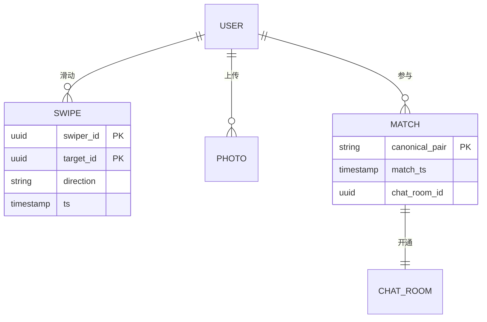
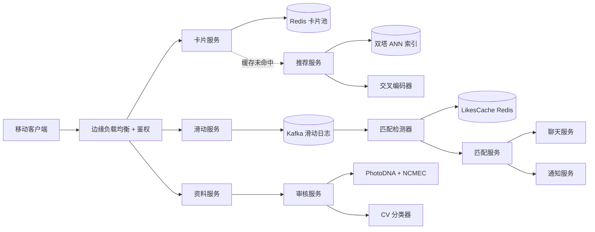
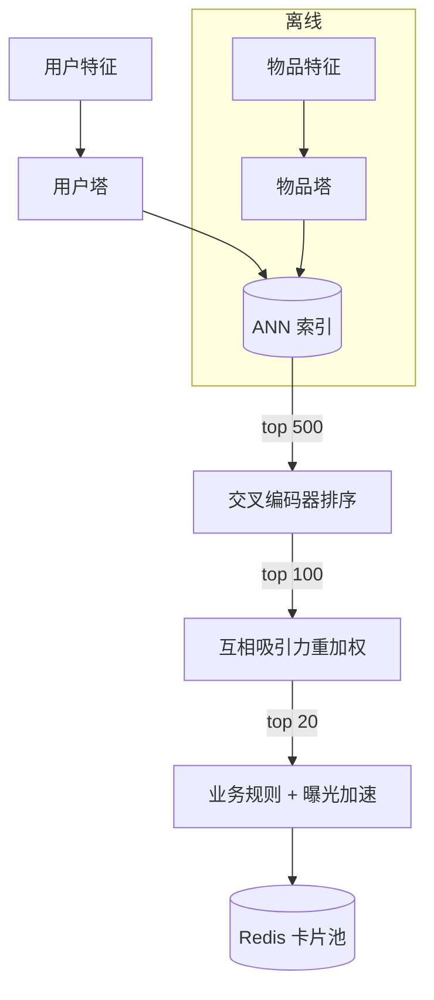
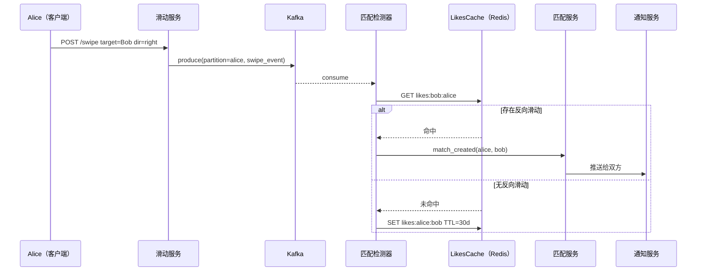
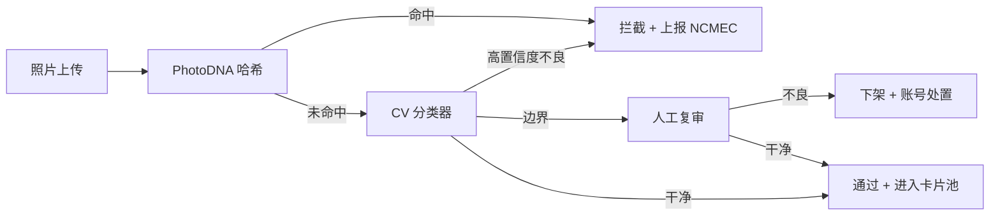

# 设计一个约会应用（Tinder / Hinge / Bumble）

> **TL;DR.** 约会应用本质上是一个对延迟极度敏感的推荐引擎，外面挂着一个地理位置过滤器、一个由 Kafka 支撑的互相匹配检测器，以及一条内容审核流水线。Tinder 每天处理约 16 亿次滑动[^1]，而卡片加载的 P99 预算只有 50 ms。最关键的权衡是：推荐排序必须为互相匹配（一个双向结果）优化，而不是为单向的互动量优化，否则市场就会滑向死亡螺旋，把大多数用户赶走。我们按 1 亿 MAU 来设计：双塔候选生成器、交叉编码器排序器、互相吸引力重加权、地理分片的 Elasticsearch，以及一条发布前安全级联。

## 学习目标

- 设计一条滑动链路，在全球扇出下承接每秒 5 万次写入，同时保持 P99 卡片加载低于 50 ms
- 比较互相匹配、必须先回复、女性先发消息三种互动模型，并给出选择理由
- 构建由双塔加交叉编码器组成的推荐级联，并叠加互相吸引力重加权
- 实现按 Kafka 分区的互相匹配检测器，能在明星用户造成的热点分区下存活
- 把安全级联（CSAM 哈希比对、虚假身份检测、身份验证）当作一等系统来设计

## 直觉理解

约会应用看起来就是一个带滑动按钮的 CRUD 应用。存用户资料、发卡片、记点赞。一千个用户，一台 PostgreSQL 就绰绰有余。

到了 1000 万日活、每人一次会话滑动 150 次，你就撞上了每天 15 亿次滑动事件，峰值大约每秒 5 万次[^1]。每次滑动都会触发四个代价不小的副作用：往分区事件日志写一条记录、做一次反向滑动查询以判断是否互相匹配、如果这次滑动是负向的就刷新推荐、以及对目标资料里的内容做一次审核判定。把这些全部塞进 50 ms 的卡片加载预算里，才是约会应用和普通信息流的真正差别。

第二个压力来自商业模型。只有大约 10% 的用户付费[^2]，所以排序器不能退化成“先把付费用户排前面”，那会毁掉填满漏斗顶部的免费体验。推荐引擎必须为互相吸引优化，而不是为单向互动优化，否则这个市场就死了。

打开设计思路的那个洞察是：为了写入吞吐量，滑动日志按 swiper_id 分区；但匹配检测器要按规范配对键（`min(a,b):max(a,b)`）分区，这样一次潜在匹配的两半必然落到同一个 worker 上。整套架构的精髓就在这个不对称上。

## 需求

### 澄清性问题

- **问：采用哪种互动模型：互相匹配（Tinder）、必须先回复（Hinge），还是女性先发消息（Bumble）？**
  假设：以互相匹配为主流程，设计上可扩展到“必须先回复”。
- **问：半径是只限同城，还是全球范围加旅行模式？**
  假设：默认 100 公里半径，另配 Passport／旅行模式覆盖全球。
- **问：推荐模型是规则驱动还是机器学习个性化？**
  假设：机器学习个性化，候选生成用双塔，排序用交叉编码器。
- **问：身份验证做到什么程度？**
  假设：新用户强制做照片验证（自拍视频活体检测）[^3]。
- **问：对 CSAM 和虚假身份采取什么安全姿态？**
  假设：发布前做 CSAM 哈希比对；发布后跑 CV 分类器；边界情况走人工复审。
- **问：订阅模式如何设计？**
  假设：免费档带滑动次数限制；付费档（Plus、Gold、Platinum）提供曝光加速和可见性功能[^4]。

### 功能需求

- 查看候选资料的排序卡片流（预取 20 张卡片）
- 对候选左滑（跳过）、右滑（喜欢）或超级喜欢
- 检测双向右滑，并原子地开出一个聊天室
- 资料照片要上传并通过审核后才出现在卡片流里
- 拉黑、举报、解除匹配
- 订阅付费档，获得曝光加速和可见性功能

### 非功能需求

- **负载：** 每天 16 亿次滑动，峰值每秒 5 万次；1 亿 MAU，1000 万 DAU[^1]
- **延迟：** P99 卡片加载 < 50 ms；匹配通知 < 2 秒
- **可用性：** 读路径 99.95%，写路径 99.9%
- **一致性：** 推荐走最终一致（允许 30 秒陈旧）；匹配创建必须强一致
- **安全：** 发布前 CSAM 检测；强制身份验证；GDPR 要求 30 天内完成数据擦除

## 容量估算

| 指标 | 数值 | 推导 |
|--------|------:|------------|
| 每日滑动次数 | 16 亿 | Tinder 公布的数字[^1] |
| 峰值滑动 QPS | 5 万 | 1.6B / 86,400 × 3 倍峰值系数（取整） |
| 每日匹配数 | 1600 万 | 约 1% 互相匹配率 × 1.6B |
| 每秒匹配数（Dating Sunday 均值） | 380 | Tinder 公布的 Dating Sunday 平均值[^5] |
| 单条滑动事件大小 | 256 B | swiper_id + target_id + direction + ts + metadata |
| 滑动带宽 | 13 MB/s | 50K/s × 256 B |
| 卡片素材带宽 | 200 TB/天 | 20 张 × 200 KB × 5 次会话 × 1000 万 DAU |
| 照片存储 | 500 TB | 1 亿用户 × 10 张照片 × 500 KB |
| 匹配元数据（5 年） | 2.9 TB | 1600 万/天 × 365 × 5 × 100 B |

- **读写比：** 卡片读占绝对主导，大约是滑动写入的 10:1。
- **Dating Sunday 峰值：** 一月的第一个周日，滑动活动上涨约 13%，匹配全天平均 380 次/秒（比全年均值高约 9%；日内峰值更高）[^5][^6]。
- **付费用户经济性：** 2024 年 Tinder 有 970 万付费用户，RPP 16.68 美元，直接收入 19 亿美元[^7]。

## API 与数据模型

### API 设计

```http
POST /v1/swipe
  Body: { "target_user_id": "uuid", "direction": "right|left|super" }
  Returns: 200 { "match": true|false, "match_id": "uuid"|null }
  Idempotency: swiper_id + target_id (dedup within 60s window)

GET /v1/cards?limit=20
  Returns: 200 { "cards": [{ "user_id": "...", "photos": [...], "bio": "..." }] }
  Cache: Redis card pool per user, TTL 10 min

POST /v1/profile/photos
  Body: multipart/form-data (image)
  Returns: 202 { "photo_id": "uuid", "status": "pending_moderation" }

POST /v1/report
  Body: { "target_user_id": "uuid", "reason": "catfish|harassment|spam" }
  Returns: 201

GET /v1/matches?cursor=...&limit=50
  Returns: 200 { "matches": [...], "next_cursor": "..." }
```

### 数据模型

```sql
-- 用户资料（PostgreSQL）
CREATE TABLE users (
  user_id       uuid PRIMARY KEY,
  bio           text,
  gender        text,
  preferences   jsonb,       -- 年龄区间、半径、性别偏好
  verification  text,        -- verified | pending | none
  created_at    timestamptz
);

-- 滑动日志（Kafka + DynamoDB 归档）
-- 分区键：swiper_id（Kafka），TTL 30 天
-- 结构：(swiper_id, target_id, direction, ts)

-- 互相匹配（DynamoDB）
-- 分区键：canonical_pair = min(a,b):max(a,b)
-- 属性：match_ts, status, chat_room_id

-- 卡片池（每个用户一个 Redis 有序集合）
-- 键：cards:{user_id}，分值：rank，TTL 10 分钟

-- 照片（S3 + 元数据存 PostgreSQL）
-- moderation_status: pending | approved | rejected
```



*规范配对键（`min(a,b):max(a,b)`）保证一次潜在匹配的两半无论谁先滑动，都会落到同一个分区。*

## 高层架构



*滑动事件扇入 Kafka 成为系统主干；匹配检测和内容审核作为并行消费者运行；卡片服务是 Redis 前置的读路径，推荐刷新异步进行。*

**写路径：** 移动客户端把一次滑动 POST 给滑动服务，滑动服务向 Kafka 生产一条事件，按 swiper_id 分区。匹配检测器消费 Kafka，用规范配对键去 LikesCache（Redis）里查是否存在反向滑动，一旦命中双向右滑就发出 `match_created` 事件。匹配服务创建聊天室并触发推送通知。

**读路径：** 卡片服务从每个用户的 Redis 有序集合里响应 `GET /v1/cards`。缓存未命中或水位过低（剩余卡片少于 5 张）时，它会通过推荐服务触发一次异步刷新。推荐服务跑双塔候选生成、交叉编码器排序、互相吸引力重加权，然后把前 20 个候选写回 Redis。

**异步路径：** 离线训练消费滑动日志来重新训练向量。审核流水线把上传的照片过一遍分类器级联，然后才标记为通过。

## 深入探讨

### 推荐级联：双塔、交叉编码器、互相吸引力

约会场景下的推荐问题本质上是双向的。普通信息流的排序器优化的是 P(用户点击物品)，而约会排序器必须优化 P(用户 A 喜欢 B) × P(用户 B 喜欢 A)，因为单向的喜欢在得到回应之前价值为零。

**第 1 阶段：候选生成（双塔模型）。** 用户塔和物品塔各自独立地从用户特征（活跃新鲜度、挑剔度、资料完整度、照片质量分）和候选特征（同一组字段）算出向量。物品向量离线预计算并存进近似最近邻（ANN）索引。查询时用户塔只跑一次，ANN 检索在 10 ms 内返回前 500 个候选[^8][^9]。

**第 2 阶段：交叉编码器重排。** 前 500 个候选送进一个更重的交叉编码器，让它建模用户与每个候选之间的完整特征交互。这样能捕捉独立双塔漏掉的细微信号：共同兴趣、互补的年龄差、共同好友重叠。输出：打分后的前 100 个候选[^10]。

**第 3 阶段：互相吸引力重加权。** 对前 100 个候选，另有一个模型估计 P(候选也喜欢该用户)。最终分数是 `cross_encoder_score × p_mutual`。这正是约会场景特有的那一步，把一个通用推荐器变成匹配优化器[^11]。

**第 4 阶段：业务规则。** 施加付费功能的曝光系数（超级喜欢的可见性、Boost 位次）、新用户冷启动加权（72 小时内衰减）、以及多样性约束（同一类型连续不超过 3 个资料）。



*候选生成通过 ANN 把百万级缩到 500；交叉编码器带完整交互重排；互相吸引力重加权把“会不会右滑”转成“会不会匹配”。*

**ELO 的历史：** Tinder 早期用过一套 ELO 式的吸引力分数，高 ELO 用户的右滑比低 ELO 用户的右滑更值钱[^12]。2019 年前后 Tinder 弃用了纯 ELO，换成一个融合活跃度、挑剔度、互动质量的动态加权分[^13]。到 2024 年，“隐藏的国际象棋等级分”这个说法已经是大众媒体的以讹传讹。

### 滑动存储与匹配检测

匹配检测要解决的问题：每秒 5 万次滑动，以亚秒级延迟识别双向右滑，并且不能产生任何重复聊天室。

**Kafka 分区策略：** 滑动日志按 swiper_id 分区以保证写入吞吐量（每个用户的滑动落在同一个分区，便于按用户去重）。但匹配检测器这个消费者需要一次配对的两半落在同一个 worker 上。解法：检测器自己维护一个内存里的 LikesCache（Redis），键为 `likes:{target}:{swiper}`。

**检测流程：**

1. Alice 右滑 Bob。事件落到 Alice 的 Kafka 分区。
2. 匹配检测器消费，算出规范配对键 `alice:bob`（按字典序），查 Redis：`GET likes:bob:alice`。
3. 命中：说明 Bob 早就喜欢了 Alice。发出 `match_created(alice, bob)`，删掉两个缓存条目。
4. 未命中：写入 `SET likes:alice:bob`，TTL 30 天。



*匹配检测器只查一个 Redis 键就能判断反向滑动；规范配对键保证无论谁先滑动，匹配创建都是幂等的。*

**幂等性：** 匹配服务把规范配对键作为 `mutual_matches` 表上的唯一约束。重试时试图创建重复匹配会拿到 409 冲突，可以直接忽略。这就杜绝了“一次匹配两个聊天室”的 bug。

**明星用户热点分区：** 一个名人会吸收正常量 1000 倍的滑动。他们的 `likes:{celebrity}:{swiper}` 键会集中在一个 Redis 分片上。缓解办法：通过滑动速率监控找出明星分区，为其分配专属分片 worker；再施加背压，让明星用户造成的延迟积压不至于饿死普通用户[^14][^15]。

### 安全流水线：CSAM、虚假身份、身份验证

安全不是外挂功能。它是一条承重系统，在内容进入卡片流之前处理每一次照片上传和每一次资料修改。

**发布前级联（同步执行，阻塞上传）：**

1. **PhotoDNA 哈希比对**，对照 NCMEC 的已知 CSAM 哈希集。PhotoDNA 产生的是鲁棒感知哈希，在缩放和重压缩后依然稳定[^16]。命中即刻拦截，并强制上报 NCMEC。
2. **裸露/暴力分类器**（CV 模型）。高置信度的不良内容当场拦下。

**发布后级联（异步执行，检出即下架）：**
3. **跨账号重复照片检查**，识别盗用他人照片的虚假身份。
4. **人工复审队列**处理边界情况。队列深度告警是必须的：分类器堵住就是一场无声的安全事故。

**身份验证：** Match Group 目前用 FaceTec 的活体检测做“Face Check”，自 2025 年 10 月起对美国新注册的 Tinder 用户强制启用[^3][^17]。一段短视频自拍会与资料照片比对，并跨账号交叉核查以识别重复身份。



*CSAM 哈希比对放在发布前，速度足够快到能留在同步链路上；CV 和人工复审放在发布后，检出即下架。不变式：任何待审照片都不得出现在卡片流里。*

**Bumble 的 Private Detector：** Bumble 开源了一个模型，把聊天中疑似露骨的图片打码，让未经请求的内容在接收方同意查看之前不会到达他们眼前[^18]。

**一键求助：** Tinder 在 2020 年接入了 Noonlight。用户把约会细节记进 Timeline 功能；按住按钮即触发“输 PIN 或报警”流程[^19]。

## 真实案例

**Tinder 的地理分片架构**是约会应用规模化的经典生产参考。

Tinder 从单一 Elasticsearch 索引迁移到了基于 Google S2 库的地理分片架构。S2 用由希尔伯特空间填充曲线导出的网格单元覆盖整个地球。Tinder 在全球把这些 S2 单元归并成 40 到 100 个地理分片，按活跃用户数而不是地理面积来均衡，于是曼哈顿独占一个分片，而整个太平洋共用一个[^20][^21]。

一次 100 英里的半径查询大约只触及 55 个分片中的 3 个（这是 40 到 100 区间内的一个实际配置），而不是整个全局索引。Tinder 称地理分片改造让“每美元算力”的效率提升了 20 倍[^21]。当用户跨过分片边界（比如通勤者在城市之间移动）时，Kafka 的有序写入加上作为事实来源的映射数据存储，避免了映射层与各分片 Elasticsearch 索引之间的竞态[^21]。

**Hinge 的 Most Compatible** 用一个 Gale-Shapley 稳定匹配变体，给每个用户每天配一位最优推荐。早期测试显示，用户与 Most Compatible 匹配对象线下约会的概率是其他推荐对象的 8 倍[^22]。稳定匹配这一轮跑的是每日批处理任务，而不是在线查询，用新鲜度换全局最优。

**规模背景：** Match Group 旗下的 Tinder 2024 年直接收入 19 亿美元、付费用户 970 万；到 2025 年第四季度，随着产品向年轻用户重新定位，付费用户滑落到 880 万，RPP 17.63 美元[^7]。Hinge 2024 年直接收入 5.5 亿美元，付费用户 150 万，RPP 29.94 美元（组合内最高），并一路同比增长 26% 进入 2025 年第四季度[^7]。Dating Sunday（一月第一个周日）的滑动活动比均值高约 13%，消息量高约 10%[^6]。

## 权衡

| 方案 | 优点 | 缺点 | 适用场景 |
|----------|------|------|-------------|
| 互相匹配（Tinder） | 简单、体验快、摩擦低 | 没有主动开场；虚假身份面广 | 广泛、低意图的市场 |
| 必须先回复（Hinge） | 意图更强；Most Compatible 带来 8 倍约会提升[^22] | 摩擦更高；漏斗顶部更慢 | 关系导向、意图明确 |
| 女性先发消息（Bumble） | 减少男性主动发起的骚扰[^23] | 对话容易冷场；需要“Opening Moves”补丁[^24] | 安全优先的用户群 |
| 实时位置（Happn） | 上下文丰富、时效性强 | 隐私风险；Grindr 级别的距离预言机泄露[^25] | 事件型约会 |
| 静态常住位置 | 简单、对隐私友好 | 上下文少、匹配概率低 | 多数应用的默认选择 |
| 双塔 + 交叉编码器 | 候选生成低于 50 ms；高质量重排 | 两阶段复杂度；冷启动缺口 | 1000 万以上用户规模 |
| 批量稳定匹配（Hinge） | 全局最优；8 倍约会转化 | 设计上就是陈旧的；每天只有一个推荐 | 每日精选推荐 |

最重要的元决策：把排序器优化目标定为互相匹配（双向），而不是单向互动。一个最大化右滑数的排序器会催生死亡螺旋：头部资料被淹没，尾部资料零匹配，两类用户都在流失。互相吸引力重加权就是阻止这场崩塌的那一步。

## 扩展与故障模式

**10 倍负载（每秒 50 万次滑动）：** LikesCache（Redis）会长到数十亿个键。缓解：按规范配对键的哈希对 Redis 分片；对超过 30 天的陈旧单向喜欢做 TTL 淘汰。

**100 倍负载（每秒 500 万次滑动）：** Kafka 分区数要扩到数千。双塔 ANN 索引超出单机内存。缓解：分布式 ANN（Milvus 或跑在 GPU 集群上的 Faiss）；区域化 Kafka 集群，为旅行模式用户做跨区复制。

**1000 倍负载：** 架构转向边缘本地推荐服务。每个都市圈跑自己的 ANN 索引和卡片池。跨区匹配（Passport 模式）走一层全局协调。

**故障模式：**

- **LikesCache Redis 故障：** Sentinel 提升一个副本。故障切换期间会漏掉一些互相匹配（反向滑动键暂时不可用）。一个对账任务会重放 Kafka 日志，在几分钟内补齐漏掉的匹配。
- **推荐服务降级：** 卡片服务回退到 Redis 里缓存的预计算“你附近的热门”列表。质量下降，但延迟仍在预算内。
- **审核队列堵塞：** 待审照片绝不能出现在卡片流里。如果分类器流水线积压，卡片池构建器会排除所有待审资料。用户暂时看到的卡片变少，而不是看到未经审核的内容。

## 常见陷阱

> [!WARNING]
> **明星用户热点分区。** 单个名人资料会吸收正常量 1000 倍的滑动，压垮匹配检测分片。监控每个分区的消费者延迟；通过滑动速率异常检测识别明星分区并为其分配专属 worker[^14]。

> [!WARNING]
> **为单向互动优化。** 一个最大化右滑数（而非互相匹配）的排序器会放大 80/20 的偏斜。男性平均匹配率约 2%，女性为 10% 到 30%[^26]。互相吸引力重加权没有商量余地。

> [!WARNING]
> **距离预言机导致位置泄露。** 在 API 响应里返回精确距离，攻击者用三个查询点就能三角定位用户。Grindr 在 2014 年就出过这个 bug[^25]。服务端把距离模糊到最小 1 km；隐私模式开启时绝不返回带排序的距离值。

> [!WARNING]
> **重试导致重复聊天室。** 至少一次投递语义下的匹配检测消费者如果不幂等，就会建出重复房间。把规范配对键作为建房的唯一约束。

> [!WARNING]
> **推荐陈旧与资料衰减。** 排序器基于陈旧特征优化，用户匹配率会断崖下跌。资料修改、收到举报、更换照片时都要刷新推荐；否则每 24 小时刷一次[^27]。

> [!WARNING]
> **把审核队列当非关键路径。** 分类器堵住就是一场无声的安全事故。把“待审照片不得进入卡片流”这条约束落在卡片池构建器上，而不是 UI 上。对队列深度设紧阈值并告警[^16]。

## 追问

**1. 如何识别约会应用里的机器人团伙（批量生成的假账号）？**

按设备指纹、IP 网段、照片向量相似度对账号聚类。机器人团伙复用同一批照片、从同一段 IP 注册。超过阈值的簇打标送批量复审，并与 FaceTec 活体检测的失败记录交叉比对。

**2. 一个合规的“删除我的账号”按钮实际做了什么？**

给所有与 user_id 关联的记录打墓碑标记。后台对账程序按 GDPR 第 17 条在 30 天内从所有副本、搜索索引和缓存里清除。派生数据（向量、滑动历史、分析数据）硬删除。只保留法律强制要求的记录（NCMEC 上报、欺诈证据）。

**3. 真实世界的紧急情况怎么处理（用户举报被匹配对象跟踪）？**

提供一键求助（接入 Noonlight[^19]）。激活后把实时位置共享给应急服务，立即解除匹配并拉黑被举报用户，并在几分钟内（不是几小时）升级到人工信任与安全团队复审。

**4. 推荐模型如何利用隐式负反馈（用户看了卡片但没有滑动）？**

把“卡片曝光但 3 秒内无滑动”当作弱负信号，权重低于显式的左滑，带折扣因子进入训练数据。这样既捕捉了“不够感兴趣到愿意行动”的信号，又不会与主动拒绝混为一谈。

**5. 免费档的滑动限流设成多少，既能防滥用又不毁体验？**

Tinder 把免费用户限制在每 12 小时约 100 次右滑。这个上限足够高，普通用户永远碰不到；又足够低，机器人账号无法批量点赞。付费档取消限制，形成转化压力[^2][^4]。

**6. 如何支持基于活动的匹配（Bumble Date 在特定场地）？**

为场地和时间窗创建临时地理围栏池。用户到场后选择加入。活动期间卡片流只从该活动池取卡；活动结束后未匹配的资料回到通用池。活动池放在独立的 Redis 实例上以隔离负载。

## 练习

### 练习 1：Dating Sunday 容量规划

Dating Sunday（一月第一个周日）的滑动活动比均值高约 13%，全天平均每秒 380 次匹配（日内峰值更高）[^5][^6]。你的基线设施每秒处理 5 万次滑动、P99 < 50 ms。估算 Dating Sunday 的峰值负载，并提出一套扩展策略，避免为其余 364 天过度预留。

<details>
<summary>提示</summary>

13% 的涨幅作用在滑动量上，但匹配检测负载会非线性放大，因为滑动率升高会让同一时间窗内出现互相匹配的概率上升。想一想哪些组件是线性扩展的（Kafka、卡片服务），哪些是超线性扩展的（匹配检测器、通知服务）。

</details>

<details>
<summary>解答</summary>

**峰值滑动 QPS：** 5 万 × 1.13 = 5.65 万/秒。Kafka 和滑动服务线性扩展；多留 15% 的分区余量。

**匹配检测：** 每秒 380 次匹配（基线约 350 次），匹配检测器因此每秒多发 380 次 Redis 查询和 380 个 match_created 事件。这对 Redis 容量来说很轻松，但下游的匹配服务和通知服务必须扛住每秒 380 次并发建房和推送。

**扩展策略：** 用定时自动扩缩。按日历在 Dating Sunday 前 24 小时预扩容卡片服务和匹配服务的副本；把 Kafka 消费组并行度提高 20%；为 LikesCache 增加只读副本。活动结束后，按 QPS 下降情况在 6 小时内缩回。

**接受的权衡：** 预扩容会为一天多花约 15% 的算力。替代方案（响应式自动扩缩）在尖峰时可能带来 2 到 5 分钟的冷启动滞后，那会直接击穿 50 ms 的卡片加载 SLA。

</details>

## 要点回顾

- **约会应用是一个套着滑动 UI 的双向匹配问题。** 50 ms 的卡片加载预算倒逼了每一个下游决策：预计算向量、Redis 卡片池、异步刷新。
- **滑动按 swiper_id 分区，匹配按规范配对键检测。** 这个不对称在一个维度上换来写入吞吐量，在另一个维度上换来匹配正确性。
- **互相吸引力重加权没有商量余地。** 少了它，排序器就会为单向互动优化，市场随之崩塌。
- **安全是承重基础设施。** CSAM 哈希、身份验证、审核队列都不是事后补的功能，而是第一天就有的需求[^16][^3]。
- **明星用户比规模更早把你打垮。** 从第一天就规划分片隔离和背压。

## 延伸阅读

- [Tinder Engineering: Geosharded Recommendations Part 1](https://medium.com/tinder/geosharded-recommendations-part-1-sharding-approach-d5d54e0ec77a)。Tinder 基于 S2 的地理分片的一手资料；讲清了在希尔伯特序单元上做桶填充的算法。
- [Tinder Engineering: Geosharded Recommendations Part 3 (Consistency)](https://medium.com/tinder/geosharded-recommendations-part-3-consistency-2d2cb2f0594b)。跨分片用户迁移时的 Kafka 有序写入与 Elasticsearch Get-API 刷新模式。
- [TechCrunch: Hinge employs new algorithm to find your most compatible match](https://techcrunch.com/2018/07/11/hinge-employs-new-algorithm-to-find-your-most-compatible-match-for-you/)。Gale-Shapley 变体、稳定室友问题的扩展、8 倍约会转化提升。
- [Google Cloud: Implement two-tower retrieval for large-scale candidate generation](https://cloud.google.com/architecture/implement-two-tower-retrieval-large-scale-candidate-generation)。约会应用候选生成所用双塔架构的经典参考。
- [Microsoft PhotoDNA Cloud Service](https://www.microsoft.com/en-us/photodna/cloudservice)。业界标准的 CSAM 哈希服务；每个约会应用都必须接入的发布前检测层。
- [Bumble Tech: Open-sourcing Private Detector](https://medium.com/bumble-tech/bumble-inc-open-sources-private-detector-and-makes-another-step-towards-a-safer-internet-for-women-8e6cdb111d81)。用于聊天消息过滤的产品化裸露分类器，已以开源许可发布。
- [The Guardian: Grindr shared HIV-status with third parties (2018)](https://www.theguardian.com/technology/2018/apr/03/grindr-shared-information-about-users-hiv-status-with-third-parties)。约会应用隐私事故的经典复盘；说明了资料字段和位置为什么必须当作敏感 PII 对待。

## 记忆卡片

<details>
<summary><strong>问：什么是规范配对键，它对匹配检测为什么重要？</strong></summary>

答：`min(user_a, user_b):max(user_a, user_b)`。它保证一次潜在匹配的两半落到同一个分区，并天然提供一个幂等键用于建房，避免重试时产生重复房间。

</details>

<details>
<summary><strong>问：约会应用的推荐级联分哪三个阶段？</strong></summary>

答：(1) 通过 ANN 检索做双塔候选生成（百万级到 500，10 ms 内）。(2) 交叉编码器带完整特征交互重排（500 到 100）。(3) 互相吸引力重加权，把每个分数乘以 P(候选也喜欢该用户)（100 到 20 张卡片）。

</details>

<details>
<summary><strong>问：Tinder 为什么在 2019 年前后弃用了 ELO 系统？</strong></summary>

答：纯 ELO 形成的是一个静态的传递性排序，会惩罚那些收到右滑较少的人，无论他们活跃度或资料质量是否已经改变。替代方案融合了活跃新鲜度、挑剔度和互动质量，允许用户通过改变行为提升曝光[^13]。

</details>

<details>
<summary><strong>问：Tinder 的地理分片如何做到 20 倍效率？</strong></summary>

答：把 S2 单元按活跃用户数（而非面积）归并成 40 到 100 个地理分片，于是 100 英里半径查询只触及约 3 个分片，而不是整个全局索引[^21]。曼哈顿独占一个分片，太平洋共用一个。

</details>

<details>
<summary><strong>问：什么是“明星用户热点分区”问题，如何缓解？</strong></summary>

答：一个名人会吸收正常量 1000 倍的滑动，压垮匹配检测分区。缓解：监控每个分区的消费者延迟，为明星分区分配专属分片 worker，并施加背压，让明星用户造成的积压不至于饿死普通用户[^14][^15]。

</details>

<details>
<summary><strong>问：为什么 CSAM 检测必须放在发布前而不是发布后？</strong></summary>

答：CSAM 内容只要出现在卡片流里，哪怕只有一瞬，也构成非法材料的传播。PhotoDNA 哈希比对足够快（100 ms 内），可以留在上传链路上同步执行[^16]。更重的 CV 分类器可以放到发布后，检出即下架。

</details>

<details>
<summary><strong>问：什么是互相吸引力重加权，为什么它是约会场景特有的？</strong></summary>

答：它把每个候选的推荐分数乘以“该候选会回滑右”的建模概率。这把“用户会不会喜欢这个资料”的单向排序器，变成“这一对会不会产生匹配”的双向排序器，而后者才是约会场景真正的转化事件[^11]。

</details>

<details>
<summary><strong>问：Hinge 的 Most Compatible 如何实现 8 倍约会转化提升？</strong></summary>

答：它用一个 Gale-Shapley 稳定匹配变体，以每日批处理任务运行。通过优化全局匹配质量（而非个体互动量），它把互相高度评价的用户配成对，产生的匹配意图要强得多[^22]。

</details>

<details>
<summary><strong>问：Grindr 的距离预言机漏洞是什么？</strong></summary>

答：即使用户开启了“隐藏距离”，API 返回的数据仍足以做距离比较，攻击者用三个查询点就能把用户三角定位到米级[^25]。修复方式：服务端把距离模糊到最小 1 km，隐私模式开启时绝不返回带排序的距离值。

</details>

<details>
<summary><strong>问：Tinder 上男女平均匹配率分别是多少？</strong></summary>

答：基于 Swipestats 对 2.94 亿次滑动的分析，男性约 2%，女性 10% 到 30%[^26]。这种帕累托式偏斜正是互相吸引力重加权和多样性约束在架构上必需的原因。

</details>

## 参考文献

[^1]: "1.6 Billion Swipes per Day": widely cited industry figure (2025-2026); secondary source on Tinder's DynamoDB usage. https://naina0405.substack.com/p/system-design-tech-case-study-pulse-a6b

[^2]: Shivanki Tarora, "How Tinder monetizes users in 15 minutes". https://shivankitarora.com/newsletter/monetization-stratetgy/

[^3]: Biometric Update, "Match Group making face liveness mandatory for US Tinder users". https://biometricupdate.com/202510/match-group-making-face-liveness-mandatory-for-us-tinder-users

[^4]: Tinder, "Subscription Tiers". https://tinder.com/feature/subscription-tiers/

[^5]: Tinder Press Room, "Tinder Dating Sunday Data", Jan 1 2026. https://au.tinderpressroom.com/Tinder-Dating-Sunday-Data-1-1-26

[^6]: dot.LA, "Inside Tinder's 380 Matches Per Second Sunday". https://dot.la/tinder-dating-sunday-la-tech-2674864786.html

[^7]: Match Group FY2024 press release (Feb 4 2025, https://mtch.com/single-news/1019/) and Q4 2025 earnings call transcript (Feb 3 2026) reporting Tinder Q4 2025 $464M direct revenue, 8.8M payers, $17.63 RPP; Hinge Q4 2025 $186M direct revenue (+26% YoY).

[^8]: Google Cloud, "Implement two-tower retrieval for large-scale candidate generation". https://cloud.google.com/architecture/implement-two-tower-retrieval-large-scale-candidate-generation

[^9]: Kumo.ai, "Two-Tower Models: Separate Encoders for Recommendations". https://kumo.ai/pyg/concepts/two-tower-model/

[^10]: arXiv, "A Hierarchical Interaction-Enhanced Two-Tower Model for Pre-Ranking Systems", 2505.19849. https://arxiv.org/html/2505.19849v1

[^11]: High Scalability, "Designing Tinder". https://highscalability.com/designing-tinder/

[^12]: Tinder Press Room, "Powering Tinder: The Method Behind Our Matching", Mar 2019 (updated Jul 2022). https://www.tinderpressroom.com/powering-tinder-r-the-method-behind-our-matching

[^13]: Fotto.ai, "How the Tinder Algorithm Actually Works in 2026". https://fotto.ai/blog/how-tinder-algorithm-actually-works

[^14]: loke.dev, "Why Does Your Balanced Database Shard Still Suffer From Hotspot Contention?". https://web.archive.org/web/20260412115103/https://loke.dev/blog/database-sharding-hotspot-key-skew

[^15]: rkenmi, "Sharding User IDs of Celebrities". https://rkenmi.com/posts/sharding-user-ids-of-celebrities

[^16]: Microsoft, "PhotoDNA Cloud Service". https://www.microsoft.com/en-us/photodna/cloudservice

[^17]: CBS News, "Tinder pilots facial recognition security feature in California". https://www.cbsnews.com/news/california-tinder-dating-app-facial-recognition/

[^18]: Bumble Tech, "Bumble Inc open sources Private Detector". https://medium.com/bumble-tech/bumble-inc-open-sources-private-detector-and-makes-another-step-towards-a-safer-internet-for-women-8e6cdb111d81

[^19]: Tinder Help, "What is Noonlight?". https://www.help.tinder.com/hc/en-us/articles/360039260031

[^20]: High Scalability, "Designing Tinder" (reproduces Tinder Engineering S2-geoshard diagrams). https://highscalability.com/designing-tinder/

[^21]: Seifeur, "How Tinder Recommends To 75 Million Users with Geosharding". https://seifeur.com/how-tinder-recommends-to-75-million-users-with-geosharding/

[^22]: TechCrunch, "Hinge employs new algorithm to find your most compatible match", Jul 2018. https://techcrunch.com/2018/07/11/hinge-employs-new-algorithm-to-find-your-most-compatible-match-for-you/

[^23]: Bumble, "About" (company page describing women-first-message model). https://bumble.com/en/about

[^24]: datingmansecrets, "What Is an Opening Move on Bumble". https://datingmansecrets.com/what-is-an-opening-move-on-bumble/

[^25]: Business Insider, "Security Flaw In Gay Dating App Grindr Reveals Precise Location Of 90% Of Users", Aug 2014. https://www.businessinsider.com/exploit-reveals-location-of-grindr-users-2014-8

[^26]: Swipestats, "Tinder Algorithm Explained: How It Works". https://www.swipestats.io/blog/tinder-algorithm

[^27]: tinderprofile.ai, "No Matches on Tinder: The Fix for Profile Decay & Shadowbans". https://tinderprofile.ai/blog/no-matches-on-tinder-profile-decay/
