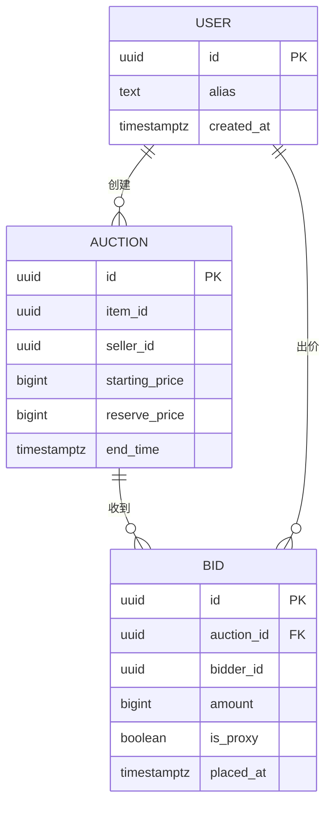
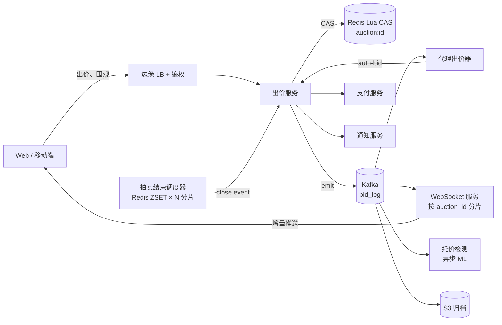
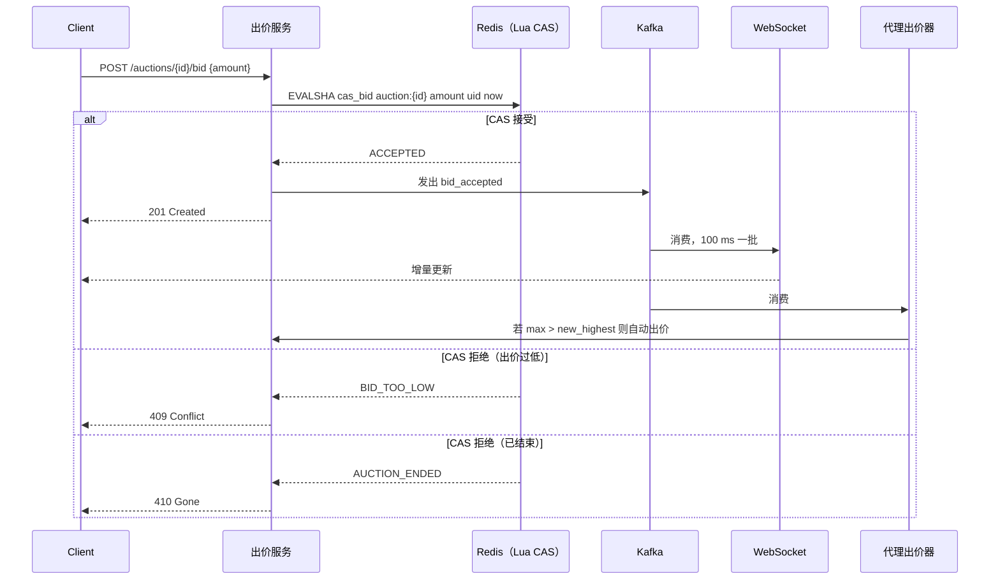
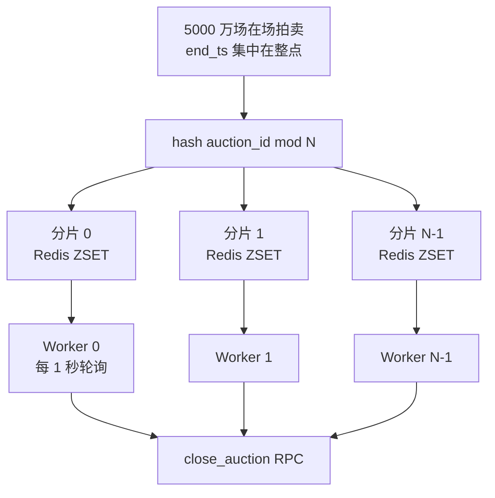

# 设计在线拍卖系统（eBay / Catawiki）

> **TL;DR.** 在线拍卖把全部争用压缩到最后 30 秒。整套架构围绕一个 Redis Lua 比较并交换（compare-and-swap，CAS）展开：它在每个分片上以每秒 10–20 万次操作的速度原子地接受或拒绝出价[^1][^2]。eBay 在 2025 财年做到 796 亿美元 GMV、1.35 亿活跃买家[^3]，在售标的约 25 亿条（2026 年 Q1）[^4]。最关键的权衡是接受单键的吞吐上限，而不是把热行拆开分片、破坏原子性。其余一切——代理出价、狙击延时、WebSocket 扇出、拍卖结束调度——都围绕这个原子内核组合而成。

## 学习目标

学完本模块后，你将能够：

- [ ] 设计一条 Redis Lua CAS 出价路径，在单场拍卖上以每秒 10 万次以上的速度原子地接受出价
- [ ] 实现代理出价（proxy bidding）语义，并用时间戳做确定性的平局裁决
- [ ] 应用狙击延时规则，并为其设上限，防止拍卖无限拖长
- [ ] 通过增量批处理把出价更新扇出给 1000 万 WebSocket 观察者
- [ ] 调度 5000 万场拍卖的结束时间，在整点不形成单实例瓶颈
- [ ] 用基于图的欺诈分类器识别托价（shill bidding）模式

## 直觉理解

在线拍卖看上去就是一个带数字输入框和倒计时的表单。一个大学生周末就能做出来。现在加上真正要命的约束：1000 万人盯着同一张稀有的科比新秀卡，最后 3 秒里有 5 万人同时点“出价”。每一次出价都必须与当前最高价做原子比较和排序，且要在 200 ms 以内完成。如果用户 A 出 500 美元、用户 B 出 499 美元，赢的必须是 A。永远如此。如果系统因为读到一个过期的“当前最高价”而接受了 499 美元，平台的信任就永久没了。

朴素方案是 PostgreSQL 里一行记录加 `SELECT FOR UPDATE`，10 个用户时它能跑。可到了单件商品 1 万个并发竞拍者，行锁争用会把 p99 推到 100 ms 以上，死锁变成常态[^5]。你又没法把这一行分片，因为出价就是对某一个值的读-改-写：这场特定拍卖的当前最高价。分片就直接破坏了原子性保证。

洞察是：把出价路径当成 Redis 里的单键比较并交换。Redis 在单线程上原子执行 Lua 脚本[^2]。一个键、一个核、一份真相。上限是物理的（每个分片每秒 10–20 万次操作），调不动。接受这个上限，溢出的请求进队列并返回可重试的 429，其余的一切——代理裁决、WebSocket 扇出、欺诈检测——都做成出价事件流的异步消费者。

## 需求

### 澄清问题

- **Q: 采用哪种拍卖形式？**
  假设：英式（升价）拍卖是主形式。同时支持“一口价”（Buy-It-Now）作为并发的快速路径。
- **Q: 支持代理出价吗？**
  假设：支持。用户设一个上限，系统代他自动加价，直到触及上限。
- **Q: 临近结束的出价会延长时间（反狙击）吗？**
  假设：可按拍卖配置。默认：最后 30 秒内出价则延长 30 秒，最多延长 10 次。
- **Q: 有保留价吗？**
  假设：有。保留价不公开；未达保留价则拍卖流拍。
- **Q: 观察者能实时收到更新吗？**
  假设：WebSocket 推送，100 ms 增量批处理。
- **Q: 托价检测在范围内吗？**
  假设：在，作为异步分类器。不放在出价关键路径上。
- **Q: 支付流程呢？**
  假设：交给[支付系统](./19-payment-system.md)。拍卖结束时发出 `winner_determined` 事件。

### 功能性需求

- 创建拍卖：起始价、结束时间、加价幅度、可选的保留价、狙击延时配置
- 接受出价，校验是否高于当前最高价加最小加价幅度；低于阈值的出价原子地拒绝
- 代理出价到用户设定的上限，在被超越时自动加价
- 在预定时间（或延时用尽后）结束拍卖，确定赢家
- 将近实时的出价更新推送给全部观察者
- 异步检测并标记托价模式

### 非功能性需求

- **负载：** 全局出价峰值每秒 100 万次；单场热门拍卖每秒 5 万次
- **延迟：** 出价接受 p99 < 200 ms；p50 < 50 ms
- **可用性：** 拍卖活跃时段 99.99%
- **一致性：** 最高出价这一值上强一致（不允许因读到旧值而判错赢家）
- **持久性：** 只追加的出价日志；单节点故障零丢单

## 容量估算

| 指标 | 数值 | 推导 |
|--------|------:|------------|
| 在售标的 | 1 亿 | 5000 万拍卖 + 5000 万一口价 |
| 热集元数据 | 50 GB | 1 亿条标的 × 每条 500 B |
| 峰值出价 QPS（全局） | 100 万/秒 | eBay + Catawiki + NFT 市场的合成 |
| 峰值出价 QPS（单场拍卖） | 5 万/秒 | 热门拍卖的最后几秒 |
| 观察者扇出（峰值） | 1000 万条推送/秒 | 最后 1 分钟 1000 万观察者 × 每秒 1 次更新 |
| 每日出价 | 8600 万 | 平均 1000 次出价/秒 × 86,400 秒 |
| 年度出价存储 | 100 GB | 每年 10 亿次出价 × 每条出价记录 100 B |
| 调度器负载 | 5000 万场在场拍卖 | 结束时间集中在整点 |

关键比例：读写比大约 100:1（观察者轮询或收推送 vs. 真实出价）。热集可以舒舒服服装进 Redis 内存。历史出价 6 个月后归档到 S3。

## API 与数据模型

### API 设计

```http
POST /v1/auctions
  Body: { "item_id": "...", "starting_price": 100, "end_time": "ISO8601",
          "reserve_price": 500, "snipe_extension_sec": 30, "max_extensions": 10 }
  Returns: 201 { "auction_id": "abc123", "state": "active" }

POST /v1/auctions/{id}/bid
  Idempotency-Key: <uuid>
  Body: { "amount": 150, "proxy_max": 300 }
  Returns: 201 { "accepted": true, "current_highest": 150, "bidder": "you" }
           409 { "error": "BID_TOO_LOW", "current_highest": 160 }
           410 { "error": "AUCTION_ENDED" }

GET /v1/auctions/{id}
  Returns: 200 { "highest_bid": 150, "bidder_alias": "j***n",
                  "time_remaining_ms": 28400, "reserve_met": false }

GET /v1/auctions/{id}/bids?cursor=...&limit=50
  Returns: 200 { "items": [...], "next_cursor": "..." }

WS /v1/auctions/{id}/subscribe
  Server pushes: { "type": "bid_update", "highest": 160, "bidder": "m***k", "ts": ... }
```

限流：每个用户每场拍卖每秒 10 次出价，走[限流器](./02-rate-limiter.md)。幂等键防止重试时重复出价。

### 数据模型

```sql
-- Redis hash（热状态，每场在场拍卖一份）
HSET auction:{id}
  highest_bid     <integer cents>
  highest_bidder  <user_id>
  end_ts          <unix_ms>
  state           <active|extended|closed>
  extensions_used <integer>

-- Redis hash（代理出价）
HSET proxy:{auction_id}:{user_id}
  max_bid         <integer cents>
  placed_at       <unix_ms>

-- Kafka topic：bid_log（按 auction_id 分区）
-- 只追加的审计轨迹，6 个月后归档到 S3

-- PostgreSQL（目录、冷存储）
CREATE TABLE auctions (
  id UUID PRIMARY KEY,
  item_id UUID NOT NULL,
  seller_id UUID NOT NULL,
  starting_price BIGINT,
  reserve_price BIGINT,
  end_time TIMESTAMPTZ,
  state TEXT DEFAULT 'active',
  created_at TIMESTAMPTZ DEFAULT now()
);
```



*核心实体：一场拍卖接收来自用户的出价；代理出价在服务端裁决，并以带 `is_proxy` 标记的普通出价记录下来。*

## 高层架构



*出价路径就是一次 Redis Lua CAS；其余一切（代理、WebSocket、调度、欺诈检测）都围绕这个原子内核组合。*

**写路径。** 客户端提交出价。出价服务校验身份与限流，然后对 Redis 里的 `auction:{id}` 执行一段 Lua CAS 脚本。接受则向 Kafka 发出 `bid_accepted` 事件；拒绝（出价过低或已结束）则立即返回。

**异步路径。** Kafka 消费者负责代理裁决（代理出价器把自动出价重新送进同一条 CAS 路径）、WebSocket 扇出（每 100 ms 一批）、欺诈打分，以及归档到 S3。

**结束路径。** 拍卖结束调度器在预定时间发起 `close_auction` RPC。出价服务冻结 Redis 中的拍卖状态，确定赢家，并向[支付系统](./19-payment-system.md)和[通知系统](./04-notification-system.md)发出事件。

## 深入探讨

### 通过 Redis Lua CAS 原子接受出价

出价路径的核心是一个在 Redis 内以 Lua 脚本执行的比较并交换。Redis 保证 Lua 脚本会执行到结束、中间不会插入其他命令[^2]。于是我们不需要分布式锁或 2PC 就拿到了原子性。

```lua
-- KEYS[1]: auction:{id}
-- ARGV[1]: new_bid, ARGV[2]: bidder_id, ARGV[3]: now_ts, ARGV[4]: min_increment
local current = tonumber(redis.call('HGET', KEYS[1], 'highest_bid') or 0)
local end_ts = tonumber(redis.call('HGET', KEYS[1], 'end_ts'))
local state = redis.call('HGET', KEYS[1], 'state')
if state ~= 'active' and state ~= 'extended' then
    return {err = 'AUCTION_ENDED'}
end
if tonumber(ARGV[3]) >= end_ts then
    return {err = 'AUCTION_ENDED'}
end
if tonumber(ARGV[1]) < current + tonumber(ARGV[4]) then
    return {err = 'BID_TOO_LOW'}
end
redis.call('HSET', KEYS[1],
    'highest_bid', ARGV[1],
    'highest_bidder', ARGV[2],
    'last_bid_ts', ARGV[3])
return {ok = 'ACCEPTED'}
```

**为什么不用 PostgreSQL？** 热行上 5 万个并发写者的 `SELECT FOR UPDATE` 会产生死锁，p99 延迟超过 100 ms[^5]。单键上的 Redis Lua 能做到亚毫秒级 p99。

**上限。** 一个 Redis 键只落在一个分片、一个核上。非流水线吞吐约每秒 18 万次操作；开流水线可到每秒 150 万次[^2]。对单场拍卖而言，实际上限是每秒 10–20 万次出价[^1]。这是物理限制，不是调参问题。把键拆到多个节点会破坏原子性。正确的应对是：接受这个上限，在边缘按用户限流，溢出时返回可重试的 429。

**持久性。** Redis 开 AOF 且 `appendfsync everysec`，同时同步复制到备节点。Kafka 的 `bid_log` 是持久化的真相来源，Redis 只是快路径。Redis 挂了就从 Kafka 重放、重建状态。



*一次 CAS 原子地拒掉低于阈值的出价；接受路径写进 Kafka，交给异步扇出、代理裁决和欺诈打分。*

### 狙击延时与代理出价

**狙击（sniping）** 是在最后几秒出价，让竞争对手没有反应时间。在 eBay 上，固定结束时间下的狙击是明确允许的[^6]。Catawiki 和传统拍卖行用的是“软关闭”：按 Catawiki 现行的出价规则，在拍卖最后 60 秒内出价会把结束时间再延长 90 秒（Live Auctions 用更紧的 15 秒窗口，延长 10 秒）[^7]。

**延时逻辑。** CAS 脚本判断 `now_ts > end_ts - extension_window`。成立则把 `end_ts` 延长 `extension_sec` 并递增 `extensions_used`，以 `max_extensions` 为上限：

```lua
-- 在 CAS 脚本中，接受出价之后：
local ext_window = tonumber(redis.call('HGET', KEYS[1], 'ext_window') or 0)
if ext_window > 0 and tonumber(ARGV[3]) > end_ts - ext_window then
    local used = tonumber(redis.call('HGET', KEYS[1], 'extensions_used') or 0)
    local max_ext = tonumber(redis.call('HGET', KEYS[1], 'max_extensions') or 10)
    if used < max_ext then
        redis.call('HSET', KEYS[1], 'end_ts', end_ts + ext_window,
                   'extensions_used', used + 1, 'state', 'extended')
    end
end
```

**代理出价。** 用户设 `proxy_max = $500`。别人出了 400 美元时，代理出价器这个消费者会读出本场拍卖所有生效的代理，发现用户 A 的上限高于 400 美元，就以“400 美元 + 一个加价幅度”通过同一条 CAS 路径提交自动出价。两个上限相同的代理：时间戳更早的以平局价格胜出。这是确定性的平局裁决，不是公平性启发式[^8]。

**加价幅度。** eBay 用阶梯表：1 美元以下每次 0.05 美元，5,000 美元以上每次 100 美元[^8]。幅度在 Lua CAS 内部强制：`new_bid >= current + increment(current)`。

**代理风暴的缓解。** 一次新出价可能在 N 个代理上触发 N 次反击出价。朴素实现是 N 次串行 CAS 调用。优化版：代理出价器在内存里裁决完所有代理，一次算出最终赢家和成交价，然后只提交一次 CAS 写入[^9]。

### WebSocket 扇出与拍卖结束调度

**向 1000 万观察者扇出。** 把每一次出价都推给 1000 万条连接是不现实的。改为每 100 ms 批处理：把 100 ms 窗口内的所有出价攒起来，每个 tick 每场拍卖只发一条增量消息。Discord 用类似的批处理把 Elixir 做到单个 pub/sub 系统上 500 万并发用户[^10]。WebSocket 服务按 `auction_id` 分片，于是一场热门拍卖的扇出落在专门的一组服务器上。

**拍卖结束调度。** 5000 万场在场拍卖不会均匀结束。卖家天然偏爱整点。一个朴素的单实例调度器在 :00 醒来处理 50 万个结束事件，必然挂掉。

解法：用带时间戳分值的 Redis 有序集合给调度器分片[^11]：

```text
ZADD scheduler:shard:{hash(auction_id) % N} {end_ts} {auction_id}
```

N 个 worker 各自每秒轮询自己的分片：

```text
ZRANGEBYSCORE scheduler:shard:{S} -inf {now} LIMIT 0 1000
```

取回的拍卖 ID 触发 `close_auction` RPC。基于租约的机制（`SET scheduler:lease:{S} {worker_id} NX PX 5000`）提供故障切换。创建时给 `end_ts` 加 ±15 秒的随机抖动，能在用户无感的前提下削平整点尖峰（配合软关闭延时，抖动完全不可见）。



*按 `hash(auction_id) % N` 分片，避免整点的结束时间尖峰打满单个调度实例。*

## 真实案例

### eBay：行星规模的英式拍卖

eBay 公布的 2025 财年商品交易总额为 796 亿美元，覆盖 1.35 亿活跃买家[^3]。到 2026 年 Q1，eBay 的 Fast Facts 页面显示全球在售标的约 25 亿条、活跃买家 1.36 亿[^4]。从历史上看，GMV 的大头来自固定价格的一口价商品，拍卖形式只占其中较小（但仍是数十亿美元级）的一块；自 2000 年代中期以来拍卖占比长期下滑，但即便只是 796 亿美元里的少数份额，按年算也是数十亿美元的拍卖 GMV。

**架构。** eBay 跑的是按功能分区的架构：售卖、出价、搜索是彼此独立的应用池，各自横向分片。eBay 的资深架构师 Randy Shoup 把这条原则总结成一句话：“如果你拆不开它，你就扩不了它”[^12]。数据库层按主要访问路径分片（用户数据、商品数据、出价数据落在不同的分片组），并且永远不用分布式事务。跨域一致性靠异步对账达成。

**规模数字。** 应用层大约 16,000 台服务器，分布在 220 个功能池里。数据库层横跨 400 台物理机、1,000 个逻辑库[^12]。自研 ODM 硬件的目标是在每个搜索节点上以 10 ms 延迟跑 10,000 QPS[^13]。移动端占市场很大一块：eBay 报告单季（2026 年 Q1）移动设备上的商品交易额约 150 亿美元[^4]。

**关键洞察。** 对跨域更新，eBay 明确选择了分区容忍与可用性，而不是即时一致性。出价路径本身是强一致的（每场拍卖只有一个权威分片），但搜索索引、推荐引擎、卖家后台都是最终一致。这与本设计用的是同一个套路：Redis CAS 上强一致，其他地方一律最终一致。

**欺诈规模。** eBay 2024 年为交易损失（拒付、欺诈、争议出价）计提了 3.53 亿美元[^3]，这多少说明了这个量级下对账与欺诈检测有多难。

## 权衡

| 方案 | 优点 | 缺点 | 适用场景 |
|----------|------|------|-------------|
| Redis Lua CAS（内存内） | 亚毫秒延迟；原子；每个分片每秒 10–20 万次操作[^1][^2] | 没有 AOF + 副本时有持久性风险；单键上限 | 所有高流量拍卖平台 |
| PostgreSQL SELECT FOR UPDATE | 简单、持久、事务性 | 有争用时 p99 约 100 ms；死锁[^5] | 原型、低流量拍卖（<100 次出价/秒） |
| 严格结束时间（不延时） | 可预测；调度简单 | 狙击彻底压制代理出价者[^6] | 法律拍卖、eBay 的历史默认 |
| 软关闭延时 | 防止狙击滥用；对代理出价者更公平[^7] | 会拖长；需要上限；UX 让人困惑 | Catawiki、传统拍卖行 |
| WebSocket 推送 + 增量批处理 | 1000 万观察者的扇出可行；每个 tick 每场拍卖一条消息[^10] | 复杂度高；100 ms 粒度在热门拍卖上可感知 | 观察者超过 1 万的热门拍卖 |
| HTTP 轮询 | 简单；不需要会话保持 | 规模化后低效；热门拍卖期间体验差[^14] | 历史客户端、低流量标的 |
| 链下订单簿 + 链上结算（NFT） | 出价零 gas；结算信任最小化[^15][^16] | 抢跑/MEV 风险；余额下降则出价失效[^17] | NFT 市场（OpenSea Seaport、Blur） |

元决策：**接受单键的吞吐上限。** 所有把热行拆开的替代方案（多主、CRDT、乐观并发）都在牺牲“没有用户会输给更低的出价”这条保证。正确答案是在边缘限流，让物理上限成为系统天然的调速器。

## 扩展与故障模式

- **10 倍负载（全局每秒 1000 万次出价）：** 单场拍卖的上限不变（物理限制）。横向扩展靠给更多拍卖加 Redis 分片。WebSocket 层按热门拍卖分片增加服务器。调度器增加 ZSET 分片。
- **100 倍负载（全局每秒 1 亿次出价）：** Kafka 集群成为瓶颈。按 auction_id 激进分区。考虑分级存储（热门拍卖放 Redis，温数据放 DynamoDB，冷数据放 S3）。欺诈分类器需要流式 ML（Flink）而不是批处理。
- **1000 倍负载：** 该重新想模型了。到这个量级，绝大多数“出价”应该是代理登记，而不是一次次的 CAS 写入。代理全部在内存里裁决，只写最终结果。

**故障模式：**

- **拍卖中途 Redis 主节点崩溃：** 备节点经 Sentinel 提升。约 1 秒故障切换窗口内在途的出价收到 503 并重试。Kafka 的 bid_log 是持久记录，需要时从它重建 Redis 状态。不会丢任何已接受的出价，因为 Kafka 落盘发生在返回 201 之前。
- **调度 worker 死亡：** 租约 5 秒后过期，另一个 worker 抢到租约、接管到期的拍卖。最坏情况是拍卖晚关 5 秒，如果拍卖本身有软关闭延时窗口，这完全不可见。
- **Kafka 分区 leader 故障：** Kafka 的 ISR 机制提升一个从副本。出价服务带退避重试生产。约 2 秒的 leader 选举期间，出价仍由 Redis（快路径）接受，但异步扇出（WebSocket、代理、欺诈）会延迟。

## 常见陷阱

> [!WARNING]
> **单个热键被打满。** 一场病毒式传播的拍卖可能超出单个 Redis 分片每秒 10–20 万次操作的上限，而你又不能把这个键分片，否则原子性就没了。在边缘按用户限流（每用户每场拍卖每秒 50 次），溢出返回 429[^1]。

> [!WARNING]
> **代理出价风暴。** 一次新出价在 N 个代理上触发 N 次反击出价，每一次都串行穿过 CAS 路径。要一遍裁决完所有代理，只提交一次带最终成交价的 CAS 写入[^9]。

> [!WARNING]
> **不设上限的狙击延时。** 没有上限时，两个铁了心的竞拍者可以把拍卖无限期延长下去。一定要按次数（例如 10 次）或总时长（例如 1 小时）设上限[^7]。

> [!WARNING]
> **用小号托价。** 卖家注册小号抬价。检测手段包括 IP 关联、设备指纹、出价后撤回的模式，以及在竞拍者-卖家交互图上做基于 GNN 的图分析[^18][^19]。

> [!WARNING]
> **调度器在整点扎堆。** 5000 万场拍卖都在 :00 结束，会干掉单实例调度器。按 `hash(auction_id) % N` 分片，并在创建时给结束时间加 ±15 秒抖动[^11]。

> [!WARNING]
> **滥用撤回出价。** 竞拍者把价格抬高吓退对手，然后在结束前撤回。要执行 eBay 式的规则：只有笔误或商品描述发生重大变更才允许撤回，按用户追踪，并对滥用者采取账号处置[^20]。

## 追问

**1. 怎样在同一套系统里支持荷兰式拍卖（降价拍卖）？**

时钟从起始高价往下走，第一个接受当前价的竞拍者获胜。把 CAS 里的“最高出价”逻辑换成“首个认领”原子操作：`HSETNX auction:{id} winner {bidder_id}`。没有争用，因为只有一次写入会成功。

**2. 换成密封投标的维克里（第二价格）拍卖要改什么？**

出价在结束前加密或隐藏。结束时揭晓全部出价，把标的判给最高出价者，但按第二高的价格成交[^21]。系统把出价存在只追加日志里且不对外暴露。CAS 路径被简单的追加替换；争用消失，因为出价之间直到结束才发生交互。

**3. 怎么让一口价与实时竞价并存？**

一口价就是以 BIN 价格出的一次特殊出价，它立即关闭拍卖。CAS 脚本里判断：如果 `amount == bin_price`，则置 `state = closed`、`winner = bidder_id`。这会与普通出价竞争，而 CAS 的串行化保证有且只有一个赢。

**4. 系统怎么扛住大量假出价的 DDoS？**

边缘按用户限流（每场拍卖每秒 10 次）。账号不足 7 天加 CAPTCHA。按 IP 限速。Redis CAS 本身就是最后一道防线：哪怕 100 万个请求都打到它这里，它也是串行处理，并在微秒级拒掉低于阈值的出价。

**5. 多区域双活会是什么样？**

一场拍卖只属于一个权威区域（创建时按卖家所在地分配）。全球观察者连本地 WebSocket 服务器，从跨区域复制的 Kafka 消费。非权威区域的出价代理转发给归属区域。这给远端竞拍者的出价路径多加一次跨区域往返（约 50–100 ms），但保住了单键原子性。

**6. 结束时如何可靠地通知赢家？**

`auction_closed` 事件由[通知系统](./04-notification-system.md)以至少一次投递消费。通知上的幂等键防重复。多渠道：推送 + 邮件 + 站内信。投递保证的模式见[幂等性与恰好一次](../part-3-distributed-systems-theory/07-idempotency-exactly-once.md)。

## 练习

### 练习 1：争用下的代理裁决

同一场拍卖上有两个代理：Alice 的 `max_bid = $500`（在 T1 设置），Bob 的 `max_bid = $500`（在 T2 设置，T2 > T1）。此时 Carol 出价 400 美元。走一遍代理裁决：最终的 `highest_bid` 是多少，`highest_bidder` 是谁，为什么？

<details>
<summary>提示</summary>

想一想代理出价器裁决这两个代理时会发生什么。两者的上限都是 500 美元。系统需要一个不会来回震荡的确定性平局裁决。Alice 和 Bob 之间有什么单调的属性可以区分？

</details>

<details>
<summary>参考答案</summary>

Carol 的 400 美元被接受（假设它超过了当前最高价 + 加价幅度）。代理出价器消费 `bid_accepted` 事件，裁决所有 `max > $400` 的生效代理。Alice 和 Bob 都符合条件。系统一遍裁决完：胜出的代理是 `placed_at` 时间戳更早的那个（T1 的 Alice）。最终价格是 `min(Alice.max, Bob.max + increment)`。两个上限都是 500 美元，Alice 以 500 美元胜出（比 Bob 的有效上限高一个加价幅度，也就是 500 - 一个幅度 = 499 美元时 Alice 就以 500 美元胜出）。CAS 写入 `highest_bid = $500, highest_bidder = Alice`。Bob 收到“被超越”通知。Carol 的 400 美元被立即覆盖。

关键洞察：时间戳顺序就是代理平局裁决的契约。它确定、单调，能防止等上限代理之间来回震荡。

</details>

## 要点回顾

- **出价路径就是一次 Redis Lua CAS。** 其余一切——代理、通知、调度——都包在这个原子内核外面。
- **接受单键上限。** 每个分片每秒 10–20 万次操作是物理限制。溢出的限流掉，不要给热行分片[^1][^2]。
- **狙击延时是 UX 策略，不是正确性问题。** 不给它设上限，拍卖就永远结束不了[^7]。
- **代理出价需要确定性的平局裁决。** 时间戳顺序就是契约，换成别的就会震荡[^8]。
- **调度器是最阴的瓶颈。** 5000 万场拍卖在整点集中结束，会先于出价路径把朴素设计打垮[^11]。
- **1000 万级的 WebSocket 扇出是批处理问题。** 增量编码，每 100 ms 一批，按 auction_id 分片[^10]。

## 延伸阅读

- [Randy Shoup, "Scalability Best Practices: Lessons from eBay"](https://www.infoq.com/articles/ebay-scalability-best-practices/)。关于 eBay 功能分区、横向分片与“无 2PC”哲学的经典文章，塑造了现代拍卖架构。
- [Redis benchmark documentation](https://redis.io/docs/latest/operate/oss_and_stack/management/optimization/benchmarks/)。定义单键吞吐上限的那些 ops/sec 数字；做容量规划必备。
- [eBay Help: Automatic Bidding](https://www.ebay.com/help/buying/bidding/automatic-bidding?id=4014)。代理出价语义与加价幅度表的公开规范；最大拍卖平台如何裁决出价的权威依据。
- [Vickrey, "Counterspeculation, Auctions, and Competitive Sealed Tenders" (1961)](https://onlinelibrary.wiley.com/doi/10.1111/j.1540-6261.1961.tb02789.x)。诺奖得主 William Vickrey 关于现代拍卖理论的开创性论文；解释了为什么第二价格拍卖能激励诚实出价。
- [OpenSea: Introducing Seaport Protocol](https://opensea.io/blog/announcements/introducing-seaport-protocol)。链下订单簿 + 链上结算的设计综述；把出价与执行分离的 NFT 拍卖架构。
- [Discord: How Discord Scaled Elixir to 5,000,000 Concurrent Users](https://ptb.discord.com/blog/how-discord-scaled-elixir-to-5-000-000-concurrent-users)。本案例所瞄准的规模下 WebSocket 扇出的先例。
- [Alzahrani et al., "Clustering and Labelling Auction Fraud Data" (2018)](https://ar5iv.labs.arxiv.org/html/1806.00656)。来自真实 eBay 拍卖的带标注托价数据集；拍卖系统欺诈检测的 ML 基线。

## 记忆卡片

<details>
<summary><strong>Q: 出价路径为什么用 Redis Lua CAS，而不是 PostgreSQL 的 SELECT FOR UPDATE？</strong></summary>

A: Redis Lua 在单线程上原子执行，延迟亚毫秒。PostgreSQL 行锁在 5 万个并发写者下会产生死锁、p99 > 100 ms。出价路径是对单个键的读-改-写，恰好契合 Redis 的执行模型。[^2][^5]

</details>

<details>
<summary><strong>Q: 单场拍卖出价路径的吞吐上限是多少，为什么不能靠分片突破？</strong></summary>

A: 每个 Redis 分片每秒 10–20 万次操作（单核、单线程）。把键拆到多个节点会破坏原子性：两个分片可能都接受了自认为是新最高价的出价，从而违反“没有用户会输给更低出价”的保证。[^1]

</details>

<details>
<summary><strong>Q: 代理出价怎么工作，上限相同的两个代理靠什么分出胜负？</strong></summary>

A: 被超越时，系统代用户自动加价，直到他声明的上限。上限相同的两个代理按时间戳裁决：更早的那个以平局价格胜出。这是确定性的，能防止震荡。[^8]

</details>

<details>
<summary><strong>Q: 什么是狙击，时间延时怎么破解它？</strong></summary>

A: 狙击是在最后几秒出价，让对手来不及反应。当出价落在最后 N 秒内，延时会把 end_ts 往后推 N 秒，给其他竞拍者回应的机会。延时必须设上限，否则拍卖可以无限延长。[^6][^7]

</details>

<details>
<summary><strong>Q: 为什么拍卖结束调度比看上去难得多？</strong></summary>

A: 5000 万场在场拍卖的结束时间集中在整点。单实例调度器没法在 1 秒内派发 50 万个结束事件。按 hash(auction_id) % N 分片能把负载摊到 N 个 worker 上，再加随机抖动削平尖峰。[^11]

</details>

<details>
<summary><strong>Q: 单场热门拍卖上的 WebSocket 扇出怎么扩到 1000 万观察者？</strong></summary>

A: 每 100 ms 批处理一次（每个 tick 每场拍卖发一条增量消息，而不是每次出价发一条）。WebSocket 服务器按 auction_id 分片，让一场热门拍卖的扇出由专门的一组服务器承担。Discord 用类似的模式在单个 Elixir pub/sub 系统上证明了 500 万并发用户。[^10]

</details>

<details>
<summary><strong>Q: 什么是托价，怎么检测？</strong></summary>

A: 卖家注册小号给自己的拍卖出价，把价格抬上去。检测用 ML 分类器，特征包括：竞拍者与卖家的 IP 关联、账号年龄、出价后撤回的模式，以及在竞拍者-卖家交互网络上做基于 GNN 的图分析。[^18][^19]

</details>

<details>
<summary><strong>Q: eBay 怎么在不用分布式事务的前提下做到出价强一致？</strong></summary>

A: 每场拍卖的出价状态只落在一个分片上（按 auction_id 分区）。CAS 就是这个分片内的本地操作。跨域更新（搜索索引、卖家后台）走异步对账和最终一致。永远不用 2PC。[^12]

</details>

<details>
<summary><strong>Q: Redis 主节点故障切换期间，在途的出价会怎样？</strong></summary>

A: 约 1 秒切换窗口内的出价收到 503 并重试。Kafka 的 bid_log 是持久记录，需要时从 Kafka 重建 Redis 状态。不会丢任何已接受的出价，因为 Kafka 落盘发生在给客户端返回 201 之前。

</details>

<details>
<summary><strong>Q: OpenSea 的 Seaport 协议处理 NFT 拍卖的方式与 eBay 有何不同？</strong></summary>

A: Seaport 把出价（链下签名订单，零 gas）与结算（卖家接受时在链上原子交换）分开。竞拍者签 EIP-712 消息，只有赢家付 gas。代价是：如果竞拍者的 WETH 余额在结算前下降，出价可能失效。[^15][^16]

</details>

## 参考文献

[^1]: Backend Bytes, "Scaling Redis for High-Throughput Systems", 2025. https://backendbytes.com/articles/scaling-redis-high-throughput/

[^2]: Redis, "Redis benchmark" documentation. https://redis.io/docs/latest/operate/oss_and_stack/management/optimization/benchmarks/

[^3]: eBay Inc., "Reports Fourth Quarter and Full Year 2025 Results", Feb 18, 2026. https://investors.ebayinc.com/investor-news/press-release-details/2026/eBay-Inc--Reports-Fourth-Quarter-and-Full-Year-2025-Results/default.aspx

[^4]: eBay Inc., "Fast Facts" (Q1 2026, accessed 2026-05-08). https://investors.ebayinc.com/fast-facts/default.aspx

[^5]: Cybertec, "SELECT FOR UPDATE considered harmful in PostgreSQL". https://web.archive.org/web/20250617075606/https://www.cybertec-postgresql.com/en/select-for-update-considered-harmful-postgresql/

[^6]: eBay Help, "Bid sniping". https://www.ebay.com/help/buying/bidding/bid-sniping?id=4224

[^7]: Catawiki Help Centre, "Why are bidding times for some lots occasionally made longer?". https://www.catawiki.com/en/help/bidding-basics/why-are-bidding-times-for-some-lots-occasionally-made-longer

[^8]: eBay Help, "Automatic bidding" (includes bid-increment table). https://www.ebay.com/help/buying/bidding/automatic-bidding?id=4014

[^9]: ClimbTheLadder, "How eBay Bids Work: Proxy Bidding and Winning Strategies". https://climbtheladder.com/how-ebay-bids-work-proxy-bidding-and-winning-strategies/

[^10]: Discord Blog, "How Discord Scaled Elixir to 5,000,000 Concurrent Users". https://ptb.discord.com/blog/how-discord-scaled-elixir-to-5-000-000-concurrent-users

[^11]: Svix, "How to Build a Scheduled Queue in Redis". https://www.svix.com/resources/redis/scheduled-queue/

[^12]: Randy Shoup, "Scalability Best Practices: Lessons from eBay", InfoQ 2008. https://www.infoq.com/articles/ebay-scalability-best-practices/

[^13]: Lam Dong, "eBay's Hyperscale Platforms", eBay Tech Blog, Sep 2019. https://innovation.ebayinc.com/tech/engineering/odm/

[^14]: Gyanblog, "System Design Patterns for Real-Time Updates at High Traffic". https://www.gyanblog.com/software-design/system-design-real-time-updates-high-traffic/

[^15]: OpenSea Developer Documentation, "Seaport". https://docs.opensea.io/docs/seaport

[^16]: OpenIllumi, "How OpenSea's Seaport Protocol Enables Zero-Gas NFT Bids". https://openillumi.com/en/en-opensea-gasless-bid-seaport-mechanism/

[^17]: Alea Research, "Blur deep dive", Jan 2024. https://alearesearch.io/deep-dives/blur/

[^18]: Alzahrani and Sadaoui (2018). "Clustering and Labelling Auction Fraud Data". arXiv:1806.00656. https://ar5iv.labs.arxiv.org/html/1806.00656

[^19]: Rao, S. X. et al. (2025). "Fraud detection at eBay", Emerging Markets Review 66:101277 (GNN-based approach). https://doi.org/10.1016/j.ememar.2025.101277

[^20]: eBay Help, "Invalid bid retraction policy". https://www.ebay.com/help/policies/rules-policies-buyers/invalid-bid-retraction-policy?id=4227

[^21]: Vickrey, William (1961). "Counterspeculation, Auctions, and Competitive Sealed Tenders", Journal of Finance 16(1):8-37. https://onlinelibrary.wiley.com/doi/10.1111/j.1540-6261.1961.tb02789.x
