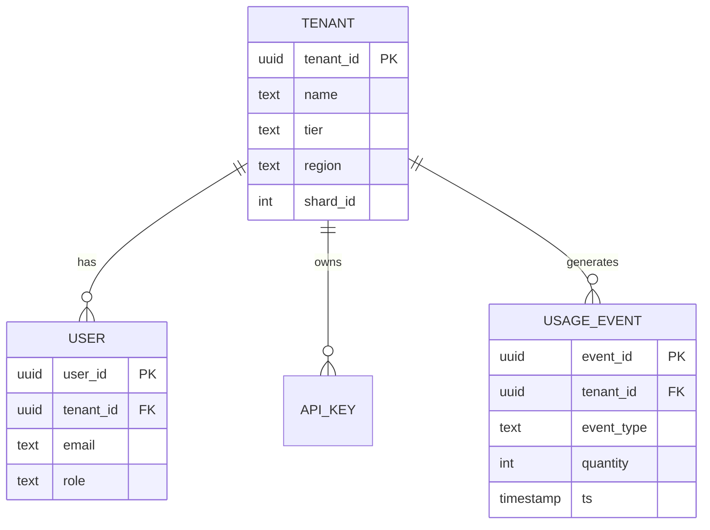
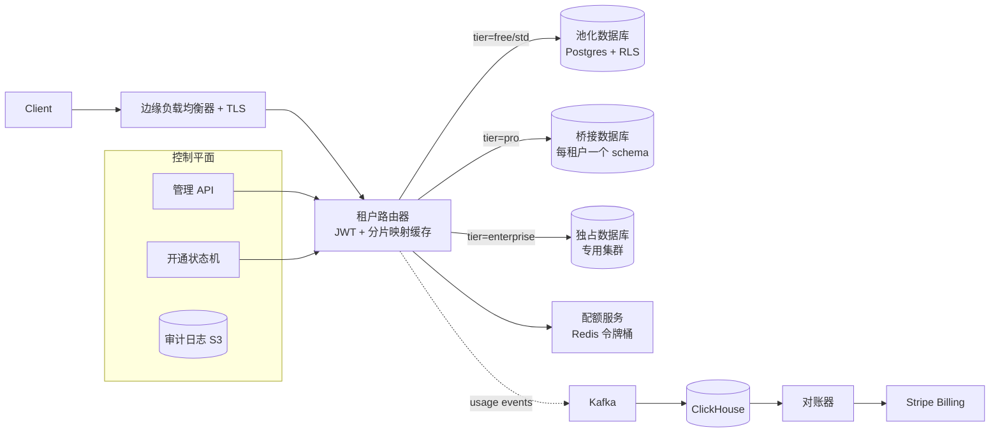
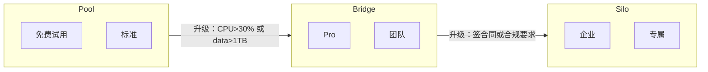
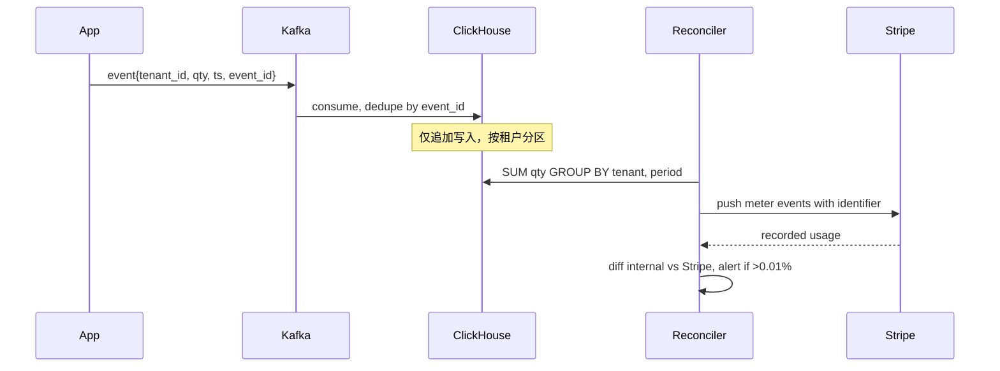
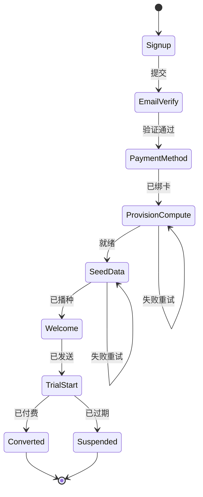

# 设计多租户 SaaS 平台

> **TL;DR.** 多租户 SaaS 平台要在共享基础设施上承载 5 万家客户组织，同时做到按租户隔离、分级 SLA（免费版 99.5% 到企业版 99.99%）和精确一次的计量计费。最关键的决定是每个租户在这条从池化到独占的光谱上站在哪一格：池化（共享数据库 + Postgres RLS）换成本效率，桥接（每租户一个 schema）换中等隔离，独占（专用集群）满足企业合规要求[^1]。Salesforce 在一个共享的多租户数据库上跑着几十万个组织，靠 governor limits 兜住[^2]；Shopify 把数百万家店铺隔进完全独立的 pod[^3]。最不可饶恕的错误是跨租户数据泄露——少写一个 `WHERE tenant_id = ?`，返回的就是另一家客户的数据。

## 学习目标

- 设计一套租户隔离架构，把独占、桥接、池化三种模型对应到定价档位和单位经济性
- 实现租户路由：让 `tenant_id` 一路传递，穿越异步跳转、缓存层和后台任务
- 构建计量管道，用幂等、精确一次的事件语义把计费准确率做到 >99.99%
- 用覆盖 CPU、连接数和 API 限流的按租户配额，把吵闹邻居关进笼子
- 论证何时该把“鲸鱼”租户从池化提升到独占，并做到零停机迁移
- 用加密粉碎（crypto-shredding）证明仅追加存储上的删除符合 GDPR

## 直觉理解

多租户 SaaS 乍看只是一个带 `tenant_id` 列的小 CRUD 应用。10 个租户时它跑得很好。到了 5 万租户、数据量横跨 20 万倍（免费试用 5 MB 到企业版 1 TB）时，架构会在三个方面崩掉。

第一是隔离：查询、缓存键或后台任务里漏掉一个租户过滤条件，就会把一家客户的数据泄露给另一家。单租户的 bug 顶多让你看到自己的全部数据，多租户的泄漏给出去的是别人的数据。这立刻就是一个 SOC 2 发现项、合同终止，还可能招来监管处罚[^4]。

第二是经济性：前 10% 的租户贡献了 80% 的负载。如果每个租户都独占，你要为 5 万个闲着的数据库集群付钱。如果全部池化，一家企业的批量导入就能占满共享连接池，让另外 49,999 家跟着变慢。

第三是计费：每一次 API 调用、每一个存储字节、每一秒算力都要变成发票上的一行。在 1 亿美元 ARR 上，0.1% 的计量漂移就是每年 10 万美元的隐性收入流失，或者多收客户的冤枉钱[^5]。

解开这个设计的洞见是：**租户模式是一条光谱，不是一个开关。** 三种隔离模型同时跑。免费租户落在池里（便宜、共享、RLS 强制隔离）。Pro 租户拿到桥接隔离（每租户一个 schema）。企业鲸鱼拿到独占（专用基础设施）。为这条光谱定价。让租户自己加钱往上爬，或者在它的负载威胁到池子时自动把它提上去。

## 需求

### 澄清问题

- **Q: 全新建设还是改造存量？**
  假设：全新建设。把多租户改造到单租户系统上更难，但用的还是同一批基础构件。

- **Q: 定价模型？**
  假设：混合模式。按席位收基础费，外加按用量的超额收费（API 调用、存储）。对接 Stripe Billing。

- **Q: 合规目标？**
  假设：所有档位满足 SOC 2 基线。HIPAA 和数据驻留只对企业档提供。

- **Q: 数据驻留？**
  假设：欧盟租户固定在欧盟区域。默认美国区。企业客户可以在注册时选区域。

- **Q: 吵闹邻居方面的承诺？**
  假设：企业档拿到隔离保证（独占）。池化档只能尽力而为，外加硬性限流。

- **Q: 租户定制？**
  假设：通过元数据做自定义字段（不做运行时 DDL）。白标品牌只对企业档开放。

### 功能需求

- 租户注册：免费/Pro 走自助开通，企业走销售协助入驻
- 租户范围内的资源管理：用户、数据、API key、审计日志
- 按租户的用量计量，直接喂给自动出账
- 租户管理员控制：邀请用户、分配角色、查看用量看板
- 租户删除：级联清理，并在 30 天内完成 GDPR 级别的擦除[^6]

### 非功能需求

- **租户数：** 5 万活跃租户，从 1 个用户的免费试用到 10 万用户的企业
- **负载：** 峰值 5 万 req/sec（工作时段）；持续 1.4 万
- **延迟：** 租户范围的读请求 p50 < 50 ms，p99 < 200 ms
- **可用性：** 99.5%（免费）、99.9%（Pro）、99.99%（企业）
- **计费准确率：** >99.99%（每个计费周期漂移 < 0.01%）
- **隔离：** 零跨租户数据泄露；在数据库层强制，而不是相信应用

## 容量估算

| 指标 | 数值 | 推导 |
|--------|------:|------------|
| 总用户数 | 5M | 50K 租户 × 平均 100 用户 |
| 基础数据 | 10 TB | 5M 用户 × 1 万行 × 200 B |
| 企业数据（前 10%） | 500 亿行 | 5K 租户 × 每个 1000 万行 |
| 峰值读 QPS | 50K | 5M 用户 × 10 请求/时 / 3,600 × 3.6 峰值系数 |
| 计量事件/秒 | 7K | 500 事件/租户/时 × 50K / 3,600 |
| 单租户存储区间 | 5 MB 到 1 TB | 跨档位 20 万倍差距 |
| 计量存储（1 年） | 220B 事件 | 7K/秒 × 86,400 × 365 |

几个关键比例：

- **帕累托分布：** 10% 的租户产生 80% 的负载。配额要按 90 分位设计，而不是按均值。
- **读:写比例：** 典型 SaaS 负载约 10:1；计量是仅追加写入，7K 事件/秒。
- **租户路由缓存命中率：** 必须高于 99.5%，否则它会自己变成瓶颈[^7]。

## API 与数据模型

### API 设计

```http
POST /v1/tenants
  Body: { "name": "Acme Corp", "tier": "pro", "region": "eu-west-1" }
  Returns: 201 { "tenant_id": "t_abc123", "status": "provisioning" }

GET /v1/tenants/{tenant_id}
  Returns: 200 { "tenant_id": "...", "tier": "pro", "usage": {...}, "quota": {...} }

POST /v1/tenants/{tenant_id}/users
  Body: { "email": "alice@acme.com", "role": "admin" }
  Returns: 201 { "user_id": "u_xyz", "invite_sent": true }

GET /v1/tenants/{tenant_id}/usage?month=2026-05
  Returns: 200 { "api_calls": 1420000, "storage_gb": 42.3, "billable_total": "$847.20" }

DELETE /v1/tenants/{tenant_id}
  Returns: 202 { "deletion_job_id": "del_789", "estimated_completion": "2026-06-03" }
  Side-effect: async erasure across all stores within 30 days
```

上下文传递：每个通过认证的请求都在 JWT claim 里携带 `tenant_id`。API 网关把它取出来，与路由做校验，然后设置 `X-Tenant-Id` 头传给下游服务。中间件拒绝任何没有租户上下文却到达数据层的请求。

### 数据模型

```sql
-- 租户元数据（PostgreSQL，控制面）
CREATE TABLE tenants (
  tenant_id   UUID PRIMARY KEY,
  name        TEXT NOT NULL,
  tier        TEXT NOT NULL CHECK (tier IN ('free','pro','enterprise')),
  region      TEXT NOT NULL,
  status      TEXT NOT NULL DEFAULT 'provisioning',
  shard_id    INT,
  created_at  TIMESTAMPTZ DEFAULT NOW()
);

-- 池化模型：共享表 + RLS
ALTER TABLE orders ENABLE ROW LEVEL SECURITY;
ALTER TABLE orders FORCE ROW LEVEL SECURITY;
CREATE POLICY tenant_isolation ON orders
  USING (tenant_id = current_setting('app.tenant_id')::uuid)
  WITH CHECK (tenant_id = current_setting('app.tenant_id')::uuid);
```



*核心实体：租户拥有用户和 API key，并产生用量事件，喂给计费管道。*

## 高层架构



*每个请求都流经租户路由器，它解析出档位和分片、执行配额，并把用量事件投进计量管道。*

**写路径：** 租户的 API 请求到达边缘负载均衡器，它终止 TLS 后转发给租户路由器。路由器从 JWT 里取出 `tenant_id`，在一级热缓存（Redis，命中率 >99.5%）里查该租户的档位和分片归属，执行按租户的限流，然后路由到对应的数据面（池化、桥接或独占）。数据面在执行任何查询之前先 `SET LOCAL app.tenant_id = ?`，从而激活 RLS 策略[^8][^9]。

**读路径：** 路由完全一样。池化租户的查询由 Postgres RLS 静默过滤行。独占租户的连接指向专用集群。缓存键一律带 `tenant_id` 前缀，防止跨租户的缓存碰撞。

**异步路径：** 用量事件从应用层进入 Kafka，按 `tenant_id` 分区。ClickHouse 消费者按 `event_id` 去重，追加写入按租户分区的表。每晚的对账任务聚合用量，带幂等键把 meter 事件推给 Stripe[^5]。

## 深入探讨

### 租户隔离：一套平台里的池化、桥接与独占

隔离模型是唯一一个同时决定成本结构、爆炸半径、合规姿态和运维复杂度的决定。AWS SaaS Lens 把三种模型归纳成标准表述[^1][^10]：

**池化（共享数据库 + RLS）：** 所有租户共用表。每行上的 `tenant_id` 列加上 Postgres RLS 策略，在数据库层强制隔离[^8][^9]。应用在取连接时执行 `SET LOCAL app.tenant_id = '<uuid>'`。RLS 在任何用户谓词之前逐行评估 `USING` 子句；不满足的行被静默过滤掉。`FORCE ROW LEVEL SECURITY` 堵上表属主绕过策略的漏洞[^8]。管理脚本、批量任务、报表查询都自动继承这个过滤[^8]。

**桥接（每租户一个 schema）：** 每个租户在共享集群里拿到独立的 Postgres schema。隔离强度高于 RLS（不会误跨 schema 查询），按租户迁移更容易，但要管理的 schema 对象更多[^11][^12]。

**独占（专用集群）：** 企业租户拿到自己的数据库实例、Redis，以及可选的专属 Kubernetes namespace。隔离最强，成本归属最清晰，HIPAA 或数据驻留合规必须这么做[^4]。

成熟的平台三种同时跑。档位映射如下：



*档位映射到隔离模型；租户随规模增长或签下企业合同，沿着光谱往上走。*

**升级机制：** 当池化租户的 CPU 超过共享集群的 30%，或数据超过 1 TB，系统就触发迁移。套路是双写新旧两处、回填历史数据、校验 checksum、把读切过去，最后清理。Shopify 的 Pod Mover 能在一分钟内把一个 pod 迁到另一个数据中心，且不丢请求[^3]。

### 吵闹邻居的隔离

在池化模型里，理论上任何租户都能吃掉 100% 的共享资源。防御必须分层：

**API 限流：** 按租户的 Redis 令牌桶。免费档：100 req/sec。Pro：1,000 req/sec。企业档：不限（独占实例自己扛）。超额返回带 `Retry-After` 头的结构化 429。

**连接池配额：** pgbouncer 按档位配置池大小。免费租户共用一个 50 连接的池。Pro 租户 200 连接。企业租户连自己的实例，500 连接。

**语句超时：** `SET LOCAL statement_timeout = '10s'` 绑在租户上下文里。某个租户跑飞的查询不可能无限期占着连接。

**Governor limits（Salesforce 模式）：** 在运行时层、执行之前就卡死的硬上限。Salesforce 限制每个事务最多 100 条 SOQL 查询、每个事务所有 SOQL 查询合计最多 50,000 行、CPU 时间 10,000 ms[^13]。预计会超限的查询直接被拒，而不是跑到一半被杀掉。

**蜂窝架构（Shopify 模式）：** Shopify 的每个 pod 都是完全独立的一组数据存储（MySQL 分片、Redis、Memcached），只服务一部分店铺。pod 之间没有运行时通信。吵闹商家的负载不可能跨 pod 传播[^3]。

### 计量管道与精确一次计费

计量就是计费。每个用量事件都会变成发票上的一笔钱。管道必须是精确一次：重复计数就多收客户钱，漏计就漏收入。

**架构：**



*靠幂等键实现精确一次计量；每晚对账，在漂移传导到客户之前抓住它。*

**幂等性：** Stripe 的 Meter Event API 接受每个事件上的 `identifier` 字段。调用方超时重试时，重复的 identifier 被静默丢弃[^5]。不带这个字段，Stripe 会自动生成一个，但调用方就没法在重试之间去重了。

**限流：** Stripe 的 v1 meter 端点每秒处理 1,000 个事件；v2 的流式路径每秒 10,000 个[^5]。聚合 7K 事件/秒的规模，要批量并扇出到多个 Stripe customer meter 流。

**对账：** 每晚跑一个任务，按租户把 ClickHouse 的聚合值和 Stripe 记录的用量对比。漂移超过 0.01% 就告警。在 1 亿美元 ARR 下，0.01% 是每月 1 万美元，正好是客户会察觉并申诉的阈值。

**时间戳容忍度：** Stripe 接受近 35 天内、且不超过未来 5 分钟的时间戳[^5]。这样就容得下时钟漂移和移动端迟到的事件。

### 把租户开通建模成状态机

开通流程被建模成一个显式、幂等、可检查点的状态机。每一步都有幂等键；失败时从最后一个成功的检查点重试。



*8 步开通状态机；每次状态转换都是幂等的，可以从最后一个检查点重试。*

池化租户的开通是秒级（插一条元数据加几行配置）。独占租户要几分钟到几小时（起数据库、配备份、配 DNS）。正是这种不对称，让企业租户先签合同再开通，而免费租户自助落进池子。

## 真实案例

**Shopify 的 Pod：面向数百万店铺的蜂窝式多租户。**

Shopify 的演进过程把整条隔离光谱都走了一遍。2015 年之前，Shopify 跑在单个 MySQL 数据库上。2015 年，他们按 shop ID 分片。但只做分片让应用变得脆弱：任何 `Sharding.with_each_shard` 的代码都会扇出到所有分片，只要有一个分片挂了就整体失败[^3]。

2016 年，Shopify 重组为 **pod**。一个 pod 是一组完全独立的数据存储（MySQL 分片、Redis、Memcached），服务一部分店铺。无状态的 worker 可以和任何 pod 通信，但每个工作单元（请求或任务）都被 `Sorting Hat` 负载均衡器钉在恰好一个 pod 上——它按规则把每个请求匹配到某个 pod，并注入一个请求头[^3]。

关键的洞见是：**pod 之间没有运行时通信。** Pod 7 出故障不可能级联到 Pod 12。每个 pod 都配对一个数据中心做容灾。Pod Mover 能在一分钟内把一个 pod 迁到另一个数据中心，不丢请求也不丢任务[^3]。

对最大的商家（Shopify Plus 的“鲸鱼”），Shopify 提供高级隔离：实际上就是它们自己的 pod，或者是只有少量租户的 pod。这就是披着蜂窝外衣的独占模型。

和 Salesforce 的对比很有启发性。Salesforce 把几十万个客户组织跑在一个共享的多租户数据库、一套 schema 上，靠元数据驱动的虚拟 schema 和 governor limits[^2]。Salesforce 选了极致的池化加运行时强制；Shopify 选了极致的隔离加蜂窝边界。两者都在超大规模下成立。区别在故障模式：Salesforce 的 governor limits 挡住了吵闹邻居，但换来一个复杂的运行时；Shopify 的 pod 从结构上阻断跨租户干扰，但每个操作都需要 pod 感知的工具链。

## 权衡

| 决策维度 | 方案 | 优点 | 缺点 | 适用场景 |
|---|---|---|---|---|
| 隔离 | 池化（共享数据库 + RLS） | 成本效率最高；运维统一；只有一个数据库要调优 | 吵闹邻居风险；爆炸半径更大；成本归属更难 | 免费/标准档；1 万以上租户[^4][^9] |
| 隔离 | 桥接（每租户一个 schema） | 隔离更强；按租户迁移更容易 | schema 对象更多；仍然是一个数据库在承担风险 | Pro/团队档；100 到 1 万租户[^12] |
| 隔离 | 独占（专用数据库） | 隔离最强；成本归属清晰；可按租户满足合规 | 运维爆炸；空闲成本不划算 | 企业档；强监管行业[^4] |
| 路由 | 子域名路由（`acme.saas.com`） | URL 干净；Cookie 隔离；CORS 简单 | 每个子域名都要配 DNS + SSL | B2B SaaS（Slack、Atlassian） |
| 路由 | 请求头路由（`X-Tenant-Id`） | 灵活；不改 URL；不用做 DNS 运维 | 只适合 API；浏览器体验别扭 | API 优先的服务[^3] |
| 路由 | 自定义域名（`acme.com`） | 完整的白标品牌 | 每个客户都要做 SSL + DNS 运维 | 企业档增值销售 |
| 运行时 | Governor limits（运行时上限） | 在造成伤害之前挡住吵闹邻居 | 合法的突发负载也会撞上限 | 高密度池化平台[^13] |

最大的元决策是：**池化还是独占，不是一次性的选择。** 真实的 SaaS 三种模式同时跑，按档位给租户分配。架构必须支持不停机地升级（池化到独占）。在第一个鲸鱼客户凌晨两点逼你之前，先把迁移路径设计好。

## 扩展与故障模式

**10 倍规模（50 万租户、50 万 req/sec）：**

- 租户路由器的缓存成了瓶颈。缓解：参考 Atlassian 的做法，用进程内 sidecar 缓存，命中率 >99.5%，p50 延迟 11 微秒[^7]。后台刷新避免冷缓存风暴。
- 池化数据库的连接数打满。缓解：把重租户提升到桥接；给池化库加只读副本。

**100 倍规模（500 万租户、500 万 req/sec）：**

- 单区域架构达不到可用性目标。缓解：按可用区（AZ）划分蜂窝（Slack 模式）。每个 AZ 跑完整技术栈；边缘 Envoy 在几秒内通过调整权重把流量从一个故障 AZ 排干[^14]。
- 计量管道的 Kafka 分区变热。缓解：按 `(tenant_id, event_type)` 重新分区以获得更好的分布；增加分区数。

**1000 倍规模：**

- 架构重写：转向 Shopify 式的 pod，每个 pod 都是自包含单元。全局控制面负责租户 CRUD；数据面按 pod 完全隔离。

**故障模式：**

- **跨租户数据泄露：** 立刻是 P0 事故。响应：吊销受影响租户的全部会话，审计该时间窗口内的所有查询，按 GDPR 第 33 条在 72 小时内通知监管机构，并按第 34 条及时通知受影响的数据主体[^15]。预防：把 RLS 放在数据库层，而不是相信应用[^9]。
- **租户路由器缓存被污染：** Atlassian 2019 年的 TCS 事故：一次数据迁移让服务带着空表上线，sidecar 缓存了空状态，多区域的产品集体掉线[^7]。缓解：对 200/404 的响应比例做异常检测；定期拉取一批用于“content-check”的假键。
- **计费管道漂移：** Stripe 记录的用量和内部总额对不上。响应：暂停出账、跑对账、发信用额度。预防：每个 meter 事件都带幂等键[^5]。

## 常见陷阱

> [!WARNING]
> **漏掉 `tenant_id` 过滤。** SaaS 的头号大罪。一条查询、一个缓存键、一个后台任务没带租户过滤，就返回了另一家客户的数据。在数据库层用 RLS 强制，不要靠应用代码。每个缓存键里都要有 `tenant_id`[^9]。

> [!WARNING]
> **吵闹邻居耗尽共享资源。** 一个租户的批量导入榨干连接池，把其他所有人的延迟一起拉高。分层防御：按租户限流、连接池配额、语句超时、governor limits[^13]。

> [!WARNING]
> **缺幂等键导致计费漂移。** 没有确定性标识的 meter 事件在重试时被重复计数。每个 Stripe meter 事件都要带确定性的 `identifier`[^5]。

> [!WARNING]
> **GDPR 擦除不彻底。** 删除之后，租户数据还留在备份、分析仓库、Kafka topic 和 ML 特征里。用加密粉碎：按租户密钥加密，擦除时销毁密钥[^6][^16]。

> [!WARNING]
> **租户路由器缓存冷掉。** 路由器在每一个请求的热路径上。一次发布或 DNS 切换把缓存命中率从 99.5% 打到 90%，上游负载就乘 20 倍。用长生命周期的进程内缓存，配后台刷新，未命中时跨区域双发[^7]。

> [!WARNING]
> **跨分片租户的 schema 迁移。** 一次 DDL 落到 500 个分片上的时间点各不相同；打到某个分片的查询能通，打到另一个就报错。用 expand-contract（先扩后收）式迁移：加列、部署同时写新旧两处的代码、回填、部署只读新列的代码、删掉旧列[^17]。

## 追问

**1. 怎样把租户从池化迁到独占且零停机？**

双写池化和独占两处。把历史数据从池化回填到独占。核对行数和 checksum。把读切到独占（同时对池化做影子读做校验）。停掉对池化的写入。清理池化里的行。Shopify 的 Pod Mover 能在一分钟内完成这件事[^3]。

**2. 租户报告“我的用户能看到另一个租户的数据”，事故响应怎么做？**

立刻吊销两个受影响租户的所有会话。通过审计日志定位泄漏的查询。确定爆炸半径（多少租户、多少行、哪个时间窗口）。按 GDPR 第 33 条在 72 小时内通知监管机构；按第 34 条及时通知受影响的数据主体[^15]。根因排查：RLS 被关了吗？缓存键少了 `tenant_id` 吗？有后台任务在无租户上下文的情况下跑吗？

**3. 池化和独占的单租户成本各是多少？**

池化租户的共享基础设施成本约 0.50 美元/月。独占租户约 200 美元/月，用于一个专用 RDS 实例、Redis 和监控。400 倍的成本差正好解释了定价页：每月 5,000 美元的企业档能吸收独占成本；每月 0 美元的免费档吸收不了。

**4. 怎样实现按租户的 SAML/OIDC 单点登录，又不把池化档搞复杂？**

企业租户在管理后台配置自己的 IdP（Okta、Azure AD）。登录时，系统从邮箱域名或子域名解析出租户，重定向到该租户的 IdP，收下 SAML assertion。池化租户用平台内置的认证。租户路由器透明地处理两条路径。

**5. 嵌套租户（控股公司带子公司）怎么处理？**

建成树：父组织拥有子组织。账单汇总到父组织。数据隔离仍然按子组织（每个子是独立的 `tenant_id`）。跨子可见性需要显式授权。Salesforce 的“org”模型通过 managed package 和 connected app 支持这种结构。

**6. 怎样用加密粉碎实现 GDPR 擦除？**

用从 AWS KMS 里的每服务 CMK 派生出的租户级数据密钥，加密每个租户的数据[^18]。删除时，销毁该租户的数据密钥。密文仍然留在 Kafka topic、S3 审计日志和不可变备份里，但计算上已不可恢复[^16]。企业租户可以选 BYOK，让 CMK 放在客户自己的 KMS 账户里[^19]。Salesforce 的 Platform Encryption 提供按 org 的加密密钥[^20]。GDPR 第 17 条要求“不得无故拖延”地擦除；普遍的解释是 30 天内[^6]。

## 练习

### 练习 1：设计吵闹邻居的检测与响应

你的平台在共享 Postgres 池里跑 5,000 个租户。某个租户的分析看板查询扫了 5,000 万行，把连接占了 30 秒以上，导致其他所有租户的 p99 延迟从 200 ms 飙到 8 秒。请设计检测、即时响应和长期预防。

<details>
<summary>提示</summary>

想想你能观察到什么信号（按租户的查询耗时、连接占用时长、p99 相对 p50 的偏离），什么即时动作是安全的（杀查询、限速该租户），以及什么结构性防御能防止复发（语句超时、连接配额、查询代价估算）。

</details>

<details>
<summary>解答</summary>

**检测：** 按租户采集查询耗时和连接占用时长。任何一个租户的 p99 超过集群中位数的 10 倍，或者单个租户占用 >30% 的可用连接超过 10 秒，就告警。

**即时响应：** 对问题查询执行 `pg_terminate_backend()`。通过 pgbouncer 热加载，临时把该租户的连接池配额从 20 降到 5。对该租户的新请求返回 429，带 `Retry-After: 60` 头。

**长期预防：** （1）在租户上下文里 `SET LOCAL statement_timeout = '10s'`，任何查询都不会跑超过 10 秒。（2）在 pgbouncer 里做按租户连接配额（免费：10，Pro：50）。（3）在应用层做查询代价估算：如果 `EXPLAIN` 估算超过 100 万行，直接返回 422，并建议加分页或日期过滤。（4）如果该租户持续超阈值，自动提升到桥接档，并通知它价格变化。

**接受的权衡：** 激进的超时可能打断付费客户合法的长查询。给重型分析提供一条异步任务队列（夜里跑，结果投到 S3）作为产品侧的逃生阀。

</details>

## 要点回顾

- **租户模式是一条光谱，不是一个开关。** 池化便宜但有风险；独占安全但昂贵。三种同时跑，并且为隔离级别定价。
- **`tenant_id` 的传递是一条安全属性。** 在数据库层用 RLS 强制，不要写在应用代码里。测试跨租户读是否默认失败。
- **计量就是计费。** 在 SaaS 规模下，幂等键加每月对账的精确一次语义没有商量余地[^5]。
- **吵闹邻居的隔离需要分层防御。** 限流、连接配额、语句超时、governor limits 要一起上，缺一不可。
- **在第一个鲸鱼客户之前就把升级路径设计好。** 凌晨两点在压力下做池化到独占的迁移，是弄丢最大客户的标准姿势。
- **加密粉碎解决仅追加存储的 GDPR 问题。** 销毁密钥，让密文变成孤儿[^16]。

## 延伸阅读

- [AWS SaaS Tenant Isolation Strategies](https://docs.aws.amazon.com/whitepapers/latest/saas-tenant-isolation-strategies/introduction.html). 独占/桥接/池化三分法的标准出处，每种模型都有具体实现套路。
- [Shopify: A Pods Architecture To Allow Shopify To Scale](https://shopify.engineering/a-pods-architecture-to-allow-shopify-to-scale). pod 架构的原始文章，讲蜂窝隔离、Sorting Hat 路由和 Pod Mover 迁移。
- [Atlassian: Six-Nines Availability via Tenant Context Service](https://www.atlassian.com/blog/atlassian-engineering/atlassian-critical-services-above-six-nines-of-availability). 公开资料里对大规模租户元数据服务讲得最深的一篇，包括缓存污染的检测与恢复。
- [PostgreSQL Row Security Policies](https://www.postgresql.org/docs/current/ddl-rowsecurity.html). RLS 的权威文档：USING 与 WITH CHECK 的区别、FORCE ROW LEVEL SECURITY，以及与查询规划器的交互。
- [Stripe: Record Usage with the API](https://docs.stripe.com/billing/subscriptions/usage-based/recording-usage-api). 幂等 meter 事件、限流和时间戳容忍窗口的一手资料。
- [Slack: Migration to a Cellular Architecture](https://slack.engineering/slacks-migration-to-a-cellular-architecture/). 为什么把 AZ 当作蜂窝边界，以及 Envoy xDS 如何实现秒级流量排干。
- [Conduktor: Crypto Shredding for Kafka](https://conduktor.io/glossary/crypto-shredding-for-kafka). 在仅追加的流式系统里做 GDPR 合规删除的落地实践。
- [Salesforce Platform Multitenant Architecture](https://architect.salesforce.com/fundamentals/platform-multitenant-architecture). 元数据驱动的设计、governor limits，以及 15 万以上组织规模下的 flex-column 数据模型。

## 记忆卡片

<details>
<summary><strong>Q: AWS SaaS Lens 定义的三种标准租户隔离模型是什么？</strong></summary>

A: 池化（共享数据库，带 `tenant_id` 列和 RLS）、桥接（共享集群内每租户一个 schema）、独占（每租户专用基础设施）。成熟的 SaaS 三种同时跑，按档位分配[^1]。

</details>

<details>
<summary><strong>Q: 池化模型里 Postgres RLS 如何强制租户隔离？</strong></summary>

A: `CREATE POLICY ... USING (tenant_id = current_setting('app.tenant_id')::uuid)` 逐查询过滤行。应用在取连接时执行 `SET LOCAL app.tenant_id = ?`。`FORCE ROW LEVEL SECURITY` 防止表属主绕过策略[^8]。

</details>

<details>
<summary><strong>Q: 为什么跨租户数据泄露是多租户 SaaS 的“头号大罪”？</strong></summary>

A: 单租户的 bug 顶多让你看到自己的全部数据，多租户的泄漏暴露的是另一家客户的数据。这会立刻成为 SOC 2 发现项、合同终止，还可能招来监管处罚。防御必须分层：RLS、中间件上下文、按租户的缓存键，以及集成测试[^4]。

</details>

<details>
<summary><strong>Q: Stripe 的 meter event API 如何做到精确一次计费？</strong></summary>

A: 每个 meter 事件接受一个 `identifier` 字段作为幂等键。调用方用同样的 identifier 重试时，重复项被静默丢弃。不带这个字段，超时重试就会重复计数[^5]。

</details>

<details>
<summary><strong>Q: 什么是加密粉碎，什么时候用它？</strong></summary>

A: 用租户级密钥加密每个租户的数据。GDPR 擦除时销毁密钥。密文仍然留在仅追加存储（Kafka、S3、备份）里，但计算上不可恢复。物理删除不可行时就用它[^16]。

</details>

<details>
<summary><strong>Q: Shopify 的 pod 架构如何避免吵闹邻居问题？</strong></summary>

A: 每个 pod 是一组完全独立的数据存储（MySQL、Redis、Memcached），服务一部分店铺。pod 之间没有运行时通信。吵闹商家的负载不可能跨 pod 传播。Sorting Hat 负载均衡器把每个请求钉在恰好一个 pod 上[^3]。

</details>

<details>
<summary><strong>Q: Salesforce 的 governor limits 是什么，为什么要存在？</strong></summary>

A: 在运行时执行的硬上限：每个事务最多 100 条 SOQL 查询、每个事务所有 SOQL 查询合计最多 50,000 行、CPU 时间 10,000 ms。它们防止任何单个 org 拖垮共享平台。预计超限的查询在执行前就被拒[^13]。

</details>

<details>
<summary><strong>Q: 哪些信号说明一个租户该从池化提升到独占？</strong></summary>

A: 租户 CPU 超过共享集群的 30%、数据超过 1 TB，或者该租户签下需要合规隔离（HIPAA、数据驻留）的企业合同。提升的步骤是双写、回填、校验、切换、清理[^3]。

</details>

<details>
<summary><strong>Q: Atlassian 的 Tenant Context Service 如何做到 99.9999% 可用性？</strong></summary>

A: 进程内 sidecar 缓存，命中率 >99.5%，配后台刷新。缓存未命中时跨区域双发。用 200/404 响应比例监控做缓存污染检测。sidecar 之间通过 CacheKey gossip 预热[^7]。

</details>

<details>
<summary><strong>Q: SaaS 计量管道可接受的计费漂移阈值是多少？</strong></summary>

A: 每个计费周期低于 0.01%。在 1 亿美元 ARR 下，0.01% 是每月 1 万美元。每晚的对账任务把内部聚合值和 Stripe 记录的用量对比，超过阈值就告警[^5]。

</details>

## 参考文献

[^1]: AWS SaaS Tenant Isolation Strategies whitepaper: Pool isolation. https://docs.aws.amazon.com/whitepapers/latest/saas-tenant-isolation-strategies/pool-isolation.html

[^2]: Salesforce Architects, "Platform Multitenant Architecture"（单一共享多租户数据库、单一 schema）. https://architect.salesforce.com/fundamentals/platform-multitenant-architecture

[^3]: Shopify Engineering, "A Pods Architecture To Allow Shopify To Scale". https://shopify.engineering/a-pods-architecture-to-allow-shopify-to-scale

[^4]: AWS SaaS Tenant Isolation Strategies: Pool model pros and cons. https://docs.aws.amazon.com/whitepapers/latest/saas-tenant-isolation-strategies/pool-isolation.html

[^5]: Stripe Docs, "Record usage for billing with the API". https://docs.stripe.com/billing/subscriptions/usage-based/recording-usage-api

[^6]: GDPR Info, Article 17, Right to erasure（被遗忘权）. https://gdpr-info.eu/art-17-gdpr/

[^7]: Atlassian Engineering, "Here's how one of Atlassian's critical services consistently gets above 99.9999% of availability". https://www.atlassian.com/blog/atlassian-engineering/atlassian-critical-services-above-six-nines-of-availability

[^8]: PostgreSQL Documentation, 5.9 Row Security Policies. https://www.postgresql.org/docs/current/ddl-rowsecurity.html

[^9]: AWS Prescriptive Guidance, Row-level security recommendations for SaaS on Postgres. https://docs.aws.amazon.com/prescriptive-guidance/latest/saas-multitenant-managed-postgresql/rls.html

[^10]: AWS Guidance for Multi-Tenant Architectures. https://aws.amazon.com/solutions/guidance/multi-tenant-architectures-on-aws/

[^11]: AWS Whitepaper, Multitenancy on Amazon RDS. https://docs.aws.amazon.com/whitepapers/latest/multi-tenant-saas-storage-strategies/multitenancy-on-rds.html

[^12]: Propelius, "Row-Level Security vs Schema-per-Tenant in PostgreSQL". https://propelius.tech/blogs/multi-tenant-database-isolation-postgresql-rls-schema/

[^13]: Salesforce Architects, Platform Multitenant Architecture（governor limits）. https://architect.salesforce.com/fundamentals/platform-multitenant-architecture

[^14]: Slack Engineering, "Slack's Migration to a Cellular Architecture". https://slack.engineering/slacks-migration-to-a-cellular-architecture/

[^15]: GDPR, Article 33 "Notification of a personal data breach to the supervisory authority"（72 小时内通知监管机构）and Article 34 "Communication of a personal data breach to the data subject"（及时通知数据主体）. https://gdpr-info.eu/art-33-gdpr/ and https://gdpr-info.eu/art-34-gdpr/

[^16]: Conduktor, "Crypto Shredding for Kafka: GDPR-Compliant Data Deletion". https://conduktor.io/glossary/crypto-shredding-for-kafka

[^17]: Notion Engineering, "Lessons learned from sharding Postgres at Notion". https://www.notion.com/blog/sharding-postgres-at-notion

[^18]: AWS Architecture Blog, "Simplify multi-tenant encryption with a cost-conscious AWS KMS key strategy". https://aws.amazon.com/blogs/architecture/simplify-multi-tenant-encryption-with-a-cost-conscious-aws-kms-key-strategy/

[^19]: Atlassian Trust, Introducing bring-your-own-key encryption (BYOK). https://www.atlassian.com/trust/privacy/byok

[^20]: Salesforce Developers, Platform Multitenant Architecture overview. https://developer.salesforce.com/wiki/multi_tenant_architecture
