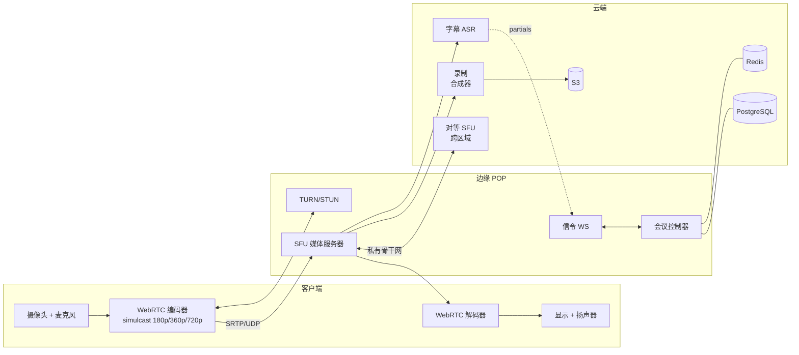
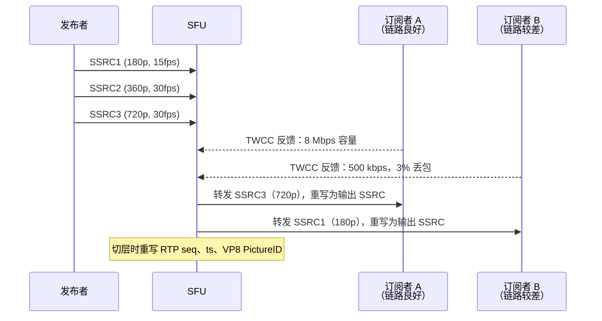
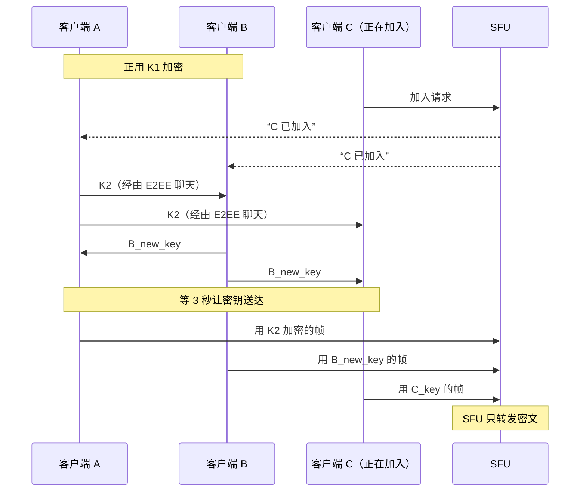

# 设计视频会议系统（Zoom / Google Meet）

> **TL;DR.** 一场 20 人的视频会议不是 20 通视频通话。在 SFU 上它是 20 路发布加 380 路订阅，全部要塞进 150 ms 的音频预算里，而丢包、NAT 防火墙和非对称带宽还在处处跟你作对。主流架构是 SFU + simulcast：每个发布者编码 2-3 个分辨率层，SFU 依据 TWCC 带宽估计为每个订阅者选层，服务器全程不解码媒体。Zoom 在 2020 年 4 月报告了 3 亿日会议参与者（这个数字是修正后的口径——Zoom 此前撤回了“日活跃用户”的说法；参与者数会把一天里参加多场会议的同一人重复计入）[^1]，跑的就是这套模型。核心权衡是 SFU（CPU 便宜，订阅端下行重）对 MCU（CPU 昂贵，订阅端带宽极小）。

## 学习目标

- 设计一套基于 SFU 的视频会议系统，支撑 50+ 个全球 POP 上的 1000 万并发参会者
- 比较 P2P 网状、SFU、MCU 三种拓扑，并论证 SFU 是 5-1,000 人房间的现代默认选择
- 估算 Zoom 量级部署下的媒体带宽、TURN 中继成本与录制存储
- 论证为什么在广泛客户端兼容性上 simulcast 优于 SVC，并解释选层机制
- 权衡云信任（服务器可以转码、录制、生成字幕）与 E2EE（服务器只看到密文）

## 直觉理解

两个人打视频电话是小事。双方各发一路流、各收一路流。一个 WebSocket 服务器交换 SDP offer，ICE 打穿 NAT，SRTP 点对点跑起来。完事。

现在再加 18 个人。每个参会者都要把自己的摄像头画面发布给另外 19 人。在朴素网状结构里，那就是 20 × 19 = 380 路有向媒体流。典型家庭上行带宽 5 Mbps，连五路 1.5 Mbps 的 720p 都撑不住[^2]。到第五个人，网状结构就崩了。

打开这个设计的那句话是：在中间放一台转发服务器。每个参会者只发布一次，服务器把每路流复制给所有订阅者。这就是选择性转发单元（Selective Forwarding Unit，SFU）。它从不解码视频，所以 CPU 占用很低。但接下来服务器必须决定每个订阅者拿到什么分辨率，因为一部走蜂窝网的手机扛不住 19 路 720p。这个决策，每个订阅者每秒做 100 次、依据 TWCC 反馈回来的带宽估计——它才是生产级 SFU 和玩具的分水岭。

第二重压力是延迟。人对超过 150 ms 的音频延迟会感知为“尴尬的停顿”。视频能容忍到 500 ms。每一跳、每一次编码、每个抖动缓冲都在啃食这份预算。MCU 要解码再重编码，多出 50-100 ms 延迟，而 SFU 完全省掉了这一段。

## 需求

### 澄清式提问

- **问：单场会议最大参会人数？**
  假设：标准会议最多 100 人；网络研讨会最多 1,000 人；大型活动最多 10 万人（广播模式）。
- **问：SFU、MCU 还是 P2P？**
  假设：默认 SFU。PSTN 拨入和录制合成用 MCU。P2P 只用于 1:1。
- **问：需要端到端加密吗？**
  假设：默认云信任（可启用录制、字幕、AI）。敏感会议可选用 E2EE。
- **问：要录制吗？**
  假设：云端录制，按轨道分别采集、异步合成。直播场景用实时合成。
- **问：第一天就要全球化？**
  假设：是。50+ 个城市部署媒体 POP，参会者就近接入。
- **问：背景特效、字幕、转写？**
  假设：客户端做背景虚化（MediaPipe）。字幕与转写用服务端 ASR。

### 功能性需求

- 创建和加入会议，支持音频、视频、屏幕共享轨道
- 每条视频轨道发布 2-3 个 simulcast 层，由 SFU 按订阅者选层
- 主持人控制：全员静音、移出参会者、锁定会议、等候室
- 云端录制，会后可回放
- 通过服务端 ASR 提供实时字幕
- 分组讨论室（会议内的子会话）

### 非功能性需求

- **负载：** 50 万场同时会议，1000 万并发参会者（平均每场 20 人）
- **延迟：** P99 音频端到端 <150 ms，P99 视频 <500 ms
- **可用性：** 媒体链路 99.9%
- **带宽：** 参会者上行 2-5 Mbps，下行 5-20 Mbps
- **合规：** 欧盟会议数据留在本区域；NAT 穿透使用 TURN 中继

## 容量估算

| 指标 | 数值 | 推导 |
|--------|------:|------------|
| 汇总媒体入流量 | 20 Tbps | 1000 万参会者 × 2 Mbps 平均上行 |
| 每场 20 人会议的扇出 | ~500 Mbps | 19 个订阅者 × 每个选中层约 1.5 Mbps × 20 个发布者 |
| TURN 中继带宽 | 1-2 Tbps | 通常 5-10% 的会话需要中继[^3] |
| 信令带宽 | ~100 Gbps | 1000 万参会者 × 每约 10 KB/s 的 WebSocket 控制流量 |
| 每日录制存储 | ~10 PB | 峰值时每场被录制的会议合成后约 1 Gbps |
| SFU 节点数（每节点 1,000 参会者） | ~10,000 | 10M / 1,000 |

关键比例：

- **读写比：** 每路发布产生 N-1 路订阅。一场 20 人会议的扇出比是 19:1。
- **TURN 成本：** 只服务 5-10% 的会话，却常常是最大的一笔带宽开销[^3]。
- **参考规模：** Zoom 在 2020 年 4 月报告约 3 亿日会议参与者（修正自最初“日活跃用户”的说法；参与者数会把一天参加多场会议的用户重复计算）[^1]。Google Meet 在三个月里增长 30 倍，达到约 1 亿日参与者[^4]。

## API 与数据模型

### API 设计

```http
POST /v1/meetings
  Body: { "title": "...", "host_id": "...", "settings": {...} }
  Returns: 201 { "meeting_id": "uuid", "join_url": "...", "host_token": "..." }

POST /v1/meetings/{id}/join
  Body: { "participant_id": "...", "device_info": {...}, "bandwidth_hint": 5000 }
  Returns: 200 { "signaling_ws_url": "wss://...", "turn_credentials": {...} }

POST /v1/meetings/{id}/record
  Returns: 202 { "job_id": "uuid" }

GET /v1/meetings/{id}/stats
  Returns: 200 { "participants": 18, "avg_bitrate_kbps": 1200, "packet_loss": 0.02 }
```

信令（WebSocket）：

```text
WS /v1/meetings/{id}/signaling
  -> sdp_offer / sdp_answer
  -> ice_candidate (trickled)
  -> participant_joined / participant_left
  -> layer_change_request { "track_id": "...", "max_height": 360 }
  -> mute_changed / speaker_active
```

媒体面：SRTP over UDP，通过 ICE/DTLS 握手建立。RTCP 反馈：NACK、PLI、TWCC。

### 数据模型

```sql
-- 会议元数据（PostgreSQL）
CREATE TABLE meetings (
  meeting_id   UUID PRIMARY KEY,
  host_id      UUID NOT NULL,
  title        TEXT,
  settings     JSONB,  -- waiting_room、e2ee_flag、recording_policy
  created_at   TIMESTAMPTZ,
  ended_at     TIMESTAMPTZ
);

-- 会话状态（Redis，按 meeting_id 作键，易失）
-- 活跃参会者、已发布轨道、simulcast 分层分配、
-- 每个订阅者的 BWE 目标、发言者历史

-- 录制清单（S3 + 元数据库）
-- 逐轨道分片列表、时间索引、合成配方、任务状态

-- TURN 凭据（Redis，TTL 约 4h）
-- 每会话 HMAC 签名的用户名/密码
```

## 高层架构



*客户端把 simulcast 各层发布到最近的 SFU POP；跨区域会议通过私有骨干网在 SFU 之间中继；录制与字幕从媒体热路径上旁路出去。*

**写路径（发布）：** 客户端同时把摄像头编码成 180p、360p、720p 三档，作为三条独立 RTP 流（不同 SSRC）发给 SFU。SFU 从每个订阅者那里收 TWCC 反馈，并为每个订阅者选出合适的层。

**读路径（订阅）：** 对每条被订阅的轨道，SFU 转发所选层的包，同时重写 RTP 序列号和时间戳，让解码器看到一条连续的时间线[^5]。订阅者针对每一路源信令自己的 `maxHeight`，SFU 就能尽早丢掉高层。

**异步路径：** 录制按轨道分别落到 S3；会议结束后由批处理合成器渲染最终视频。ASR 接收一路混音音频，通过信令通道推送字幕的分段结果。

**入会预算：** 一次健康的入会必须在约 3 秒内走完 DNS、TLS、信令、ICE、DTLS 并拿到第一帧媒体，否则用户就会认定应用坏了。

```mermaid
gantt
    dateFormat X
    axisFormat %L ms
    title 入会延迟瀑布（预算约 3000 ms）
    section 建立阶段
    DNS + TLS 握手       : 0, 300
    信令 WS + SDP        : 300, 900
    ICE 候选收集         : 400, 1800
    DTLS 握手            : 1800, 2200
    首个 SRTP 音频包     : 2200, 2500
    首个 SRTP 视频包     : 2500, 3000
```



*一次健康的入会把整条握手链条压在 3 秒内；ICE 候选收集占大头，靠 trickle 候选和预热好的 TURN 凭据才能省下来。*

## 深入探讨

### SFU 的 simulcast 与选层

生产级 SFU 的核心画质机制是 simulcast 加按订阅者选层。发布者把同一路摄像头编码成 2-3 档分辨率（例如 180p/15 fps、360p/30 fps、720p/30 fps），同时上传所有层，代价是上行带宽变成单流的 2-3 倍[^6]。

对每个订阅者，SFU 挑出能塞进其估算下行容量的那一层。看缩略图的订阅者拿 180p，当前发言人大画面拿 720p。Jitsi 的分配算法先按语音活跃度给源排序（主导发言者优先），再用 `LastN` 上限把不可见的源整个丢掉，然后在剩余带宽预算内贪心分配各层[^7]。



*SFU 依据 TWCC 上报的容量为每个订阅者挑选 simulcast 层，并重写包头元数据以维持解码器侧连续的时间线。*

当 SFU 切换层（比如订阅者链路变差，从 720p 降到 360p），它会重写 RTP SSRC、序列号、时间戳以及 VP8 的 PictureID/TL0PICIDX，让解码器看到一条连续的流[^5]。这种重写与 E2EE 兼容，因为这些字段都是加密帧载荷之外的包头元数据。

**SVC 这条替代路线：** 可分层视频编码（Scalable Video Coding，VP9-SVC、AV1-SVC）编码出一条分层单流，SFU 直接丢掉高层即可，不需要重写。AV1 的压缩率比 VP9、H.264 这类前辈好 30-50%[^8]，Google Meet 已经部署它，让视频在 40 kbps 下也能看[^9]。权衡是：SVC 解码器在旧浏览器上的支持仍然参差不齐，而 simulcast 的 VP8/H.264 到处都能跑[^6]。

### 用 GCC 和 TWCC 做带宽估计

不知道每个订阅者可用带宽，SFU 就选不对层。Google 拥塞控制（Google Congestion Control，GCC）的办法是从单向延迟梯度反推容量[^10]。

传输层全链路拥塞控制（Transport-Wide Congestion Control，TWCC）是当前 WebRTC 的默认做法。每个发出的 RTP 包都带一个 transport-wide 序列号。接收端大约每 100 ms 回一次 RTCP 反馈（“我在 Z 时刻收到了 X 号包”），间隔限制在 50-250 ms 之间[^10][^11]。发送端据此算出逐包的延迟梯度和丢包率，喂进趋势线滤波和过载检测，再由 AIMD 控制器产出目标发送速率。

链路变化后 TWCC 大约 1 秒内就能跟上[^10]。这就是“画面卡死了 5 秒”和“画面糊了一下”的差别。Signal 在选型评估时发现，只有两个开源 SFU 的拥塞控制算得上“够用”，这正是他们改用 Rust 重写的原因[^5]。

SFU 用 TWCC 推出来的目标值驱动分配循环：

1. 按优先级给源排序（当前发言者优先）
2. 施加 `LastN`，丢掉不可见的源
3. 对每个剩余源，选出能塞进订阅者剩余带宽预算的最高层[^7]

### 端到端加密下如何保持 SFU 转发

视频会议里的 E2EE 意味着 SFU 只转发不透明密文，无法解码、转码、录制或生成字幕。WebRTC 的 Encoded Transforms（早期叫 Insertable Streams）在打包前把编码帧暴露给 JavaScript，应用可以加密帧载荷，同时让 RTP 头保持明文，供 SFU 转发[^12][^13]。

Signal 的实现是：入会时为每个客户端生成一个帧加密密钥，密钥通过 Signal 已有的 E2EE 消息通道分发给所有参会者。任何人加入或离开，每个客户端都生成新密钥，并在 3 秒后开始使用，从而保证前向保密（新加入者解不开之前的媒体）和抗合谋安全（离开者解不开之后的媒体）[^5]。



*成员变化时，每个客户端都轮换密钥，并留 3 秒宽限期。SFU 从不持有解密密钥。*

关键权衡在这里：一旦开启 E2EE，服务端转写、录制合成、降噪、AI 摘要全部失效，因为它们都需要明文媒体。Microsoft Teams 明确写了这一点：开启会议 E2EE 会关闭转写和录制[^14]。Zoom 于 2020 年 10 月推出 E2EE，此前正因虚假宣传加密能力被 FTC 调查（和解在 2020 年 11 月公布，2021 年 2 月最终确定）[^15]；IACR 的研究者后来描述了针对 Zoom E2EE 设计的冒充攻击（大多需要内部人员与参会者串通），不过作者自己也指出这些对 Zoom 的 E2EE 而言“并非迫在眉睫的威胁”[^16]。

**结论：** 把 E2EE 的作用范围划窄（1:1 通话、敏感会议），并在产品体验里把这个权衡摊开给用户看。大多数用户更想要转写和录制，而不是零信任加密。

## 真实案例

**Google Meet：疫情期间三个月扩容 30 倍。**

Google Meet 完全构建在 WebRTC 之上。2020 年初疫情爆发时，用量在三个月里增长 30 倍，达到约 1 亿日会议参与者[^4][^17]。SRE 团队组织了一套事故响应结构，把工作流拆成容量、依赖项、瓶颈、“控制旋钮”（缓解手段）和生产变更几路[^17]。

第一个缓解手段只是一个开关：全球范围内把默认视频从高清强制降到标清。这一个控制旋钮把单场会话带宽大致砍半，在新服务器到位之前抢出了好几天的容量余量[^17]。

第二个洞察反直觉：“更胖”的任务（每个容器 4 倍 CPU 和内存）承载的请求量约为四个基线容器的 1.8 倍。固定开销（连接保活、日志、监控 socket）在更大的实例上摊得更薄[^17]。这对有状态媒体服务器是一条通用经验。

Meet 在 AV1 编码上的投入，对带宽受限的用户回报明显。AV1 在 40 kbps 下就能产出可用画面[^9]，把之前完全打不了视频电话的 2G 蜂窝用户也接了进来。Meta 同样在有硬件解码能力的移动端 RTC 场景部署了 AV1[^18]。

这套架构与 Google 其他所有 WebRTC 服务共享编解码与传输层的投入。GCC/TWCC 的改进会自动流进 Meet，反过来也一样。

## 权衡

| 架构 | 优点 | 缺点 | 适用场景 |
|---|---|---|---|
| P2P 网状 | 无服务器媒体成本；延迟最低 | 上行随人数 O(N) 增长；超过约 4 人就不实用[^2] | 1:1 与极小规模通话 |
| SFU | 可扩展到 100+ 人；转发不解码；兼容 E2EE | 订阅端下行重；服务端无法合成 | Zoom、Meet、Teams、Signal 的默认选择[^5] |
| MCU | 订阅端带宽小；对拨入友好 | 服务器 CPU/GPU 压力大；增加编解码延迟 | PSTN 桥接、网络研讨会、瘦客户端 |
| SFU + MCU 混合 | 交互走 SFU，桥接走 MCU | 运维最复杂 | 同时需要 PSTN 与网络研讨会的生产服务 |
| Simulcast | 解码器支持面广；每个客户端都能跑 | 上行成本 2-3 倍[^6] | WebRTC 视频的默认路径 |
| SVC（VP9/AV1） | 单次上传即可支持服务端细粒度丢层（方案本身优势）；与 AV1 搭配时，编解码器本身还比 VP9/H.264 多出最多 30-50% 的压缩收益（这是编码代际优势，与 SVC 无关）[^8] | 解码器支持不齐；编码器 CPU 占用高 | 上行受限的发布者；新一代客户端 |
| E2EE（Encoded Transforms） | 零信任服务器；符合合规要求 | 破坏转写、录制、AI 功能[^14] | 隐私敏感套餐；受监管行业 |

最大的那个元决策是 SFU 对 MCU。交互式会议选 SFU，因为它省掉了编解码往返延迟、服务器 CPU 也便宜。只有订阅端带宽成为硬约束时（拨入、2G、VDI 瘦客户端）MCU 才赢。所有主流平台（Zoom、Meet、Teams、Signal）都是 SFU 优先，再为边缘场景补上 MCU 的行为[^2][^5]。

## 扩展与故障模式

**10 倍（1 亿并发）：** SFU 节点打满。单节点承载 500-2,000 个参会者，按 `meeting_id` 分片。横向扩量；尽量让一场会议落在一个节点上。大会议（100+ 人）则在多个 SFU 节点间级联，节点之间走私有骨干网中继[^19]。

**100 倍（10 亿并发）：** TURN 带宽成为主要成本。全球部署 TURN，用 TLS/443 上的 `turns` 穿激进中间盒[^3]。区域不均衡会逼出动态会议迁移：如果一场会议的参会者分布变了（3 个在美国、17 个在欧盟），就把该会议的主 SFU 迁到多数派所在区域。

**1000 倍：** 大型活动转向 CDN 支撑的广播（1 万以上观众用 LL-HLS/WHEP），交互参会者仍留在 SFU 上。

**故障：会议进行中 SFU 节点崩溃。** 参会者看到画面冻结。客户端靠 RTCP 超时发现，重新信令到健康节点，3-5 秒内完成重新 ICE。会议状态放在 Redis 里，使无状态故障切换成为可能。

**故障：某个发布者方向上的非对称丢包。** 其他人看到那个人卡住。缓解：发布端 FEC、把 simulcast 降到最低分辨率、客户端弹出“你的网络连接不稳定”提示条。

**故障：企业防火墙统一调整期间 TURN 集群被打满。** 中继比例从 5% 飙到 30% 以上。缓解：把 TURN 当一等公民做容量规划；按中继会话数对每个 POP 的 TURN 节点自动扩缩。

## 常见陷阱

> [!WARNING]
> **用 WebSocket（TCP）承载媒体。** TCP 的队头阻塞会把 2% 的丢包变成彻底冻结。基于 UDP 的 WebRTC/SRTP 是唯一正确的默认选择。Zoom 的 Web SDK 把视频跑在 data channel 上，Daily 记录了它在中等质量 WiFi 下可见的卡顿[^20]。

> [!WARNING]
> **按用户而不是按会议锁定区域。** 在旧金山的人加入巴黎的会议，应该接入巴黎的 SFU。按用户锁会把会议撕碎到多个区域，给音频加上 150-200 ms[^19]。

> [!WARNING]
> **没有速率分配。** 给每个订阅者都发发布者的最高层，既浪费下行，又会触发拥塞导致的全体码率崩塌。要对每个订阅者跑完整的 TWCC 驱动分配循环[^5][^7]。

> [!WARNING]
> **把录制耦合在 SFU 热路径上。** 录制合成器是个虚拟订阅者。它一卡，背压就会传导回来，把直播会议暂停。永远要用“逐轨道落对象存储 + 异步合成”来解耦。

> [!WARNING]
> **把 E2EE 当成一个免费开关。** 开了 E2EE，转写、录制、降噪、AI 摘要全部坏掉。把 E2EE 的作用范围划窄，并在产品体验里把权衡摊开[^14]。

> [!WARNING]
> **忽略 TURN 成本。** 常规就有 5-10% 的会话需要 TURN，而企业防火墙一变，中继比例能飙到 30% 以上。把 TURN 当作一等的带宽预算条目[^3]。

## 追问

**1. 怎么在不丢掉 SFU 选择性转发的前提下加 E2EE？**

用 Encoded Transforms 加密帧载荷，同时让 RTP 头（SSRC、seq、timestamp）保持明文。SFU 为切层重写包头，完全不碰密文。每次加入/离开都轮换密钥，并留 3 秒宽限期保证送达[^5]。

**2. 1,000 人的网络研讨会和 20 人会议有什么不同？**

拆成发布者（嘉宾，接入 SFU）和观众（只收，ABR 单播或 LL-HLS）。观众拿到的是类 MCU 合成器输出的一路合成流。只有嘉宾有双向媒体。Microsoft Teams 的 town hall 就是照这个分法做的[^21]。

**3. 最小可用的 PSTN 拨入怎么做？**

SIP 网关终结电话呼叫，把 G.711 转码成 Opus，然后作为一个虚拟参会者接入 SFU。纯音频，无视频。MCU 把拨入者的音频混进房间，并回送一路“混合减自己”的流（除了他自己以外的所有人）。

**4. 参会者摄像头坏了（黑帧）怎么处理？**

通过分析 RTP 时间戳检测卡帧（超过 2 秒没有新帧）。给客户端弹“摄像头可能已关闭”的提示条。暂停该轨道的各 simulcast 层，把带宽让给其他人。

**5. 服务端降噪会带来什么变化？**

SFU 在转发前把音频过一条 ML 流水线（RNNoise 或 Krisp）。这会加 10-20 ms 延迟，但在嘈杂环境里音质提升巨大。它与 E2EE 不兼容，因为服务器需要明文音频帧。

**6. 跨区域会议（东京到圣保罗）怎么办？**

每个参会者接入最近的 SFU POP，SFU 之间通过私有骨干网互转。最差情况音频路径仍能压在 200 ms 以内。会议控制器跟踪参会者分布，可以把“主”SFU 迁到多数派区域[^19]。

## 练习

### 练习 1：50 人全员大会的带宽预算

你公司每周开一次 50 人全员大会。每人发布 3 个 simulcast 层（180p/150 kbps、360p/500 kbps、720p/1.5 Mbps）。发言人大画面显示 1 人 720p、5 人 360p，其余 43 人是 180p 缩略图。算一下每个订阅者的下行需求。

<details>
<summary>提示</summary>

把每个订阅者实际收到的各层码率加起来。记住：你收不到自己那一路，所以总共是 49 路源。

</details>

<details>
<summary>解答</summary>

每个订阅者收到：

- 1 路 720p = 1,500 kbps
- 5 路 360p = 5 × 500 = 2,500 kbps
- 43 路 180p = 43 × 150 = 6,450 kbps

每订阅者合计：约 10.5 Mbps 下行。这在典型宽带（25+ Mbps）之内，但超过很多蜂窝连接（5-10 Mbps）。在受限链路上，SFU 会丢掉 `LastN` 之外的缩略图（比如只显示 9 个格子），或者把所有缩略图降到 0（不可见参会者只留音频）[^7]。发布端上行是 150 + 500 + 1,500 = 2.15 Mbps，与房间人数无关——这正是 SFU 相对网状结构的关键优势。

</details>

## 要点回顾

- **SFU + simulcast 是默认答案。** P2P 只用于 1:1；MCU 用于桥接和广播；其余一切场景都是 SFU 加按订阅者选层。
- **TWCC 决定画质。** 带宽估计加上分配循环，才是生产级 SFU 与玩具的分界线。编解码选型是次要的。
- **按会议路由，不按用户路由。** 媒体就近比用户就近更重要。会议被撕到多个区域，音质会直接塌掉。
- **录制和字幕要解耦。** 它们是关键功能，但绝不能卡住 SFU 的媒体热路径。
- **E2EE 是产品权衡，不是免费开关。** 它会关掉转写、录制和 AI 功能。范围要划窄。
- **显式给 TURN 做预算。** 5-10% 的会话需要中继，但它常常是最大的那笔带宽开销。

## 延伸阅读

- [How to build large-scale end-to-end encrypted group video calls (Signal)](https://signal.org/blog/how-to-build-encrypted-group-calls/)。关于在生产 Rust 中组合 SFU 转发、simulcast、TWCC 与 SFrame E2EE，最好的一手资料。
- [Three months, 30x demand: How we scaled Google Meet (Google Cloud)](https://cloud.google.com/blog/products/g-suite/keeping-google-meet-ahead-of-usage-demand-during-covid-19)。疫情期间的 SRE 工作流、容量预测、“更胖的任务”与应急控制旋钮。
- [A technical guide to the Zoom Web SDK (Daily)](https://www.daily.co/blog/zoom-web-sdk-technical-notes/)。对 Zoom 自研 H.264+SVC 栈及其与 WebRTC 差异最清晰的解释。
- [Jitsi Videobridge bandwidth allocation algorithm](https://github.com/jitsi/jitsi-videobridge/blob/master/doc/allocation.md)。生产级 SFU 的速率分配算法：优先级排序、LastN、贪心选层。
- [Transport-Wide Congestion Control (IETF Internet-Draft)](https://datatracker.ietf.org/doc/html/draft-holmer-rmcat-transport-wide-cc-extensions-01)。TWCC 发送端带宽估计的权威描述。
- [RFC 6716: Opus audio codec](https://www.rfc-editor.org/rfc/rfc6716)。WebRTC 的必选音频编解码器：6-510 kbps，算法延迟 5-66.5 ms。
- [Improved video calling with faster AV1 encoding (Chrome)](https://developer.chrome.com/blog/av1/)。Google Meet 的 AV1 部署，让带宽受限用户也能在 40 kbps 下看视频。
- [LiveKit SFU internals](https://docs.livekit.io/reference/internals/livekit-sfu/)。简洁的 P2P vs MCU vs SFU 框架，外加 LiveKit 的横向扩量模型。

## 记忆卡片

<details>
<summary><strong>问：为什么 P2P 网状超过约 4 人就不行？</strong></summary>

答：每个参会者都要上传 N-1 路流。到 5 个人时，典型家庭上行带宽 5 Mbps 撑不住四路 1.5 Mbps 的 720p。每人的带宽开销随人数 O(N) 增长，所以网状结构出了小规模就不实用。

</details>

<details>
<summary><strong>问：SFU 和 MCU 的关键差别是什么？</strong></summary>

答：SFU 转发媒体包而不解码，服务器 CPU 占用低，但要求订阅端自己处理 N-1 路入向轨道。MCU 解码所有入向流，合成成每订阅者一路输出再重新编码，订阅端带宽极省，但烧服务器 CPU/GPU，还多出编解码延迟。

</details>

<details>
<summary><strong>问：WebRTC 里的 simulcast 是怎么工作的？</strong></summary>

答：发布者把同一路摄像头编码成 2-3 档分辨率（例如 180p、360p、720p），作为多条独立 RTP 流上传。SFU 依据每个订阅者的估算带宽容量为其选一层，只转发那一层。

</details>

<details>
<summary><strong>问：TWCC 是什么，为什么对视频会议重要？</strong></summary>

答：传输层全链路拥塞控制给每个发出的 RTP 包打上序列号。接收端周期性回传带到达时间的反馈。发送端据此计算延迟梯度和丢包率，估计可用带宽，链路变化后约 1 秒内跟上。它是 simulcast 选层的驱动信号。

</details>

<details>
<summary><strong>问：为什么应该按会议就近路由，而不是按用户就近路由？</strong></summary>

答：把每个用户路由到最近 POP 会把会议撕到多个区域，逼出 SFU 之间的中继，加上 150-200 ms。按会议就近路由能把大多数参会者放在同一个 SFU 集群上，给多数人最小化音频延迟。

</details>

<details>
<summary><strong>问：E2EE 如何与必须重写 RTP 头的 SFU 共存？</strong></summary>

答：Encoded Transforms 加密帧载荷，同时让 RTP 头（SSRC、序列号、时间戳）保持明文。SFU 为切层重写这些头，完全不碰加密载荷。每次成员变化都轮换密钥，并留 3 秒宽限期。

</details>

<details>
<summary><strong>问：通常有多少比例的会话需要 TURN 中继？</strong></summary>

答：5-10% 的会话因 NAT 穿透需要 TURN（对称 NAT、企业防火墙）。比例虽低，但 TURN 往往是最贵的单项带宽成本，因为它要把完整媒体流经服务器中转。

</details>

<details>
<summary><strong>问：疫情导致流量涨 30 倍时，Google Meet 首先做了什么？</strong></summary>

答：拧了一个旋钮：全球范围内把默认视频从高清强制降到标清。这把单场会话带宽大致砍半，在新服务器到位前抢出了好几天的容量余量。

</details>

<details>
<summary><strong>问：为什么开启 E2EE 会关掉转写和录制？</strong></summary>

答：服务端转写和录制需要明文媒体帧。开了 E2EE，SFU 只看到密文。这些功能只能改到设备端跑，而多人会议的合成录制在设备端做不到。

</details>

<details>
<summary><strong>问：视频会议的入会延迟预算是多少？</strong></summary>

答：总共约 3 秒：DNS + TLS（约 300 ms）、信令/SDP 交换（约 600 ms）、ICE 候选收集（约 1,000 ms）、DTLS 握手（约 400 ms）、首个 SRTP 音频包（约 200 ms）。超过 3 秒，用户就会认定应用坏了然后刷新。

</details>

## 参考文献

[^1]: TechCrunch, "Zoom retracts statement that it has 300M daily active users", Apr 2020. https://techcrunch.com/2020/04/30/zoom-retracts-statement-that-it-has-300m-daily-active-users/

[^2]: SignalWire, "P2P? SFU? MCU? Which WebRTC Architecture Is Right for You". https://signalwire.com/blogs/industry/p2p-sfu-mcu-find-out-which-webrtc-architecture-is-right-for-you

[^3]: LiveKit, "LiveKit SFU". https://docs.livekit.io/reference/internals/livekit-sfu/

[^4]: Wired, "How Google Meet weathered the work-from-home explosion", Aug 2020. https://www.wired.com/story/how-google-meet-weathered-work-from-home-explosion/

[^5]: Signal, "How to build large-scale end-to-end encrypted group video calls", Dec 2021. https://signal.org/blog/how-to-build-encrypted-group-calls/

[^6]: BlogGeek.me, "Scalable Video Coding (SVC)". https://bloggeek.me/webrtcglossary/svc/

[^7]: Jitsi, "Bandwidth Allocation Algorithm", jitsi-videobridge docs. https://github.com/jitsi/jitsi-videobridge/blob/master/doc/allocation.md

[^8]: Jitsi, "AV1 and more... how does Jitsi Meet pick video codecs?", Dec 2024. https://jitsi.org/blog/av1-and-more-how-does-jitsi-meet-pick-video-codecs/

[^9]: Chrome Developers, "Improved video calling with faster AV1 encoding", May 2023. https://developer.chrome.com/blog/av1/

[^10]: Walter Fan, "Transport-wide Congestion Control", WebRTC notes, 2021. https://walterfan.github.io/webrtc_primer/3.media/webrtc_tcc.html

[^11]: Holmer et al., "RTP Extensions for Transport-wide Congestion Control", IETF Internet-Draft, Oct 2015. https://datatracker.ietf.org/doc/html/draft-holmer-rmcat-transport-wide-cc-extensions-01

[^12]: Mozilla WebRTC Blog, "End-to-end-encrypt WebRTC in all browsers!". https://blog.mozilla.org/webrtc/end-to-end-encrypt-webrtc-in-all-browsers/

[^13]: TRTC, "Comprehensive Guide to WebRTC Encoded Transform". https://trtc.io/blog/details/what-is-webrtc-insertable-streams

[^14]: Microsoft Learn, "Require end-to-end encryption for sensitive Teams meetings". https://learn.microsoft.com/en-us/microsoftteams/end-to-end-encrypted-meetings

[^15]: FTC, "FTC Requires Zoom to Enhance its Security Practices as Part of Settlement", Nov 2020. https://www.ftc.gov/news-events/news/press-releases/2020/11/ftc-requires-zoom-enhance-its-security-practices-part-settlement

[^16]: IACR, "Security Analysis of End-to-End Encryption for Zoom Meetings", 2021/486. https://eprint.iacr.org/2021/486

[^17]: Google Cloud Blog, "Three months, 30x demand: How we scaled Google Meet during COVID-19", Aug 2020. https://cloud.google.com/blog/products/g-suite/keeping-google-meet-ahead-of-usage-demand-during-covid-19

[^18]: Meta Engineering, "Better video for mobile RTC with AV1 and HD", Mar 2024. https://engineering.fb.com/2024/03/20/video-engineering/mobile-rtc-video-av1-hd/

[^19]: LiveKit, "How we built a globally distributed mesh network to scale WebRTC", Oct 2022. https://blog.livekit.io/scaling-webrtc-with-distributed-mesh/

[^20]: Daily, "A technical guide to the Zoom Web SDK", Dec 2023. https://www.daily.co/blog/zoom-web-sdk-technical-notes/

[^21]: Microsoft Learn, "Overview of meetings, webinars, and town halls". https://learn.microsoft.com/en-us/microsoftteams/overview-meetings-webinars-town-halls
