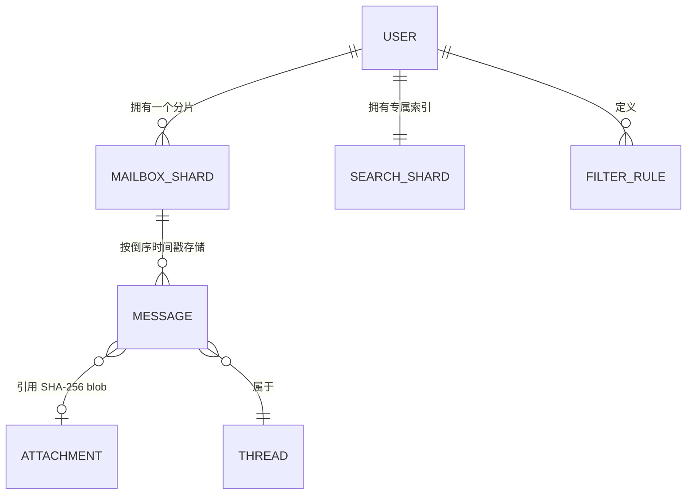
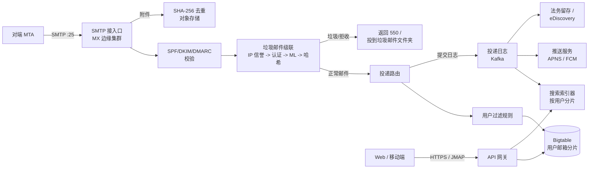
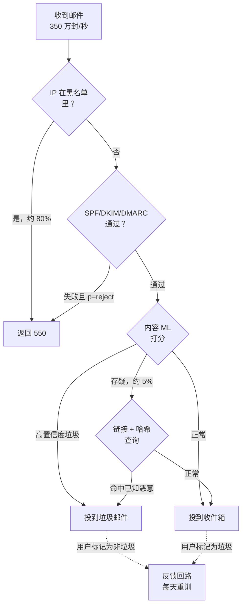
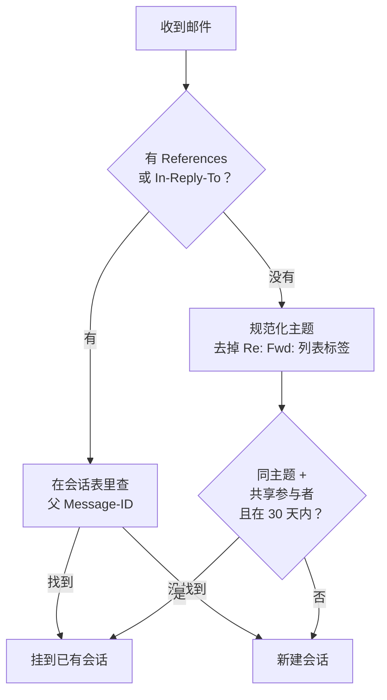

# 设计 Gmail 规模的邮件服务（18 亿用户，每天 3000 亿封邮件）

> **TL;DR。** 邮件服务做到超大规模，本质上是个存储问题，只是穿了一件消息系统的外衣。Gmail 服务 18 亿用户 [^1]，承担全球每天约 3000 亿封邮件中的一部分 [^2]，但收到的入站流量里大部分是垃圾邮件，在进入收件箱之前就被杀掉了。关键的权衡发生在「服务端明文访问」（从而支持搜索、Smart Compose 和垃圾邮件 ML）与「零访问加密」（Proton Mail 的模式，代价是放弃这些功能）之间。真正能跑起来的架构是这样：带分层认证（SPF/DKIM/DMARC）的 SMTP 接入口、按成本排序的垃圾邮件级联、投递进 Bigtable 风格的宽列邮箱、按内容寻址的附件去重省下 36% 存储 [^3]，再加一个按用户分片的倒排索引，把搜索 P99 压在 200 ms 以内。

## 学习目标

- 在 2 秒的投递前预算内，为每秒 350 万封邮件的峰值设计 SMTP 接入口与多级垃圾邮件级联
- 论证为何选择按用户分片的搜索而非全局索引，并估算十年深度邮箱下 200 ms P99 的容量
- 用 jwz 算法实现 RFC 5322 头部会话串接，并以主题行作为后备
- 为 EB 级存储做分层（热 SSD、温 HDD、冷归档），并按内容哈希对附件去重
- 比较云信任（Gmail）与零访问（Proton）两种模式，说清各自牺牲了什么
- 为 18 亿个 15 GB 的邮箱、跨三层存储做容量估算

## 直觉理解

单机邮件系统服务 100 个用户毫无压力：接收 SMTP，把邮件落成一个文件，让用户用 POP 取走。可到了 18 亿用户、每天交换 3000 亿封邮件，三股力量会同时把这个模型打碎。

第一，对抗性洪水。入站流量中很大一部分（通常估计在 45%–85%，取决于服务商和年代）是垃圾邮件、钓鱼或恶意软件 [^4]。你必须在投递之前、在 2 秒延迟预算之内，以 99.9% 的精度给每秒 350 万封邮件分类。一次误判（把正常邮件判成垃圾）可能让用户悄悄丢掉一个工作机会；一次漏判则可能让他损失金钱。

第二，存储悬崖。每个用户免费拿到 15 GB [^5]，邮件、云盘、照片共用。乘上 18 亿个账号，你就进了 EB 量级。附件是绝对大头：Mail.Ru 实测发现，邮件正文和索引只占邮箱存储的 15%，剩下 85% 全是文件 [^3]。你不可能为 1000 万个收件人各自单独存一份同样的 5 MB 新闻邮件 PDF。

第三，搜索预期。用户要在十年的邮件里搜索，还期望 200 ms 内出结果。全局共享索引只要有一条查询语句写错，就会跨租户泄露数据。按用户分片一举解决隐私、配额隔离和长尾延迟三件事，代价是你得维护数十亿个极小的索引分片。

朴素架构在这三个维度上会同时崩掉。真正上线的设计是：按成本排序的垃圾邮件级联（便宜信号先跑，ML 只处理中间那批模棱两可的）、带分层生命周期的列式邮箱存储、内容寻址的附件去重，以及一个由投递日志异步喂数据的按用户倒排搜索索引。

## 需求

### 澄清问题

- **问：走云信任模式还是端到端加密？**
  假设：云信任（服务端可以读内容）。这样才能做服务端搜索、垃圾邮件 ML 和 Smart Compose。Proton 那条替代路线放在权衡一节讨论。
- **问：全文搜索要包含附件内容吗？**
  假设：邮件正文和元数据要。附件内容搜索是尽力而为（索引时抽取 PDF/DOCX 文本）。
- **问：必须支持哪些客户端协议？**
  假设：SMTP（收发）、带 IDLE 的 IMAP [^6]、JMAP（RFC 8620/8621）[^7][^8]，以及自有的一套 Web/移动端 REST API。
- **问：垃圾邮件判定的 SLA 是投递前还是事后？**
  假设：实时、投递前完成。用户永远不会在收件箱里看到被判为垃圾的邮件。
- **问：附件大小上限？**
  假设：内联 25 MB；更大的走云盘链接集成。
- **问：会话串接模型？**
  假设：以 RFC 5322 的 `References`/`In-Reply-To` 为主，主题行聚类作为后备 [^9][^10]。

### 功能需求

- 通过带 DKIM/SPF/DMARC 认证的 SMTP 撰写、发送和接收邮件 [^11]
- 用 RFC 5322 头部把邮件串成会话，主题行作为后备
- 在用户整个邮箱（正文、主题、发件人、标签）上做全文搜索
- 标签、过滤器、转发、假期自动回复、归档
- 附件上传，含病毒扫描、预览生成、CDN 加速下载
- 投递前完成垃圾邮件/钓鱼/恶意软件分类，并带用户反馈回路

### 非功能需求

- **负载：** 峰值接入每秒 350 万封；搜索峰值 5M QPS
- **延迟：** 搜索 P99 < 200 ms；邮件投递 P99 < 2 s（含垃圾邮件分类）
- **可用性：** 读路径 99.99%；写路径 99.9%
- **持久性：** 11 个 9；SMTP 返回 250 OK 之后绝不丢邮件
- **存储：** 跨层共 15 EB；单用户配额 15 GB [^5]

## 容量估算

| 指标 | 数值 | 推导 |
|--------|------:|------------|
| 每日邮件量（所有服务商） | 300B | 行业总量 [^2] |
| 峰值接入 | 3.5M 封/秒 | 300B / 86,400 × 突发系数 |
| 平均邮件大小 | 50 KB | 头部 + 正文 + 小附件 |
| 原始接入带宽 | 175 GB/秒 | 3.5M × 50 KB |
| 单用户配额 | 15 GB | Google 共享配额 [^5] |
| 聚合存储 | ~15 EB | 18 亿 × 平均占用 ~8 GB |
| 搜索 QPS（峰值） | 5M | 18 亿用户 × 每天 10 次搜索，通勤时段尖峰 |
| 附件占存储比例 | 85% | Mail.Ru 实测 [^3] |
| 去重节省 | 36% | 50 PB 降到 32 PB [^3] |

- **读写比：** 收件箱浏览占绝对主导；平均每个用户每天读操作约为写操作的 50 倍。
- **垃圾邮件比例：** 入站流量中很大一部分是垃圾邮件，在写入邮箱之前就被杀掉。只有一小部分真正落盘。
- **热层：** 最近 30 天放 SSD；温层（30–365 天）放 HDD；冷层（超过 1 年）进归档。

## API 与数据模型

### API 设计

```http
POST /v1/messages/send
  Body: { "to": [...], "subject": "...", "body_html": "...",
          "attachments": ["obj_id_1"], "thread_id": "..." }
  Returns: 201 { "message_id": "...", "thread_id": "..." }
  Idempotent on client-generated Idempotency-Key header

GET /v1/messages?label=INBOX&before=<cursor>&limit=50
  Returns: 200 { "threads": [...], "next_cursor": "..." }

GET /v1/search?q=from:alice+has:attachment&limit=20
  Returns: 200 { "messages": [...], "total_estimate": 342 }

PATCH /v1/messages/{id}
  Body: { "add_labels": ["STARRED"], "remove_labels": ["UNREAD"] }
  Returns: 200

POST /v1/attachments/upload
  Body: multipart/form-data (file <= 25 MB)
  Returns: 201 { "object_id": "sha256:abc...", "preview_url": "..." }
```

### 数据模型

```sql
-- 邮箱邮件（Bigtable 风格的列式存储）
-- 行键：user_id | 倒序时间戳 | message_id
-- 列族：headers, body, flags, thread_ref
-- 按 user_id 前缀做范围扫描即可得到收件箱视图（最新在前）

-- 附件存储（对象存储，内容寻址）
-- 键：文件内容的 SHA-256
-- 元数据：{ ref_count, content_type, size, upload_ts }
-- 生命周期：热（SSD，<90 天）-> 冷（归档，>90 天）

-- 会话状态（PostgreSQL，区域主库 + 只读副本）
CREATE TABLE threads (
    user_id       bigint,
    thread_id     bigint,
    message_ids   bigint[],
    participants  text[],
    subject_norm  text,
    last_updated  timestamp,
    PRIMARY KEY (user_id, thread_id)
);

-- 搜索索引（按用户分片的倒排索引）
-- 分片键：user_id
-- 词条：按语言环境分词（语种检测、词干提取、停用词）
-- 支持的算子：from:, to:, has:attachment, older_than:, label:
```



*每个用户的邮件放在独立的 Bigtable 分片里；邮件引用内容寻址的附件，并归属于 PostgreSQL 中跟踪的会话。*

## 高层架构



*SMTP 入站流量先过认证和垃圾邮件级联，再由投递路由写入用户的 Bigtable 分片；Kafka 把事件扇出到搜索索引、推送通知和合规存档。*

**写路径：** 对端 MTA 在 25 端口连上来。边缘先做 MX 路由检查，跑 SPF/DKIM/DMARC [^11]，然后把邮件送进垃圾邮件级联。干净的邮件进投递路由，由它执行用户级过滤规则，写入该用户的 Bigtable 分区（行键：`user_id | inverted_timestamp | message_id`）。写入同时提交到投递日志（Kafka），由它触发搜索索引、移动推送和法务留存等异步消费者。

**读路径：** 客户端通过 JMAP 或自有 REST API 连接。收件箱视图就是对该用户 Bigtable 分片做一次范围扫描（按倒序时间戳，最新在前）。搜索请求路由到该用户专属的索引分片。附件下载走 CDN，用签名 URL。

**异步路径：** 投递日志把写路径和昂贵的下游工作解耦。搜索索引、推送通知扇出、合规归档各自独立从 Kafka 消费，按自己的节奏跑。

## 深入探讨

### 垃圾邮件分类器级联

Gmail 在邮件进入收件箱之前就拦下了超过 99.9% 的垃圾邮件、钓鱼和恶意软件 [^4]。2019 年，基于 TensorFlow 的模型在原有规则过滤器之上，每天又多拦下 1 亿条 [^12]。级联的顺序按成本排，不按准确率排：便宜信号直接短路，昂贵的 ML 只跑在模棱两可的中间地带。

**第 1 阶段：IP 信誉。** 拿发件 IP 去查黑名单（Spamhaus，以及来自 Google Postmaster Tools 的内部信誉数据 [^13]）。已知的坏 IP 直接回 SMTP 550 拒收。这一步以近乎为零的 CPU 成本干掉大部分垃圾邮件流量。

**第 2 阶段：认证结果。** 评估 SPF、DKIM 和 DMARC。自 2024 年 2 月起，Google 和 Yahoo 要求所有批量发件人（每天 5,000 封以上）三项全齐 [^11]；Microsoft Outlook 从 2025 年 5 月起执行同样要求 [^28]。Gmail 在 2025 年 11 月升级到直接拒收不合规流量。DMARC 为 `p=reject` 却校验失败的邮件，不做任何后续处理直接丢弃。

**第 3 阶段：内容 ML。** 一个 TensorFlow 模型给主题、正文和内嵌内容打分。它能抓到纯图片垃圾邮件、隐藏的内嵌文本，以及来自新注册域名的邮件 [^12]。这个模型只跑在那约 10% 通过前两阶段但得分含糊的流量上。

**第 4 阶段：链接与哈希查询。** URL 拿去查信誉库。附件的 SHA-256 哈希拿去比对已知恶意软件特征。Microsoft 的 Safe Links 更进一步，会重写 URL 并在点击时重新扫描 [^14]。

**第 5 阶段：用户反馈。**「标记为垃圾邮件」的信号每天用于重训模型。单个用户的举报会立刻调整他自己的个人过滤器；聚合后的举报则在几分钟内影响全局信誉信号。



*便宜信号（IP 信誉、认证）在昂贵的 内容 ML 模型启动之前就短路掉 90% 以上的垃圾邮件，把单封邮件的 CPU 开销压住。*

### 按用户分片的搜索索引

用户要在十年的邮件里搜索，还期望 200 ms 内出结果。关键洞察是：按用户分片用一套答案同时解决三个问题——隐私（不会因为一条查询语句的 bug 跨租户泄露数据）、配额（一个用户无法拖垮另一个用户的延迟）、长尾延迟（P99 被单个用户最差的那个分片兜住）[^15]。

**索引结构：** 每个用户的分片是一个小型倒排索引（重度用户约 5 GB）。词条按语言环境分词，带语种检测、词干提取和停用词移除。查询解析器支持 Gmail 风格的算子（`from:`、`has:attachment`、`older_than:1y`、`label:`）。

**异步索引：** 新邮件从 Kafka 投递日志异步建索引，不在写路径上同步做。这样投递延迟保持紧凑，索引器也能批量写入并优化。索引延迟通常在 5 秒以内；用户很少会去搜 3 秒前刚收到的邮件。

**Proton Mail 的另一条路：** Proton 走的是完全相反的方向。因为服务端无法解密内容，搜索只能全在客户端实现。激活时，客户端拉取全部邮件，用用户的 OpenPGP 密钥解密，再用每会话一把的 AES-GCM 密钥重新加密，把密文存进 IndexedDB [^15]。查询延迟明显慢于服务端搜索，而且不含附件内容。这就是零访问加密的代价。

**规模：** 峰值 5M QPS，每条查询正好命中一个分片，那么集群规模要足以把热工作集全放内存里。多数用户最近 30 天的邮件，索引只占几百 MB；冷段按需加载。

### 用 jwz 算法做会话串接

邮件会话串接看着简单，直到你遇上会剥掉 `References` 头部的客户端、会重写主题的邮件列表，以及回信回错对象的人。

**主信号：RFC 5322 头部。** 每封邮件带一个全局唯一的 `Message-ID`。回复里包含 `In-Reply-To`（直接父级）和 `References`（完整祖先链，从旧到新）[^9][^16]。标准算法是 Jamie Zawinski 在 Netscape Mail 时期提出的「jwz threading」[^10]：先用 `References` 建一片森林，再把孤儿节点按规范化主题、在一定时间窗口内归组。

**主题行后备。** 当 `References` 缺失时（在老式移动客户端和某些 Outlook 版本上很常见），规范化主题（剥掉 `Re:`、`Fwd:`、`[list-tag]`），然后在 30 天窗口内按「发件人 + 规范化主题」聚类。这能救回不少会话，但偶尔也会把不相干的「Lunch?」邮件错误合并。

**实现：** 投递时，会话服务拿 `References` 去查会话表。找到父 `Message-ID` 就挂到那个会话上；找不到就退化为主题聚类，并附加 30 天 + 共享参与者的约束来减少误合并。



*头部是会话串接的主信号；主题聚类只是给那些剥掉了 `References` 的客户端准备的、范围窄且有界的时间窗后备。*

### 内容寻址的附件去重

附件占邮箱存储的 85% [^3]。同一份新闻邮件 PDF 发给 1000 万个收件人，应该只存一份，而不是一千万份。

**机制：** 上传时计算文件内容的 SHA-256。如果该哈希在对象存储里已存在，引用计数加一，返回已有的对象 ID。邮件本身只存哈希引用，不存字节。

**一致性难题：** 在「删除邮件」和「减少计数」之间崩溃，系统就会不一致。Mail.Ru 的解法是给每条消息一个「魔数」：上传时加上的一个随机值，删除时减掉。当计数归零但魔数对不上时，说明发生过竞争，blob 进入隔离状态而不是被删除，延迟一段时间后才真正物理删除 [^3]。

**效果：** Mail.Ru 把邮件存储从 50 PB 降到 32 PB，省了 36% [^3]。放到 Gmail 的 EB 量级上，这意味着 PB 级的节省，以及存储层成本同比例的下降。

**分层生命周期：** 去重之后，blob 走一条生命周期曲线：前 90 天在热 SSD，90 天到 1 年在温 HDD，再往后进冷归档。Bigtable 的分层存储能力在单一接口下自动完成这种降级 [^17]。对冷层的读取会异步触发回迁到温层。

## 真实案例

**Gmail 跑在 Bigtable + Colossus 上。**

Gmail 运行在 Bigtable 上，那是 2006 年在 OSDI 发表的分布式宽列存储 [^18]。Bigtable 是一个稀疏、分布式、持久化的多维有序映射，专为在数千台通用服务器上达到 PB 级而设计 [^18]。对 Gmail 而言，行键是 `user_id + inverted_timestamp + message_id`，列族分别放头部、正文和标志位。范围扫描以最新在前的顺序提供收件箱视图。

Bigtable 底下是 Colossus，Google 的分布式文件系统层，它把 Curator（元数据）和 D 文件服务器（数据）两个平面分开，以便各自独立扩展 [^19]。Bigtable 现在支持分层存储，在单一接口下自动把冷行从 SSD 降级到低频访问存储 [^17]。

**2020 年 12 月的那次故障**说明了配额系统在大规模下的脆弱。一个在迁移期间被遗留下来的过时配额管理系统，把 User ID 服务的用量报成了零。宽限期一过，自动配额系统就下调了该服务的配额，导致 Paxos 主节点无法写入。认证查询返回 5xx 持续约 45 分钟。工程师在太平洋时间 04:08 定位根因，04:33 恢复 [^20]。

**Exchange Online 的另一条路：** Microsoft 把每个邮箱数据库复制至少三份，分布在 Database Availability Group（DAG）内地理位置分离的数据中心；最常见配置是三个数据中心各一份，在只有两个数据中心的地区（澳大利亚、日本）则更少 [^21]。本地部署的 Exchange Server DAG 每组可扩展到最多 16 台 Mailbox 服务器 [^22]。延迟副本保留 7 天快照，用于灾难性逻辑损坏的恢复。Shadow Redundancy 在收件方确认之前一直保留传输中的副本；Safety Net 保存投递后的副本，用于故障切换后自动重投 [^21]。

## 权衡

| 决策 | 方案 A | 方案 B | 我们的选择 | 原因 |
|----------|----------|----------|----------|-----|
| 邮件存储 | Bigtable（列式） | 行存储 + CDC | Bigtable | 邮箱范围读能扩展；原生分层存储 [^18][^17] |
| 搜索索引 | 按用户分片 | 全局共享索引 | 按用户 | 隐私、配额隔离、长尾延迟可控 [^15] |
| 垃圾邮件时机 | 投递前实时判定 | 投递后扫描再隐藏 | 投递前 | 用户永远看不到坏邮件；延迟预算可达成 [^4] |
| 会话串接 | RFC 5322 头部 | 仅主题行 | 混合 | 有头部时头部最准；主题后备能救移动端 [^10] |
| 附件 | 每封邮件各存一份 | 内容寻址去重 | 去重 | 50 PB 规模下省 36%；值得为此承担引用计数复杂度 [^3] |
| 信任模型 | 服务端明文 | 零访问端到端加密 | 服务端 | 才能做搜索、Smart Compose、垃圾邮件 ML；Proton 是拿这些换掉的 [^15] |
| 客户端协议 | IMAP（旧） | JMAP（新） | 两者都支持，优先 JMAP | JMAP 批处理减少移动端往返；IMAP 保证兼容 [^8] |

最大的一个元决策是信任模型。Gmail 选择服务端访问，因此能做 Smart Compose [^23]、全文搜索和基于 ML 的垃圾邮件分类。Proton Mail 选择零访问加密，意味着服务端不能搜索、不能审核、也不能提供 AI 功能，否则就破坏了信任模型 [^15]。两者都站得住脚；这是产品决策，不是纯工程决策。

## 扩展与故障模式

**10 倍负载（每秒 3500 万封）：** 垃圾邮件级联成为瓶颈。内容 ML 阶段无法线性扩展，因为模型推理受 GPU 限制。缓解手段：更激进的前置过滤（收紧 IP 信誉阈值）、用模型蒸馏降低推理成本、在队列后面横向扩 GPU。

**100 倍负载（每秒 3.5 亿封）：** 投递日志（Kafka）被打满。缓解手段：按用户哈希而非会话分区，增设区域 Kafka 集群，只在合规场景下做跨区复制，并把搜索索引迁到专用的流处理管道（Flink）。

**1000 倍负载：** 架构转向边缘优先处理。SMTP 接入、垃圾邮件分类乃至邮箱写入都在区域边缘集群完成。一个全局协调层负责跨区投递和去重对账。

**故障模式：配额系统 bug（2020 年 12 月）。** 自动配额执行器错误地把 User ID 服务的配额归零，阻塞了 Paxos 写入。Gmail 宕机约 45 分钟 [^20]。缓解手段：超过阈值的配额变更必须人工审批；绝不允许自动降到某个下限以下。

**故障模式：元数据 blob 过载（2020 年 8 月）。** 内部 blob 存储里一个过载的元数据服务级联导致 Gmail 和 Drive 不可用 [^24]。缓解手段：元数据查询上加熔断器；即使 blob 元数据降级，也要能用缓存头部把收件箱渲染出来。

## 常见陷阱

> [!WARNING]
> **对每封邮件都跑内容 ML。** 每秒 350 万封的量级下，给每封邮件都做 GPU 推理在经济上不可能。级联存在的意义就是让 ML 只跑在那 5%–10% 的模糊地带。要按级联来定容量，不是按模型来定。

> [!WARNING]
> **用全局搜索索引。** 共享索引里一条查询语句的 bug 就可能跨租户泄露数据。按用户分片彻底消除了这一类漏洞，同时把长尾延迟限制在单个用户最差的分片上。

> [!WARNING]
> **忽略转发导致的 SPF 失效。** SPF 认证的是信封发件人的 IP，不是内容。任何转发或邮件列表重放都会改变 IP，从而 SPF 失败。要靠 DKIM（正文未修改时能扛过转发），并让 DMARC 对齐仅凭 DKIM 就能通过 [^11]。

> [!WARNING]
> **不加约束的主题行串接。** 朴素的主题聚类会把不同参与者之间毫不相干的「Lunch?」邮件并到一起。约束条件应为：规范化主题相同 + 至少一个共享参与者 + 30 天窗口 [^10]。

> [!WARNING]
> **大规模下按每封邮件存附件。** 不去重的话，同样一份 5 MB 新闻邮件发给 1000 万人就是 50 TB。用 SHA-256 的内容寻址存储把它降到 5 MB 加元数据。超过约 1 PB 之后，引用计数的复杂度完全值得 [^3]。

> [!CAUTION]
> **没有一致性保护就删除去重后的 blob。** 在邮件删除和计数递减之间崩溃，会让 blob 变成孤儿，更糟的是在仍被引用时就被删掉。用 Mail.Ru 的魔数技术，或者「先隔离再删除」的模式 [^3]。

## 追问

**1. Gmail 怎么在实现 Smart Compose 的同时不泄露跨用户训练数据？**

模型在聚合、匿名化、带差分隐私保证的数据上训练。推理时，它只在服务端针对当前用户的草稿上下文运行。任何用户的具体邮件内容都不会暴露给另一个用户的会话。混合的 BoW+RNN-LM 模型目标是每次击键约 100 ms [^23]。

**2. 用户删除了邮件，法务留存怎么处理？**

投递日志上的合规消费者会在邮件进入用户邮箱之前，先复制一份到不可变的法务留存存储。用户主动删除只从邮箱移除，不从留存存储移除。留存策略按组织配置（G Suite 管理员），保留窗口可调。

**3. 如果邮箱静态加密但仍要搜索（Proton 模式），哪些地方会变？**

服务端搜索不可能了。客户端在 IndexedDB 里建一个本地正向索引，用每会话一把的 AES-GCM 密钥加密 [^15]。查询延迟明显慢于服务端搜索，附件内容被排除在外，Smart Compose 这类 AI 功能在架构上就无法实现。

**4. 怎么防止 joe-job 造成的退信攻击（backscatter）？**

把 DMARC 部署到 `p=reject`，从源头上阻止域名假冒。接收方则对认证失败的邮件抑制退信生成（DSN/NDR）。绝不向未经认证的信封发件人发退信。

**5. 一键退订（RFC 8058）的设计是什么？**

批量发件人带上 `List-Unsubscribe` 和 `List-Unsubscribe-Post` 头部 [^25]。邮箱服务商渲染一个「退订」按钮，发出 HTTP POST（不是 GET，避免杀毒扫描器误触发退订）。自 2024 年起，Google 对批量发件人强制要求这一项 [^11]。

**6. MTA-STS 怎么防 STARTTLS 剥离攻击？**

接收域发布一条托管在 HTTPS 上的策略（RFC 8461），声明自己要求使用带可信证书的 TLS [^26]。合规的发件方拒绝回退到明文，从而关闭主动剥离的攻击窗口。TLS-RPT（RFC 8460）投递失败报告，让运维能发现配置错误 [^27]。

## 练习

### 练习 1：去重引用计数的一致性

一封引用了附件 `sha256:abc` 的邮件被删除。删除服务把引用计数从 1 减到 0，正要删除 blob 时崩溃了。与此同时，一封引用同一哈希的新邮件到达。设计一套协议，同时防止数据丢失（blob 在被引用时被删）和存储泄漏（blob 永远不被删）。

<details>
<summary>提示</summary>

考虑两阶段做法：先递减计数，但不立即删除。还能靠什么额外信号来确认「零」真的是零？想一想新邮件带来的递增和这次递减发生竞争时会怎样。

</details>

<details>
<summary>解答</summary>

用 Mail.Ru 的魔数技术 [^3]：

1. 上传时，为每一条「邮件-附件」引用生成一个随机「魔数」M。在递增引用计数的同时把 M 存下来。
2. 删除时，从魔数累加器里减去 M，并把引用计数递减。
3. 引用计数归零时，检查魔数累加器是否也为零。是，则说明 blob 确实无人引用。不是，说明发生过竞争，给 blob 打上时间戳放进隔离区。
4. 一个后台对账任务在延迟（例如 24 小时）之后扫描隔离区的 blob，重新检查引用计数，只有仍为零才删除。

这样就处理了崩溃场景：新邮件的递增在对账任务运行之前到达，把引用计数推回 1，blob 得以保留。接受的权衡是：隔离区的 blob 会多占最多 24 小时的存储，但不会丢数据。

</details>

## 要点回顾

- **邮件本质上是存储问题。** 每秒 350 万封的接入量是可解的；真正塑造每一个架构决策的，是跨层那 15 EB 的邮箱占用。
- **垃圾邮件分类是一条级联，不是一个模型。** 便宜信号（IP 信誉、认证）短路掉 90% 以上的量；昂贵的 ML 只打磨那批模糊的中间地带 [^4][^12]。
- **按用户分片索引是正确的搜索设计。** 隐私、配额隔离、长尾延迟上界，三个诉求指向同一个答案。
- **EB 量级下内容寻址去重是生存问题。** 50 PB 上省 36% 就是释放 18 PB；引用计数的复杂度早被这点收益赚回来了 [^3]。
- **信任模型是产品决策。** 服务端访问换来搜索、Smart Compose 和垃圾邮件 ML。零访问加密把这三样全牺牲掉。两者都谈不上错。
- **会话串接是「一个 RFC 加一个主题行后备」。** 单独任何一个都不完美；能上线的是混合方案（头部为主，带约束的主题后备）[^10]。

## 延伸阅读

- [Bigtable: A Distributed Storage System for Structured Data (OSDI 2006)](https://research.google/pubs/bigtable-a-distributed-storage-system-for-structured-data/)。支撑 Gmail 的存储系统的经典论文；讲清了有序映射模型和 tablet 分裂，正是它们让按用户的范围扫描足够高效。
- [Behind the scenes of Proton Mail's message content search](https://proton.me/blog/engineering-message-content-search)。第一视角的工程复盘，讲用 IndexedDB 和 Web Crypto API 实现客户端加密搜索；关于零访问权衡讲得最清楚的一篇。
- [Efficient storage: how we went down from 50 PB to 32 PB](http://highscalability.com/blog/2017/1/2/efficient-storage-how-we-went-down-from-50-pb-to-32-pb.html)。Mail.Ru 的附件去重与魔数一致性技巧；关于大规模下引用计数正确性的最佳公开资料。
- [Ridding Gmail of 100 million more spam messages with TensorFlow](https://workspace.google.com/blog/product-announcements/ridding-gmail-of-100-million-more-spam-messages-with-tensorflow)。Google 关于垃圾邮件级联中 ML 层的公开工程说明；说清了 TensorFlow 能抓到哪些规则抓不到的类别。
- [RFC 8620 (JMAP Core) and RFC 8621 (JMAP Mail)](https://jmap.io/spec.html)。IMAP 的现代替代品；基于 HTTPS 的批量 JSON 加反向引用，消除了移动端同步的多次往返。
- [Exchange Online Data Resiliency](https://learn.microsoft.com/en-us/compliance/assurance/assurance-exchange-data-resiliency/)。Microsoft 关于 DAG 复制、延迟副本、Shadow Redundancy 和 Safety Net 的公开架构说明。
- [jwz threading algorithm](https://web.archive.org/web/20260906130932/https://www.jwz.org/doc/threading.html)。源自 Netscape Mail（1997）的经典邮件会话串接算法；至今仍是 Gmail 会话视图的基础。
- [Smart Compose: Using Neural Networks to Help Write Emails](https://research.google/blog/smart-compose-using-neural-networks-to-help-write-emails/)。混合 BoW+RNN-LM 模型以约 100 ms 提供逐击键建议；展示了服务端明文访问能换来什么。

## 记忆卡片

<details>
<summary><strong>Q: 为什么超大规模邮件系统主要是存储问题而不是消息问题？</strong></summary>

A: 附件占邮箱存储的 85%。18 亿用户、每人 15 GB 配额，聚合占用就进了 EB 量级。接入（每秒 350 万封）靠横向扩展就能解决；真正主宰架构的是存储成本和分层复杂度。

</details>

<details>
<summary><strong>Q: 垃圾邮件分类器级联的阶段顺序是什么，为什么这样排？</strong></summary>

A: IP 信誉，然后 SPF/DKIM/DMARC 认证，然后内容 ML，然后链接/哈希查询，最后用户反馈。阶段按成本排序（最便宜的在前），而不是按准确率。便宜阶段在昂贵 ML 模型启动前就干掉 90% 以上的垃圾邮件量。

</details>

<details>
<summary><strong>Q: Gmail 为什么用按用户分片的搜索而不是全局索引？</strong></summary>

A: 按用户分片同时解决三个问题：隐私（查询 bug 不会跨租户泄露数据）、配额隔离（一个用户无法拖慢另一个用户的延迟）、长尾延迟上界（P99 由单个用户最差的分片决定）。

</details>

<details>
<summary><strong>Q: 内容寻址的附件去重是怎么工作的？</strong></summary>

A: 上传时计算文件的 SHA-256。哈希已存在就递增引用计数并返回已有对象 ID。邮件只存哈希引用。删除时递减计数。计数归零（带一致性保护）后删除 blob。

</details>

<details>
<summary><strong>Q: jwz 串接算法的主信号是什么，后备是什么？</strong></summary>

A: 主信号：RFC 5322 的 `References` 和 `In-Reply-To` 头部，它们提供完整的祖先链。后备：在 30 天窗口内、带共享参与者约束的规范化主题行聚类（剥掉 Re:、Fwd:、列表标签）。

</details>

<details>
<summary><strong>Q: SPF 为什么在邮件转发时会失效？</strong></summary>

A: SPF 认证的是信封发件人的 IP 地址。邮件被转发后，中间人的 IP 不在原域名的 SPF 记录里，SPF 就失败。DKIM 能扛过转发，因为它签名的是邮件内容而不是传输路径。

</details>

<details>
<summary><strong>Q: 2020 年 12 月的 Gmail 故障是什么引起的？</strong></summary>

A: 一个过时的配额管理系统把 User ID 服务的用量报成了零。自动配额执行器下调了该服务的配额，导致 Paxos 主节点无法写入。认证查询返回 5xx 持续约 45 分钟。

</details>

<details>
<summary><strong>Q: JMAP 相比 IMAP 在移动端好在哪里？</strong></summary>

A: JMAP 用反向引用把多条查询和变更批到一次 HTTPS 请求里，替代了在长连接 TCP 上串行执行的一连串 IMAP 命令。它避免了按文件夹维持长连接耗电的问题，并支持高效的状态重同步。

</details>

<details>
<summary><strong>Q: Gmail 的云信任模式与 Proton 的零访问模式之间的权衡是什么？</strong></summary>

A: 云信任能做服务端搜索、Smart Compose 和基于 ML 的垃圾邮件分类。零访问加密意味着服务端读不到内容，搜索只能在客户端做（明显更慢，且不含附件），AI 功能在架构上无法实现。

</details>

<details>
<summary><strong>Q: Mail.Ru 用于去重一致性的「魔数」技术是什么？</strong></summary>

A: 每一条「邮件-附件」引用都存一个随机魔数 M。删除时从累加器里减去 M。引用计数归零时，只有累加器也为零才删除 blob。不为零说明发生了竞争，blob 进隔离区等待后续对账。

</details>

## 参考文献

[^1]: Statista, "Gmail: global active users worldwide 2024", November 2024. https://www.statista.com/statistics/432390/active-gmail-users/

[^2]: The Radicati Group (via Statista), "Number of sent and received e-mails per day worldwide from 2018 to 2028", December 2024. https://www.statista.com/statistics/456500/daily-number-of-e-mails-worldwide/

[^3]: Dmitriy Kalugin-Balashov, "Efficient storage: how we went down from 50 PB to 32 PB", High Scalability, 2 Jan 2017. http://highscalability.com/blog/2017/1/2/efficient-storage-how-we-went-down-from-50-pb-to-32-pb.html

[^4]: Nick Statt, "Gmail is now blocking 100 million extra spam messages every day with AI", The Verge, 6 Feb 2019. https://www.theverge.com/2019/2/6/18213453/gmail-tensorflow-machine-learning-spam-100-million

[^5]: Google, "How your Google storage works" (Support). https://support.google.com/mail/answer/9312312

[^6]: RFC 2177, "IMAP4 IDLE command". https://www.rfc-editor.org/rfc/rfc2177

[^7]: RFC 8620, "The JSON Meta Application Protocol (JMAP)". https://www.rfc-editor.org/rfc/rfc8620

[^8]: Fastmail, "We're Making Email More Modern With JMAP", 16 Aug 2019. https://www.fastmail.com/blog/jmap-new-email-open-standard/

[^9]: RFC 5322, "Internet Message Format". https://www.rfc-editor.org/rfc/rfc5322

[^10]: Jamie Zawinski, "message threading" (jwz threading algorithm). https://web.archive.org/web/20260906130932/https://www.jwz.org/doc/threading.html

[^11]: Google, "Email sender guidelines", Google Workspace Admin Help. https://support.google.com/a/answer/81126

[^12]: Neil Kumaran, "Spam does not bring us joy, ridding Gmail of 100 million more spam messages with TensorFlow", Google Workspace Blog, 7 Feb 2019. https://workspace.google.com/blog/product-announcements/ridding-gmail-of-100-million-more-spam-messages-with-tensorflow

[^13]: Google, "Postmaster Tools dashboards". https://support.google.com/a/answer/14668346

[^14]: Microsoft, "Complete Safe Links overview for Microsoft Defender for Office 365". https://learn.microsoft.com/microsoft-365/security/office-365-security/safe-links-about

[^15]: Marco Martinoli, "Behind the scenes of Proton Mail's message content search", Proton, 31 Aug 2022. https://proton.me/blog/engineering-message-content-search

[^16]: Nylas Developer Docs, "Email threading for agents". https://developer.nylas.com/docs/v3/agent-accounts/email-threading/

[^17]: Google Cloud Blog, "Introducing Bigtable tiered storage", October 2025. https://cloud.google.com/blog/products/databases/introducing-bigtable-tiered-storage

[^18]: Fay Chang et al., "Bigtable: A Distributed Storage System for Structured Data", OSDI 2006. https://research.google/pubs/bigtable-a-distributed-storage-system-for-structured-data/

[^19]: Google Cloud Blog, "A peek behind Colossus, Google's file system", 2021. https://cloud.google.com/blog/products/storage-data-transfer/a-peek-behind-colossus-googles-file-system

[^20]: Simon Sharwood, "Google reveals version control plus not expecting zero as a value caused Gmail to take an inconvenient early holiday", The Register, 21 Dec 2020. https://www.theregister.com/2020/12/21/gmail_outage_cause/

[^21]: Microsoft, "Exchange Online Data Resiliency - Microsoft Service Assurance". https://learn.microsoft.com/en-us/compliance/assurance/assurance-exchange-data-resiliency/

[^22]: Microsoft, "Database availability groups (Exchange)". https://learn.microsoft.com/en-us/exchange/high-availability/database-availability-groups/database-availability-groups

[^23]: Yonghui Wu, "Smart Compose: Using Neural Networks to Help Write Emails", Google Research Blog, 16 May 2018. https://research.google/blog/smart-compose-using-neural-networks-to-help-write-emails/

[^24]: Simon Sharwood, "Mysterious metadata monster swamped Google's blobs and crashed its cloud", The Register, 25 Aug 2020. https://www.theregister.com/2020/08/25/gmail_outage_root_cause/

[^25]: RFC 8058, "Signaling One-Click Functionality for List Email Headers". https://www.rfc-editor.org/rfc/rfc8058

[^26]: RFC 8461, "SMTP MTA Strict Transport Security (MTA-STS)". https://www.rfc-editor.org/rfc/rfc8461

[^27]: RFC 8460, "SMTP TLS Reporting". https://www.rfc-editor.org/rfc/rfc8460

[^28]: Microsoft, "Strengthening Email Ecosystem: Outlook's New Requirements for High-Volume Senders", April 2025. https://techcommunity.microsoft.com/blog/microsoftdefenderforoffice365blog/strengthening-email-ecosystem-outlook%E2%80%99s-new-requirements-for-high%E2%80%90volume-senders/4399730
