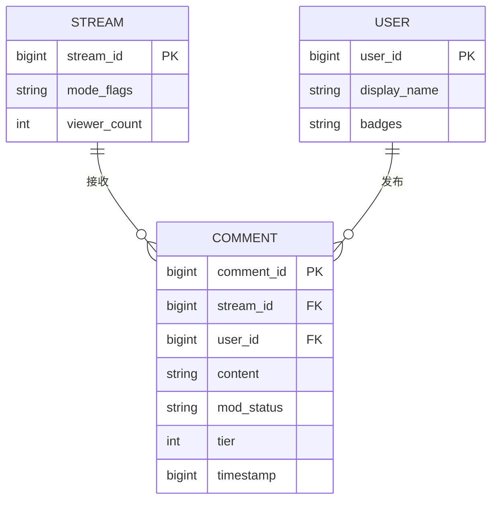
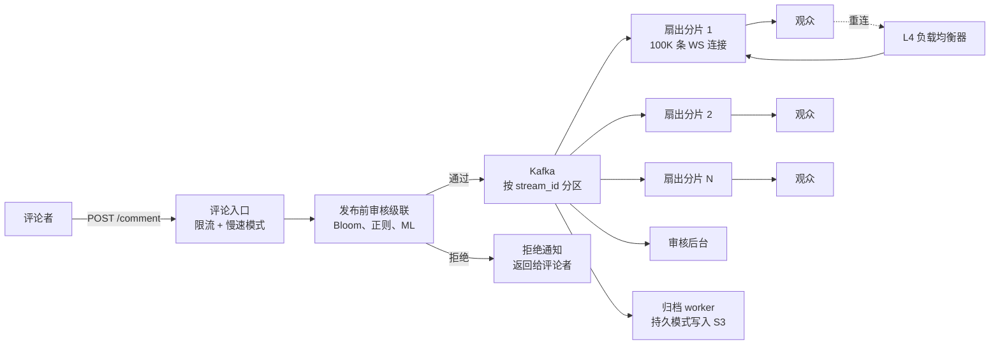
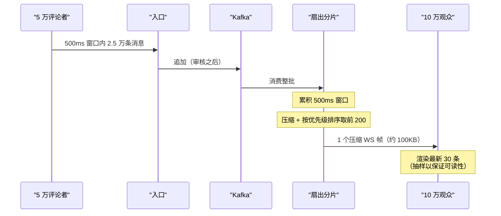
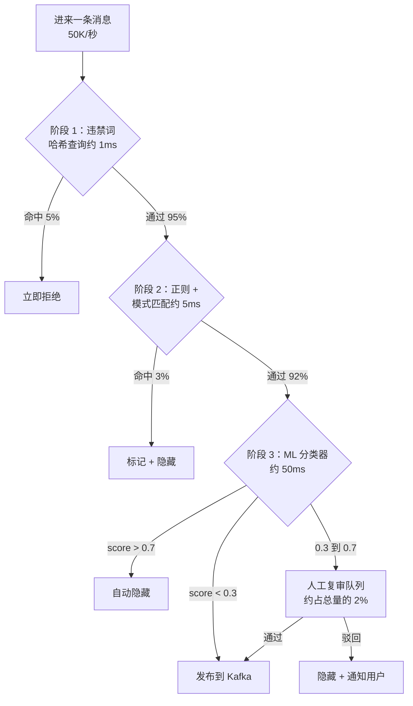
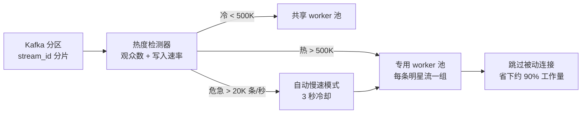

# 大规模场景下的直播评论系统设计（FB Live / YouTube Live / Twitch Chat）

> **TL;DR.** 直播评论把聊天系统的扇出问题倒了过来：不是很多房间、每间几个人，而是一个房间有 1000 万订阅者。一条爆款直播每秒涌入 5 万条评论，必须在 2 秒内送到数百万观众眼前。关键的洞察是增量批处理聚合（delta-batched aggregation）：把一个 500 ms 窗口内的消息折叠成每个订阅分片一帧压缩的 WebSocket 帧，把朴素实现下每秒 5000 亿次推送压到每个分片每秒 200 帧的可控量级。审核是一条三级级联流水线（Bloom 过滤器、正则、ML 分类器），98% 的消息在 5 ms 内放行。明星直播的热点问题靠按流的分片亲和性和自动开启的慢速模式控制住。

## 学习目标

- 设计一对多广播扇出，在 2 秒内把每秒 5 万条评论送达 1000 万观众
- 实现增量批处理的 WebSocket 推送，把朴素的逐收件人扇出削减 100 倍
- 构建三级审核级联，在过滤每秒 5 万条消息的同时把 p99 压在 500 ms 以内
- 按产品需求论证临时存储（Redis 缓冲区）与持久存储（Kafka 归档）的取舍
- 用按流的分片亲和性和动态 worker 扩缩容，控制明星直播的热点
- 把这种广播形态与 [Design a Chat System](./05-chat-system.md) 里的多对多扇出做对比

## 直觉理解

直播评论系统看起来就像个聊天室：收下消息，展示给所有人。100 个观众时毫无压力。可当单场直播有 1000 万并发观众时，它会直接崩掉，原因就是扇出的算术。

如果有 5 万个评论者每人每秒发一条，那就是每秒 5 万条消息砸进同一个房间。朴素的逐收件人推送意味着 5 万条消息乘以 1000 万观众，等于每秒 5000 亿次推送。没有任何基础设施扛得住。这种朴素做法不是“有点慢”，而是物理上不可能。Facebook Live 上那段西瓜爆炸的视频，在一条 45 分钟的短片里峰值达到 80 万并发观众、30 万条评论 [^1]。TheGrefg 的 Fortnite 皮肤揭晓在单个 Twitch 频道上冲到 2,468,668 并发观众 [^2][^3]。这些都不是假设出来的数字。

解开这个设计的洞察是：人类的阅读速度超不过大约每分钟 60 条消息 [^4][^5]。一个看着高速滚动聊天流的观众，本来就在做抽样。系统可以顺势利用这一点：把 500 ms 窗口内的所有消息攒起来，压缩成一帧，再把这单独一帧推给每个订阅分片。于是每秒 5 万条消息变成每个观众每秒 2 帧，而扇出集群推送的是每秒 2 帧乘以 100 个订阅分片（每片承载 10 万连接），即每个分片每秒 200 次推送。可控了。

这和 1:1 聊天有本质区别。[Design a Chat System](./05-chat-system.md) 讲的是很多房间、每个房间很少的接收者。直播评论是一个房间、数百万接收者。聊天要求逐消息有序和恰好一次语义；直播评论接受至多一次投递、宽松顺序，以及过载时的优雅降级。技术手段是反着来的：聊天为正确性优化，直播评论为吞吐量优化。

## 需求

### 澄清问题

- **Q: 评论是临时的还是持久的？**
  假设：两种都要。Twitch 式的临时模式（30 分钟 TTL），以及 FB Live 式的持久模式（永久归档，用于回放和法律取证）。
- **Q: 审核在发布前还是发布后？**
  假设：品牌安全类平台（YouTube、FB Live）走发布前审核；社区类平台（Twitch）走发布后审核，事后隐藏。
- **Q: 需要对所有评论者做严格的全局排序吗？**
  假设：不需要。每个评论者内部 FIFO 就够。同一条批处理窗口内的全局顺序宽松即可。
- **Q: Super Chat / 付费高亮消息在范围内吗？**
  假设：在。付费消息绕过常规限流，并获得视觉上的突出位置。
- **Q: 中途加入的观众需要回放吗？**
  假设：需要。加入时从缓存中返回最近 N 条（可配置，默认 200）。
- **Q: 需要限流模式（慢速模式、仅订阅者、仅表情）吗？**
  假设：需要。这些是主播可控的主动丢弃（过载保护）手段。

### 功能需求

- 向直播流发送评论，并收到带审核状态的确认
- 通过 WebSocket 订阅某条直播流的评论流，接收增量批处理帧
- 审核：自动过滤（违禁词、ML 毒性识别）、人工管理操作（封禁、禁言、删除）
- 按用户限流，支持可配置的慢速模式、仅订阅者和仅表情模式 [^6]
- 支持付费/高亮消息（Super Chat、Bits），置顶时长按档位区分 [^7]
- 为中途加入的观众回放最近 N 条评论

### 非功能需求

- **观众：** 单条热门直播 1000 万并发；全站所有直播合计 1 亿
- **评论者：** 单条热门直播 10 万并发写入者
- **写入速率：** 单条流峰值每秒 5 万条评论；全站每天 10 亿事件
- **可见延迟：** 从发布到出现在观众屏幕上 p99 < 2 秒
- **审核延迟：** 自动化流水线 p99 < 500 ms
- **可用性：** 直播活动期间 99.9%
- **投递：** 允许至多一次；过载时丢弃率 < 5%

## 容量估算

| 指标 | 数值 | 推导 |
|--------|------:|------------|
| 峰值写入 QPS（热门流） | 50K | 100K 评论者 × 0.5 条/秒（突发） |
| 朴素扇出（不可能实现） | 500G 次推送/秒 | 50K 条/秒 × 10M 观众 |
| 增量批处理扇出 | 200 帧/秒/分片 | 2 帧/秒 × 100 分片 |
| 消息大小 | 500 B | 用户名 + 正文 + 元数据 + 表情 |
| 热门流带宽（入口） | 25 MB/s | 50K × 500 B |
| 全站每日存储（持久模式） | 500 GB | 10 亿事件 × 500 B |
| Redis 回放缓冲（全站） | 500 GB | 100K 条流 × 10K 条消息 × 500 B |
| 每条热门流的订阅分片数 | 100 | 10M 观众 / 每片 100K 连接 |
| 审核 GPU 实例 | ~300 | 50K/秒 × 200ms / 每实例 30 RPS |

关键比例：

- **读写放大：** 200:1（每条消息作为批处理帧的一部分到达 100 个分片）
- **审核放行率：** 约 98% 自动放行（阶段 1-3 合计）；只有约 2% 进入人工复审 [^8]
- **人工复审量：** 约占总量的 1%（热门流上每秒 500 条）

## API 与数据模型

### API 设计

```http
POST /v1/streams/{stream_id}/comments
  Body: { "content": "...", "emojis": [...], "reply_to": null }
  Returns: 201 { "comment_id": "<snowflake>", "status": "published" | "pending" }
  Rate-limited: per-user token bucket (default 20/30s) [^9]

WS /v1/streams/{stream_id}/subscribe
  Server push: delta-batched frames every 500ms
  Resume: { "last_frame_id": "<cursor>" }
  Backpressure: slow clients dropped after 3 missed frames

DELETE /v1/streams/{stream_id}/comments/{comment_id}
  Returns: 204 (mod action or self-delete)

POST /v1/streams/{stream_id}/mode
  Body: { "slow_seconds": 3, "subs_only": true, "emote_only": false }
  Returns: 200 (broadcasts ROOMSTATE to all subscribers) [^6]

GET /v1/streams/{stream_id}/replay?limit=200
  Returns: 200 { "comments": [...], "next_cursor": "..." }
```

### 数据模型

```sql
-- Redis: live comment ring buffer (ephemeral mode)
-- Key: stream:{stream_id}:comments (sorted set, score = timestamp)
-- TTL: 30 min after stream ends
-- Max entries: 10,000 (ZREMRANGEBYRANK on overflow)

-- Kafka: comment.log (durable mode)
-- Topic: comments, partitioned by stream_id
-- Retention: 7 days hot, archive to S3 for permanent

-- Redis: rate limits
-- Key: rate:{stream_id}:{user_id} (token bucket counter)
-- Key: mode:{stream_id} (hash: slow_seconds, subs_only, emote_only)

-- Redis: banned words
-- Key: banned:{stream_id} (set of strings, synced to mod workers)
```



*评论从属于一条直播流和一个用户；直播流持有模式标记（慢速、仅订阅者）和当前观众数，供分片扩缩容决策使用。*

## 高层架构



*评论者写入入口，入口负责限流和发布前审核；通过审核的消息经 Kafka 流到分片的扇出集群，后者通过 WebSocket 向 1000 万观众推送增量批处理帧。*

**写路径：** 评论者通过 HTTP 提交评论。入口服务检查每用户令牌桶和流的模式标记（慢速模式、仅订阅者）。若被放行，消息进入审核级联。通过审核的消息追加到该 `stream_id` 对应的 Kafka 分区，同时写入 Redis 环形缓冲供回放使用。

**读路径：** 每个扇出分片消费自己那条流的 Kafka 分区，在 500 ms 窗口内累积消息，把整批压缩成单个 WebSocket 帧，推给它持有的所有连接。连续错过 3 帧的慢客户端会被断开，并收到 `RECONNECT` 提示。

**回放路径：** 中途加入的观众请求回放接口，接口从 Redis 有序集合中取出最近 200 条消息。对热门流，这个响应会在边缘缓存 2 秒，以吸收集中涌入的加入请求。

## 深入探讨

### 深入探讨 1：增量批处理扇出

这是整个系统里最重要的一个杠杆。不做批处理，每秒 5 万条消息乘以 1000 万观众就是每秒 5000 亿次推送。一旦按 500 ms 批处理，算术就完全变了。

**机制：** 每个扇出分片为每条流维护一个累积器。每 500 ms，分片会：

1. 排空累积器（高峰窗口内最多 2.5 万条消息）
2. 把整批序列化为压缩后的 Protocol Buffer 帧
3. 把这一帧写入内核发送缓冲区，只写一次
4. 由内核把这帧复制到该分片的 10 万条 TCP 连接上

每分片的出口流量是一帧乘以 10 万连接。按每条压缩后消息 500 B、每批 2.5 万条算，一帧未压缩约 12.5 MB，gzip 后约 2 MB。每分片出口：2 MB 乘以每秒 2 帧乘以 10 万连接……还是太高。解法是**客户端抽样**。

**抽样：** 帧里包含全部 2.5 万条消息，但客户端只渲染最近 30 条（对应每分钟约 60 条的人类阅读上限 [^4]）。客户端按新鲜度、付费消息优先级和关注用户加权来决定显示哪 30 条。这意味着服务端还能再裁一轮：每批只保留优先级最高的 200 条，帧大小降到压缩后约 100 KB。

Twitch 2016 年的工程博客描述了这个思路的客户端版本：把进来的 TMI 消息缓冲 100 ms，每个窗口渲染一次，结果渲染耗时减半，视频掉帧也消失了 [^10]。YouTube 的 `pollingIntervalMillis` 在服务端实现了同样效果：由服务端规定客户端多久可以拉一次，每次返回 200 到 2,000 条消息的批次 [^11][^12]。



*500 ms 的累积窗口把 2.5 万条消息压成一帧；客户端再抽样到每分钟约 60 条的人类可读上限。*

### 深入探讨 2：三级审核级联

每秒 5 万条消息的规模下，不可能让每条都过一遍 GPU 毒性分类器。级联利用了一个事实：绝大多数消息要么无害，要么命中已知的违禁词模式。

**阶段 1：违禁词哈希查询（约 1 ms）。** 一个频道级违禁词哈希集合，加一份全局脏话表。在我们的设计里，这一步立即拦下约 5% 的消息。Twitch 的 `msg_rejected_mandatory` 通知就在这个阶段触发 [^6]。因为词表是人工维护的，误判率接近于零。

**阶段 2：正则与模式匹配（约 5 ms）。** 抓规避写法（l33tspeak、Unicode 同形字、零宽字符）。再标出约 3% 的消息。与阶段 1 合计，约 8% 在进入任何 ML 推理之前就被挡住。

**阶段 3：ML 毒性分类器（约 50 ms）。** 一个轻量 transformer 给剩下的 92% 打分。得分高于 0.7 的自动隐藏。得分在 0.3 到 0.7 之间（约占总量的 2%）转给人工审核员 [^8]。低于 0.3 的直接放行。这些阶段比例只是示意性的设计目标，没有平台会公开确切的生产数据。



*便宜的多层过滤在 5 ms 内拒掉 8% 的消息；只有 2% 的模糊内容需要人工复审，从而把审核 p99 延迟压在 500 ms 以内。*

**GPU 容量测算：** 每秒 5 万条消息、92% 进入阶段 3，分类器要处理每秒 4.6 万条。按每次推理 50 ms、每 GPU 实例 30 RPS 计算，需要约 1,500 个分类器并发槽位。做推理批处理（一次前向 8 条消息）后降到约 190 个 GPU 实例。级联的价值就在这里：如果没有阶段 1-2，你需要 1,667 个 GPU 实例，而不是 190 个。

### 深入探讨 3：明星直播的热分片问题

流的受欢迎程度服从幂律。TheGrefg 的 Fortnite 皮肤揭晓在单个 Twitch 频道上吸引了 2,468,668 并发观众 [^13][^14]。Facebook Live 的西瓜视频峰值 80 万观众、30 万条评论 [^15]。单场明星直播就能把全站 50-95% 的流量压到一个 Kafka 分区上。

**检测：** 热度检测服务监控每个分区的 lag 和每条流的观众数。当某条流越过阈值（例如 50 万观众或每秒 1 万次写入），就被标记为“热”。

**隔离：** 热流分配专用的扇出 worker 池，冷流共用 worker 池。这样明星的流量不会把同一 broker 上相邻的流饿死。

**自动慢速模式：** 当写入速率超过阈值（例如每秒 2 万条），系统自动开启慢速模式（每用户 3 秒冷却），把有效写入速率降低 60-80% [^6]。Twitch 的 `ROOMSTATE` 会把模式变更瞬时广播给所有客户端。

**被动连接优化：** Discord 发现，在大型服务器里约 90% 的用户-服务器连接是“被动”的（是成员但没有在主动看）[^16]。跳过对被动连接的扇出，让扇出工作量降到原来的十分之一。同样的道理在这里也适用：聊天面板收起来、或者把标签页放到后台的观众，不需要实时帧。基于心跳的活跃信号让扇出分片跳过不活跃连接。



*热流检测把明星分区路由到专用 worker 并自动开启慢速模式；跳过被动连接把扇出量削减 90%。*

Facebook Live 的 Cartographer 系统处理的是地理维度：它把子网映射到 PoP，并用三次样条负载预测（不是线性预测，因为负载曲线是非线性的）在容量饱和之前把观众引到最近且有富余容量的 PoP [^15]。从测量到决策的窗口被从 90 秒压缩到 3 秒。

## 真实案例

**Twitch TMI：在 240 万并发观众下跑 IRC。**

Twitch 的聊天后端叫 TMI（Twitch Messaging Interface），对外暴露为改造过的 RFC 1459 IRC 接口，带 IRCv3 消息标签 [^6][^17]。客户端通过 `wss://irc-ws.chat.twitch.tv:443` 连接，用 OAuth 认证，然后 `JOIN #channel`。每条 `PRIVMSG` 都带 IRCv3 标签：徽章、表情位置、bits 数量，以及一个 `tmi-sent-ts` 服务端 UNIX 时间戳，用作每条流内部的排序键 [^6]。

频道就是分片单元。每个标签里的 `room-id` 就是分区键。当房间超过 1,000 人时，Twitch 会完全关闭 `JOIN`/`PART` 在线事件的推送，因为在那个规模下这些状态的维护成本不可承受 [^6]。限流是分档的：普通用户每 30 秒 20 条，主播/管理员/VIP 是 100 条，认证机器人是 7,500 条 [^9]。

2021 年 1 月 TheGrefg 的那场直播（2,468,668 并发观众 [^13]，这个纪录后来被 Ibai Llanos 反复刷新：2022 年 6 月 330 万、2023 年 340 万、2024 年 380 万，2025 年 7 月 La Velada del Ano 5 达到 930 万）期间，TMI 始终保持可用，但聊天限流和客户端渲染都被压到了极限 [^18]。此前的单频道纪录是 Ninja 和 Drake 在 2018 年 3 月的 Fortnite 直播，62.8 万并发观众，TheGrefg 在 2020 年 12 月首次超过它 [^19]。Twitch 2016 年的工程博客描述了这个渲染修复：把 TMI 消息缓冲 100 ms、每个窗口刷新一次，Ember 渲染耗时从每帧约 200 ms 降到约 100 ms，消除了聊天渲染导致的视频掉帧 [^10]。

架构上的洞察是：Twitch 选了一个已被充分理解的现成文本协议（IRC），而没有自己发明一套二进制协议。每种语言都有 IRC 库。代价是冗长（每条消息都带文本头），但渲染层的增量批处理把它补了回来。Twitch 后来为新的集成叠加了 EventSub（一套现代的 webhook/WebSocket 订阅 API），现在建议所有新的聊天机器人使用 EventSub 而非 IRC；IRC 仍然可用，但已被视为遗留方案 [^17]。

Bilibili 的 goim（开源，与他们的弹幕流水线同源）在单台 Xeon 服务器上的基准是每秒 3,590 万次消息投递（以每秒 40 次广播扇出到 100 万在线连接），出口带宽 4.39 Gbps [^20]。2023 年 IPL 板球直播据称峰值达到 3200 万并发观众 [^21]，把同样的广播形态推到了更大的规模。这些数字给出了广播问题在单机层面的天花板。

## 权衡

| 方案 | 优点 | 缺点 | 适用场景 |
|----------|------|------|-------------|
| 临时模式（Redis 缓冲，30 分钟 TTL） | 便宜、快、没有归档成本 | TTL 到期后无法回放；无法回溯审核 | Twitch 式临时聊天 [^6] |
| 持久模式（Kafka + S3 归档） | 完整回放、可作 ML 重训语料、可做法务留存 | 存储成本 10 倍；写入时 schema 开销 | FB Live、YouTube Live、新闻 [^15] |
| 逐评论 WebSocket 推送 | 延迟最低；实现最简单 | 1000 万观众时每秒 500G 次推送 | 小于 1 万观众的小型流 |
| 增量批处理聚合（500 ms） | 扇出量降 100 倍；帧可压缩 | 500 ms 的可见延迟下限 | 超过 1 万观众时的默认选择 [^10][^11] |
| 发布前审核 | 用户永远看不到毒性内容 | 给可见延迟增加 200-500 ms | 品牌安全关键场景（FB、YouTube）[^8] |
| 发布后 + 事后隐藏 | 立即可见；写入路径更简单 | 毒性内容在被隐藏前会闪现 | Twitch、社区类平台 [^6] |
| 服务端流式（gRPC） | 延迟低，没有轮询浪费 | 要求 HTTP/2；调试更难 | YouTube streamList [^22] |

最大的一个元决策是临时还是持久。Twitch 为即时性和成本优化：评论是短暂的，像房间里的说话。Facebook 和 YouTube 为长期保存优化：评论就是内容，可搜索、可回放、可依法取证。存储成本 10 倍的差距（临时模式每天 500 GB，带完整元数据的持久模式每天 5 TB）就是持久化的价格。

## 扩展与故障模式

**10 倍（1 亿观众，单条流）：** 扇出分片线性扩展（每片 10 万连接，需要 1,000 个分片）。热门流的那个 Kafka 分区成了瓶颈。缓解办法：把单个分区拆成 N 个子分区，加一层二级路由；每个扇出分片消费一个子分区。

**100 倍（全球 10 亿并发）：** WebSocket 连接集群需要 1 万台以上服务器。缓解办法：转向 CDN 边缘模型，由边缘 PoP 持有连接并消费一条复制过的消息流，从而消除扇出的跨区域跳转。

**1000 倍：** 架构转向网络层组播（PoP 内部用 IP 组播），在边缘做应用层去重。

**失效：扇出分片崩溃。** 该分片上的观众在重连前收不到帧（带抖动的 2-5 秒）。至多一次语义意味着错过的帧不会补发。这可以接受：用户看到聊天短暂空白，然后恢复。

**失效：Kafka 分区 leader 故障。** ISR 在数秒内选出新 leader。扇出分片从已提交的 offset 继续消费。leader 选举期间提交的评论在入口侧缓冲（通过带 Retry-After 的 HTTP 503 对评论者施加背压）。

**失效：WebSocket 重连风暴。** 一次后端抖动会让 1000 万客户端同时断开。没有抖动的话，它们会在 1 秒窗口内全部重连，把认证服务打满。缓解办法：指数退避加随机抖动（Twitch 的 `RECONNECT` 命令假定客户端实现了这一套 [^6]）；按区域的准入控制把新连接速率限制在每秒 10 万。

## 常见陷阱

> [!WARNING]
> **在广播规模下设计逐收件人扇出。** 朴素的“给每个观众排一次推送”在 1000 万观众时会产生每秒 500G 次推送。增量批处理不是可选项；它决定了这件事是“可能”还是“不可能”。

> [!WARNING]
> **把直播评论当成 1:1 聊天。** 聊天要求逐消息有序和恰好一次投递。直播评论接受至多一次、宽松顺序和优雅降级。在这里套用聊天系统的严谨性只会浪费资源、增加延迟。

> [!WARNING]
> **让每条消息都过 ML 分类器。** 每秒 5 万条的规模下，光 GPU 推理就需要 1,500 个以上实例。级联（哈希、正则、ML）先用便宜手段过滤明显案例，把 GPU 负载降了 92% [^8]。

> [!WARNING]
> **忽视明星热点。** 按 `stream_id` 哈希在期望上是均匀分布，但真实流量服从 Zipf 分布。一条流就能把 95% 的流量压到一个分区上。必须显式做热分片路由 [^15][^16]。

> [!WARNING]
> **为慢客户端无限缓冲。** 一个处在拥塞移动网络上的观众会落后。替他缓冲帧会无上限地吃掉服务器内存。错过 3 帧就断开，让客户端带重放请求重连。

> [!CAUTION]
> **重连时没有退避。** 一次后端抖动如果没有客户端侧抖动，会制造出比原始故障更糟的重连风暴。永远要发带服务端建议延迟窗口的 `RECONNECT` 提示 [^6]。

## 追问

**1. 怎么设计 Super Chat（付费置顶消息）而不破坏扇出顺序？**

付费消息是一种单独的消息类型，带 `tier` 字段，控制高亮颜色和置顶时长 [^7]。它们绕过常规限流，但仍然要过审核。扇出帧以优先级标记携带它们；客户端把它们渲染在滚动流上方的置顶位。置顶时长在客户端按服务端下发的过期时间戳执行。

**2. 对于 7x24 常驻直播和一次性活动，设计上有什么不同？**

常驻直播（新闻频道、音乐直播）会累积无界历史。要把单个 Redis 环形缓冲换成按时间保留的滚动 Kafka topic（热存 7 天，冷存归档）。回放从最近的分段读取。观众数更低但恒定，所以扇出分片可以静态预留，不必自动扩缩容。

**3. 怎么实时检测并阻止协同骚扰（brigading）？**

一个发布后审核服务消费 Kafka 流，做滑动窗口异常检测：含同一目标用户名、同一话题标签的消息突然激增，或来自最近一小时内注册的账号。检测到之后，自动开启仅订阅者模式，并把协同账号标记待审。

**4. 审核模型怎么按主播的语境做重训？**

每个主播的审核决定（在人工复审队列上的通过/驳回）汇成该主播的微调数据集。每晚跑一个任务，在基础毒性模型上重训一个轻量适配器（LoRA），按该主播社区的规范调整阈值。适配器按 `stream_id` 热加载进分类器集群。

**5. 弹幕（Bilibili 式屏幕上飘过的评论）在架构上有什么不同？**

弹幕是渲染在视频画面上的浮动层，不在侧边栏 [^5]。这要求客户端按每条评论拿到定位元数据（x 偏移、速度、颜色）。扇出帧里带渲染提示。防碰撞（避免文字重叠）在客户端用轨道分配算法做。服务端架构完全一样，只有客户端渲染层不同。

**6. 直播结束后评论还能被搜索吗？**

持久模式下，归档 worker 会把评论索引进按 `stream_id` 和 `timestamp` 分区的 Elasticsearch。搜索 API 提供限定在单条流范围内的全文检索。临时模式下，TTL 到期后就没有搜索了。

## 练习

### 练习 1：批处理窗口大小

某条流有 200 万并发观众、每秒 1 万条评论。你的每个扇出分片承载 5 万条 WebSocket 连接。网络团队说每个分片可以稳定承受 500 MB/s 的出口流量。假设每个压缩后的批处理帧是 50 KB，在出口成为瓶颈之前，你最大能用多长的批处理窗口？

<details>
<summary>提示</summary>

算一下：需要的分片数 = 2M / 50K = 40 个分片。每个分片每个批处理窗口向 5 万条连接推一帧。每分片每窗口的出口 = 50 KB × 5 万连接。再和 500 MB/s 的预算比较。

</details>

<details>
<summary>解答</summary>

需要的分片数：2M 观众 / 每片 5 万连接 = 40 个分片。

每分片每个批处理窗口的出口：50 KB × 50,000 连接 = 每窗口 2.5 GB。

按 500 MB/s 的持续出口，排空一批所需时间：2.5 GB / 500 MB/s = 5 秒。

这意味着最小批处理窗口是 5 秒（分片需要 5 秒才能把一帧推给所有连接）。若用 500 ms 窗口，你需要 10 倍的出口预算（每分片 5 GB/s），这不现实。

可选做法：(1) 更激进地抽样来减小帧大小（只取前 50 条而不是 200 条，帧降到约 12 KB）；(2) 增加分片数（每片 1 万连接，200 个分片）；(3) 在分片内使用内核级组播，让帧只写一次、由网卡复制。实践中，抽样加更小的分片组合起来，可以把窗口拉回 500 ms。

接受的权衡：分片越多，Kafka 消费者实例越多、协调开销越大，但延迟目标（< 2s）要求这么做。

</details>

## 要点回顾

- **直播评论是广播，不是聊天。** 一个房间乘以 1000 万订阅者，要求的是 topic 级扇出，不是逐收件人投递。
- **要么批处理，要么死。** 每 500 ms 的增量批处理聚合，就是每秒 500G 次不可能的推送和每分片每秒 200 帧可控推送之间的差别。
- **审核是一条级联。** 便宜的过滤器先行（哈希、正则），在 5 ms 内放行 92%；GPU 只处理模糊的剩余部分。
- **明星直播是最有意思的场景。** 按流的分片亲和性、自动慢速模式、跳过被动连接，就是主动丢弃（过载保护）的几个杠杆。
- **临时还是持久是产品决策。** Twitch 和 FB Live 站到了相反的两边，各有站得住脚的理由；10 倍的成本差距是真实的。
- **至多一次可以接受。** 人类本来就在抽样看高速聊天流；每秒 5 万条的流上丢几条消息，观众根本察觉不到。

## 延伸阅读

- [How Facebook Live Streams to 800,000 Simultaneous Viewers](http://highscalability.com/blog/2016/6/27/how-facebook-live-streams-to-800000-simultaneous-viewers.html)。关于广播扇出中请求合并、三次样条负载预测和 PoP 容量估算的经典文章。
- [Improving Chat Rendering Performance (Twitch Engineering, 2016)](https://blog.twitch.tv/en/2016/08/08/improving-chat-rendering-performance-1c0945b82764/)。启发了渲染层增量批处理扇出的批处理论证；有具体的帧耗时前后对比。
- [Maxjourney: Pushing Discord's Limits with a Million+ Online Users in a Single Server](https://discord.com/blog/maxjourney-pushing-discords-limits-with-a-million-plus-online-users-in-a-single-server)。对明星分片问题公开得最深入的一篇；90% 被动连接这个结论会改变你对扇出容量的估算方式。
- [YouTube liveChatMessages API Reference](https://developers.google.com/youtube/v3/live/docs/liveChatMessages)。所有付费消息类型、墓碑记录、审核事件，以及由服务端决定的 `pollingIntervalMillis` 节奏。
- [YouTube liveChatMessages.streamList (gRPC)](https://developers.google.com/youtube/v3/live/docs/liveChatMessages/streamList)。轮询的推送式替代；`nextPageToken` 的重连续传语义，重连时无需回放。
- [Terry-Mao/goim on GitHub](https://github.com/Terry-Mao/goim)。与 Bilibili 弹幕流水线同形态的开源 IM；README 里的基准测试给出了单机连接数和吞吐量的天花板。
- [Twitch IRC Concepts (TMI Reference)](https://dev.twitch.tv/docs/irc/capabilities)。线格式的权威参考：标签、模式、通知、限流，以及完整的 ROOMSTATE 面。

## 记忆卡片

<details>
<summary><strong>Q: 为什么在 1000 万观众时，朴素的逐收件人扇出对直播评论行不通？</strong></summary>

A: 每秒 5 万条消息乘以 1000 万观众，会产生每秒 5000 亿次推送。没有基础设施能承受。增量批处理（把 500 ms 窗口折叠成每分片一帧）能把它降低 100 倍以上。

</details>

<details>
<summary><strong>Q: 人类阅读聊天消息的上限是多少，为什么这在架构上很重要？</strong></summary>

A: 人类舒适阅读速度大约是每分钟 60 条消息。既然观众本来就在抽样看高速滚动的聊天，系统批量甚至丢消息，都不会降低感知体验。

</details>

<details>
<summary><strong>Q: 审核级联有哪三个阶段，各自增加多少延迟？</strong></summary>

A: 阶段 1：违禁词哈希查询（约 1 ms，拦下 5%）。阶段 2：正则/模式匹配（约 5 ms，拦下 3%）。阶段 3：ML 毒性分类器（约 50 ms，处理剩下的 92%）。只有 2% 进入人工复审。

</details>

<details>
<summary><strong>Q: 增量批处理扇出是怎么工作的？</strong></summary>

A: 扇出分片在 500 ms 窗口内累积所有消息，压缩成一个 Protocol Buffer 帧，再把这单独一帧推给它那 10 万条 WebSocket 连接。每个分片每个窗口只写一次，而不是每条消息每个连接写一次。

</details>

<details>
<summary><strong>Q: 直播评论和 1:1 聊天在架构上的关键区别是什么？</strong></summary>

A: 聊天是很多房间、每个房间很少接收者（跨房间扇出）。直播评论是一个房间、数百万接收者（单房间内扇出）。聊天要求逐消息有序和恰好一次；直播评论接受至多一次和宽松顺序。

</details>

<details>
<summary><strong>Q: Discord 是怎么把大型服务器的扇出工作量降低 10 倍的？</strong></summary>

A: 他们发现约 90% 的用户-服务器连接是“被动”的（是成员但没有在主动看）。跳过对被动连接的扇出让工作量降到十分之一，最大服务器规模因此获得了 3 倍的余量提升。

</details>

<details>
<summary><strong>Q: Twitch 对普通用户和认证机器人的限流分别是多少？</strong></summary>

A: 普通用户：每 30 秒 20 条消息。认证机器人：每 30 秒 7,500 条。管理员/VIP：每 30 秒 100 条。

</details>

<details>
<summary><strong>Q: 为什么 Facebook Live 做负载均衡时用三次样条外推而不是线性预测？</strong></summary>

A: 负载曲线是非线性的（病毒式爆发会加速）。线性预测会低估增长，导致负载均衡器还没反应 PoP 就饱和了。三次样条能刻画加速度，从而在 3 秒内做出前置的流量调度。

</details>

<details>
<summary><strong>Q: 直播评论可以接受什么投递语义，为什么？</strong></summary>

A: 至多一次可以接受。在每秒 5 万条的高速流上，丢掉的消息对观众是不可见的——他们本来每分钟也只能读约 60 条。恰好一次所需的成本（去重基础设施、顺序保证）在这里不值得。

</details>

<details>
<summary><strong>Q: 后端抖动之后出现 WebSocket 重连风暴会怎样？</strong></summary>

A: 没有抖动的话，1000 万客户端会同时重连，打满认证服务。缓解办法：指数退避加随机抖动、服务端下发带延迟窗口的 RECONNECT 提示，以及按区域的准入控制把新连接限制在每秒 10 万。

</details>

## 参考文献

[^1]: Todd Hoff, "How Facebook Live Streams to 800,000 Simultaneous Viewers" (watermelon video peak numbers), HighScalability, 27 June 2016. http://highscalability.com/blog/2016/6/27/how-facebook-live-streams-to-800000-simultaneous-viewers.html
[^2]: "TheGrefg", Wikipedia, accessed 2026-05-04. https://en.wikipedia.org/wiki/TheGrefg
[^3]: "Spanish Fortnite Streamer TheGrefg Breaks All-Time Twitch Viewership Record", IGN, 11 Jan 2021. https://in.ign.com/fortnite/153782/news/spanish-fortnite-streamer-thegrefg-breaks-all-time-twitch-viewership-record
[^4]: Mark Seidenberg et al., reading-speed literature; 200-300 words/min silent reading implies ~60 chat messages/min as the comfortable perception ceiling. https://en.wikipedia.org/wiki/Reading_(process)#Reading_rate
[^5]: "Coherence in massive anonymous chats on Bilibili.com", ResearchGate 2021. Discusses how danmaku viewers sub-sample dense comment streams. https://www.researchgate.net/publication/342816981
[^6]: Twitch Developers, "IRC Concepts" (TMI / Twitch IRC reference). https://dev.twitch.tv/docs/irc/capabilities
[^7]: Google, "LiveChatMessages" resource reference, YouTube Live Streaming API. https://developers.google.com/youtube/v3/live/docs/liveChatMessages
[^8]: Twitch Developers, "Chat & Chatbots" overview, rate limits and AutoMod behavior. https://dev.twitch.tv/docs/chat/
[^9]: Twitch Developers, "Rate Limits" section of Chat & Chatbots overview. https://dev.twitch.tv/docs/chat/
[^10]: Ben Swartz, "Improving Chat Rendering Performance", Twitch Engineering Blog, 8 Aug 2016. https://blog.twitch.tv/en/2016/08/08/improving-chat-rendering-performance-1c0945b82764/
[^11]: Google, "LiveChatMessages: list", YouTube Live Streaming API. https://developers.google.com/youtube/v3/live/docs/liveChatMessages/list
[^12]: Google, "LiveChatMessages: list", pollingIntervalMillis response field semantics. https://developers.google.com/youtube/v3/live/docs/liveChatMessages/list
[^13]: "TheGrefg", Wikipedia. https://en.wikipedia.org/wiki/TheGrefg
[^14]: "Spanish Fortnite Streamer TheGrefg Breaks All-Time Twitch Viewership Record", IGN, 11 Jan 2021. https://in.ign.com/fortnite/153782/news/spanish-fortnite-streamer-thegrefg-breaks-all-time-twitch-viewership-record
[^15]: Todd Hoff, "How Facebook Live Streams to 800,000 Simultaneous Viewers", HighScalability, 27 June 2016. http://highscalability.com/blog/2016/6/27/how-facebook-live-streams-to-800000-simultaneous-viewers.html
[^16]: Yuliy Pisetsky, "Maxjourney: Pushing Discord's Limits with a Million+ Online Users in a Single Server", Discord Engineering Blog, 25 Oct 2023. https://discord.com/blog/maxjourney-pushing-discords-limits-with-a-million-plus-online-users-in-a-single-server
[^17]: Twitch Developers, "Migrating from IRC" (EventSub equivalents). https://dev.twitch.tv/docs/chat/irc-migration/
[^18]: Calum Patterson, "TheGrefg breaks Ninja's world record for most-viewed Twitch stream", Dexerto, 11 Jan 2021. https://www.dexerto.com/entertainment/thegrefg-breaks-ninjas-world-record-for-most-viewed-twitch-stream-1472877/
[^19]: Nick Statt, "Drake drops in to play Fortnite on Twitch and breaks the record for most-viewed stream", The Verge, 14 Mar 2018. https://www.theverge.com/2018/3/15/17123424/ninja-drake-fortnite-twitch-stream-record-travis-scott-juju
[^20]: Terry-Mao, "goim - a high-performance IM server in Go", GitHub README, Bilibili-lineage broadcast gateway. https://github.com/Terry-Mao/goim
[^21]: Gergely Orosz, "Live streaming at world-record scale with Ashutosh Agrawal", Pragmatic Engineer, 2025. https://newsletter.pragmaticengineer.com/p/live-streaming-at-world-record-scale
[^22]: Google, "LiveChatMessages: streamList", YouTube Live Streaming API. https://developers.google.com/youtube/v3/live/docs/liveChatMessages/streamList
