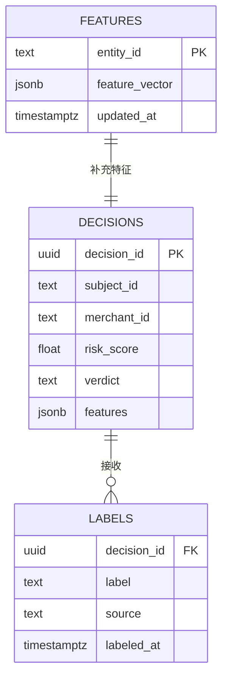
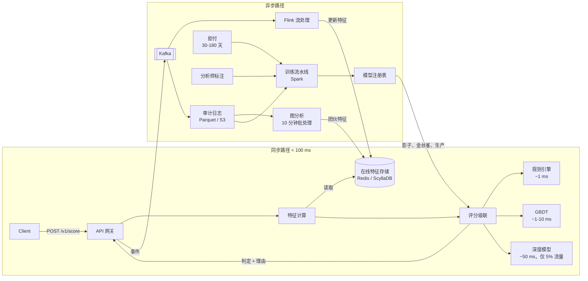
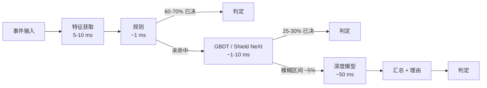
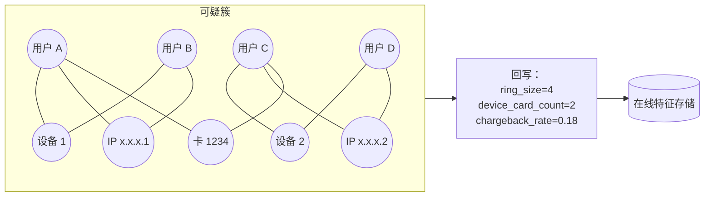

# 设计一个欺诈检测系统（Stripe Radar / PayPal / Feedzai）

> **TL;DR.** 欺诈检测挂在每笔支付的同步关键路径上：判定必须在 100 ms 内返回，否则授权就会超时[^1]。这套架构最终收敛为三级级联（确定性规则、梯度提升树、对模糊长尾使用深度模型），底层是一套统一的在线/离线特征存储用来消除训练-服务偏差，另有异步图流水线做团伙检测，以及一个闭环反馈回路——分析师的标注和拒付（chargeback）每周驱动模型再训练。Stripe Radar 对每笔交易评估 1,000 多个信号，按这套模式每月阻止超过 5 亿美元的欺诈损失[^2][^3]。最关键的权衡是假阳性对假阴性：33% 的消费者在被误拒一次之后再也不回来了[^4]。

## 学习目标

- [ ] 在特征获取、规则和 ML 推理之间，为同步评分服务规划出低于 100 ms 的 P99 预算
- [ ] 论证分类器级联（廉价规则、GBDT、深度模型）为何是延迟与成本的控制手段
- [ ] 设计一套在线/离线特征存储，保证训练与服务的一致性
- [ ] 说明基于图的团伙检测为什么应作为异步特征生产者，而不是热路径组件
- [ ] 把分析师标注和拒付的反馈闭环接到影子部署的重训模型上
- [ ] 拿捏 GDPR 可解释性要求与模型被逆向风险之间的张力

## 直觉理解

一个朴素的欺诈检测器就是一条 if 语句：金额超过 $10,000 就拦截。这套逻辑能撑过你的前 100 个商户。到了每秒 100 万事件，三件事会同时崩掉。

第一，正样本比例天生不利。线上支付里大约只有千分之一是欺诈[^2]。你的分类器必须在草堆里找出那根针，同时不能顺手把草堆也拦了。一次假阴性要赔上货值，外加 $15 到 $40 的拒付手续费；一次假阳性丢掉这单生意，而且按 Stripe 的数据，这些客户里有三分之一再也不回来[^4]。代价函数是不对称的，而且每个商户各不相同。

第二，延迟没有商量余地。卡组织要求授权响应在 100 ms 内返回[^1]。你不可能对每笔交易都跑一个 500 ms 的深度学习模型。但也不能干脆不跑，因为廉价模型看不出新出现的模式。关键在于级联：每一级消化掉大部分流量，只把模糊的长尾交给下一级更贵的模型。

第三，欺诈者是会自适应调整的对手。他们用小额交易试探你的系统，摸清你的阈值，几天之内就完成进化。你的训练数据在结构上就是过期的，因为拒付要在交易后 30 到 180 天才到账[^5]。所以这套系统不是一次训练完的分类器，而是"判定 → 标注 → 重训 → 安全上线"的闭环。

## 需求

### 澄清问题

- **问：只做支付欺诈，还是也覆盖账户盗用和营销活动滥用？**
  假设：三者都做。无卡（CNP）欺诈是主体；账户盗用（ATO）和营销滥用共用同一套特征基础设施。
- **问：同步（授权前拦截）还是异步（事后标记）？**
  假设：支付走同步；广告点击这类低风险场景走异步。
- **问：假阳性容忍度是多少？**
  假设：由商户配置。默认拦截率约 1%；激进一些的商户接受 0.5%。
- **问：需要图分析吗？**
  假设：需要，但走异步。团伙检测把特征写回在线存储。
- **问：监管范围？**
  假设：支付数据受 PCI-DSS 约束，决策可解释性受 GDPR 约束，欧洲的强客户认证（SCA）走 PSD2。
- **问：要多地域部署吗？**
  假设：要。评分在区域内完成，训练集中进行。

### 功能需求

- 接收支付、登录或注册事件，返回带理由的判定（通过、挑战、拒绝）。
- 用交易历史、设备指纹和用户画像为事件补齐 100 个以上特征。
- 支持商户可编辑的规则（黑名单、速度阈值），并提供影子模式和 A/B 模式。
- 接收分析师标注和拒付数据；重训并影子部署新模型。
- 对每一次决策提供带 SHAP 解释的审计轨迹。

### 非功能需求

- **负载：** 持续 1M 事件/秒，峰值 3M。
- **延迟：** 同步判定路径 P99 低于 100 ms。
- **可用性：** 99.9%（欺诈系统挂了就等于支付挂了）。
- **特征新鲜度：** 在线存储在事件发生后 1 到 5 秒内更新。
- **召回率：** 已知欺诈模式的召回 99.9%，在标记人群上的假阳性率低于 0.1%。

## 容量估算

| 指标 | 数值 | 推导 |
|--------|------:|------------|
| 每秒事件数（持续） | 1M | 数千商户汇总 |
| 每秒事件数（峰值） | 3M | 黑五爆发，平均值的 3 倍 |
| 特征向量大小 | 2 KB | 100 个特征 × 平均约 20 B |
| 特征获取带宽 | 2 GB/sec | 1M × 2 KB |
| 在线特征存储键数 | 500M | 活跃用户 + 设备 + 卡 |
| 在线存储内存 | 1 TB | 500M × 2 KB |
| 事件日志年存储量 | 60 PB | 1M/sec × 2 KB × 365 天，分层下沉到对象存储 |
| 图节点数 | 2B | 用户 + 设备 + IP + 卡 + 邮箱 |
| 分析师复核队列 | 10K/sec | 1% 标记率 × 1M 事件/秒 |

- **读写比：** 评分路径上是 1:1（每个事件既是从特征存储的一次读，也是向事件日志的一次写）。
- **缓存命中率：** 在线特征存储 95% 以上；大部分特征都是预先算好的。
- **带宽：** 2 GB/sec 写入 Kafka；200 MB/sec 进入图流水线（1% 的标记事件）。

## API 与数据模型

### API 设计

```http
POST /v1/score
  Body: { "event_type": "payment", "subject_id": "usr_abc", "merchant_id": "m_xyz",
          "amount": 4999, "currency": "usd", "device": {...}, "ip": "..." }
  Returns: 200 { "verdict": "approve", "risk_score": 0.12, "reasons": [],
                  "model_version": "v42", "decision_id": "dec_123" }
  Errors: 429 rate_limited, 503 service_unavailable

POST /v1/feedback
  Body: { "decision_id": "dec_123", "label": "fraud", "source": "chargeback" }
  Returns: 202 accepted

GET /v1/decisions/{decision_id}
  Returns: 200 { "features": {...}, "rules_fired": [...], "shap_values": {...} }

PUT /v1/rules/{rule_id}
  Body: { "condition": "velocity_1h > 10", "action": "decline", "mode": "shadow" }
  Returns: 200 { "rule_id": "r_456", "version": 3 }
```

### 数据模型

```sql
-- 事件日志（Kafka -> S3 上的 Parquet，按天 + 商户分区）
-- 在线特征存储（Redis / ScyllaDB，以 entity_id 为键）
-- 图索引（Neo4j：节点 = 用户、设备、ip、卡、邮箱；边 = 共同使用）

CREATE TABLE decisions (
  decision_id   UUID PRIMARY KEY,
  event_type    TEXT,
  subject_id    TEXT,
  merchant_id   TEXT,
  risk_score    FLOAT,
  verdict       TEXT,         -- approve | challenge | decline
  model_version TEXT,
  features      JSONB,
  rules_fired   TEXT[],
  created_at    TIMESTAMPTZ
);

CREATE TABLE labels (
  decision_id   UUID REFERENCES decisions(decision_id),
  label         TEXT,         -- fraud | legit
  source        TEXT,         -- chargeback | analyst | merchant
  labeled_at    TIMESTAMPTZ
);
```



*决策表在评分当时保存完整的特征快照；标签异步到达，再回连进来用于再训练。*

## 高层架构



*同步评分路径在 100 ms 内返回，异步流水线则在后台更新特征、发现团伙、用新标签重训模型。*

**写入路径。** 支付事件打到 API 网关，网关从在线存储取出预先算好的特征向量（5 到 10 ms），跑完评分级联，返回判定结果。事件同时发布到 Kafka 供下游处理。

**读取路径。** 分析师控制台查决策表里被标记的事件，连上 SHAP 解释和图邻域上下文做人工研判。

**异步路径。** Flink 从 Kafka 消费，在几秒内更新在线存储里的流式特征（速度计数器、设备信誉）。图批处理任务每 10 分钟跑一次，识别团伙并把簇特征写回。训练流水线消费已标注数据，产出新的候选模型用于影子部署。

## 深入探讨

### 评分级联：把延迟压到 100 ms 以内

核心思路：不是每笔交易都需要深度模型。级联让流量依次穿过越来越贵的环节，每一级消化掉剩余流量的大部分[^2][^6]。

**第 1 级：规则引擎（约 1 ms）。** 确定性检查：黑名单、速度阈值（同一张卡 1 小时内超过 10 笔交易）、地理位置不匹配（账单国家与 IP 国家不一致）、设备指纹落在已知恶意名单上、制裁名单筛查。规则能无歧义地处理 60% 到 70% 的事件。它们可审计，运营人员几分钟内就能改，也满足监管对可解释性的要求[^7]。

**第 2 级：梯度提升树（约 1 到 10 ms）。** XGBoost 或 LightGBM，跑在几百个特征上。再吃掉 25% 到 30% 的流量。Stripe 上一代架构用的是 Wide（XGBoost）+ Deep（DNN）的集成；简单粗暴地去掉 XGBoost 会丢掉 1.5 个百分点的召回，于是他们换成了 Shield NeXt——一个受 ResNeXt 启发的多分支 DNN，把"记忆"优势保留在单个模型里，还把训练时间砍掉 85%，压到 2 小时以内[^2]。

**第 3 级：深度模型（约 50 ms，只处理模糊的 5%）。** 一个跑在事件序列上的 Transformer 或 DNN，捕捉表格模型看不见的时序模式。只有模糊长尾会走到这一级，因此 P99 守住 100 ms，平均值则保持在 20 ms 以下[^2][^6]。



*快路径在 10 ms 内解决掉大部分事件；深度模型只在模糊长尾上运行，从而把 P99 压在 100 ms 预算之内。*

**为什么不干脆跳过级联，全量跑深度模型？** 每秒 100 万事件下，50 ms 的深度模型需要 50,000 个并发推理槽位。按级联 5% 的路由率，你只需要 2,500 个槽位——成本降 20 倍，召回损失可以忽略。

### 特征存储与训练-服务一致性

训练-服务偏差（training-serving skew）是生产 ML 里最隐蔽的头号故障模式。有个被广泛引用的例子：模型在离线能抓到 94% 的欺诈，上线后只有 71%，原因是 Spark 训练任务和 Flink 在线流水线对特征的计算方式不一致[^8]。有份行业估算把约 37% 的生产 ML 缺陷归到这类错误上，不过尚未找到一手研究佐证[^9]。

**解法：每个特征只声明一次。** Stripe 在 Airbnb 开源的 Chronon 之上构建了 Shepherd，统一批处理和流式特征定义[^10]。像 `user_id` 上的 `count_transactions_7d` 这样一条声明，会同时编译出训练用的 BigQuery 表和在线评分用的 Redis 读取路径[^11]。Feast 的参考架构是同一套路：离线存储（BigQuery/Snowflake）和在线存储（Redis/Datastore）共用完全一致的特征视图定义[^11]。

**时点正确性。** 训练流水线必须按交易发生那一刻的特征值来关联，而不是按查询时刻的值。否则模型在训练时看到了"未来"的特征（标签泄漏），上线就崩。Feast 的 `get_historical_features` 用 `event_timestamp` 列强制这一点[^11]。

**流式聚合。** `transaction_count_7d` 这类特征由 Flink 用带水位线的事件时间窗口维护。迟到事件会污染计数器，除非系统配置了明确的迟到处理策略（例如更新计数并记录这次修正）[^12][^13]。

**在线读取模式。** 评分服务按实体 ID 调用特征存储，在 10 ms 以内拿到预先算好的向量。热路径上不做任何特征计算，所有聚合都已物化[^11]。

### 基于图的团伙检测

表格模型一次只看一笔交易。它们看不出"四个账户共用两台设备、三个重叠 IP"其实是一个协同作案的欺诈团伙。图分析能把这类结构性模式挖出来[^14][^15]。

**架构。** 图数据库（Neo4j、TigerGraph）存实体图：用户、卡、设备、IP、邮箱作为节点，共同使用关系作为边。批处理任务每 5 到 10 分钟跑一次，计算连通分量、社区发现（Louvain）和度中心性。产出的特征（`ring_size`、`ring_prior_chargeback_rate`、`device_shared_by_N_accounts`）写回在线特征存储，供下一次同步评分使用[^14][^15]。

**为什么不在同步路径里查图？** Neo4j 里一次 3 跳邻域查询在有负载时要几百毫秒。再叠加 50 ms 的深度模型慢路径，延迟预算直接没了[^16]。BRIGHT 论文（Lu 等，CIKM 2022）把解法形式化了：两阶段有向图加 Lambda 神经网络，把离线实体嵌入的批量推理和在线交易预测解耦，端到端 P99 降低超过 75%，推理速度比朴素的 GNN 快 7.8 倍[^16]。



*四个账户共用两台设备、IP 交叉重叠，聚成一个异常连通分量；簇特征喂给下一次同步评分。*

PayPal 用一套实时图数据库做 ATO 检测，能暴露出"ABABA"式的两账户反复互转、以及资产共用类异常——这些模式用关系型 schema 得靠四路自连接才能查出来[^17]。

## 真实案例

### Stripe Radar：每月阻止 5 亿美元以上的欺诈

Stripe Radar 对 Stripe 网络上的每笔交易做评分，P99 在 100 ms 以内，每笔交易评估 1,000 多个信号，在数十亿笔正常支付上判定准确率达到 99.9%[^2]。Radar 每月阻止超过 5 亿美元的支付欺诈[^3]。

**网络优势。** Stripe 网络上用过的卡里，90% 出现过不止一次[^18]。这让 Radar 拥有跨商户的聚合特征，任何单家商户都复制不了。在一个巴西商户身上发现的欺诈模式，通过学到的嵌入自动泛化到美国商户[^2][^18]。

**Shield NeXt 架构。** Stripe 用一个受 ResNeXt 启发的多分支 DNN 替换了 Wide（XGBoost）+ Deep（DNN）集成。分支结构把 XGBoost 的记忆优势保留在单个模型内部，同时让并行训练、迁移学习和嵌入的引入成为可能。训练时间从整整一夜降到 2 小时以内（降幅 85% 以上）[^2]。

**持续改进。** 仅用更新鲜的数据重训同一套架构，每月就能多拿 0.5 个百分点的召回[^18]。Stripe 在影子部署和按商户的护栏工具上投入，把模型发布节奏提到了三倍。每次发布不只看聚合 F1，还要看每个商户的假阳性率、拦截率和授权通过率[^18]。

**可解释性。** 风险洞察会给出贡献最大的特征、账单/收货/IP 距离的位置图，以及关联邮箱的授权通过率。分析师控制台的关联交易查询由 Elasticsearch 支撑[^2]。

## 权衡

| 方案 | 优点 | 缺点 | 适用场景 |
|----------|------|------|-------------|
| 同步评分（授权前拦截） | 能真正阻止损失 | 给支付流程增加 50-100 ms | 支付授权、登录、注册 |
| 异步评分（事后标记） | 对延迟零影响 | 损失已经发生 | 广告点击欺诈、内容审核 |
| 纯规则 | 可解释、可审计、运营可调 | 脆弱；对手几天就能适应 | 早期产品、受监管行业 |
| 纯 ML | 自动学习新模式 | 黑盒；GDPR 可解释性更难 | 标签充足的成熟产品 |
| 规则 + ML 级联 | 兼顾可解释性与模式发现 | 组件更多，漂移监控更重 | 生产默认选择（Stripe、PayPal） |
| 图分析（异步，回写） | 抓住团伙；暴露关联实体 | 遍历要 200 ms 以上；跑得不勤就会过期 | 离线批量评分、调查工具、由在线路径读取的预计算实体嵌入 |
| 全量流量跑深度模型 | 召回最大化 | 1M/秒下要 50K 推理槽位；成本 20 倍 | 只在延迟预算允许时 |

最关键的元决策是：**在精确率-召回率曲线上，操作点定在哪里。** 这不是技术选择，是商业选择。高毛利商户（数字商品，80% 毛利）能忍受更多假阳性，因为假阴性的代价（拒付 + 货值）相对一次丢单更高。低毛利商户（电子产品，5% 毛利）承受不起拦掉 2% 的正常客户。系统必须暴露按商户的阈值，而不是一个全局阈值[^18]。

## 扩展与故障模式

- **10 倍（10M 事件/秒）：** 在线特征存储（Redis）跑满。按 entity_id 分片到 100 个以上节点的 Redis Cluster。评分级联可以横向扩展；在负载均衡器后面加推理 Pod。
- **100 倍（100M 事件/秒）：** 单地域架构跑满。评分按区域部署（US、EU、APAC），训练流水线集中。特征存储按区域复制。Kafka 分区扩到 1,000 以上。
- **1000 倍：** 图数据库成为批处理任务的瓶颈。按地理区域对图做分区。转向流式 GNN 架构（BRIGHT 风格的 Lambda NN），把特征新鲜度做到分钟以内[^16]。

**故障模式：**

- **特征存储不可用：** 评分服务降级到一个只用请求级特征（金额、币种、IP）的模型。召回下降，但延迟仍在预算内。告警触发，立刻处理。
- **模型推理超时：** 深度模型超出它 50 ms 的预算时，级联退回 GBDT 的分数。那 5% 的模糊交易拿到的是稍欠准确的判定，而不是超时。
- **拒付流水线延迟：** 某些争议类型的标签在 180 天之后才到[^5]。模型只能拿陈旧数据训练；在标签追上之前，用无监督异常检测作为新模式的漂移哨兵。

## 常见陷阱

> [!WARNING]
> **训练-服务偏差。** 回测显示召回 94%，生产只抓到 71%。根因是离线（Spark，按自然日对齐）和在线（Flink，事件时间窗口）算出来的特征不一样。在统一存储里把每个特征只定义一次[^8][^10]。

> [!WARNING]
> **在热路径上做图遍历。** 同步的 3 跳 Neo4j 查询在有负载时要 200 ms 以上。卡组织直接让授权超时。把图推理推到异步批处理，特征回写在线存储[^16][^17]。

> [!WARNING]
> **把 SHAP 值暴露给终端用户。** 在面向客户的申诉界面里给出细粒度特征归因，等于让老练的欺诈者用合成交易反复试探、反推出模型。对外只给归桶后的理由（"异常设备"、"高频卡片试探"）；原始 SHAP 留给内部分析师[^19]。

> [!WARNING]
> **忽视概念漂移。** 欺诈模式每周都在变。拿上季度数据训练的模型抓不到本季度的攻击。每周用新数据重训；Stripe 报告说单靠更频繁的重训每月就能多 0.5 个百分点召回[^18]。

> [!WARNING]
> **分析师队列溢出。** 一次新型攻击会把标记率从 1% 顶到 5%。按 1% 设计的复核队列直接崩，审核员为了清积压开始走过场。按预期损失（分数 × 金额）排序，而不是按原始分数；高峰期限流低价值复核[^20][^19]。

> [!WARNING]
> **未来特征导致的标签泄漏。** 训练时把交易关联到特征表却没加时点过滤。模型看到了"未来"的特征，上线就崩。用时点正确的关联（Feast 的 `get_historical_features`）[^11]。

## 追问

**1. 遇到一个完全没有标注样本的新型欺诈模式，你怎么处理？**

用无监督异常检测（孤立森林、自编码器重构误差）先把新模式标出来。主动学习回路把分析师精力优先投到高不确定性事件上，在拒付窗口关闭之前抢出标签。合成数据增强可以补充，但替代不了真实标签。

**2. 深度模型的单位经济账怎么算？**

每秒 100 万事件、5% 路由到深度模型，需要 2,500 个并发推理槽位。按每 GPU 槽位 $0.50/小时算，是 $1,250/小时，即每年 1,090 万美元。如果深度模型在 GBDT 之上多抓 0.5% 的欺诈，按每月 5 亿美元的交易额，每月能避免 250 万美元损失。ROI 很清楚，但前提正是级联把深度模型限制在 5% 的流量上。

**3. 怎么接入第三方信任分（Sift、Socure）而不让可用性被绑死？**

异步调用第三方，把分数带 TTL 缓存在在线特征存储里。同步路径把缓存分数当作一个特征来读。缓存过期或缺失时，模型就不带这个特征继续走（优雅降级）。永远不要把第三方调用放进同步热路径。

**4. 怎么发现商户与欺诈者串通？**

这时商户不是受害者，而是参与者。信号包括：拒付率异常偏高、交易集中在少数几台设备上、退款模式在反复循环使用同一批卡。图分析能找出与已知恶意簇存在异常连接的商户节点。

**5. PSD2/SCA 对架构有什么影响？**

对 30 欧元以上的欧洲支付，系统必须决定是发起 3DS 强客户认证（挑战），还是主张交易风险分析（TRA）豁免。TRA 豁免要求收单方的欺诈率保持在阈值以下：100 欧元以内低于 0.13%，250 欧元以内低于 0.06%，500 欧元以内低于 0.01%[^21]。评分级联在给出判定的同时输出一个挑战建议。

**6. 这套系统能不能在标注数据有限的情况下冷启动到新垂直领域（保险理赔、贷款申请）？**

从支付欺诈模型做迁移学习可以拿到热启动。类别型特征（商户类型、交易类别）学成嵌入后能跨垂直领域泛化[^2]。在新领域的小规模标注集上微调；用主动学习把分析师精力优先投到高不确定性样本上。

## 练习

### 练习 1：级联路由阈值

你的级联在 GBDT 分数落在 0.3 到 0.7 之间（"模糊区间"）时把交易路由给深度模型。一种新的攻击手法产生的分数集中在 0.28，刚好卡在阈值下面，深度模型永远看不到它们。你怎么发现并修掉这个问题？

<details>
<summary>提示</summary>

想一想：哪个监控信号能暴露出欺诈正在向路由阈值下方聚集？再想想这个阈值如何随时间与分数分布相互作用。

</details>

<details>
<summary>答案</summary>

**发现：** 按 GBDT 分数分桶监控假阴性率。分数在 0.25 到 0.30 区间的交易拒付率突然上升，就说明存在盲区。另外跟踪已确认欺诈交易的分数分布；如果分布整体左移（向低分方向移动），说明阈值已经过期。

**修复：** 路由阈值不该是静态的。实现自适应阈值：只要一笔交易的 GBDT 分数超过近期已确认欺诈分数的第 N 百分位（例如过去 7 天欺诈分数的 P10），就路由给深度模型。另一种做法是加一个"新颖度"信号：如果该交易的特征向量离训练分布很远（自编码器重构误差高），不管 GBDT 分数多少都路由给深度模型。

**权衡：** 降低阈值会增加深度模型的流量（以及成本）。如果路由率从 5% 提到 15%，推理成本就是三倍。自适应方案只针对欺诈真正聚集的那个分数区间，能把成本涨幅控住。

</details>

## 要点回顾

- **延迟预算就是产品预算。** 把 95% 的事件路由到廉价路径的级联，能在不牺牲模型质量的前提下把 P99 压在 100 ms 内。
- **训练-服务一致比模型精巧更重要。** 特征一致的 GBDT 打得过有偏差的 Transformer。特征只定义一次，只从一个存储服务[^8][^10]。
- **图分析属于热路径之外。** 异步算好，把结果作为特征写回，让同步模型白白受益，不必付遍历的代价[^16]。
- **反馈闭环是一套系统，不是一个任务。** 分析师标注、影子部署、金丝雀晋级、漂移告警，都是欺诈服务的一部分。
- **可解释性是监管要求的功能，同时有隐私代价。** 对外只给归桶理由，原始 SHAP 留给内部分析师。
- **操作点是商业决策。** 暴露按商户的阈值；高毛利商户比低毛利商户更能忍受假阳性。

## 延伸阅读

- [How Stripe Detects Fraudulent Transactions Within 100 ms](https://blog.bytebytego.com/p/how-stripe-detects-fraudulent-transactions)。从端到端讲清 Radar、Shield NeXt 和训练-服务基础设施；就一套生产欺诈栈而言，这是单篇最实用的一读。
- [A primer on machine learning for fraud detection (Stripe)](https://stripe.com/guides/primer-on-machine-learning-for-fraud-protection)。Stripe 对精确率-召回率权衡、假阳性与假阴性的代价、分数分布监控的经典解释。
- [BRIGHT: Graph Neural Networks in Real-Time Fraud Detection (CIKM 2022)](https://arxiv.org/abs/2205.13084)。两阶段有向图与 Lambda NN 架构，让 GNN 推理装进 100 ms 预算，在电商市场数据上做了评测。
- [How PayPal Uses Real-time Graph Database to Fight Fraud](https://developer.paypal.com/community/blog/graph-usage-in-combating-ato-fraud-risk/)。针对账户盗用的资产共用异常检测与交易模式挖掘。
- [Uber Project RADAR: Intelligent Early Fraud Detection](https://www.uber.com/en-GB/blog/project-radar-intelligent-early-fraud-detection/)。可解释性优先的混合 AI 论证，以及为什么专家规则要和 ML 一起留在栈里。
- [Feast fraud detection tutorial](https://github.com/feast-dev/feast-fraud-tutorial)。可运行的在线/离线特征一致性参考架构，附代码片段。
- [Shepherd: How Stripe adapted Chronon](https://stripe.dev/blog/shepherd-how-stripe-adapted-chronon-to-scale-ml-feature-development)。一手资料，讲 Stripe 如何在规模化条件下统一批处理与流式特征定义。
- [PSD2 SCA exemptions (Stripe docs)](https://docs.stripe.com/payments/3d-secure/strong-customer-authentication-exemptions)。塑造任何欧洲欺诈引擎挑战逻辑的监管阈值。

## 记忆卡片

<details>
<summary><strong>问：为什么欺诈检测系统要用级联，而不是对每笔交易都跑深度模型？</strong></summary>

答：每秒 100 万事件下，50 ms 的深度模型需要 50,000 个并发推理槽位。级联把 95% 的流量导过廉价环节（规则 1 ms，GBDT 1-10 ms），把深度模型槽位降到 2,500，同时把 P99 守在 100 ms 以内。

</details>

<details>
<summary><strong>问：什么是训练-服务偏差，为什么它是欺诈 ML 的头号故障模式？</strong></summary>

答：离线（Spark，按自然日对齐）和在线（Flink，事件时间窗口）算出的特征不同，导致模型在生产中看到的输入与训练时不同。这会让召回从 94% 掉到 71%。解法是在 Feast 或 Chronon 这样的统一存储里把每个特征只声明一次。

</details>

<details>
<summary><strong>问：为什么要把图遍历挡在同步评分路径之外？</strong></summary>

答：Neo4j 里一次 3 跳查询在有负载时要几百毫秒。再叠加 50 ms 的深度模型，100 ms 延迟预算就爆了。所以图分析每 5-10 分钟异步跑一次，把簇特征写回在线存储。

</details>

<details>
<summary><strong>问：拒付是如何造成结构性的标签滞后问题的？</strong></summary>

答：拒付在交易后 30 到 180 天才到。今天的训练集永远是几周前的。系统靠三件事补偿：每周用新数据重训（每月 +0.5 个百分点召回）、用无监督异常检测捕捉新模式、以及优先安排分析师复核的主动学习回路。

</details>

<details>
<summary><strong>问：欺诈检测里的不对称代价问题是什么？</strong></summary>

答：一次假阴性要赔上货值再加 $15-$40 的拒付手续费。一次假阳性丢掉这单生意，而且这些客户里 33% 再也不回来。精确率-召回率曲线上的操作点是商业决策而非技术决策，而且必须能按商户配置。

</details>

<details>
<summary><strong>问：Stripe Radar 怎么获得跨商户信号？</strong></summary>

答：Stripe 网络上 90% 的卡出现过不止一次。Radar 借助学到的嵌入，让在一家商户身上发现的欺诈模式自动泛化到其他商户。任何单家商户都复制不了这种网络级信号。

</details>

<details>
<summary><strong>问：Shield NeXt 是什么，Stripe 为什么要自研？</strong></summary>

答：Shield NeXt 是受 ResNeXt 启发的多分支 DNN，替换了 Stripe 原来的 Wide（XGBoost）+ Deep（DNN）集成。它把 XGBoost 的记忆优势保留在单个模型里，同时让并行训练、迁移学习和嵌入的引入成为可能，训练时间降低 85%，压到 2 小时以内。

</details>

<details>
<summary><strong>问：为什么不应该把 SHAP 值暴露给终端用户？</strong></summary>

答：细粒度特征归因会让老练的欺诈者通过合成交易试探来反推模型。对外解释应该用归桶理由（"异常设备"），原始 SHAP 值只留给内部分析师。

</details>

<details>
<summary><strong>问：PSD2/SCA 在欺诈检测系统里扮演什么角色？</strong></summary>

答：对欧洲支付，系统必须决定是发起 3DS 强客户认证，还是主张 TRA 豁免。豁免阈值取决于收单方欺诈率是否低于 0.13%（100 欧元）、0.06%（250 欧元）或 0.01%（500 欧元）。评分级联在给出判定的同时输出挑战建议。

</details>

<details>
<summary><strong>问：欺诈团伙在图数据库里长什么样？</strong></summary>

答：多个账户共用设备、IP 或卡，会连成一个连通分量。图分析算出簇特征（ring_size、device_card_count、ring_prior_chargeback_rate），这些是逐行表格模型看不见的。它们被写回在线存储，供下一次同步评分使用。

</details>

## 参考文献

[^1]: Tacnode, "Real-Time Fraud Detection Architecture: Where Coherence Breaks", 2025. 授权决策必须在 100 毫秒内提交。 https://tacnode.io/post/real-time-fraud-detection-architecture

[^2]: ByteByteGo, "How Stripe Detects Fraudulent Transactions Within 100 ms", 2026. https://blog.bytebytego.com/p/how-stripe-detects-fraudulent-transactions

[^3]: Stripe Docs, "Advanced fraud detection". https://docs.stripe.com/disputes/prevention/advanced-fraud-detection

[^4]: Digital Commerce 360, "33% of US consumers drop retailers after a false decline", 2020. https://www.digitalcommerce360.com/2020/07/16/33-of-us-consumers-drop-retailers-after-a-false-decline-heres-how-to-prevent-those-losses/

[^5]: Consumoteca, "Credit card chargeback time limits: complete 2026 guide to deadlines, rules and exceptions", 2026. https://consumoteca.com.co/articles/en/credit-card-chargeback-time-limits-complete-2026-guide-to-deadlines-rules-exceptions

[^6]: Tacnode, "Real-Time Fraud Detection Architecture: Where Coherence Breaks", 2025. https://tacnode.io/post/real-time-fraud-detection-architecture

[^7]: Uber Engineering, "Project RADAR: Intelligent Early Fraud Detection System with Humans in the Loop", 2022. https://www.uber.com/en-GB/blog/project-radar-intelligent-early-fraud-detection/

[^8]: RisingWave, "Feature Freshness Matters for ML Models", 2025. https://risingwave.com/blog/feature-freshness-ml-model-performance/

[^9]: Iterathon, "How to Build Feature Stores for Production ML Systems 2026", 2025. https://web.archive.org/web/20260612084110/https://iterathon.tech/blog/feature-store-implementation-production-ml-2026

[^10]: Mears, Ben. "Shepherd: How Stripe adapted Chronon to scale ML feature development", Stripe Dev blog, 2024-04-15. https://stripe.dev/blog/shepherd-how-stripe-adapted-chronon-to-scale-ml-feature-development

[^11]: Feast documentation, "Fraud detection on GCP" tutorial and reference notebook. https://docs.feast.dev/tutorials/tutorials-overview/fraud-detection

[^12]: RisingWave, "The Online/Offline Feature Store Problem: How a Streaming Database Solves It", 2026. https://risingwave.com/blog/unified-online-offline-feature-store-sql

[^13]: RisingWave, "Build a Real-Time Feature Store with Streaming SQL", 2025. https://risingwave.com/blog/real-time-feature-store-streaming-sql/

[^14]: Neo4j, "Transaction fraud ring industry use case", 2025. https://neo4j.com/developer/industry-use-cases/finserv/retail-banking/transaction-ring/

[^15]: Neo4j, "A Graph-Based Approach to Financial Fraud Detection (IEEE-CIS)". https://neo4j.com/developer/industry-use-cases/finserv/retail-banking/ieee-cis-fraud-graphs/

[^16]: Lu, Han, Rao, Zhang, Zhao, Shan, Raghunathan, Zhang, Jiang. "BRIGHT - Graph Neural Networks in Real-Time Fraud Detection", CIKM 2022. https://arxiv.org/abs/2205.13084

[^17]: Zhang, Xinyu. "Graph Usage in Combating ATO Fraud Risk", PayPal Tech Blog, 2023-09-15. https://developer.paypal.com/community/blog/graph-usage-in-combating-ato-fraud-risk/

[^18]: Stripe, "Radar Technical Guide: A primer on machine learning for fraud detection", last updated 2021-12-15. https://stripe.com/id-us/radar/guide

[^19]: Towards Data Science, "Explainable AI in Production: A Neuro-Symbolic Model for Real-Time Fraud Detection", 2025. https://towardsdatascience.com/explainable-ai-in-production-a-neuro-symbolic-model-for-real-time-fraud-detection/

[^20]: Kindatechnical, "Case Study: Uber Michelangelo ML Platform", 2026. https://www.kindatechnical.com/mlops-guide/case-study-uber-michelangelo-ml-platform.html

[^21]: Stripe, "Strong Customer Authentication (SCA) exemptions", docs.stripe.com. https://docs.stripe.com/payments/3d-secure/strong-customer-authentication-exemptions
