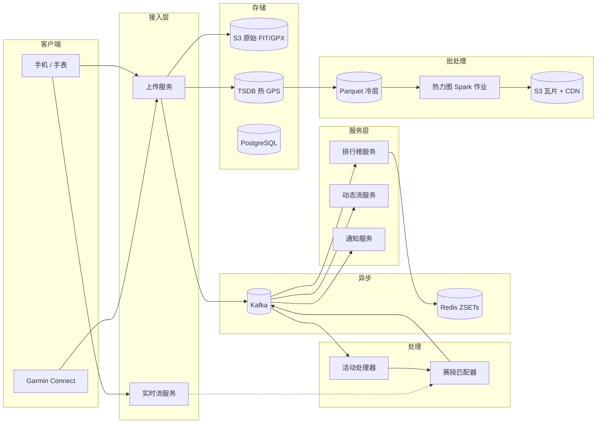
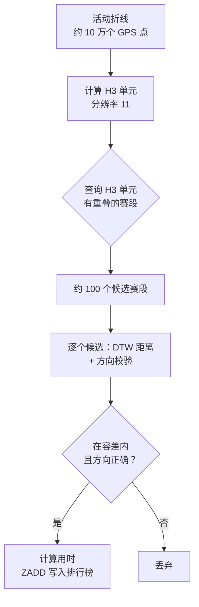
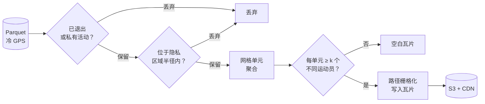
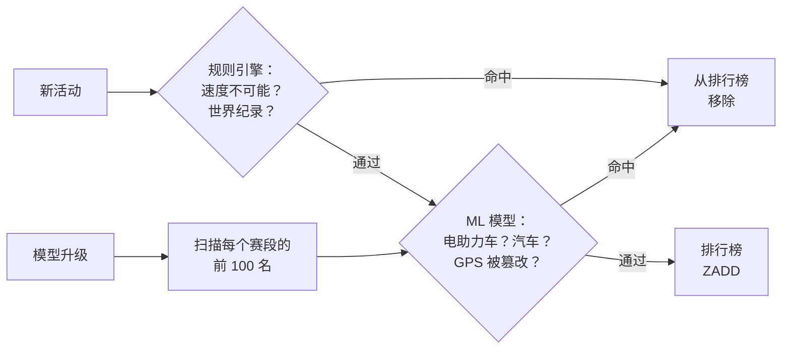

# 设计一个健身追踪服务（Strava / MapMyRun）

> **TL;DR.** 一个健身追踪服务要接收 1.95 亿+ 运动员的 GPS 轨迹[^1]，通过两阶段流水线（先用 H3 预筛，再用 DTW 精修）把每条活动与数千万个用户创建的赛段做匹配，并维护由 Kafka 事件流和 Redis 有序集合支撑的逐赛段排行榜[^2]。这里最关键的权衡是：服务端赛段匹配很贵（每天 10 亿次匹配），但为了反作弊它是必须的——客户端检测太容易被伪造。2018 年的热力图事件从“默认参与”的位置数据里曝出了隐蔽军事基地[^3]，这证明隐私必须是设计的输入项，而不是一个开关。

## 学习目标

- 设计一条 GPS 摄入流水线，每天处理 16 TB 时序数据点，并额外支撑一路实时流旁路通道
- 把赛段匹配实现为两阶段流水线：先做地理空间预筛（H3 单元），再做 DTW 精修
- 对比“骑行中实时”排行榜与“活动后批量”对账，并论证按付费档位拆分的合理性
- 用 Spark 批处理加 k-匿名阈值，在行星级规模上生成尊重隐私的热力图
- 把反作弊（GPS 伪造、错误运动类型上传）当作一等需求来推理，它在 2024–2026 年间清除了 1485 万条活动[^4]

## 直觉理解

记录一次骑行看起来就是个简单的 CRUD 应用。收一个 GPS 文件、存起来、在地图上画出来。一张 PostgreSQL 表应付 10 个用户毫无问题。

到 2025 年，1.95 亿运动员每天上传数千万条活动[^4]，三股压力把这个朴素设计撑破了。第一，每次上传都必须与数千万个赛段比较，才能找出运动员穿过了哪些赛段。没有预筛的话，一天就是 10^14 次比较。第二，每个赛段的排行榜必须在几秒内更新，这样刚爬完一个坡的车手立刻就能看到自己的名次。第三，把所有这些 GPS 数据聚合成全球热力图，在 2018 年暴露了军事巡逻路线——因为没人问过：“当我们把战区里默认参与的位置数据可视化出来，会发生什么？”

解开这个设计的洞察是：把赛段匹配拆成一个便宜的空间预筛（H3 单元把候选从数百万降到大约 100 个），再加一个昂贵的精确匹配器（DTW 能容忍抖动和不同的采样率）。这种两阶段模式让 CPU 成本在赛段库增长时保持可控，而且它跑在服务端，作弊者绕不过去。

## 需求

### 澄清问题

- **问：赛段反馈要骑行中实时给，还是只在上传后给？**
  假设：两者都要。实时赛段（Live Segments）是付费功能；活动后匹配是免费档的默认行为。[^5]
- **问：必须支持哪些文件格式？**
  假设：FIT（Garmin/Wahoo 二进制格式，行业标准）、GPX（开放 XML）和 TCX（Garmin Training Center XML）。[^6]
- **问：隐私控制呢？**
  假设：隐私区域（围绕家/公司可配置半径）、逐活动可见性、热力图退出机制，以及 k-匿名阈值。[^7]
- **问：和第三方平台的集成？**
  假设：OAuth 2.0 API，用 webhook 推送活动创建/更新/删除事件；对接 Garmin Connect、Apple HealthKit、Peloton、Zwift。[^8]
- **问：反作弊需求？**
  假设：服务端检测 GPS 伪造、错误运动类型上传（电助力车当自行车、开车当跑步），以及模型升级时对排行榜做历史回填。[^4]
- **问：订阅模式？**
  假设：免费档（活动后匹配、基础统计）与付费档（79.99 美元/年），后者包含实时赛段、训练分析和 Beacon。[^9]

### 功能需求

- 上传带元数据的活动（FIT/GPX/TCX）；异步处理后返回 activity_id（平均 < 2 秒）[^6]
- 把活动与全局赛段库匹配；计算每个命中赛段的用时
- 按时间范围（全时段、年、月）维护逐赛段排行榜，含 KOM/QOM 排名
- 用聚合、匿名化的活动数据生成全球热力图
- 活动过程中实时推送 GPS 流，支撑实时赛段与 Beacon（向 3 位联系人共享位置）
- 社交层：关注者动态流、点赞（kudos）、评论、俱乐部、挑战赛

### 非功能需求

- **负载：** 每天 1000 万条活动（平均约 115 次上传/秒，峰值 500 次/秒）；10 万并发实时追踪者
- **延迟：** 上传到可见 P99 < 30 秒；赛段匹配 P99 < 5 秒；排行榜更新端到端 < 5 秒
- **可用性：** 写路径 99.9%；读路径 99.95%
- **持久性：** 活动数据 99.999%（不可替代的个人数据）
- **一致性：** 排行榜最终一致（几秒的陈旧可接受）；活动写入强一致

## 容量估算

| 指标 | 数值 | 推导 |
|--------|------:|------------|
| 活动数/天 | 1000 万 | AWS 案例研究（2025）称“数千万”；2021 年为 18 亿/年 |
| 每条活动的 GPS 点数 | 10 万 | 设计上界：多传感器 FIT 记录（GPS + 心率 + 踏频 + 功率）以 1 Hz 记录 4 小时骑行 |
| 原始摄入量/天 | 16 TB | 1000 万 × 10 万点 × 16 字节（纬度/经度/海拔/时间戳） |
| 赛段匹配候选数/天 | 10 亿 | 1000 万条活动 × H3 预筛后约 100 个候选 |
| 生命周期原始存储（10 年） | 58 PB | 16 TB/天 × 3,650 天 |
| 热力图输入（2017 年重建） | 5 TB | 7 亿条活动，1.4 万亿个点[^10] |
| 热排行榜内存 | 约 50 GB | 1000 万个活跃赛段 × 平均 5 KB 的 ZSET |

- **读写比：** 排行榜读请求以约 100:1 压过写请求。活动上传是写密集，但 QPS 中等（平均约 115/秒）。
- **压缩：** 1 小时骑行产生约 100 KB 原始数据；FIT 二进制可压到约 10 KB。[^6]
- **带宽：** 实时追踪：10 万并发 × 1 点/秒 × 16 B = 1.6 MB/s 入站（可以忽略）。

## API 与数据模型

### API 设计

```http
POST /v1/uploads
  Content-Type: multipart/form-data
  Body: { file: <FIT/GPX/TCX>, activity_type: "ride", name: "Morning Ride" }
  Returns: 202 { "upload_id": "abc123", "status": "processing" }
  Poll: GET /v1/uploads/{upload_id} until activity_id is populated

GET /v1/activities/{id}
  Returns: 200 { "id": "...", "distance_m": 42195, "moving_time_s": 3600,
                  "polyline": "<encoded>", "segment_efforts": [...] }

GET /v1/segments/{id}/leaderboard?timeframe=year&page=1
  Returns: 200 { "efforts": [{"athlete_id": "...", "elapsed_s": 124, "rank": 1}],
                  "next_cursor": "..." }

POST /v1/segments
  Body: { "name": "Hawk Hill Climb", "polyline": "<encoded>", "sport_type": "ride" }
  Returns: 201 { "segment_id": "seg_789" }

WebSocket /v1/live/stream
  Client sends: { "lat": 37.77, "lng": -122.41, "alt": 50, "ts": "..." } at 1 Hz
  Server pushes: { "segment_entered": "seg_789", "delta_vs_pr": -3.2 }
```

### 数据模型

```sql
-- 活动元数据（PostgreSQL，按 user_id 分片）
CREATE TABLE activities (
  activity_id   BIGINT PRIMARY KEY,
  user_id       BIGINT NOT NULL,
  sport_type    TEXT,
  start_time    TIMESTAMPTZ,
  distance_m    INT,
  moving_time_s INT,
  elevation_m   INT,
  device_type   TEXT
);

-- GPS 点（时序库 / S3 上的 Parquet，按月分区）
-- Schema: (activity_id, ts, lat, lon, alt, hr, cadence, power)
-- 热层：最近 90 天，存于列式 TSDB
-- 冷层：S3 上的 Parquet，可通过 Spark 查询

-- 赛段（PostgreSQL + PostGIS，用于空间查询）
CREATE TABLE segments (
  segment_id  BIGINT PRIMARY KEY,
  polyline    GEOMETRY(LineString, 4326),
  h3_cells    BIGINT[],  -- 预先算好的、覆盖该赛段的 H3 res-11 单元
  sport_type  TEXT,
  min_length_m INT CHECK (min_length_m >= 250)
);
CREATE INDEX ON segments USING GIN (h3_cells);

-- 排行榜成绩（Redis 有序集合）
-- Key: seg:{segment_id}:{timeframe}:{sport}
-- Score: elapsed_ms  Member: athlete_id
-- 每个 (segment, timeframe) 组合一个 ZSET
```

## 高层架构



*上传路径把原始文件存进 S3、把热 GPS 存进 TSDB，然后由 Kafka 扇出到活动处理器、赛段匹配器、动态流和通知；热力图则是跑在冷 Parquet 层之上的月度 Spark 批处理作业。*

**写入路径：** 移动客户端把 FIT/GPX 文件 POST 到上传服务。服务校验载荷，把原始文件存进 S3，把 GPS 点规范化写进热 TSDB，并向 Kafka 发布 `activity.created` 事件。活动处理器消费该事件，算出统计值（距离、配速分段、爬升），然后入队一个赛段匹配作业。

**读取路径：** 排行榜查询直接打到 Redis 有序集合。活动详情查询把 PostgreSQL 元数据与降采样后的折线（用 Ramer-Douglas-Peucker 压到约 1000 个点用于渲染）拼在一起。动态流服务把活动事件推给关注者的收件箱。

**实时路径：** 骑行过程中，手机通过 WebSocket 以 1 Hz 把 GPS 推给实时流服务。该服务把流投影到附近的赛段折线上，并把实时配速差值推回设备。

## 深入剖析

### 赛段匹配：两阶段流水线

赛段库里有全球数千万个用户创建的赛段。让每次上传与每个赛段都匹配，算力上根本不可能。解法是两阶段流水线。

**第一阶段：H3 空间预筛。** 赛段创建时，我们预先算出它在分辨率 11 下的 H3 单元（每单元约 0.002 km^2，平均边长约 29 米），存进一个建了 GIN 索引的数组列。[^11] 活动到达时，算出活动途经的 H3 单元，查询 `h3_cells` 数组与之重叠的赛段。这样候选就从数千万降到每条活动大约 100 个。[^12]

**第二阶段：用 DTW 精确匹配。** 对每个候选赛段，我们在活动的子折线与赛段参考折线之间跑动态时间规整（Dynamic Time Warping，DTW）。[^13] DTW 能处理不同的记录间隔（1 Hz 与 5 Hz 的设备）和轻微的 GPS 抖动，同时给出一个标量距离指标。我们还会比较起点到终点的行进向量来校验方向，并对起终点线处的 GPS 漂移留出缓冲区容差。[^12]



*H3 预筛把候选集从数千万压到约 100；精确阶段跑带方向校验的 DTW，并把命中的成绩写入排行榜。*

**为什么不在客户端匹配？** 客户端检测没有后端扇出，但太容易被伪造。Strava 的反作弊流水线在 2024–2026 年的多轮回填中清除了 1485 万条异常活动[^4]，如果匹配跑在不可信的客户端上，这根本做不到。

**最小赛段长度：** 短于 500 米（骑行）或 250 米（跑步）的赛段，其 GPS 噪声底与自身长度相当，用时计算不可靠。Strava 已不再允许创建低于这些阈值的赛段。[^4]

### 热力图生成与 2018 年隐私事件

全球热力图把 GPS 密度聚合成栅格瓦片，可视化运动员在哪里跑步和骑行。2017 年的重建用 Apache Spark 和 Scala 处理了 7 亿条活动、1.4 万亿个经纬度点和 5 TB 原始输入。[^10]

**事件本身：** 2018 年 1 月，一名澳大利亚学生发现热力图暴露了叙利亚、阿富汗和吉布提隐蔽军事基地的巡逻路线、周界和补给线。英国国防部将其评估为“明确的风险”，并重新发布了内部网络安全指引。[^3][^14] 根因是：低密度地区军事人员的“默认参与”位置数据亮了起来——因为哪怕只有少数几个固定用户，也能把一圈周界勾出来。

**修复方案（2018 年 3 月）：** 支持退出、街道级数据需登录、月度重建节奏（让隐私变更在一个月内生效）、围绕家/公司的可配置隐私区域，以及渲染前要求每个单元有“若干不同运动员”的 k-匿名阈值。[^7]



*隐私过滤在聚合之前生效；k-匿名阈值把守最终瓦片渲染，避免低密度地区曝出个体活动模式。*

**架构决策：**

- 在 Parquet 上跑 Spark 批处理，是以月度节奏处理 PB 级数据最便宜的方式。之前单节点的 C 流水线跟不上，因为它每条活动都要发一次 S3 GET。[^10]
- 路径栅格化（在 GPS 采样点之间画折线）比逐点打点（splatting）产生的视觉效果更准。[^10]
- 月度重建节奏在算力成本与隐私变更生效速度之间取得平衡。[^7]

### 反作弊与排行榜公平性

只有数据诚实，排行榜才有意义。Strava 的反作弊从纯规则系统演进成了规则加 ML 的流水线。

**规则层：** 标记打破世界纪录的成绩、超人般的爬升率和不可能的速度。2024 年 12 月的一次规则更新清除了 650 万条异常活动。[^4]

**ML 层：** 一个用人工标记数据训练的监督模型能抓更隐蔽的情况：电助力车记成普通自行车、开车上传成跑步、被篡改过的 GPS 文件。2025 年 5 月对跑步赛段前 100 名排行榜的 ML 回填清除了 445 万条活动；2026 年 1 月的骑行回填清除了 390 万条。[^4][^15]

**历史回填：** 新版模型必须回溯应用到已有排行榜上。这是一等操作，不是事后补丁。Strava 的工程团队花了“一年半以上”来协调回填基础设施。[^4]



*新活动先过规则再过 ML；模型升级会触发历史回填，对已有排行榜条目重新打分。*

## 真实案例

Strava 的排行榜基础设施在 2018 年经历了一次大重建，驱动力是需要一个有序、分区、可复制的存储底座，让多个附属系统能各自独立订阅。[^2][^16]

**之前：** 赛段成绩同步写入一个数据库。排行榜、动态流、通知和成就系统都查同一个存储。耦合很紧，加一个新消费者就要改 schema。

**之后：** 平台团队引入了一条 Kafka 事件流。每条赛段成绩产生一个按 segment_id 分区的事件。消费者各自订阅：排行榜消费者对 Redis 有序集合发 `ZADD`[^17]，动态流消费者推到关注者收件箱，通知消费者触发个人纪录（PR）提醒，成就消费者检查里程碑徽章。[^2]

Redis 充当临时缓存，“以便更快速、更有效地服务绝大多数读请求”。[^18] 每个排行榜是一个有序集合，键为 `(segment_id, timeframe, sport)`，分数是用时毫秒数。`ZADD` 以 O(log N) 插入或更新成绩；`ZRANGE` 读一页；`ZRANK` 返回用户名次。[^17]

挑战赛排行榜子系统（面向“一月骑行 200 公里”这类时间窗目标）在 2020 年撞上另外的瓶颈，需要单独重写以承载数百万并发参与者。[^19]

**规模洞察：** Strava 的 Geo 团队为规模化地图数据（OSM 聚合、高程数据集、活动衍生的 GPS）自建了一个名为 Rain 的键值存储。[^20] 2025 年 Mapbox 的用量成本变得不再划算后，地图渲染迁到了自研引擎。[^21]

## 权衡

| 方案 | 优点 | 缺点 | 适用场景 |
|----------|------|------|-------------|
| 骑行中实时赛段匹配 | 实时体验有吸引力；带动付费档[^5] | 占用 GPS 流带宽；耗电 | 付费档 + 连接的可穿戴设备 |
| 仅活动后匹配 | 简单；对隐私友好；可批处理 | 排行榜不会实时跳动 | 免费档默认 |
| GPS 降采样（RDP） | 存储省约 10 倍；渲染更快 | 急弯处精度略损 | 归档与地图渲染层 |
| 保留原始 GPS | 可精确回放；赛段精度最佳 | 存储成本 10 倍；需要冷层 | 进行中与近期的活动 |
| 服务端赛段匹配 | 一致；权威；可反作弊[^4] | 随上传速率扩展，扇出重 | 标准路径（强制） |
| 客户端赛段检测 | 零后端扇出；延迟低 | 用户可伪造；规则不一致 | 仅低信任或离线优先的产品 |
| Kafka 事件流排行榜 | 消费者解耦；可重放做回填[^2] | 最终一致（滞后数秒） | 规模化生产环境的排行榜 |

最大的一条元决策：服务端还是客户端做赛段匹配。客户端能省下大量后端算力，但让反作弊变成不可能。Strava 清除 1485 万条活动这一事实说明，只要排行榜的可信度重要，服务端方案就没有商量余地。

## 扩展与故障模式

**10 倍负载（每天 1 亿条活动）：** 赛段匹配器成为瓶颈。缓解：按地理区域分区横向扩展匹配 worker；在上传时预先算好 H3 单元索引，让匹配器完全不做空间计算。

**100 倍负载（每天 10 亿条活动）：** Kafka 分区数必须扩到数千。热门赛段的 Redis 有序集合变成热键。缓解：按时间范围拆分 ZSET、为排行榜 GET 增加只读副本，以及用 Kafka 支撑异步写、由消费者批量 ZADD。

**1000 倍负载：** 对 PB 级 Parquet 的热力图重建会变成一个持续数天的作业。缓解：按瓦片增量更新（只重算成分活动发生变化的瓦片），而不是全量重建。

**故障模式：**

- **赛段匹配器积压：** 如果匹配 worker 落后，活动会出现几分钟没有赛段成绩。降级模式：立刻展示活动，打上“匹配中”标记。Kafka 保留 24 小时，确保数据不丢。
- **Redis 分片故障：** Sentinel 提升一个副本。故障切换期间，排行榜读会返回陈旧数据。Kafka 事件流支持全量重放，重建任何丢失的 ZSET。
- **热力图隐私回归：** 某次代码改动关掉了 k-匿名过滤器。检测：自动化测试校验已知稀疏区域的瓦片渲染为空白。响应：暂停 CDN 供给瓦片，用上一个已知良好的流水线版本重建。

## 常见陷阱

> [!WARNING]
> **赛段匹配扇出无上界。** 让每条活动与所有赛段比较，一天就是 10^14 次比较。务必用地理空间单元索引（H3、S2）预筛，把每条活动的候选降到约 100 个。[^11]

> [!WARNING]
> **提出在客户端做赛段匹配。** 这是面试里的红旗。客户端检测太容易伪造，会让反作弊彻底不可能。Strava 是在服务端清除了 1485 万条异常活动。[^4]

> [!WARNING]
> **热力图里忽视隐私。** 在没有 k-匿名阈值的情况下聚合默认参与式的 GPS 数据，2018 年因此暴露了军事基地。[^3] 隐私过滤必须在聚合之前生效，而不是之后。

> [!WARNING]
> **热门赛段的写争用。** 热门的通勤赛段每天收到数千条成绩。单个 Redis ZSET 分片会变成热键。按时间范围拆分、用只读副本，并通过 Kafka 消费者批量写入。[^2]

> [!WARNING]
> **短赛段的 GPS 噪声。** 短于 250 米（跑步）或 500 米（骑行）的赛段，GPS 噪声底与其长度相当。创建时就强制最小长度。[^4]

> [!WARNING]
> **把反作弊当做事后想法。** 上线后再补检测，意味着几年的排行榜数据都被污染。从第一天起就把规则引擎和 ML 流水线设计进匹配器。

## 追问

**1. 如何检测伪造赛段 PR 的 GPS 欺骗？**

规则层拒绝不可能的速度和超出世界纪录的成绩。用人工标记异常训练出的 ML 模型抓电助力车冒充自行车、开车冒充跑步。可穿戴设备能提供加速度计数据时做交叉验证。每次模型升级都要回填前 100 名排行榜。[^4]

**2. Beacon（实时位置共享）在架构上与实时赛段有何不同？**

Beacon 通过持久 WebSocket 把 GPS 推给最多 3 位受信联系人，完全不做赛段匹配计算。实时赛段则额外把流投影到附近的赛段折线上并计算配速差值。Beacon 是简单的发布/订阅扇出；实时赛段需要服务端实时空间计算。[^22][^23]

**3. 如何处理从 Garmin/Apple Watch 到 Strava 的集成流水线？**

Garmin Connect 在用户授权后通过 Activity API 同步 FIT 文件。[^24] Apple HealthKit 通过 `HKWorkoutRouteQuery` 暴露训练路线；后台投递频率下限为每小时一次。[^25] 两者都以标准上传的形式走同一条异步流水线。

**4. GDPR 的“被遗忘权”扇出有多大？**

一次删除请求必须传播到 PostgreSQL（活动元数据）、TSDB（热 GPS）、S3（原始文件）、Redis（排行榜成绩）、Parquet 冷层、热力图瓦片、CDN 缓存和 webhook 日志。用一个删除协调器跟踪所有存储的完成情况，SLA 为 30 天。

**5. 如何在不疏远免费档的前提下变现？**

免费档拿到活动后匹配、基础统计和社交动态流。付费档（79.99 美元/年）解锁实时赛段、Beacon、训练分析，以及由热力图驱动的路线规划。[^9] 付费墙设在实时计算边界，而不是数据边界。

**6. 如何支持多名运动员一起骑行的车队/俱乐部训练？**

用同一俱乐部运动员上传数据的时间与空间相关性做分组检测。合并成小组活动视图，同时保留每个人的赛段成绩。用关注关系图推荐小组成员。

## 练习

### 练习 1：估算赛段匹配器的容量

你的赛段库有 2000 万个赛段。每天收到 200 万次活动上传。每条活动平均途经 500 个 H3 分辨率 11 单元。每个赛段平均覆盖 50 个 H3 单元。估算：(a) H3 预筛后每条活动的候选匹配数；(b) 每天的 DTW 计算总量。

<details>
<summary>提示</summary>

把 H3 预筛想成一次倒排索引查询。有多少赛段与给定活动至少共享一个 H3 单元？重叠概率取决于活动单元数与该地理区域总单元数的比例。

</details>

<details>
<summary>解答</summary>

(a) 2000 万个赛段平均各 50 个单元，倒排索引里的赛段-单元条目共 10 亿条。假设赛段分布在全球约 5 亿个不同的 H3 res-11 单元上，每个单元平均含 2 条赛段引用。一条途经 500 个单元的活动会命中约 1,000 条赛段-单元条目，但很多赛段会重复出现（覆盖 50 个单元的赛段可能与活动的 5 个单元重叠）。去重后，每条活动预计有约 100 到 200 个不同的候选赛段。

(b) 按每条活动 200 个候选、每天 200 万条活动算：每天 4 亿次 DTW 计算，约 4,600 次/秒。在现代硬件上，每次对约 1000 点子折线做 DTW 约需 1 毫秒，因此需要约 5 个核持续做 DTW 计算。一个小型 worker 池就能撑住。

接受的权衡：预筛并不完美（部分候选过不了 DTW），但另一条路（不预筛）每天要 40 万亿次比较。

</details>

## 要点回顾

- **两阶段赛段匹配是核心架构洞察。** H3 预筛把候选从数百万降到约 100；DTW 负责精确匹配。省掉预筛，就是每天 10 亿次比较与 10^14 次比较的差别。
- **为了排行榜可信度，服务端匹配没有商量余地。** 客户端检测省算力，但让反作弊变成不可能。
- **隐私是设计输入，不是开关。** 2018 年热力图事件是经典的警示故事：k-匿名阈值、隐私区域和退出机制必须在渲染之前把住聚合这一关。
- **Kafka 事件流把排行榜写入与附属系统解耦。** 动态流、通知和成就各自独立订阅，不与匹配器耦合。
- **反作弊要求把历史回填当作一等操作。** 新 ML 模型必须对已有排行榜重新打分，而不只是处理新活动。

## 延伸阅读

- [Strava Engineering: Building the Global Heatmap (2017)](https://medium.com/strava-engineering/the-global-heatmap-now-6x-hotter-23fc01d301de)。那次处理 1.4 万亿点的 Spark/Scala 重写；解释了路径栅格化，以及从逐活动 S3 GET 转向批量 Parquet 访问。
- [Strava Engineering: Rebuilding the Segment Leaderboards Infrastructure, Part 3](https://medium.com/strava-engineering/rebuilding-the-segment-leaderboards-infrastructure-part-3-design-of-the-new-system-39fdcf0d5eb4)。Kafka 支撑的事件流设计，把排行榜写入与附属消费者解耦。
- [Strava: Keeping Segment Leaderboards Fair (2026)](https://stories.strava.com/articles/keeping-stravas-segment-leaderboards-fair-an-engineers-perspective)。规则加 ML 的反作弊流水线，以及三轮清查中 1485 万条活动的回填。
- [Wired UK: Strava heatmap a “clear risk” to security](https://www.wired.co.uk/article/strava-heat-maps-military-app-uk-warning-security)。国防部的评估以及 2018 年事件的政策余波。
- [Uber H3 documentation](https://h3geo.org/docs/)。层次化六边形索引：分辨率表、gridDisk，以及地理空间预筛所用的 aperture-7 父子层级。
- [Newson and Krumm, “Hidden Markov Map Matching Through Noise and Sparseness” (SIGSPATIAL 2009)](https://www.microsoft.com/en-us/research/publication/hidden-markov-map-matching-noise-sparseness/)。OSRM Match 背后的经典算法；把带噪声的 GPS 吸附到路网时很有用。
- [Redis: Build a Real-Time Leaderboard with Sorted Sets](https://developer.redis.com/howtos/leaderboard/)。O(log N) 的 ZADD/ZRANGE/ZRANK；支撑逐赛段排名的模式。

## 记忆卡片

<details>
<summary><strong>问：赛段匹配流水线的两个阶段是什么？</strong></summary>

答：第一阶段：H3 空间预筛通过检查单元重叠，把候选从数千万降到约 100。第二阶段：DTW（动态时间规整）或带方向校验的折线距离匹配，确认命中并计算用时。

</details>

<details>
<summary><strong>问：为什么客户端赛段匹配是面试红旗？</strong></summary>

答：客户端检测太容易伪造（改过的 GPX 文件、GPS 模拟器）。为了反作弊，服务端匹配是必须的。Strava 在 2024–2026 年间用服务端规则加 ML 回填清除了 1485 万条异常活动。

</details>

<details>
<summary><strong>问：2018 年 Strava 热力图事件是什么造成的？</strong></summary>

答：低密度地区（战区、隐蔽基地）军事人员的默认参与式位置数据，在全球热力图上把巡逻路线和周界点亮了。修复手段：退出机制、隐私区域、k-匿名阈值，以及月度重建节奏。

</details>

<details>
<summary><strong>问：Strava 的排行榜架构如何使用 Kafka？</strong></summary>

答：赛段成绩作为事件发布到 Kafka，按 segment_id 分区。各消费者独立订阅：一个写 Redis 有序集合（排行榜），一个推动态流，一个发通知。这把匹配器与所有下游系统解耦。

</details>

<details>
<summary><strong>问：热力图生成中的 k-匿名阈值是什么？</strong></summary>

答：一个网格单元只有在包含“若干不同运动员”的数据时才会被渲染。这避免低密度地区（军事基地、私人小径）曝出个体移动模式。

</details>

<details>
<summary><strong>问：Strava 为什么要强制最小赛段长度？</strong></summary>

答：短于 500 米（骑行）或 250 米（跑步）的赛段，GPS 噪声底与其长度相当。只有 3–4 个 GPS 点时，起终点缓冲区互相重叠，用时计算就不可靠了。

</details>

<details>
<summary><strong>问：赛段排行榜用什么 Redis 数据结构？</strong></summary>

答：有序集合（ZSET）。每个 (segment_id, timeframe, sport) 一个 ZSET。分数 = 用时毫秒。ZADD 以 O(log N) 插入，ZRANGE 读一页，ZRANK 返回用户名次。

</details>

<details>
<summary><strong>问：H3 预筛在赛段匹配中如何工作？</strong></summary>

答：每个赛段的折线预先索引为 H3 分辨率 11 单元数组。活动到达时，算出它的 H3 单元，通过 GIN 索引查询单元有重叠的赛段。这把候选从数百万降到约 100。

</details>

<details>
<summary><strong>问：Beacon 与实时赛段的区别是什么？</strong></summary>

答：Beacon 把 GPS 推给最多 3 位受信联系人（简单的发布/订阅扇出，不做计算）。实时赛段把 GPS 流投影到附近赛段折线上并推送实时配速差值（需要服务端空间计算）。

</details>

<details>
<summary><strong>问：Strava 的热力图流水线如何从单节点演进到 Spark？</strong></summary>

答：最初的 C 流水线每条活动读一个 S3 对象，到 7 亿条活动时已经撑不住。2017 年的重写改用 Spark/Scala 做批量 Parquet 访问，从输入到输出全程并行，并改用路径栅格化。

</details>

## 参考文献

[^1]: Strava Press，“Strava Adds Support For Ten Additional Languages”（2026 年 3 月，提及 1.95 亿+ 用户）。https://press.strava.com/articles/strava-adds-support-for-ten-additional-languages-continuing-global-growth 另见：AWS 案例研究（2025，提及 1.5 亿+）。https://aws.amazon.com/solutions/case-studies/strava-case-study/

[^2]: Jeff Pollard 与 Strava 平台团队，“Rebuilding the Segment Leaderboards Infrastructure Part 3: Design of the New System”（Kafka 支撑的事件流），2018 年 8 月。https://medium.com/strava-engineering/rebuilding-the-segment-leaderboards-infrastructure-part-3-design-of-the-new-system-39fdcf0d5eb4 （存档：https://web.archive.org/web/20250120153738/https://medium.com/strava-engineering/rebuilding-the-segment-leaderboards-infrastructure-part-3-design-of-the-new-system-39fdcf0d5eb4）

[^3]: Matt Burgess，“Strava's heatmap was a 'clear risk' to security, UK military warned”，Wired UK，2018 年 4 月。https://www.wired.co.uk/article/strava-heat-maps-military-app-uk-warning-security

[^4]: James Wang（Strava），“Keeping Strava's Segment Leaderboards Fair: An Engineer's Perspective”，2026 年 3 月。https://stories.strava.com/articles/keeping-stravas-segment-leaderboards-fair-an-engineers-perspective

[^5]: Strava Support，“Strava Subscription Features”（实时赛段属于订阅档功能）。https://support.strava.com/hc/en-us/articles/216917657-Strava-Premium-Features-and-Pricing

[^6]: Strava Developers，“Uploading to Strava”（API 参考，上传）。https://developers.strava.com/docs/uploads/

[^7]: Strava Press Blog，“Heatmap Updates”，2018 年 3 月 13 日（事件后的官方调整）。https://web.archive.org/web/20190217132816/https://blog.strava.com/press/heatmap-updates/

[^8]: Strava Developers，“Webhook Events API”（HMAC-SHA256 签名、2 秒内确认、重试策略）。https://developers.strava.com/docs/webhooks/

[^9]: Strava，“Pricing”页面（11.99 美元/月，79.99 美元/年，家庭版 139.99 美元/年）。https://www.strava.com/pricing

[^10]: Drew Robb，“Building the Global Heatmap”（Strava Engineering），2017 年 11 月。https://medium.com/strava-engineering/the-global-heatmap-now-6x-hotter-23fc01d301de

[^11]: Uber H3，“Indexing”文档（aperture-7 层级、位运算）。https://h3geo.org/docs/highlights/indexing/

[^12]: Strava Support，“How to Create Good Segments”与“Segment Matching Issues”（缓冲区、方向、GPS 采样率）。https://support.strava.com/hc/en-us/articles/216918227-Optimizing-Segment-Creation-How-to-Create-Good-Segments

[^13]: Springer，“Fast and Exact Warping of Time Series Using Adaptive Segmental Approximations”（用 DTW 做时序相似度）。https://link.springer.com/article/10.1007/s10994-005-5828-3

[^14]: Alex Hern，“Fitness tracking app Strava gives away location of secret US army bases”，The Guardian，2018 年 1 月。https://www.theguardian.com/world/2018/jan/28/fitness-tracking-app-gives-away-location-of-secret-us-army-bases

[^15]: Cycling Weekly，“Strava wipes 4.45 million activities in hunt against cheats”，2025 年 5 月。https://www.cyclingweekly.com/news/strava-wipes-4-45-million-activities-in-hunt-against-cheats

[^16]: Strava Engineering，“Rebuilding the Segment Leaderboards Infrastructure Part 2: First Principles of a New System”。https://medium.com/strava-engineering/rebuilding-the-segment-leaderboards-infrastructure-part-2-first-principles-of-a-new-system-cd2e77c82ba3 （存档：https://web.archive.org/web/20250120153738/https://medium.com/strava-engineering/rebuilding-the-segment-leaderboards-infrastructure-part-2-first-principles-of-a-new-system-cd2e77c82ba3）

[^17]: Redis，“Build a Real-Time Leaderboard with Redis Sorted Sets”（ZADD/ZREVRANGE/ZREVRANK，O(log N)）。https://developer.redis.com/howtos/leaderboard/

[^18]: Jacob Stultz 与 Jeff Pollard（Strava），“Lessons Learned in Scaling Strava's Infrastructure”，AWS Startups Blog。https://aws.amazon.com/blogs/startups/lessons-learned-in-scaling-stravas-infrastructure/

[^19]: Mike Kasberg（Strava Engineering），“Scaling Challenge Leaderboards for Millions of Athletes”，2024 年 1 月。https://medium.com/strava-engineering/scaling-challenge-leaderboards-for-millions-of-athletes-9ab09ef01381 （存档：https://web.archive.org/web/20250114090526/https://medium.com/strava-engineering/scaling-challenge-leaderboards-for-millions-of-athletes-9ab09ef01381）

[^20]: Strava Engineering，“Rain: A key-value store for Strava's scale”，2025 年 1 月。https://medium.com/strava-engineering/rain-a-key-value-store-for-stravas-scale-7f580f5b4848

[^21]: Strava Press，“Strava Introduces Proprietary Map Rendering Engine”，2025 年 3 月。https://press.strava.com/tags/strava-introduces-proprietary-map-rendering-engine

[^22]: Strava Support，“Strava Beacon for Garmin”（LiveTrack + 自动启动）。https://support.strava.com/hc/en-us/articles/207294450-Strava-Beacon-for-Garmin

[^23]: Kevin Bunarjo（Strava Engineering），“Implementing Beacon on Apple Watch”，2019 年 9 月。https://medium.com/strava-engineering/implementing-beacon-on-apple-watch-4434dbb46fdb

[^24]: Garmin Connect Developer Program，“Activity API”概览。https://developer.garmin.com/gc-developer-program/activity-api/

[^25]: Apple Developer，“enableBackgroundDelivery(for:frequency:withCompletion:)”（HealthKit 后台投递频率）。https://developer.apple.com/documentation/healthkit/hkhealthstore/1614175-enablebackgrounddelivery
