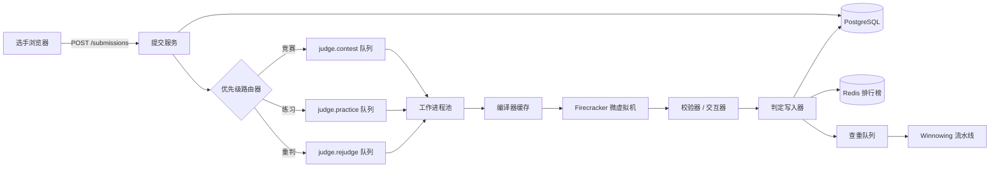
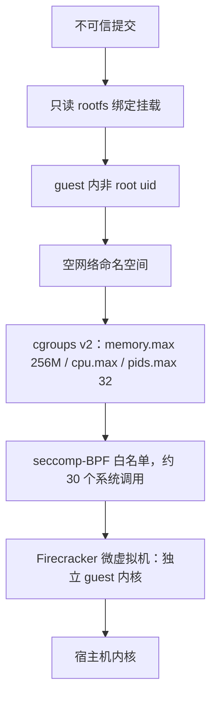
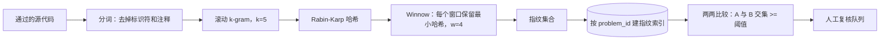

# 设计在线评测系统（LeetCode / Codeforces / HackerEarth）

> **TL;DR.** 在线评测系统（online judge）接收不受信任的源代码，编译后在沙箱环境里对着隐藏测试用例运行，并在 p99 < 15 s 内给出判定结果（AC、WA、TLE、MLE、RE、CE）。核心权衡在于隔离强度与单次提交开销：Docker 共享宿主机内核，差一个 CVE 就能逃出集群[^1]；而 Firecracker 微虚拟机（microVM）启动不到 125 ms、额外开销约 5 MB，能让每次提交都跑在独立内核上[^2]。到了竞赛规模（1 万名选手瞬间打出 200 次/秒的提交），优先级排队把竞赛流量和练习流量分开，MOSS 风格的 winnowing 流水线则异步地抓出抄袭。

## 学习目标

- [ ] 比较 Docker、gVisor、Firecracker 三种代码执行沙箱，并为公开评测系统给出选择理由
- [ ] 为开赛瞬间 200 次/秒的突发流量、平均执行 3 s 的场景估算工作进程池规模
- [ ] 设计一套优先级队列拓扑，让练习提交持续推进，同时不饿死竞赛流量
- [ ] 说清多层隔离的推理：microVM + seccomp + cgroups + 空网络命名空间
- [ ] 用 k-gram winnowing 指纹搭一条 MOSS 风格的查重流水线
- [ ] 为每天 500 万次提交（含编译型与解释型语言）估算容量

## 直觉理解

单机版评测系统是个周末项目：接收代码、编译、跑测试用例、比对输出。10 个用户时它工作得很好。到了 100 万用户、1 万名选手在同一分钟里点提交的时候，它会因为三个原因崩掉。

第一，你跑的是接近 root 权限的陌生代码。容器运行时只要出一个 CVE（CVE-2019-5736 就让恶意容器覆盖掉了宿主机的 `runc` 二进制[^1]），你的评测系统就变成了攻击者手里的 shell。只用 Docker 是不够的。

第二，负载极不均匀。Codeforces 的 Div 2 场次平均能吸引 1 万名以上选手，热门场次超过 2 万名[^3]。开赛后 60 秒内所有人都去提交热身题 “A”：平台平时 30 次/秒，此刻约 170 次/秒。如果竞赛和练习流量共用一条 FIFO 队列，那个等了 90 秒才拿到结果的选手，实际上被坑了。

第三，学生会抄。他们把同学的解法复制过来，改变量名，重新提交。没有指纹比对，你在规模上根本查不出来。

洞察在于：把决策流水线拆成互相独立的层。提交服务做校验并入队；优先级路由器保证竞赛流量先排空；无状态的沙箱工作进程在用过即弃的 Firecracker 微虚拟机里执行；查重流水线异步地跑在已通过的提交上。每一层都能独立扩展、独立失败、独立升级。

## 需求

### 澄清问题

- **问：评测模式是标准输入/输出比对、自定义校验器，还是交互式？**
  假设：三种都要。自定义校验器处理有多个合法输出的题目；交互式题目根据程序的 stdout 喂入 stdin。

- **问：是实时竞赛还是异步练习？**
  假设：两者都有。架构规模由竞赛场景（1 万名以上选手同时在线）决定。

- **问：支持哪些语言？**
  假设：20 多种运行时。以 C++、Java、Python 为主。按语言设置时间倍数（Python 拿到 C++ 时限的 3-5 倍）。

- **问：沙箱模型？**
  假设：每次提交一个 Firecracker 微虚拟机。提交之间不复用容器。

- **问：内存和 CPU 限制？**
  假设：256 MB 内存、1 vCPU，按题目可配。墙钟时间到达标称时限的 2 倍即强杀。

- **问：查重是阻塞还是异步？**
  假设：异步。作弊者先看到 AC，过一会儿被标记、进入人工复核。

### 功能性需求

- 用指定语言提交源代码，拿到逐测试用例的判定和整体判定（AC/WA/TLE/MLE/RE/CE）
- 支持自定义校验器二进制和交互式（有状态）题目
- 维护每题、每场比赛的排行榜，按（通过题数、罚时）排序
- 用指纹相似度在已通过的提交之间检测抄袭
- 管理员对题目做增删改查，含隐藏测试用例、时间/内存限制，以及重判能力

### 非功能性需求

- **负载：** 10 万次提交/小时（平均 30 次/秒），开赛瞬间突发到 200 次/秒
- **延迟：** 端到端判定 p99 < 15 s
- **隔离：** 不允许沙箱逃逸，不允许跨提交读取，单次提交不能对集群造成 DoS
- **可用性：** 竞赛期间 99.9%；练习场景 99.5% 可接受
- **持久性：** 每次提交和判定都落盘，不允许静默丢弃

## 容量估算

| 指标 | 数值 | 推导 |
|--------|------:|------------|
| 平均提交 QPS | 30 | 100k/hour / 3,600 |
| 峰值突发 QPS | 200 | 60 s 窗口内 1 万名选手 |
| 并发沙箱工作进程（峰值） | 600 | 200/s × 3 s 平均执行时间 |
| 每年存储（提交） | 50 GB | 500 万次提交 × 10 KB 平均 |
| 测试用例语料 | ~1 GB | 约 5,000 道题 × 200 KB 平均 |
| 排行榜条目（竞赛峰值） | 20k+ | 热门的 Codeforces 场次[^3] |
| 每天查重比较次数 | ~50k | 每道题所有 AC 提交两两比较 |

- **CPU 下限：** 竞赛期间 600 核；练习基线约 100 核
- **带宽瓶颈：** 大测试用例（50-100 MB）同时流向 600 个工作进程时，会先把 VPC 出网带宽打满，而不是 CPU 先满
- **开赛钟声尖峰：** 在公布的开始时间前 10 分钟，把工作进程预热到 2-3 倍

## API 与数据模型

### API 设计

```http
POST /v1/submissions
  Body: { "problem_id": "p_123", "language": "cpp20", "source_code": "..." }
  Returns: 202 { "submission_id": "s_abc", "status": "queued" }
  Rate limit: 1 per 5 s outside contest, 1 per 10 s during contest

GET /v1/submissions/{id}
  Returns: 200 { "submission_id": "s_abc", "verdict": "AC",
                  "cases": [{"id": 1, "verdict": "AC", "time_ms": 42, "memory_kb": 8192}...] }
  Also: WebSocket /v1/submissions/{id}/stream for real-time verdict updates

GET /v1/leaderboard/{contest_id}?top=100&around_user={user_id}
  Returns: 200 { "rankings": [...], "user_rank": 847, "total": 12000 }

POST /v1/problems (admin)
  Body: { "title": "...", "time_limit_ms": 2000, "memory_limit_kb": 262144,
           "test_cases_s3_prefix": "testcases/p_123/" }
  Returns: 201 { "problem_id": "p_123" }
```

教学类集成里需要同步判题时，支持 `?wait=true` 模式（Judge0 风格[^4]）。

### 数据模型

```sql
-- PostgreSQL：提交元数据
CREATE TABLE submissions (
  submission_id   UUID PRIMARY KEY,
  user_id         UUID NOT NULL,
  problem_id      UUID NOT NULL,
  language        TEXT NOT NULL,
  source_code     TEXT NOT NULL,
  verdict         TEXT DEFAULT 'queued',
  total_time_ms   INT,
  peak_memory_kb  INT,
  created_at      TIMESTAMPTZ DEFAULT now(),
  contest_id      UUID
);
CREATE INDEX idx_submissions_user ON submissions(user_id, created_at DESC);
CREATE INDEX idx_submissions_problem ON submissions(problem_id, verdict);

-- S3：测试用例
-- s3://judge-testcases/{problem_id}/{case_number}.in
-- s3://judge-testcases/{problem_id}/{case_number}.out

-- Redis 有序集合：竞赛排行榜
-- Key: leaderboard:{contest_id}
-- Score: encode (problems_solved * 1e9 - penalty_minutes) as double
-- Member: user_id
```

[排行榜](./26-leaderboard.md)详细讲了 Redis 有序集合这一模式。`ZADD` 和 `ZREVRANGE` 都是 O(log N)[^5]，所以对一个 2 万名以上选手的排行榜来说，取前 100 名是亚毫秒级的轻松活儿。

## 高层架构



*提交经优先级路由进入按需创建的 Firecracker 沙箱；判定结果分别流向数据库、排行榜和异步查重流水线。*

**写入路径。** 提交服务校验请求体、写入 PostgreSQL，并向 RabbitMQ 投一条判题消息。优先级路由器看 `contest_id`：有值走高优先级队列，没值走练习队列。针对这种拓扑，RabbitMQ 官方文档本身就建议用相互独立的物理队列，而不是堆很多优先级等级[^6]。

**执行路径。** 工作进程取出消息，从 S3 拉测试用例（缓存在本地 tmpfs），用 `(language, sha256(source_code))` 查编译器缓存是否命中，需要的话先编译，然后在一个全新的 Firecracker 微虚拟机里执行，外面套 seccomp + cgroups + 空网络命名空间。逐用例结果流式返回，校验器比对输出（或者跑一个自定义校验器二进制）。判定写入器更新 PostgreSQL，如果是竞赛期间的 AC，就向 Redis 排行榜发 `ZADD`。

**异步路径。** 通过的提交进入查重队列。winnowing 流水线做分词、算指纹，与每道题的指纹索引比对。相似度超过阈值的提交对被标记，转人工复核。

## 深入探讨

### 沙箱隔离：为什么 Docker 不够用

最小可用的沙箱就是一个带资源限制的 Docker 容器。它能用，直到哪天不能用了。CVE-2019-5736（2019 年 2 月）证明：容器内任何 root 进程都能通过 `/proc/[runc-pid]/exe` 覆盖宿主机的 `runc` 二进制，从而在宿主机上执行任意代码[^1][^7]。当时所有没有启用 user namespace 的 Docker 版在线评测系统都中招。

Firecracker 用另一条路封死这类攻击：给每次提交一个跑在 KVM 支撑的微虚拟机里的、自己的 Linux 内核。NSDI 2020 的论文报告启动时间低于 125 ms、每个 guest 约 5 MB 内存开销、单机创建速率最高 150 个微虚拟机/秒[^2]。AWS Lambda 和 Fargate 就跑在 Firecracker 上，每月处理数以万亿计的请求[^8]。



*纵深防御：每一层都能独立失效而不给出宿主机访问权。就算绕过了 seccomp，也还被 microVM 边界关着。*

微虚拟机内部还叠了几层：seccomp-BPF 过滤器只放行语言运行时需要的约 30 个系统调用[^9]；空网络命名空间断了外传数据的可能；cgroups v2 限制内存、CPU 时间和进程数（pids.max = 32 挡住 fork 炸弹）[^10]；rootfs 只读，另给每次提交挂一个 tmpfs 做临时空间。按语言的时间倍数（Python 通常 3-5 倍、Java 2 倍）补偿解释器开销，正确的解才不会被误杀。

**gVisor 作为折中方案。** gVisor 在中间插了一个用户态 Go 内核重新实现系统调用，缩小宿主机内核的攻击面，而且不需要 KVM。蚂蚁集团报告，生产环境跑在 runsc 上的负载里 70% 开销 < 1%，另有 25% 开销 < 3%（95% 在 3% 以内）[^11]。不过同一篇文章测到，KVM 平台上裸系统调用拦截约 830 ns，原生约 62 ns——每次系统调用的结构性成本高出 10 倍以上，所以系统调用密集的负载（紧循环、Redis 风格的小操作）会付出一笔看得见的税[^12][^11]。用到冷门系统调用的编译型二进制还可能直接跑不起来。对一个要跑 20 多种语言的评测系统来说，gVisor 的兼容性缺口就是负债。

**Judge0 的教训。** Judge0 用 `ioi/isolate`（共享内核上的 namespace + cgroups + seccomp）[^13]。2024 年 4 月，CVE-2024-28185（CVSS 10.0）表明提交可以在沙箱里建一个指向 `/etc/passwd` 的符号链接；Judge0 的运行脚本跟了这个链接，把宿主机文件覆盖掉了[^14][^15]。这就是给 namespace 沙箱底下再垫一层 microVM 的经典论据。

### 竞赛流量与练习流量的优先级排队

[任务调度器](./29-job-scheduler.md)用 Kafka 讲了优先级派发。对在线评测系统来说，RabbitMQ 更合适：它的经典队列通过 `x-max-priority` 支持 1-255 的优先级，而它自己的文档明确建议优先级等级只取“个位数”，更好的做法是用相互独立的物理队列，由同一个工作进程池按加权预取消费[^6]。

我们的设计用三条物理队列：

1. **judge.contest** —— 预取 1，消费者优先级最高
2. **judge.practice** —— 预取 5，普通优先级
3. **judge.rejudge** —— 预取 10，优先级最低，最多占用 25% 的工作进程

RabbitMQ 4.3 的 quorum 队列引入了 32 个严格优先级等级[^16]，但拆成独立队列在运维上更简单，也能避免已被预取的低优先级消息造成队头阻塞。

```mermaid
gantt
    title 一场 2 小时竞赛中的工作进程池规模
    dateFormat HH:mm
    axisFormat %H:%M
    section 工作进程
    基线 100       :b1, 17:00, 50m
    预热到 600     :crit, pw, 17:50, 10m
    竞赛进行中 600 :active, ca, 18:00, 120m
    回落到 200     :d1, 20:00, 30m
    回到基线       :d2, 20:30, 30m
```



*开赛前 10 分钟预热工作进程；竞赛期间维持 6 倍基线；结束后用 30 分钟回落。*

**限流。** 按用户设上限（非竞赛期间 5 秒 1 次提交，竞赛期间 10 秒 1 次）能把误写的死循环和 DoS 流量砍到十分之一。[限流器](./02-rate-limiter.md)讲了令牌桶的实现。

### 用 MOSS 风格 winnowing 做查重

Schleimer、Wilkerson 和 Aiken 在 SIGMOD 2003 发表了 winnowing[^17]，证明了它的密度保证与任何局部指纹算法的理论下界相差不超过 33%。MOSS（Measure of Software Similarity）从 1994 年起就在斯坦福运行[^18]。

流水线如下：

1. **分词** —— 去掉标识符、注释和空白。改变量名在这一步就被破解了。
2. **K-gram** —— 在 token 流上生成滚动 k-gram（k = 5-10 个 token）。
3. **哈希** —— 对每个 k-gram 做 Rabin-Karp 哈希。
4. **Winnow** —— 用大小为 w 的窗口滑过哈希序列，每个窗口只保留最小哈希值。这些就是指纹。
5. **比对** —— 按题目对指纹集合两两求交。共享指纹超过 N 个的提交对被标记。



*分词、哈希、winnow、比对。任何足够长的抄袭片段都保证会产生匹配的指纹。*

**局限。** winnowing 抓“整段粘贴再改变量名”非常漂亮，但对付 AI 生成的解法毫无用处——那种源码看起来是全新的，跟任何历史提交都不像[^19]。现代平台把 winnowing 和 AST 归一化比对、行为信号（打字节奏、粘贴检测）、以及高利害认证场景下的监考结合起来。

**异步，不阻塞。** 把查重放进提交路径，每次提交要多花几秒。标准做法是异步：作弊者先看到 AC，几分钟内被标记。只有高利害认证考试（HackerRank 企业版）才会在诚信检查上阻塞[^20]。

## 真实案例

### Codeforces：小团队，大规模

Codeforces 是同时在线选手最多的竞赛编程平台，热门 Div 2 场次动辄吸引数万人同时参赛[^3]。而它由一支很小的工程师团队维护[^21]。

网站用 Java 写。评测集群用自定义沙箱，配合 `testlib`[^22] 做校验器和交互器二进制。Polygon 是出题流水线，测试数据生成器、校验器、合法性检查器在上线前都要先被测试一遍。

Mirzayanov 在 2022 年的 AMA 里透露了一种保守的架构哲学[^21]。平台用的是共享内核沙箱（namespace + cgroups），而不是每次提交一个微虚拟机——用内核 CVE 的风险换取小团队可承受的运维简单度。竞赛流量靠队列优先级与练习流量分开，按用户的提交限流（非竞赛期间 5 秒 1 次）防止误伤式 DoS。

Codeforces 有个独特功能叫“hacking”：竞赛期间，其他选手可以付罚时，拿你的公开源码跑自定义测试用例。这在 hack 阶段制造了第二波判题调用突发，也确实造成过公开承认的队列饱和事件[^21]。

教训是：即便选手规模巨大，只要接受保守的架构选择、靠限流而不是无限横向扩展，小团队也能撑起一个评测系统。

## 权衡

| 方案 | 优点 | 缺点 | 适用场景 |
|----------|------|------|-------------|
| Docker 沙箱 | 简单；生态巨大 | 共享内核 = 差一个 CVE 就逃出集群[^1] | 仅内部使用、代码可信 |
| Firecracker 微虚拟机 | 隔离强；启动约 125 ms；Lambda 已验证[^2] | 运维负担更重；宿主机需要 KVM | LeetCode 规模的公开评测 |
| gVisor | 用户态内核；不需要 KVM | 在 ptrace 平台上系统调用拦截大约比原生慢一个数量级（KVM 平台能补上大部分差距）[^11]；部分二进制跑不了[^12] | 拿不到 KVM 宿主机权限时 |
| Postgres `SKIP LOCKED` 队列 | 一套系统；运维简单 | 上限接近 10k/s；没有原生优先级 | 每天 10 万次提交以下 |
| RabbitMQ 独立队列 | 优先级路由；可扩到 100k+/s | 又一套要运维的系统 | 竞赛规模判题 |
| 数据库排行榜 | 与真相源一致 | 1 万名以上选手时 Top-K 查询很贵 | 小型竞赛；仅做报表 |
| Redis 有序集合 | O(log N) 的 ZADD/ZREVRANGE[^5] | 又多一个要备份的存储 | 实时竞赛排行榜 |
| 实时查重阻塞 | 立刻震慑作弊 | 每次提交多几秒 | 高利害认证 |
| 异步查重批处理 | 对提交延迟零影响 | 作弊者先看到 AC 才被标记[^17] | 标准做法；多数竞赛 |

元决策：隔离强度 vs 运维复杂度。小团队（Codeforces）接受共享内核的风险；资金充足的平台（LeetCode、HackerRank）应该上 Firecracker。CVE 的历史已经把论据摆出来了：Judge0 在 2024 年那个 CVSS 10.0 的逃逸[^14]影响了每一个自托管实例。

## 扩展与故障模式

**10 倍规模（2,000 次提交/秒）：** 工作进程池扩到 6,000 个并发沙箱。Firecracker 单机 150 个微虚拟机/秒的创建速率[^2]意味着 40 台机器就能撑住创建吞吐。瓶颈转到测试用例带宽：6,000 个工作进程同时拉 50 MB 的测试文件，必须预置到本地 tmpfs。

**100 倍规模（20,000 次提交/秒）：** 单区域 RabbitMQ 饱和。缓解办法：按题目集或 contest-id 把队列切分到多个 RabbitMQ 集群。编译器缓存命中率变得关键（调试循环里的重复提交很常见）。换成按 `(language_version, sha256(source))` 建键的分布式缓存（Redis）。

**1000 倍规模：** 架构转为区域评测集群 + 全局提交路由器。每个区域跑自己的队列、工作进程池和测试用例缓存。排行榜用 CRDT 或带跨区域复制的单 Redis 集群做聚合。

**故障：沙箱逃逸。**
检测：宿主机层面用 auditd 监控预期容器路径之外的 execve。响应：杀掉宿主机、轮换密钥、封禁用户、启动事故复盘。预防：Firecracker 微虚拟机边界意味着就算 namespace 被突破，也还在 guest 内核里关着。

**故障：竞赛期间队列积压。**
检测：队列深度超过 1,000 条消息且持续 30 s 以上。响应：从热池自动扩容工作进程；完全丢弃重判流量；告警值班。降级模式：练习提交返回“judge busy, retry in 60 s”。

**故障：重判把生产打崩。**
管理员修好一个坏测试用例，重判 10 万条历史提交。没有隔离的话，这会把工作进程池淹掉。缓解：重判队列硬性限制在 25% 的工作进程、最低优先级、并行度有界。

## 常见陷阱

> [!WARNING]
> **没有 microVM 的共享内核沙箱。** 只用 Docker 就离逃出集群差一个 CVE。CVE-2019-5736 和 Judge0 的 CVE-2024-28185（CVSS 10.0）[^14]证明了这不是理论问题。垫一层 microVM 边界。

> [!WARNING]
> **竞赛和练习共用一条 FIFO 队列。** 练习流量排在竞赛提交前面，会让选手等 60-90 秒才拿到判定。用相互独立的物理队列做加权消费。

> [!WARNING]
> **对失控提交没有墙钟强杀。** 不在时限 2 倍处硬杀，一个死循环就能永久占住一个工作进程。竞赛规模下，几个失控提交就能把池子耗干。

> [!WARNING]
> **在提交路径里阻塞做查重。** 每次提交多花 3-5 秒做指纹比对，判定延迟就毁了。查重异步跑，AC 之后再标记。

> [!WARNING]
> **重判和在线流量同优先级。** 管理员修完测试用例要重判 10 万条提交。没有一个最低优先级、并行度有界的重判队列，在线竞赛的判定就会卡住。

> [!WARNING]
> **没有按语言的时间倍数。** Python 光是解释器预热就可能超过 C++ 的 1 s 时限。不给解释型语言 3-5 倍倍数，你就在拒绝正确的解。

> [!WARNING]
> **只信 winnowing 做查重。** MOSS 风格的 winnowing 能抓改变量名，但对 AI 生成或算法式改写的解法毫无用处[^19]。要和 AST 分析、行为信号组合使用。

## 追问

**1. 如何为有多个合法输出的题目设计自定义校验器功能？**

校验器是可信二进制（用 testlib[^22] 编译），接收三个文件：输入、期望输出、选手输出。它返回 AC/WA，可带一条说明消息。校验器跑在与提交同一类沙箱里，但信任级别更高（不限时、可以联网从 S3 读期望输出）。

**2. 如何支持评测机根据程序 stdout 喂 stdin 的交互式题目？**

沙箱内跑两个进程，用管道连起来：选手程序和交互器二进制。交互器读选手的 stdout，算出下一步输入，写进选手的 stdin。墙钟超时覆盖整个交互过程。交互器是可信的 testlib 二进制。

**3. 到 5 万名选手的 ACM-ICPC 总决赛规模，要改什么？**

专用物理机，绑核、关掉 turbo boost、固定主频，保证计时确定。不用共享云主机。测试用例预载到 ramdisk。选手走独立网段，不接互联网。

**4. 除了 cgroups，如何防止基于提交的 DoS？**

cgroups v2 的 `pids.max=32` 挡 fork 炸弹，`memory.max=256M` 挡内存爬升，空网络命名空间挡数据外传，只读 rootfs 挡写盘，按用户限流（5 秒 1 次提交）挡量级攻击。反复触发沙箱违规就自动封禁。

**5. 如何加入部分分（IOI 风格）？**

每个测试用例带分值。判定是已通过用例的分数之和，而不是二元的 AC/WA。排行榜有序集合的分数变成总分（罚时做同分排序）。这要求按用例存判定结果，并有按题目可配的计分函数。

**6. 编译器缓存如何避免跨语言版本被污染？**

缓存键是 `(language_id, language_version, sha256(source_code))`。编译器升级就抬高版本号，旧条目全部自动失效。TTL 24 小时防止无限增长。缓存放在每台工作进程机的本地 tmpfs 上，不共享，避免网络开销。

## 练习

### 练习 1：为一场竞赛估算工作进程池

某平台办一场有 15,000 名报名选手的竞赛。历史数据显示 80% 的选手在开赛后 90 秒内提交。平均执行时间（编译 + 跑完所有测试用例）为 4 秒。要把判定 p99 维持在 15 s 以内，工作进程池最少要多大？

<details>
<summary>提示</summary>

先从 80% 的突发窗口算出峰值提交速率。乘以平均执行时间得到所需并发数。再给执行时间的方差留余量（执行时间并不均匀，有些题目有 50 个测试用例）。

</details>

<details>
<summary>解答</summary>

**峰值速率：** 15,000 × 0.8 = 90 秒内 12,000 次提交 = 133 次提交/秒。

**所需并发：** 133 次/秒 × 4 s 平均 = 532 个并发工作进程才能跟上流入。

**排队预算：** p99 目标 15 s、平均执行 4 s，排队预算约 11 s。流入 133 次/秒、532 个工作进程（排空速率 133 次/秒）时队列稳定，但任何方差都会造成积压。

**余量：** 按执行时间方差乘 1.5 倍（有的 C++ 解 0.5 s 跑完，有的 Python 解要 10 s）：532 × 1.5 = 798 个工作进程。

**最终答案：** 开赛前预热约 800 个工作进程。按 Firecracker 单机 150 个微虚拟机/秒的创建速率，在 10 分钟预热窗口内创建 800 个虚拟机只需要至少 6 台机器（轻松达到）。真正的约束是手里得有 800 个核。

</details>

## 要点回顾

- **Firecracker 微虚拟机是当前大规模运行不可信代码的默认选择。** 只用 Docker 不够，CVE 历史已经证明了[^1][^14]。
- **隔离要分层。** 只要 cgroups、空 netns、microVM 边界各自独立守得住，seccomp 被绕过就不是灾难。
- **公平排队胜过裸吞吐。** 5 s 出结果但顺序公平的竞赛，体验比 2 s 出结果但像抽奖的排名更好。
- **查重是个异步问题。** 为了相似度检索去阻塞提交，是用错误的延迟换错误的公平。
- **难的是突发、失控回收、重判这三件事。** 开赛尖峰、失控提交的强杀、以及绝不能把生产打崩的管理员重判。
- **按语言的时间倍数不是可选项。** Python 相对 C++ 的 3-5 倍开销，是竞赛编程世界的现实。

## 延伸阅读

- [Firecracker: Lightweight Virtualization for Serverless Applications (NSDI 2020)](https://www.usenix.org/conference/nsdi20/presentation/agache)。微虚拟机启动时间、内存开销、创建速率这些支撑沙箱选型的数字的原始来源。
- [Winnowing: Local Algorithms for Document Fingerprinting (SIGMOD 2003)](https://dl.acm.org/doi/10.1145/872757.872770)。MOSS 风格查重的算法基础，证明了密度保证。
- [Judge0: Robust and Scalable Online Code Execution System (MIPRO 2020)](https://paper.judge0.com)。一份可读的开源在线评测参考架构；也是两个 CVSS 10.0 CVE 的来源，恰好说明共享内核的风险。
- [Breaking out of Docker via runC: CVE-2019-5736 (Unit 42)](https://unit42.paloaltonetworks.com/breaking-docker-via-runc-explaining-cve-2019-5736/)。深入讲那个影响了所有 Docker 版评测系统的经典容器逃逸。
- [ioi/isolate on GitHub](https://github.com/ioi/isolate)。IOI/CMS 的沙箱，用 namespace + cgroups + seccomp，是竞赛编程评测的事实标准。
- [RabbitMQ Priority Queues](https://www.rabbitmq.com/docs/3.13/priority)。实际限制，以及为什么更推荐多队列拓扑而不是多优先级等级。
- [Codeforces AMA: Mike Mirzayanov](https://codeforces.com/blog/entry/98770)。竞赛编程平台创始人最坦诚的生产经验；印证了 4 人团队和那套架构哲学。
- [gVisor Performance Guide](https://gvisor.dev/docs/architecture_guide/performance/)。诚实的开销拆解，说明了 gVisor 什么时候适合做沙箱、什么时候不适合。

## 记忆卡片

<details>
<summary><strong>问：为什么只用 Docker 不足以为公开在线评测系统做沙箱？</strong></summary>

答：Docker 共享宿主机内核。容器运行时一个 CVE（比如 CVE-2019-5736）就能把容器内 root 变成宿主机代码执行。Firecracker 微虚拟机让每次提交拥有自己的内核，消除了这类逃逸。

</details>

<details>
<summary><strong>问：Firecracker 的启动时间和每个微虚拟机的内存开销是多少？</strong></summary>

答：启动时间低于 125 ms，每个 guest 约 5 MB 内存开销。单机创建速率最高 150 个微虚拟机/秒。这些数字来自 NSDI 2020 论文。

</details>

<details>
<summary><strong>问：如何防止 fork 炸弹搞死一个评测工作进程？</strong></summary>

答：cgroups v2 的 `pids.max=32` 限制沙箱内的进程数。加上 `memory.max` 和时限 2 倍处的墙钟强杀，失控提交的影响就有界了。

</details>

<details>
<summary><strong>问：为什么用相互独立的物理队列，而不是 RabbitMQ 的优先级等级？</strong></summary>

答：RabbitMQ 自己的文档就建议用独立队列而不是堆很多优先级等级。独立队列能避免已被预取的低优先级消息造成队头阻塞，允许独立扩展，运维上也更简单。

</details>

<details>
<summary><strong>问：winnowing 在查重上的密度保证是什么？</strong></summary>

答：Schleimer、Wilkerson 和 Aiken 证明了 winnowing 的指纹密度与任何局部算法的理论下界相差不超过 33%。任何足够长的抄袭片段都保证会产生匹配指纹。

</details>

<details>
<summary><strong>问：为什么查重要异步跑，而不是阻塞提交？</strong></summary>

答：内联查重每次提交多花 3-5 秒，会毁掉判定延迟。标准做法是异步：作弊者先看到 AC，几分钟内被标记转人工复核。

</details>

<details>
<summary><strong>问：如何为 1 万名选手的竞赛估算工作进程池？</strong></summary>

答：峰值突发约 170 次提交/秒（1 万人在 60 s 内提交）。平均执行 3 s，最少需要 170 × 3 = 510 个并发工作进程。按方差留 1.5 倍余量：开赛前预热约 750-800 个工作进程。

</details>

<details>
<summary><strong>问：按语言的时间倍数有什么用？</strong></summary>

答：Python 光是解释器预热就可能超过 C++ 的 1 s 时限。倍数（Python 通常 3-5 倍、Java 2 倍）补偿语言运行时开销，慢语言写出的正确解才不会被拒。

</details>

<details>
<summary><strong>问：编译器缓存的键如何避免跨语言版本被污染？</strong></summary>

答：缓存键是 `(language_id, language_version, sha256(source_code))`。编译器升级抬高版本号，所有旧条目自动失效，不需要手工清缓存。

</details>

<details>
<summary><strong>问：CVE-2024-28185 是什么，为什么对在线评测系统重要？</strong></summary>

答：Judge0 里一个 CVSS 10.0 的漏洞：提交可以在自己的沙箱里建一个指向宿主机文件的符号链接，Judge0 的运行脚本跟了链接，以 root 身份覆盖宿主机目标，实现任意文件写。它说明了为什么只用 namespace 而没有 microVM 层的沙箱，对公开评测系统是不够的。

</details>

<details>
<summary><strong>问：Codeforces 如何应对 hacking 阶段的突发？</strong></summary>

答：竞赛期间其他选手可以针对公开解法提交自定义测试用例，制造第二波判题突发。Codeforces 用按用户限流和队列优先级分离来应对，不过创始人也承认过 hacking 阶段出现过队列饱和。

</details>

## 参考文献

[^1]: Avrahami, Y., "Breaking out of Docker via runC: Explaining CVE-2019-5736", Palo Alto Unit 42, 2019-02-21. https://unit42.paloaltonetworks.com/breaking-docker-via-runc-explaining-cve-2019-5736/

[^2]: Agache et al., "Firecracker: Lightweight Virtualization for Serverless Applications", NSDI 2020. https://www.usenix.org/conference/nsdi20/presentation/agache

[^3]: Wikipedia, "Codeforces", noting 1,692,402 users (15th anniversary, April 2024) and 11k+ average contestants per round (as of November 2025). https://en.wikipedia.org/wiki/Codeforces

[^4]: Judge0 GitHub README. https://github.com/judge0/judge0

[^5]: Redis docs, "Redis sorted sets", with complexity annotations per command. https://redis.io/docs/latest/develop/data-types/sorted-sets/

[^6]: RabbitMQ docs, "Priority Support in Queues", v3.13, 2024. https://www.rabbitmq.com/docs/3.13/priority

[^7]: AWS, "Anatomy of CVE-2019-5736: A runc container escape", 2019-04. https://aws.amazon.com/blogs/compute/anatomy-of-cve-2019-5736-a-runc-container-escape/

[^8]: Amazon Science, "How AWS's Firecracker virtual machines work", 2021-04. https://www.amazon.science/blog/how-awss-firecracker-virtual-machines-work

[^9]: Linux kernel docs, "Seccomp BPF (SECure COMPuting with filters)". https://docs.kernel.org/next/userspace-api/seccomp_filter.html

[^10]: Linux kernel docs, "Control Group v2: PID Controller", 2015-present. https://docs.kernel.org/admin-guide/cgroup-v2.html

[^11]: Google, "Running gVisor in Production at Scale in Ant Group", gVisor blog, 2021-12-02. https://gvisor.dev/blog/2021/12/02/running-gvisor-in-production-at-scale-in-ant/

[^12]: gVisor Performance Guide, 2024. https://gvisor.dev/docs/architecture_guide/performance/

[^13]: ioi/isolate GitHub repo, README and rules.c. https://github.com/ioi/isolate

[^14]: The Hacker News, "Sandbox Escape Vulnerabilities in Judge0 Expose Systems to Complete Takeover", 2024-04. https://thehackernews.com/2024/04/sandbox-escape-vulnerabilities-in.html

[^15]: NIST NVD, "CVE-2024-28185", CVSS 10.0, 2024. https://nvd.nist.gov/vuln/detail/CVE-2024-28185

[^16]: RabbitMQ blog, "RabbitMQ 4.3 Highlights" (32 strict priority levels in quorum queues), 2026-04-23. https://www.rabbitmq.com/blog/2026/04/23/rabbitmq-4.3-release

[^17]: Schleimer, S., Wilkerson, D.S., Aiken, A., "Winnowing: Local Algorithms for Document Fingerprinting", SIGMOD 2003. https://dl.acm.org/doi/10.1145/872757.872770

[^18]: Aiken, A., "Moss: A System for Detecting Software Similarity", Stanford. Page states: "Since its development in 1994, Moss has been very effective". https://theory.stanford.edu/~aiken/moss/

[^19]: Survey: "A Study on the Security of Online Judge System Applied Sandbox Technology", MDPI Electronics 12(14):3018, 2023. https://www.mdpi.com/2079-9292/12/14/3018

[^20]: HackerRank, "Online Coding Tests and Technical Interviews", 2025. https://www.hackerrank.com/

[^21]: Mirzayanov, M., "I am Mike Mirzayanov. AMA!", Codeforces blog entry 98770, 2022. https://codeforces.com/blog/entry/98770

[^22]: Mirzayanov, M., "testlib", GitHub. https://github.com/MikeMirzayanov/testlib
