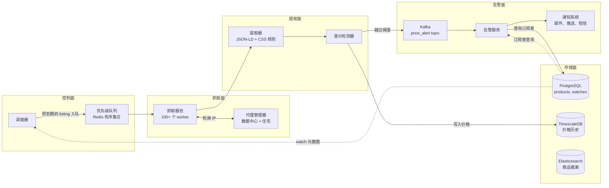
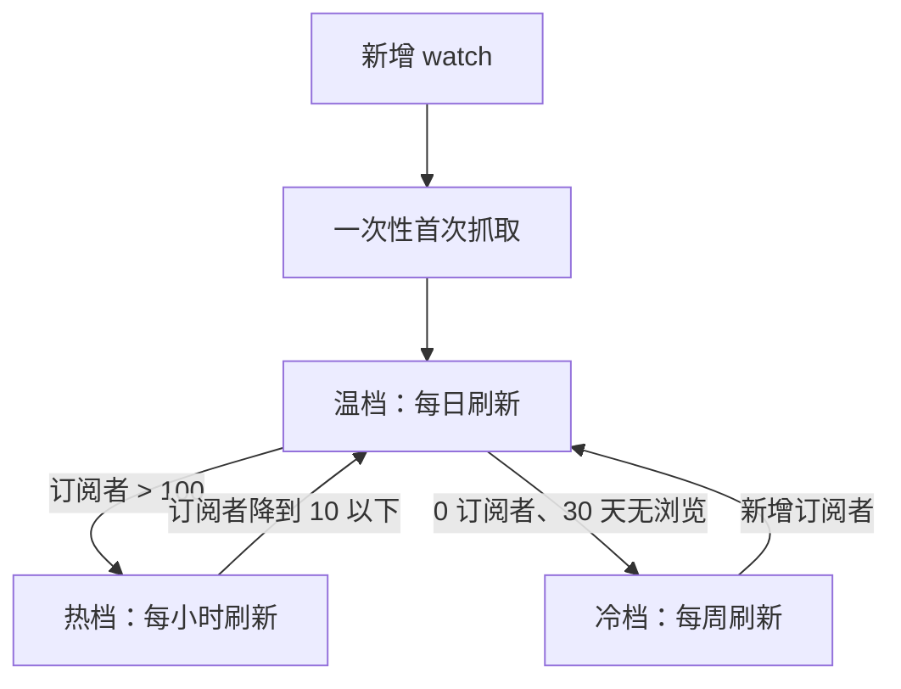
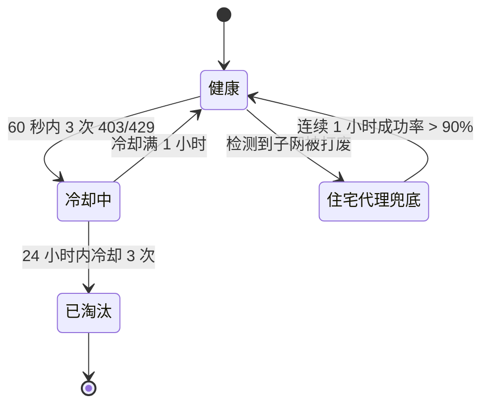
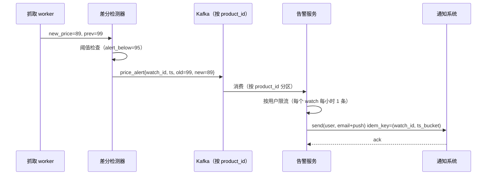

# 设计一个价格追踪服务（CamelCamelCamel / Honey / Keepa）

> **TL;DR.** 价格追踪服务本质上是一个专用网页爬虫：它按优先级调度反复访问 1 亿个商品 URL，把提取到的价格与存储的历史做比对，在价格越过阈值时向 1000 万订阅者扇出告警。真正的难点不在抓页面，而在于礼貌地安排调度（据报道，Amazon 每天有数百万商品调价[^1]）、绕过反爬系统（Cloudflare Bot Management、DataDome）、把真实价格变动与 DOM 噪声区分开，以及在闪购让 5000 万个阈值在几分钟内被触发时吸收告警风暴。核心权衡是：抓取频率、礼貌合规、代理成本三者之间的取舍。

## 学习目标

- 在每家零售商礼貌预算的约束下，为 1 亿个 URL 设计按优先级分桶的抓取调度
- 论证在主动反爬对抗下选择住宅代理还是数据中心代理
- 用金丝雀集合与双提取器确认，把真实价格变动与提取规则漂移区分开
- 为闪购这类突发场景规划告警扇出，包含按用户限流与幂等
- 估算 2 年价格历史在时序压缩下的存储开销
- 识别约束抓取架构的法律边界（hiQ 诉 LinkedIn、欧盟数据库指令）

## 直觉理解

价格追踪服务看起来就是个简单的 CRUD 应用。存一个 URL，每天抓一次，比一下价格，发一封邮件。10 个用户盯 10 个商品时，一个 cron 任务加一张 Postgres 表就够了。

但放到 10 家零售商的 1 亿个商品上，这套做法直接崩掉。光 Amazon 一家，据报道每天就有数百万商品调价[^1]，所以每天抓一次对热门长尾来说已经过时了。Amazon Product Advertising API 给每个账号的初始限额是每秒 1 次请求[^2]（只有按归因的成交额增长才会提到每秒 10 次），一天能覆盖 86,400 个 URL，比 1 亿的商品规模差了三个数量级。“API 允许的”和“追踪服务需要的”之间的缺口，只能靠走轮换代理做 HTML 抓取来填，而这带来了反爬检测、CAPTCHA、法律风险和提取链路的脆弱性。

解开整个设计的洞察是：**抓取本身很简单；调度才是架构。** 不是每个商品都配得上同样的频率。头部 1%（订阅者多的 100 万个 URL）需要每小时检查。中间 80% 每天一次就够。冷门长尾最多每周一次。这个三档优先级模型把总抓取量相比统一每日轮询压低了约 10 倍，同时还能让热门商品对着 Amazon 的持续调价保持新鲜。

一旦你想明白调度器是核心组件，剩下的就顺理成章了：按域名分配令牌桶保证礼貌，轮换代理绕过反爬，双提取器确认做变更检测，分区扇出做告警投递。

## 需求

### 澄清问题

- **问：只做单一零售商（像 CamelCamelCamel 那样只盯 Amazon），还是跨零售商？**
  假设：跨零售商（Amazon、Walmart、Best Buy、Target、eBay）。这会逼出跨商品目录的商品匹配问题。

- **问：告警渠道有哪些？**
  假设：邮件、推送，以及浏览器扩展的悬浮层提示。短信只对付费档开放。下游投递走 [Notification System](./04-notification-system.md)。

- **问：免费档和付费档怎么分？**
  假设：免费档每天检查、只发邮件告警。付费档每小时检查，支持推送和短信。

- **问：怎么处理 MAP 和虚假的“原价”？**
  假设：以我们自己观测到的历史为准，不看零售商宣称的参考价。

- **问：需要渲染 JavaScript 吗？**
  假设：不需要。Schema.org JSON-LD 覆盖了常见路径[^3]。无头渲染只留给边缘情况。

- **问：法律姿态怎么定？**
  假设：只抓公开、免登录的页面。按 RFC 9309 遵守 robots.txt[^4]。不在目标零售商处注册账号。

### 功能需求

- 添加商品 URL 并设置告警阈值（价格低于 X 时通知）
- 按优先级调度抓取商品（每小时、每天、每周三档）
- 检测真实的价格变动并写入时序历史
- 在越过阈值时触发告警，通过邮件、推送或短信投递
- 为每个商品渲染 2 年价格走势图
- 通过 GTIN/UPC 标识符跨零售商匹配同一商品[^5]

### 非功能需求

- **抓取吞吐量：** 总计 1 亿个 URL；稳态约 1,500 次抓取/秒，峰值 5,000 次/秒
- **告警延迟：** 付费档 p99 < 60 秒，免费档 < 5 分钟
- **告警投递：** 99% 落在 SLO 内
- **新鲜度：** 热门商品 < 1 小时，温档 < 24 小时，冷档 < 7 天
- **存储：** 保留 2 年，压缩率 90-98%[^6]
- **可用性：** API 与图表读取 99.9%；抓取集群可容忍单节点故障
- **礼貌性：** 遵守 robots.txt；每个 IP 对每个域名的速率限制为 1 次请求/秒

## 容量估算

| 指标 | 数值 | 推算 |
|--------|------:|------------|
| 商品总数 | 1 亿 | 10 家零售商的商品目录 |
| 热档（每小时） | 100 万 | 按订阅者数量取前 1% |
| 温档（每天） | 8000 万 | 中间 80% |
| 冷档（每周） | 1900 万 | 长尾，0 订阅者 |
| 每日抓取次数 | 约 1.05 亿 | 100 万 × 24 + 8000 万 × 1 + 1900 万 / 7 |
| 峰值抓取 QPS | 约 5,000 | 平均约 1,200/秒的 3 倍 |
| 单条记录存储 | 50 字节 | product_id(8) + ts(8) + price(8) + currency(4) + meta(22) |
| 每日原始历史 | 约 5 GB | 1.05 亿 × 50 B |
| 2 年原始数据 | 约 3.6 TB | 5 GB × 730 |
| 压缩后（95%） | 约 180 GB | TimescaleDB 列式存储[^6] |
| 订阅者 | 1000 万用户 × 5 个 watch | 5000 万行 watch 记录 |
| 每日告警事件 | 约 200 万 | 约 2% 的抓取检测到变化 |
| 闪购峰值 | 5 分钟内 5000 万条事件 | 500 万次阈值触发 × 10 个订阅者 |

关键比例：API 上读:写约为 20:1（图表查看占绝对主导）。告警扇出放大倍数为 10-30 倍（一个 price_alert 变成 N 条用户通知，跨 M 个渠道）。

## API 与数据模型

### API 设计

```http
POST /v1/watches
  Body: { "product_url": "https://...", "alert_below": 299.99, "channels": ["email", "push"] }
  Returns: 201 { "watch_id": "w_abc123", "product_id": "p_xyz" }
  Idempotency-Key: <uuid>

GET /v1/products/{id}/history?range=2y&resolution=1d
  Returns: 200 { "product_id": "p_xyz", "points": [{"ts": "...", "price": 329.00}, ...] }

DELETE /v1/watches/{watch_id}
  Returns: 204

GET /v1/products/search?q=Sony+WH-1000XM5
  Returns: 200 { "results": [{"product_id": "p_xyz", "title": "...", "current_price": 299.99}] }
```

分页使用游标（cursor）令牌。限流沿用 [Rate Limiter](./02-rate-limiter.md) 的模式：免费档 100 次/分钟，付费档 1,000 次/分钟。

### 数据模型

```sql
-- Product catalog (PostgreSQL, sharded by product_id)
table products (
  product_id      uuid PRIMARY KEY,
  canonical_title text,
  gtin            varchar(14),       -- GTIN-13/14 for cross-retailer match
  category        text,
  created_at      timestamp
);

-- Per-retailer listings
table listings (
  listing_id      uuid PRIMARY KEY,
  product_id      uuid REFERENCES products,
  retailer        varchar(32),
  url             text,
  priority_bucket enum('hot','warm','cold'),
  last_scraped_at timestamp,
  rule_version    int
);

-- Price history (TimescaleDB hypertable, partitioned by month)
table price_history (
  listing_id      uuid,
  observed_at     timestamptz,
  price           numeric(10,2),
  currency        char(3),
  availability    varchar(16)
) PARTITION BY RANGE (observed_at);

-- User watches (PostgreSQL)
table watches (
  watch_id        uuid PRIMARY KEY,
  user_id         uuid,
  product_id      uuid,
  alert_below     numeric(10,2),
  channels        text[],
  last_alerted_at timestamp
);
CREATE INDEX idx_watches_product ON watches(product_id);
```

## 高层架构



*端到端的价格追踪链路：调度器把到期的 listing 压入优先级队列，抓取 worker 走轮换代理取回页面，提取器与差分检测器把真实价格变动从噪声里分出来，Kafka 承载的告警扇出把通知送到订阅者手里。*

**写路径**：调度器扫出需要刷新的 listing（依据 `priority_bucket` 和 `last_scraped_at`），按陈旧程度和订阅者数量打分，压进 Redis 有序集合。worker 弹出优先级最高的 listing，从池子里取一个代理，抓取页面，通过 Schema.org JSON-LD（主路径）或按零售商的 CSS 规则（兜底）提取价格，把结果交给差分检测器。价格变了就写入 TimescaleDB，并检查订阅者的阈值。

**告警路径**：一旦越过阈值，差分检测器向 Kafka 发出 `price_alert` 事件（按 `product_id` 分区）。告警服务消费消息，从 PostgreSQL 查出订阅者，施加按用户限流（每个 watch 每小时最多 1 条告警），再把按用户拆分的通知投入 [Notification System](./04-notification-system.md)。

**读路径**：图表请求打到 TimescaleDB 并做降采样（30 天内读原始点，30-365 天读小时桶，1-2 年读日桶）。商品搜索打到 Elasticsearch。

## 深入探讨

### 抓取礼貌性与优先级调度

调度器是核心组件。它必须在三股力量之间取平衡：新鲜度（热门商品需要每小时检查）、礼貌性（每个 IP 对每个域名每秒 1 次请求）、成本（住宅代理约 $5-8/GB，数据中心代理约 $1/GB）。

**三档优先级模型：**



*优先级分桶的升档与降档：商品依据订阅者数量和活跃度在各档之间迁移，既保证热门商品新鲜，又不在长尾上浪费预算。*

热档（100 万个 URL，每天 24 次）消耗 2400 万次抓取/天。温档（8000 万个，每天 1 次）消耗 8000 万次。冷档（1900 万个，每 7 天 1 次）消耗约 270 万次。合计约 1.07 亿次抓取/天，平均约 1,240 次/秒。

**按域名分配令牌桶：**每个（域名, 代理 IP）组合一个令牌桶，速率 1 令牌/秒，突发 5 个令牌。池子里有 1,000 个 IP 时，Amazon 最多看到整个集群每秒 1,000 次请求，且分散在不同的源 IP 上。符合 RFC 9309 意味着每 24 小时抓一次 `/robots.txt`，并遵守 `Disallow` 规则[^4]。

**动态升档：**刚火起来的商品（比如一个在 TikTok 上爆火的数码配件）初始落在温档。当订阅者数量在一小时内越过 100，调度器立即把它升到热档，而不是等夜间重算。这就避免了一个热门商品白白陈旧 23 小时。

### 反爬规避与代理管理

零售商部署 Cloudflare Bot Management[^7]、DataDome[^8]、Akamai Bot Manager、PerimeterX（HUMAN）来给请求分类。Cloudflare 用基于全球请求流训练的 ML 模型[^7]，结合 JA3/JA4 TLS 指纹[^9]，打出 1 到 99 的机器人评分。分数低就说明是自动化流量。

**规避策略（分层）：**

1. **优先用 Schema.org JSON-LD。** 大多数零售商为了 Google Shopping 会在页面里内嵌 `<script type="application/ld+json">`，带着规范的价格数据[^3]。一个带真实 User-Agent 的简单 HTTP GET 往往就够了，因为 JSON-LD 就在初始 HTML 响应里，不需要渲染 JS。

2. **升级时上隐身插件。** 当 JSON-LD 缺失或过期，退回到带 `playwright-stealth` 的无头 Chromium，它会修补 `navigator.webdriver`、`HeadlessChrome` UA 标记和 WebGL 不一致问题[^10]。按 ScrapingAnt 的基准测试，Playwright 隐身对基础反爬系统的规避成功率约 92%[^10]。

3. **最后用住宅代理兜底。** 先上数据中心 IP（便宜，约 $1/GB）。一旦检测到 IP 被打废（同一个 IP 连续 3 次返回 403/429），把这个 IP 冷却 1 小时，并升级到住宅代理。Bright Data 每月提供 195 个国家的 4 亿多个住宅 IP[^11]；Oxylabs 提供 1.75 亿多个[^12]。住宅代理成本约 5-8 倍，但被拦的概率显著更低。



*代理健康状态机：每个 IP 在健康、冷却中、已淘汰三种状态之间流转；子网级别的打废会触发向住宅代理池的升级。*

**成本模型：**每天 1.07 亿次抓取，平均每页 50 KB，总带宽约 5 TB/天。按数据中心 $1/GB 算，就是 $5,000/天。如果有 10% 升级到住宅代理（$5-8/GB），再加 $2,500-4,000/天。代理总成本约 $7,500-9,000/天，即约 $225-270K/月。这就是优先级调度意义所在：对 1 亿个 URL 做统一的每小时轮询，成本要贵 24 倍。

### 变更检测与提取规则漂移

这是那个不显眼的硬问题。零售商改了一次 DOM，CSS 选择器返回 null，流水线把 null 转成 $0，于是每个订阅者都收到“价格降到 $0 了！”的告警。这是价格追踪服务在生产环境里最常见的故障模式。

**双提取器确认：**每次抓取都并行跑两个独立的提取器：

1. Schema.org JSON-LD 解析器（结构化数据，零售商为了 SEO 自己维护）[^3]
2. 按零售商的 CSS/XPath 规则（脆弱，每家每年失效 1-4 次）

只有两个提取器结果一致，或者其中一个返回 null、另一个的变化落在历史区间内（上次观测价格的 50-200%），才确认价格变动。如果两个都返回 null，或者差异离谱，这次抓取就进隔离区等人工复核，而不是给用户发告警。

**金丝雀集合：**每家零售商取 100 个有代表性的 URL 组成样本，每次提取规则发布时都抓一遍，生产环境里每小时抓一遍。任何规则只要返回 null、空值或超出历史区间，就把这个规则版本标记为待回滚。这样能在一次抓取周期内发现漂移，而不是等用户投诉之后。

**图表降采样：**最近 30 天保留原始价格点（按 listing_id + 时间范围查询）。30-365 天用 1 小时桶。1-2 年用 1 天桶。TimescaleDB 的连续聚合（continuous aggregate）自动处理这些，列式数据块上还能拿到 90-98% 的压缩率[^6][^13]。

### 闪购压力下的告警扇出

一次黑五或 Prime Day 促销，可能在 5 分钟内让 500 万个商品降价。按每个 watch 平均 10 个订阅者算，就是 5000 万条用户级告警事件，每条还要展开成 1-3 个渠道的投递（邮件 + 推送 + 短信）。没有背压的话，通知系统会被打满，然后用户开始退订。



*告警扇出时序：差分检测器为每次阈值穿越发出幂等的 price_alert；告警服务先施加按用户限流，再交给通知系统。*

**幂等性：**键是 `(watch_id, crossing_ts)`，粒度到秒级桶。如果同一次穿越被检测到两次（重试、重复抓取），通知系统会去重。

**摘要模式：**在已知的高峰时段（黑五、Prime Day），告警服务切到批量摘要模式：“你有 5 个 watch 刚降价了”，合成一条通知而不是 5 条。这把下游量压掉 5-10 倍。

**背压：**Kafka 按 `product_id` 分区以保证顺序。告警服务的消费者组可以横向扩容。如果消费延迟超过 5 分钟，系统就主动丢负载：丢掉免费档的告警，优先保付费档的投递。

## 真实案例

**Keepa：覆盖 11 个站点的 60 亿+ Amazon 商品。**

Keepa（Keepa GmbH，德国 Kemnath，2011 年成立）是聚焦 Amazon 的最大价格追踪服务，监控 11 个 Amazon 站点（美国、英国、德国、日本、法国、加拿大、意大利、西班牙、印度、墨西哥、巴西）上的 60 亿+ 商品 listing[^14][^15]。Chrome 扩展有 400 万+ 用户，评分 4.7 星[^14]。付费档约 19 欧元/月，含 API 访问和无限追踪[^16]。

Keepa 的架构吃到了一个关键简化：只做 Amazon，意味着 ASIN 就是规范商品标识，跨零售商匹配问题直接消失[^15]。系统还追踪细分的价格（Amazon 自营 vs 第三方新品 vs 二手 vs 仓库货），因为套利卖家——它的主要付费用户——需要这种粒度[^14]。

浏览器扩展用 `contentScripts` 把价格历史图直接注入 Amazon 商品页的 DOM[^14]。这正是 Honey 做优惠券注入的同一套模式[^17]。后端按分层频率轮转 ASIN：热门 SKU（畅销榜、每日特价候选）接近持续抓取；长尾每天或更慢刷新。

因为据报道 Amazon 每天有数百万商品调价[^1]，Keepa 的热档周期必须跟上节奏。PA-API 默认每秒 1 次的初始限额[^2]只能覆盖 86,400 个 URL/天，所以数据获取的大头还是靠 HTML 抓取。据卖家论坛反映，Amazon 的反爬升级会周期性地让 Keepa 的覆盖度下降数小时，不过没有官方复盘。

反面教材是 Honey（PayPal 于 2020 年 1 月以 40 亿美元收购[^18][^19]）。Honey 那个 1700 万用户的浏览器扩展从真实购物者的客户端观测价格，优雅地绕开了反爬[^17]。但它的变现方式——覆盖末次点击的联盟追踪 cookie——引来了 2024 年的集体诉讼（In re PayPal Honey Browser Extension Litigation，N.D. Cal. Case 5:24-cv-09470-BLF）[^20][^21]，Chrome 用户六个月内从 2000 万掉到 1500 万[^22]，Google 又在 2025 年 3 月更新 Chrome Web Store 政策，限制联盟链接操纵[^23]。

## 权衡

| 决策 | 方案 A | 方案 B | 我们的选择 | 理由 |
|----------|----------|----------|------------|-----|
| 轮询调度 | 固定间隔（全部每天 1 次） | 优先级分桶（热/温/冷） | 优先级分桶 | 效率约高 10 倍；让热门 SKU 在每天频繁调价下保持新鲜[^1] |
| 数据获取 | 零售商 API（PA-API） | 走代理做 HTML 抓取 | 混合：有 API 就用，其余抓取 | API 可靠但被限在每秒 1 次[^2]；抓取来填缺口 |
| 告警投递 | 每个事件实时推送 | 批量摘要 | 默认实时，闪购期间切摘要 | 实时就是产品本身；摘要防刷屏风暴 |
| 价格存储 | PostgreSQL + blob | TimescaleDB 超表 | TimescaleDB | 2 年历史能压到 90-98%[^6]；且兼容 SQL |
| 代理组合 | 100% 住宅 | 100% 数据中心 | 先用数据中心，被打废再上住宅 | 住宅成本 5-8 倍[^11]；混合方案在成本与封禁率之间取优 |
| 提取方式 | 只用按零售商的 CSS 规则 | 优先 Schema.org JSON-LD，CSS 兜底 | JSON-LD 为主 + CSS 交叉确认 | JSON-LD 是零售商为 SEO 维护的[^3]；双提取器能抓到漂移 |
| 商品匹配 | 只做标题模糊匹配 | GTIN 硬匹配 + 模糊兜底 | 先 GTIN，模糊兜底 | GTIN 可获取时又快又准[^5]；模糊匹配处理剩下的 |

最大的元决策是：**抓取频率、代理成本、检测延迟三者之间怎么取舍。** Keepa 的解法是只做 Amazon（一个零售商、一套 ID 体系、一个要啃下来的反爬系统）。像我们这样的跨零售商追踪服务，则用更高的代理成本换更广的覆盖。

## 扩展与故障模式

**10 倍规模（10 亿商品）：**优先级队列成为瓶颈。Redis 有序集合单节点约 10 万 ops/秒；10 亿商品加上频繁的分数更新，得横向切到 10 个以上 Redis 实例。TimescaleDB 的分区压完约 1.8 TB，得给图表查询加只读副本。

**100 倍规模（100 亿商品，Keepa 量级）：**代理成本占主导。带宽变成现在的 10 倍，代理开销超过 $3M/月。缓解手段：客户端采价（Honey 模式），让浏览器扩展用户被动贡献价格，把服务端抓取量压掉 50-80%。

**1000 倍规模（全球持续价格情报）：**架构要重写成流式。Flink 实时处理来自 API 源、抓取输出、客户端贡献数据的混合价格事件。调度器则变成“我们已知什么”和“什么已陈旧”之间的流式 join。

**故障模式：**

- **代理池被打废（子网封禁）。** Cloudflare 封掉整个 /24 子网。检测：按子网统计滚动的 5 分钟 403 率。响应：淘汰该子网，升级到住宅代理，如果住宅成功率跌破 70% 就呼叫 on-call。
- **提取规则漂移。** 零售商改了 DOM，CSS 选择器返回 null。检测：金丝雀集合在一个抓取周期内报警。响应：隔离受影响的 listing，回滚规则版本，确认之前先抑制告警。
- **闪购期间 Kafka 消费延迟。** 告警投递超出 SLO。检测：消费延迟 > 5 分钟。响应：丢掉免费档告警，横向扩消费者组，切到摘要模式。

## 常见陷阱

> [!WARNING]
> **对提取失败产生的 $0 价格发告警。** 提取到 null 后被转成 $0，就会给每个订阅者发“降价啦！”的告警。永远要在告警前用历史区间（上次观测价格的 50-200%）校验提取到的价格。跌幅超过 50% 时必须要求双提取器一致。

> [!WARNING]
> **对 1 亿个 URL 做统一轮询。** 一视同仁地对待所有商品，会把 90% 的抓取预算浪费在没人关注的商品上。优先级分桶能砍掉 10 倍成本，同时让真正重要的商品更及时。

> [!WARNING]
> **忽视闪购的扇出放大。** 一个 price_alert 变成 10+ 条用户通知，再变成 30+ 次渠道投递。没有按用户限流（每个 watch 每小时 1 条），黑五就变成一场垃圾信息事故，烧掉用户信任。

> [!WARNING]
> **相信零售商标的“原价”。** 划掉的价格往往是锚定定价，从来就不是真实售价。要以自己观测到的历史为准，不看零售商宣称的参考价[^24]。

> [!WARNING]
> **在目标零售商注册账号来做抓取。** hiQ II 判决之后，抓取公开数据已经落在 CFAA 之外[^25]，但只要你注册账号并同意了禁止自动化访问的条款，基于 ToS 的违约索赔就依然成立。只抓免登录的公开页面。

> [!WARNING]
> **单靠 CSS 选择器做提取。** 零售商每年会改 1-4 次商品页布局。单条 CSS 规则失效时没有任何声音。把 Schema.org JSON-LD 作为主提取器更稳，因为零售商为了合规 Google Shopping 会持续维护它[^3]。

## 追问

**1. 怎么把商户一方提供的 API 与抓取结合起来？**

有 API 就优先用（Amazon PA-API、Walmart Affiliate API、Best Buy Product API）。统一走一层适配器，把响应归一化成同一套 schema。只有当 API 覆盖不足或限额耗尽时才退回抓取。来自 API 的价格直接跳过差分检测器的双提取器校验，因为它们本身就是权威数据。

**2. 如果改成浏览器扩展在客户端采价，架构会有哪些变化？**

扩展的 `contentScript` 在用户正常购物时从 DOM 读取价格并回传后端。这样抓取成本摊到几百万用户身上，还完全绕开了反爬。代价是覆盖度：你只能拿到用户真正访问过的页面，长尾上会出现空洞。要和服务端抓取结合使用以求完整。

**3. 怎么识别虚假的“原价/现价”？**

持续追踪那个“原价”。如果宣称的参考价在追踪服务的观测窗口内从未作为真实售价出现过，就标记为锚定定价。展示“历史最低”时用观测数据，不用零售商的宣称[^24]。

**4. 如果要加价格预测（Hopper 模型），怎么做？**

Hopper 用 70 万亿个数据点和 8 年历史，在机票上做到 95% 的推荐准确率[^26]。放到零售场景，就是按商品在 2 年历史上训练时序预测模型（Prophet、DeepAR），预测“未来 7 天还会再降吗”，并给出“现在买 vs 再等等”的建议。这是一个独立的 ML 服务，消费同一份 TimescaleDB 历史。

**5. 全球零售商的多区域抓取怎么处理？**

Amazon 每个站点（美国、英国、德国、日本）价格都不同。在每个区域部署抓取池，才能看到本地化价格。调度器把每个（商品, 站点）对当成独立的 listing。跨站点比价顺带变成一个功能：“这件商品在 Amazon 日本便宜 50 美元。”

**6. 变现模式是什么，又如何影响架构？**

免费增值（免费档每天检查，付费档每小时）加联盟收入（告警邮件里的 Amazon Associates 链接）。Honey 的官司[^20][^21]说明了激进联盟手法的风险。更安全的模式：联盟关系透明披露，不替换 cookie，只对告警邮件带来的点击计佣。

## 练习

### 练习 1：优先级分桶规划

你的追踪服务有 5000 万个商品。分析显示：50 万个商品的订阅者超过 50 个，4000 万个有 1-10 个订阅者，950 万个零订阅者。请设计优先级分桶并估算每日总抓取量。假设数据中心代理 $1/GB、平均页面 50 KB，代理带宽成本是多少？

<details>
<summary>提示</summary>

把 50 万高订阅商品放进热档（每小时）。4000 万活跃商品放温档（每天）。950 万零订阅商品放冷档（每周）。算出每日总抓取量，乘以页面大小得到带宽，再换算成成本。

</details>

<details>
<summary>解答</summary>

**分桶：**

- 热档（每小时）：50 万 × 24 = 1200 万次抓取/天
- 温档（每天）：4000 万 × 1 = 4000 万次抓取/天
- 冷档（每周）：950 万 / 7 = 136 万次抓取/天
- **合计：约 5336 万次抓取/天**

**带宽：**5336 万 × 50 KB = 2.67 TB/天

**成本：**2,670 GB × $1/GB = $2,670/天 ≈ $80K/月

**与统一每日对比：**5000 万 × 1 次/天 = 5000 万次抓取（和我们的总量差不多），但热档只会得到每天 1 次检查而不是 24 次。优先级分桶在总成本基本相同的前提下，把最受关注商品的新鲜度提升了 24 倍。

**接受的权衡：**冷档每周才检查一次。一个刚添加、零订阅者的商品最多会陈旧 7 天。缓解：watch 创建时做一次性首次抓取，并在第一个订阅者出现时立即升到温档。

</details>

## 要点回顾

- **抓取本身不难；调度才是设计问题。** 优先级分桶（每小时/每天/每周）在成本效率上比统一轮询好约 10 倍，还能让热门商品保持新鲜。
- **双提取器确认能防住 $0 告警灾难。** Schema.org JSON-LD 加 CSS 规则，再配金丝雀集合做漂移检测，能在用户看到之前抓住提取失败。
- **告警扇出必须做按用户限流。** 不做的话，一场闪购就变成一次垃圾信息事故。幂等键 `(watch_id, crossing_ts)` 负责去重重试。
- **代理成本是最大的开销项。** 先用数据中心、被打废再退住宅，能优化那 5-8 倍的成本差。
- **法律边界会塑造架构。** 只抓公开的免登录页面；遵守 RFC 9309；避免注册账号而建立起 ToS 上的合同关系[^25]。

## 延伸阅读

- [RFC 9309: Robots Exclusion Protocol](https://www.rfc-editor.org/rfc/rfc9309)。robots.txt 的规范性标准；每个讲礼貌的爬虫都必须实现它，而且法院越来越倾向于把违规当作恶意的证据。
- [hiQ Labs v. LinkedIn, 31 F.4th 1180 (9th Cir. 2022)](https://cdn.ca9.uscourts.gov/datastore/opinions/2022/04/18/17-16783.pdf)。Van Buren 案之后对“抓取公开数据落在 CFAA 之外”的再次确认；任何抓取架构的法律姿态都得读它。
- [Schema.org Product vocabulary](https://schema.org/Product)。零售商为 Google Shopping 维护的结构化数据标准；对价格追踪服务来说是最省维护的提取信号。
- [Cloudflare Bot Management documentation](https://developers.cloudflare.com/bots/)。从防守方视角解释 ML 评分、JA3/JA4 指纹和已认证机器人白名单；了解你的对手。
- [TimescaleDB compression documentation](https://docs.timescale.com/use-timescale/latest/compression/compression-policy/)。90-98% 的列式压缩，让 2 年价格历史在兼容 PostgreSQL 的基础设施上成为可能。
- [The Verge: Honey scandal timeline](https://www.theverge.com/24343913/paypal-honey-megalag-coupon-scam-affiliate-fees)。2024 年联盟佣金丑闻的时间线梳理，附法院文件链接；变现设计的前车之鉴。
- [OAG Q&A: Hopper Disrupts the OTA Market](https://www.oag.com/blog/hopper-q-and-a)。关于 Hopper 70 万亿数据点和预测架构的一手数字；“预测而不只是追踪”的另一条路。
- [Amazon Product Advertising API rate limits](https://affiliate-program.amazon.com/help/node/topic/GLL6HEVVWUKMQDDQ)。PA-API 每秒 1 次上限与提额规则的权威说明；也是抓取为何必要的论据。

## 记忆卡片

<details>
<summary><strong>问：为什么统一每日抓取对 1 亿商品的价格追踪服务行不通？</strong></summary>

答：据报道 Amazon 每天有数百万商品调价。每天只抓一次会漏掉热门商品的日内变化。优先级分桶（热档每小时、温档每天、冷档每周）在总抓取量大致相同的情况下，把头部 1% 的新鲜度提升了 24 倍。

</details>

<details>
<summary><strong>问：按域名的礼貌预算是多少，怎么强制执行？</strong></summary>

答：每个（域名, 代理 IP）组合一个 1 令牌/秒的令牌桶。池子里有 1,000 个 IP 时，零售商最多看到总共每秒 1,000 次请求，每次来自不同的源 IP。符合 RFC 9309 还要求每 24 小时抓一次 robots.txt。

</details>

<details>
<summary><strong>问：双提取器确认如何避免虚假的 $0 告警？</strong></summary>

答：两个独立的提取器（Schema.org JSON-LD 与按零售商的 CSS 规则）必须对价格变动达成一致。如果其中一个返回 null 或差异离谱，这次抓取就进隔离区，而不是给用户发告警。每家零售商 100 个 URL 的金丝雀集合能在一个抓取周期内发现漂移。

</details>

<details>
<summary><strong>问：告警去重用的幂等键是什么？</strong></summary>

答：`(watch_id, crossing_ts)`，粒度到秒级桶。如果同一次阈值穿越被检测到两次（重试、重复抓取），通知系统用这个复合键去重。

</details>

<details>
<summary><strong>问：为什么先用数据中心代理、再用住宅兜底？</strong></summary>

答：住宅代理每 GB 成本高 5-8 倍，但被拦的概率显著更低。先用数据中心，被打废（连续 3 次 403/429）再升级到住宅，既优化成本又保住成功率。

</details>

<details>
<summary><strong>问：闪购的扇出问题是什么，怎么缓解？</strong></summary>

答：一场闪购可能在 5 分钟内穿过 500 万个阈值，产生 5000 万条用户通知。缓解手段：按用户限流（每个 watch 每小时 1 条）、在已知高峰时段切摘要模式、基于 Kafka 的背压并对免费档丢负载。

</details>

<details>
<summary><strong>问：为什么 Schema.org JSON-LD 是首选的提取信号？</strong></summary>

答：零售商为了合规 Google Shopping 和 SEO 会持续维护它。它机器可读、结构化，而且比 DOM 布局变化得少。按零售商的 CSS 规则每年失效 1-4 次；JSON-LD 是零售商维护的基础设施。

</details>

<details>
<summary><strong>问：hiQ 诉 LinkedIn 之后，价格抓取服务还剩下什么法律风险？</strong></summary>

答：针对公开数据抓取的 CFAA 主张虽然被削弱了，但基于 ToS 的违约主张依然成立。注册账号（意味着要同意 ToS）就建立了合同相对关系。缓解办法：只抓免登录的公开页面，不注册账号。

</details>

<details>
<summary><strong>问：TimescaleDB 如何在价格历史上做到 90-98% 的压缩？</strong></summary>

答：列式 hypercore 把时序数据块从行存转成列存。价格数据压缩效果好，是因为价格很少变（大量连续相同的值），而且 schema 很窄（时间戳 + 价格 + 币种）。连续聚合负责图表查询的降采样。

</details>

<details>
<summary><strong>问：三档优先级模型是什么，升档降档的触发条件有哪些？</strong></summary>

答：热档（每小时，订阅者排名前 1%）、温档（每天，中间 80%）、冷档（每周，零订阅者）。升档：订阅者数越过 100（温→热），或出现第一个订阅者（冷→温）。降档：订阅者降到 10 以下（热→温），或零订阅者且 30 天无浏览（温→冷）。

</details>

## 参考文献

[^1]: Keferboeck. "Dynamic Pricing With AI: A Growth Hacker's Guide." 2026. https://keferboeck.com/en-gb/articles/dynamic-pricing-with-ai-growth-hackers-guide

[^2]: Amazon Associates Central. "Product Advertising API rate limits." https://affiliate-program.amazon.com/help/node/topic/GLL6HEVVWUKMQDDQ

[^3]: Schema.org. "Product." https://schema.org/Product (and Google Merchant Center structured data guide, https://support.google.com/merchants/answer/6386198)

[^4]: Koster, M. et al. "Robots Exclusion Protocol." RFC 9309, September 2022. https://www.rfc-editor.org/rfc/rfc9309

[^5]: Google Merchant Center. "About unique product identifiers." https://support.google.com/merchants/answer/160161

[^6]: Timescale. "Basic compression with hypercore." https://docs.timescale.com/use-timescale/latest/compression/compression-policy/

[^7]: Cloudflare. "Bot detection engines." https://developers.cloudflare.com/bots/concepts/bot-detection-engines/

[^8]: DataDome. "Multi-Layered Machine Learning: A New Requirement for Sophisticated Bot Protection." https://datadome.co/bot-management-protection/multi-layered-machine-learning-a-new-requirement-for-sophisticated-bot-protection/

[^9]: Cloudflare blog. "JA4 fingerprints and inter-request signals." August 2024. https://blog.cloudflare.com/ja4-signals/

[^10]: ScrapingAnt. "Best Web Scraping Detection Avoidance Libraries for Javascript." 2024. https://scrapingant.com/blog/javascript-detection-avoidance-libraries

[^11]: Bright Data. "Residential Proxies." https://brightdata.com/proxy-types/residential-ips

[^12]: Oxylabs. "Residential Proxies." https://oxylabs.io/products/residential-proxy-pool

[^13]: Timescale. "TimescaleDB 2.3: Improving columnar compression for time-series on PostgreSQL." https://www.timescale.com/blog/timescaledb-2-3-improving-columnar-compression-for-time-series-on-postgresql/

[^14]: Keepa GmbH. "Keepa — Amazon Price Tracker" (Chrome Web Store listing and extension overview). https://chromewebstore.google.com/detail/keepa-amazon-price-tracke/neebplgakaahbhdphmkckjjcegoiijjo

[^15]: AmzFinder. "Keepa: Amazon Price Tracker, Features, Pricing & Free Download." https://www.amzfinder.com/tools/keepa/

[^16]: RevenueGeeks. "Keepa Pricing and Plans." 2026. https://revenuegeeks.com/keepa-pricing/

[^17]: Honey help center. "Get to know the Honey browser extension." https://help.joinhoney.com/article/39-what-is-the-honey-extension-and-how-do-i-get-it

[^18]: PRNewswire. "PayPal Completes Acquisition of Honey." January 6, 2020. https://www.prnewswire.com/news-releases/paypal-completes-acquisition-of-honey-300981363.html

[^19]: PayPal Newsroom. "PayPal Completes Acquisition of Honey." January 6, 2020. https://newsroom.apac.paypal-corp.com/2020-01-06-PayPal-Completes-Acquisition-of-Honey

[^20]: PPC Land. "PayPal's Honey faces class action lawsuit over affiliate commission practices." December 31, 2024. https://ppc.land/paypals-honey-faces-class-action-lawsuit-over-affiliate-commission-practices/

[^21]: The Verge. "Honey: all the news about PayPal's alleged scam coupon app." Updated December 2025. https://www.theverge.com/24343913/paypal-honey-megalag-coupon-scam-affiliate-fees

[^22]: 9to5Google. "Honey drops to 15 million users on Chrome, down 5 million in less than six months." May 2025. https://9to5google.com/2025/05/23/honey-15-million-chrome-users-six-months/

[^23]: The Verge. "Google changes Chrome extension policies following the Honey link scandal." March 12, 2025. https://www.theverge.com/news/627940/google-chrome-extensions-paypal-honey-affiliate

[^24]: CamelCamelCamel. "Features." https://camelcamelcamel.com/features

[^25]: Wikipedia and Ninth Circuit opinion. hiQ Labs v. LinkedIn, 31 F.4th 1180 (9th Cir. 2022). https://cdn.ca9.uscourts.gov/datastore/opinions/2022/04/18/17-16783.pdf

[^26]: OAG. "Q&A: Hopper Disrupts the OTA Market With the World's Best Flight Data." June 2022. https://www.oag.com/blog/hopper-q-and-a
