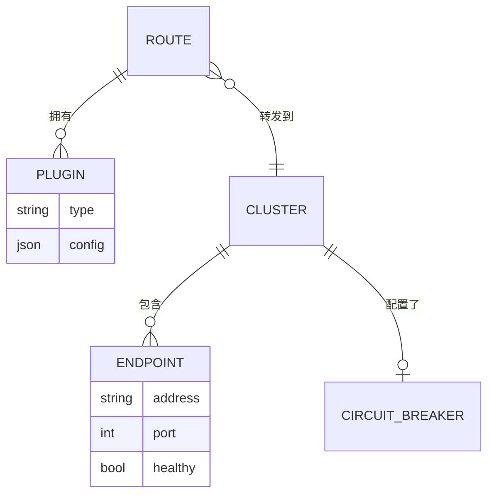
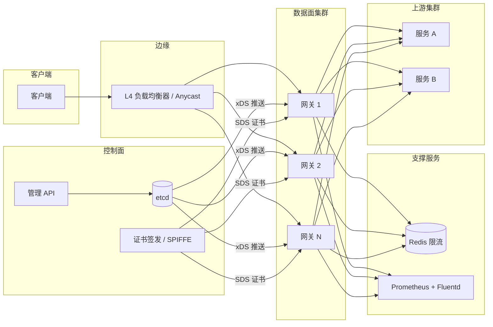
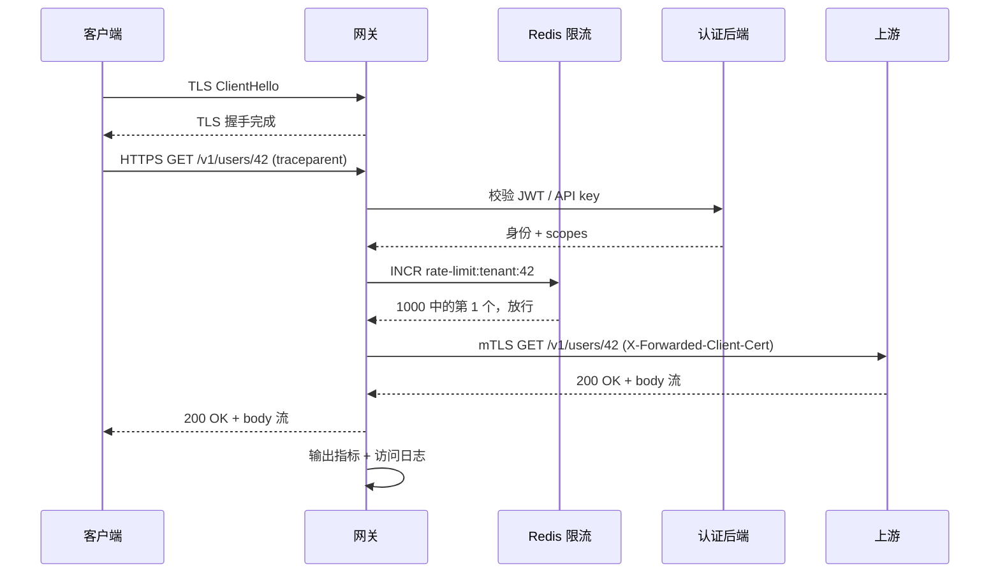
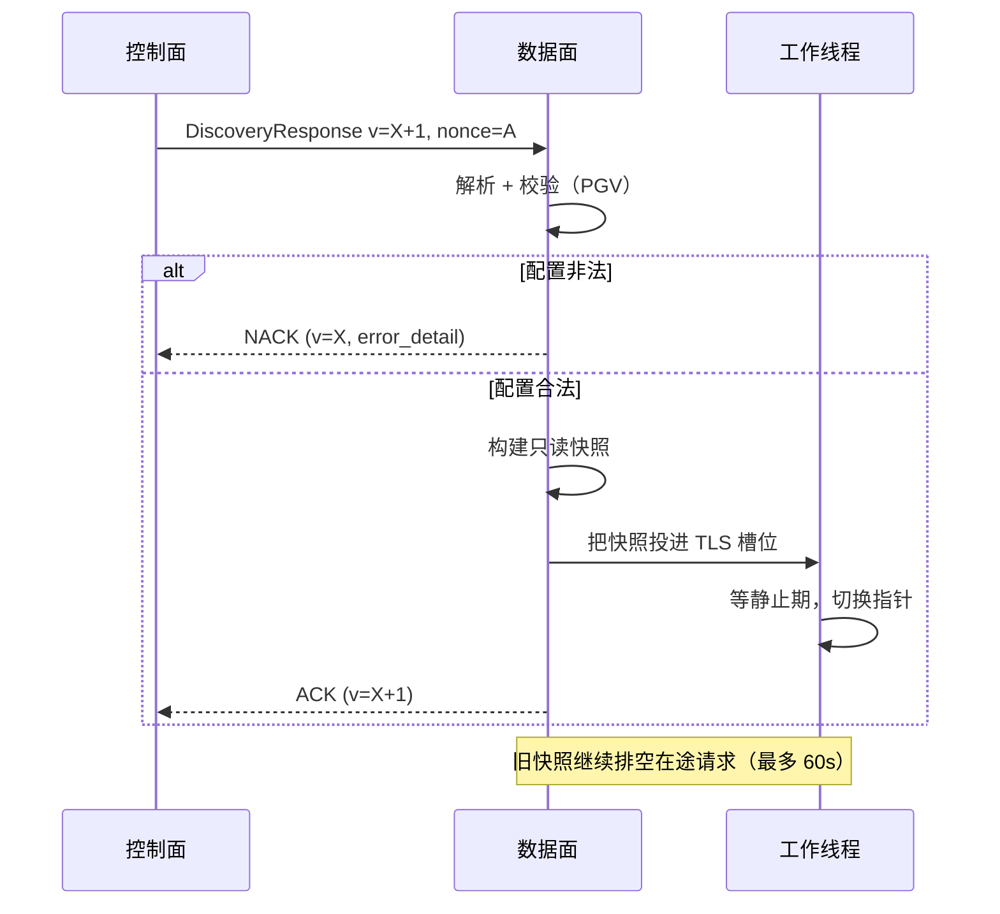
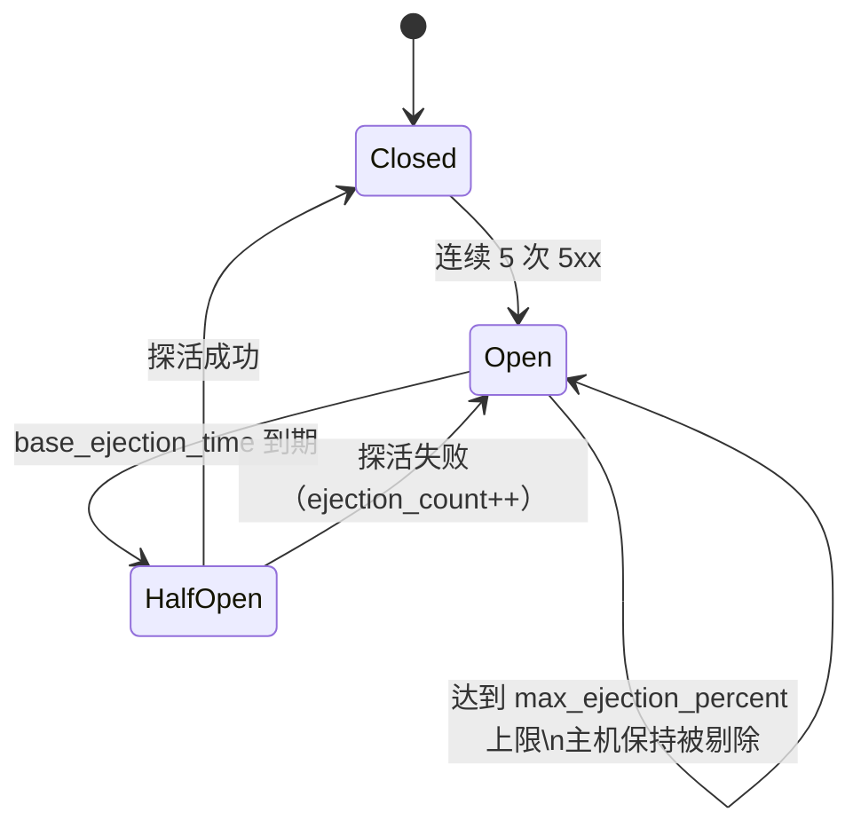

# 设计一个大规模 API 网关（Kong / AWS API Gateway / Apigee / Envoy）

> **TL;DR.** API 网关是所有南北向流量唯一的反向代理收口点。它卸载 TLS、认证调用方、执行限流、匹配路由、对上游做负载均衡、上报遥测，而这一切都要压在 p99 个位数毫秒的低段预算内。Netflix Zuul 2 在 80 个集群上处理每秒 100 万次以上请求[^1]；一台 Maglev 机器就能跑满 10 Gbps 链路[^2]。难的不是代理本身，而是控制面：把配置推送到数千个数据面实例而不丢掉在途请求，同时让热路径保持无锁、无分支。

## 学习目标

- [ ] 设计一个无状态数据面，单实例稳定支撑 10 万 RPS，且额外开销 p99 低于 5 ms
- [ ] 实现基数树（radix tree）路由器，在 O(log N) 时间内匹配 1 万条路由
- [ ] 组合本地按实例与 Redis 支撑的全局限流器，用精度换延迟
- [ ] 用 xDS 的 ACK/NACK 与 RCU 指针交换，设计无损的配置热加载
- [ ] 对每个上游做熔断，防止慢后端引发级联故障
- [ ] 根据部署场景论证网关选型（Envoy vs Kong vs AWS API Gateway vs 边缘 isolate）

## 直觉理解

单机反向代理服务 10 个用户毫无压力：匹配路由、转发、完事。到了单实例 10 万 RPS、1 万条路由、5 ms 延迟预算的量级，问题的形状在三个方面变了。

第一，每个功能都在和热路径预算抢资源。认证、限流、改写、WAF、链路追踪：每个过滤器都要吃 CPU 周期。天真的实现串起六个阻塞调用，第一个请求就把预算打爆。解法是每核一个非阻塞事件循环加线程本地状态，让请求路径实际上无锁[^3][^4]。

第二，配置变更既高频又要命。在微服务环境里，路由每分钟都要改很多次。一份坏配置能吞掉全部流量。你需要带版本、带确认的配置分发：数据面可以 NACK 一次坏推送，继续按最后已知良好（last-known-good）的快照服务[^5]。

第三，网关在设计上就是单点故障。每一个南北向请求都要穿过它。一个慢后端占满事件循环，整扇前门就塌了。熔断不是可选项，它是后端挂掉时让网关活下来的机制。

打通整个设计的关键洞察只有一句：把控制面（配置编译、证书轮转、指标聚合）和数据面（接受、过滤、转发、流式回传）分开。数据面是根又笨又快的管子，控制面是个又慢又聪明的大脑。两者用带版本的协议（xDS）通信，控制面挂了，数据面靠最后已知良好的配置继续活着。

## 需求

### 澄清问题

- **问：是入口（南北向）网关还是网格（东西向）网关？**
  假设：南北向入口。同样的原语也适用于网格 sidecar，只是信任边界不同。
- **问：哪些功能在范围内？**
  假设：全部核心职责：路由、认证（JWT/OAuth2/mTLS）、限流、TLS 卸载、熔断、请求改写，以及可观测性。
- **问：控制面配置传播的 SLA 是多少？**
  假设：配置变更在 10 秒内对所有数据面实例可见，传播期间不丢请求。
- **问：控制面故障时失效开放还是失效关闭？**
  假设：失效开放。数据面靠最后已知良好的配置无限期继续服务。
- **问：插件/扩展模型是什么？**
  假设：原生 C++ 过滤器（Envoy）、Lua 插件（Kong/OpenResty），或用 WebAssembly 做可移植扩展。
- **问：多区域吗？**
  假设：是。各区域独立的数据面集群加一个全局控制面，每个区域能独立存活。

### 功能性需求

- 按路径前缀、方法、host 和请求头，把请求路由到命名的上游集群
- 通过 JWT 校验、API key 查表、OAuth2 introspection 或 mTLS 客户端证书完成认证
- 按 API key、IP、用户或租户限流，突发额度与稳态速率均可配置
- 上游故障时熔断（连续 5xx、超时，或错误率阈值）
- 改写请求/响应头与消息体（增、删、重写）
- 输出按路由的指标（Prometheus）、访问日志（Fluentd/Vector），并传播 W3C Trace Context[^6]

### 非功能性需求

- **吞吐量：** 单实例 10 万 RPS；单区域横向扩到几十个实例
- **延迟：** 相比直连服务，p99 额外开销低于 5 ms
- **可用性：** 读/转发路径 99.99%
- **配置热加载：** 配置传播期间零丢请求
- **路由规模：** 1 万条路由，匹配时间 O(log N)
- **可观测性：** 100% 追踪传播；span 记录用头部采样

## 容量估算

| 指标 | 数值 | 推导 |
|--------|------:|------------|
| 在途请求 | 5,000 | 100K RPS × 50 ms 平均上游延迟 |
| 配置大小 | 10 MB | 10K 条路由 × 每条 1 KB |
| 指标出口流量 | 50 MB/s | 100K RPS × 50 字节 × 每个网关 10 个标签 |
| 访问日志 | 50 MB/s | 100K RPS × 每条 500 字节 |
| TLS 握手/秒 | 1,000 | 100K RPS 下 1% 的新连接率 |
| 上游连接数（16 核、800 台主机） | 12,800 | 16 个事件循环 × 800 台源站主机[^7] |

- **读写比：** 网关是直通管道；每个请求既是“读”（路由匹配）也是“写”（转发上游）。默认不缓存。
- **CPU 预算：** TLS 卸载与 JSON 消息体解析占大头。5 万 RPS 以上，会话复用和 HTTP/2 多路复用是硬要求。
- **内存：** 路由表（编译后 10 MB）、连接池（每连接约 1 KB × 12,800 = 12.8 MB），加上过滤器状态。单实例总计低于 256 MB。

## API 与数据模型

### API 设计

```http
# 管理 API（控制面）
POST /v1/routes
  Body: { "path": "/api/users/*", "methods": ["GET","POST"],
          "upstream": "user-service", "plugins": ["jwt-auth","rate-limit"] }
  Returns: 201 { "id": "rt_abc", "version": 42 }

PUT /v1/config
  Body: <full config bundle, versioned>
  Returns: 200 { "version": 43, "applied_to": 12, "pending": 3 }

# 数据面（代理端口本身）
GET /health   -> 200 OK
GET /ready    -> 200 OK (after warmup)
GET /metrics  -> Prometheus text format

# 被代理响应上的限流头
X-RateLimit-Limit: 1000
X-RateLimit-Remaining: 847
X-RateLimit-Reset: 1714838400
```

### 数据模型

```sql
-- 控制面（etcd 或 PostgreSQL）
routes     (route_id, path_pattern, methods[], upstream_cluster, plugins[], priority, version)
clusters   (cluster_id, endpoints[], lb_policy, health_check_config, circuit_breaker_config)
plugins    (plugin_id, route_id, type ENUM, config_json, enabled)

-- 数据面（内存中，只读快照）
route_table    -> compiled radix tree, swapped atomically via RCU
cluster_state  -> endpoint list + health bits, updated via EDS

-- 限流后端（Redis Cluster）
rate:{tenant}:{window}  -> token bucket counter (EVAL Lua script)
```



*路由通过插件绑定到上游集群；每个集群独立跟踪端点健康状态与熔断器状态。*

## 高层架构



*控制面编译配置并把带版本的配置推送给无状态的数据面集群；每个实例卸载 TLS、跑过滤器链、转发到上游集群，同时异步输出指标。*

**写路径（配置）。** 运维把一次路由变更推给管理 API。控制面持久化到 etcd，编译出新的路由表，再通过 xDS 把 `DiscoveryResponse` 推给所有数据面实例。每个实例校验、ACK，然后原子地换表。

**请求路径。** 客户端连到 L4 负载均衡器（anycast VIP）。被选中的网关实例卸载 TLS，跑过滤器链（认证、限流、改写），在编译好的基数树里匹配路由，用 P2C 或 Maglev 选一个上游端点并转发。响应直接流式回传。

**异步路径。** 访问日志流式送往 Fluentd/Vector，不阻塞事件循环。Prometheus 每 15 秒抓一次 `/metrics`。请求路径上，网关从不做同步落盘。



*每个请求都要走完过滤器链（TLS、认证、限流、路由、上游）才流式回传；任何一步失败都会短路成错误响应。*

## 深入探讨

### 在 1 万条路由下做到 O(log N) 匹配

线性正则扫描是每请求 O(N)。1 万条路由、10 万 RPS，就是每秒 10 亿次正则求值。认证还没开始跑，预算就烧光了。

Envoy 把通过 RDS 下发的路由表编译成内存中的匹配器：最长前缀路径匹配、请求头谓词、优先级决胜[^8][^4]。路由更新时靠 RCU 风格的线程本地指针翻转原子换表，工作线程无需加锁就能看到一致的快照[^4]。Kubernetes Gateway API 把这个数据模型标准化了：`GatewayClass`（控制器契约）、`Gateway`（监听器、TLS），以及 `HTTPRoute`/`GRPCRoute`/`TLSRoute`（由应用开发者拥有的路由规则）[^9]。

**为什么正则路由很危险。** 表里只要有一条 `/.*` 正则，就会废掉前缀树优化，退化成线性扫描[^8]。正则只用在校验捕获片段上，其余一律用前缀加请求头匹配器。

**增量更新。** 全量（state-of-the-world，SotW）xDS 在任何一处改动时都重发全部 N 条路由，集群数过几千就是一个可扩展性悬崖。增量 xDS 只发变更的资源，状态由客户端自己维护[^5]。这决定了 1 万集群的网格是能跑起来，还是控制面直接融化。



*数据面校验每一次配置推送，坏配置回 NACK；合法配置通过 RCU 指针翻转生效，在途请求在旧快照上排空。*

### 本地加分布式限流

两层限流器：本地按实例计数（纳秒级开销，集群内会有漂移），加上 Redis 支撑的全局计数（约 10 ms 开销，全局精确）[^10]。

AWS API Gateway 在四个层面套用令牌桶：AWS 区域级、按账号（默认稳态 1 万 RPS、突发 5,000）、按 stage/method、按客户端/API key[^11][^12][^10]。最具体的限额优先。超限时返回 HTTP 429[^13]。

**本地层。** 每个网关实例为每条路由、每个 key 维护线程本地的令牌桶。10 万 RPS 下，99% 的请求离配额还远，几纳秒就放行，不用任何网络跳转。只有接近边界的请求才去问全局层。

**全局层。** 一段 Redis Lua 脚本原子地扣减令牌并返回剩余量。同机房 Redis 往返大约加 0.5 ms。连这点开销都嫌多的热路径，团队会跳过全局检查，接受一定漂移。

**层级倒挂的陷阱。** 宽松的按方法限额不会覆盖账号上限。忘了设按客户端限额，一个 API key 就能烧光整个账号的突发额度[^10]。永远保证 按客户端 < 按 stage < 按账号 < 区域级。

### 按上游熔断与异常点检测

一个占满网关事件循环的慢后端，比配额被击穿更常导致故障。熔断能防止单个坏上游把整扇前门拖垮。

Envoy 的异常点检测（outlier detection）实现四种检测器：连续 5xx、连续网关失败（502/503/504）、成功率、失败百分比[^14]。被剔除的主机要停 `base_ejection_time * ejection_count` 这么久，上限是 `max_ejection_time`，计时结束后重新入场。`max_ejection_percent`（通常 10%）封顶，防止关联性故障时熔断器把整个集群都踢掉[^14]。



*熔断器在连续失败时从关闭（健康）转为打开（剔除）；半开状态先探活，通过后才重新放主机入场。*

```yaml
# Envoy 异常点检测配置
outlier_detection:
  consecutive_5xx: 5
  base_ejection_time: 30s
  max_ejection_time: 300s
  max_ejection_percent: 10
  interval: 10s
```

**与重试的相互作用。** 无界重试会把负载放大到正在故障的服务上。Netflix 观察到，故障期间网关重试叠加客户端重试造成了显著的流量放大（常见 2-4 倍）[^7]。解法：自适应重试预算（例如重试配额上限为成功请求的 10%）、指数退避，以及对持续错误熔断[^1][^14]。

**mTLS 上游上的连接爆炸。** 每个事件循环都向每台上游实例开自己的连接池。一台 16 核网关面对 800 台源站主机，单实例就是 12,800 条连接，100 个实例的集群就是 128 万条[^7]。Netflix 用 HTTP/2 多路复用加确定性子集化（Ringsteady/van der Corput 序列）解决了这个问题：峰值连接数降 10 倍，单个分片上少了 1300 万条连接[^7]。

### 无损配置热加载

应用新配置而不丢在途请求，是数据面必须履行的契约，不是加分项。

**NGINX 的做法。** SIGHUP 用新配置 fork 出新的 worker，让旧 worker 停止接受新连接并慢慢排空。在途请求在旧 worker 上跑完[^15]。风险在于：没有空闲超时的流式连接（WebSocket、SSE）可能活过 worker 关闭的截止时间，被直接杀掉。

**Envoy 的做法。** 带 ACK/NACK 语义的 xDS：管理面推送带版本的 `DiscoveryResponse`，数据面校验后 ACK 或 NACK，路由通过线程本地存储的 RCU 换掉[^5][^4]。工作线程在一个事件循环的静止期内就能看到一致快照。坏配置永远落不了地，因为 NACK 机制在它生效前就拦住了。

**Kong 混合模式。** 控制面（DB 支撑）发布配置；数据面把最后已知良好的配置放在内存里，控制面离线也照常服务[^16]。这样控制面故障时数据面能存活，单个数据面节点被攻破时爆炸半径更小，还能按区域划分数据面组，不必每个区域一套数据库。

## 真实案例

### Netflix Zuul 2：80 个集群上每秒 100 万次以上请求

Netflix Zuul 2 是承载 Netflix 全部流媒体流量的生产网关：每秒超过 100 万次请求，跨 80 多个集群，路由到约 100 个后端服务集群[^1]。

**架构。** Zuul 2 跑在 Netty 上，每核一个非阻塞事件循环。每个事件循环一个连接池，让整个请求-响应周期留在同一个线程上，避免上下文切换[^1][^7]。过滤器分三个阶段：pre-proxy（入站）、endpoint（路由或静态）、post-response（出站）。过滤逻辑是可动态加载的 Groovy 或 Java，因此服务团队能在运行时推送路由规则做自助路由，无需发布[^1]。

**负载均衡。** Zuul 用二选一（P2C）加实例健康度与利用率信号。源站会发出 `utilization` 头，Zuul 把它算进选择评分[^1]。

**mTLS 连接危机。** Netflix 启用上游 mTLS 后，连接数爆炸。子集化之前：单个 800 台主机的源站，每个 Zuul 实例就有 12,800 条上游连接；100 个实例的集群就是 128 万条[^7]。解法是 Google 的 Ringsteady 子集化算法（van der Corput 序列），按事件循环而不是按实例应用。结果：峰值连接数降 10 倍，单个分片少 1300 万条连接，单实例的连接抖动从每秒数千条新连接降到约 60 条[^7]。

**关键教训。** “连接是免费的”这个说法在规模上不成立。光靠 HTTP/2 多路复用没用，因为源站集群太大，稳态下连接复用根本起不来。真正的解法是确定性子集化。

## 权衡

| 网关 | 优势 | 劣势 | 适用场景 |
|---------|-----------|------------|-------------|
| Envoy | CNCF 标准、L3-L7、每核一线程无锁、xDS 天生适配网格、Delta xDS 支撑 1 万以上集群 | YAML 配置复杂；学习曲线陡 | 云原生、服务网格、10 万 RPS 以上[^8][^4] |
| Kong | 插件丰富、管理 UI、混合模式、兼容 OpenResty | 基于 NGINX/Lua 的老架构；传统模式每个数据面一套 DB | 需要插件市场的 SaaS[^17][^16] |
| AWS API Gateway | 全托管、与 Lambda 集成、四层限速、有免费额度 | 厂商锁定；默认 1 万 RPS 限速（软限制，可申请提高）；REST API 每月 150 亿请求约 $36K/月[^18] | AWS 原生无服务器、运维人手少的团队[^11] |
| NGINX + Lua | 成熟、久经考验、快；SIGHUP 重载机制清楚 | 不是网格原生；重载可能掐断长连接[^15] | 自建本地部署、已有 NGINX 经验 |
| Cloudflare Workers | V8 isolate、冷启动约 5 ms、基线约 3 MB[^19]、全球 330+ 城市[^20] | 只支持 JS/TS/WASM；长时计算受限 | 边缘路由、WAF、A/B、边缘认证 |
| Fastly Compute | WASM/Wasmtime、边缘执行亚毫秒、不限语言[^21] | 生态较小；背 VCL 的历史包袱 | Rust/Go/C++ 的低延迟边缘逻辑 |
| Traefik | K8s ingress 上手快、自动发现、支持 Gateway API[^9] | 复杂路由上不够成熟 | 中小规模集群的 K8s ingress |

最大的一个元决策是**自建还是采购**。AWS 自己的定价示例显示，每月 150 亿请求的负载跑在 AWS API Gateway REST 上，光请求费就约 $36,353/月（还没算数据传输和缓存）[^18]。每天 100 亿请求（每月 3000 亿）按同样的阶梯价会超过 $70 万/月。到这个量级，自建一套 Envoy 集群几周就回本。每月 1 亿请求以下，托管方案在运维成本上更划算。

## 扩展与故障模式

- **10 倍（100 万 RPS）：** 单实例 Redis 做限流会被打满。缓解：把限流键分片到 Redis Cluster；用本地层拦掉 99% 的流量。
- **100 倍（1000 万 RPS）：** 全量 xDS 配置推送会把控制面压融。缓解：用 Delta xDS 做增量更新；加区域级控制面缓存[^5]。
- **1000 倍（1 亿 RPS）：** 网关集群本身成了成本中心。缓解：把认证和限流推到边缘（Cloudflare Workers、Fastly Compute），网关退化成薄薄一层路由。

**故障模式：**

- **控制面故障：** 数据面靠最后已知良好的配置继续服务，新的路由变更排队等恢复。只要故障时长在配置陈旧度 SLA 以内，用户无感[^16]。
- **上游变慢（p99 > 5s）：** 熔断器在连续 5 次 5xx 后剔除该主机，其余健康主机吸收流量。如果整个集群都慢，熔断器把剔除比例压在 10% 以内，避免全面黑屏[^14]。
- **Redis 限流分区：** 网关失效开放（放行请求）。吵闹的租户可能超配额 5-30 秒。告警触发，月度对账补齐差额。
- **坏配置推送：** 数据面 NACK 掉非法配置，继续跑上一个版本。控制面把 NACK 连同 `error_detail` 记进日志供运维排查[^5]。

## 常见陷阱

> [!WARNING]
> **全量 xDS 爆炸。** 一个集群的改动迫使把全部 N 个集群重发给全部 M 个数据面实例。M × N 一大，xDS 流就被打满。CDS/EDS/LDS 用 Delta xDS[^5]。

> [!WARNING]
> **mTLS 上的连接爆炸。** 每个事件循环都向每台上游主机开自己的连接池。16 核网关 × 800 台源站 = 每实例 12,800 条连接。用 HTTP/2 多路复用加确定性子集化[^7]。

> [!WARNING]
> **会掐断连接的无损重载。** NGINX SIGHUP 会杀掉活过 worker 关闭截止时间的 WebSocket/SSE 连接。把 `worker_shutdown_timeout` 设得宽松些，或者用 Envoy 的热重启加显式排空期[^15]。

> [!WARNING]
> **无界重试放大故障。** 网关重试 + 客户端重试 = 打到故障后端的 4 倍流量。把重试预算封在成功请求的 10%，配指数退避[^1][^7]。

> [!WARNING]
> **限流层级倒挂。** 宽松的按方法限额不会覆盖账号上限。一个没设按客户端限额的 API key 能烧光整个账号的突发额度。永远保证 按客户端 < 按 stage < 按账号[^10]。

> [!WARNING]
> **通配正则路由。** 一条 `/.*` 正则就能废掉前缀树优化，退化成 O(N) 线性扫描。正则只用在具体的捕获片段上，优先用前缀匹配器[^8]。

## 追问

**1. 如何为幂等 GET 实现网关级缓存？**

按 `(route, path, query_params, Vary headers)` 缓存响应，放在带 TTL 的本地 LRU 里。缓存未命中时用 stale-while-revalidate 回源。这样网关就成了热读的类 CDN 边缘缓存，不必再单独搭一层 CDN。

**2. 怎么做金丝雀路由（10% 流量打到新版本上游）？**

在路由表里做加权分流。Envoy 原生支持 `weighted_clusters`。按稳定键（用户 ID、会话）哈希，做会话保持式的金丝雀分配。盯金丝雀集群的错误率，超过基线 2 倍就自动回滚。

**3. 怎么防止一个乱来的客户端吃掉网关的所有连接？**

在监听器层做按客户端的连接上限。Envoy 的 `connection_limit` 过滤器限制每个下游 IP 的并发连接数。再叠加按客户端的限流，把连接数和请求速率一起框住。

**4. 怎么支持 gRPC 流式穿过网关？**

gRPC 跑在 HTTP/2 上。网关不能缓冲请求或响应体，gRPC 路由要关掉消息体检查插件。流控通过 HTTP/2 的 WINDOW_UPDATE 帧端到端传播。超时从按请求变成按流，并配合空闲检测。

**5. 怎么做到零停机从一种网关技术迁移到另一种？**

两套网关并行挂在 L4 负载均衡器后面。按权重（1%、10%、50%、100%）在几天里逐步切流量。对比新旧两侧的访问日志，确认行为一致。要回滚就把权重拨回去，瞬间完成。

**6. 多租户网关要给每个租户单独的可观测性，要改什么？**

给每条指标和日志打上 `tenant_id` 标签。用 Prometheus relabeling 把租户指标路由到各自的看板。把长尾租户聚合成一个“other”桶，压住标签基数。完整模式见 [设计多租户 SaaS 平台](./42-multi-tenant-saas.md)。

## 练习

### 练习 1：为限流 Redis 集群做容量规划

你的网关集群有 20 个实例，每个处理 5 万 RPS。限流按 API key，稳态限额 1,000 RPS。有 1 万个活跃 API key。每次限流检查是一次 Redis EVAL（Lua 脚本）。最坏情况下全局层每秒要处理多少次 Redis 操作？假设单个分片每秒 10 万次操作，Redis 集群至少要多大规模？

<details>
<summary>提示</summary>

不是每个请求都会打到全局层。本地层会拦掉明显超额的请求。假设 5% 的请求接近边界、需要全局校验。先算全局层的总操作数，再除以单分片容量。

</details>

<details>
<summary>解答</summary>

网关总 RPS：20 个实例 × 5 万 = 100 万 RPS。若 5% 打到全局层：每秒 5 万次操作到 Redis。按单分片每秒 10 万次操作，一个分片就够，还有 50% 余量。但为了可用性，你至少要 3 个分片（1 主 + 2 副本），或者一个 3 节点 Redis Cluster。如果流量高峰时边界比例升到 20%（每秒 20 万次操作），最少需要 2 个主分片。按高峰来规划：3 分片 Redis Cluster 加只读副本，容量和容错都够。本地层才是关键优化：没有它，每秒 100 万次操作打到 Redis，需要 10 个以上分片，基础设施成本会被它主导。

</details>

## 要点回顾

- **网关是一份预算，不是功能清单。** 每个过滤器都在抢同一份 5 ms p99。先量再加。
- **把控制面和数据面分开。** 数据面是根又笨又快的管子，靠最后已知良好的配置在控制面故障时存活。
- **路由是编译好的基数树，不是正则循环。** 1 万条路由需要 O(log N) 匹配；一条通配正则就能废掉这个优化。
- **本地限流在纳秒级吸收 99% 的拒绝。** 只有边界情况才付 Redis 往返的代价。
- **熔断要果断。** 一个占满事件循环的慢后端，比配额被击穿更常导致故障。
- **连接在规模上不免费。** HTTP/2 多路复用加确定性子集化，解决了 Netflix 那 128 万条连接的爆炸。

## 延伸阅读

- [Envoy 线程模型（Matt Klein，2017）](https://web.archive.org/web/20201012074707/https://blog.envoyproxy.io/envoy-threading-model-a8d44b922310)。主线程/worker/文件刷盘线程以及线程本地 RCU 的权威描述，正是它们让无锁数据面成为可能。
- [Envoy xDS REST 与 gRPC 协议](https://www.envoyproxy.io/docs/envoy/latest/api-docs/xds_protocol)。ACK/NACK、SotW 与 Delta、ADS、warming 语义的权威参考。
- [抑制 Zuul 中的连接抖动（Netflix，2023）](https://netflixtechblog.com/curbing-connection-churn-in-zuul-2feb273a3598)。mTLS 加子集化的案例，展示 100 万 RPS 以上把连接数降 10 倍。
- [开源 Zuul 2（Netflix，2018）](https://netflixtechblog.com/open-sourcing-zuul-2-82ea476cb2b3)。生产网关架构：自适应重试、自助路由、P2C 负载均衡。
- [Kubernetes Gateway API 概览](https://web.archive.org/web/20260430174811/https://gateway-api.sigs.k8s.io/concepts/api-overview/)。GatewayClass/Gateway/Route 的角色模型，以恰当的关注点分离取代 Ingress。
- [Maglev：快速可靠的软件网络负载均衡器（NSDI 2016）](https://www.usenix.org/conference/nsdi16/technical-sessions/presentation/eisenbud)。在商用硬件上以 10 Gbps 做一致性哈希；Envoy Maglev 负载均衡的源头。
- [W3C Trace Context 推荐标准](https://www.w3.org/TR/trace-context/)。每个网关都必须正确传播的 `traceparent` 与 `tracestate` 格式。
- [没有容器的云计算（Cloudflare，2018）](https://blog.cloudflare.com/cloud-computing-without-containers/)。V8 isolate 的冷启动与内存数字，让边缘网关以约 5 ms 启动、约 3 MB 基线变得可行。

## 记忆卡片

<details>
<summary><strong>问：API 网关过滤器链的典型 p99 延迟预算是多少？</strong></summary>

答：个位数毫秒的低段，通常低于 5 ms。每个过滤器（认证、限流、改写、WAF）都在抢这份预算。数据面靠每核一个非阻塞事件循环加线程本地状态做到这一点。

</details>

<details>
<summary><strong>问：Envoy 如何在 worker 线程上做到无锁配置更新？</strong></summary>

答：RCU（Read-Copy-Update）风格的线程本地指针翻转。主线程构建新的只读快照，投递到每个 worker 的线程本地存储槽位；worker 在下一个静止期切到新指针，全程不加锁。

</details>

<details>
<summary><strong>问：SotW 与 Delta xDS 的区别是什么？</strong></summary>

答：全量（SotW）在任一处变更时重发全部 N 个资源。Delta xDS 只发变更的资源加一个版本，客户端自己维护状态。集群数过几千就必须用 Delta，否则控制面会被压融。

</details>

<details>
<summary><strong>问：两层限流器怎么工作？</strong></summary>

答：本地按实例的令牌桶在纳秒级处理 99% 的请求（没有网络跳转）。只有接近配额边界的请求才去问 Redis 支撑的全局计数器（约 0.5-10 ms），换取跨实例的准确性。

</details>

<details>
<summary><strong>问：Netflix 那 128 万条连接的爆炸是怎么来的，又是怎么解决的？</strong></summary>

答：16 个事件循环各自向每台上游主机开一个连接池。800 台源站 × 100 个 Zuul 实例 = 128 万条连接。解法：HTTP/2 多路复用加 Ringsteady 确定性子集化，让每个事件循环只跟一部分源站说话。

</details>

<details>
<summary><strong>问：Envoy 的异常点检测为什么用 max_ejection_percent 封顶？</strong></summary>

答：防止关联性故障时熔断器把整个集群都剔除。通常封在 10%，这样即使错误大面积发生，也保证至少 90% 的主机留在轮转里。

</details>

<details>
<summary><strong>问：Envoy 数据面通过 xDS 收到非法配置会发生什么？</strong></summary>

答：它回一个 NACK：发出携带上一个良好 `version_info` 和填好的 `error_detail` 字段的 DiscoveryRequest。非法配置永不生效，数据面继续按最后已知良好的快照服务。

</details>

<details>
<summary><strong>问：W3C traceparent 头的格式是什么？</strong></summary>

答：55 个字符的定长头：`version (2 hex)-trace-id (32 hex)-parent-id (16 hex)-trace-flags (2 hex)`。网关必须同时传播 traceparent 和 tracestate，转发时可以改写 parent-id。

</details>

<details>
<summary><strong>问：AWS API Gateway 的 REST 定价为什么在规模上成问题？</strong></summary>

答：REST API 的阶梯价从每百万请求 $3.50 起（前 3.33 亿/月），接着每百万 $2.80（后 6.67 亿），超过 10 亿后每百万 $2.38。AWS 自己的定价示例显示每月 150 亿请求 = 请求费 $36,353/月（不含数据传输）。每天 100 亿请求（每月 3000 亿）按这些价格会超过 $70 万/月。到这个量级，自建 Envoy 集群几周就回本。

</details>

<details>
<summary><strong>问：Kong 混合模式怎么在控制面故障时存活？</strong></summary>

答：数据面把最后已知良好的配置放在内存里，无限期继续服务流量，运行时不需要数据库连接。新的配置变更排队等控制面恢复。

</details>

<details>
<summary><strong>问：Kubernetes Gateway API 相比 Ingress 的关键改进是什么？</strong></summary>

答：按角色拆分关注点：GatewayClass（基础设施提供商）、Gateway（集群运维配置监听器/TLS）、HTTPRoute/GRPCRoute（应用开发者拥有路由规则）。Ingress 把三种角色压在一个资源里。

</details>

## 参考文献

[^1]: Netflix TechBlog, "Open Sourcing Zuul 2", May 2018. https://netflixtechblog.com/open-sourcing-zuul-2-82ea476cb2b3

[^2]: Eisenbud et al., "Maglev: A Fast and Reliable Software Network Load Balancer", USENIX NSDI 2016. https://www.usenix.org/conference/nsdi16/technical-sessions/presentation/eisenbud

[^3]: Envoy Proxy project, "Performance". https://www.envoyproxy.io/docs/envoy/latest/operations/performance

[^4]: Matt Klein, "Envoy threading model", Envoy Proxy Blog, 2017. https://web.archive.org/web/20201012074707/https://blog.envoyproxy.io/envoy-threading-model-a8d44b922310 (see also https://www.envoyproxy.io/docs/envoy/latest/intro/arch_overview/arch_overview)

[^5]: Envoy Proxy project, "xDS REST and gRPC protocol". https://www.envoyproxy.io/docs/envoy/latest/api-docs/xds_protocol

[^6]: W3C, "Trace Context - W3C Recommendation", 23 November 2021. https://www.w3.org/TR/trace-context/

[^7]: Netflix TechBlog, "Curbing Connection Churn in Zuul", August 2023. https://netflixtechblog.com/curbing-connection-churn-in-zuul-2feb273a3598

[^8]: Envoy Proxy project, "Architecture overview: Listeners and HTTP filters". https://www.envoyproxy.io/docs/envoy/latest/intro/arch_overview/arch_overview

[^9]: Kubernetes SIG Network, "Gateway API - API Overview". https://web.archive.org/web/20260430174811/https://gateway-api.sigs.k8s.io/concepts/api-overview/

[^10]: Amazon Web Services, "Throttle requests to your REST APIs for better throughput in API Gateway". https://docs.aws.amazon.com/apigateway/latest/developerguide/api-gateway-request-throttling.html

[^11]: Amazon Web Services, "Quotas for configuring and running a REST API in API Gateway". https://docs.aws.amazon.com/apigateway/latest/developerguide/api-gateway-execution-service-limits-table.html

[^12]: AWS re:Post, "Increase and manage API Gateway throttling limits". https://repost.aws/knowledge-center/api-gateway-throttling

[^13]: Amazon Web Services, "Amazon API Gateway Increases Account Level Throttle Limits to 10,000 Requests per Second (RPS)". https://aws.amazon.com/about-aws/whats-new/2017/06/amazon-api-gateway-increases-account-level-throttle-limits-to-10000-requests-per-second-rps/

[^14]: Envoy Proxy project, "Outlier detection". https://www.envoyproxy.io/docs/envoy/latest/intro/arch_overview/upstream/outlier

[^15]: NGINX, "Control NGINX Processes at Runtime". https://docs.nginx.com/nginx/admin-guide/basic-functionality/runtime-control/

[^16]: Kong, Inc., "Deployment topologies (hybrid mode, traditional mode, DB-less)". https://developer.konghq.com/gateway/deployment-topologies/

[^17]: Kong, Inc., "Kong Gateway GitHub repository". https://github.com/Kong/kong

[^18]: Amazon Web Services, "Amazon API Gateway pricing". https://aws.amazon.com/api-gateway/pricing/

[^19]: Zack Bloom, "Cloud Computing without Containers", Cloudflare Blog, November 2018. https://blog.cloudflare.com/cloud-computing-without-containers/

[^20]: Cloudflare, "The Cloudflare global network" (data center locations page, accessed May 2026). https://www.cloudflare.com/network/

[^21]: Fastly, "Getting started with Compute (WebAssembly / Wasmtime)". https://www.fastly.com/documentation/guides/compute/getting-started-with-compute/
