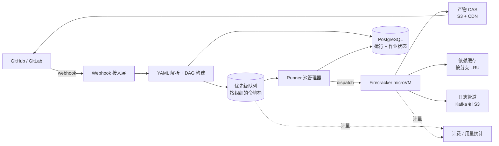
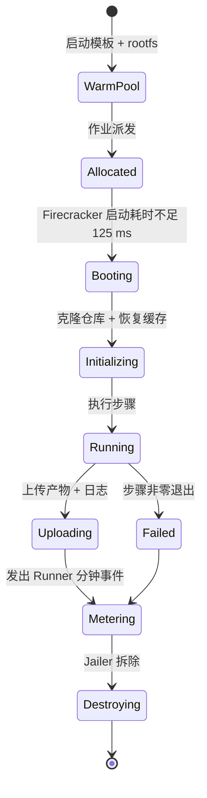
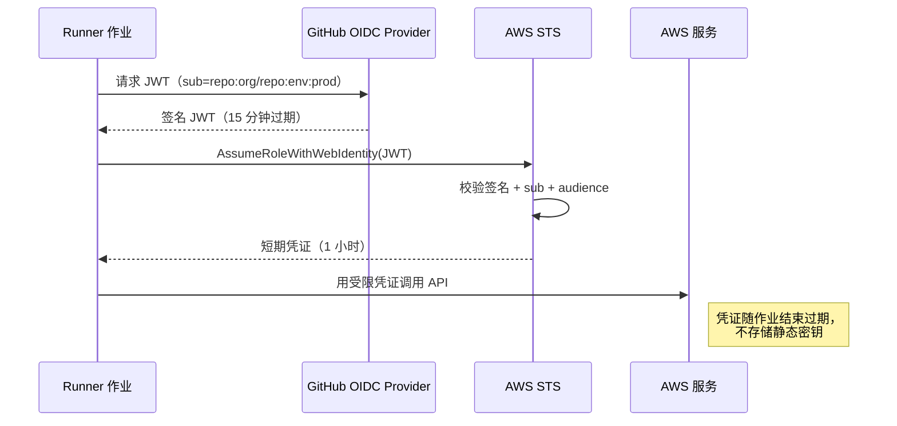
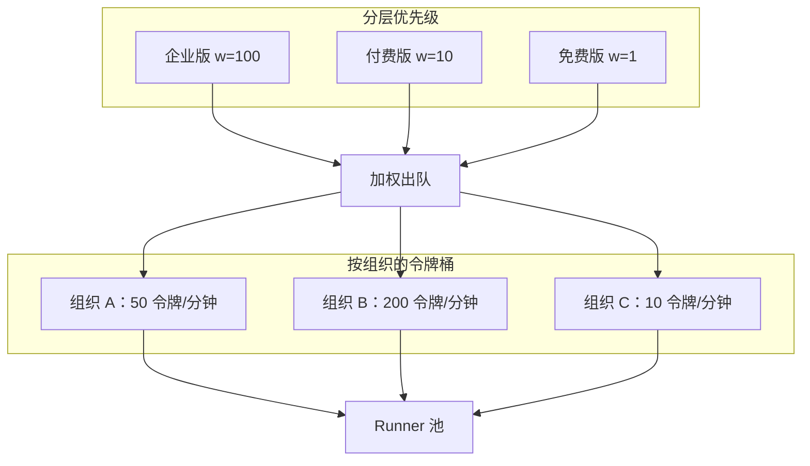

# 设计一个 CI/CD 平台（GitHub Actions / GitLab CI / CircleCI）

> **TL;DR.** 托管型 CI/CD 平台就是一个 DAG 调度器，外挂一支临时计算机队和两层缓存。推送 webhook 到达，解析器把 YAML 转成作业图，优先级队列派发根节点，一台 Firecracker microVM 在 125 ms 内为这个作业启动，对着内容寻址缓存执行各个步骤，上传产物，然后被销毁。在每天 1000 万次运行、4 万并发 Runner 的量级上，核心张力有三处：隔离（容器共享内核，microVM 不共享）、数据引力（每天 5 PB 产物逼着你要 CAS 去重）、公平性（总有一个组织会把半个机队占满）。这套设计支撑 10 万个组织：按组织的令牌桶排队、基于 OIDC 的无密钥部署，以及 SLSA Build L3 级别的产物溯源。

## 学习目标

- [ ] 把工作流 YAML 解析成 DAG，并在依赖满足时调度作业
- [ ] 为 4 万并发 Firecracker microVM 规划 Runner 池规模，且冷启动低于 30 秒
- [ ] 设计内容寻址的产物存储，做到 5-10 倍去重[^1]
- [ ] 比较容器、microVM、裸金属三种 Runner 隔离方案的权衡
- [ ] 在免费与付费分层之间，用按组织的令牌桶实现公平排队
- [ ] 接入 OIDC 工作负载身份联合，彻底消灭长期密钥[^2]

## 直觉理解

CI/CD 平台看起来像个简单的 CRUD 应用。接收 webhook，跑几条 shell 命令，报个通过或失败。10 个用户的时候，一台 Jenkins 机器就够了。到了每天 1000 万次运行，它就崩了，原因有三层。

第一，用户代码不可信。来自 fork 的 PR 可能藏着内核提权代码。容器共享宿主机内核，所以 CVE-2019-5736（runc，2019）允许恶意容器通过 /proc/self/exe 覆写宿主机的 runc 二进制，进而在宿主机上拿到 root 代码执行权限，于是同一台宿主机上的所有同租户全部暴露[^3]。你需要硬件级隔离，但完整虚拟机历史上要启动几十秒，开发体验直接废掉。

第二，数据量占主导。源码检出、依赖缓存、容器层、测试报告、发布二进制，规模化后每天产生 5 PB。每次运行的产物独立存放，意味着 500 PB 的开销。内容寻址存储（以 SHA-256 为键）在数千次运行之间对相同 blob 去重，能省下 5-10 倍[^1][^4]。

第三，总有一个客户会试图吃掉整个机队。冲刺末的周一早上，会把 600-1,200 次/秒的负载压到一个按 116 次/秒均值规划的机队上[^5]。没有按组织配额和加权优先级队列，免费层的滥用就会饿死企业版 SLA。

关键洞察：Firecracker microVM 启动不到 125 ms，每台 VM 内存开销不到 5 MB[^6][^7]。有了这个底层能力，“每个作业一台全新 VM”在经济上才站得住。把它和 DAG 调度器、内容寻址 blob 存储、公平排队层拼在一起，你就得到了一个能撑到 GitHub Actions 峰值 15 万核的平台[^8]。

## 需求

### 澄清问题

- **Q：托管云 Runner、客户基础设施上的自托管，还是两者都要？**
  假设：两者都要。托管是默认形态；自托管通过客户 K8s 上的 actions-runner-controller 提供[^9]。

- **Q：操作系统与架构范围？**
  假设：Linux x64（主力）、macOS ARM、Windows x64，以及面向 ML 流水线的 GPU 机型。

- **Q：计费模型？**
  假设：按 Runner 分钟计费，带操作系统乘数（Linux 1 倍、Windows 约 1.7 倍、macOS 约 10 倍，对应 GitHub Actions 每分钟 $0.006、$0.010、$0.062 的费率）[^10]。

- **Q：作业启动的排队 SLA？**
  假设：p99 情况下作业在触发后 30 秒内启动，周一高峰也不例外。

- **Q：密钥模型？**
  假设：优先用 OIDC 联邦的短期令牌；平台托管加密环境变量作为兜底[^2]。

- **Q：供应链溯源要求？**
  假设：通过复用工作流与隔离的签名密钥，可达 SLSA Build L3[^11]。

### 功能需求

- 用 YAML 声明工作流；支持 push、PR、tag、cron、webhook、手动触发
- 执行 DAG 时遵守 `needs:` 依赖，并支持矩阵展开（操作系统 × 语言）
- 作业之间可上传/下载产物；跨运行的依赖缓存，作用域按分支隔离
- 受保护环境支持审批门禁；超过 24 小时的陈旧审批自动过期
- 日志实时推流到 UI；状态检查回报到 SCM

### 非功能需求

- **负载：** 每天 1000 万次运行（均值约 116 次/秒，周一峰值 1,200 次/秒），4 万并发 Runner
- **延迟：** Runner 启动 p99 < 30 秒；日志端到端投递 < 2 秒
- **可用性：** 99.9% 运行成功（不含用户代码自身失败）
- **隔离：** 一次运行不能观测或影响另一次运行（硬件级）
- **持久性：** 产物保留 90 天；日志热存 90 天、冷存 2 年

## 容量估算

| 指标 | 数值 | 推导 |
|--------|------:|------------|
| 运行速率（均值） | 116 次/秒 | 1000 万/天 ÷ 86,400 |
| 运行速率（峰值） | 1,200 次/秒 | 周一 UTC 9 点，均值的 10 倍 |
| 并发 Runner | 4 万 | 1000 万次 × 6 分钟均值 ÷ 1,440 分钟/天 |
| 产物 I/O | 5 PB/天 | 1000 万次 × 500 MB 平均上传+下载 |
| 产物存储（CAS 之后） | 100 PB | 原始约 500 PB ÷ 去重 5 倍[^1] |
| 日志量 | 100 TB/天 | 1000 万次 × 10 MB 均值 |
| 依赖缓存命中目标 | > 80% | node_modules、pip、cargo、Maven |
| Runner 分钟/天 | 6000 万 | 1000 万次 × 6 分钟 |

- **读写比：** 产物下载量是上传量的 5 倍（矩阵作业共享同一份构建产物）。CDN 承接 90%+ 的读流量。
- **热路径：** 优先级队列在峰值必须扛住 1,200 次/秒入队，且分层之间不能出现队头阻塞。
- **成本大头：** Runner 分钟数占绝对主导。按 GitHub Actions 标准 Linux 双核 Runner 每分钟 $0.006 计算[^10]，每天 6000 万分钟 = 每天 36 万美元的计算成本，还没算毛利。更大的 Runner 和非 Linux 系统会显著推高这个数字。

## API 与数据模型

### API 设计

```http
POST /v1/workflows/run
  X-GitHub-Event: push
  Body: { "repo": "org/repo", "ref": "refs/heads/main", "commit_sha": "abc123" }
  Returns: 202 { "run_id": "r_7f3a", "status": "queued" }

GET /v1/runs/{id}
  Returns: 200 { "run_id": "r_7f3a", "status": "in_progress",
                  "jobs": [{"id": "j1", "status": "completed"}, ...] }

GET /v1/runs/{id}/artifacts/{name}
  Returns: 302 -> signed S3/CDN URL (expires 5 min)

POST /v1/runs/{id}/jobs/{job_id}/approve
  Body: { "approver": "user_id", "environment": "production" }
  Returns: 200 { "status": "approved" }

WS /v1/runs/{id}/logs
  Streams: { "job_id": "j1", "line": 42, "text": "npm test passed", "ts": "..." }
```

限流：API 网关处每个组织 1,000 请求/秒。产物下载走签名 URL，配 CDN 边缘缓存。日志推流用 WebSocket，支持自动重连和基于游标的重放。

### 数据模型

```sql
-- 运行状态（PostgreSQL，按 org_id 分片）
CREATE TABLE runs (
  run_id        UUID PRIMARY KEY,
  org_id        UUID NOT NULL,
  repo_id       UUID NOT NULL,
  trigger       TEXT,          -- push | pr | cron | manual | webhook
  workflow_yaml TEXT,          -- 触发时解析
  status        TEXT DEFAULT 'queued',
  created_at    TIMESTAMP,
  started_at    TIMESTAMP,
  completed_at  TIMESTAMP
);

-- 作业状态（PostgreSQL，按 run_id 分区）
CREATE TABLE jobs (
  job_id        UUID PRIMARY KEY,
  run_id        UUID REFERENCES runs(run_id),
  name          TEXT,
  needs         UUID[],        -- DAG 边
  matrix_values JSONB,         -- {os: "linux", lang: "py"}
  status        TEXT DEFAULT 'pending',
  runner_id     UUID,
  started_at    TIMESTAMP,
  completed_at  TIMESTAMP
);

-- 产物 CAS（S3 + PostgreSQL 中的清单）
-- blob 以 SHA-256 为键；清单按运行引用 blob 哈希
CREATE TABLE artifact_manifests (
  run_id        UUID,
  artifact_name TEXT,
  blob_hash     CHAR(64),      -- SHA-256
  size_bytes    BIGINT,
  PRIMARY KEY (run_id, artifact_name)
);
```

## 高层架构



*推送 webhook 依次流经解析、调度、派发、执行；计费同时从队列和 Runner 生命周期取数。*

**写路径。** SCM 在 push 或 PR 时发出 webhook。接入层做去重（按 `delivery_id` 保证幂等），在 PostgreSQL 里建一行运行记录，把工作流 YAML 交给解析器。解析器展开复用工作流、展开矩阵策略、构建 DAG，把根作业以 `{org_id, tier_weight}` 为键入队到优先级队列。

**执行路径。** Runner 池管理器按组织的令牌桶限制出队。它从热池里分配一台预热好的 Firecracker microVM，挂上暂存磁盘和网络接口，启动 VM。VM 内部，作业执行器克隆仓库、恢复依赖缓存、顺序执行各步骤、把日志流到 Kafka、把产物上传到 CAS，然后退出。退出时 VM 被销毁，同时发出一条计量事件。

**协调路径。** 作业完成时，池管理器更新作业行并通知解析器/调度器。调度器评估下游：如果所有 `needs:` 前驱都成功，就把下一个作业入队；如果任一前驱失败且设了 `fail-fast`，就取消矩阵中其余的兄弟作业。

## 深入探讨

### 用 Firecracker microVM 做临时 Runner 隔离

威胁模型很清楚：用户代码是任意的。来自 fork 的 PR 可能带着内核提权代码。容器共享宿主机内核（数千万行代码），所以像 CVE-2019-5736 这样一个漏洞就能拿下所有同租户[^3]。

Firecracker 是一个用 Rust 写的极简 KVM VMM。它去掉不必要的设备，使用线程级 seccomp 过滤器，并把每个进程裹进 Jailer（cgroup + namespace 隔离，且已降权）[^7]。默认 microVM：1 vCPU、128 MiB 内存。从启动到 init 完成不到 125 ms[^6][^7]。AWS 用 Firecracker 支撑 Lambda 和 Fargate，规模是“每月数万亿次请求”[^6]。



*每台 microVM 被创建、只跑一个作业、然后被销毁。作业之间不留任何状态。*

**预热策略。** 池管理器依据历史需求曲线维持 10-20% 的空闲冗余。周一 UTC 9 点和冲刺末的合并会触发预扩容事件。GitHub.com 在峰值运行 4,500 台 32 核 larger runner，占用 15 万核[^8]。把依赖预先烤进 rootfs 的自定义 VM 镜像，把他们典型工作流从 50 分钟压到 12 分钟[^8]。

**SLSA Build L3。** 规范要求“构建平台实现强控制，防止运行之间相互影响”，以及“用于签名溯源的密钥材料对用户自定义的构建步骤不可访问”[^11]。每个作业一台 Firecracker 同时满足这两条：microVM 之间无法相互影响（硬件隔离），签名密钥存在于用户代码访问不到的复用工作流步骤中[^12][^11]。

### 内容寻址的产物存储与依赖缓存

每天 5 PB 的原始产物 I/O，按运行独立存储在经济上根本不可行。内容寻址存储（CAS）以内容本身的 SHA-256 作为 blob 的键。上传前客户端先对 blob 哈希发 HEAD 请求；如果已存在，就跳过上传，清单直接指向既有对象[^1]。

Bazel 的 Remote Build Execution 协议用两张表把这套做法形式化：Action Cache（动作哈希 → ActionResult）和 CAS（blob 哈希 → 字节）[^1]。Dagger 的引擎缓存在 BuildKit 之上用了同样的形状[^4]。实际工作负载上典型的收益是 5-10 倍去重，因为发布二进制、容器层、依赖 tarball 会在多次运行中反复出现[^1][^4]。

**依赖缓存**是相关的一层，键为 `hash(package-lock.json)` 或用户自选的键。它按分支做 LRU 作用域，防止 fork PR 投毒。主干和发布分支有独立的、受写限制的作用域；来自 fork 的 PR 只拿到只读权限[^8]。

**垃圾回收。** 删除一次运行只删清单，不删 blob。后台 GC 统计 blob 的引用计数；超过 7 天且无人引用的 blob 才删除。这样就避开了“删掉一个仍被其他运行引用的 blob”的竞态。

### OIDC 工作负载身份与密钥注入

把长期云凭证存成仓库密钥，是 CI 里最大的供应链风险。Runner 一旦被攻破，攻击者就能把有效期长达数月的静态 AWS 密钥带走。

GitHub Actions 充当 OIDC 身份提供方。作业启动时，Runner 从 `token.actions.githubusercontent.com` 请求一个 JWT，其中包含声明：`repo`、`ref`、`environment`、`job_workflow_ref`、`run_id`[^2]。目标云（AWS STS、Azure、GCP）校验签名和主体声明，然后签发一个作用域限定在该作业时长内的会话令牌[^2]。



*Runner 铸造一个短期 JWT；云厂商把它换成一个只对本次作业有效的访问令牌。*

**细粒度信任。** 云角色可以要求 `repo:org/repo:environment:prod`，于是只有那个特定仓库里的生产部署工作流能扮演它[^2]。别的仓库不行、别的分支不行、别的环境也不行。

**声明伪造风险。** 复用工作流必须仔细校验 `job_workflow_ref`，否则下游仓库可以冒充上游的可信工作流[^2]。缓解办法：把复用工作流的引用固定到具体 commit SHA，而不是分支。

### 多租户公平排队

两道正交的控制，防止单个租户垄断机队。

**隔离：** 每个作业都跑在自己那台打了租户标签的宿主机上的 microVM 里。出站流量通过防火墙规则阻断到非白名单主机。Jailer 丢掉所有 capability[^7]。

**公平性：** 作业进入带分层权重（免费=1、付费=10、企业=100）的优先级队列，权重叠加在按组织的令牌桶之上。出队时，调度器挑选权重最高且仍在自身桶速率之下的组织。大组织会把自己那个桶打满，排队的作业往外溢；任何免费层组织都无法饿死付费层。背压时返回 429 并带上 `Retry-After` 头。



*加权优先级保证付费层先得到服务；按组织的令牌桶防止任何一个组织吃光整个机队。*

## 真实案例

### GitHub.com 规模的 GitHub Actions

GitHub 用 GitHub Actions 构建和测试 GitHub.com 自身。数字是公开的：峰值 4,500 台 32 核 larger runner 并发，每小时约 15,000 个 CI 作业、12.5 万构建分钟，峰值区间内约 15 万核计算资源[^8]。

**自定义 VM 镜像取代层缓存。** GitHub.com 的依赖树太深，运行时恢复不划算。他们改为把依赖烤进自定义 VM 镜像，把典型工作流从 50 分钟降到 12 分钟[^8]。这是“bootstrap 缓存”模式：rootfs 本身就是缓存。

**结果复用。** 如果同一个 Git tree ID 已经通过了 CI，平台会直接跳过重跑。这为 GitHub 工程师每天省下 300-500 次工作流运行[^8]。

**处处 OIDC。** 从 Runner 访问私有服务靠的是 OIDC 声明校验，而不只是网络 ACL。Runner 铸造 JWT，内部网关校验声明后才代理进入 VPC[^8][^2]。

**复用工作流。** `workflow_call` 把 Runner 选型和安全策略集中到几百个仓库上，团队之间不用再复制粘贴 YAML[^8]。

**产物证明。** GitHub 用 Sigstore Fulcio 签名，借助复用工作流达到 SLSA v1.0 Build L3——签名密钥材料对用户步骤不可见[^12][^11][^13]。

关键洞察：在 GitHub 这个量级上，YAML 解析器是最容易的部分。难的是 Runner 镜像管理、缓存命中率，以及防止某个团队的巨型单体仓库饿死另一个团队的部署流水线。

## 权衡

| 决策 | 方案 A | 方案 B | 我们的选择 | 理由 |
|----------|----------|----------|------------|-----|
| Runner 隔离 | 容器（Docker/K8s） | microVM（Firecracker） | microVM | 硬件级隔离；CVE-2019-5736 这类利用被挡住；启动 < 125 ms[^3][^6] |
| 队列公平性 | FIFO | 加权优先级 + 按组织令牌桶 | 加权 + 令牌桶 | 免费层洪水下 FIFO 会饿死付费层；令牌桶才能兑现 SLA |
| 产物存储 | S3 按运行存 blob | 内容寻址（SHA-256） | CAS | 每天 5 PB 上省 5-10 倍；清单感知的 GC 值得这份复杂度[^1] |
| 缓存作用域 | 按仓库共享 | 按分支隔离 | 按分支 | 防止 fork PR 缓存投毒；命中率降低是可接受的权衡[^8] |
| 密钥模型 | 静态环境变量 | OIDC 短期令牌 | OIDC | 没有长期密钥要轮换或担心被窃；即使失陷也只丢一个作业的权限[^2] |
| 日志投递 | WebSocket 推流 | HTTP 轮询 | WebSocket | 实时跟随的体验对开发者至关重要；长连接用负载均衡器可管 |
| 部署模型 | 推送（CI 直接 kubectl） | 拉取（GitOps：Argo CD） | 拉取 | 集群从 Git 拉取；CI 里不存集群出站凭证；审计轨迹更强[^14] |

最大的单个权衡：隔离与冷启动延迟。容器启动约 1 秒，但共享内核。完整虚拟机给出硬件隔离，却要 30 秒以上启动。Firecracker 把这个差距压到 125 ms 以内[^6]，对 Linux 工作负载而言这个权衡直接消失了。macOS 和 Windows Runner 仍然需要完整虚拟机，冷启动更长。

## 扩展与故障模式

**10 倍（每小时 12 万次运行）：** 优先级队列成为瓶颈。缓解：按区域（us-east、us-west、eu-central）拆分队列，各配本地 Runner 池。产物 CAS 增加区域 S3 桶，共享 blob 做跨区域复制。

**100 倍（每小时 120 万次运行）：** 单区域 Runner 池无法维持 30 秒启动 SLA。缓解：多区域 Runner 机队，用 GitLab 风格的 autoscaler executor（docker-autoscaler、kubernetes、instance）做地理路由[^15]。调度器变成分布式服务（按 org_id 哈希区间分片，与 [设计一个分布式作业调度器](./29-job-scheduler.md) 同一套模式）。每天 1 PB 的日志摄取需要每个区域独立的 Kafka 集群。

**1000 倍：** 架构转向边缘优先：每个区域部署轻量调度代理，本地完成派发，只把计费和状态事件转给中心控制面。产物 CAS 变成全球 CDN 支撑的对象存储，写入直通主区域。

**故障：周一高峰期间 Runner 池耗尽。**
检测：队列深度 > 1 万个作业，p99 启动时间 > 60 秒。响应：紧急扩容 spot 实例；把免费层降级为 429 加 `Retry-After: 120`；优先保障企业版和付费层。恢复：spot 容量 2-5 分钟内到位。

**故障：产物 CAS 损坏（blob 哈希错误）。**
检测：下载时校验和不匹配。响应：隔离该 blob，从产出该产物的运行的缓存重新上传（如果还热），或者让消费方作业以明确错误失败。预防：上传和下载双向校验 SHA-256。

**故障：OIDC 提供方不可用。**
检测：JWT 铸造失败率飙升。响应：回退到加密环境变量密钥（安全姿态降低）并告警。恢复：OIDC 提供方是多可用区的；全挂虽然罕见，但回退路径必须存在。

## 常见陷阱

> [!WARNING]
> **共享内核的容器逃逸。** 在没上 gVisor 或 Firecracker 的 Docker 容器里跑不受信任的 CI 作业，等于把每个同租户都暴露给 CVE-2019-5736 这类内核利用[^3]。多租户托管 Runner 请用 microVM。

> [!WARNING]
> **来自 fork PR 的缓存投毒。** 不受信任的 fork 发来的 PR 写入了仓库作用域的依赖缓存；后续主干构建就继承了攻击者控制的代码。修法：缓存按分支作用域，fork PR 只给只读权限[^8]。

> [!WARNING]
> **审批门禁把 Runner 扣成人质。** 一个手动审批步骤会让一台 Runner 空转几个小时。修法：把 DAG 状态存进 PostgreSQL，释放 Runner，审批通过后再把下游作业重新入队。超过 24 小时的陈旧审批自动过期[^8]。

> [!WARNING]
> **测试不稳定拖累合并队列。** 十次失败一次的测试会逼着合并队列回滚整批，白烧 Runner 小时。修法：对高波动率的测试自动隔离；重试次数要有上限；把单个测试的不稳定性和真实回归分开统计[^5][^16]。

> [!WARNING]
> **周一早上的惊群。** 冲刺周期把负载在 UTC 9 点集中到 10 倍。修法：按历史曲线预热池子，保持 10-20% 空闲冗余，用 spot 实例扛突发，对免费层做 429 背压[^5]。

> [!WARNING]
> **未签名产物与供应链缺口。** 没有溯源证明，一台被攻破的 Runner 可以发布一个消费者照单全收的恶意二进制。修法：用 Sigstore Cosign 做无密钥签名；由隔离的复用工作流附加 SLSA in-toto 证明[^12][^11]。

## 追问

**1. 你怎么支持自定义 Runner 机型（GPU A100、64 核 ARM、Windows Server）？**

基于标签的路由。作业声明 `runs-on: [gpu-a100]`；池管理器按标签维护各自的热池。GPU Runner 用完整虚拟机（Firecracker 不支持 GPU 直通）。定价反映每分钟的硬件成本。

**2. 跨工作流依赖怎么实现（工作流 B 等同一 commit 上的 A）？**

`workflow_run` 触发器在指定工作流于同一 ref 上完成时触发。调度器按 `{repo, ref, workflow_name}` 存完成事件，每次完成时评估等待中的触发器。

**3. 客户在自己的基础设施上跑 agent 时，自托管 Runner 的安全模型是什么？**

参考 Buildkite 的混合模型[^17]。控制面（托管）派发作业；agent（客户所有）通过 HTTPS 拉取工作。源码永远不离开客户的 VPC。agent 用一个限定到该组织的注册令牌做认证。Runner 隔离是客户自己的责任。CircleCI 2023 年的安全事件说明了这件事为什么重要：一名工程师的笔记本被攻破，导致对客户密钥的未授权访问，最终被迫轮换所有环境变量，并建议把 OIDC 令牌作为最佳实践[^18]。

**4. 怎么提供不稳定测试重试，又不掩盖真实回归？**

按测试记录通过/失败历史。某个测试的波动率超过 5%，就自动隔离，不再阻塞合并队列。重试次数有上限（最多 2 次）。同一 commit 上连续 3 次以上失败的测试，标记为回归，而不是不稳定[^5]。

**5. 你会怎么把 SLSA L3 溯源接入平台？**

复用工作流在隔离步骤里执行构建。签名密钥由平台注入（用户步骤访问不到）。工作流产出由 Sigstore Fulcio 签名的 in-toto 证明，证书主体就是 OIDC 身份。消费方用 `cosign verify-attestation` 校验[^12][^11][^13]。

**6. Shopify 规模的巨型单体仓库 CI（17 万+ 测试）怎么处理？**

影响图分析（如 Bazel、Nx、Turborepo）确定哪些包变了，只跑受影响的测试。测试并行化把套件切到 N 个 worker 上。Shopify 自建了测试选择系统，配合 Docker I/O 调优，把 p95 从 45 分钟压到 18 分钟[^5]。

## 练习

### 练习 1：估算热池规模

你的平台服务 5 万个组织。历史数据显示周一 UTC 9 点峰值是日均 116 次/秒的 8 倍。每次运行平均 6 分钟。Firecracker 启动 125 ms，但完整初始化（克隆 + 恢复缓存）要 25 秒。要在峰值维持 30 秒启动 SLA，你需要在热池里准备多少台预热 VM？

<details>
<summary>提示</summary>

先算出峰值需要的并发 Runner 数。然后注意：预热 VM 必须覆盖“作业到达”到“新 VM 就绪”之间的空档（25 秒的初始化）。在峰值到达速率下，这 25 秒里会到达多少需要立刻拿到热 VM 的作业？

</details>

<details>
<summary>解答</summary>

**峰值到达速率：** 116 × 8 = 928 次/秒（保守起见取整到约 1,000 次/秒）。

**峰值并发 Runner：** 1,000 次/秒 × 360 秒平均时长 = 36 万 Runner 秒在飞。但运行是重叠的，所以并发数 = 到达速率 × 平均时长 = 1,000 × 360 = 36 万？不对，那是每秒的 Runner 秒总量。并发 Runner = 峰值速率 × 平均时长（秒）÷ 1 = 1,000 × 360 = 每个 6 分钟窗口需要 6,000 台新 Runner。峰值稳态并发：约 6,000 台。

**热池规模：** 在 25 秒的初始化窗口内，1,000 次/秒 × 25 秒 = 25,000 个作业到达。要维持 30 秒 SLA，你需要 25,000 台预热 VM 就绪，能直接接活而不等启动 + 初始化。加上 20% 冗余：**30,000 台预热 VM**。

**权衡：** 30,000 台空闲 VM，每台 128 MiB，等于预留 3.75 TB 内存。按 $0.008/分钟算，如果计费，空闲成本是 $240/分钟。另一种选择：接受尖峰最初 60 秒内的 p99 劣化，反应式扩容。多数平台选混合方案：60% 预热，40% 靠 spot 实例反应式拉起。

</details>

## 要点回顾

- **核心是 DAG 调度器加上一支 VM 机队。** YAML 解析器是最容易的部分；调度、隔离、缓存才是难题。
- **Firecracker 让强隔离在经济上成立。** 不到 125 ms 启动、每台 VM 不到 5 MB 开销，对 Linux 而言容器与 VM 的权衡就消失了[^6][^7]。
- **每天 5 PB 的量级上，内容寻址存储是必选项。** CAS 去重就是 100 PB 和 500 PB 存储开销之间的差别[^1]。
- **公平排队是产品决策，不是数学题。** 总有一个组织想跑掉你半个机队。带分层权重的按组织令牌桶没有商量余地。
- **OIDC 消灭了 CI 的头号安全风险。** 限定到单个作业的短期令牌，取代了能存活数月的长期密钥[^2]。
- **审批绝不能扣住 Runner。** 把 DAG 状态落库，释放 Runner，等人操作后再重新入队。

## 延伸阅读

- [Firecracker: Lightweight Virtualization for Serverless Applications (NSDI 2020)](https://www.usenix.org/conference/nsdi20/presentation/agache)。每个 CI 架构师都该读的论文；它解释了让临时 VM 在大规模下可行的隔离原语。
- [How GitHub uses GitHub Actions and Larger Runners to build and test GitHub.com](https://github.blog/engineering/infrastructure/how-github-uses-github-actions-and-actions-larger-runners-to-build-and-test-github-com/)。关于超大规模 Actions 部署最清晰的公开数据，涵盖自定义 VM 镜像与结果复用。
- [Keeping Developers Happy with a Fast CI (Shopify)](https://www.shopify.engineering/faster-shopify-ci)。17 万测试、p95 从 45 分钟到 18 分钟、Docker I/O 调优，以及巨型单体仓库规模下的不稳定测试治理。
- [SLSA v1.0 specification: Security Levels](https://slsa.dev/spec/v1.0/levels)。Build L1/L2/L3 要求的权威定义，以及每一级实际能挡住什么。
- [GitHub OIDC documentation](https://docs.github.com/en/actions/concepts/security/openid-connect)。工作负载身份联合的声明、信任策略、云厂商集成的完整参考。
- [Bazel Remote Caching](https://bazel.build/remote/caching)。CI 产物系统最终都会收敛到的那套标准 CAS 设计（Action Cache + blob 存储）。
- [Argo CD Architectural Overview](https://argo-cd.readthedocs.io/en/stable/operator-manual/architecture/)。拉取式 GitOps，作为“CI 把凭证塞进生产集群”的反面模式。
- [The Origin Story of Merge Queues (Mergify)](https://mergify.com/blog/the-origin-story-of-merge-queues)。从 Bors 到 GitHub Merge Queue：为什么串行化合入很重要，以及批量测试如何把等待时间降低 33%[^16]。

## 记忆卡片

<details>
<summary><strong>Q：为什么容器不足以支撑多租户 CI Runner 的隔离？</strong></summary>

A：容器共享宿主机内核。一个内核利用（比如 runc 的 CVE-2019-5736）就能让容器进程逃逸，并攻陷同一宿主机上的所有同租户[^3]。Firecracker microVM 通过 KVM 提供硬件级隔离，启动不到 125 ms[^6]。

</details>

<details>
<summary><strong>Q：一台 Firecracker microVM 的启动时间和内存开销是多少？</strong></summary>

A：从启动到 init 完成不到 125 ms，每台 microVM 内存开销不到 5 MB。单台宿主机每秒最多可以创建 150 台 microVM[^6][^7]。

</details>

<details>
<summary><strong>Q：内容寻址存储怎么为 CI 产物实现 5-10 倍去重？</strong></summary>

A：blob 以内容本身的 SHA-256 为键。上传前客户端先查这个哈希是否存在。跨数千次运行的相同产物（发布二进制、容器层、node_modules）只存一份。按运行的清单引用共享 blob[^1][^4]。

</details>

<details>
<summary><strong>Q：OIDC 工作负载身份如何消灭长期 CI 密钥？</strong></summary>

A：CI 平台充当 OIDC 身份提供方，为每个作业铸造一个短期 JWT。云厂商把它换成只在作业时长内有效的受限凭证。CI 平台里不存任何静态密钥[^2]。

</details>

<details>
<summary><strong>Q：防止单个组织吃光整个 Runner 机队的公平排队策略是什么？</strong></summary>

A：加权优先级队列（免费=1、付费=10、企业=100）叠加在按组织的令牌桶之上。大组织打满自己的桶后只能往外溢；付费层永远不会被免费层洪水饿死。

</details>

<details>
<summary><strong>Q：为什么审批门禁必须释放 Runner 而不是扣着它？</strong></summary>

A：手动审批可能要等几个小时。让 Runner 空转就是在浪费机队容量。正确的模式：把 DAG 状态落进 PostgreSQL，释放 Runner，等人批准后再把下游作业重新入队。

</details>

<details>
<summary><strong>Q：SLSA Build L3 要求了哪些容器给不了的东西？</strong></summary>

A：L3 要求运行之间不能相互影响，且签名密钥材料对用户自定义的构建步骤不可访问[^11]。共享内核的容器违反第一条；microVM 两条都满足。

</details>

<details>
<summary><strong>Q：GitHub.com 是怎么把 CI 工作流从 50 分钟降到 12 分钟的？</strong></summary>

A：用自定义 VM 镜像把依赖预先烤进 rootfs，省掉运行时的依赖恢复。rootfs 本身就是缓存[^8]。

</details>

<details>
<summary><strong>Q：按仓库作用域缓存有什么投毒风险，怎么缓解？</strong></summary>

A：fork PR 可以向共享缓存写入恶意内容；后续主干构建会继承它。缓解办法：缓存按分支作用域，fork PR 只给只读权限[^8]。

</details>

<details>
<summary><strong>Q：CircleCI 的架构如何用 Nomad 做作业调度？</strong></summary>

A：一个 Nomad server 集群充当调度控制面。Nomad client（每台 VM 一个）跑在集群之外。CI 作业作为 Nomad 作业提交；Nomad 的装箱调度器把它们放到 client 上。CircleCI 在 750 个 Nomad client 上运行 7,500 个并发作业[^19]。

</details>

<details>
<summary><strong>Q：CI 里的周一早上惊群问题是什么，怎么处理？</strong></summary>

A：冲刺周期把负载在周一 UTC 9 点集中到正常的 8-10 倍。缓解：按历史需求曲线预热池子，保持 10-20% 空闲冗余，用 spot 实例扛突发，对免费层做 429 + Retry-After 背压[^5]。

</details>

## 参考文献

[^1]: Bazel 文档，“Remote Caching”。https://bazel.build/remote/caching

[^2]: GitHub Docs，“OpenID Connect”（OIDC 令牌声明、云厂商集成）。https://docs.github.com/en/actions/concepts/security/openid-connect

[^3]: Fernando Lucktemberg，“Security Tradeoffs for Agentic Workloads: Firecracker vs Docker”，2026。https://nextkicklabs.substack.com/p/firecracker-vs-docker-security-tradeoffs

[^4]: Dagger，“Built-In Caching”（BuildKit 之上的层缓存、卷缓存与函数调用缓存）。https://docs.dagger.io/features/caching

[^5]: Christian Bruckmayer（Shopify），“Keeping Developers Happy with a Fast CI”，2021 年 2 月。https://www.shopify.engineering/faster-shopify-ci

[^6]: Alexandru Agache、Marc Brooker 等，“Firecracker: Lightweight Virtualization for Serverless Applications”，USENIX NSDI 2020。https://www.usenix.org/conference/nsdi20/presentation/agache

[^7]: firecracker-microvm/firecracker，README.md。https://github.com/firecracker-microvm/firecracker

[^8]: Max Wagner（GitHub），“How GitHub uses GitHub Actions and Actions larger runners to build and test GitHub.com”，2023 年 9 月（2024 年 7 月更新）。https://github.blog/engineering/infrastructure/how-github-uses-github-actions-and-actions-larger-runners-to-build-and-test-github-com/

[^9]: GitHub，“actions/actions-runner-controller”（用于临时自托管 Runner 的 Kubernetes operator）。https://github.com/actions/actions-runner-controller

[^10]: GitHub Docs，“Actions runner pricing”（每分钟费率：Linux 双核 $0.006、Windows 双核 $0.010、macOS 3-4 核 $0.062）。https://docs.github.com/en/billing/reference/actions-runner-pricing

[^11]: SLSA specification v1.0，“Security levels”。https://slsa.dev/spec/v1.0/levels

[^12]: Sigstore 文档，“Overview”（Fulcio 无密钥签名、Rekor 透明日志）。https://docs.sigstore.dev/cosign/signing/overview/

[^13]: GitHub，“Artifact attestations” 文档。https://docs.github.com/en/actions/concepts/security/artifact-attestations

[^14]: Argo CD 文档，“Architectural Overview”。https://argo-cd.readthedocs.io/en/stable/operator-manual/architecture/

[^15]: GitLab Docs，“GitLab Runner executors”。https://docs.gitlab.com/runner/executors/

[^16]: Julien Danjou（Mergify），“The Origin Story of Merge Queues”，2025 年 9 月。https://mergify.com/blog/the-origin-story-of-merge-queues

[^17]: Buildkite，“Pipelines architecture”。https://buildkite.com/docs/pipelines/architecture

[^18]: CircleCI，“January 4, 2023 Security Incident Report”。https://circleci.com/blog/jan-4-2023-incident-report/

[^19]: HashiCorp / CircleCI，“CircleCI and Nomad” 主题演讲（7.5K 并发作业、750 个 client）。https://www.hashicorp.com/resources/keynote-circleci-nomad
