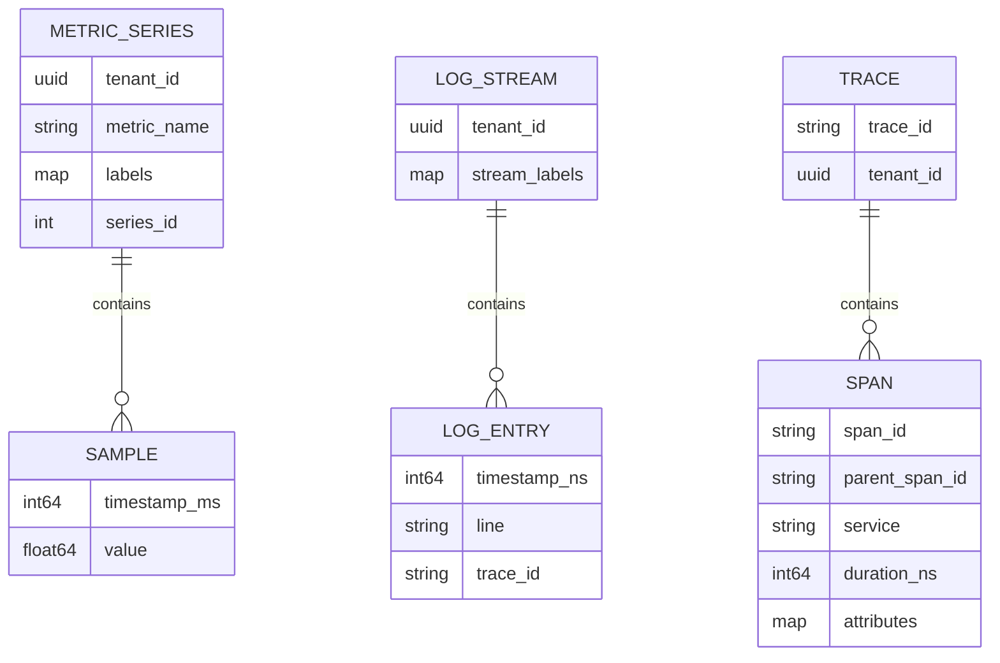
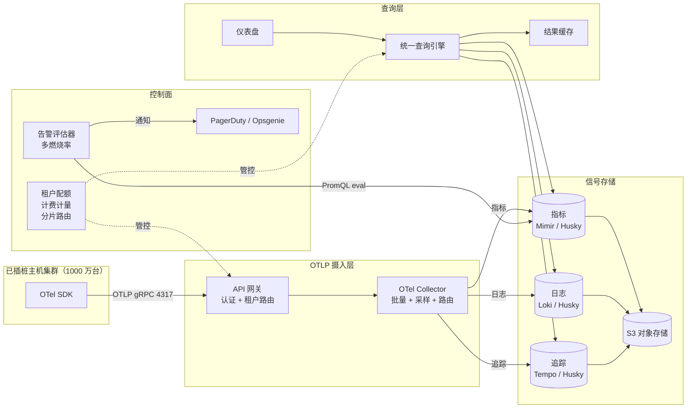
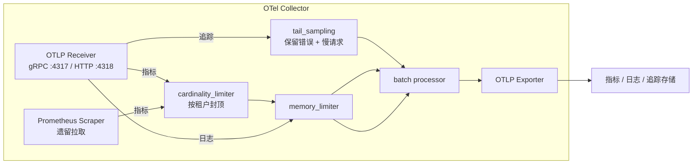
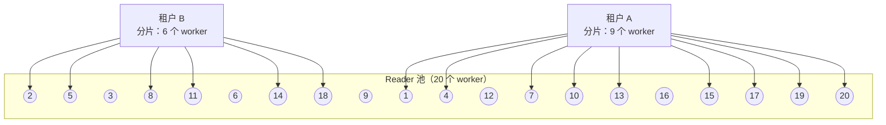

# 设计可观测性平台（Datadog / New Relic / Honeycomb）

> **TL;DR.** 可观测性平台把指标、日志和追踪统一在一个关联键（`trace_id`）之后，工程师从错误率飙升的曲线一点，就能跳到具体失败的 span 和它的日志行。到 Datadog 这个量级，意味着每天 100 万亿以上事件[^1]、S3 上 PB 级存储、每个分片的交互式查询延迟约 p50 2 ms[^1]。关键的权衡不在数据量，而在基数（cardinality）：每一条唯一的标签组合都是一个新时间序列，一个没有上界的标签就能让 TSDB 一夜之间 OOM[^9]。架构最终收敛到几个共识：以 OTLP 作为通用传输协议[^11]、对象存储作为持久层、shuffle sharding 实现多租户查询隔离[^1]、尾部采样在不必全量存储的前提下保住 100% 的错误追踪[^14]。

## 学习目标

- [ ] 设计统一的摄入层，用单一协议（OTLP）接收指标、日志和追踪
- [ ] 解释为什么标签基数而不是原始数据量，才是压垮指标平台的第一个约束
- [ ] 用 `trace_id` 作为通用关联键，实现追踪、日志、指标三者互跳
- [ ] 为每类信号论证存储选型（Mimir 对 Prometheus、Loki 对 Elasticsearch、Tempo 对 Jaeger）
- [ ] 为每个租户的查询算力设预算，让一个吵闹的仪表盘无法拖垮整个集群
- [ ] 比较头部采样与尾部采样，并说明各自适用场景

## 直觉理解

单台 Prometheus、一个 Loki 实例、一个 Jaeger collector，各自独立跑都没问题，用它们监控 50 个服务绰绰有余。可一旦值班工程师在仪表盘上看到延迟尖峰、然后问出那句“到底是哪个请求导致的，它的日志说了什么”，整个架构就塌了。

要回答这个问题必须能跳转。指标告诉你*某个地方*出问题了，追踪告诉你*哪条请求链路*出了问题，日志告诉你*为什么*。没有一个共享的关联键，工程师只能开三个标签页、手动对齐时间戳、然后猜。事故发生在凌晨三点时，猜是不能接受的。

解开这个设计的洞察是：`trace_id` 就是三类信号之间的关联键。SDK 在每条日志上打上当前 span 的 trace ID；指标携带 exemplar，指向抽样得到的 trace ID；查询引擎在用户点击时完成关联[^13]。这不是三条管道硬拼在一起，而是一个产品加三个存储后端。

[设计指标管道](./22-metrics-pipeline.md) 深入讲了指标这一支柱。本章拉远到整个统一平台：取代各类专用 agent 的 OTLP 摄入层、保护 TSDB 的基数控制、让数万客户互不干扰的多租户隔离，以及在 PB 级数据上返回交互式结果的查询引擎。

## 需求

### 澄清性问题

- **问：统一走 OTLP 摄入，还是每类信号各用一套管道？**
  假设：统一。一个 SDK、一个 collector、一个协议（OTLP gRPC/HTTP）[^11]。

- **问：从第一天就做多租户？**
  假设：是。10000 家以上客户共享基础设施。摄入、查询、保留期都按租户设配额。

- **问：实时告警的 SLA 是多少？**
  假设：每 30 秒评估一次告警规则。越过阈值后 60 秒内完成呼叫通知。

- **问：APM（分布式追踪、服务拓扑图）是一等公民吗？**
  假设：是。追踪是主要信号，不是附赠功能。

- **问：RUM 和合成监控在范围内吗？**
  假设：RUM 在范围内（Core Web Vitals：p75 下 LCP <= 2.5 s、INP <= 200 ms、CLS <= 0.1）[^17]。合成监控作为后续项。

- **问：查询延迟目标是多少？**
  假设：每个分片 p50 < 5 ms，p99 < 300 ms。仪表盘用起来要跟手。

### 功能需求

- 通过 OTLP 摄入指标、日志和追踪（gRPC 端口 4317，HTTP 端口 4318）[^11]
- 通过 PromQL、LogQL 和追踪检索 API 查询并可视化各类信号
- 按计划评估告警规则，支持多窗口多燃烧率的 SLO 告警[^8]
- 信号互跳：点指标点看追踪，点 span 看它的日志
- 从追踪的父子关系自动发现服务拓扑（服务地图）
- 按租户隔离的仪表盘、RBAC 和保留策略

### 非功能需求

- **摄入：** 合计每秒 10 亿事件（每秒 1 亿指标采样、每秒 8 亿日志事件、每秒 1 亿 span）
- **延迟：** 每个查询分片 p50 < 5 ms；仪表盘端到端刷新 < 2 秒[^1]
- **可用性：** 摄入路径 99.99%；查询路径 99.9%
- **租户隔离：** 某个客户的 30 天全量扫描不能饿死共享的查询 worker
- **保留期：** 热 15 天、温 90 天、冷 1 年（指标做压缩与降采样）

## 容量估算

| 指标 | 数值 | 推导 |
|--------|------:|------------|
| 指标采样/秒 | 100M | 1000 万台主机 × 100 个序列 × 每 10 秒 1 个采样 |
| 日志事件/秒 | 800M | 1000 万台主机 × 平均每秒 80 条日志 |
| Span/秒（采样后） | 10M | 每秒 1 亿请求 × 10% 采样率 |
| 存储/天（日志，未压缩） | 80 TB | 800M × 平均 100 B × 86,400 秒 |
| 存储/天（指标，压缩后） | 1.2 TB | 1 亿序列 × 每天 8,640 个采样 × 每个采样 1.37 B[^22] |
| 存储/天（追踪） | 17 TB | 10M × 200 B × 86,400 / 10（十存一） |
| 热+温 90 天合计 | ~8.8 PB | (80 + 1.2 + 17) TB/天 × 90 |
| 查询 QPS（仪表盘刷新） | 1.7K | 10 万名分析师 × 每分钟 1 次查询 |
| 峰值突发（20 面板仪表盘） | 2M 分片/30 秒 | 10 万观看者 × 20 个面板 / 30 秒[^1] |

关键比例：

- **读写比：** 指标约 5:1（仪表盘刷新），日志约 0.01:1（绝大多数日志从未被读取）
- **缓存命中率：** 结果缓存约 80%，Datadog Husky 上的 blob 区间缓存约 70%[^1]
- **真正访问 blob 存储的分片：** 叠完所有缓存层后只剩 0.4%[^1]

## API 与数据模型

### API 设计

```http
POST /v1/traces    (OTLP protobuf, Snappy-compressed)
POST /v1/metrics   (OTLP protobuf)
POST /v1/logs      (OTLP protobuf)

GET  /api/v1/query?query=rate(http_requests_total[5m])&time=<ts>
GET  /api/v1/query_range?query=...&start=<ts>&end=<ts>&step=15s
GET  /api/v1/logs?query={service="api"} |= "error"&start=<ts>&end=<ts>&limit=100
GET  /api/v1/traces/{trace_id}
GET  /api/v1/traces/search?service=api&minDuration=500ms&limit=20

POST /api/v1/alerts/rules   Body: { expr, for, labels, annotations }
GET  /api/v1/service-map?start=<ts>&end=<ts>
```

分页使用游标 token。触发限流时返回 `429` 并带 `Retry-After`。所有端点都要求租户 API key，放在 `DD-API-KEY` 或 `Authorization: ***` 头里。

### 数据模型

```text
-- 指标（列式 TSDB，按时间分区）
(tenant_id, metric_name, labels{}, timestamp_ms, value)
Partition key: tenant_id + metric_name + label_hash
Compression: Gorilla XOR + delta-of-delta

-- 日志（按标签索引的 chunk）
(tenant_id, stream_labels{}, timestamp_ns, log_line, trace_id, span_id)
Index: label tuples only (Loki model) or full-text inverted index (ES model)

-- 追踪（span 存储）
(tenant_id, trace_id, span_id, parent_span_id, service, operation,
 start_time_ns, duration_ns, status, attributes{})
Primary lookup: trace_id -> all spans
```



*三类信号共享 `tenant_id` 用于隔离、共享 `trace_id` 用于关联；各自的存储模型都针对自己的访问模式优化。*

## 高层架构



*OTLP 摄入层把数据分发到三个由 S3 兜底的信号存储；统一查询引擎按 `trace_id` 关联它们，供仪表盘和告警使用；控制面在摄入和查询两条路径上执行租户配额。*

**写路径：** 主机通过 OTel SDK 以 OTLP 发出所有信号。摄入网关校验租户 API key、施加限流，然后转发给 OTel Collector 集群。Collector 做批量聚合、施加尾部采样（追踪）、执行基数上限（指标），再把每类信号路由到对应存储。存储先在内存里短暂缓冲，随后把不可变的文件刷到 S3。

**读路径：** 仪表盘打到统一查询引擎，它把 PromQL 路由到指标存储、LogQL 路由到日志存储、追踪查询路由到追踪存储。结果缓存（键为 `tenant_id, query, time_range`）吸收掉约 80% 重复的仪表盘刷新[^1]。查询引擎按 `trace_id` 关联各信号的结果，支撑跨信号跳转。

**告警路径：** 告警评估器每 30 秒跑一遍 PromQL 规则。多窗口多燃烧率逻辑（1 小时 14.4 倍且 5 分钟 14.4 倍；6 小时 6 倍且 30 分钟 6 倍）只在预算持续燃烧时才呼叫[^8]。通知经 PagerDuty 或 Opsgenie 发出。

## 深入探讨

### 统一的 OTLP 摄入与 OTel Collector

OpenTelemetry Collector 是一个二进制，取代 StatsD、Jaeger agent、Fluentd 以及各家厂商的专用 agent。它的架构是一条 `receiver -> processor -> exporter` 的管道，可按信号分别配置[^11]。



*同一个 collector 二进制为每类信号并行跑各自的管道；尾部采样保住 100% 的错误，基数限制器在指标序列进入 TSDB 之前拦住它们。*

W3C Trace Context 传播保证请求链路上每个服务携带同一个 `trace_id`。`traceparent` 头编码了 `version-trace_id(16 bytes)-parent_id(8 bytes)-flags`[^4]。每个 SDK 和 collector 都必须遵守它，跨厂商关联才成立。

尾部采样处理器缓冲完整的追踪（通常 10~30 秒，可用 `decision_wait` 配置），再套用策略：错误 100% 保留、延迟超过 500 ms 的追踪 100% 保留、其余按 1% 概率基线采样[^21]。这取代了头部采样——后者在根 span 处就决定取舍，那时还不知道状态，于是恰好丢掉工程师最需要的错误追踪[^14]。

Honeycomb 的 Refinery 在此之上加了动态采样（稀有取值的追踪保留概率更高）和基于 EMA 的速率调整，随流量变化自适应[^14]。

### 基数控制：压垮指标平台的那个约束

每个唯一的 `(metric_name, labels)` 组合都是一个新时间序列。Prometheus 明确警告：取自无界集合的标签（user ID、request ID、session ID）会造成基数炸弹，把查询、仪表盘和告警评估一起搞坏[^10]。Datadog 对每台主机 100~200 个自定义指标额度之外的部分按每 100 个摄入指标 $0.10 计费，于是基数直接变成成本问题[^12]。

**为什么它是灾难性的：** 某位工程师给 `http_requests_total` 加了个 `user_id`。一夜之间，一个 5,000 序列的指标变成 5,000 万序列。TSDB 的 ingester OOM。你正需要看仪表盘的那场事故里，仪表盘全黑了[^9]。

**在摄入处检测：** cardinality limiter 处理器按租户跟踪序列数量。某个指标超过设定上限后，新的标签组合被丢弃并产生一条告警事件。Datadog 的“Metrics Without Limits”把“摄入”和“可索引”解耦：所有标签都落进存储，但只有白名单里的子集可查询，在不丢原始数据的前提下掰断成本曲线[^12]。

**exemplar 解决关联问题：** 把 `trace_id` 当指标标签加，是教科书式的基数炸弹。正确做法是用 OpenMetrics exemplar，把抽样得到的 `trace_id` 指针挂到指标采样上，而不让它成为一个维度[^9][^13]。UI 读 exemplar，就能从指标跳到追踪。

### 用 shuffle sharding 做多租户查询隔离

到数万客户共享一个查询集群的规模，某个租户临时发起的一次 30 天日志扫描、读 10 TB，就足以饿死其他所有租户的仪表盘。单靠一致性哈希，每个租户都能碰到每个 worker，一次重扫描就把整个池子占满[^1]。

Datadog Husky 用 shuffle sharding：每个租户映射到 reader worker 的一个有界子集。租户 A 拿 9 个 worker，租户 B 拿 15 个，租户 C 拿 6 个[^1]。吵闹租户的扫描只能占满自己那个子集，其他租户的 worker 不受影响。



*shuffle sharding 把每个租户限制在一个 worker 子集内；租户 A 的一次重扫描占不满租户 B 的 worker。*

缓存层层叠加进一步降低负载：结果缓存（键为查询 + 时间范围）对仪表盘刷新有约 80% 命中率；blob 区间缓存对重复的 chunk 读取约 70% 命中率；谓词缓存存放昂贵的过滤位图，每次命中平均省下约 11 倍 CPU（峰值超过 20 倍）[^1]。叠完所有层，只有 0.4% 的分片查询真正碰到 blob 存储[^1]。

查询编排器还会跟踪每个 reader 的负载，主 reader 过载时把请求路由到一致的备 reader，既保住缓存亲和性又避开热点[^1]。

### SLO 告警：多窗口多燃烧率

朴素的阈值告警（“错误率 > 0.1% 持续 10 分钟”）要么为无意义的抖动呼叫，要么漏掉缓慢燃烧的预算消耗[^8]。Google SRE Workbook 第 5 章给出了生产标准：

- **呼叫：** 1 小时燃烧率 14.4 倍且 5 分钟 14.4 倍（1 小时烧掉月度预算的 2%）
- **呼叫：** 6 小时燃烧率 6 倍且 30 分钟 6 倍（6 小时烧掉 5%）
- **工单：** 3 天燃烧率 1 倍（3 天烧掉 10%）[^8]

长窗口提供精确性（避免误呼），短窗口提供快速复位（事故结束后 5 分钟告警就消失，而不是拖到 1 小时后）。告警评估器必须为每个 SLO 计算多个滚动窗口，并把 TSDB 读取摊到多条规则上。

## 真实案例

**Datadog Husky：每天服务 100 万亿以上事件的第三代事件存储。**

Datadog 的前两代用的是 Elasticsearch 风格的分片加副本集群。到这个规模，单个吵闹租户就能让整个集群失稳。第三代 Husky 是重写的，围绕三条原则：存储放 S3、计算无状态、按租户隔离[^2]。

**架构：** 写入端从 Kafka 消费，在内存里缓冲事件，把自研列式文件上传到 S3，然后把文件元数据提交到 FoundationDB（选它是因为可串行化事务和严格的模拟测试）[^2]。Compactor 作为分布式自动扩缩服务，把小文件合并成大文件。读取端在单个 fragment 文件上执行查询，返回部分聚合结果。所有组件都无状态，可独立扩缩[^2]。

**查询性能：** Husky 的查询引擎采用 Volcano 风格的迭代器模型，配合惰性的 row-group 解码。在 1,000 个抽样分片查询中，300 个被元数据剪掉，560 个被结果缓存挡掉，78 个被列元数据挡掉，28 个被其他缓存挡掉。只有 3.4% 真正读数据；只有 0.4% 碰到 blob 存储[^1]。分片查询延迟：p50 约 2 ms，p90 约 6 ms，p99 约 257 ms[^1]。

**业务规模：** FY2024 营收 26.8 亿美元，同比增长 26%，ARR 超过 100 万美元的客户 462 家，ARR 超过 10 万美元的客户约 3,610 家[^6]。定价：基础设施 Pro 版每主机每月 $15，APM 每主机每月 $31，日志摄入每 GB $0.10[^7]。

关键洞察：从第一天就把存储和计算分开，消除了困扰前两代的吵闹邻居问题。每个租户通过 shuffle sharding 得到有界的爆炸半径，而 S3 的经济性让 PB 级保留变得可行。

## 权衡

| 决策 | 方案 A | 方案 B | 我们的选择 | 原因 |
|----------|----------|----------|------------|-----|
| 指标存储 | 单个 Prometheus（约 1000 万序列上限） | Mimir/Thanos（分片，10 亿以上序列）[^15] | Mimir | 这个规模必须多租户、写路径可横向扩展 |
| 日志存储 | Elasticsearch（全文索引） | Loki（只索引标签）[^16] | 通用租户用 Loki，重检索的租户用 ES | 大多数查询先用标签过滤；全文索引的成本高得多 |
| 追踪存储 | Jaeger + Cassandra | Tempo + 对象存储[^16] | Tempo | 针对 trace-id 查询优化；PB 级下 S3 的经济性胜出 |
| 采样 | 头部采样（根 span 处 1%） | 尾部采样（缓冲，保留错误）[^14][^21] | 尾部采样 | 头部采样丢弃错误追踪；调试时无法接受 |
| 查询语言 | 按信号分（PromQL/LogQL/TraceQL） | 统一宽事件查询[^5][^19] | 目前按信号分 | 统一是 UX 目标但还不成熟；按信号分有生态 |
| 告警评估 | 每条规则一个评估器 | 多窗口多燃烧率[^8] | 多燃烧率 | 大幅减少误呼；把 TSDB 读取摊到各窗口 |
| 租户隔离 | 一致性哈希（所有 worker） | shuffle sharding（有界子集）[^1] | shuffle sharding | 3 万租户下，爆炸半径受控是底线 |

最大的元决策是：**三支柱 vs. 宽事件。** 三支柱阵营（Grafana LGTM、传统 Datadog）把指标、日志、追踪分别存进各自优化的后端，用关联串起来。宽事件阵营（Honeycomb）存储任意宽的结构化事件，在查询时派生指标[^5][^19]。三支柱在成本效率上胜出（每个后端都为自身访问模式优化）。宽事件在探索式调试上胜出（任何字段都能查，无需预聚合）。行业正在收敛：Datadog 内部在 Husky 里用宽事件，对外仍暴露三支柱 API。

## 扩展与故障模式

**10 倍（每秒 100 亿事件）时：**

- 摄入的 Kafka 分区不够用。缓解：增加分区数，加区域级摄入集群。
- 随着查询多样性上升，结果缓存命中率下降。缓解：分层缓存，按租户做 LRU 淘汰。

**100 倍（每秒 1000 亿事件）时：**

- 单区域 S3 吞吐撞顶。缓解：多区域 cell，各区域独立摄入，跨区域查询联邦。
- FoundationDB 元数据层成为瓶颈（5 秒事务限制）[^2]。缓解：按租户前缀给元数据分片。

**1000 倍时：**

- 架构级重写：边缘预聚合（在 collector 处先聚合指标再回传）、更激进的降采样配合分层存储、为最大客户提供专属租户 cell。

**故障模式：**

- **基数爆炸：** 某个租户一个坏标签把指标 ingester 打到 OOM。检测：按指标的序列创建速率告警。响应：cardinality limiter 丢弃新组合；已有序列打墓碑。恢复：自动化的情况下几分钟[^9][^10]。
- **区域 S3 故障：** 最近数据（最近 2 小时）还在 ingester 内存里。历史查询优雅降级，返回部分结果。告警继续基于内存数据运行。
- **吵闹租户的查询风暴：** shuffle sharding 把爆炸半径限制在该租户的 worker 子集内。按租户的并发查询上限（例如 50 个并行查询）确保连这个子集也不会被吃干[^1]。

## 常见陷阱

> [!WARNING]
> **把 `trace_id` 当指标标签加。** 每个请求都有唯一 trace ID，这等于结构性地制造无界基数。改用 OpenMetrics exemplar：它挂上一个抽样 trace 指针，却不创建维度[^9][^13]。

> [!WARNING]
> **0.1% 的头部采样会丢掉全部错误追踪。** 如果错误率是 0.1%、头部采样率也是 0.1%，统计上你保留下来的错误追踪是零。尾部采样在追踪结束后才决策，因此能保住 100% 的错误[^14][^21]。

> [!WARNING]
> **仪表盘扇出却不做结果缓存。** 一个 20 面板的仪表盘每 30 秒刷新一次、10 万人观看，每轮就是 200 万分片查询。没有结果缓存，查询层直接熔掉[^1]。

> [!WARNING]
> **单窗口阈值告警。** “错误率 > 0.1% 持续 10 分钟”会为无意义抖动（月度预算的 0.02%）呼叫，却漏掉缓慢燃烧。用多窗口多燃烧率[^8]。

> [!WARNING]
> **没有租户隔离的吵闹邻居查询。** 一个客户临时扫 30 天、读 10 TB，就把所有共享 worker 饿死。多租户规模下，shuffle sharding 加按租户的 CPU-秒上限是硬性要求[^1]。

> [!WARNING]
> **把三支柱当三个独立产品做。** 没有 `trace_id` 关联，工程师在事故中只能对着三个 UI 手工对齐时间戳。跳转本身就是产品；从第一天就建关联[^13]。

## 追问

**1. 怎么接入 LLM 可观测性（token 用量、幻觉率、prompt-response 追踪）？**

LLM 调用就是带属性的 span（`llm.token_count`、`llm.model`、`llm.prompt_hash`）。OTel SDK 的 GenAI 语义约定把这些作为 span 属性承载。评估类指标（幻觉分数、相关性）作为 span event 记录。[LLM 评估与可观测性](../../../hld/part-9-ai-ml-system-design/05-llm-evaluation-observability.md) 讲了为平台供数的评估管道。

**2. 怎么在不预建仪表盘的前提下支持高基数探索式查询？**

Honeycomb 的宽事件模型把每个事件的所有属性都存下来。BubbleUp 查询在查询时按任意字段分组，无需预聚合[^3][^20]。对三支柱架构来说，这要求一个列式扫描引擎（如 Husky），能在没有预建索引的情况下按任意属性过滤。

**3. 怎么处理生命周期只有 200 ms 的临时 serverless 负载（Lambda、Cloud Run）？**

用推送式 OTLP，而不是拉取/抓取。函数的 OTel SDK 批量攒 span 和指标，在运行时冻结前同步刷出。由一个轻量扩展或 sidecar 负责 OTLP 导出。trace context 通过事件触发源传播（HTTP 头、SQS 消息属性）。

**4. 定价模型是什么，怎么让账单和资源用量对齐？**

按三个维度计费：摄入量（日志按 GB/月，指标按自定义指标数量[^12]，追踪按 span/月）、查询算力（CPU-秒）、保留期（各层级的 GB-月）。Datadog 的模型（基础设施 Pro 每主机 $15、APM 每主机 $31、日志每 GB $0.10）[^7] 是参照系。“Metrics Without Limits” 把摄入和可查询解耦，避免因为插桩而惩罚客户[^12]。

**5. 怎么让新客户零插桩接入？**

自动插桩 agent（Java agent、.NET profiler、基于 eBPF 的 Beyla[^18]）附着到进程上，不用改代码。agent 自动发现服务、发出追踪和指标，平台根据前 5 分钟的数据自动生成一份默认仪表盘和服务地图。

**6. 这个平台能观测自己吗（元可观测性）？**

可观测性平台自己跑一份 OTel SDK，指向一个专用的内部租户。摄入滞后、查询延迟、缓存命中率都是一等指标。另有一个独立的、极简的 Prometheus 实例，在主平台挂掉时提供最后一道告警。

## 练习

### 练习 1：尾部采样的存储预算

你的平台每秒摄入 1 亿 span。S3 存储成本 $0.02/GB/月，每个 span 平均 200 字节。你要保留 100% 的错误 span（约占流量 0.1%）、100% 的慢 span（延迟 > 500 ms，约占流量 1%），其余按概率基线采样。基线采样率定在多少，才能让追踪总存储量控制在 50 TB/月以内？

<details>
<summary>提示</summary>

先算必保的量（错误 + 慢请求），再看 50 TB/月的上限里还剩多少预算给概率基线。

</details>

<details>
<summary>解答</summary>

**必保部分：**

- 错误：100M × 0.1% = 100K span/秒 × 200 B = 20 MB/秒 = 51.8 TB/月
- 慢请求：100M × 1% = 1M span/秒 × 200 B = 200 MB/秒 = 518 TB/月

等等，这已经超过 50 TB 了。1% 的慢请求假设过于宽松。调整：若慢 span 占比 0.1%（延迟 > 2 s），则：

- 错误：100K span/秒 × 200 B = 1.7 TB/月
- 慢请求：100K span/秒 × 200 B = 1.7 TB/月
- 剩余预算：50 - 3.4 = 46.6 TB/月
- 基线池：100M - 200K = 99.8M span/秒
- 99.8M × 200 B × 采样率 × 2.6M 秒/月 = 46.6 TB
- 采样率 = 46.6 TB / (99.8M × 200 B × 2.6M) = 46.6e12 / (99.8e6 × 200 × 2.6e6) = 约 0.9%

**答案：** 约 1% 的概率基线采样能把存储压在预算内。这与业界常见做法一致（1% 基线是尾部采样常被推荐的起点）[^21]。代价是：你丢掉了 99% 的“无聊”追踪，对非错误、非慢请求做临时调试会更难。

</details>

## 要点回顾

- **`trace_id` 就是产品。** 三条互不关联的管道是三个产品，不是一个。从第一天就建这个关联[^13]。
- **杀死指标的是基数，不是数据量。** 一个无界标签比 10 倍标注良好的数据更糟[^9][^10]。
- **尾部采样保住重要的东西。** 头部采样按概率丢弃错误；尾部采样以短暂缓冲（通常 10~30 秒）为代价保住 100% 的错误和慢追踪[^14][^21]。
- **多租户查询必须上 shuffle sharding。** 没有它，一个吵闹租户就饿死整个集群[^1]。
- **对象存储是通用的持久层。** 指标（Mimir）、日志（Loki）、追踪（Tempo）都收敛到 S3，区别只在它上面的计算层[^15][^16]。
- **多燃烧率告警取代朴素阈值。** Google SRE 的 14.4 倍/6 倍/1 倍三层模型同时给出精确性和快速复位[^8]。

## 延伸阅读

- [Inside Husky's query engine: real-time access to 100 trillion events](https://www.datadoghq.com/blog/engineering/husky-query-architecture)。关于 Datadog 级查询引擎最好的公开文章，带真实延迟分位数和缓存命中数据。
- [Introducing Husky, Datadog's Third-Generation Event Store](https://web.archive.org/web/20220527103400/https://www.datadoghq.com/blog/engineering/introducing-husky/)。讲 Datadog 为什么长到 Elasticsearch 装不下、以及为什么自建 S3 上的列式存储，动机与设计都在里面。
- [Google SRE Workbook, Ch. 5: Alerting on SLOs](https://sre.google/workbook/alerting-on-slos/)。多窗口多燃烧率告警的权威出处；那张 14.4 倍/6 倍/1 倍的表，每个值班工程师都该背下来。
- [W3C Trace Context 1.0 Recommendation](https://www.w3.org/TR/trace-context/)。`traceparent` 和 `tracestate` 头的真实规范，每个 SDK 都必须实现。
- [OpenTelemetry Collector Architecture](https://opentelemetry.io/docs/collector/architecture/)。receiver、processor、exporter 详解；统一摄入的基础。
- [Honeycomb Refinery documentation](https://docs.honeycomb.io/manage-data-volume/refinery/)。尾部采样在生产中怎么跑，动态模式和 EMA 模式怎么用。
- [Grafana Mimir: scaling to 1 billion active series](https://grafana.com/blog/2022/04/08/how-we-scaled-our-new-prometheus-tsdb-grafana-mimir-to-1-billion-active-series/)。开源指标存储规模的参照点，带 split-and-merge 压实。
- [Observability 2.0 and the Database for It](https://greptime.com/blogs/2025-04-25-greptimedb-observability2-new-database)。对宽事件论证的出色综合，附具体负载示例。

## 记忆卡片

<details>
<summary><strong>问：让三条可观测性管道像同一个产品的通用关联键是什么？</strong></summary>

答：`trace_id`。SDK 把它打在日志上、作为 exemplar 挂到指标上、作为追踪的主键存下来。查询引擎用这一个标识符关联三类信号[^13]。

</details>

<details>
<summary><strong>问：为什么把 `user_id` 加为指标标签会毁掉 TSDB？</strong></summary>

答：每个唯一的标签组合都创建一个新时间序列。1000 万用户意味着单个指标变成 1000 万以上序列，为 head chunk 和索引条目吃掉数 GB 内存。TSDB OOM，事故期间恰好失去了可观测性[^9][^10]。

</details>

<details>
<summary><strong>问：追踪的头部采样和尾部采样有什么区别？</strong></summary>

答：头部采样在根 span 处、状态还未知时就决定取舍（按概率丢掉错误）。尾部采样缓冲完整追踪（通常 10~30 秒，可配置），然后保住 100% 的错误和慢追踪，其余按概率丢弃[^14][^21]。

</details>

<details>
<summary><strong>问：Google SRE 多窗口告警的三个燃烧率档位是什么？</strong></summary>

答：14.4 倍燃烧率呼叫（1 小时窗口，烧掉 2% 预算）。6 倍燃烧率呼叫（6 小时窗口，5% 预算）。1 倍燃烧率开工单（3 天窗口，10% 预算）。每档都配一个短确认窗口，用于快速复位[^8]。

</details>

<details>
<summary><strong>问：shuffle sharding 怎么保护多租户查询隔离？</strong></summary>

答：每个租户映射到 reader worker 的一个有界子集。吵闹租户的重扫描只占满自己的子集，其他租户的 worker 不受影响。这比一致性哈希好得多——后者每个租户都能打到每个 worker[^1]。

</details>

<details>
<summary><strong>问：Datadog Husky 有多大比例的分片查询真正碰到 blob 存储？</strong></summary>

答：只有 0.4%。其余被元数据剪掉（30%）、被结果缓存挡住（56%）、被列元数据挡住（7.8%）、被其他缓存挡住（2.8%）[^1]。

</details>

<details>
<summary><strong>问：OpenMetrics exemplar 如何在不让基数爆炸的前提下解决追踪-指标关联？</strong></summary>

答：exemplar 把抽样得到的 `trace_id` 指针作为元数据挂到指标采样上，而不是作为标签维度。指标的基数不变，但 UI 仍能从指标点跳到一条示例追踪[^9][^13]。

</details>

<details>
<summary><strong>问：W3C Trace Context 的 `traceparent` 头是什么格式？</strong></summary>

答：`version(2 hex)-trace_id(32 hex, 16 bytes)-parent_id(16 hex, 8 bytes)-flags(2 hex, sampled bit)`。示例：`00-4bf92f3577b34da6a3ce929d0e0e4736-00f067aa0ba902b7-01`[^4]。

</details>

<details>
<summary><strong>问：为什么 Loki 只索引标签，不索引日志正文？</strong></summary>

答：真实查询大多先用标签（service、environment）过滤，再在一个很窄的时间窗口里扫 chunk。全文索引（Elasticsearch 模型）在内存和存储上通常被引为贵 5~10 倍。Loki 用查询灵活性换来大幅降低的成本[^16]。

</details>

<details>
<summary><strong>问：Datadog 的自定义指标定价模型是什么，为什么它在架构上有意义？</strong></summary>

答：每台主机 100~200 个额度之外，每 100 个摄入的自定义指标收 $0.10。一个 HISTOGRAM 默认每个标签组合生成 5 个指标（max、median、avg、95pc、count）；一个 DISTRIBUTION 默认也生成 5 个（count、sum、min、max、avg），若启用百分位聚合（p50/p75/p90/p95/p99）则生成 10 个[^12]。这让基数直接成为成本问题而不只是运维问题，也促成了 “Metrics Without Limits”（把摄入与索引解耦）。

</details>

## 参考文献

[^1]: Sami Tabet, "Inside Husky's query engine: Real-time access to 100 trillion events", Datadog Engineering Blog, Oct 2025. https://www.datadoghq.com/blog/engineering/husky-query-architecture

[^2]: Richard Artoul, "Introducing Husky, Datadog's Third-Generation Event Store", Datadog Engineering Blog, May 2022. https://web.archive.org/web/20220527103400/https://www.datadoghq.com/blog/engineering/introducing-husky/

[^3]: Honeycomb Docs, "High Cardinality". https://docs.honeycomb.io/getting-started/high-cardinality/

[^4]: W3C, "Trace Context Level 1", W3C Recommendation, 23 Nov 2021. https://www.w3.org/TR/trace-context/

[^5]: Honeycomb Blog, "The Bridge From Observability 1.0 to 2.0 Is Made Up of Logs". https://www.honeycomb.io/resources/bridge-from-observability1dot0-2dot0-logs-not-metrics

[^6]: Datadog Inc., "Fourth Quarter and Fiscal Year 2024 Financial Results", 13 Feb 2025. https://www.nasdaq.com/press-release/datadog-announces-fourth-quarter-and-fiscal-year-2024-financial-results-2025-02-13

[^7]: Datadog, "Pricing and plans". https://www.datadoghq.com/pricing/

[^8]: Steven Thurgood et al., "Chapter 5 - Alerting on SLOs", Google SRE Workbook, 2018. https://sre.google/workbook/alerting-on-slos/

[^9]: Prometheus Docs, "Instrumentation best practices (labels / cardinality guidance)". https://prometheus.io/docs/practices/instrumentation/

[^10]: Prometheus Docs, "Instrumentation best practices" (labels / cardinality guidance). https://prometheus.io/docs/practices/instrumentation/

[^11]: OpenTelemetry, "Collector Architecture". https://opentelemetry.io/docs/collector/architecture/

[^12]: Datadog Docs, "Custom Metrics Billing". https://docs.datadoghq.com/account_management/billing/custom_metrics/

[^13]: Datadog Docs, "OpenTelemetry: Correlate Metrics and Traces". https://docs.datadoghq.com/opentelemetry/correlate/metrics_and_traces/

[^14]: Honeycomb Docs, "Refinery: tail-based sampling proxy". https://docs.honeycomb.io/manage-data-volume/refinery/

[^15]: Grafana Labs Blog, "How we scaled our new Prometheus TSDB Grafana Mimir to 1 billion active series", Apr 2022. https://grafana.com/blog/2022/04/08/how-we-scaled-our-new-prometheus-tsdb-grafana-mimir-to-1-billion-active-series/

[^16]: Grafana Labs, "Loki overview" (label-only index architecture). https://grafana.com/docs/loki/latest/get-started/overview/

[^17]: web.dev / Core Web Vitals, "How the Core Web Vitals metrics thresholds were defined". https://web.dev/articles/defining-core-web-vitals-thresholds

[^18]: Javier Canete, "eBPF for Continuous Profiling: Parca and Beyla", Nov 2024. https://jacar.es/en/ebpf-profiling-continuo/

[^19]: Ning Sun (Greptime), "Observability 2.0 and the Database for It", Apr 2025. https://greptime.com/blogs/2025-04-25-greptimedb-observability2-new-database

[^20]: Honeycomb Blog, "High-Cardinality Instrumentation (Wide Events) in Frontend Apps", Feb 2025. https://www.honeycomb.io/blog/high-cardinality-instrumentation-wide-events-frontend-apps

[^21]: OpenTelemetry Docs, "Tail-based sampling". https://opentelemetry.io/docs/concepts/sampling/

[^22]: Pelkonen et al., "Gorilla: A Fast, Scalable, In-Memory Time Series Database", VLDB 2015 (1.37 bytes/sample figure). https://www.vldb.org/pvldb/vol8/p1816-teller.pdf
