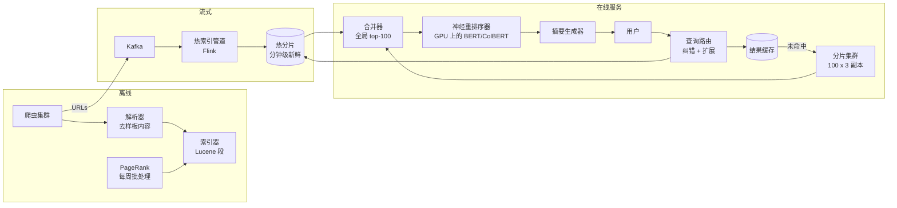
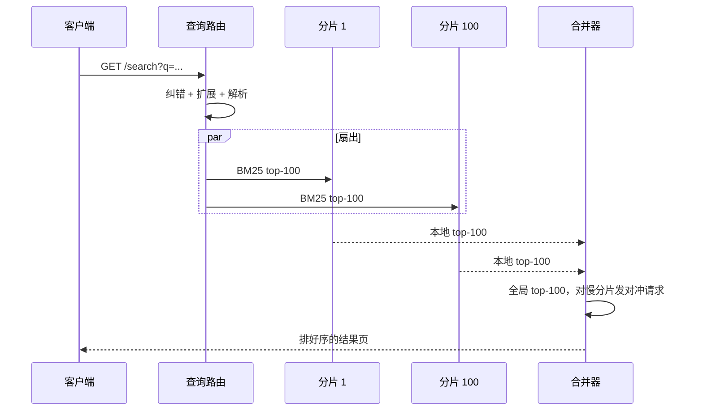
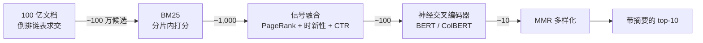
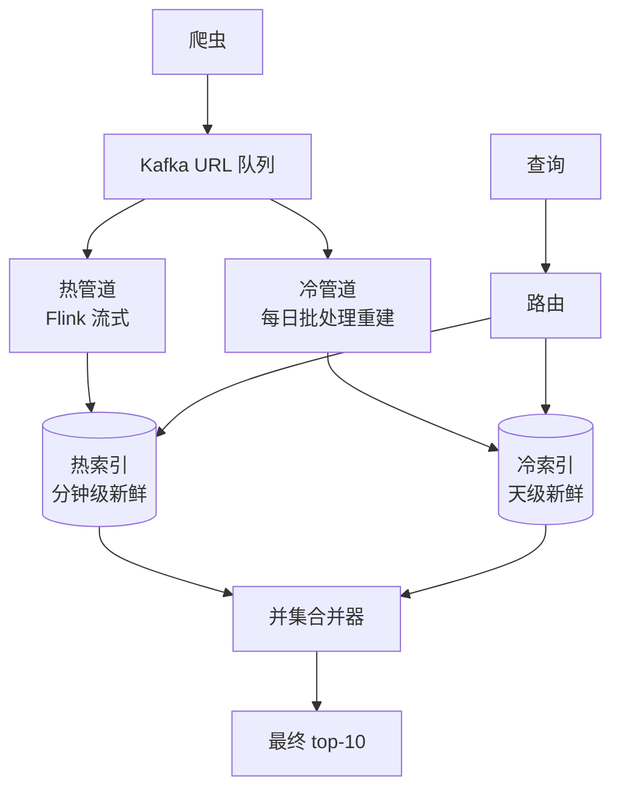

# 设计搜索引擎（Google 规模 / Brave Search）

> **TL;DR.** Web 搜索引擎要在 200 ms 内回答两个问题：“100 亿个页面里哪些包含这些词？”以及“其中哪 10 个应该排在最前？”整套架构是一个分片倒排索引（100 个分片，按文档切分）加一条多级排序级联（ranking cascade）：BM25 扫描数十亿条倒排项，信号融合层（PageRank、时新性、CTR）把候选收窄到几百个，最后由神经交叉编码器（BERT/ColBERT）挑出那 10 条。Google 每天处理约 85 亿次查询，占全球市场份额约 90% [^1]。核心权衡是成本、质量、延迟三者之间的取舍：完整跑一遍交叉编码器的开销是 BM25 的 1,000 倍，所以级联每一级的筛选比例就是整个设计的全部。

## 学习目标

- 设计按文档分片的倒排索引，让查询扇出到 100 个分片，并在 200 ms 预算内完成结果合并
- 搭建多级排序级联（BM25、信号融合、神经重排序），并能说清每一级的候选数量为什么这么定
- 为 100 亿文档的语料做容量估算：存储、分片数、QPS、PageRank 图规模
- 判断什么时候只用 BM25 就够，什么时候神经重排序才值回它的 GPU 成本
- 把热新闻索引和冷长尾索引拆开，在查询时合并以获得时新性
- 识别扇出架构中的长尾延迟放大效应，并用对冲请求（hedged request）缓解

## 直觉理解

最朴素的搜索引擎就是对一个大文件做 `grep`。1,000 个文档时它很好用。到了 100 亿个文档，线性扫描要跑几个小时。倒排索引把问题翻转过来：不再为每个词扫描每个文档，而是直接拿词去查一份预先建好的、包含该词的所有文档清单。这个查找在哈希表里是 O(1)。

但倒排索引只回答“哪些文档匹配”，不回答“哪 10 个最重要”。真正的复杂度在排序。词袋打分器（BM25）便宜，但抓不住语义。神经模型（BERT）能理解含义，但在 TPU 上每个文档要花 50 ms [^2]。如果对 100 亿个文档全做神经打分，一次查询要跑好几年；如果一篇都不打分，质量就退回 1998 年。

打开这个设计的钥匙是：级联。每一级处理的文档数少一个数量级，而单个文档的处理成本高一个数量级。BM25 跑在数十亿条倒排项上，产出 1,000 个幸存者；信号融合层（PageRank、时新性、CTR）收窄到 100 个；神经交叉编码器挑出最后 10 个。所有级别的成本乘积仍然落在 200 ms 以内。架构的本质就是这个比例，而不是某一个模型。

## 需求

### 澄清问题

- **Q：是 Web 级（Google、Brave）还是垂直领域（电商、法律）？**
  假设：Web 级。100 亿文档，开放互联网，覆盖所有语言。

- **Q：排序路线选经典模型、神经模型，还是级联？**
  假设：两者级联。BM25 做第一级，神经重排序做最后一级。

- **Q：时新性预算是多少？**
  假设：新闻分钟级，普通网页小时级，长尾天级。

- **Q：要做个性化吗？**
  假设：只用位置和语言。不做按用户的点击历史（隐私优先，类似 Brave/DuckDuckGo）。

- **Q：支持哪些查询类型？**
  假设：自然语言、布尔查询、结构化运算符（`site:`、`filetype:`）。

- **Q：第一天就上哪些垂直搜索？**
  假设：只做文本。图片、视频、新闻是独立管道，共用前端。

### 功能需求

- 抓取并解析开放互联网（见 [设计网络爬虫](./08-web-crawler.md)）
- 为 100 亿文档构建并提供分片倒排索引
- 对布尔查询和自然语言查询返回带排序的结果
- 用 BM25 + PageRank + 神经重排序组成级联来排序
- 为每条结果生成摘录，高亮命中的查询词
- 提供相关查询推荐和自动补全（见 [设计搜索自动补全](./09-search-autocomplete.md)）

### 非功能需求

- **负载：** 持续 10 万 QPS，峰值 30 万
- **延迟：** 端到端 p50 < 100 ms，p99 < 200 ms
- **可用性：** 读路径 99.99%
- **时新性：** 新闻 < 1 小时，长尾 < 1 周
- **分片均衡：** 与均匀分布的偏差不超过 10%
- **容错：** 允许 1-2 个慢分片而不突破 SLO

## 容量估算

| 指标 | 数值 | 推导 |
|--------|------:|------------|
| 索引文档数 | 100 亿 | 设计目标 |
| 每文档抽出的文本 | 500 KB（压缩后） | 剥掉 HTML，去掉样板内容 |
| 内容存储总量 | 5 PB | 100 亿 × 500 KB |
| 倒排项存储 | 约 1 PB | 带位置的倒排索引 |
| 分片数 | 100 | 100 亿 / 每分片 1 亿文档 |
| 副本数 | 每分片 3 个 | 至少 300 个服务节点 |
| 查询 QPS（持续） | 10 万 | Google 约 99K QPS [^1] |
| 每查询扇出 | 100 个 RPC | 每个分片一个 |
| PageRank 图边数 | 3,000 亿 | 100 亿页面 × 平均约 30 条出链 |
| PageRank 图大小 | 约 1.2 TB | 紧凑整数对 |
| Common Crawl 参照 | 31.6 亿页面 / 424 TiB | 2024 年 2-3 月抓取 [^3] |

- **读写比：** 100:1。读是查询，写是爬虫摄取。
- **带宽：** 10 万 QPS × 10 条结果 × 每条摘要 2 KB = 服务集群出口 2 GB/s。
- **PageRank 重算：** 在 Pregel/Giraph 集群上每周批处理一次，3,000 亿条边约需 8 小时。
- **结果缓存：** 最热门的 1% 查询（头部查询）覆盖约 30% 的流量。一个 100 GB、TTL 5 分钟的结果缓存能卸掉可观的负载。

## API 与数据模型

### API 设计

```http
GET /v1/search?q=distributed+consensus&page=1&limit=10&locale=en
  Headers: X-Request-ID, X-Region
  Returns: 200 {
    "results": [
      {"url": "...", "title": "...", "snippet": "...", "score": 0.94}
    ],
    "total_estimated": 42000000,
    "corrections": {"did_you_mean": null},
    "related_queries": ["raft consensus", "paxos algorithm"],
    "latency_ms": 87
  }
  Errors: 429 rate limited, 503 degraded

GET /v1/suggest?q=distrib&locale=en&limit=10
  (Autocomplete endpoint; see Design Search Autocomplete)

POST /v1/feedback
  Body: {"query_id": "...", "clicked_url": "...", "position": 3}
  (CTR signal for offline ranker training)
```

- **分页：** 游标式。第 2 页起用偏移量重新执行查询（第 5 页之后不支持深翻页）。
- **限流：** 按 IP 的令牌桶，每客户端 100 QPS。
- **缓存键：** `(normalized_query, locale, region)`，用于非个性化结果。

### 数据模型

```text
-- Inverted index (per shard, Lucene-style segments)
term -> posting_list[(doc_id, term_freq, positions[])]
  Sharded by: doc_id range (each shard holds 100M docs)
  Compression: PForDelta on doc_id gaps, vbyte on positions

-- Document store (S3 + metadata DB)
doc_id -> {url, title, crawled_html, extracted_text, lang, last_modified}
  Partition key: doc_id

-- PageRank table (global, versioned)
doc_id -> {pagerank_score: float32, version: int}
  Joined into shard at segment-build time

-- Query log (Kafka topic, 30-day retention)
{query, locale, timestamp, clicked_results[], session_id}
  Feeds: ranker training, related-query mining, autocomplete
```

## 高层架构



*从抓取到搜索结果页的完整链路：离线索引构建冷索引，流式管道构建热索引，在线服务层同时扇出到两者并在 200 ms 内合并。*

**写路径：** 爬虫集群抓取页面，把原始 HTML 发布到 S3。解析器去掉样板内容、抽出正文、识别语言。索引器构建不可变的 Lucene 式段，并在后台合并（max_merged_segment 默认 5 GB [^4]）。PageRank 分数在段构建时就预先拼进每条文档记录。

**读路径：** 查询先到路由层，做拼写纠错和同义词扩展，然后查结果缓存。未命中时，路由层扇出到全部 100 个冷分片外加热分片。每个分片在本地跑 BM25，返回自己的 top-100。合并器汇总出全局 top-100，交给 GPU 上的神经重排序器，最终 top-10 抽取摘要后返回给用户。

**流式路径：** 为了新闻的时新性，爬虫把抓到的 URL 发布到 Kafka。Flink 管道解析并索引到一个很小的热分片（延迟分钟级）。查询路由同时扇出到热索引和冷索引，由合并器取并集 [^5]。

## 深入探讨

### 分片倒排索引与并行查询

**问题：** 单机内存装不下 1 PB 的倒排索引。分片是必须的，但分片策略决定了每次查询是打到所有分片还是只打一个。

**按文档分片（Google 的做法）：** 按 `doc_id` 切分语料，每个分片持有全体文档的一个横向切片 [^6]。每次查询扇出到全部 N 个分片（Web 级是 100 个）。每个分片对自己的倒排链表跑 BM25，返回本地 top-K。合并器汇总出全局 top-K。

**为什么不用按词分片？** 按词分片会把某个词的全部倒排项放在一个分片上。单词查询只打一个分片（很快），但多词查询需要跨分片 join（很慢）。更糟的是，“the”这类高频词会造出热点分片。按文档分片能让各分片大小均匀，并让摄取本地化：一篇新文档只碰一个分片 [^4]。

**长尾延迟放大：** 100 个分片，单分片 p99 = X ms 时，所有分片都在 X 内返回的概率是 (0.99)^100 = 36.6%。合并器实际感受到的 p99 由最慢分片的 p99.9 决定。缓解手段是对冲请求：在 90 分位截止时间再向该慢分片的第二个副本重发一次请求，谁先返回用谁。每分片独立截止时间让合并器在某个分片真的卡死时，用 99 个分片继续算 [^7]。



*每次查询都扇出到所有分片；合并器汇总结果，并对最慢的副本发对冲请求，以此压住长尾延迟。*

**BM25 打分：** 每个分片用的排序函数是 BM25，由 Robertson 和 Sparck Jones 提出 [^8]。对查询 Q 和文档 D：

```text
score(Q,D) = sum_{t in Q} IDF(t) * tf(t,D) * (k1+1) / (tf(t,D) + k1*(1-b+b*|D|/avgdl))
```

参数 k1（通常 1.2-2.0）控制词频饱和；b（通常 0.75）做文档长度归一 [^9]。BM25 对每个词是 O(倒排链表长度)，且天然可以跨分片并行。

### 神经重排序级联

**问题：** BM25 是词袋模型，分不清“apple fruit”和“Apple Inc.”。神经模型能捕捉语义，但在 TPU 上每个文档要花约 50 ms [^2]。在 200 ms 内对 100 亿文档全做神经打分是不可能的。

**级联方案：** 每一级更贵，但看到的候选更少：



*级联的每一级处理的文档数少一个数量级，单文档成本高一个数量级；乘起来仍落在 200 ms 预算内。*

**第 2 级：信号融合。** PageRank、时新性、历史 CTR 都是与查询无关的信号，在建索引时就预先拼进每条文档记录 [^6]。查询时它们与 BM25 线性融合。PageRank 本身是在 3,000 亿条边的 Web 图上做幂迭代，阻尼因子 0.85，通常 20-50 轮收敛 [^6]。它刻画的是群体投票出来的权威性，但可以被链接农场刷，这正是 Google 在 2012 年 4 月推出 Penguin 更新的原因 [^10]。

**第 3 级：神经重排序。** Nogueira 和 Cho（2019）把 BERT 当作段落重排序器，用在 MS MARCO 上 BM25 的 top 1,000 候选上，取得了当时的最好效果 [^2]。关键约束：BERT-base 最多 512 个 token，因此文档要截断到得分最高的段落。ColBERT（Khattab 和 Zaharia，SIGIR 2020）提出“延迟交互”：查询和文档的 token 各自独立编码，查询时用一个廉价的 MaxSim 算子算相似度 [^11]。因为文档向量可以预先算好，它能在低 100 倍的延迟下达到 BERT 级别的排序质量。

**学习排序（LTR）：** 在生产环境里，最终融合器常常是 LambdaMART（直接优化 NDCG 的梯度提升树），输入特征包括 BM25 分数、PageRank、时新性、CTR 和神经相似度 [^12]。Burges 2010 年的综述梳理了从 RankNet（成对损失）到 LambdaRank（隐式 NDCG 梯度）再到 LambdaMART（树模型）的演进 [^13][^14][^12]。

**Google 的 BERT：** BERT 排序于 2019 年 10 月 25 日上线，影响了 1/10 的美国英语查询 [^15]。MUM（Multitask Unified Model）在 2021 年 5 月跟进，Google 称它处理多模态、多语言查询的能力“比 BERT 强 1,000 倍” [^16]。

### 查询理解与时新性管道

**查询理解**把原始查询转换成与语料匹配的表示：

1. **分词与归一化：** Unicode NFC、转小写、语言检测。
2. **拼写纠错：** 噪声信道模型 P(纠正|错拼) = P(错拼|纠正) × P(纠正)。Peter Norvig 那个极简的玩具纠错器（按 Norvig 自己的说法约“半页代码”）就演示了这个原理 [^17]。生产系统还要加上键盘距离权重和基于 Transformer 的上下文纠错。Google 曾表示每天大约有 15% 的查询是以前从未出现过的。
3. **同义词扩展：** “NYC”扩展为“New York City”。扩展过猛会损害准确率。
4. **实体识别：** 技术语境里的“Apple”路由到公司实体，而不是水果。
5. **运算符解析：** `site:github.com`、`filetype:pdf`、`-exclude`。

**时新性管道：** Google 在 2010 年用 Percolator + Caffeine 替换了批处理 MapReduce 索引器。Percolator 论文报告：每天处理的文档数不变，而 Google 搜索结果中文档的平均年龄降低了 50%；Caffeine 的发布公告同样声称持续索引带来了“50% 更新的结果” [^5]。Caffeine 博客称“单个数据库里近 1 亿 GB 存储”，并持续索引“每秒数十万个页面” [^18]。

架构把索引拆成热（分钟级新鲜，由流式管道构建）和冷（天级新鲜，批处理重建）。查询路由同时扇出到两者，合并器取并集：



*新闻由流式管道索引进一个小热索引；长尾躺在大冷索引里；合并器在查询时取并集。*

## 真实案例

**Google 搜索：从 2,400 万页面到 100 PB**

1998 年，Brin 和 Page 描述了一个在斯坦福的廉价机器集群上索引 2,400 万页面的系统 [^6]。那套架构里有词典（lexicon）、桶（barrel，即倒排链表的分片）、存放原始 HTML 的仓库，以及编码词位置的命中列表。PageRank 只在一台工作站上跑。

到 2010 年，系统规模已经大到批处理 MapReduce 无法提供足够新的结果。Caffeine 重建用 Percolator（Bigtable 上的增量事务）替换了索引器，把已索引文档的平均年龄砍掉约 50% [^5]。Caffeine 博客宣布存储达到“近 1 亿 GB”（约 100 PB）[^18]。查询扇出到由 Bigtable/Colossus 支撑的分片集群，排序融合经典特征与跑在 TPU pod 上的 BERT [^15]。

商业规模令人咋舌：Alphabet 公布 2024 年第一季度“Google 搜索及其他”收入 460 亿美元 [^1]。2024 年 8 月 5 日，美国联邦地区法院裁定 Google 非法垄断通用搜索，据报道其每年为默认搜索位置支付约 260 亿美元 [^19]。这一判决正在重塑竞争格局。

**Brave Search** 代表独立路线：自建的 300 亿页面索引 [^20]，2024 年 12 月 11.9 亿次自然查询 [^21]，并从 2023 年 4 月起 100% 不依赖 Bing [^22]。Brave 的隐私优先模式不做任何按用户的查询日志，证明了有竞争力的搜索引擎也可以完全不做个性化。

非专家常忽略的一点：Google 的统治力主要不来自算法，而来自分发（Chrome、Android、Safari 的默认位）加上 25 年的点击数据反馈回路——后来者除非从零自建索引，否则复制不了。

## 权衡

| 决策 | 方案 A | 方案 B | 我们的选择 | 原因 |
|----------|----------|----------|------------|-----|
| 索引结构 | 倒排（Lucene） | 正排索引 | 倒排 | BM25 需要“词→文档”查找；正排只适合标签过滤 [^4] |
| 分片策略 | 按 doc_id | 按词 | 按 doc_id | 分片大小均匀；摄取本地化；按词分片会产生热点分片 [^6] |
| 排序流程 | 两级级联 | 单个深度模型 | 级联 | 达到同等 top-10 质量，成本低约 100 倍 [^2][^11] |
| 第一级排序器 | BM25 | 稠密检索（DPR） | BM25 | 在 100 亿文档规模上，倒排链表求交无人能敌；DPR 在罕见词上会失效 [^23] |
| 神经重排序器 | 完整交叉编码器 | ColBERT 延迟交互 | ColBERT | 延迟低 100 倍；文档向量可预计算 [^11] |
| 时新性 | 单索引 + 批重建 | 热冷拆分 | 热冷拆分 | 新闻需要分钟级；长尾能容忍天级 [^5] |
| 摘要生成 | 建索引时预计算 | 查询时抽取 | 查询时抽取 | 结合查询的高亮更相关；最终只有 10 篇文档，成本很低 |

最大的一个元决策：**级联深度与质量的取舍。** Google 跑 4 级以上，因为广告收入撑得起 GPU 成本。创业公司（Brave、Kagi）用 BM25 加一个轻量 LTR 模型就能上线，对 90% 的查询仍有竞争力。只有当流量大到能摊平 GPU 集群成本时，神经重排序才值这个钱。

## 扩展与故障模式

**10 倍负载（100 万 QPS）：** 结果缓存吸掉头部查询。给每个分片加副本（从 3 个到 6 个）。神经重排序需要扩 GPU 集群，或做模型蒸馏（MiniLM、TinyBERT）。

**100 倍负载（1,000 万 QPS）：** 分片数从 100 增到 1,000。扇出合并变成两级树（10 个超级分片，每个再扇出到 100 个子分片）。头部查询在 CDN 做边缘缓存。PageRank 重算从每周改为增量（Percolator 式）。

**1,000 倍负载（1 亿 QPS）：** 架构重写。CDN 优先，前 1,000 万个查询的搜索结果页预渲染后从边缘直接返回。源站只处理长尾和新鲜查询。索引本身可能按语言拆成多个集群，各自独立的分片池。

**故障模式：**

- **区域级故障：** 分片副本跨区域部署。路由层切换到最近的健康副本集。降级模式：在副本恢复期间从结果缓存返回（数据最多陈旧 5 分钟）。
- **神经重排序 GPU 故障：** 回落到信号融合级（BM25 + PageRank）。质量大约掉 15-20% NDCG，但延迟反而更好。通过在线 NDCG 监控对质量回退告警。
- **段合并风暴：** 大段合并接连发生，把查询用的 CPU 抢光。缓解：限制每分片的合并并发数、把合并排在低峰期、用 warmer 在对外服务前预读新段 [^4]。
- **PageRank 版本漂移：** 每周重算期间，新旧分数并存。部署时按比例混合两个版本（80% 新、20% 旧），避免排名抖动。

## 常见陷阱

> [!WARNING]
> **忽视长尾延迟放大。** 100 个分片时，全部落在 p99 以内的概率只有 0.366。合并器实际感受到的 p99 是最慢分片的 p99.9。务必实现对冲请求和每分片截止时间 [^7]。

> [!WARNING]
> **对全部候选做神经打分。** BERT 交叉编码器 50 ms/文档，1,000 个候选就是 50 秒。级联存在的意义就是把神经打分限制在约 100 篇文档上。跳过级联，延迟预算直接超 250 倍 [^2]。

> [!WARNING]
> **倒排索引按词分片。** 高频词（“the”、“is”）会造出极热的分片。按文档分片才能保持分片均匀，并让摄取本地化 [^6]。

> [!WARNING]
> **把原始 CTR 直接当排序信号。** 第 1 位无论是否相关都会拿到更多点击。原始 CTR 回流进排序会形成锁定循环。用交错评估（interleaving）或逆倾向加权来去偏 [^12]。

> [!WARNING]
> **只有单一时新性层级。** 纯批处理索引会让新闻查询返回一天前的内容；纯流式索引对长尾来说又太贵。把热和冷拆开，在查询时合并 [^5]。

> [!WARNING]
> **段合并后缓存冷启动。** 新合并出的段不在操作系统页缓存里，最初几批查询会打到磁盘。用 warmer 在把流量导到新段之前预读热词 [^4]。

## 追问

**1. 你会怎么加上垂直搜索（图片、视频、新闻）？**

每个垂直领域跑自己的索引和排序管道。前端的“通用搜索”融合器根据查询意图分类，把垂直结果和 Web 结果交错编排。延迟预算共享：如果图片垂直很慢，就把它排除，而不是拖慢整个结果页。

**2. “答案优先”的结果（知识图谱、精选摘要）怎么设计？**

一条并行管道把结构化事实抽进知识图谱（实体-属性-值三元组）。查询时由意图分类器识别事实型查询，路由到知识图谱查找。精选摘要则从排名最高的文档中抽出最匹配的段落。两者都与主排序级联并行运行。RAG 扩展见 [设计 Perplexity AI 搜索](./33-perplexity-ai-search.md)。

**3. 系统怎么接入一种新语言？**

加语言相关的分词器（中文用 jieba，日文用 kuromoji）、停用词表和词干提取器。用该语区的查询日志重训拼写纠错器。分词做对了，BM25 就能跨语言工作。神经重排序需要多语言微调（mBERT 或 XLM-R）。

**4. 广告怎么和自然结果交错？**

广告竞价与自然排序并行进行。一个“融合器”把广告位插到结果页的固定位置（顶部 1-3 位，底部 2 位）。广告系统有自己的延迟预算（50 ms）。广告超时就只返回自然结果。永远不要让广告的延迟阻塞自然结果路径。

**5. 隐私优先的引擎（Brave、DuckDuckGo）有哪些不同？**

没有按用户的查询日志，排序里没有任何个性化信号。所有排序都是与查询无关的信号加 BM25。时新性靠爬虫而不是用户行为。代价：个性化查询上的 NDCG 大约低 5%，但监管风险为零，也没有点击模型的位次偏差 [^22]。

**6. 怎么接入 RAG 来做直接回答？**

排序级联产出 top-10 之后，把 top-3 文档连同查询一起交给 LLM 做答案合成。把生成的答案展示在蓝色链接上方，并标注来源。延迟预算：答案 500 ms（在结果页加载后异步展示）。完整模式见 [RAG 管道](../../../hld/part-9-ai-ml-system-design/01-rag-pipelines.md)。

## 练习

### 练习 1：估算神经重排序集群规模

你的搜索引擎承载 10 万 QPS。神经重排序器（ColBERT）每次查询处理 100 个候选，每个候选 0.5 ms（延迟交互，不是完整交叉编码器）。如果每块 GPU 能同时处理 200 个打分请求，需要多少块 GPU？

<details>
<summary>提示</summary>

先算出所需的总打分吞吐（候选/秒），再除以单 GPU 的容量。注意每次查询产生 100 次打分操作，不是 1 次。

</details>

<details>
<summary>解答</summary>

1. 每秒打分的候选总数：10 万 QPS × 100 个候选 = 1,000 万候选/秒。
2. 单候选延迟：0.5 ms，即每个串行流每秒 2,000 个候选。
3. 单 GPU 在 200 个并发请求下的吞吐：200 × 2,000 = 40 万候选/秒。
4. 所需 GPU：1,000 万 / 40 万 = 25 块。
5. 为突发和故障切换留 2 倍余量：50 块。

接受的权衡：ColBERT 的延迟交互（0.5 ms/候选）比完整交叉编码器（50 ms/候选）便宜 100 倍，后者在同等吞吐下需要 5,000 块 GPU。质量差距约 2-3% NDCG [^11]。

</details>

## 要点回顾

- **按 doc_id 分片，不要按词分片。** 每次查询都打到所有分片，但在 Web 规模上，文档均衡胜过词倾斜。
- **排序是一条级联，不是一个模型。** BM25 跑在数十亿上，神经模型跑在约 100 上。这个比例就是整个设计。
- **与查询无关的信号（PageRank、时新性、CTR）预先拼进分片。** 永远不要在热路径上计算它们。
- **你付出的是长尾延迟，不是平均延迟。** 100 个分片时，要么在 90 分位截止时间发对冲请求，要么错过 SLO。
- **为时新性把热冷拆开。** 新闻需要分钟级，长尾能容忍天级。在查询时合并。
- **级联比例决定 GPU 成本。** 每级候选数降 10 倍，所需 GPU 就少 10 倍。

## 延伸阅读

- [The Anatomy of a Large-Scale Hypertextual Web Search Engine (Brin and Page, 1998)](http://infolab.stanford.edu/~backrub/google.html)。原始的 Google 论文，讲 PageRank、倒排索引和爬虫；至今仍是搜索架构最好的入门读物。
- [Introduction to Information Retrieval (Manning, Raghavan, Schutze)](https://nlp.stanford.edu/IR-book/)。斯坦福教材，从第一性原理讲 BM25 推导、倒排索引和经典排序。
- [Passage Re-ranking with BERT (Nogueira and Cho, 2019)](https://arxiv.org/abs/1901.04085)。神经重排序的经典论文，展示 BERT 在 BM25 的 top-1000 候选上就能在 MS MARCO 上达到最好效果。
- [ColBERT: Late Interaction over BERT (Khattab and Zaharia, SIGIR 2020)](https://arxiv.org/abs/2004.12832)。如何预计算文档向量，在低 100 倍的延迟下拿到 BERT 级排序质量。
- [Large-scale Incremental Processing Using Distributed Transactions (Peng and Dabek, OSDI 2010)](https://research.google/pubs/large-scale-incremental-processing-using-distributed-transactions-and-notifications/)。Percolator 论文，支撑了 Google Caffeine 的实时索引。
- [From RankNet to LambdaRank to LambdaMART (Burges, 2010)](https://www.microsoft.com/en-us/research/publication/from-ranknet-to-lambdarank-to-lambdamart-an-overview/)。学习排序的完整演进；做生产级排序器的必读材料。
- [Dense Passage Retrieval (Karpukhin et al., EMNLP 2020)](https://arxiv.org/abs/2004.04906)。用双编码器检索替代 BM25 做问答；搞清它什么时候赢、什么时候 BM25 仍然占优。
- [Common Crawl monthly statistics](https://commoncrawl.org/blog/february-march-2024-crawl-archive-now-available)。每月 30 亿页面 / 400 TiB；学生可以做量级估算的公开语料。

## 记忆卡片

<details>
<summary><strong>问：Google 搜索每秒处理多少查询，市场份额多少？</strong></summary>

答：约 99,000 QPS（约每天 85 亿次查询），截至 2025 年全球市场份额约 90% [^1]。

</details>

<details>
<summary><strong>问：为什么按 doc_id 分片而不是按词分片？</strong></summary>

答：按文档分片能让分片大小均匀，并让摄取本地化（一篇新文档只碰一个分片）。按词分片会为“the”这类高频词造出热点分片，多词查询还需要跨分片 join [^6]。

</details>

<details>
<summary><strong>问：100 分片扇出的长尾延迟问题是什么？</strong></summary>

答：所有 100 个分片都在 p99 内返回的概率 = (0.99)^100 = 36.6%。合并器实际感受到的 p99 是最慢分片的 p99.9。缓解手段是在 90 分位截止时间重发对冲请求。

</details>

<details>
<summary><strong>问：BM25 的参数 k1 和 b 分别控制什么？</strong></summary>

答：k1（通常 1.2-2.0）控制词频饱和：额外出现多少次之后就不再重要。b（通常 0.75）控制文档长度归一：长文档被罚多重 [^8][^9]。

</details>

<details>
<summary><strong>问：为什么用级联而不是对所有文档做神经打分？</strong></summary>

答：BERT 交叉编码器每个文档约 50 ms，1,000 个候选就要 50 秒。级联先用便宜的 BM25 把数十亿文档筛下去，把神经打分限制在约 100 篇文档上 [^2]。

</details>

<details>
<summary><strong>问：ColBERT 怎么在更低延迟下达到 BERT 级排序质量？</strong></summary>

答：延迟交互：文档 token 在离线阶段编码一次。查询时只编码查询 token，用一个廉价的 MaxSim 算子算逐 token 相似度。比完整交叉编码器快 100 倍 [^11]。

</details>

<details>
<summary><strong>问：Google 的 Caffeine（2010）解决了什么问题？</strong></summary>

答：它用基于 Percolator 的 Bigtable 增量索引替换了批处理 MapReduce 索引，把已索引文档的平均年龄降低约 50%，并让新闻获得分钟级时新性 [^5]。

</details>

<details>
<summary><strong>问：PageRank 的阻尼因子是什么，为什么需要它？</strong></summary>

答：阻尼因子 d（通常 0.85）刻画随机游走者顺着链接走而不是随机跳转的概率。没有它，排名汇点（没有出链的页面）会把所有概率质量吸走 [^6]。

</details>

<details>
<summary><strong>问：热冷索引拆分是怎么实现时新性的？</strong></summary>

答：流式管道（Flink）把新闻索引进一个小热分片（延迟分钟级）。大的冷索引每天批处理重建。查询路由同时扇出到两者，合并器在查询时取并集 [^5]。

</details>

<details>
<summary><strong>问：是什么触发了 Google 的 Penguin 更新（2012 年 4 月）？</strong></summary>

答：链接农场人为抬高 PageRank。Penguin 会降权那些链接结构看起来像在操纵的页面，针对的正是 PageRank 随机游走模型的根本弱点 [^10]。

</details>

<details>
<summary><strong>问：LambdaMART 是什么，它在排序流程的哪个位置？</strong></summary>

答：LambdaMART 是梯度提升决策树模型，通过隐式 lambda 梯度直接优化 NDCG。它位于 BM25 和神经级之后的最终融合位，把所有特征合成一个排序分 [^12]。

</details>

## 参考文献

[^1]: Wikipedia, "Google Search" (market share and query-volume summary, accessed 2026-05-08): "As of 2025, Google Search has a 90% share of the global search engine market." https://en.wikipedia.org/wiki/Google_Search

[^2]: Nogueira, R. and Cho, K. "Passage Re-ranking with BERT" (2019). https://arxiv.org/abs/1901.04085

[^3]: Common Crawl, "February/March 2024 Crawl Archive Now Available". https://commoncrawl.org/blog/february-march-2024-crawl-archive-now-available

[^4]: Elasticsearch Reference, merge settings. https://elastic.co/docs/reference/elasticsearch/index-settings/merge

[^5]: Peng, D. and Dabek, F. "Large-scale Incremental Processing Using Distributed Transactions and Notifications" (Percolator/Caffeine, OSDI 2010). https://research.google/pubs/large-scale-incremental-processing-using-distributed-transactions-and-notifications/

[^6]: Brin, S. and Page, L. "The Anatomy of a Large-Scale Hypertextual Web Search Engine" (1998). http://infolab.stanford.edu/~backrub/google.html

[^7]: Dean, J. and Barroso, L.A. "The Tail at Scale" (Communications of the ACM, Feb 2013). https://research.google/pubs/the-tail-at-scale/

[^8]: Wikipedia, "Okapi BM25" (covers Robertson/Sparck Jones history and formula). https://en.wikipedia.org/wiki/Okapi_BM25

[^9]: Stanford NLP IR Book, "Okapi BM25: A non-binary model". https://www-nlp.stanford.edu/IR-book/html/htmledition/okapi-bm25-a-non-binary-model-1.html

[^10]: Wikipedia, "Google Penguin". https://en.wikipedia.org/wiki/Google_Penguin

[^11]: Khattab, O. and Zaharia, M. "ColBERT: Efficient and Effective Passage Search via Contextualized Late Interaction over BERT" (SIGIR 2020). https://arxiv.org/abs/2004.12832

[^12]: Burges, C. "From RankNet to LambdaRank to LambdaMART: An Overview" (Microsoft Research, 2010). https://www.microsoft.com/en-us/research/publication/from-ranknet-to-lambdarank-to-lambdamart-an-overview/

[^13]: Burges, C. et al. "Learning to Rank using Gradient Descent" (ICML 2005, RankNet). https://www.microsoft.com/en-us/research/publication/learning-to-rank-using-gradient-descent/

[^14]: Burges, C. "Learning to Rank with Non-Smooth Cost Functions" (LambdaRank, NIPS 2006). https://www.microsoft.com/en-us/research/publication/learning-to-rank-with-non-smooth-cost-functions/

[^15]: Nayak, P. "Understanding searches better than ever before" (Google, Oct 25 2019). https://blog.google/products-and-platforms/products/search/search-language-understanding-bert/

[^16]: Google blog, "A new AI milestone for understanding information" (MUM, May 2021). https://blog.google/products/search/introducing-mum/

[^17]: Norvig, P. "How to Write a Spelling Corrector". http://norvig.com/spell-correct.html

[^18]: Grimes, C. "Our new search index: Caffeine" (Google, June 9 2010). https://developers.google.com/search/blog/2010/06/our-new-search-index-caffeine

[^19]: Goodwin Law alert, "Google is an Illegal Monopoly, Federal Court Rules" (Aug 2024). https://www.goodwinlaw.com/en/insights/publications/2024/08/alerts-technology-antc-google-is-an-illegal-monopoly

[^20]: Brave Search API page. https://brave.com/search/api/

[^21]: Brave, "Brave Search Ads report massive 1500% growth in click volume alongside 80% increase in organic searches in 2024" (Feb 2025). https://brave.com/blog/2025-search-ads-update/

[^22]: Brave blog, "Brave Search removes last remnant of Bing from search results page" (April 2023). https://brave.com/search-independence

[^23]: Karpukhin, V. et al. "Dense Passage Retrieval for Open-Domain Question Answering" (EMNLP 2020). https://arxiv.org/abs/2004.04906
