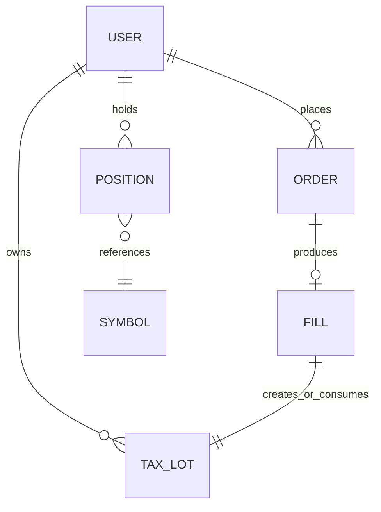
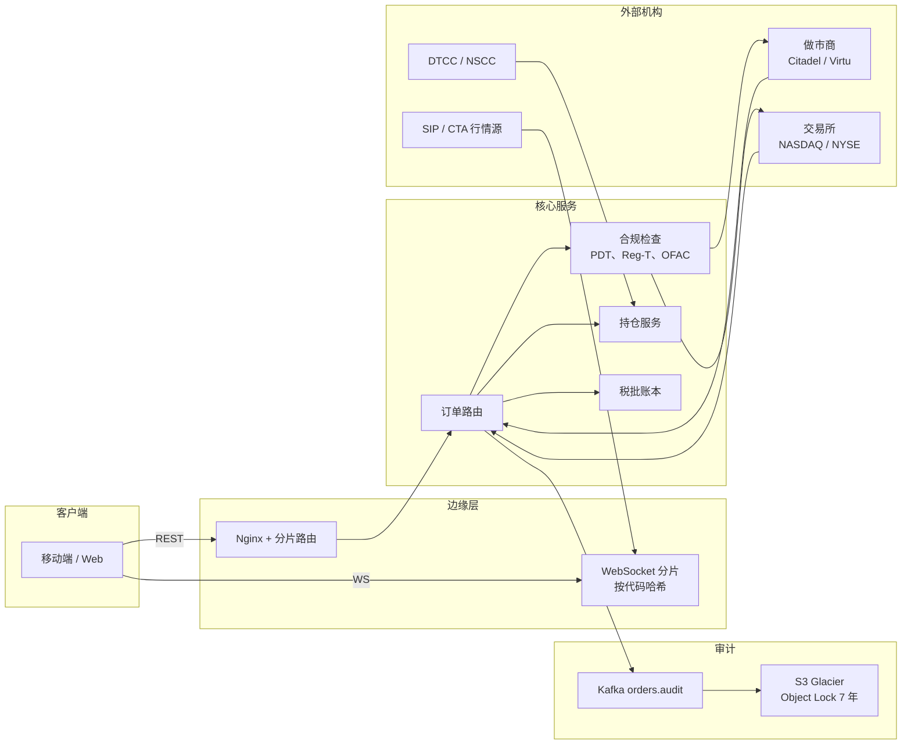
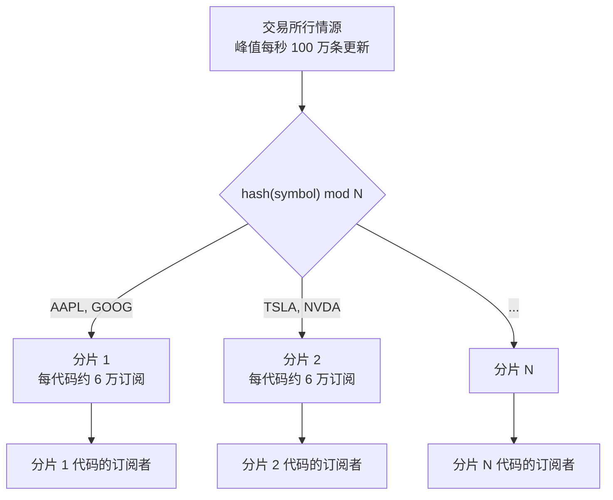
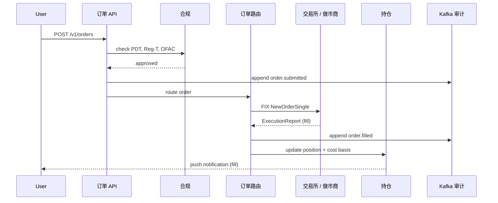

# 设计一个券商交易平台（Robinhood / E*TRADE / Interactive Brokers）

> **TL;DR.** 零售券商本质上是托管加路由的一层，不是撮合引擎。它每天把 500 万笔订单路由到交易所或批发做市商，通过按代码分频道的 WebSocket 把每秒 100 万条行情更新扇出给 3000 万订阅者，在 T+1 把碎股对账到分，并按 SEC 17a-4 规则把每个事件留存七年。核心权衡是 PFOF（零佣金、靠返点补贴）与直连交易所（成交质量更好、但要付接入费）。Robinhood 在 13 个月里从每秒 10 万请求涨到 200 万请求，靠的是对 Postgres 支撑的券商单体做应用层分片[^1][^2]。

## 学习目标

- 设计一套按代码分频道的 WebSocket 扇出，在峰值每秒 100 万条行情更新、每个代码平均 6 万订阅者的条件下仍然撑得住
- 区分零售券商与撮合引擎，并独立估算订单路径、行情路径、持仓路径的容量
- 说清 PFOF 与直连交易所路由的取舍，以及对应的监管约束（Rule 606、Rule 611、最佳执行义务）
- 建模碎股聚合，含每日 T+1 对账和公司自有账户的吸收取整
- 实现税批核算（FIFO/LIFO/指定批次），并在 61 天窗口（亏损卖出前 30 天与后 30 天）内做洗售检测
- 设计满足 SEC 17a-4 的七年不可篡改审计链

## 直觉理解

券商看起来像个 CRUD 应用。收单、转发到某处、更新余额。一个周末的黑客松就能做出来。

现在加上真实约束。美东时间 9:30，1000 万用户同时打开 App，每人订阅 20 个代码。交易所行情源瞬间冲到每秒 100 万条更新。如果你按用户推流，每秒就要产生 600 亿次投递事件。任何你付得起的机器规模都做不到。

朴素做法（每个用户一条 WebSocket，每次 tick 遍历他所有代码）在规模上必然崩掉。关键洞察是：把拓扑倒过来。按代码分片，而不是按用户分片。一条交易所 tick 只会落到一个分片上，然后在一个紧凑循环里扇出给该代码的所有订阅者。复杂度是 O(代码数 + 订阅者数)，不是 O(用户数 × 代码数)。这和社交信息流里直播评论的扇出是同一个模式，只是延迟要求更严（p99 低于 50 毫秒），而且做错了要承担监管后果。

第二个不那么显然的约束：这个系统的每一层都被外部法规框定。开户前要 KYC。每四次日内交易前要查 PDT 权益。每笔杠杆买入前要查 Reg T 保证金。洗售检测要覆盖 61 天窗口。每一笔订单、成交、撤单都要七年不可篡改留存。漏掉任何一条，你收到的是 SEC 的函件，不是 500 错误。

[设计一个证券交易所（撮合引擎）](./20-stock-exchange.md)设计的是以微秒级撮合订单的场所。本章设计的是夹在 3000 万零售用户与那个场所之间的券商。不同的问题，不同的规模，不同的监管。

## 需求

### 澄清问题

- **问：只做股票，还是也要期权、加密货币、期货？**
  假设：美股与 ETF。期权作为后续扩展。加密货币单独深挖。
- **问：收入模型？**
  假设：股票走 PFOF 补贴的零佣金；专业版可选直连交易所。
- **问：支持碎股吗？**
  假设：支持。聚合成整股母单，每日对账。
- **问：行情是给所有用户，还是只给订阅的代码？**
  假设：只推自选列表里订阅的代码（人均 20 个）。零售用 SIP Level 1，专业版用 Level 2。
- **问：盘前盘后交易？**
  假设：支持，路由到 ECN，并提示流动性不足。
- **问：监管范围？**
  假设：完整的美国经纪自营商资质：FINRA、SEC、SIPC（50 万美元保护）、KYC/AML、PDT、Reg T 保证金[^3][^4][^5]。

### 功能需求

- 通过 WebSocket 查看订阅代码的实时行情（买价/卖价/最新价）
- 下单（市价、限价、止损、止损限价）并接收成交确认
- 查看持仓：头寸、成本基准、浮动盈亏、当日变动
- 买入碎股（按金额下单，由券商聚合）
- 生成年终税务文件（含成本基准申报的 1099-B）
- 通过 ACH/电汇入金；出金到绑定银行账户

### 非功能需求

- **行情延迟：** 从交易所行情源到客户端设备 p99 < 50 毫秒
- **订单确认：** 从提交到合规放行路由 p99 < 100 毫秒
- **可用性：** 交易时段（美东 9:30-16:00，每年 252 个交易日）99.99%
- **并发 WebSocket：** 开盘时 1000 万；非高峰 300-500 万
- **审计留存：** 7 年，不可篡改，依据 SEC 17a-4[^5]
- **持仓准确性：** 精确到分；每日 T+1 对账

## 容量估算

| 指标 | 数值 | 推导 |
|--------|------:|------------|
| 行情更新（峰值） | 每秒 100 万 | 1 万个代码 × 开盘时每秒 100 次更新[^6] |
| 订阅数 | 6 亿 | 3000 万用户 × 人均 20 个自选代码 |
| 扇出事件（朴素做法） | 每秒 600 亿 | 100 万次更新 × 每代码平均 6 万订阅 |
| 订单数/天 | 500 万 | Robinhood 量级的零售成交量 |
| 订单存储/天 | ~10 GB | 500 万 × 500 B 原始数据 + 审计索引 |
| 并发 WebSocket | 1000 万 | 开盘峰值 |
| 持仓重算/天 | 500 万 | 每笔成交一次 |
| 审计存储/年 | ~3.6 TB | 10 GB/天 × 365 |
| 七年归档 | ~25 TB | 压缩后存 S3 Glacier |

关键比例：每秒 100 万条入站 tick 会产生 600 亿次潜在投递事件。按代码分频道的扇出把实际工作量压到 100 万次广播操作（每个分片每次 tick 一次），每次广播对着预先构建好的订阅者列表展开。不做这个倒转，系统根本不可行。

## API 与数据模型

### API 设计

```http
POST /v1/orders
  Idempotency-Key: <uuid>
  Body: { "symbol": "AAPL", "side": "buy", "qty": 10, "type": "limit",
          "limit_price": 185.50, "time_in_force": "day" }
  Returns: 201 { "order_id": "ord_abc123", "status": "pending_compliance" }
  Errors: 400 invalid, 403 PDT/margin violation, 429 rate limited

GET /v1/portfolio
  Returns: 200 { "positions": [...], "total_value": 42150.00,
                  "day_change": +312.50, "buying_power": 8200.00 }

WS /v1/quotes/subscribe
  Client sends: { "action": "subscribe", "symbols": ["AAPL","TSLA","NVDA"] }
  Server pushes: { "s": "AAPL", "b": 185.42, "a": 185.44, "l": 185.43, "seq": 9001 }

GET /v1/portfolio/tax-lots?symbol=AAPL
  Returns: 200 { "lots": [{ "qty": 5, "cost_basis": 172.30,
                  "acquired": "2024-03-15", "holding": "long_term" }] }

POST /v1/deposits
  Body: { "amount": 5000, "method": "ach", "bank_account_id": "ba_xyz" }
  Returns: 202 { "deposit_id": "dep_456", "available_at": "2026-05-06" }
```

### 数据模型

```sql
-- 持仓（PostgreSQL，按 user_id 分片）
CREATE TABLE positions (
  user_id       BIGINT NOT NULL,
  symbol        VARCHAR(10) NOT NULL,
  qty           DECIMAL(18,8),  -- 碎股精度
  avg_cost      DECIMAL(12,4),
  PRIMARY KEY (user_id, symbol)
);

-- 税批（只追加的账本）
CREATE TABLE tax_lots (
  lot_id        BIGSERIAL PRIMARY KEY,
  user_id       BIGINT NOT NULL,
  symbol        VARCHAR(10),
  qty           DECIMAL(18,8),
  cost_basis    DECIMAL(12,4),
  acquired_at   DATE,
  consumed_qty  DECIMAL(18,8) DEFAULT 0,
  wash_sale_adj DECIMAL(12,4) DEFAULT 0
);

-- 订单（PostgreSQL + Kafka 镜像）
CREATE TABLE orders (
  order_id      UUID PRIMARY KEY,
  user_id       BIGINT NOT NULL,
  symbol        VARCHAR(10),
  side          VARCHAR(4),
  qty           DECIMAL(18,8),
  limit_price   DECIMAL(12,4),
  status        VARCHAR(20),  -- pending、routed、filled、cancelled
  route         VARCHAR(20),  -- pfof_citadel、exchange_nasdaq 等
  created_at    TIMESTAMPTZ,
  filled_at     TIMESTAMPTZ
);
```



*每笔成交会创建（买入）或消耗（卖出）税批；持仓按用户按代码聚合税批。*

## 高层架构



*移动端通过 REST 下单、通过 WebSocket 看行情；Kafka 审计主干把数据送进 S3 Glacier，满足 SEC 17a-4 的七年留存。*

**写路径（订单）。** 客户端通过 REST 提交订单。Nginx 分片路由把 `user_id` 映射到对应的应用分片[^1]。合规服务检查 PDT 权益（最低 2.5 万美元；按 2026 年 4 月批准的 SR-FINRA-2025-017，将被基于风险的 tier 取代，18 个月分阶段落地）[^7]、Reg T / FINRA Rule 4210 保证金（初始 50%、维持 25%）[^3]，以及 OFAC 名单筛查。通过后，订单路由选择交易场所（PFOF 做市商或明池交易所），发出 FIX NewOrderSingle。成交后，持仓服务更新头寸，税批账本创建或消耗税批。

**读路径（行情）。** SIP 合并行情源提供 Level 1 报价。以 `hash(symbol)` 为键的 WebSocket 分片接收 tick，把增量编码后的更新广播给该代码的所有订阅者。客户端在 50-100 毫秒窗口内合并更新。

**异步路径（审计）。** 每个订单事件（已提交、已路由、已成交、已撤销）都追加到 Kafka 主题 `orders.audit`。消费者把它写入开启 Object Lock（WORM）的 S3 Glacier，实现不可篡改的七年留存。

## 深入探讨

### 面向数百万用户的实时行情扇出

反模式是按用户投递：每个 tick 都遍历一遍该用户的自选列表。3000 万用户、人均 20 个代码，每秒就是 O(6 亿) 的工作量。开盘即崩。

正确的模式是按代码分频道扇出。WebSocket 服务器按 `hash(symbol)` 分片。每个分片负责一部分代码，并为这些代码维护预构建的订阅者列表。一条入站 tick 只会落到一个分片上，在一个紧凑循环里完成扇出[^6]。

**增量编码**只传变化的字段（价格、数量），而非整条报价。配合客户端合并（把 100 毫秒窗口内的多次更新压成每个代码的末值），出口带宽大约降到十分之一。

**热门代码不均衡：** TSLA 有 100 万订阅者，小盘股只有 500。缓解手段：把最热门的 1% 代码按一致性哈希拆到多个频道副本上。TSLA 的订阅者列表拆到 4 个分片，每片承担 25 万连接。

**重连风暴：** 一次发布或网络抖动后，3000 万客户端同时重连。缓解手段：客户端做带抖动的指数退避；订阅压缩（把 20 个代码合成一帧订阅）；在美东 9:30 开盘铃前预扩容 WebSocket 入口（时间表可预测）。



*每条交易所 tick 只会落到一个分片上；该分片通过增量编码在一个紧凑循环里扇出给订阅者列表。*

### PFOF 与直连交易所路由

按 Reg NMS Rule 611（订单保护规则），任何成交价都必须等于或优于 NBBO[^8][^9]。Rule 610 把交易所接入费上限压到每股 0.003 美元[^8]。批发做市商（Citadel Securities、Virtu）把零售订单流内部化，以 NBBO 或更优价格成交，再按股向券商支付返点。仅 Citadel Securities 一家，就撮合了美国上市股票零售成交量的大约 25-35%[^10][^11]。

**经济账：** PFOF 返点养活了零佣金券商。Robinhood 2026 年第一季度交易收入：股票 8200 万美元、期权 2.6 亿美元、"其他"1.47 亿美元（主要是事件合约）[^12]。每股返点很小（不到一美分的零头），但一个季度几十亿股累起来就相当可观。

**争议：** 2020 年 12 月，SEC 对 Robinhood 罚款 6500 万美元，理由是它误导客户、把 PFOF 说成最大收入来源，并在 2015 至 2018 年间未能履行最佳执行义务。SEC 认定这些 PFOF 安排在非标普 500 成分股和超过 100 股的订单上造成了"劣于最优的成交价格"，扣除零佣金节省后估计给客户带来 3410 万美元损失[^13][^14]。

**路由决策**在订单路由里是一次策略判断：如果订单是非持有的零售股票且低于规模阈值，就路由给历史成交质量最好的 PFOF 做市商。如果订单很大、流动性差，或者客户选择了直连路由（专业版），就送去明池交易所。SEC Rule 606 要求按季度公开披露路由场所、收到的费用和成交质量[^15][^16]。

**智能订单路由（SOR）：** 对于超出做市商承接能力的大单，SOR 会拆到多个场所，以最小化市场冲击。这与机构券商用的是同一套模式，只是按零售规模缩小了。



*合规检查同步执行，耗时在 100 毫秒以内；审计写入 Kafka 发生在路由前后两个时点，保证不存在未被记录的状态迁移。*

### 碎股与税批核算

用 10 美元买一股 700 美元的 AAPL，得到 0.0143 股。交易所不支持碎股成交。券商每 N 秒把用户提交的碎股订单聚合成整股母单，执行母单后，再按比例把碎股份额重新分配给各用户。

**对账：** 每日 T+1，每个代码所有客户碎股持仓之和必须等于券商在清算机构持有的整股头寸。取整残差由专门的公司"取整"账户吸收。如果差异持续到 T+2，该代码的碎股交易暂停，等待调查。

**税批核算：** 每笔买入创建一个批次：`(qty, cost_basis, acquired_date)`。卖出按选择规则消耗批次（默认 FIFO，也可 LIFO 或指定批次）。每笔卖出的已实现盈亏 = 所有被消耗批次上 `(sale_price - cost_basis) x qty` 之和[^17]。

**洗售检测：** IRS Publication 550 / IRC 第 1091 条规定，如果纳税人在亏损卖出前后 30 天内买入"实质相同"的股票，该亏损不允许抵扣[^17][^18]。被否掉的亏损计入替代股票的成本基准。检测必须在同一券商下该客户的所有账户间进行。跨券商的洗售由客户自行负责。

**1099-B 生成：** 二月中旬前必须发给纳税人。券商要申报该税务年度内所有已售"覆盖证券"的成交金额、成本基准、持有期和洗售调整。税批历史必须留存七年以备审计[^5]。

## 真实案例

Robinhood 的券商核心跑着两个主力服务：`brokeback`，一个 Python/Django 单体，后端是 PostgreSQL（RDS Aurora）和 Memcached，负责账户、持仓和入金；以及 `main street`，一个 Go 服务，后端是 Postgres，负责下单、状态机和到执行场所的 FIX 连接[^2]。

2019 年 12 月，brokeback 峰值每秒处理 10 万请求。到 2020 年 6 月，流量冲到每秒 75 万请求（疫情封锁期间的交易热潮）。到 2021 年 1 月（GameStop 迷因股高峰），它超过了每秒 200 万请求[^1][^2]。尽管有只读副本、连接池和激进建索引，PostgreSQL 还是撞上了纵向扩展的天花板。

解法是应用层分片。每个分片都是一套完整的 brokeback 栈（应用服务器、Postgres、Memcached、Kafka 消费者、Airflow worker、部署流水线），前面是 Nginx + Lua 路由器，把 `user_id` 映射到分片[^1]。团队从 1 个分片（2020 年初）扩到 3 个（2020 年底），到 2021 年中扩到 10 个，每个分片"单独就能处理每秒几十万请求"[^1]。

**为什么选应用层分片而不是 Spanner/CockroachDB？** 核心业务逻辑的改写成本超过了横向扩展带来的收益。服务隔离还缩小了爆炸半径：一个分片出问题只影响一桶用户，而不是全部 2400 万[^1]。

2021 年 1 月 28 日，NSCC 的盘前抵押品追缴要求涨了约 10 倍，在 Robinhood 手上 7 亿美元之外要求约 30 亿美元[^19][^20]。Robinhood 对 13 只迷因股限制买入，这降低了公司的风险敞口和抵押品需求；它最终向 NSCC 缴纳了约 14 亿美元现金，动用了既有授信额度，并在次日从现有投资人处紧急融资约 10 亿美元（随后一周又追加了几笔，合计约 34 亿美元）[^20]。这次限制不是系统故障。它是在 NSCC 抵押品算式下的正确行为，只是用户体验起来像审查[^21][^22]。这个事件证明：合规与资金管理是一等子系统，不是脚注。

## 权衡

| 决策 | 方案 A | 方案 B | 何时用 A | 何时用 B |
|----------|----------|----------|---------------|---------------|
| 订单路由 | 直连交易所 | PFOF 给做市商 | 专业版、大单、流动性差的标的 | 零售小额股票（零佣金模式） |
| 行情投递 | 按用户推流 | 按代码分频道扇出 | 演示和单租户环境；机构客户数 N < ~100 | 超过 ~100 客户的零售规模，此时按代码分频道把 O(NxM) 压成 O(N+M)[^6] |
| 碎股 | 聚合再平衡 | 仅整股 | 小额投资（增长杠杆） | 运维更简单，无对账风险 |
| 结算模型 | 实时（T+0） | 券商中介的 T+1 | 加密货币（链上） | 美股（SEC Rule 15c6-1）[^23][^24] |
| 行情源 | 交易所直连 L2 | 合并 SIP L1 | 专业账户、期权 Greeks | 零售展示（约 0.10 美元/用户/月 vs 10-100 倍）[^6] |
| 分片 | 应用层 | 数据库层（Spanner） | 已有单体、需要爆炸半径隔离 | 全新项目、需要强一致 |
| 审计存储 | Kafka 到 S3 Glacier | RDBMS 只追加表 | 七年留存、成本敏感 | 短期可查询审计 |

元决策：**PFOF 还是直连路由，决定了整个商业模式。** PFOF 养活零佣金，吸引 3000 万零售用户。直连路由吸引看重成交质量而非价格的专业用户。Robinhood 选了 PFOF；Interactive Brokers 两档都提供。架构跟着经济模型走。

## 扩展与故障模式

- **10 倍负载（3 亿订阅、每天 1000 万订单）：** WebSocket 分片被打满。增加带本地行情缓存的区域边缘 PoP，客户端连最近的 PoP。订单路径仍保持集中（监管要求的单一事实源）。分片数从 10 涨到 30 以上。
- **100 倍负载（30 亿订阅）：** 光靠按代码分频道对超大盘股不够。引入分层扇出：交易所行情源到区域聚合层，再到边缘分片。持仓重算变成专门的异步服务，带每用户串行队列。
- **1000 倍负载（全球多资产）：** 按资产类别拆分订单路由（股票、期权、加密货币、期货）。每个资产类别有自己的合规引擎、结算周期和监管体制。账户/持仓层保持统一。

**故障模式：**

- **NSCC 抵押品飙升（GameStop 情形）：** NSCC 盘中要求 10 倍于常规的抵押品。应对：实时监控抵押品，用熔断器在资金耗尽前限制高波动代码开新仓。维持紧急授信额度[^19][^20]。
- **WebSocket 分片崩溃：** 客户端带抖动退避重连。替补分片从客户端重新订阅中重建订阅者列表（无状态恢复）。故障切换期间行情陈旧 1-3 秒。
- **Kafka 审计延迟：** 审计消费者落后时订单继续（审计是异步的）。消费者滞后超过 60 秒告警。滞后超过 5 分钟则暂停接受新订单（监管义务：不得有未审计的交易）。

## 常见陷阱

> [!WARNING]
> **把券商设计成撮合引擎。** 面试官说的是"券商"，不是"交易所"。不要建带价格时间优先的订单簿。券商把订单路由给本来就有撮合引擎的场所。重点在路由、合规、扇出和托管。

> [!WARNING]
> **按用户推行情流。** 3000 万用户 × 20 个代码 × 每秒 10 次更新 = 每秒 60 亿事件。不可能。按代码分频道扇出没有商量余地。如果你描述的是按用户投递，面试官会立刻挑战你。

> [!WARNING]
> **忽略美东 9:30 的惊群。** 人类行为与开盘铃同步。按可预测的时间表预扩容 WebSocket 入口。对每个用户的 REST 下单限流。慢消费者直接丢到最近一次快照，而不是缓冲。

> [!WARNING]
> **把合规当成事后检查。** PDT、Reg T 保证金和 OFAC 筛查必须在订单路径上同步、内联执行。路由之后才发现合规失败，那就是监管违规，不只是用户误操作。

> [!WARNING]
> **忘了七年审计链。** SEC 17a-4 要求所有订单和交易记录不可篡改留存七年[^5]。这不是"有了更好"。Kafka 写进带 Object Lock（WORM）的 S3 Glacier 是行业标准做法。

> [!WARNING]
> **漏掉 PFOF 披露。** Rule 606 要求按季度公开披露路由场所和收到的返点[^15]。虚假陈述就是执法抓手。Robinhood 因为这点做错付了 6500 万美元[^13]。

## 追问

**1. 如何在不违反公平准入规则的前提下处理"GameStop 事件"？**

实时监控 NSCC 的抵押品要求。当预计抵押品超过可用资本某个阈值时，限制在波动最大的代码上开新多仓。公开、立即披露该限制。这是资金/风险决策，不是系统故障。维持紧急授信额度和预先谈好的融资机制[^19][^20]。

**2. 如何在同一个 App 里支持加密货币？**

加密货币 7×24 交易，没有收盘。结算是 T+0（链上）。托管需要热钱包/冷钱包分离和多签。订单路由连的是加密交易所（不是 PFOF 做市商）。持仓服务统一展示股票和加密头寸，但结算、合规、托管子系统完全分开。

**3. 如何实现多腿期权策略？**

把"策略单"建模为带 N 条子腿的母单。所有腿要么原子成交，要么全都不成交（依赖交易所的组合订单支持）。Greeks 重算需要实时隐含波动率行情源。期权的保证金用 CBOE 组合保证金规则，而不是简单的 Reg T。

**4. 盘前盘后交易要改什么？**

路由到 ECN（ARCA、EDGX）而不是主板交易所。展示流动性不足的警告。点差更宽意味着只允许限价单（不允许市价单）。行情扇出继续，但更新频率降低。

**5. 如何处理券商之间的 ACATS 转仓？**

ACATS（Automated Customer Account Transfer Service）在 3-6 个业务日内把持仓从一个券商转到另一个。碎股无法通过 ACATS 转移，必须先卖出。接收方券商会以转移过来的成本基准创建新的税批。通过 DTCC 的 ACATS 系统协调。

**6. 你会如何设计实时图表的移动端架构？**

增量流式 WebSocket 投递 tick 数据。客户端用 GPU 加速绘制（iOS 上 Metal，Android 上 Vulkan）在本地渲染 K 线。历史数据通过带游标分页的 REST 拉取。离线模式展示最近一次快照，并标注"数据陈旧"。

## 练习

### 练习 1：碎股对账差异

你的每日 T+1 对账任务报告：AAPL 的客户碎股持仓总和（210 万用户共 14,327.4821 股）比券商在清算机构持有的整股头寸（14,327 股整股）多出 0.4821 股。公司取整账户里只有 0.0012 股。诊断根因并设计恢复流程。

<details>
<summary>提示</summary>

想想母单部分成交时会发生什么。如果券商把 50 笔碎股买单聚合成一张 15 股的母单，但只成交了 14 股，剩下的碎股份额是怎么处理的？也考虑公司行为（一次 4:1 拆股作用在碎股持仓上）。

</details>

<details>
<summary>解答</summary>

最可能的根因是某张母单的部分成交没有被正确重新分配。券商把碎股买单聚合成 15 股母单，实际只成交 14 股，却给全部 50 个用户记满了他们申请的碎股份额，而没有按比例分摊这次部分成交。

恢复流程：(1) 找出上一个结算周期内所有发生部分成交的母单。(2) 逐笔比对已分配的碎股数量与实际成交量。(3) 冲回超额分配，借记受影响用户的持仓，贷记公司账户。(4) 通知受影响用户这次更正。(5) 如果差异持续到 T+2，暂停 AAPL 的碎股交易直到解决。

预防：分配引擎必须把部分成交当作一等情形处理。在母单完全结算、或部分成交被确认并按比例分摊之前，绝不向用户入账。在对账任务里加一条硬断言：`abs(sum(user_fractions) - broker_held - house_account) < epsilon`，其中 epsilon 为一股。

</details>

## 要点回顾

- **券商不是交易所。** 不要设计撮合引擎。要设计路由、合规、扇出和托管。
- **按代码分频道扇出没有商量余地。** 按用户推流是 O(NxM)，3000 万用户下物理上不可能。把拓扑倒过来。
- **PFOF 是收入模型，不是技术细节。** 它决定了路由架构、监管义务和零佣金的商业模式。
- **合规是同步且内联的。** PDT、保证金和 OFAC 检查在路由之前跑，不是之后。事后失败就是监管违规。
- **七年审计链是一等基础设施。** Kafka 写进带 Object Lock 的 S3 Glacier。不是事后补的东西。
- **资金风险是系统设计问题。** GameStop 事件不是 bug。那是 NSCC 抵押品算式下的正确行为。要为它做设计。

## 延伸阅读

- [How we scaled Robinhood's brokerage system for greater reliability](https://robinhood.com/us/en/newsroom/how-we-scaled-robinhoods-brokerage-system-for-greater-reliability/)。关于把 Python/Django 券商单体按应用层分片扩到 10 个分片的权威一手资料。
- [While Postgres Redlined, Robinhood Sharded to Scale](https://tomlinford.com/posts/robinhood-sharding-to-scale/)。一位前 Robinhood 工程师对 2021 年 1 月流量高峰和分片决策的内部复盘。
- [SEC Press Release 2020-321: Robinhood $65M PFOF Settlement](https://www.sec.gov/newsroom/press-releases/2020-321)。关于最佳执行义务失职与 PFOF 披露义务的监管一手来源。
- [SEC Staff FAQ: Rule 606 of Regulation NMS](https://www.sec.gov/rules-regulations/staff-guidance/trading-markets-frequently-asked-questions/faq-rule-606-regulation)。关于季度订单路由披露要求的权威指引。
- [FINRA: Understanding Settlement Cycles (T+1)](https://www.finra.org/investors/insights/understanding-settlement-cycles)。T+1 机制与 Reg T 追加保证金时点影响的清晰入门。
- [IRS Publication 550: Investment Income and Expenses](https://www.irs.gov/publications/p550)。洗售规则、成本基准方法和 1099-B 申报义务的权威来源。
- [DTCC T+1 After Action Report](https://www.dtcc.com/news/2024/september/12/sifma-ici-and-dtcc-release-t1-after-action-report)。关于 2024 年 5 月 28 日结算周期切换的行业复盘。

## 记忆卡片

<details>
<summary><strong>问：为什么必须用按代码分频道扇出，而不是按用户推流？</strong></summary>

答：按用户推流需要 O(用户数 × 代码数) 的工作量：3000 万用户 × 20 个代码 × 每秒 10 次更新 = 每秒 60 亿事件。按代码分频道扇出把拓扑倒转成 O(代码数 + 订阅者数)：每条 tick 落到一个分片，扇出给该代码的订阅者列表。工作量降低约 1000 倍。

</details>

<details>
<summary><strong>问：什么是 PFOF，它如何支撑零佣金交易？</strong></summary>

答：订单流付费（Payment for Order Flow）把零售订单路由给批发做市商（Citadel、Virtu），后者以 NBBO 或更优价格成交，并按股向券商支付返点。返点补贴零佣金。仅 Citadel Securities 一家就撮合了美国零售成交量的 25-35%。

</details>

<details>
<summary><strong>问：2021 年 1 月 28 日 Robinhood 为什么限制买入 GameStop？</strong></summary>

答：NSCC 的盘前抵押品追缴要求涨了约 10 倍，在 Robinhood 手上 7 亿美元之外要求约 30 亿美元。该限制是清算机构抵押品算式下的正确行为，不是系统故障，也不是市场操纵。

</details>

<details>
<summary><strong>问：什么是洗售规则，它如何影响券商系统设计？</strong></summary>

答：IRS Publication 550 / IRC 第 1091 条规定，如果纳税人在亏损卖出前后 30 天内买入实质相同的股票，该亏损不允许抵扣。被否掉的亏损计入替代股票的成本基准。券商必须在客户所有账户间检测这一点，并在 1099-B 上申报调整。

</details>

<details>
<summary><strong>问：截至 2024 年 5 月，美股结算周期是什么？</strong></summary>

答：T+1（交易日之后一个业务日），依据 2024 年 5 月 28 日生效的 SEC Rule 15c6-1。此前是 T+2。结算通过 DTCC 的 NSCC 连续净额结算完成。券商在 T 到 T+1 窗口向 NSCC 缴纳抵押品。

</details>

<details>
<summary><strong>问：Robinhood 如何把券商后端从每秒 10 万请求扩到 200 万请求？</strong></summary>

答：应用层分片。每个分片都是一整套栈（Django 应用服务器、PostgreSQL、Memcached、Kafka 消费者、Airflow worker），前面是 Nginx + Lua 路由器，把 user_id 映射到分片。2020 年到 2021 年中，他们从 1 个分片扩到 10 个。

</details>

<details>
<summary><strong>问：什么是 SEC Rule 17a-4，它如何影响架构？</strong></summary>

答：Rule 17a-4 要求经纪自营商把全部订单、交易和通讯记录在不可篡改（不可重写、不可擦除）的存储中留存七年。行业标准做法是 Kafka 写进带 Object Lock（WORM 模式）的 S3 Glacier。

</details>

<details>
<summary><strong>问：碎股在券商层面是怎么运作的？</strong></summary>

答：券商把用户提交的碎股订单聚合成整股母单，在交易所执行母单，再按比例把碎股份额重新分配给各用户。公司取整账户吸收残差。每日 T+1 对账确保碎股库存净额归零。

</details>

<details>
<summary><strong>问：从架构上，券商与证券交易所有什么区别？</strong></summary>

答：交易所是 B2B 撮合引擎，微秒级延迟，单线程订单簿。券商是 B2C 基础设施：账户托管、向场所路由订单、向数百万用户扇出行情、持仓跟踪、税务申报和监管合规。不同的问题，不同的规模，不同的监管。

</details>

<details>
<summary><strong>问：什么是美东 9:30 的惊群，如何缓解？</strong></summary>

答：开盘时 1000 万用户同时打开 App、订阅自选列表、提交排队订单。缓解手段：按可预测时间表预扩容 WebSocket 入口，对 REST 下单做每用户限流，客户端重连带抖动退避，慢消费者直接丢到最近快照。

</details>

## 参考文献

[^1]: Edmond Wong and Nathan Ziebart, "How we scaled Robinhood's brokerage system for greater reliability," Robinhood Engineering, 25 June 2021. https://robinhood.com/us/en/newsroom/how-we-scaled-robinhoods-brokerage-system-for-greater-reliability/
[^2]: Tom Linford, "While Postgres Redlined, Robinhood Sharded to Scale," 21 February 2025. https://tomlinford.com/posts/robinhood-sharding-to-scale/
[^3]: FINRA, "Day Trading" (Pattern Day Trader minimum equity, Rule 4210). https://www.finra.org/investors/investing/investment-products/stocks/day-trading/
[^4]: SIPC, "What SIPC Protects" ($500,000 limit including $250,000 cash sub-limit). https://www.sipc.org/for-investors/what-sipc-protects
[^5]: SEC Rule 17a-4, broker-dealer records retention (7 years, immutable storage). 17 CFR 240.17a-4. https://www.ecfr.gov/current/title-17/section-240.17a-4
[^6]: Outline and research capacity estimation: 10K symbols x 100 updates/sec peak = 1M/sec; 30M users x 20 symbols = 600M subscriptions; symbol-channel fanout reduces O(NxM) to O(N+M).
[^7]: Insider Finance, "SEC Ends Pattern Day Trader Rule" (SR-FINRA-2025-017 approved 14 April 2026). https://app.insiderfinance.io/news/sec-ends-pattern-day-trader-rule-broadens-retail-access
[^8]: "Regulation NMS" overview: Rule 610 access-fee cap ($0.003/share) and Rule 611 Order Protection Rule. https://www.tradealgo.com/trading-guides/tools/regulation-nms
[^9]: SIFMA, "Rethinking Trade-Through Prohibitions" (Rule 611 prohibits worse-than-NBBO execution). https://www.sifma.org/resources/news/blog/rethinking-trade-through-prohibitions-beware-of-the-market-structure-octopus/
[^10]: Citadel Securities, "Equity Pulse" (approximately 35% of U.S.-listed retail volume; page intermittently inaccessible). https://www.citadelsecurities.com/news-and-insights/equity-pulse/. See also [^11] for corroborating secondary source.
[^11]: TradeAlgo, "Internalization" (Citadel Securities internalises ~25-30% of U.S. retail equity volume). https://www.tradealgo.com/trading-guides/tools/internalization
[^12]: Yahoo Finance, "Robinhood Q1 Earnings" (Q1 2026: equities $82M, options $260M, total net revenue $1.07B). https://finance.yahoo.com/markets/stocks/articles/robinhood-q1-earnings-miss-crypto-131400285.html
[^13]: SEC, "SEC Charges Robinhood Financial With Misleading Customers About Revenue Sources and Failing to Satisfy Duty of Best Execution," Press Release 2020-321, 17 December 2020. https://www.sec.gov/newsroom/press-releases/2020-321
[^14]: SEC, "In the Matter of Robinhood Financial, LLC, Admin. Proc. File No. 3-20171." https://www.sec.gov/enforcement/information-for-harmed-investors/robinhood-financial/
[^15]: SEC Staff, "FAQ Concerning Rule 606 of Regulation NMS." https://www.sec.gov/rules-regulations/staff-guidance/trading-markets-frequently-asked-questions/faq-rule-606-regulation
[^16]: TradeStation, "SEC Rule 606 Report & Rule 607 Disclosure." https://www.tradestation.com/important-information/sec-rule-606-report-rule-607-disclosure/
[^17]: IRS Publication 550 (2025), "Investment Income and Expenses" (wash-sale rule, cost basis, 1099-B). https://www.irs.gov/publications/p550
[^18]: Cornell Law, "26 U.S. Code section 1091 - Loss from wash sales of stock or securities." https://www.law.cornell.edu/uscode/text/26/1091
[^19]: Vlad Tenev, Written Testimony before the U.S. House Committee on Financial Services, 18 February 2021 ($3B NSCC collateral demand vs. $700M cash on hand). https://docs.house.gov/meetings/BA/BA00/20210218/111207/HHRG-117-BA00-Wstate-TenevV-20210218.pdf
[^20]: Fortune, "The real story behind Robinhood's decision to restrict GameStop trading," 2 February 2021. https://fortune.com/2021/02/02/robinhood-gamestop-restricted-trading-meme-stocks-gme-amc-vlad-tenev-nscc/
[^21]: CNBC, "Robinhood restricts trading in GameStop," 28 January 2021. https://www.cnbc.com/2021/01/28/robinhood-interactive-brokers-restrict-trading-in-gamestop-s.html
[^22]: CNBC, "Robinhood CEO says it limited buying to protect the firm and customers," 28 January 2021. https://www.cnbc.com/2021/01/28/robinhood-ceo-says-it-limited-buying-in-gamestop-to-protect-the-firm-and-protect-our-customers.html
[^23]: FINRA, "Understanding Settlement Cycles: What Does T+1 Mean for You?" https://www.finra.org/investors/insights/understanding-settlement-cycles
[^24]: SEC Office of Investor Education and Advocacy, "New T+1 Settlement Cycle — What Investors Need to Know: Investor Bulletin" (SEC Rule 15c6-1, effective 28 May 2024). https://www.investor.gov/introduction-investing/general-resources/news-alerts/alerts-bulletins/investor-bulletins/new-t1-settlement-cycle-what-investors-need-know-investor-bulletin
