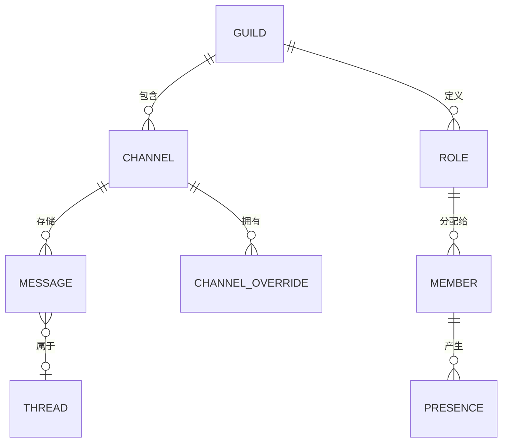
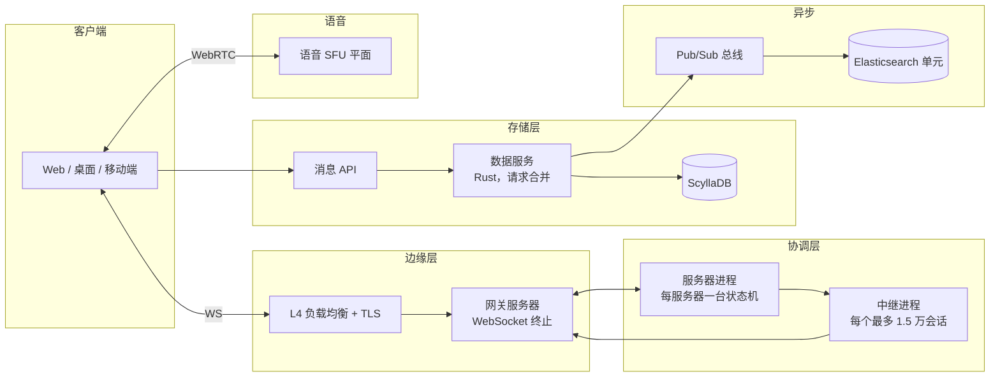
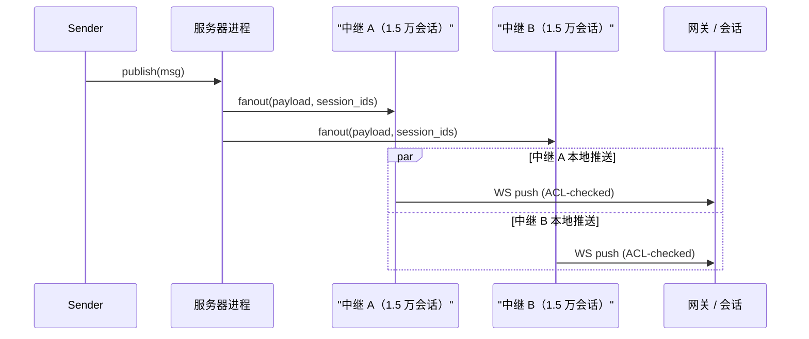
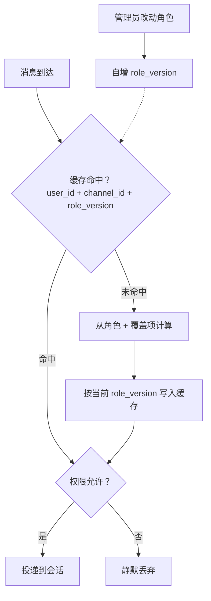

# 设计频道级规模的聊天系统（Discord / Slack）

> **TL;DR.** 频道级规模的聊天不是“大号群聊”，而是一套根本不同的架构：pub/sub 取代单播，RBAC 校验变成每条消息投递都要走的热路径，在线状态则是个 N 平方问题。Discord 在单台服务器里扛住 100 万以上并发用户[^3]，用 72 个 ScyllaDB 节点存下数万亿条消息[^4]。关键的权衡在扇出成本与投递延迟之间：把推送聚合成中继进程或区域网关服务器，用 1-2 秒的最终一致性换取单个频道突破 10 万在线成员的能力。

## 学习目标

- 设计一套 pub/sub 扇出架构，把一条消息投递给 3 万以上并发频道成员，同时避免单播爆炸
- 实现带按频道覆盖（override）与版本化缓存失效的 RBAC 权限矩阵
- 用订阅范围收敛、批处理与最终一致性缓解 N 平方的在线状态问题
- 设计工作区搜索，把 ACL 过滤施加在查询时，而不是排序之后
- 论证在数万亿条消息的写入密集场景下，为什么选 ScyllaDB 而不是 Cassandra
- 说清频道级规模聊天与 1:1 消息（[设计聊天系统](./05-chat-system.md)）、直播评论（[直播评论](./45-live-comments.md)）之间的区别

## 直觉理解

10 个人的群聊很轻松：每发一条，扇出到 9 条 socket。100 人时扇出到 99 个，也还管得住。现在换成一个有 10 万成员、3 万人在线的 Discord 服务器：一条消息就触发 3 万次 WebSocket 推送，每次推送还要做一遍权限校验，确认收件人能不能读这个频道。每秒发 10 条消息，光一个频道你就在制造每秒 30 万次带权限校验的投递。

这就是那个 N 平方的洞见，它把频道级规模聊天和[设计聊天系统](./05-chat-system.md)里的一切区分开来。1:1 聊天扇出是 1；2048 人的 WhatsApp 群（WhatsApp 当前的群上限）扇出是 2047；一个有 100 万成员、30 万在线的 Discord 服务器，每条消息扇出 30 万。变的是问题的形状，不只是规模。

随之而来的是三个架构转向。第一，你没法从消息服务向每个收件人单播。你需要带聚合的 pub/sub：每个中继节点或网关节点只收一条跨网络消息，而不是每个收件人一条[^6]。第二，每次投递都得过一遍 ACL 校验，因为同一个工作区里不同频道的可见性并不一样。权限校验因此成了 CPU 热路径[^2]。第三，在线状态（那个绿点）变成平方级开销：每个用户订阅所有可见成员的状态，每次状态变化又扇出给所有订阅者。Slack 把订阅范围收敛到“当前可见的成员列表”，把状态流量压到原来的五分之一[^1]。

天真的单机设计会同时在三个维度上崩掉。能跑起来的架构把连接面（网关服务器）、协调面（服务器/频道进程）与存储面（消息走 ScyllaDB，搜索走 Elasticsearch）拆开，各自独立扩展。

## 需求

### 澄清问题

- **Q：单个频道的成员上限是多少？**
  假设：单频道 2500 万成员（Discord 截至 2025 年 9 月的上限），仅公告频道同样是这个上限。
- **Q：频道是持久的，历史可浏览吗？**
  假设：是。完整的历史回滚，不像临时的直播评论。
- **Q：需要语音频道吗？**
  假设：需要，常驻的长期房间（不是预约会议）。
- **Q：搜索范围？**
  假设：按工作区做全文搜索，ACL 过滤在查询时施加。
- **Q：要支持子区（thread）吗？**
  假设：要，挂在某条父消息下的行内子区回复。
- **Q：消息投递的一致性模型？**
  假设：最终一致（1-2 秒窗口可接受）；存储内部保证单频道全序。
- **Q：治理需求？**
  假设：自动治理（关键词/正则）、基于角色的封禁/禁言、机器人集成。见[大规模内容审核](./35-content-moderation-at-scale.md)。

### 功能需求

- 创建工作区（服务器/团队），包含公开与私有频道
- 在基于角色的访问控制下往频道发消息
- 用游标分页浏览频道历史
- 每个用户的实时在线状态（在线/空闲/勿扰/离线）
- 加入与离开常驻语音频道，参与者列表动态更新
- 跨工作区消息全文搜索，按调用者权限过滤

### 非功能需求

- **并发：** 每个工作区 100 万并发用户，热点频道 3 万以上在线[^3]
- **吞吐量：** 大型工作区每天 1000 万条消息；全球合计每秒 120 万条
- **延迟：** 频道内消息投递 P99 < 100 ms；搜索 P99 < 500 ms[^8]
- **可用性：** 投递路径 99.95%
- **一致性：** 存储内单频道全序；在线状态最终一致（滞后 < 10 秒）
- **持久性：** 服务端 ack 之后不丢消息；数万亿条消息永久保留[^4]

## 容量估算

| 指标 | 数值 | 推导 |
|--------|------:|------------|
| 每天消息数（大型工作区） | 1000 万 | Discord/Slack 企业级实际规模 |
| 全球每秒合计发送 | 120 万 | 约 1000 亿条/天 / 86,400 |
| 热点频道每条消息的扇出 | 3 万 | 10 万成员 × 30% 在线 |
| 每秒投递数（单热点频道 10 条/秒） | 30 万 | 3 万 × 10 |
| 平均消息大小 | 500 B | 文本 + 元数据 + 各类 ID |
| 每天存储（全球） | 50 TB | 1000 亿 × 500 B |
| 5 年存储 | 约 90 PB | 50 TB × 365 × 5 |
| 每秒状态事件（周一早 9 点尖峰） | 1000 万+ | 60 秒内 50 万次登录 × 订阅数[^1] |
| 每个工作区的搜索索引 | 50 GB | 1 亿条消息 × 500 B |
| 每秒投递的 WebSocket 事件 | 2600 万+ | Discord 2020 年的数字[^10] |

关键比例：

- **状态流量比消息流量高约 5 倍**，来自心跳、输入中提示与状态切换[^1]。
- **90% 的用户-服务器连接是被动的**（没有活跃标签页），这些会话的有效扇出工作量因此降低 90%[^3]。
- **消息的读写比**很高（一次发送多个读者），但成本被写路径的扇出主导。

## API 与数据模型

### API 设计

```http
POST /v1/channels/{id}/messages
  Body: { "content": "...", "nonce": "<client-uuid>" }
  Returns: 201 { "id": "<snowflake>", "channel_id": "...", "author_id": "..." }
  Idempotent on nonce (dedup window: 5 min)

GET /v1/channels/{id}/messages?before=<snowflake>&limit=50
  Returns: 200 { "messages": [...] }

WS /v1/gateway
  Multiplexes: MESSAGE_CREATE, PRESENCE_UPDATE, TYPING_START, GUILD_MEMBER_UPDATE
  Compression: streaming zstandard [^7]

GET /v1/guilds/{id}/search?q=<query>&channel_ids=<filter>
  Returns: 200 { "messages": [...], "total_results": N }
  ACL: injects caller's readable channel_id set as term filter [^8]

POST /v1/voice/{channel_id}/join
  Returns: 200 { "session_id": "...", "endpoint": "...", "ice_servers": [...] }

PUT /v1/users/@me/presence
  Body: { "status": "online|idle|dnd|invisible" }
```

### 数据模型

消息用 Twitter 风格的 Snowflake ID[^16] 作聚簇键，无需协调就能得到按时间有序的唯一性。

```sql
-- Messages (ScyllaDB, partitioned by channel + time bucket)
CREATE TABLE messages (
    channel_id  bigint,
    bucket      int,            -- static time window
    message_id  bigint,         -- Snowflake ID, clustering key
    author_id   bigint,
    content     text,
    thread_id   bigint,         -- nullable, parent message snowflake
    PRIMARY KEY ((channel_id, bucket), message_id)
) WITH CLUSTERING ORDER BY (message_id DESC);

-- Roles and permissions (PostgreSQL, heavily cached)
CREATE TABLE channel_overrides (
    channel_id  bigint,
    role_id     bigint,
    allow       bigint,         -- permission bitmask
    deny        bigint,         -- permission bitmask
    PRIMARY KEY (channel_id, role_id)
);
```



*一个服务器拥有频道与角色；频道按时间桶切分存消息；每频道覆盖项把角色权限在特定频道上改写。*

## 高层架构



*端到端的频道级规模聊天：客户端经网关服务器接入；服务器进程通过中继协调扇出；消息经一层做请求合并的数据服务落盘到 ScyllaDB；搜索索引通过 pub/sub 总线异步流入 Elasticsearch 单元。*

**写路径：** 客户端通过 WebSocket 把消息发给自己的网关服务器。网关转给服务器进程，进程校验权限（查缓存的位掩码），经数据服务层落盘到 ScyllaDB，再通过中继进程触发扇出。

**扇出路径：** 服务器进程把消息载荷连同收件人会话 ID 交给中继进程。每个中继最多挂 1.5 万个会话[^3]，通过已经打开的 WebSocket 把消息推下去。对被动会话（没有活跃标签页），中继只发一条轻量通知，而不是完整载荷。

**搜索路径：** 数据服务层把消息发布到 pub/sub 总线（Discord 用的是 Google PubSub[^8]）。索引 worker 按目标 Elasticsearch 集群与索引给消息分组，再按目的地批量建索引。这种隔离保证单个节点出问题不会拖垮无关的批次[^8]。

## 深入探讨

### 频道扇出：别让单播爆炸

核心问题：一个有 30 万在线成员、热点频道每秒 10 条消息的服务器，产生每秒 300 万次投递。如果服务器进程给每个收件人发一条跨进程消息，它的邮箱会在毫秒级被打满。

**Manifold（Discord）。** Discord 开源的这套库把收件人 PID 按远端 Erlang 节点分组，每个节点只发一份跨节点拷贝，而不是每个 PID 一份[^6]。上线后，每秒出向包数降了一半。但在 30 万并发时，即便一个节点一份，节点数也太多。

**中继进程。** Discord 在服务器进程与会话之间引入了中继进程[^3]。服务器告诉每个中继“把这条消息扇出给你的会话集合”。每个中继挂 1.5 万个会话，在本地做完权限校验再推。服务器的工作量因此是 O(中继数)，而不是 O(成员数)。

**Slack 的对应做法。** Slack 的 Channel Server（CS）把消息的一份拷贝发给订阅了该频道的每个区域 Gateway Server（GS）[^5]。每个 GS 再扇出给本地连接的客户端。CS 到 GS 这一跳就是聚合点：每个 GS 一条跨区域消息，而不是每个客户端一条。Slack 2024 年的 Unified Grid 重构用 Vitess 按 `channel_id` 对消息存储做分片，于是不需要按工作区路由就能给出组织级视图[^15]。



*一次发送只到达服务器进程一次；进程把活派给中继；每个中继在权限校验后扇出给最多 1.5 万个本地会话，把服务器侧的 O(成员数) 压成 O(中继数)。*

**被动会话。** 大服务器里 90% 的用户-服务器连接没有活跃标签页[^3]。Discord 对被动会话跳过完整消息投递，只发一个计数自增。这让这些连接的有效扇出降低约 90%。

### 带版本失效的 RBAC

每次消息投递都要做一次权限判断：“这个用户能读这个频道吗？”一个有 50 个角色、500 个频道的服务器，权限矩阵是 25,000 个格子。每条消息都从头算一遍太贵。

**有效权限位掩码。** Discord 的服务器进程把用户各角色的位掩码与按频道的覆盖项（显式的 allow/deny 位，优先于角色默认值）合并，算出每一对 `(user_id, channel_id)` 的有效权限[^2]。结果以 `(user_id, channel_id, role_version)` 为键缓存。

**版本化失效。** 管理员改动角色时，服务器把该工作区的 `role_version` 加一。所有带旧版本的权限缓存项在下次访问时即为过期。失效是 O(1)（一次版本自增），而不是 O(用户数 × 频道数) 次写[^2]。



*每次投递都走一遍带缓存的权限查询；角色变更只自增一个版本计数器，就能在下次访问时惰性作废所有过期项，无需 O(N) 次写。*

**热路径成本。** Discord 的服务器进程在每次消息投递时校验权限[^2]。CPU 成本随（在线成员数）×（每秒消息数）×（每用户平均角色数）增长。有缓存时，常见路径退化为一次哈希查找，只有角色变更才触发重算。

### 在线状态聚合（N 平方问题）

天真的状态广播：一个 1 万成员的频道，每秒 1,000 次状态变化，就要投递每秒 1,000 万次状态事件。这是成员数的平方级开销。

**订阅范围收敛（Slack）。** 客户端只为当前 UI 上可见的用户订阅状态，而不是整个工作区[^1]。这一招把投递给客户端的状态事件量压到原来的五分之一。Slack 的 Flannel 边缘缓存保存了按客户端过滤的状态视图，把服务端 pub/sub 转成每客户端一条流[^1]。

**批处理与去抖。** 状态增量按 5 秒窗口合并，窗口内的多次变更只留最新值。用户能接受 5-10 秒的陈旧；这个规模上严格一致根本付不起。

**周一早 9 点的风暴。** 50 万用户在 60 秒内登录，会产生数百万条订阅事件。缓解手段：重连抖动（摊到 30 秒）、服务端对状态订阅限流，以及把 SLO 降级为“30 秒内最终正确”[^1][^5]。

### 带 ACL 过滤的工作区搜索

搜索只能返回调用者有权限读的频道里的消息。后置过滤（先给所有消息打分，再剔掉禁止的）会泄漏命中数，并破坏分页语义。

**前置过滤。** Discord 在打分之前就把调用者被允许的 `channel_id` 集合作为 term 过滤条件注入查询[^8]。这样打分只碰用户有权看的文档。Slack 用工作区范围的过滤实现同样的原则[^9][^14]。

**单元架构。** Discord 把搜索分片到 40 个 Elasticsearch 集群，并按单元（cell）组织[^8]。每个单元都很小（3 个可成为 master 的节点 + 3 个 ingest 节点 + 数据节点）。好处：滚动升级安全（Log4Shell 事件逼得旧的单体集群整体下线[^8]），而且一个吵闹的服务器也拖不住别人。Slack 对核心服务也采用了类似的单元化方案，把故障爆炸半径限制在单个单元内[^13]。

**BFG 索引。** “Big Freaking Guilds”（超大服务器）会突破 Lucene 单索引约 20 亿文档的上限[^8]。Discord 为这些异类使用多分片索引，配套流程是双写、历史回填、原子化查询切换，最后清理旧索引。

## 真实案例

**Discord：5 名工程师、400 台机器、数万亿条消息。**

Discord 的聊天基础设施跑在约 400-500 台 Elixir/Erlang 机器上（2020 年的数字），由 5 名工程师的团队维护[^10]。每个服务器就是一个 Elixir GenServer，独自持有该服务器完整的频道、角色、语音状态与成员在线视图[^2][^3]。最大的单个服务器（Midjourney）在 2023 年达到 100 万以上同时在线[^3]。

存储层在 2022 年从 177 节点的 Cassandra 迁到 72 节点的 ScyllaDB[^4]。动机是：Cassandra 的 JVM 垃圾回收会造成不可预测的延迟尖峰（P99 读 40-125 ms）。ScyllaDB 的每核分片（shard-per-core）C++ 架构把 P99 读从 40-125 ms 压到 15 ms，写 P99 稳定在 5 ms（Cassandra 则在 5-70 ms 之间抖动）[^4]。API 与 ScyllaDB 之间夹着一层 Rust 数据服务，用按 `channel_id` 的一致性哈希路由，把对同一频道行的并发读合并成一次数据库查询[^4]。

网关带宽优化发生在 2024 年：流式 zstandard 压缩取代 zlib，配合 Passive Sessions V2 把 WebSocket 流量降低约 40%[^7]。成员列表用的是 Rust NIF 实现的 SortedSet：纯 Elixir 的 OrderedSet 在 25 万条时插入最坏情况要 640 微秒，而 Rust NIF 的 SortedSet 在 100 万条时最坏情况只要 3.68 微秒，从而突破了原先 25 万成员的服务器规模上限[^12]。

搜索面在 40 个 Elasticsearch 集群里索引数万亿条消息[^8]。单元化重构之后，查询延迟中位数从 500 ms 降到 100 ms 以内。索引管道从 Redis（CPU 压力下会丢消息）迁到 Google PubSub，以保证投递[^8]。

## 权衡

| 方案 | 优点 | 缺点 | 适用场景 |
|----------|------|------|-------------|
| 每频道一个 Kafka 主题 | 热点隔离；扩展干净 | 几万个主题要管 | 大型工作区、高流量频道 |
| 共享 Kafka + channel_id 路由 | 主题少；运维简单 | 热点会饿死其他频道 | 中小型工作区 |
| WebSocket 单播扇出 | 简单；不需要中间件 | 超过约 1000 成员就 N 平方爆炸[^6] | 只适合小频道 |
| pub/sub 聚合（中继 / GS 边缘） | 可扩到 30 万以上并发[^3] | 1-2 秒的最终一致窗口 | 1000 成员以上的生产默认 |
| 每条消息做 ACL 校验（带缓存） | 角色变更后仍严格正确[^2] | 热路径上的 CPU 成本 | 永远必需 |
| 每工作区独立 Elasticsearch 单元 | 租户隔离；升级安全[^8] | 1 万+ 工作区时基础设施成本高 | 企业级规模 |
| ScyllaDB 替换 Cassandra | 没有 GC 停顿；节点更少[^4] | 生态更小；社区工具更少 | 写入密集、对延迟敏感 |

最大的一个元决策是扇出策略。Discord 选的是进程内中继（与服务器进程同机的 Erlang 进程）；Slack 选的是跨区域网关聚合（Channel Server 到 Gateway Server）。两者达成同一个目标：把协调层的 O(成员数) 压成 O(节点数) 或 O(区域数)。差别在运维形态：Discord 的模型把状态放在一个进程里（推理更简单，横向扩展更难）；Slack 的模型把状态分散到一致性哈希的服务器上（组件更多，但更容易独立扩展）。

## 扩展与故障模式

**10 倍（单服务器 300 万并发）：** 服务器进程成为瓶颈。缓解：按频道分类把服务器拆成子服务器进程，每个只管一部分频道与中继。协调层从单一根节点变成一棵树。

**100 倍（单工作区 3000 万并发、每天 100 亿条消息）：** 病毒式传播的频道会让 ScyllaDB 热分片拉高长尾延迟。缓解：在数据服务层做请求合并（Discord 已上线[^4]），再加上自适应桶大小，把热频道切成更细的时间窗口。

**1000 倍：** 架构转向 CDN 边缘模型：PoP 上的网关服务器持有频道订阅，并接收来自全局事件网格的推送，读多的频道就不必再走跨区域跳。

**故障：服务器进程崩溃。** 服务器 GenServer 在新节点上重启。状态从数据库重建期间，客户端会经历 2-3 秒的投递空档。不丢消息（扇出前已落盘）[^10]。

**故障：Elasticsearch 单元宕掉。** 受影响服务器的搜索降级。消息继续在 PubSub 里排队（保证投递）。单元恢复后积压排空。不会有索引空洞，因为 PubSub 在压力下不丢数据[^8]。

**故障：ScyllaDB 节点故障。** 法定人数读写继续在剩余副本上进行。故障节点的数据会自动重新复制。再平衡完成前 P99 读可能短暂抬升（15 ms 到约 50 ms）[^4]。

## 常见陷阱

> [!WARNING]
> **从消息服务直接单播扇出。** 每次 Erlang 跨节点 `send/2` 约 70 微秒。一个 10 万成员的服务器里，一条消息就变成 10 万次 send 调用，进程直接跟不上[^6]。用 Manifold 式的节点分组，或者把扇出委派给中继。

> [!WARNING]
> **对搜索结果做后置 ACL 过滤。** 先给所有消息打分再剔掉禁止的，会泄漏命中数、破坏分页，还违背严格 ACL。要在打分之前就把被允许的 channel_id 集合作为 term 过滤条件注入[^8]。

> [!WARNING]
> **把状态广播给工作区全体成员。** 10 万成员上天真的状态广播会产生 N 平方流量。把订阅范围收敛到当前可见的成员列表；增量按 5 秒窗口批处理[^1]。

> [!WARNING]
> **单体 Elasticsearch 集群。** 200+ 节点的集群没有安全的滚动重启路径。Log4Shell 打补丁期间，Discord 的搜索被迫整体下线[^8]。用小单元（3 个 master + 3 个 ingest + 数据节点），各自独立生命周期。

> [!WARNING]
> **消息分区不分桶。** 一个长期活跃却没有时间分桶的频道会变成 100+ GB 的大分区，毁掉读性能并引发无休止的压实。用 `(channel_id, bucket)` 加静态时间窗口分区[^4]。

> [!CAUTION]
> **以为频道级规模聊天只是“更大的群聊”。** 那几个架构转向（pub/sub、热路径 ACL、N 平方状态）是质变，不是量变。把 1:1 聊天系统扩到 10 万成员而不重做扇出层，会惨烈失败。

## 追问

**1. 怎么设计跨工作区私信（Slack Connect）？**

共享频道活在一个中立的可路由层里，不归任何一个工作区的服务器进程管。消息双宿：在两边工作区的搜索里都建索引，同时受两边保留策略约束。权限校验查一张跨工作区成员表。Slack 把这件事做成了独立的 “Shared Channels” 服务[^20]。

**2. 一个 100 万成员的公告频道，只有管理员能发帖，架构长什么样？**

写 ACL 把发帖限制在管理员角色。扇出变成向 30 万以上在线成员的只读推送。既然只有管理员发帖，消息速率很低（< 1 条/分钟），每条消息的扇出预算就很大。被动会话只收到一个通知角标，而不是完整载荷。

**3. 这套系统能在频道规模下支持端到端加密吗？**

频道规模下的端到端加密对多数场景都不现实。发送者密钥（Sender Keys，WhatsApp 群里用的那套）要求每次成员变化都轮换密钥；10 万成员加上频繁进出，等于无休止的密钥再分发。此外，服务端搜索与内容治理都需要明文。Matrix.org 的联邦房间对公开房间就不做端到端加密，只走服务端状态解析[^17][^18]；Project Hydra（2025）披露了联邦协议漏洞，需要跨服务器的状态解析修复[^19]。

**4. 一个 50 万成员的频道里，名人 @everyone 会怎么样？**

对 @everyone 限流（Discord 允许每个频道每 10 分钟一次）。扇出与普通消息相同，但会给全体成员触发推送通知，不只是在线的人。通知投递按 60 秒摊开，避免撞上 APNS/FCM 的速率限制。50 万客户端同时来取这条消息时，数据服务的合并层会把这场读风暴吸收掉[^4]。

**5. 语音频道怎么和文本架构结合？**

语音频道是常驻的 SFU 会话，由一套独立的 C++ 媒体面管理，跑在 1000+ 节点上[^10][^11]。文本侧的服务器进程跟踪语音状态（谁在哪个语音频道），并通过同一套中继扇出广播 VOICE_STATE_UPDATE 事件。SFU 对每个说话者收一路 RTP 流，不解码就直接选择性地转发给听众。

**6. 怎么实现子区而不重复存储？**

子区回复带一个 `thread_id`（父消息的 snowflake），并与父频道共用 ScyllaDB 里的同一个分区。在 `thread_id` 上建二级索引就能高效查子区视图。服务器进程维护一份独立于频道订阅者的子区订阅者列表，所以子区回复只扇出给子区参与者。

## 练习

### 练习 1：中继容量规划

一个服务器有 20 万同时在线成员。每个中继进程最多处理 1.5 万个会话。某热点频道每秒收到 20 条消息。请计算：(a) 需要多少个中继进程，(b) 所有中继合计每秒投递多少次，(c) 如果其中一个中继崩溃会发生什么。

<details>
<summary>提示</summary>

不是 20 万成员都订阅了这个热点频道。假设 40% 在频道里（8 万）。再考虑一下：可能有 90% 的连接是被动的。

</details>

<details>
<summary>答案</summary>

(a) 20 万成员 / 每中继 1.5 万 = 最少 14 个中继进程（向上取整为 14）。

(b) 热点频道里的活跃成员：8 万（20 万的 40%）。其中 10% 是活跃（非被动）连接 = 8 千次完整投递 + 7.2 万次轻量计数更新。按每秒 20 条消息：8 千 × 20 = 每秒 16 万次完整投递，加上 7.2 万 × 20 = 每秒 144 万次计数更新。

(c) 如果一个中继崩溃，它那 1.5 万个会话会有 2-3 秒收不到投递，直到服务器把这些会话重新分配给存活的中继，或者起一个新的中继。空档期发出的消息不会丢（已落盘到 ScyllaDB）；客户端重连后通过基于游标的同步拉取漏掉的消息。

接受的权衡：中继故障期间短暂出现投递空档，换掉主动-主动中继复制的复杂度。

</details>

## 要点回顾

- **频道不是大号群聊。** pub/sub 扇出、热路径 ACL、N 平方状态，是质变式的架构转向，不只是规模变大。
- **要聚合，不要单播。** 每个节点或每个区域只收一条跨网络消息（Manifold、CS 到 GS），是唯一能撑过 1000 并发的模式[^6]。
- **权限缓存配版本化失效。** 角色变更时 O(1) 的版本自增，胜过 O(用户数 × 频道数) 次缓存写[^2]。
- **在线状态在设计上就是最终一致。** 用户能接受 5-10 秒的陈旧；工作区规模上严格一致付不起[^1]。
- **消息按 (channel_id, time_bucket) 分区。** 既让历史同处一地、翻页够快，又给分区大小设了上限[^4]。
- **小的搜索单元胜过单体集群。** 独立生命周期、升级安全、租户隔离[^8]。

## 延伸阅读

- [How Discord Stores Trillions of Messages](https://discord.com/blog/how-discord-stores-trillions-of-messages)。从 Cassandra 迁到 ScyllaDB 的经典文章，带 P99 延迟数字和 Rust 数据服务的合并模式。
- [Maxjourney: Pushing Discord's Limits with a Million+ Online Users](https://discord.com/blog/maxjourney-pushing-discords-limits-with-a-million-plus-online-users-in-a-single-server)。中继架构、被动会话，以及 Discord 最大服务器背后的工程。
- [Flannel: An Application-Level Edge Cache to Make Slack Scale](https://slack.engineering/flannel-an-application-level-edge-cache/)。边缘缓存与 pub/sub 在线状态，把状态流量压到五分之一。
- [Real-time Messaging (Slack Engineering)](https://slack.engineering/real-time-messaging/)。Channel Server、Gateway Server 与 CHARM 一致性哈希架构。
- [How Discord Indexes Trillions of Messages](https://discord.com/blog/how-discord-indexes-trillions-of-messages)。Elasticsearch 单元架构、BFG 索引与 PubSub 摄入管道。
- [How Discord Reduced WebSocket Traffic by 40%](https://discord.com/blog/how-discord-reduced-websocket-traffic-by-40-percent)。流式 zstandard 压缩与 Passive Sessions V2。
- [Unified Grid: How We Re-Architected Slack](https://slack.engineering/unified-grid-how-we-re-architected-slack-for-our-largest-customers/)。按 channel_id 分片的转向，让组织级视图成为可能。
- [Matrix State Resolution v2](https://matrix.org/docs/older/stateres-v2/)。没有协调者的联邦房间状态收敛；对跨工作区联邦有参考价值。

## 记忆卡片

<details>
<summary><strong>Q: 把频道级规模聊天与 1:1 聊天区分开的那三个架构转向是什么？</strong></summary>

A: (1) pub/sub 取代单播扇出；(2) RBAC 权限校验变成每次投递都要走的 CPU 热路径；(3) 在线状态变成 N 平方问题，需要订阅范围收敛与批处理。

</details>

<details>
<summary><strong>Q: Discord 的 Manifold 库怎么降低跨节点扇出成本？</strong></summary>

A: Manifold 把收件人 PID 按远端 Erlang 节点分组，每个节点只发一份跨节点拷贝，而不是每个 PID 一份。上线时每秒出向包数降了一半。

</details>

<details>
<summary><strong>Q: 什么是中继进程，为什么需要它？</strong></summary>

A: 中继进程夹在服务器进程与会话之间，最多挂 1.5 万个会话。它在本地做权限校验和 WebSocket 推送，把服务器的工作量从 O(成员数) 降到 O(中继数)。

</details>

<details>
<summary><strong>Q: Discord 迁到 ScyllaDB 后，消息读延迟改善了多少？</strong></summary>

A: P99 读延迟从 40-125 ms（Cassandra，177 节点）降到 15 ms（ScyllaDB，72 节点）。ScyllaDB 的每核分片 C++ 设计消除了 JVM 垃圾回收停顿。

</details>

<details>
<summary><strong>Q: 为什么搜索的 ACL 过滤必须在打分之前，而不是之后？</strong></summary>

A: 后置过滤会泄漏禁止频道的命中数、破坏分页语义，还可能借结果数量暴露私有频道的活动。用 term 过滤做前置过滤，能保证打分只碰允许的文档。

</details>

<details>
<summary><strong>Q: Slack 怎么把状态流量压到原来的五分之一？</strong></summary>

A: 客户端只为当前 UI 上可见的用户（即当前频道的成员列表）订阅状态，而不是整个工作区。Flannel 边缘缓存把服务端 pub/sub 转成按客户端过滤的流。

</details>

<details>
<summary><strong>Q: Discord 的消息分区键是什么，为什么这么选？</strong></summary>

A: `(channel_id, bucket)`，其中 bucket 是静态时间窗口。这既让一个频道的历史同处一地、范围扫描快，又给分区大小设了上限，避免出现 100+ GB 的分区。

</details>

<details>
<summary><strong>Q: 版本化的权限缓存失效是怎么工作的？</strong></summary>

A: 每个工作区有一个 `role_version` 计数器。权限项以 `(user_id, channel_id, role_version)` 为键缓存。角色变更时版本自增一次（O(1)），下次访问时惰性作废所有过期项。

</details>

<details>
<summary><strong>Q: Discord 为什么从单体 Elasticsearch 集群改成单元？</strong></summary>

A: 200+ 节点的单体集群没有安全的滚动重启路径。Log4Shell 期间，搜索为了打补丁整体下线。单元（小型独立集群）让滚动升级安全，并隔离吵闹的租户。

</details>

<details>
<summary><strong>Q: Slack 消息投递架构里的聚合点在哪？</strong></summary>

A: Channel Server（CS）到 Gateway Server（GS）这一跳。CS 把消息的一份拷贝发给订阅了该频道的每个区域 GS；每个 GS 再扇出给本地连接的客户端。这避免了 CS 向每个客户端单播。

</details>

## 参考文献

[^1]: Bing Wei, "Flannel: An Application-Level Edge Cache to Make Slack Scale", Slack Engineering, 2017. https://slack.engineering/flannel-an-application-level-edge-cache/

[^2]: Yuliy Pisetsky, "Maxjourney: Pushing Discord's Limits with a Million+ Online Users in a Single Server", Discord Engineering, 2023 (guild permission checks). https://discord.com/blog/maxjourney-pushing-discords-limits-with-a-million-plus-online-users-in-a-single-server

[^3]: Yuliy Pisetsky, "Maxjourney: Pushing Discord's Limits with a Million+ Online Users in a Single Server", Discord Engineering, 2023 (relays, passive sessions). https://discord.com/blog/maxjourney-pushing-discords-limits-with-a-million-plus-online-users-in-a-single-server

[^4]: Bo Ingram, "How Discord Stores Trillions of Messages", Discord Engineering, 2023. https://discord.com/blog/how-discord-stores-trillions-of-messages

[^5]: Sameera Thangudu, "Real-time Messaging", Slack Engineering, 2023. https://slack.engineering/real-time-messaging/

[^6]: discord/manifold README, GitHub. https://github.com/discord/manifold

[^7]: Austin Whyte, "How Discord Reduced Websocket Traffic by 40%", Discord Engineering, 2024. https://discord.com/blog/how-discord-reduced-websocket-traffic-by-40-percent

[^8]: Vicki Niu, "How Discord Indexes Trillions of Messages", Discord Engineering, 2025. https://discord.com/blog/how-discord-indexes-trillions-of-messages

[^9]: "Set up and manage Slack enterprise search", Slack Help Center. https://slack.com/help/articles/39044407124755-Set-up-and-manage-Slack-enterprise-search

[^10]: Jose Valim, "Real time communication at scale with Elixir at Discord", elixir-lang.org, 2020. https://elixir-lang.org/blog/2020/10/08/real-time-communication-at-scale-with-elixir-at-discord

[^11]: "SFU (Selective Forwarding Unit)", videocalling.app glossary. https://videocalling.app/glossary/sfu

[^12]: Matt Nowack, "Using Rust to Scale Elixir for 11 Million Concurrent Users", Discord Engineering, 2019. https://discord.com/blog/using-rust-to-scale-elixir-for-11-million-concurrent-users

[^13]: "Slack's Migration to a Cellular Architecture", Slack Engineering, 2023. https://slack.engineering/slacks-migration-to-a-cellular-architecture/

[^14]: "Enterprise AI Search: Power compliance with Slack Search", Slack Blog. https://slack.com/blog/developers/enterprise-ai-search-with-slack-search

[^15]: Ian Hoffman and Mike Demmer, "Unified Grid: How We Re-Architected Slack for Our Largest Customers", Slack Engineering, 2024. https://slack.engineering/unified-grid-how-we-re-architected-slack-for-our-largest-customers/

[^16]: Twitter Engineering, "Announcing Snowflake", 2010. https://github.com/twitter-archive/snowflake

[^17]: Matrix Specification, "Server-Server API (Federation)". https://spec.matrix.org/v1.18/server-server-api/

[^18]: Neil Alexander Twigg, "State Resolution v2 for the Hopelessly Unmathematical", matrix.org docs. https://matrix.org/docs/older/stateres-v2/

[^19]: "Project Hydra: Improving state resolution in Matrix", matrix.org blog, 2025. https://matrix.org/blog/2025/08/project-hydra-improving-state-res/

[^20]: "How Slack Built Shared Channels", Slack Engineering. https://slack.engineering/how-slack-built-shared-channels/
