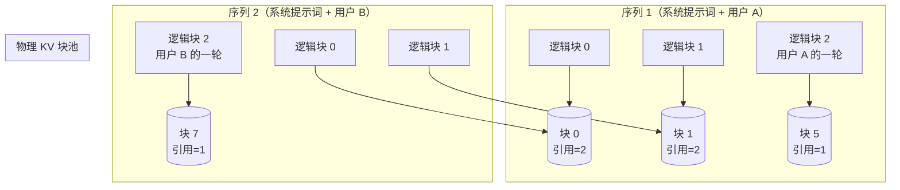
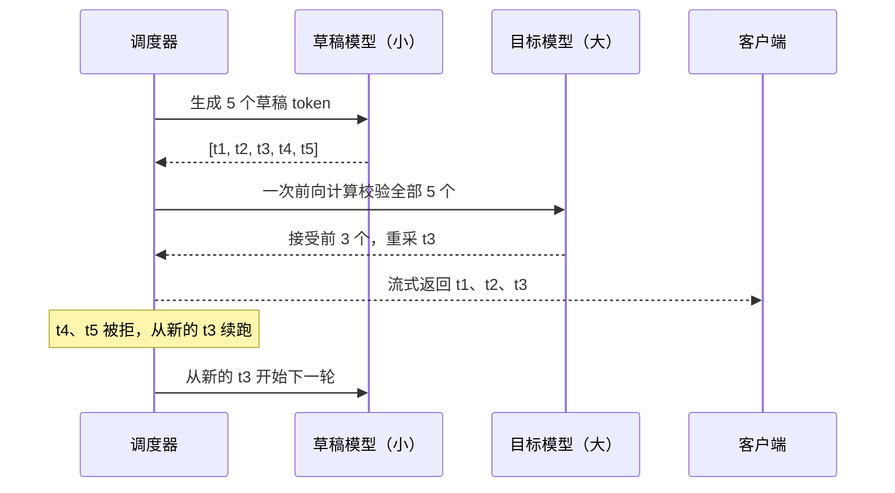
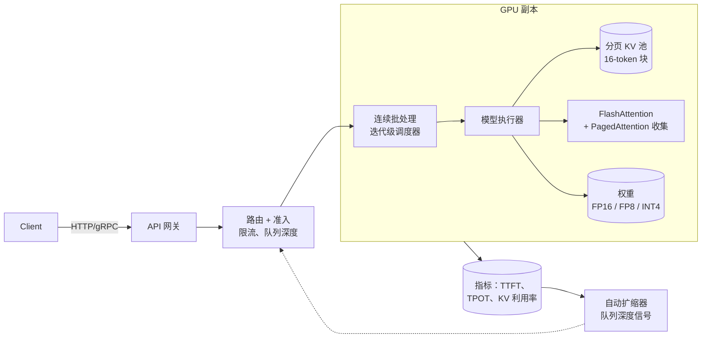

# LLM 服务架构（vLLM、TGI、TensorRT-LLM）

> **TL;DR**：朴素的 LLM 服务方式会浪费 70% 到 90% 的 GPU 算力，因为一个长回复就能把整个批次扣作人质。[^1] 生产级栈靠三个思路解决：连续批处理（按每个解码步调度，而不是按每个请求调度）、分页注意力（像操作系统虚拟内存那样用固定大小的块管理 KV 缓存）、前缀缓存（让提示词相同的请求共享 KV 块）。三者合起来，吞吐量比基线高 10 到 24 倍。[^2] 再叠加 FlashAttention、量化、投机解码和多 GPU 并行，就是现代推理引擎的全貌。开源参考实现是 vLLM、TGI 和 TensorRT-LLM，而这些思路可以搬到任何栈上。

## 学习目标

完成本模块后，你将能够：

- [ ] 解释朴素批处理推理为什么浪费 GPU 周期，以及连续批处理如何修复它
- [ ] 描述分页注意力（paged attention）及其如何解决 KV 缓存碎片
- [ ] 针对给定模型和上下文长度，计算 KV 缓存的内存需求
- [ ] 设计一个 GPU 调度器，让短请求与长请求复用同一批算力，且谁都不会被饿死
- [ ] 从工程权衡的角度比较 vLLM、TGI、TensorRT-LLM 与 SGLang
- [ ] 判断投机解码在什么情况下改善延迟、在什么情况下损害吞吐量

## 直觉理解

你开了一家理发店，只有一位理发师（GPU）。顾客进门，要剪的发型长短差别极大：快剪 5 分钟，整个重新造型 45 分钟。按朴素做法，你一次安排四位顾客坐下，理发师轮流在四人头上动刀，但在最慢那位做完之前，谁都不能走。早早剪完的三个人干坐在椅子上，堵着新来的客人，理发师却还在做那个重新造型。你的店只有 20% 的产能。

更聪明的理发师换一种干法。一剪完，那张椅子立刻空出来，下一位顾客马上坐下，哪怕轮转还没结束。理发师绝不会为了等最慢的顾客而拒绝新客人。这就是连续批处理（continuous batching）。

再想象每位顾客的碎发都堆在一个托盘里（KV 缓存）。旧做法下，你给每位顾客都预留一个全尺寸托盘，连快剪也不例外。多数托盘有 80% 是空的。新做法下，你改用可堆叠的小盒子。每位顾客按需拿盒子，一次一个，人走了盒子就还回共享池。两位发型参考图相同的顾客，甚至可以共用最初几个盒子（前缀缓存）。这就是分页注意力（paged attention）。

本章余下部分会把这些想法讲精确，补上数学推导，并说明生产引擎如何在真实 GPU 上落地。

## 原理

### 朴素服务方式为什么失败

Transformer 解码是自回归的：每产出一个 token 都要以全部历史 token 为条件做一次完整前向计算。单个解码步要读取全部模型权重加上完整 KV 缓存，全部来自 GPU HBM。这让单请求推理压倒性地受限于内存带宽，GPU 的计算能力被白白浪费。[^3]

静态批处理（static batching）把 N 个请求编成一组，按最长预期序列做填充（padding），然后整批跑到结束。任何提前完成的请求仍占着填充后的槽位，GPU 还在这些槽位上空算。生成长度服从重尾分布（聊天负载均值 128 到 300 个 token），于是最长的那个请求决定了整批的运行时长。[^1]

结果：Anyscale 在 OPT-13B 上测得静态批处理吞吐量为 81 tokens/sec。在同一块 A100 上改用连续批处理加 PagedAttention，vLLM 跑到 1,900 tokens/sec，提升 23 倍（生成长度方差最大的场景）。[^1] 在真实聊天流量下，静态批处理的 GPU 利用率通常估计只有 10% 到 30%。

### 连续批处理（迭代级调度）

Orca（Yu 等，OSDI 2022）给出了解法：按每个解码迭代调度，而不是按每个请求调度。[^3] 请求一完成就立刻被逐出，新请求马上补位。调度器在每个步上评估正在运行的集合，把放得进 token 预算的等待请求放进来，然后发出一次融合的前向计算。

```mermaid
gantt
    title 静态批处理（上）与连续批处理（下）对比
    dateFormat X
    axisFormat %s
    section 静态批次
    请求 A（短）        :done, sA, 0, 3
    请求 B（短）        :done, sB, 0, 2
    请求 C（长）        :done, sC, 0, 10
    GPU 空转（填充）    :crit, idle1, 3, 10
    section 连续批次
    请求 A（短）        :done, cA, 0, 3
    请求 D（补位）      :active, cD, 3, 9
    请求 B（短）        :done, cB, 0, 2
    请求 E（补位）      :active, cE, 2, 10
    请求 C（长）        :done, cC, 0, 10
```



*静态批处理下，短请求要等最长的那个跑完，GPU 全程空转。连续批处理立刻填补空出的槽位，利用率接近 100%。*

Orca 报告在 GPT-3 175B 上、延迟相同的前提下，吞吐量比 NVIDIA FasterTransformer 高 36.9 倍。[^4] 关键洞察是：非注意力算子（matmul、LayerNorm、MLP）仍然跨所有请求成批执行，而注意力只能按请求单独做，因为每个请求的 KV 缓存形状都不同。

一个细节：预填充（prefill，处理输入提示词）是计算密集的，而解码（decode，逐个生成 token）是内存密集的。把两者粗暴混在一起会产生“解码停顿”（decode stall），长预填充会堵住 token 生成。Sarathi-Serve（OSDI 2024）用分块预填充（chunked prefill）解决：把长提示词切成固定大小的块，与解码步交错执行。[^5]

### 分页注意力与 KV 缓存内存

每个活跃请求都维护一份 KV 缓存：到目前为止生成的每个 token，在每一层注意力里的 key 和 value 张量。以 Llama-3 70B 为例，80 层、8 个 KV 头（分组查询注意力）、head 维度 128、BF16：

```text
bytes_per_token = 2 * num_layers * num_kv_heads * head_dim * dtype_bytes
               = 2 * 80 * 8 * 128 * 2
               = 327,680 bytes = 320 KB per token
```

8K 上下文每个序列约占 2.5 GB。128K 上下文约占 40 GB，几乎吃满一整块 H100 的 80 GB HBM。[^6] 改用 FP8，每 token 成本减半，约 160 KB。

vLLM 之前的系统会按每个请求的最大上下文长度预分配连续 KV 缓冲区。结果 60% 到 80% 的 GPU 内存浪费在碎片和闲置容量上。[^2]

Kwon 等（SOSP 2023）照搬操作系统虚拟内存的思路解决了这个问题。[^7] 对应关系非常直接：

| OS 概念 | PagedAttention 中的对应物 |
|---|---|
| 字节 | Token |
| 页 | 块（16 个 token） |
| 进程 | 序列 |
| 页表 | 块表 |
| 物理内存 | 共享 KV 池 |

每个序列的逻辑块通过一张每序列的块表映射到物理块。注意力 kernel 借助这层间接寻址，把不连续的 K/V 分片收集起来。内存碎片因此降到 4% 以下（只浪费每个序列最后一块的尾部）。[^2]



*两个共享同一段系统提示词的序列，把各自的起始逻辑块映射到相同的物理块。生成分叉后各拿独立的块。写时复制（copy-on-write）负责处理修改。*

前缀共享由此自然成立：系统提示词相同的两个请求，其块链哈希相同，直接共用物理 KV 内存。vLLM 采用基于块哈希的查找（父块哈希与当前块 token ID 一起哈希），并用 LRU 淘汰。[^8] SGLang 把它扩展成基数树（radix tree），可以处理带分支的前缀（多智能体树、自一致性采样），在一组包含 RAG、少样本评测和智能体思维链的基准里，吞吐量最高比 vLLM v0.2.5（当时还没有前缀缓存）高 5 倍。[^8]

### FlashAttention 与融合 kernel

标准注意力会把完整的 N x N 注意力矩阵物化到 HBM 里，于是受限于内存带宽。FlashAttention（Dao 等，2022）把 Q、K、V 分块（tiling），在单个融合 kernel 里在线计算 softmax，把一个 HBM 复杂度为二次的算法变成 SRAM 复杂度为二次的算法。[^9] 它的结果是精确注意力（没有任何近似），让原本放不下的 128K+ 上下文变得可行。

FlashAttention-2 在 A100 FP16/BF16 上，注意力 kernel 峰值达 230 TFLOPs/s；GPT 风格训练的端到端速度达到 225 TFLOPs/s 左右，约合 72% 的模型 FLOP 利用率。[^10] FlashAttention-3 面向 H100，用 warp 特化和 FP8 支持：FP16 下达 740 TFLOPs/s（75% 利用率），FP8 下接近 1.2 PFLOPs/s。[^11]

### 投机解码

每一步，用一个小草稿模型提出 K 个候选 token。目标模型用一次前向计算并行校验这 K 个，接受其中最长的、分布与自身采样一致的前缀，其余丢弃。其输出分布可以证明与目标模型的原生采样等价。[^12]



*草稿模型廉价地提出 token，目标模型批量校验。被接受的 token 立即流出。被拒绝的 token 只浪费一次前向计算，不损失正确性。*

生产环境的接受率通常在 50% 到 70%，对应 1.5 到 2 倍的墙钟延迟加速。[^12] EAGLE 在 Llama-2 70B Chat 上报告了 2.7 到 3.5 倍。[^13] 但投机解码本质上是延迟上的收益，并不总是吞吐量上的收益。高负载下，校验被拒绝的 token 会抢走本该服务其他请求的周期。做得好的系统会在并发超过阈值时关掉投机。

### 量化与并行

**量化（quantisation）** 降低精度以压缩内存、加速解码。70B 模型的 FP16 权重占 140 GB；INT4 压缩到 35 GB，一块 40 GB 的 A100 就能装下，还留有 KV 缓存的空间。[^6] GPTQ 与 AWQ 是主流的 4-bit 纯权重方法。SmoothQuant 把激活里的离群值迁移到权重上，从而实现 W8A8。在 Hopper/Blackwell GPU 上，FP8 是生产上的最佳平衡点：精度几乎无损，解码吞吐量约为 FP16 的 2 倍。

**张量并行（TP）** 把每层的权重矩阵切分到多块 GPU 上，每个 transformer 块做一次 all-reduce。在 8xH100 上跑 Gemma2，all-reduce 约占解码延迟的 23%；具体比例取决于负载。[^14] TP 通常限制在单机内，以吃到 NVLink（H100 上 900 GB/s）。**流水线并行（PP）** 把连续的层区间分给不同 GPU，更大模型再靠 InfiniBand 跨节点。

## 真实案例

### vLLM 与 LMSYS Chatbot Arena

LMSYS Chatbot Arena 用 vLLM 支撑数十个模型，峰值每天 6 万次请求（2023 年中平均 3 万）。从 HuggingFace Transformers 后端切到 vLLM，所需 GPU 机队减少了一半。[^2]

vLLM V1 架构（2025 年 1 月发布 alpha；自 2025 年起成为默认引擎，V0 已完全废弃）把引擎重构为 GPU 优先、零 CPU 开销的调度器。[^15] 每个解码步，调度器会：

1. 按 token 预算推进每个正在运行的请求（分块预填充、前缀缓存、投机解码统一在同一个预算里）
2. 尝试为新 token 分配 KV 块
3. 若分配失败，抢占优先级最低的运行中请求（释放它的 KV 块，把 `num_computed_tokens` 重置为 0，重新排队，恢复时重算完整预填充）
4. 把放得进剩余预算的等待请求放进来

这种“靠重算来抢占”的做法用算力换内存：与其把 KV 块换出到 CPU（走 PCIe 很贵），vLLM 干脆丢掉，等请求恢复时重新算预填充。被抢占的请求会跳到等待队列队首。

vLLM 最早的博客报告：在 Llama-7B/13B 上，吞吐量比 HuggingFace Transformers 高 24 倍，比 TGI v0.x 高 3.5 倍。[^2] 在 Anyscale 的 OPT-13B 基准里，连续批处理引擎（Ray Serve、TGI）的吞吐量约为静态批处理的 8 倍；同时具备连续批处理与 PagedAttention 的 vLLM 相对同一基线约为 23 倍。[^1]



*vLLM 服务栈：迭代级调度器驱动 GPU worker，worker 读取权重、通过块表收集 KV 块。自动扩缩由队列深度指标驱动，而不是 GPU 利用率。*

## 权衡

连续批处理与分页注意力不是二选一的关系，它们是如今每个现代引擎都实现的两项技术（见上文原理部分）。真正要做的工程决策是选哪个开源引擎，所以这张表在一个维度上比较几个可相互替代的引擎。

| 引擎 | 优点 | 缺点 | 适用场景 | 我们的选择 |
|---|---|---|---|---|
| vLLM | 开源，社区迭代最快，硬件支持广 | 历史上热路径是 Python（V1 引擎已补上差距） | 成本敏感的自托管、异构 GPU 机队 | 最好的通用开源引擎 |
| TensorRT-LLM | 在 NVIDIA 上最快，FP8 硬件路径，AOT 编译的 kernel | 仅支持 NVIDIA，AOT 编译带来重建摩擦，定制困难 | 全力押注 NVIDIA、延迟至上的生产栈 | 在 NVIDIA 上每一毫秒都要抠的时候 |
| TGI | 生产环境打磨充分，Rust 路由层，与 HF 生态紧密集成 | 仓库已于 2026 年 3 月归档（只读）；HF 官方建议新部署用 vLLM/SGLang/llama.cpp/MLX | 仅做遗留系统维护 | 新项目应选 vLLM 或 SGLang |
| SGLang | RadixAttention 在分支型负载上前缀复用最好 | 社区较小，久经考验的集成较少 | 多轮智能体、RAG、思维树、自一致性 | 前缀密集的智能体负载 |

## 常见陷阱

> [!WARNING]
> **生产环境还在用静态批处理。** 在真实流量下 GPU 利用率会塌到 10% 到 30%。一个长回复扣住整批，短回复就干坐在填充槽里。换到任何连续批处理引擎都行；在 vLLM、TGI 或 TensorRT-LLM 里这只是一行配置的事。

> [!WARNING]
> **准入队列无上限。** LLM 的容量是很少的几个并发槽位（通常 32 到 256）。没有准入控制，队列深度会无界增长，所有人的 TTFT 都突破 SLO。队列深度超过按 SLO 推导出的阈值时，返回 429。扩容看队列深度，不要看 GPU 利用率。[自动扩缩与容量规划](../part-6-reliability-and-operations/04-auto-scaling-capacity.md) 讲了选信号的原则。

> [!WARNING]
> **负载一高，投机解码反而倒退。** 投机解码在低并发时改善延迟，但系统饱和后吞吐量会下降——校验被拒绝的 token 是白干的活。并发超过阈值就动态关掉投机；同时盯住接受率和总 tokens/sec。

> [!WARNING]
> **没有把 TTFT 当成独立 SLO。** 用户对首 token 时间的感受与生成速度是两回事。一个只优化吞吐量的系统（大批次、长预填充）可以有漂亮的 tokens/sec，TTFT 却惨不忍睹。单独跟踪 TTFT 的 P99，并用分块预填充把它压住。

> [!WARNING]
> **RAG 负载不开前缀缓存。** 如果你的系统提示词或检索上下文被多个请求共用，而你没缓存这些 KV 块，每个请求都在为完全相同的 token 重算预填充。开启自动前缀缓存（vLLM 的 APC、SGLang 的 RadixAttention、TensorRT-LLM 的 KV cache reuse），前缀密集流量上白得 2 到 5 倍。

## 练习

设计一个双客户层的多租户 LLM API：“标准”（延迟尽力而为）与“高级”（保证首 token 时间低于 500 ms）。说明调度器行为、什么情况下抢占标准请求以兑现高级 SLO、以及你如何跨层核算 GPU 成本。还要给出：当高级层延迟劣化时，你会基于哪个指标报警。

<details>
<summary>提示</summary>

想想这几点：(a) 为高级请求预留一部分 KV 池，让它们永远不必排在标准请求后面；(b) 高级请求到达而 KV 池已满时的抢占策略；(c) 直接按原始延迟报警与专门按 `ttft_p99_premium` 报警的区别。

</details>

<details>
<summary>答案</summary>

**调度器设计：**

给每个请求定优先级：高级 = 0（最高），标准 = 1。调度器在每个优先级带内按 FCFS 排队，但始终优先准入高级请求。

**KV 池预留：**

把 KV 块池的 30% 预留给高级专用。标准请求只能从剩下的 70% 里分配。这保证高级请求总能拿到块，不必等标准请求被逐出。

**抢占策略：**

当高级请求到达、连预留池也满了（突发场景），抢占已分配 KV 块最多的、优先级最低的标准请求。释放它的块（它恢复时会重算预填充）。高级请求立即准入。

**TTFT 保障：**

开着前缀缓存时，多数高级请求能命中缓存的系统提示词块，跳过共享前缀的预填充。Llama-70B 在 FP8 下、2K token 的系统提示词，H100 上预填充约需 50 到 100 ms。500 ms 预算还剩下 400 ms 给排队和网络。只要高级队列深度保持在 3 个请求左右以内（每个 100 ms 预填充），SLO 就守得住。

**报警指标：**

按 `ttft_p99_premium > 400ms` 报警（不是 500 ms，留 100 ms 缓冲）。这样在 SLO 真正被突破之前就会触发。处置手册动作：扩容 GPU 副本，或临时用 429 削减标准流量。

**成本核算：**

高级层按标准层每 token 价格的 3 倍计费。用调度器记录的每请求耗时，统计各层消耗的 GPU 秒数。高级请求抢占标准请求所产生的重算成本，记到高级层的毛利里。

</details>

## 要点回顾

- 连续批处理是 LLM 服务里单项收益最大的改动：按每个解码迭代（而非每个请求）调度，吞吐量比静态批处理高 3 到 23 倍。
- 分页注意力消除了 KV 缓存碎片（从 60-80% 的浪费降到 4% 以下），并让提示词相同的请求共享前缀。
- KV 缓存计算就是 LLM 服务的容量规划公式：每 token `2 * layers * kv_heads * head_dim * dtype_bytes`，再乘以上下文长度和批大小。
- 投机解码是延迟优化（TPOT 降低 1.5 到 3 倍），负载高时可能损害吞吐量。并发超过阈值就动态关掉。
- FlashAttention 避开 N x N 矩阵在 HBM 中的物化，让 128K+ 的长上下文变得可行，而且没有近似。
- vLLM、TGI、TensorRT-LLM、SGLang 是“灵活性 vs 性能”这条曲线上的不同点。按你的硬件锁定情况、前缀复用模式和生态需求来选。
- GPU 推理扩容看队列深度，不要看 GPU 利用率。GPU 预热要 30 到 60 秒，等利用率飙起来时，队列早就堆深了。

## 延伸阅读

- [Efficient Memory Management for Large Language Model Serving with PagedAttention (Kwon et al., SOSP 2023)](https://arxiv.org/abs/2309.06180) - vLLM 论文；KV 分页、块表与前缀共享的权威论述。
- [Orca: A Distributed Serving System for Transformer-Based Generative Models (Yu et al., OSDI 2022)](https://www.usenix.org/conference/osdi22/presentation/yu) - 开启现代服务时代的连续批处理论文。
- [How continuous batching enables 23x throughput in LLM inference (Anyscale, 2023)](https://www.anyscale.com/blog/continuous-batching-llm-inference) - 被引用最多的行业基准，方法学清晰地对比了静态与连续批处理。
- [Fast and Expressive LLM Inference with RadixAttention and SGLang (LMSYS, 2024)](https://lmsys.org/blog/2024-01-17-sglang/) - 超越简单哈希的前缀缓存；面向智能体与分支负载的基数树方案。
- [FlashAttention-3: Fast and Accurate Attention with Asynchrony and Low-precision (Shah et al., 2024)](https://pytorch.org/blog/flashattention-3/) - 针对 Hopper 的注意力 kernel，在 H100 上达到 75% MFU。
- [vLLM V1: A Major Upgrade to vLLM's Core Architecture (vLLM team, 2025)](https://vllm.ai/blog/v1-alpha-release) - 零 CPU 开销的调度器重写；解释了抢占、分块预填充与投机解码的统一。
- [Speculative Decoding (Leviathan et al., ICML 2023)](https://arxiv.org/abs/2211.17192) - 证明草稿-校验解码无损的基础论文。
- [Taming Throughput-Latency Tradeoff with Sarathi-Serve (Agrawal et al., OSDI 2024)](https://www.usenix.org/conference/osdi24/presentation/agrawal) - 用分块预填充防止解码停顿；TTFT SLO 的必需品。

## 记忆卡片

**Q：** 静态批处理为什么浪费 GPU 容量？
**A：** 一个长回复扣住整批。早完成的短请求占着填充槽位，GPU 还在这些槽位上空算。生成长度重尾，真实负载下浪费达 70% 到 90%。

**Q：** 什么是连续批处理？
**A：** 按每个解码迭代而非每个请求调度。请求一完成，槽位立刻被等待中的请求填上。这把请求生命周期与批次生命周期解耦，带来 3 到 23 倍的吞吐量提升。

**Q：** PagedAttention 如何管理 KV 缓存内存？
**A：** 把每个序列的 KV 缓存切成固定大小的块（每块 16 个 token），通过块表做映射，像操作系统虚拟内存那样。物理块从共享池按需分配，碎片从 60-80% 降到 4% 以下。

**Q：** 计算 Llama-3 70B 在 BF16 下的每 token KV 缓存开销。
**A：** `2 * 80 layers * 8 KV heads * 128 head_dim * 2 bytes = 327,680 bytes = 320 KB per token`。8K 上下文每个序列约需 2.5 GB。

**Q：** 什么是前缀缓存，它在什么时候有用？
**A：** 复用跨请求共享的 token 前缀所对应的 KV 块（系统提示词、RAG 上下文）。在前缀重叠度 60% 以上的负载上，跳过重复的预填充计算，能快 2 到 5 倍。

**Q：** 投机解码怎么工作？
**A：** 小草稿模型提出 K 个 token。目标模型用一次前向计算校验全部 K 个，接受最长的匹配前缀。输出分布可证明与目标模型原生采样等价。典型加速是延迟上的 1.5 到 3 倍。

**Q：** 投机解码什么时候有害？
**A：** 高负载下，校验被拒绝的 token 会浪费本可服务其他请求的 FLOPs。净吞吐量可能下降。做得好的系统会在并发超过阈值时关掉投机。

**Q：** FlashAttention 与标准注意力有何不同？
**A：** 它把 Q、K、V 分块，用片上 SRAM 在单个融合 kernel 里在线算 softmax，避免把完整 N x N 注意力矩阵物化到 HBM。结果是精确的（无近似），并让 128K+ 上下文可行。

**Q：** LLM 服务的关键指标有哪些？
**A：** TTFT（time-to-first-token，衡量排队等待加预填充）、TPOT（time-per-output-token，衡量解码速度）、总 tokens/sec（吞吐量）。每个都要看 p50 和 p99。TTFT 与 TPOT 需要独立的 SLO，因为它们的优化手段不同。

**Q：** vLLM、TensorRT-LLM、SGLang 该怎么选？
**A：** vLLM：通用、开源、社区迭代最快。TensorRT-LLM：在 NVIDIA 硬件上追求极致性能，靠预编译（AOT）。SGLang：前缀密集的智能体负载，RadixAttention 的基数树缓存比基于哈希的缓存快 2 到 5 倍。

**Q：** LLM 推理为什么按队列深度而不是 GPU 利用率扩缩？
**A：** 批次一满，GPU 利用率就贴着 100%。队列深度才是容量不足的先行指标。等利用率掉下来（请求跑完了），损害（TTFT 突破）早已发生。

**Q：** vLLM 的抢占策略是什么？
**A：** KV 分配失败时，vLLM 抢占优先级最低的运行中请求：释放其 KV 块，并把它标记为恢复时重算完整预填充。这用算力换内存，避免了昂贵的 PCIe 换出到 CPU 内存。

## 参考文献

[^1]: Daniel, Shen, Liang, Liaw, "How continuous batching enables 23x throughput in LLM inference while reducing p50 latency," Anyscale, 2023-06-22. https://www.anyscale.com/blog/continuous-batching-llm-inference
[^2]: Kwon, Li, Zhuang, Sheng, Zheng, Yu, Gonzalez, Zhang, Stoica, "vLLM: Easy, Fast, and Cheap LLM Serving with PagedAttention," vLLM blog, 2023-06-20. https://blog.vllm.ai/2023/06/20/vllm.html
[^3]: Yu et al., "Orca: A Distributed Serving System for Transformer-Based Generative Models," OSDI 2022. https://www.usenix.org/conference/osdi22/presentation/yu
[^4]: USENIX OSDI '22 论文集中 Orca 的条目。https://www.usenix.org/system/files/osdi22-yu.pdf
[^5]: Agrawal et al., "Taming Throughput-Latency Tradeoff in LLM Inference with Sarathi-Serve," OSDI 2024. https://www.usenix.org/conference/osdi24/presentation/agrawal
[^6]: Tian Pan, "The GPU Memory Math Nobody Tells You." https://tianpan.co/blog/2026-04-10-self-hosted-llms-production-gpu-memory-math
[^7]: Kwon et al., "Efficient Memory Management for Large Language Model Serving with PagedAttention," SOSP 2023. https://arxiv.org/abs/2309.06180
[^8]: Zheng et al., "Fast and Expressive LLM Inference with RadixAttention and SGLang," LMSYS, 2024-01-17. https://lmsys.org/blog/2024-01-17-sglang/
[^9]: Dao, Fu, Ermon, Rudra, Re, "FlashAttention: Fast and Memory-Efficient Exact Attention with IO-Awareness," arXiv 2205.14135. https://arxiv.org/abs/2205.14135
[^10]: Dao, "FlashAttention-2: Faster Attention with Better Parallelism and Work Partitioning," Hazy Research blog, 2023-07-17. https://hazyresearch.stanford.edu/blog/2023-07-17-flash2
[^11]: Shah et al., "FlashAttention-3: Fast and Accurate Attention with Asynchrony and Low-precision," PyTorch blog / NeurIPS 2024. https://pytorch.org/blog/flashattention-3/
[^12]: Leviathan, Kalman, Matias, "Fast Inference from Transformers via Speculative Decoding," arXiv 2211.17192 (ICML 2023). https://arxiv.org/abs/2211.17192
[^13]: Li et al., "EAGLE: Speculative Sampling Requires Rethinking Feature Uncertainty," arXiv 2401.15077. https://arxiv.org/abs/2401.15077
[^14]: NVIDIA, "Optimizing for Low-Latency Communication in Inference Workloads with JAX and XLA." https://developer.nvidia.com/blog/optimizing-for-low-latency-communication-in-inference-workloads-with-jax-and-xla/
[^15]: vLLM team, "vLLM V1: A Major Upgrade to vLLM's Core Architecture," 2025-01-27. https://vllm.ai/blog/v1-alpha-release
