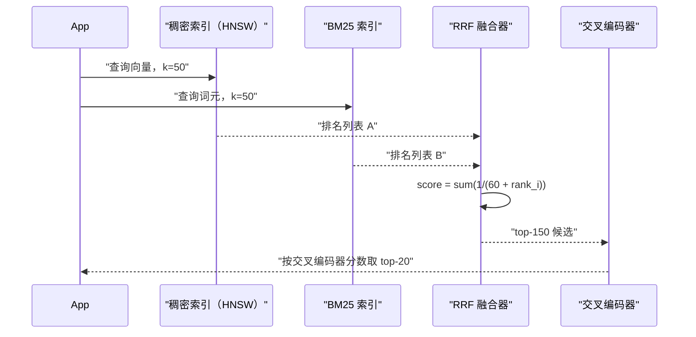
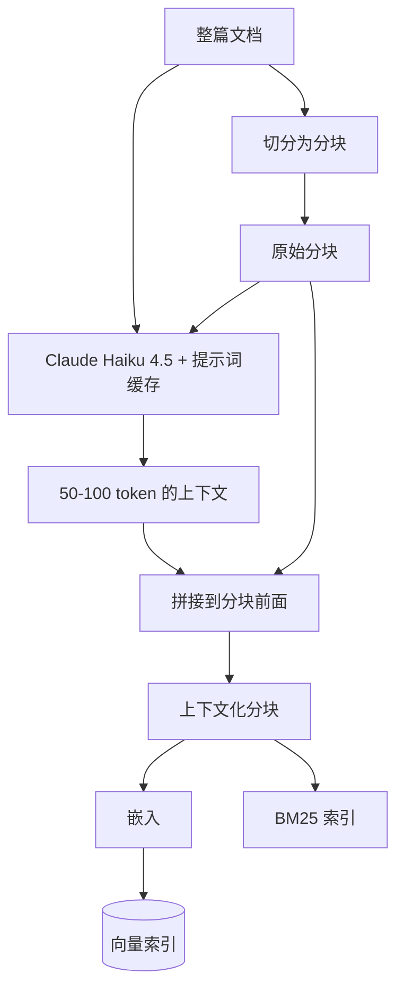
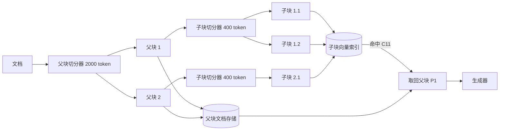
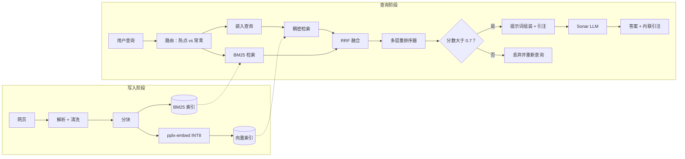

# RAG 流水线（检索增强生成）

> **TL;DR**: RAG 在查询时检索相关段落注入提示词，让 LLM 建立在外部知识之上。生成器文笔流畅却记性很差，是检索让它保持诚实。生产环境的默认配置是混合检索（稠密向量 + BM25，用倒数排名融合合并）、交叉编码器重排序器，以及 20 条上下文的窗口。Anthropic 的上下文检索技术把上下文嵌入、上下文 BM25 和重排序器叠加起来后，将 top-20 检索失败率降低了 67%[^1]。分块是最不光鲜、影响却最大的决策：在 FloTorch 2026 基准测试中，递归式 512 token 切分打败了更花哨的替代方案[^2]。没有评估闭环（Ragas、黄金集、nDCG@k），你根本分不清上一次改动是帮忙还是添乱。

## 学习目标

学完本章，你将能够：

- [ ] 依据文档形态和基准测试证据，挑选分块策略（固定、递归、语义、层级）
- [ ] 选定嵌入模型，并说明延迟、质量、维度三者的权衡
- [ ] 设计用 RRF 把 BM25 稀疏检索与稠密向量结合起来的混合检索
- [ ] 加上重排序器（交叉编码器），并衡量它是否值那份延迟
- [ ] 解释为什么“直接把 top-k 调大”会因为迷失在中间的位置偏置而失效
- [ ] 搭一套离线评估闭环，用 Ragas 指标和黄金集支撑

## 直觉理解

你是一名律师助理，正在准备一份诉讼摘要。律师（也就是 LLM）辩论起来才华横溢，对判例法的记性却糟糕透顶。你把对的先例递到她手上，她写出的摘要杀伤力十足；你把错的递过去，她会理直气壮地引用根本不存在的案子。

你的工作是检索。你维护着一只装满几千份案例摘要的档案柜（也就是向量索引）。当律师说“帮我找房东对霉菌责任的先例”，你做两件事：按语义检索（稠密检索，能抓住“潮湿导致租户健康危害”这类换说法），同时按精确引注编号检索（稀疏检索，能抓住“17 U.S.C. Section 512(c)”）。你把两路结果合并，再重读排名靠前的候选，确认它们真的相关（重排序），最后只递给她 20 份摘要，不是 200 份。

律师会仔细读开头几份和结尾几份，中间那些则一扫而过（迷失在中间）。所以你把最有力的先例放在这一叠的最上面和最下面。

这就是 RAG。档案柜是你的向量索引和 BM25 索引，合并那一步是倒数排名融合，重读那一步是交叉编码器重排序器，律师的阅读习惯就是 Liu 等人在他们测试过的每一个 LLM 上量到的位置偏置[^3]。整条流水线之所以存在，是因为这位律师再聪明，也记不住史上立过的每一个案子。检索是第一位的东西：再出色的生成器，也补不上那些从未进入提示词的分块[^4]。

## 原理

### 为什么需要 RAG

Lewis 等人（Facebook AI Research）在 NeurIPS 2020 上提出检索增强生成，把它框定为两种记忆的结合：参数化记忆（模型权重）和非参数化记忆（通过神经检索器访问的文档稠密向量索引）[^5]。论文证明在知识密集型任务上，RAG 模型比纯参数化基线“生成更具体、更多样、更符合事实的语言”。

五年之后，RAG 已成为让 LLM 建立在私有数据或近期数据之上的主流生产架构。核心矛盾在于：生成器一旦被问到训练窗口之外的东西就会胡编，而在私有数据上做微调既昂贵、又容易泄露，数据一变就立刻过时。检索绕开了这三点，把“知识”变成一个在你掌控的索引上做搜索的问题。

[LLM 服务架构](./00-llm-serving-architecture.md)讲的是生成器那一侧：连续批处理、分页注意力、KV-cache 的量级计算。本章讲生成器上游的全部环节：怎么把正确的 token 送进那个上下文窗口。

### 分块策略

分块把原始文档切成受 token 数量约束、后续要被嵌入和索引的单元。主流的有五类：

- **固定长度：** 每 N 个 token 切一刀（常见做法：512 token，10-20% 重叠）。简单、可预测，而且出人意料地难以超越。
- **递归字符切分：** 按分隔符层级（`\n\n`、`\n`、空格、字符）逐级尝试，在尺寸预算允许的范围内选最自然的那条边界。这是 LangChain 的默认做法。
- **语义切分：** 在相邻句子的嵌入余弦相似度出现分叉处切开，把边界落在话题转换的地方。
- **版面感知：** 利用 markdown 标题、HTML 标签、PDF 结构或代码函数边界切分。
- **父文档（层级）切分：** 索引小块以保证精度，生成时返回它们更大的父块以提供上下文。

基准测试的证据相当一致。在 FloTorch 2026 RAG 基准测试中，递归式 512 token 切分拿到 69% 的端到端准确率，胜过所有更昂贵的替代方案[^2]。同一基准测试里语义分块的端到端准确率只有 54%，因为它切出来的块平均约 43 个 token，太小了，生成器没法在其上推理[^2]。Chroma Research 另有报告称语义分块的检索召回率能高到 91.9%，这恰好说明高召回并不总能转化成高端的端到端答案质量[^6]。Qu、Tu 和 Bao 在 2024 年的研究得出同样的结论：一旦把算力成本算进来，固定长度分块始终与语义分块持平甚至更好[^7]。

> [!TIP]
> 从递归式 512 token、10% 重叠起步。只有当你的评估在你自己的语料上显示出可测量的收益时，才换成语义切分或版面感知切分。

### 嵌入模型与 MTEB 格局

嵌入（embedding）是神经编码器产出的定长向量，语义相近的输入会映射到彼此靠近的向量上。生产选型大致分几档：

| 模型 | 维度 | MTEB（英文） | 每 1M token 价格 |
|---|---|---|---|
| Google gemini-embedding-2（多模态） | 3072（Matryoshka，128-3072） | 榜首 | 见厂商定价 |
| Voyage voyage-4-large（MoE） | 2048/1024/512/256 | 第一梯队 | $0.12 |
| OpenAI text-embedding-3-large | 3072 | 64.6% | $0.13 |
| OpenAI text-embedding-3-small | 1536 | 62.3% | $0.02 |
| Cohere embed-v4 | 1536（默认） | -- | -- |
| BGE-M3（开源） | 1024 | 有竞争力 | 免费（自托管） |

[MTEB 榜单](https://huggingface.co/spaces/mteb/leaderboard)横跨 56 个以上任务对模型做基准测试。但 MTEB 数字是总体平均；领域匹配（法律、医疗、代码）比榜单名次更重要。注意上表里的分数可能来自不同的 MTEB 版本（v1 与 v2），并非所有模型之间都直接可比。

关键权衡：Matryoshka 表示学习让 `text-embedding-3-large` 可以从 3072 维截断到 256 维，还能打赢更老的模型，用质量换存储。Google 的 `gemini-embedding-2`（原生支持文本、图像、视频、音频和 PDF 的多模态）在 2026 年 MTEB 英文榜上登顶，Voyage 基于 MoE 的 `voyage-4-large` 以相当的代价提供相当的文本检索效果。在默认选定任何供应商之前，先在自己的语料上做基准测试。嵌入是一个在写入时就冻结的决策：换模型就意味着整个语料重新嵌入，1 亿个分块的话，那就是一笔跑好几天的 GPU 账单。

[向量数据库](../part-4-data-systems/08-vector-databases.md)讲了让这些嵌入上的近似最近邻搜索在大规模下可行的索引结构（HNSW、IVF、DiskANN）。

### 混合检索与倒数排名融合

单靠稠密检索会漏掉带唯一标识符的查询（“错误码 TS-999”），因为嵌入模型会压缩稀有 token。单靠 BM25 会漏掉换说法、多语言，以及任何与索引文本措辞不同的查询。混合检索两路并行跑，再把结果融合起来。

融合的主力是倒数排名融合（Reciprocal Rank Fusion，RRF）：

```python
def rrf(rankings: list[list[str]], k: int = 60) -> dict[str, float]:
    scores: dict[str, float] = {}
    for ranking in rankings:
        for rank, doc_id in enumerate(ranking, start=1):
            scores[doc_id] = scores.get(doc_id, 0.0) + 1.0 / (k + rank)
    return dict(sorted(scores.items(), key=lambda x: -x[1]))
```

因为只用排名，不需要做分数标定。常数 `k=60` 来自 Cormack、Clarke 和 Buttcher 2009 年的 SIGIR 原始论文，几乎被普遍沿用[^8]。在那项研究里，RRF 打败了 Condorcet Fuse 以及每一种单独的学习排序方法。



*RRF 依倒数排名合并稠密与稀疏两路排名，无需分数标定。随后由重排序器把 top-150 蒸馏成交给生成器的最终 top-20。*

### 重排序与迷失在中间

第一阶段检索（稠密 + 稀疏）快但浅：它对查询和文档分别打分。重排序器用交叉编码器对候选重新打分，这个编码器同时关注查询和文档，能带来 10-20% 的相关性提升，代价是 100-300 ms。

生产可用的重排序器包括 Cohere Rerank 4.0（`rerank-v4.0-pro` 与 `rerank-v4.0-fast`，覆盖 100 种以上语言的多语言能力）[^9]、BGE-reranker-v2-m3（开源），以及 ColBERT/ColBERTv2（延迟交互，按 token 做 MaxSim 打分，在索引检索的速度下逼近交叉编码器的质量）。

但即便检索完美，只要生成器忽略了正确的那个分块，一切白费。Liu 等人展示了一条 U 形注意力曲线：LLM 在上下文开头和结尾的召回最好，中间最差，即便是那些明确用长上下文训练过的模型也是如此[^3]。这意味着：

- 把 top-k 从 50 降到 20，既降成本又提升答案质量
- 天真地“把 top-k 调大”是适得其反
- 长上下文模型（Gemini 的 1M+ token、Claude 的 200K）并不能免除对检索的需要

Anthropic 发现 top-20 在他们所有测试里都胜过了 top-10 和 top-5[^1]。把排名最高的分块放在上下文窗口的头和尾。

### 进阶模式

在基础的“先检索再生成”循环之外，还有几种模式把它包在自我反思或预处理之中：

**Anthropic 上下文检索（2024 年 9 月）：** 每个分块前面都拼上 50-100 个 token 的 LLM 生成上下文，说明它如何嵌进整篇文档。上下文化的分块同时喂给嵌入索引和 BM25 索引。效果是叠加的：仅用上下文嵌入就把 top-20 检索失败率压低 35%，再加上下文 BM25 达到 49%，再加重排序器达到 67%[^1]。配合提示词缓存，预处理成本约为每百万文档 token 1.02 美元。



*每个分块在写入时都被 LLM 补充了文档级上下文。同一个上下文化分块同时喂给嵌入索引和 BM25 索引，两条检索路径一起提升。*

**父文档（小到大）检索：** 索引小尺寸的子块（400 token）以保证检索精度，但把更大的父块（2000 token）返回给生成器，让它有足够的周边上下文可以推理。LangChain 为这个模式提供了 `ParentDocumentRetriever`。



*父文档检索把检索粒度和生成上下文解耦。小子块给出精确排名，它们的父块给生成器足够的上下文去推理。*

**Self-RAG**（Asai 等人，ICLR 2024）[^10]: 微调生成器输出反思 token，由它决定要不要检索、给段落打分、并对自己的输出做批评。

**CRAG**（Corrective RAG）：加一个轻量检索评估器给分块打分，置信度低时退回带查询改写的网页搜索。

**RAG-Fusion：** 把用户查询扩展成 k 个换说法版本，逐版本检索，再用 RRF 融合。

**GraphRAG**（微软，2024）：从语料里抽取知识图谱，把实体聚成社区，回答原生嵌入检索处理不了的全局摘要类查询。

**Agentic RAG：** 把检索当成 LLM 可以调用、可以推理、可以再调用的工具。典型代价是 3-10 倍 token，换来的质量提升只在复杂的多跳查询上才划算。

> [!IMPORTANT]
> 从混合检索加重排序器起步。只有当你的评估显示基础流水线在特定查询类型上失败时，才加 agentic 循环或 Self-RAG。复杂度是有调试代价的。

## 真实案例

### Perplexity AI：万维网规模的 RAG

Perplexity 公布 2025 年中约为每月 7.8 亿次查询、约 4500 万月活用户，相比 2024 年 8 月的每月 2.3 亿次查询增长迅猛[^4][^11]。标准搜索每次查询检索 60 个以上来源；Deep Research 要读几百个。

架构是一条六阶段的 RAG 流水线：

1. **查询解析与路由**，分派到热点索引或常青索引
2. **混合检索**（BM25 + 稠密 + 混合）跑在几千亿页面的自有网页索引上
3. **多层 ML 重排序器**，带一个 0.7 左右的严格质量阈值（据 ZipTie 的分析，共三层，其中一层是 XGBoost）[^11]
4. **结构化提示词组装**，引注标记预先嵌入
5. **受限的 LLM 合成**，经 Sonar（Perplexity 自研模型）加一组按档位选定的前沿模型
6. **内联引注附着**

Perplexity 自建了嵌入模型（`pplx-embed`，2026 年 2 月）来替换第三方供应商，在最基础的那一层上取得了对相关性的完全掌控。40 亿参数的 `pplx-embed-context-v1` 在 ConTEB 上拿到 81.96%[^4]。嵌入使用原生 INT8 量化，每 GB 能索引的页面多 4 倍。

它的兜底逻辑很有启发：如果通过质量阈值的候选太少，Perplexity 会丢弃整个结果集重新查询，而不是拿弱证据去生成引注[^11]。这就是生产环境里“我不知道”式提示的对应物。



*Perplexity 的六阶段流水线：在几千亿页面上做混合检索，三层重排序器配一道硬质量阈值，以及一套宁可丢弃弱结果也不胡编的兜底。*

哥伦比亚新闻评论（Columbia Journalism Review）的一次审计发现 Perplexity 的答案有 37% 的错误率，其中归属错误（信息对、引注错）和捏造（信息错、引注不相关）是两种主要失效模式[^12]。教训是：即便到了这个规模，检索质量依然是硬约束。再出色的合成模型，也补不上上游糟糕的检索。

## 设计决策

**分块策略。**

| 方案 | 优点 | 缺点 | 适用场景 | 我们的选择 |
|---|---|---|---|---|
| 固定/递归分块 | 简单、可预测，在 FloTorch 2026 学术论文上端到端准确率 69%[^2] | 会切断语义边界；对话题转换无感知 | 基线方案、同质文本、优化前的第一版 | **默认：递归式 512 token、50 token 重叠** |
| 语义分块 | 检索召回高（Chroma Research 中 91.9%[^6]） | 在 FloTorch 中碎片平均约 43 token，端到端准确率只有 54%；生成端上下文不足 | 有明确话题转换的长文，且评估已证明有收益 | 仅在设了 200-400 token 的 `min_chunk_size` 下限时使用 |
| 基于 LLM 的分块 | 每个分块的语义质量最高 | 每份文档的成本高出几个数量级；一千万份以上文档根本不可行 | 高价值、低体量的语料（合同、政策文件） | 留给特定高价值文档类型 |

**检索模式。**

| 方案 | 优点 | 缺点 | 适用场景 | 我们的选择 |
|---|---|---|---|---|
| 仅稠密（嵌入相似度） | 在换说法和多语言查询上强；只需一个索引 | 漏掉精确匹配的 token（产品码、错误码、引注），因为嵌入模型会压缩稀有子词 | 干净散文上的纯语义问答 | 只在语料完全没有标识符时使用 |
| 仅 BM25（词法） | 确定性、便宜、能抓住精确匹配 | 漏掉换说法；在多语言和短查询上很脆 | 标识符密集、且查询与原文高度重合的语料（法律引注、SKU） | 与稠密搭配，不单独使用 |
| 混合（稠密 + BM25，经 RRF） | Anthropic 报告与上下文嵌入结合后 top-20 检索失败率降低 49%[^1]；无需分数标定 | 要建、要版本化、要查询两个索引 | 几乎所有领域里的生产默认 | **生产 RAG 一律使用** |

**重排序器。**

| 方案 | 优点 | 缺点 | 适用场景 | 我们的选择 |
|---|---|---|---|---|
| 不加重排序器 | 延迟最低，只需一次模型调用 | top-k 精度低；擦边分块会污染上下文 | 自动补全、输入联想、100 ms 以内的 SLO | 仅用于延迟极敏感的路径 |
| 交叉编码器重排序器 | Anthropic 报告与上下文嵌入和上下文 BM25 叠加后，top-20 检索失败率降低 67%[^1] | 每次查询多 100-300 ms；要多托管一个模型 | 质量关键的问答与检索路径 | **在 top-100 候选上做问答时的默认选择** |

## 常见陷阱

> [!WARNING]
> **在标识符密集的语料上只用稠密检索。** 含产品码、案件引注或错误码的查询会一无所获，因为嵌入模型把稀有 token 压缩成了无意义的子词片段。在有精确标识符的领域（法律、技术支持、电商）里，永远跑混合检索。

> [!WARNING]
> **省掉重排序器。** 第一阶段检索对查询和文档分别打分。没有交叉编码器那一遍，你的 top-5 常常被擦边分块污染——它们共享词汇，回答的却是另一个问题。在每一条非延迟敏感的路径上，那 100-300 ms 都会在答案质量上赚回来。

> [!WARNING]
> **往上下文窗口里塞 50 个以上分块。** Liu 等人证明 LLM 会忽略长上下文中部的分块[^3]。分块越多，噪声越多、成本越高、答案越差。top-k 保持在 20 以内，把最强的分块放在头尾。

> [!WARNING]
> **没有评估闭环。** 没有黄金集（200-500 条有代表性的查询，附标准答案和理想分块），你分不清一次分块改动、一次嵌入升级、或加一个重排序器，到底是帮忙还是添乱。Ragas 把失败拆成“检索没找到”和“生成胡编了”，让调试能定位。

> [!WARNING]
> **嵌入与查询不匹配。** 很多模型（E5、BGE）对查询和文档要求特定的前缀（`"query: ..."` 与 `"passage: ..."`）。漏掉前缀或用错前缀会静默地拉低召回。锁定模型版本，遵循它文档里写的前缀约定。

## 练习

在一个一千万份文档的技术知识库上搭一套 RAG 系统。确定分块策略、嵌入模型、检索类型（稠密还是混合）、是否加重排序器，并设计一套离线评估闭环，配 200 条查询的黄金集。说明你要跟踪的两个指标，以及索引变更后重新评估的节奏。

<details>
<summary>Hint</summary>

想一想（a）对一个满是错误码和 API 名的技术语料，混合检索为什么重要；（b）“端到端准确率”与“检索召回”分别指什么，为什么两者都要；（c）你的语料多久变一次，这对重新评估的节奏意味着什么。

</details>

<details>
<summary>Solution</summary>

**分块：** 递归字符切分，512 token，50 token 重叠。技术文档里有代码块和标题，递归切分处理得很好。语义分块很诱人，但基准证据显示它在端到端准确率上更差。

**嵌入：** BGE-M3（1024 维，开源，多语言，一个模型里同时给出稠密和稀疏）。自托管以避开一千万份文档的出网成本。预算允许的话，Voyage voyage-4-large 能拿到更高的 MTEB 分数。

**检索：** 混合（稠密 + BM25 + RRF）。技术语料里满是标识符、错误码和 API 名，单靠稠密检索会漏；BM25 能可靠地抓住它们。

**重排序器：** 要加。BGE-reranker-v2-m3（开源，GPU 托管）。检索 top-100，重排序到 top-20。对问答场景来说 100-200 ms 的代价可以接受。

**评估指标：**

1. 检索阶段的 **nDCG@20**（对照黄金集的理想分块衡量排名质量）
2. 通过 Ragas 测的 **忠实度**（衡量生成的答案是否被检索到的上下文支撑，用来抓胡编）

**节奏：** 任何改动涉及 5% 以上文档的语料更新都要重新评估。每周跑一次完整的 200 条查询黄金集作为回归检查。nDCG@20 掉超过 3 个点，或忠实度掉到 0.85 以下，就告警。

**架构：** 通过源系统的 CDC 写入以保证新鲜度。只对变更的分块做增量重嵌入。按团队做元数据过滤以支持多租户。用[缓存](../part-2-building-blocks/03-caching.md)缓存高频查询的嵌入，省掉重复的模型调用。

</details>

## 要点回顾

- RAG 在查询时把 LLM 建立在外部知识上，避开了微调的成本、过时和数据泄露风险。
- 分块是最不光鲜、影响却最大的决策：在 2025-2026 年每一个主要基准测试里，递归式 512 token 切分在端到端准确率上都打败了语义分块。
- 混合检索（稠密 + BM25 + RRF）是生产默认。纯稠密把精确匹配类查询拱手让出，纯稀疏则漏掉换说法。
- 重排序器花掉 100-300 ms，但与上下文嵌入和混合检索叠加后，能把检索失败率降低多达 67%。
- 迷失在中间意味着分块多并不总是更好。top-k 保持在 20，最强的分块放在头尾。
- 嵌入在写入时就被冻结。换模型意味着整个语料重新嵌入；要为它留预算。
- 没有评估闭环（黄金集 + Ragas 指标），你就是在盲飞。每一次流水线改动都需要可测量的证据。

## 延伸阅读

- [Retrieval-Augmented Generation for Knowledge-Intensive NLP Tasks (Lewis et al., NeurIPS 2020)](https://arxiv.org/abs/2005.11401) - 给 RAG 命名、并框定参数化与非参数化记忆的那篇论文；本章一切内容的概念基础。
- [Introducing Contextual Retrieval (Anthropic, September 2024)](https://www.anthropic.com/engineering/contextual-retrieval) - 35%/49%/67% 的失败率下降结果，还附了可复现的操作手册；近期最有影响力的单项技术。
- [Lost in the Middle (Liu et al., TACL 2024)](https://arxiv.org/abs/2307.03172) - 位置偏置那篇论文，每个 RAG 设计者在决定 top-k 和上下文排序之前都该读。
- [Ragas: Automated Evaluation of RAG (Es et al.)](https://arxiv.org/abs/2309.15217) - 把端到端失败拆成检索与生成的评估框架；调试必备。
- [ColBERT and ColBERTv2 (Khattab & Zaharia)](https://arxiv.org/abs/2004.12832) - 延迟交互检索，在索引检索的速度下逼近交叉编码器质量；多向量路线的替代方案。
- [SPLADE v2 (Formal et al., SIGIR 2021)](https://arxiv.org/abs/2109.10086) - 学习式稀疏检索，架在 BM25 和稠密之间；想要神经质量又要词法可解释性时很有用。
- [LlamaIndex Production RAG Guide](https://developers.llamaindex.ai/python/framework/optimizing/production_rag/) - 检索与合成分离、小到大模式、查询路由；最好的框架级参考。
- [MTEB Leaderboard](https://huggingface.co/spaces/mteb/leaderboard) - 嵌入模型的活基准；选型前先看一眼。

## 记忆卡片

**Q:** 什么是 RAG，它为什么存在？
**A:** 检索增强生成在查询时从外部语料取回相关段落，注入 LLM 的提示词。它之所以存在，是因为 LLM 对训练窗口之外的知识会胡编，而微调既昂贵、又容易泄露、还会过时。

**Q:** 起步该用哪种分块策略，为什么？
**A:** 递归字符切分，512 token，10-20% 重叠。它在 FloTorch 2026 基准测试里拿到 69% 的端到端准确率，胜过语义分块（54%）和其他昂贵的替代方案。简单、可预测、难以超越。

**Q:** 为什么混合检索（稠密 + BM25）是生产默认？
**A:** 稠密检索漏掉精确匹配类查询（错误码、引注、标识符），因为嵌入模型会压缩稀有 token。BM25 漏掉换说法和多语言查询。用 RRF 做混合能同时抓住两类信号，还不需要分数标定。

**Q:** 什么是倒数排名融合，它怎么工作？
**A:** RRF 用 `sum(1 / (k + rank_i))`（k=60）给每个文档打分，从而合并多份排名列表。它只用排名、不用分数，所以检索器之间不需要标定。在 2009 年那项 SIGIR 原始研究里，它打败了每一种单独的学习排序方法。

**Q:** “迷失在中间”问题是什么？
**A:** Liu 等人证明 LLM 在上下文窗口开头和结尾的召回最好、中间最差，即便在长上下文模型上也是如此。这意味着把 top-k 加到 20 以上是适得其反的，因为中间的分块实际上被忽略了。

**Q:** Anthropic 的上下文检索做了什么？
**A:** 它在写入时给每个分块前面拼上 50-100 个 token 的 LLM 生成上下文，说明该分块如何嵌进整篇文档。这同时改善了嵌入检索和 BM25 检索。配合重排序器，它把 top-20 检索失败率降低了 67%。

**Q:** RAG 评估的两个维度是什么？
**A:** 检索质量（我们取回了正确的分块吗？用 nDCG@k、recall@k 衡量）和生成质量（答案是否忠实地使用了上下文？用 Ragas 的忠实度和答案相关性衡量）。两者都要，才能定位失败环节。

**Q:** 什么时候该加重排序器？
**A:** 在任何质量关键、且能接受多 100-300 ms 延迟的路径上。只有在自动补全、输入联想这类延迟极敏感的路径上才跳过。交叉编码器重排序器在 top-150 候选上选出 top-20，是单阶段里最大的一次质量提升。

**Q:** 为什么嵌入是“写入即冻结”的决策？
**A:** 换嵌入模型需要整个语料重新嵌入，因为不同模型产出的向量空间互不兼容。一亿个分块的话，这是跑好几天的 GPU 任务。选型要谨慎，并给嵌入做版本管理。

**Q:** 父文档（小到大）检索模式是什么？
**A:** 索引小块（400 token）以保证检索精度，但把更大的父块（2000 token）返回给生成器，让它有足够的上下文推理。这把检索粒度和生成上下文解耦了。

**Q:** 说出生产 RAG 系统的三种失效模式。
**A:** （1）嵌入与查询不匹配，源于漏掉了模型特定的前缀。（2）短查询失效，两三个词的查询会塌缩到聚类中心。（3）权限泄露，ACL 过滤放在检索之后做、或者根本没做，把用户本不该看到的文档暴露出去。

**Q:** 检索质量低时 Perplexity 怎么兜底？
**A:** 如果通过质量阈值（约 0.7）的候选太少，Perplexity 会丢弃整个结果集重新查询，而不是拿弱证据去生成。这就是生产环境里“我不知道”式提示的对应物。

## 参考文献

[^1]: Anthropic Engineering, "Introducing Contextual Retrieval", September 19, 2024. https://www.anthropic.com/engineering/contextual-retrieval
[^2]: FloTorch, "FloTorch 2026 RAG Benchmark: chunking strategy results across 905,746 tokens of academic papers"（递归式 512 token 切分端到端准确率 69%；语义分块 54%）。
[^3]: Liu et al., "Lost in the Middle: How Language Models Use Long Contexts", TACL 2024, arXiv:2307.03172. https://arxiv.org/abs/2307.03172
[^4]: Perplexity Research, "pplx-embed: state-of-the-art embedding models for web-scale retrieval", February 2026. https://research.perplexity.ai/articles/pplx-embed-state-of-the-art-embedding-models-for-web-scale-retrieval
[^5]: Lewis et al., "Retrieval-Augmented Generation for Knowledge-Intensive NLP Tasks", NeurIPS 2020. https://proceedings.neurips.cc/paper_files/paper/2020/hash/6b493230205f780e1bc26945df7481e5-Abstract.html
[^6]: Chroma Research, semantic-chunking evaluation（语义分块器的检索召回可达 91.9%，但当分块长度小到生成端吃不消时，下游表现会受损）。
[^7]: Qu, Tu, Bao, "Is Semantic Chunking Worth the Computational Cost?", arXiv:2410.13070, October 2024. https://arxiv.org/abs/2410.13070
[^8]: Cormack, Clarke, Buttcher, "Reciprocal Rank Fusion outperforms Condorcet and individual Rank Learning Methods", SIGIR 2009. 原文：http://cormack.uwaterloo.ca/cormack/cormacksigir09-rrf.pdf （另见解读：https://blog.serghei.pl/posts/reciprocal-rank-fusion-explained/）
[^9]: Cohere Docs, "An Overview of Cohere's Rerank Model"（Rerank 4.0 `rerank-v4.0-pro` 与 `rerank-v4.0-fast`，覆盖 100 种以上语言）。https://docs.cohere.com/docs/rerank-overview
[^10]: Asai et al., "Self-RAG: Learning to Retrieve, Generate, and Critique through Self-Reflection", ICLR 2024 (oral). https://arxiv.org/abs/2310.11511
[^11]: ZipTie.dev, "How Perplexity AI Answers Work: Retrieval, Ranking, and Citation Pipeline". https://ziptie.dev/blog/how-perplexity-ai-answers-work/
[^12]: Jaźwińska and Chandrasekar, "AI Search Has a Citation Problem", Columbia Journalism Review (Tow Center), March 6, 2025. https://www.cjr.org/tow_center/we-compared-eight-ai-search-engines-theyre-all-bad-at-citing-news.php
