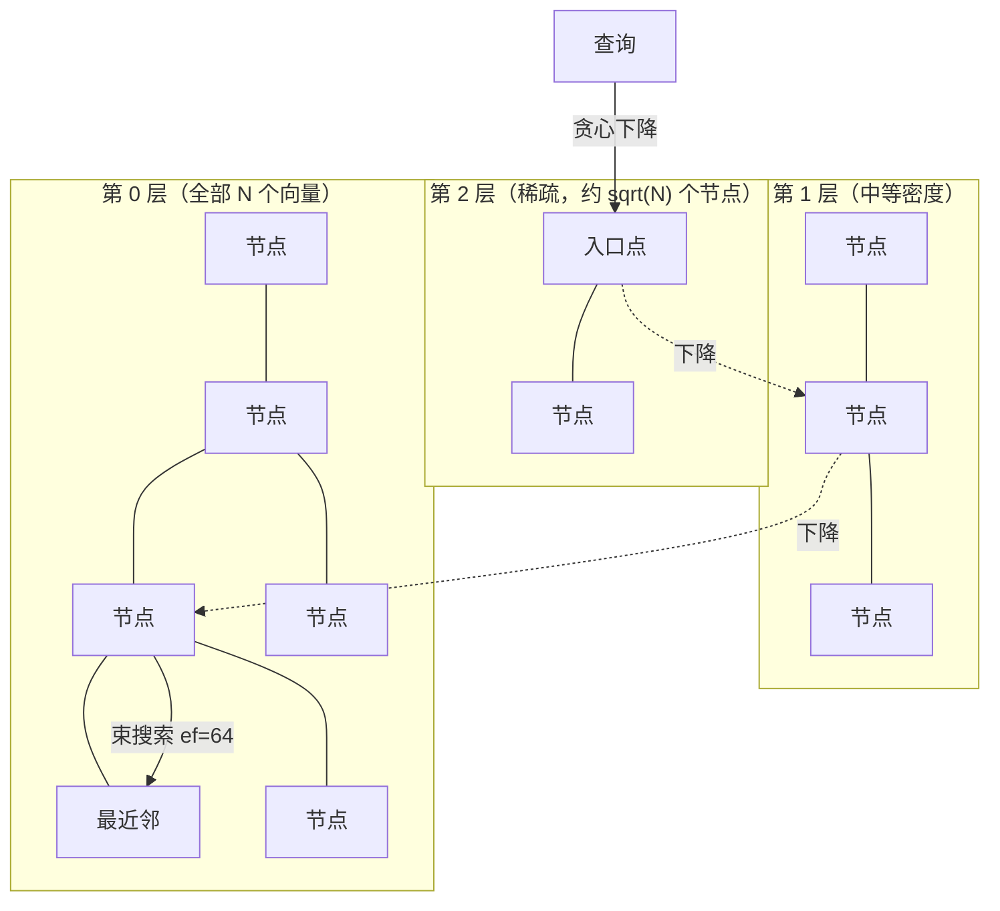
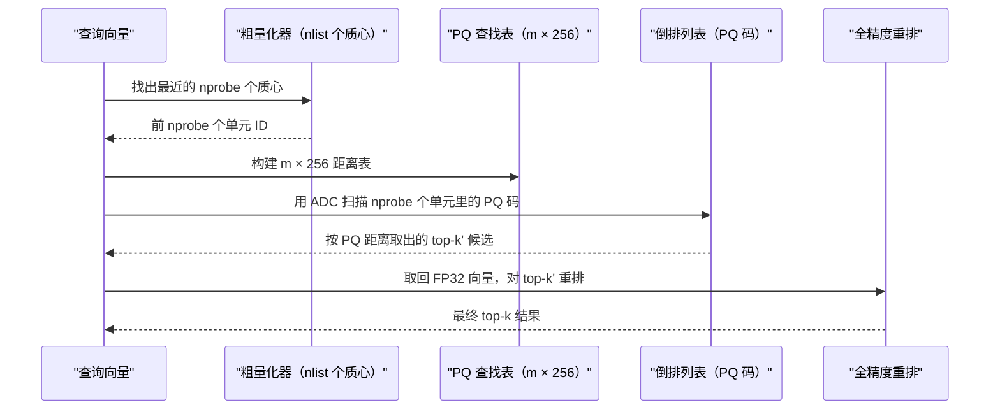
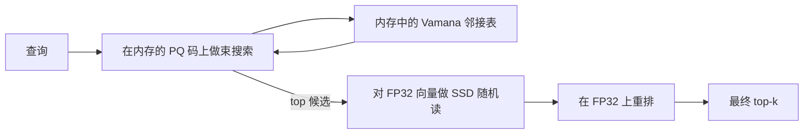
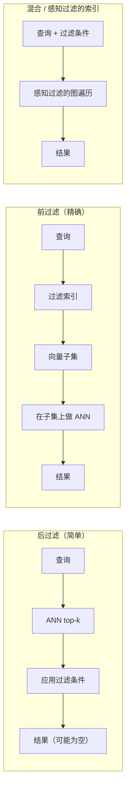

# 大规模向量检索（HNSW、IVF-PQ、DiskANN）

> **TL;DR**: 内存中的 HNSW 索引能撑住数百万向量：召回率 98% 以上，延迟低于 10 ms。但 10 亿个 1024 维的 FP32 向量就是 4 TB 内存。这件事没法靠堆机器蛮干过去。生产上的三大流派是 HNSW（基于图、全内存、召回最好）、IVF-PQ（倒排文件 + 乘积量化，32 倍压缩，成本最优）和 DiskANN（把 Vamana 图放在 SSD 上，单节点支撑十亿级、5,000+ QPS）[^1]。真正的功夫，在于把一副索引骨架、一层量化、一种过滤策略组合到一起。光靠量化（FP32 转二值再重排），在适配的 1024 维模型上就能保住大约 96% 的检索质量，内存降到 1/32[^2]。永远要重排。永远要跑混合检索。永远要测召回率。

## 学习目标

学完本模块，你将能够：

- [ ] 描述 HNSW、IVF-PQ 与 DiskANN 的工作方式，并按语料规模在它们之间做选择
- [ ] 应用乘积量化把内存降低 10-32 倍，同时把召回损失控制在可接受范围
- [ ] 用倒数排名融合（RRF）设计 BM25 加向量的混合检索
- [ ] 依据过滤条件的选择率选择过滤策略（前过滤、后过滤、混合）
- [ ] 把十亿级向量索引分片到多个节点，同时保住召回率
- [ ] 组合量化层级（MRL 截断 + 二值 + 重排），实现成本最优的在线服务

## 直觉理解

你经营一座有十亿本书的图书馆。一位读者来问：“有没有跟这本类似的书？” 跟每一本书精确比对一遍，要花好几年。你需要捷径。

第一条捷径是按体裁编排的卡片目录（IVF）。你只翻最近的三只体裁抽屉，而不是全部一千只。很快，但会漏掉那些横跨体裁的书。

第二条捷径是一张馆员网络，每位馆员都认识自己的邻座（HNSW）。你问一位馆员，他把你指向更近的一位，那一位再把你指向更近的一位。五跳之内你就站到了正确的书架前。召回率漂亮极了，但每位馆员必须时刻待在大楼里（待在内存里）。

第三条捷径是墙上的一张地图，上面标着每本书的压缩描述（DiskANN）。你在内存里沿着地图走，挑出最有希望的 10 本，然后下到地下库房（SSD），只把这 10 本的全文取上来做最终比对。

地图就是乘积量化。地下库房就是 NVMe 存储。那五跳就是图遍历。而读者的问题，就是高维空间里的一次最近邻查询。本章讲的是：什么时候该用哪条捷径，怎么压缩地图而不过多丢掉好书，以及怎么应付那位说“要类似的，但只要是法语书”的读者（带过滤的检索）。

## 原理

### HNSW：内存索引的黄金标准

分层可导航小世界（Hierarchical Navigable Small World，HNSW）是一张多层图：每个向量都待在第 0 层，同时按对数级稀疏的比例出现在更高的层里[^3]。可以把它理解成推广到高维的跳表。

插入时，向量的最高层从按 `1/ln(M)` 缩放的指数分布中抽取。在每一层，一次宽度为 `ef_construction` 的束搜索找出候选邻居，再用多样性启发式保留最多 `M` 条边（第 0 层是 2M 条）。这条启发式的规则是：只要某个已选中的邻居到候选点的距离，比候选点到查询点的距离还近，就否掉这个候选。这能防止抱团成小圈子，也保证了图的可达性。

查询时，遍历从顶层那个固定的入口点开始，逐层贪心地走向更近的节点，然后在第 0 层跑一次宽度为 `ef_search` 的束搜索，产出最终的 top-k。

*查询从顶层的入口点进入，贪心地穿过更稀疏的层逐层下降，最后在所有向量所在的第 0 层执行一次宽度为 `ef_search` 的束搜索。*

**关键参数：**

| 参数 | 常见默认值 | 影响 |
|---|---|---|
| `M` | 16 | 每个节点的边数。越大召回越好，内存越多 |
| `ef_construction` | 100-200 | 建图时的束宽。越大图质量越好，构建越慢 |
| `ef_search` | 64-256 | 查询时的束宽。越大召回越好，查询越慢 |

在 `M=16`、768 维 FP32 向量的情况下，每个向量大约占 3.4 KB（向量 + 图上的边 + 额外开销）。到 1 亿个向量，那就是 340 GB 的 DRAM，还没算任何应用层的开销[^3]。这就是为什么 HNSW 在 1000 万到 5000 万向量以内是正确答案，到了十亿级就是错误答案。

删除靠墓碑位。图结构不动，只置一个 `DELETE_MARK` 位，查询时跳过被标记的节点。日积月累，小世界性质退化，召回率从 98% 掉到 85% 甚至更低。增删频繁的负载必须定期重建。

### IVF-PQ：为规模而压缩

倒排文件加乘积量化把问题劈成两段：粗粒度分区，细粒度压缩。

**IVF** 用 k-means 把向量空间划成 `nlist` 个 Voronoi 单元。查询时只扫描最近的 `nprobe` 个单元。`nlist=4096`、`nprobe=64` 时，你扫的是语料的 1.5%，而不是 100%。

**乘积量化（Product Quantization）** 把每个 d 维向量切成 `m` 个子向量，再把每个子向量替换成它在对应子空间码本里最近质心的 ID，码本共 256 个条目（8 位）。一个 1024 维的 FP32 向量（4,096 字节）在 `m=128` 时变成 128 字节：32 倍压缩[^4]。

查询到某个 PQ 码的距离用非对称距离计算（ADC）来近似：每次查询，为每个子空间建一张 256 项的分段距离查找表，之后库里的每个码字，其距离就是在这几张表上做一次 `m` 项求和。正是这一点，让 IVF-PQ 单核每秒能扫过数百万个压缩码。

*IVF-PQ 先把搜索范围收窄到少数几个 Voronoi 单元，再用预先算好的查找表扫描压缩码，最后在全精度向量上重排，把召回率找回来。*

**OPQ**（Optimized PQ）在量化之前先旋转向量空间，以最小化重构误差。它需要离线训练，但在同等压缩比下能把召回率提高 2-5%。

**ScaNN**（Google，2020）使用各向异性量化，按每个维度对内积排序的贡献给它加权。刚发布时，它在 [ann-benchmarks.com](https://ann-benchmarks.com/) 上胜过另外十一个调优过的库（同等召回率下 QPS 约为 2 倍）；如今它和 `glass`、`hnswlib`、`vamana(diskann)` 这些一流实现各有胜负，不再一枝独秀。

IVF 调参的经典规则：`nlist ~ sqrt(N)`，`nprobe` 取 `nlist/32` 到 `nlist/8` 可拿到 90-95% 的召回率。FAISS 默认的 `nprobe=1` 在生产环境几乎总是错的。

### DiskANN：单节点上的十亿级

DiskANN 把 Vamana 图和全精度向量放在 SSD 上，内存里只留 PQ 压缩后的向量供遍历使用[^1]。Vamana 建图用 alpha 松弛剪枝（alpha > 1），产出的边比 HNSW 那套严格的多样性启发式更长程，从而减少图上的跳数。

在 SIFT1B 基准（10 亿个 128 维向量）上，DiskANN 跑在一台 16 核、64 GB 内存、一块普通 SSD 的机器上，做到 5,000+ QPS、平均延迟低于 3 ms、1-recall@1 在 95% 以上[^1]。同样的语料，HNSW 要 640 GB 以上的内存。

一次查询先在内存里的 PQ 向量上做束搜索锁定候选，再对这 5-10 个候选的全精度向量发起随机 SSD 读来做重排。瓶颈在 SSD 带宽，不在容量。

*DiskANN 把索引拆到不同存储层级。PQ 压缩向量和 Vamana 邻接表留在内存里支撑快速的图遍历；全精度向量放在 SSD 上，只在最终重排时才取回。*

**Filtered-DiskANN**（Gollapudi 等，WWW 2023）把标签集纳入边的构建过程，让元数据过滤不再摧毁召回率[^5]。它支撑着 Bing 的语义搜索和 Azure Cosmos DB 的向量索引。

### 量化阶梯

量化在每一个精度层级上压低每个向量的内存：

| 精度 | 字节数（1024 维） | 加速比 | 召回保留率（带重排） |
|---|---|---|---|
| FP32 | 4,096 | 1 倍 | 100% |
| FP16 | 2,048 | 约 1.5-2 倍 | 约 100% |
| INT8 | 1,024 | 平均 3.66 倍 | 约 99.3% |
| 二值 | 128 | 平均 24.76 倍 | 92-96% |

二值量化以 0 为阈值把每一维二值化，8 个值打进一个字节，用汉明距离做比较。Cohere 在 2024 年 3 月在 embed-v3 之上加了原生 int8/二值 embedding 服务，并在 embed-v4 中延续（截至 2026 年的当前版本，输出类型有 `float`/`int8`/`uint8`/`binary`/`ubinary`）。整条流水线（二值负责候选召回，再用 INT8 或 FP16 对 top-k 重排）在 MTEB 上保住约 96% 的 NDCG@10[^2]。

> [!IMPORTANT]
> 绝不要把二值或 INT8 的结果不经重排直接返回。量化后的距离是有损估计。用全精度向量对 top-k 重排，能把召回率找回大半。跳过重排是最常见的量化反模式。

**套娃表示学习（Matryoshka Representation Learning，MRL）** 训练出的 embedding，前 N 维可以单独当作一个完整 embedding 使用。OpenAI 的 `text-embedding-3-large`（3072 维）报告称，满 3072 维时 MTEB 得分 64.6，256 维时 62.0，即在 12 倍压缩下保住了约 96% 的检索性能[^2]。到 2026 年，Google 的 `gemini-embedding-2`（原生多模态，覆盖文本、图像、视频、音频和文档，默认 3072 维）位居 MTEB 英文榜首，Voyage 基于 MoE 的 `voyage-4-large`（默认 1024 维，可按 Matryoshka 截断到 2048/512/256）在文本检索上与之相当。MRL 可以和量化叠加：把 1024 维截到 128 维再上二值，总共约 256 倍压缩，质量损失约 10%。

### 混合检索与过滤

[RAG 流水线](./01-rag-pipelines.md) 已经把混合检索（稠密 + BM25 + RRF）作为生产默认方案讲了一遍。本章补上“过滤”这一维。

**过滤**是按元数据（租户 ID、日期范围、商品类目）限定哪些向量能成为候选。一共有三种策略：

*三种过滤策略：后过滤在选择性强的谓词上有返回空结果的风险；前过滤需要二级索引；混合索引（Filtered-DiskANN、Qdrant 的可过滤 HNSW）把过滤感知直接建进图结构本身。*

关键的洞见：过滤选择性低时（语料 90% 都匹配），后过滤完全够用。选择性高时（只有 0.1% 匹配，比如 `tenant_id = X`），后过滤会返回空结果，因为 ANN 的 top-k 基本不可能与过滤集有交集。这是多租户向量检索里头号的生产意外。

**按选择率给出的建议：**

- 宽过滤（匹配超过 50%）：后过滤
- 窄过滤（匹配低于 5%）：用带 payload 索引的前过滤，或者按过滤字段分区成命名空间
- 混合负载：过滤感知索引（Filtered-DiskANN、Qdrant、Weaviate）

## 真实案例

### Microsoft DiskANN：从研究到 Bing 和 Azure

DiskANN 起于微软研究院 2019 年的一篇 NeurIPS 论文，如今支撑着 Bing、Azure Cosmos DB（NoSQL 与 MongoDB vCore）以及 Azure SQL 的向量检索[^1]。

**问题：** Bing 需要对数十亿网页 embedding 提供语义搜索。这个量级上搞内存版 HNSW，意味着几百台机器上堆几十 TB 的 DRAM。成本根本扛不住。

**架构：** Vamana 图存在 NVMe SSD 上。内存里只放 PQ 压缩向量（10 亿个 128 维向量占 64 GB）。查询路径：在内存的 PQ 码上做束搜索，锁定大约 100 个候选，5-10 次 SSD 随机读取回全精度向量，重排产出最终 top-k。在单台 16 核节点上，总体做到 5,000+ QPS、平均延迟低于 3 ms。

**Filtered-DiskANN（2023）：** Bing 的生产负载里有“2024 年斯坦福作者发表的机器学习论文”这类查询。原版 DiskANN 不管元数据。Filtered-DiskANN 构建的图边尊重标签集，即便在高选择性过滤下，遍历也始终待在匹配的顶点内。这就消掉了后过滤在选择性谓词上造成的召回断崖[^5]。

**规模经济：** 同等召回率下，单个 DiskANN 节点能索引的向量数是 HNSW 或 FAISS IVF 的 5-10 倍。对 Azure Cosmos DB 来说，这意味着向量检索成了既有数据库的一个特性，而不是另立一层基础设施。客户在现有文档集合上加一个向量索引就行，不必先建一套专用的向量检索集群。

**下一站：** turbopuffer 的 ANN v3 走得更远，用对象存储（S3）当真值来源，配 SSD 缓存和 RaBitQ 二值量化，在 1000 亿向量上做到 200 ms 的 p99 延迟[^6]。靠着对象存储和激进量化，每 TB 成本远低于内存方案。

## 权衡

| 索引 | 每向量内存（1024 维） | Recall@10 | 查询延迟 | 规模上限 | 我们的选择 |
|---|---|---|---|---|---|
| HNSW（全内存） | 约 4 KB（FP32 + 图） | 98-99% | 低于 10 ms | 1000 万-5000 万向量 | 5000 万以下，永远选它 |
| IVF-PQ | 128 B（32 倍压缩） | 90-95% | 10-50 ms | 1 亿-10 亿+ | 成本敏感、有 GPU |
| DiskANN | 128 B 内存 + 4 KB SSD | 95-98% | 5-15 ms | 10 亿-1000 亿 | 1 亿以上，默认选它 |
| 对象存储（turbopuffer） | 极少内存，SSD + S3 | 90-95%+ | 10-200 ms | 1000 亿+ | 冷热混合的多租户 |

## 常见陷阱

> [!WARNING]
> **在只做后过滤的索引上使用高选择性过滤。** 一个只匹配 0.1% 向量的 `tenant_id = X` 过滤，从后过滤 ANN 里拿回来的是空结果，因为未过滤的 top-k 永远撞不上过滤集。改用带 payload 索引的前过滤、按租户分区成命名空间，或者换成 Filtered-DiskANN 这类过滤感知索引。

> [!WARNING]
> **增删频繁时 HNSW 的召回率退化。** 软删除的节点还挂在图里当枢纽，却指不到任何有用的地方。经历几百万次删除-插入循环后，召回率从 98% 掉到 85%。用影子新建索引对比监控 recall@10，并安排定期重建。

> [!WARNING]
> **量化之后不重排。** 只用二值检索，在适配的 1024 维模型上召回约 90-92%（模型更小或更不适配时低得多）。对 top-k 加上 FP16/FP32 重排能恢复到 96% 以上。重排每候选只花几微秒。跳过它是量化上最常见的错误。

> [!WARNING]
> **IVF 用默认的 nprobe=1。** FAISS 出厂就是 `nprobe=1`。在 `nlist=4096` 下，那只扫了语料的 0.02%。无论给多少资源，召回率都卡在 70-80%。在留出集上扫一遍 `nprobe`；拐点通常在 `nlist/32` 到 `nlist/8`。

> [!WARNING]
> **对未归一化向量用余弦相似度。** 多数 embedding 模型输出的是未归一化向量。如果对未归一化输入用点积建索引，模长会主导排序。在生成 embedding 时就归一化，或者在索引配置里用 cosine 度量。

## 练习

你要建一个 20 亿向量、按租户分区的检索服务（每个租户只能看到自己的向量），峰值 10,000 QPS。请设计：按租户规模（小租户 1 万向量，大租户 1 亿）的索引选型、分片方案、内存与 SSD 的分工，以及随着新向量写入而跟踪召回漂移的评估闭环。

提示

想一想：(a) 为什么当租户规模横跨 4 个数量级时，单一索引策略必然失效；(b) 当一个小租户的向量只占共享索引的 0.0005% 时，后过滤的召回会变成什么样；(c) 在没有每次查询的真值标签的情况下，你怎么发现召回率下降。

解答

**分层索引策略：**

- 小租户（10 万向量以下）：放进共享的 HNSW 索引，通过 payload 索引对 tenant_id 做前过滤。这个规模下 HNSW 的高召回足以抵消过滤开销。内存成本可以忽略（10 万 × 4 KB = 每租户 400 MB）。
- 中等租户（10 万到 1000 万）：每个租户一个独立 HNSW 索引。每个占单节点 4-40 GB 内存。把召回和跨租户干扰隔开。
- 大租户（1000 万到 1 亿）：每个租户一个 DiskANN。PQ 压缩向量放内存（128 B × 1 亿 = 12.5 GB），全量向量放 SSD。单节点就能扛住 5,000+ QPS。

**分片：** 共享的小租户索引随机分到 8 个节点。每次查询广播到所有分片再合并 top-k。独立租户索引按 tenant_id 路由到指定节点（用一致性哈希便于再均衡）。

**内存与 SSD 的分工：** 小租户和中等租户全内存（HNSW）。大租户走 DiskANN 的拆分：PQ 码 + 图在内存，FP32 向量在 NVMe。每个大租户节点的内存预算约 20 GB，SSD 约 400 GB。

**评估闭环：** 每个租户层级维护 500 条查询的黄金集，标注已知的相关向量。每周对线上索引跑一次 recall@10。召回比新建基线低 3 个点以上就告警。对大租户按月安排 DiskANN 重建；共享 HNSW 索引在墓碑比例超过 10% 时重建。

**QPS 预算：** 所有租户合计 10,000 QPS。大租户拿专用容量（DiskANN 单节点 5,000 QPS，所以每个大租户给 2 个节点留余量）。小租户共用 8 节点的 HNSW 集群。读副本随峰值弹性伸缩。

## 要点回顾

- 5000 万向量以下，HNSW 是局部最优：召回 98% 以上、延迟低于 10 ms，但每向量 4 KB 的内存让它在十亿级不经济。
- IVF-PQ 压缩 32 倍（每向量从 4,096 B 到 128 B），用 5-10% 的召回换巨大规模。务必调 `nprobe`。
- DiskANN 把图放上 SSD、内存只留 PQ 码，让单节点以 5,000+ QPS 支撑十亿级检索。
- 量化阶梯（FP32 → FP16 → INT8 → 二值）可以和任何索引叠加。量化结果务必用全精度向量重排。
- 混合检索（稠密 + BM25 + RRF）是稳定的质量收益。生产环境绝不要只上稠密。
- 过滤选择率决定策略：宽过滤用后过滤，窄过滤用前过滤或过滤感知索引。多租户负载需要命名空间隔离或 Filtered-DiskANN。
- 对着黄金集监控 recall@10。HNSW 会因增删退化；IVF 质心会漂移；两者都需要定期重建。

## 延伸阅读

- [DiskANN: Fast Accurate Billion-point Nearest Neighbor Search on a Single Node](https://www.microsoft.com/en-us/research/publication/diskann-fast-accurate-billion-point-nearest-neighbor-search-on-a-single-node/) - SSD 驻留式十亿级检索的奠基论文；重点读 Vamana 图的构建和 alpha 松弛剪枝。
- [Efficient and robust approximate nearest neighbor search using HNSW graphs](https://arxiv.org/abs/1603.09320) - Malkov 与 Yashunin 2016 年的论文；多样性启发式和层选择的数学是调 `M` 和 `ef` 的关键。
- [Product Quantization for Nearest Neighbor Search](https://hal.inria.fr/inria-00514462v2/document) - Jegou 等，2011；正是这篇论文把向量压缩 32 倍，让十亿级检索变得经济可行。
- [Filtered-DiskANN: Graph Algorithms for Approximate Nearest Neighbor Search with Filters](https://harsha-simhadri.org/pubs/Filtered-DiskANN23.pdf) - 带过滤向量检索的最前沿；多租户系统的必读。
- [Binary and Scalar Embedding Quantization (Hugging Face)](https://huggingface.co/blog/embedding-quantization) - 带 MTEB 数据和代码的实操讲解，涵盖 INT8 与二值量化及其重排。
- [turbopuffer ANN v3: 200ms p99 over 100 billion vectors](https://turbopuffer.com/blog/ann-v3) - 近年关于对象存储原生向量检索加 RaBitQ 的最佳系统深度剖析。
- [Matryoshka Representation Learning](https://arxiv.org/abs/2205.13147) - Kusupati 等，2022；OpenAI 与 Cohere 模型里可截断 embedding 背后的训练方法。
- [ann-benchmarks.com](https://ann-benchmarks.com/) - ANN 算法的标准基准；信任何厂商的营销图表之前，先读它的方法论。

## 记忆卡片

**Q:** 1 亿个 1024 维 FP32 向量占多少内存？
**A:** 1 亿 × 1024 × 4 字节 = 400 GB 的裸向量数据。加上 HNSW 的图开销（M=16），总共约 430-450 GB。这就是全内存 HNSW 在这个量级撑不住的原因。

**Q:** HNSW 怎么做到 O(log N) 的查询时间？
**A:** 靠把向量组织成对数级稀疏的多层结构。查询从顶层（节点很少、边很长程）贪心下降到第 0 层（全部节点），每降一层就收窄搜索范围。层数约为 log(N)/ln(M)。

**Q:** 乘积量化做了什么，能达到多少压缩？
**A:** PQ 把 d 维向量切成 m 个子向量，每个替换成一个 8 位的码本索引（每个子空间 256 个质心）。1024 维 FP32 向量（4,096 字节）在 m=128 时压到 128 字节，32 倍缩减。

**Q:** DiskANN 只有 64 GB 内存，怎么做到十亿级检索？
**A:** 它把 PQ 压缩向量和 Vamana 图的邻接表放内存里供遍历使用，但把全精度向量留在 SSD 上。查询先在内存的 PQ 码上做束搜索，再对 top 候选发起 5-10 次 SSD 随机读，用全精度重排。

**Q:** 二值量化加上重排，召回能保住多少？
**A:** 视 embedding 模型而定，约 92-96% 的 NDCG@10，平均加速 24.76 倍。不重排的话质量明显下滑。二值检索永远要配 top-k 上的 FP16/FP32 重排。

**Q:** 后过滤为什么在高选择性的元数据谓词上会失效？
**A:** 后过滤先跑 ANN，再丢掉不匹配的结果。如果只有 0.1% 的向量匹配过滤条件，任何匹配项出现在未过滤 top-100 里的概率几乎为零。于是明明有匹配向量，查询却返回空结果或近乎空结果。

**Q:** Filtered-DiskANN 是什么，为什么重要？
**A:** Filtered-DiskANN 构建的图边尊重标签集，即便在高选择性过滤下，遍历也待在匹配的顶点内。它解决了后过滤在多租户或元数据密集负载上造成的召回断崖。Bing 和 Azure Cosmos DB 都在用它。

**Q:** 什么是套娃表示学习？
**A:** 一种训练方法，把多个粒度的 embedding 嵌套进同一个向量里，使前 N 维可以单独当作完整 embedding 使用。OpenAI 的 text-embedding-3-large 在 3072 维时 MTEB 得分 64.6，256 维时 62.0——12 倍压缩下约 96% 的检索性能。

**Q:** IVF 的 nlist 和 nprobe 有什么经典调参规则？
**A:** nlist 取大约 sqrt(N)。nprobe 取 nlist/32 到 nlist/8 之间，可得 90-95% 召回率。FAISS 默认的 nprobe=1 在生产环境几乎总是错的。

**Q:** 倒数排名融合（RRF）怎么合并稠密与稀疏检索？
**A:** RRF 把每个文档在各排名列表里的分数算成 sum(1/(k + rank_i))，k 通常取 60。它只用排名不用分数，所以分数分布不同的两个检索器之间不需要做校准（BM25 无上界，余弦在 [-1,1]）。

**Q:** 什么时候用 HNSW，什么时候用 IVF-PQ，什么时候用 DiskANN？
**A:** 5000 万向量以下用 HNSW（召回最好，全内存）。1 亿到 10 亿、内存紧张且有 GPU 加速时用 IVF-PQ。1 亿以上默认 DiskANN，在普通硬件上做性价比最高的十亿级检索。

**Q:** HNSW 的召回率为什么会随时间下降？
**A:** 软删除（墓碑）把死节点留成了图上的枢纽。多样性启发式只在插入时跑，不会修复被破坏的邻域。重度增删之后，小世界性质退化，召回率从 98% 掉到 85% 甚至更低。必须定期全量重建。

## 参考文献

[^1]: Subramanya, Devvrit, Kadekodi, Krishnaswamy, Simhadri. "DiskANN: Fast Accurate Billion-point Nearest Neighbor Search on a Single Node." NeurIPS 2019. https://www.microsoft.com/en-us/research/publication/diskann-fast-accurate-billion-point-nearest-neighbor-search-on-a-single-node/
[^2]: Shakir, Aarsen, Lee. "Binary and Scalar Embedding Quantization for Significantly Faster and Cheaper Retrieval." Hugging Face blog, March 2024. https://huggingface.co/blog/embedding-quantization
[^3]: Malkov and Yashunin. "Efficient and robust approximate nearest neighbor search using Hierarchical Navigable Small World graphs." arXiv 2016. https://arxiv.org/abs/1603.09320
[^4]: Jegou, Douze, Schmid. "Product Quantization for Nearest Neighbor Search." TPAMI 2011. https://hal.inria.fr/inria-00514462v2/document
[^5]: Gollapudi et al. "Filtered-DiskANN: Graph Algorithms for Approximate Nearest Neighbor Search with Filters." WWW 2023. https://harsha-simhadri.org/pubs/Filtered-DiskANN23.pdf
[^6]: VanBenschoten. "ANN v3: 200ms p99 query latency over 100 billion vectors." turbopuffer blog, Jan 2026. https://turbopuffer.com/blog/ann-v3
