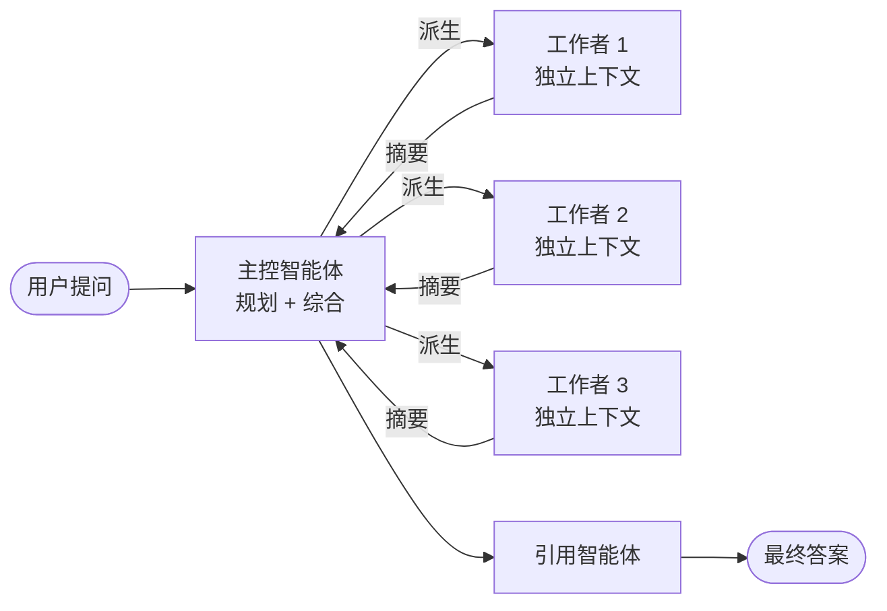
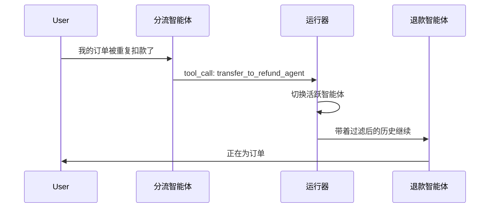
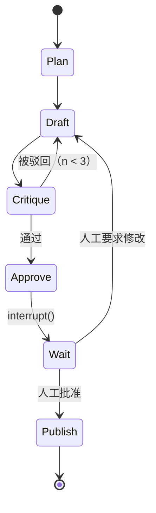
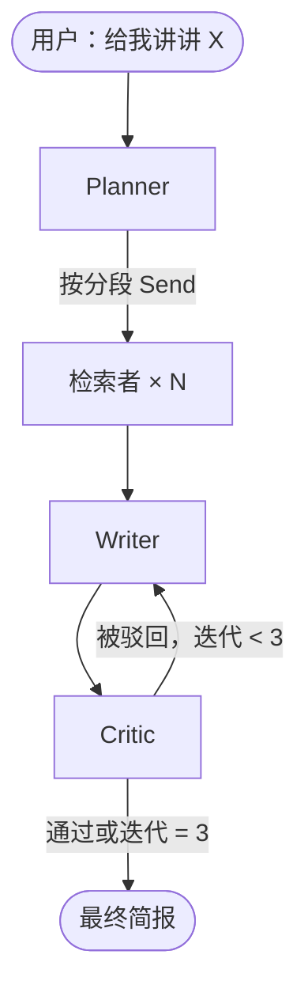

# 多智能体编排（LangGraph、OpenAI Agents SDK、AutoGen、Swarm）

> **TL;DR**：多智能体系统同时运行多个 LLM 实例，每个实例有独立的对话上下文，由代码负责协调。它承诺的是专业化分工、并行执行，以及每个智能体的上下文都有界。代价也很陡：Anthropic 实测独立智能体的 token 消耗约为一次对话交互的 4 倍，多智能体运行约为 15 倍[^1]，所以从单智能体走向多智能体团队，通常还要再叠加约 4 倍。主导的结构原语只有两个：编排者-工作者（中央规划者拆解任务并分派）和交接（对等方之间转移控制权）。Anthropic 的建议毫不含糊：先做一个更强的单智能体，只有当你能说出多智能体究竟缓解了哪个具体约束时，才引入多智能体[^2]。其余的一切——辩论、评估者-优化者、监督者层级——都只是这两个原语的组合。

## 学习目标

学完本章，你将能够：

- [ ] 解释多智能体拓扑在什么情况下比一个更强的单智能体更划算
- [ ] 针对具体问题在编排者-工作者与交接之间做出选择
- [ ] 把智能体系统建模成由节点、边和条件路由组成的状态机
- [ ] 从一条 trace 里诊断循环、上下文爆炸和委派失控
- [ ] 在核心原语层面比较 LangGraph、Agents SDK、Swarm 和 AutoGen
- [ ] 设计一个上下文有界、交接明确的「调研+写作」智能体团队

## 直觉理解

你经营一家小型律所。一位合伙人不可能独自处理所有案子。她才华出众，可办公桌已经堆满了：税务申报、合同审查、专利申请，还有一桩离婚案。每个领域都需要不同的专业知识、不同的参考资料、不同的工具。如果她试图把四件事同时装进脑子里，就会把专利权利要求和离婚财产分割方案搞混。

于是她雇了专家。税务律师负责申报，专利律师负责权利要求，一位律师助理负责检索文档。合伙人就成了编排者：她读客户的需求，判断该由哪位专家处理，把相关上下文（且只把相关的上下文）交接过去，等对方交付工作成果，最后把这些汇总成一份辩护意见。

有时专家们并行工作（税务律师和专利律师的任务互不相干）。有时一个专家把活交接给另一个（律师助理找到一份文件，转给合同审查者）。合伙人绝不会把离婚案卷宗发给专利律师。每个专家只看到自己需要看的东西。

这就是多智能体编排（multi-agent orchestration）。合伙人是编排者，专家是工作者智能体，律师助理与审查者之间的交接属于对等转移。有界的上下文（每位专家只看到自己的案子）避免了交叉污染。而合伙人的时间（即 token）就是预算约束：每一次委派都要付出协调开销。

本章剩下的部分会把这个类比讲精确，给你看那两个结构原语，走一遍实现它们的框架，并教你诊断当你的「专家」变成非确定性 LLM 之后冒出来的那些分布式系统 bug。

## 原理

### 多智能体何时划算（何时不划算）

[AI Agent Architectures](./03-ai-agent-architectures.md) 讲了单智能体循环：ReAct、反思、规划、工具使用、记忆。那一章的核心结论是「从工作流起步，只有当控制流真正未知时才升级为智能体」。本章讲下一次升级：一个智能体什么时候需要变成多个？

Anthropic 指出了多智能体稳定取胜的三种情形[^2]：

1. **上下文保护。** 隔离子上下文能防止污染。一个客服智能体检索了 2000 token 的订单历史后，它的技术推理能力会明显下降；把这次检索拆给一个子智能体，只返回 50 到 100 token 的摘要，质量就能恢复。
2. **并行化。** 相互独立的方面可以同时探索。Anthropic 的 Research 智能体并行派生 3 到 5 个子智能体而不是串行执行，把调研时间最多缩短了 90%[^1]。
3. **专业化。** 每个角色配一套聚焦的工具和系统提示。便宜模型负责路由，昂贵模型负责综合。

超出这三种情形，协调成本就会超过收益。有的团队「花几个月搭建精巧的多智能体架构，最后发现只要把单个智能体的提示写好就能达到同等效果」[^2]。规则是：如果你说不出自己在缓解这三种约束中的哪一个，就留在单智能体。

什么情况下不要用多智能体：

- 任务有清晰的流程化工作流（改用提示链或路由）
- 延迟 SLO 很紧（每一跳都要加 500ms 到 2s）
- 你无法容忍可调试性受限（多智能体的 trace 是 DAG，不是树）
- 协调消耗的 token 超过执行消耗的 token

### 编排者-工作者模式

一个中央 LLM 拆解任务，把子任务分派给工作者智能体（通常是并行），再综合它们的产出。这是调研、分析和代码生成类产品里的主导模式。



*主控智能体负责规划，派生出上下文隔离的并行子智能体，再把它们的摘要综合成最终输出。*

编排者是唯一的责任归属点。你可以在运行时层面限制扇出（fan-out）、强制总 token 预算、追踪每一次委派。但它同时也是单点故障：一个错误的计划会毒化整轮运行。当某个子智能体比同伴慢 10 倍时，同步执行就会形成瓶颈。

Anthropic Research 智能体的扩展经验[^1]：简单的事实查找只需 1 个智能体、3 到 10 次工具调用；直接对比需要 2 到 4 个子智能体，每个 10 到 15 次调用；复杂调研则用 10 个以上子智能体，职责划分清楚。这些规则写在编排者的系统提示里，而不是代码里。

关键工程原则：按上下文边界拆解，而不是按角色类型拆解。拆成规划者/实现者/测试者/审查者（以角色为中心）会制造「传话游戏」，每交接一跳就损失一次保真度。按独立的调研路径拆解（以上下文为中心），每个智能体才能以最小的协调自主工作[^2]。

### 交接模式

交接（handoff）是对等方之间的控制权转移。一个智能体调用的工具返回了另一个智能体，运行时就在下一轮切换当前活跃智能体。整个过程没有中央协调者。

OpenAI Swarm（2024 年 10 月）给出了这个最小原语：一个 `Agent` 有指令和函数；某个函数如果返回 `Agent`，它就是一次交接[^3]。运行循环是：从当前智能体取补全，执行工具调用，若有工具返回了 Agent 就切过去，一直循环到没有新的函数调用。

OpenAI Agents SDK（2025 年 3 月首次发布，如今已不绑定单一厂商，2026 年中的版本为 0.17.x）把交接编译成合成工具。一个配置了 `handoffs=[billing_agent, refund_agent]` 的 `triage_agent`，会在同一张决策面上看到 `transfer_to_billing_agent`、`transfer_to_refund_agent` 以及它自己的常规工具[^3]。模型用同一套机制来选交接还是选工具调用。



*分流智能体把 transfer_to_refund_agent 当作一次工具调用来选；SDK 切换活跃智能体；对话由该专家继续。*

交接天然适合客服分流：前台智能体做分类，然后路由给账单、退款或技术支持专家。每个专家只能访问自己相关的工具。

风险是交接环（handoff loop）：智能体 A 交给 B，B 又交回 A，因为谁都不认领这个请求。缓解手段：限制 `max_turns`（Swarm 默认是无限，这很危险）、强化「留在角色内」的提示、要求每次状态转移都必须改动状态里的某个进度键。

### LangGraph：类型化状态、检查点与中断

LangGraph 把多智能体系统建模成显式的有向图。节点是更新类型化共享状态的函数，边是状态转移，其中包括条件路由器。检查点器（checkpointer）在每一步把完整状态序列化下来。

状态是一个 `TypedDict` 或 Pydantic 模型。每个节点接收状态、返回增量更新，图的 reducer 负责合并更新。做并行扇出时，reducer 必须满足结合律和交换律（列表上的 `operator.add` 是标准选择）[^4]。

编排者-工作者模式用 LangGraph 的 `Send` API：编排者在条件边上返回一组 `Send("worker", {...})`。每个工作者带着自己的状态切片独立运行，写入一个共享键，由 reducer 聚合。最后有一个综合节点读取所有已完成的分段。

**检查点**（`MemorySaver`、`SqliteSaver`、`PostgresSaver`）支持暂停/恢复、时间旅行和崩溃恢复。一次几分钟的运行如果因为工具超时崩了，用户可以从上一个检查点恢复，而不必从头重试。

**中断**（interrupt）会暂停执行等待人工输入。在节点里调用 `interrupt()` 会让 LangGraph 保存状态，并无限期等待你恢复[^5]。人可以查看状态、修改状态、再恢复。这是高风险动作（发邮件、退款、部署代码）之前设置审批门禁的生产级做法。



*一个写作-评审图在发布前暂停等待人工批准；检查点器在暂停期间持久化状态，因此几小时甚至几天后都能异步恢复。*

心智模型：如果你用过 React 的 `useReducer`，LangGraph 的类型化状态加减 reducer 就是同一个套路。状态是显式的，更新是增量的，图拓扑提前声明。权衡是比 Swarm 更啰嗦（你得声明节点、边、条件边和状态 schema），但崩溃恢复和人工介入（human-in-the-loop）是白送的。

### 框架对比：如何选择抽象层

多智能体框架的生态很宽。下面是你最常遇到的四个，另外简单提几个替代品。

**LangGraph（LangChain）：** 显式 DAG/状态机。带 reducer 的类型化共享状态。检查点（SQLite、Postgres）。通过中断实现人工介入。支持流式和子图。1.0 稳定版于 2025 年 10 月发布；1.x 系列是当前生产版本。Klarna、Elastic 等公司在生产中使用[^6]。当你需要持久、可观测、长时间运行且能崩溃恢复的工作流时，它最合适。

**OpenAI Agents SDK：** 轻量，抽象很少。交接即工具。内置护栏（guardrail，与智能体执行并行地做输入校验，快速失败）。用会话（SQLite、Postgres、Redis、MongoDB）实现持久记忆。内置追踪，兼容 OpenAI 的评估工具。2025 年 3 月发布时以 OpenAI 为先，现在已不绑定厂商，可跑 100 多个 LLM。当你想要最少的仪式感时，它最合适[^3]。

**Microsoft Agent Framework（MAF）/ AutoGen：** AutoGen（微软，2025 年 1 月 v0.4 → 2025 年 9 月 v0.7.5）引入了带 GroupChat 选择器的异步事件驱动 actor 模型[^7]。Magentic-One（通用型多智能体：Orchestrator、WebSurfer、FileSurfer、Coder、ComputerTerminal）以及面向用户的 **Magentic-UI**（最新 0.1.x，2025 年 11 月）都属于这条血脉。AutoGen 现已进入维护模式；**Microsoft Agent Framework（MAF）** 是新项目应采用的 GA 继任者（Python `agent-framework`，.NET 1.6.x）。适用于辩论式或代码解释器类工作流，以及需要异步执行的场景。

**CrewAI：** 基于角色的 crew 加一个流程（顺序式或层级式）。学习曲线更低。适合快速搭出基于角色的团队原型。

**其他值得了解的：** CrewAI（2026 年已到 1.x——基于角色的 crew，配顺序式或层级式流程）、MetaGPT（SOP 驱动的软件开发团队，在 SoftwareDev 基准上单任务 token 成本低于 ChatDev）[^8]、DSPy（把提示当作程序来编译，而不是编排）、LlamaIndex Workflows（事件驱动）、Pydantic AI、Mastra（TypeScript 优先）。

| 框架 | 核心抽象 | 状态模型 | 人工介入 | 最适用 |
|---|---|---|---|---|
| LangGraph | DAG + 类型化状态 | 显式 schema + reducer | interrupt() + 检查点器 | 持久、可观测的工作流 |
| Agents SDK | 智能体 + 交接工具 | 对话（会话） | 非内置（需自行添加） | 轻量分流/路由 |
| Microsoft Agent Framework（MAF；取代 AutoGen） | Actor + GroupChat | 共享对话记录 | 终止条件 | 辩论、代码解释器 |
| CrewAI | 角色 + 流程 | 共享记忆 | 回调 | 快速原型 |

### 通信模式与状态管理

多智能体系统通过三种模式之一通信：

**共享状态 / 黑板。** 所有智能体读写同一个状态对象。LangGraph 的 `TypedDict` 加 reducer 是类型化版本，AutoGen 的 GroupChat 对话记录是非类型化版本。优点：协调简单。缺点：每多一个智能体，上下文压力就涨一分；并行写入的竞态需要靠满足结合律的 reducer 来化解。

**消息传递（actor 模型）。** 智能体之间通过异步消息通信。AutoGen 及其继任者 Microsoft Agent Framework（MAF）的核心就是这套。优点：能跨进程边界扩展。缺点：顺序和投递语义更难推理。

**带载荷的交接。** 控制权连同过滤后的历史子集一起转移。OpenAI Agents SDK 的 `input_filter`（例如 `remove_all_tools`）会在下一个智能体看到之前剥掉此前的工具调用。优点：隔离干净。缺点：过滤太激进就会丢信息。

要耐久性，就加一层持久化。LangGraph 的检查点器能覆盖中短期工作流。对持续几小时或几天的智能体运行，要用持久执行框架（Temporal、Restate、Inngest），它们能扛住进程重启，并提供恰好一次（exactly-once）的投递语义。

## 真实案例

### Anthropic 的 Claude Research 智能体

Anthropic 的多智能体调研系统（2025 年 6 月）是公开资料最详尽的生产级编排者-工作者部署。在他们的内部调研评测上，它比单智能体的 Claude Opus 4 高出 90.2%[^1]。多智能体运行的 token 消耗约为对话交互的 15 倍，独立智能体约为 4 倍[^1]。

**架构：** 一个 `LeadResearcher` 分析查询、制定计划，并把计划存到外部 Memory（因为 200K 上下文窗口可能被超出并截断）。它通过工具调用并行派生 3 到 5 个子智能体。每个子智能体有自己的上下文窗口，用交错的思考过程做网页搜索。结果回流给主控。一个 `CitationAgent` 对草稿做后处理，把引用挂到具体的来源位置上。

**关键工程决策：**

- 子智能体把产物直接写到文件系统，而不是把一切塞给协调者，从而把「传话游戏」问题降到最低。
- 扩展思考模式充当规划和工具调用后评估的「可控草稿纸」。
- 彩虹部署（rainbow deployment）让新旧版本同时运行，逐步把流量从旧版本挪到新版本，这样工作流跑到一半的智能体不会被发布搞崩。
- 把明确的扩展规则写进主控智能体的提示里，避免无界扇出。

**早期踩的坑：** 第一版「为简单查询派生 50 个子智能体，为了并不存在的来源在地毯式搜索网页，还用过量更新互相干扰」[^1]。一个子智能体去研究 2021 年的汽车芯片危机，另外两个则在 2025 年的供应链上重复劳动，因为任务描述太模糊。人工测试者还发现，智能体会一致地偏好 SEO 优化的内容农场而不是权威来源，直到加入来源质量启发式规则才纠正。

**经验：** 每个子智能体都需要一个目标、一种输出格式、关于工具和来源的指引，以及清晰的任务边界。仅 token 用量一项就能解释 BrowseComp 评测表现方差的 80%；模型选择和工具调用解释了剩下的大部分（三个因素合计解释 95%）[^1]。

## 权衡

| 方案 | 优点 | 缺点 | 最适用 | 我们的选择 |
|---|---|---|---|---|
| 单智能体 + 工具 | 最简单、最便宜、最好调试 | 受上下文和工具数量限制 | 大多数生产任务 | **默认起点** |
| 编排者-工作者 | 责任清晰、易限制扇出、可并行 | 规划者是单点故障、错误级联、同步瓶颈 | 可自上而下拆解的任务（调研、分析） | 上下文隔离被证明必要时 |
| 交接（对等） | 耦合低、专家小而精、原语简单 | 交接环、没有全局视图 | 客服分流、基于角色的路由 | 当路由是主要决策时 |
| 并行扇出 | 用并发掩盖 LLM 延迟 | 合并冲突、成本随宽度线性增长 | Map 类工作负载、多源调研 | 子任务可证明相互独立时 |
| 评估者-优化者 | 在标准明确的模糊任务上质量更高 | 成本 2 到 5 倍、意见不合时死锁 | 写作、翻译、复杂检索 | 迭代确实有收益时 |

## 常见陷阱

> [!WARNING]
> **智能体困在循环里。** 两个智能体把任务来回推，或者某个智能体用完全相同的参数反复调用同一个工具。限制 `max_turns`（Swarm 默认无限）。要求每次状态转移都改动状态里的一个进度键。把「重复调用工具且参数相同」作为一种 trace 模式来监控。

> [!WARNING]
> **上下文污染与爆炸。** 智能体的上下文里堆积了此前子任务留下的无关工具输出，随着上下文增长，回答质量下降。按智能体 span 追踪 `gen_ai.usage.input_tokens`，上下文占用超过 70% 就告警。把子任务隔离到上下文全新的子智能体里；把产物写到外部存储，只传引用。

> [!WARNING]
> **无界委派失控。** 编排者为一个简单查询派生几十个子智能体，账单爆炸，撞上限流。把明确的扩展规则写进编排者提示。在运行时层面硬性限制扇出。单请求子智能体数量超过阈值就告警。

> [!WARNING]
> **以角色为中心的拆解（传话游戏）。** 按角色类型（规划者、实现者、测试者、审查者）拆而不是按上下文边界拆，会导致每交接一跳就损失一次保真度。采用以上下文为中心的视角：只有当上下文能被隔离时才拆（独立调研路径、干净的 API 契约、黑盒验证器）[^2]。

> [!WARNING]
> **没有检查点，智能体中途死掉。** 一次几分钟的多智能体运行因工具超时崩溃，用户只能从头重试。挂上检查点器（LangGraph 的 `PostgresSaver`、Agents SDK 的 SQLAlchemy 会话）。把智能体的适应性与确定性的保护措施结合起来：重试逻辑加上定期检查点。

## 练习

为一个「给我讲讲 X 这个主题」的产品设计调研+写作智能体团队。**规划者**拆解任务；**检索者**并行执行；**写作者**起草；**评审者**审阅，写作者修改，直到通过或耗尽三轮预算。请明确拓扑、共享状态 schema、LangGraph 的节点与边、失败预算，以及一个用来触发寻呼的指标。

<details>
<summary>提示</summary>

这是一个编排者-工作者模式，尾部带一个评估者-优化者循环。规划者是编排者，检索者是并行工作者，写作者-评审者构成一个「先写再评」的循环。想一想 reducer 需要从并行检索者那里合并什么状态，以及评审循环里的「进度」是什么（迭代次数就是预算）。

</details>

<details>
<summary>参考解法</summary>

**拓扑：** 编排者-工作者 + 尾部的评估者-优化者。

**共享状态 schema（TypedDict）：**

```python
class BriefState(TypedDict):
    topic: str
    plan: list[Section]           # 规划者输出
    search_results: Annotated[list[SearchResult], operator.add]  # reducer 负责合并
    draft: str                    # 写作者输出
    critique: str                 # 评审者输出
    iteration: int               # 0 到 3
    approved: bool
    final_brief: str
```

**LangGraph 的节点与边：**



*规划者扇出到并行检索者；它们的结果经 reducer 合并；写作者-评审者循环最多跑三轮。*

**节点：** `planner`（结构化输出：带检索查询的分段列表）、`searcher`（网页搜索 + 摘要，通过 `Send` 每个分段一个）、`writer`（根据检索结果起草）、`critic`（按评分标准评估，返回通过/驳回 + 反馈）。

**失败预算：** 检索者子智能体最多 5 个。评审循环最多 3 轮。总 token 上限：每请求 200K 输入 + 50K 输出。墙钟超时：120 秒。

**用来触发寻呼的指标：** `critic_loop_exhausted_rate`（评审循环跑满 3 轮仍未通过的请求占比）。如果滚动一小时内超过 20%，说明写作者提示或评分标准需要调优。通过 [LLM Evaluation and Observability](./05-llm-evaluation-observability.md) 的工具链暴露该指标。

</details>

## 要点回顾

- 只有当你能说出多智能体缓解了哪个约束时才用它：上下文保护、并行化或专业化。一个更好的单智能体通常在成本和可调试性上取胜。
- 编排者-工作者和交接是两个结构原语。其余的一切（辩论、评估者-优化者、监督者层级）都是这两者的组合。
- 多智能体系统的 token 消耗约为一次对话交互的 15 倍，独立智能体约为 4 倍[^1]。token 用量能解释评测表现方差的 80%。
- 智能体图就是分布式系统。那些 bug 是披着 LLM 外衣的分布式系统 bug：循环、级联错误、上下文爆炸、状态漂移。
- 按上下文边界拆解，而不是按角色类型拆解。以角色为中心的拆分制造「传话游戏」，每交接一跳就损失一次保真度。
- LangGraph 的类型化状态加检查点是最耐久的抽象。Agents SDK 用结构换取更简单的交接。AutoGen 为对话而优化。
- 如果 trace 里没有按智能体的 span、状态 diff 和交接事件，你就无法诊断一个四智能体系统为什么给出了错误答案。工具链层面见 [LLM Evaluation and Observability](./05-llm-evaluation-observability.md)。

## 延伸阅读

- [Building effective agents (Anthropic, Dec 2024)](https://www.anthropic.com/engineering/building-effective-agents) - 工作流与智能体之辨的参考文本，以及五种可组合模式；设计任何多智能体系统之前先读这篇。
- [How we built our multi-agent research system (Anthropic, Jun 2025)](https://www.anthropic.com/engineering/multi-agent-research-system) - 生产经验，包括 15 倍 token 成本、90.2% 的提升，以及「为简单查询派生 50 个子智能体」的失败模式。
- [Building multi-agent systems (Anthropic, Jan 2026)](https://claude.com/blog/building-multi-agent-systems-when-and-how-to-use-them) - 以上下文为中心的拆解、验证子智能体模式，以及多智能体稳定取胜的场合。
- [OpenAI Agents SDK documentation](https://openai.github.io/openai-agents-python/) - 交接即工具、会话、护栏与追踪；Swarm 的生产级继任者。
- [LangGraph workflows and agents guide](https://docs.langchain.com/oss/python/langgraph/workflows-agents) - Anthropic 五种模式在 LangGraph 中的标准参考实现，含 Send API。
- [AutoGen v0.4 announcement (Microsoft Research, Jan 2025)](https://www.microsoft.com/en-us/research/blog/autogen-v0-4-reimagining-the-foundation-of-agentic-ai-for-scale-extensibility-and-robustness) - actor 模型重写、GroupChat 选择器，以及 Magentic-One。
- [Microsoft Agent Framework overview](https://learn.microsoft.com/en-us/agent-framework/overview/) - AutoGen 的 GA 继任者；新项目的标准参考。
- [OpenTelemetry GenAI agent spans](https://opentelemetry.io/docs/specs/semconv/gen-ai/gen-ai-agent-spans/) - 智能体可观测性正在成形的标准：`invoke_agent`、`create_agent`、`execute_tool` 操作。
- [Encouraging Divergent Thinking in Large Language Models through Multi-Agent Debate (Liang et al., EMNLP 2024)](https://arxiv.org/abs/2305.19118) - 一篇把辩论当作集成的基础论文；针对推理基准里的思维退化（degeneration-of-thought）问题。

## 记忆卡片

**Q:** 多智能体稳定胜过单智能体的三种情形是什么？
**A:** 上下文保护（隔离子上下文防止污染）、并行化（相互独立的方面同时探索）、专业化（每个角色配聚焦的工具和系统提示）。超出这三种，协调成本就超过收益。

**Q:** 多智能体系统的两个结构原语是什么？
**A:** 编排者-工作者（中央规划者拆解、分派、综合）和交接（对等方转移控制权，一次工具调用返回另一个智能体）。其余一切都是这两者的组合。

**Q:** 多智能体系统比单智能体贵多少？
**A:** Anthropic 实测多智能体运行的 token 约为对话交互的 15 倍，独立智能体约为 4 倍。因此多智能体团队消耗的 token 约等于处理同一任务的单智能体的 4 倍，若协调设计不佳还会有额外开销。

**Q:** OpenAI Agents SDK 里的交接是什么？
**A:** 交接会被编译成一个合成工具（例如 `transfer_to_billing_agent`）。模型在同一张决策面上看到交接和常规工具调用。当模型调用交接工具时，SDK 切换活跃智能体，并带着过滤后的历史继续。

**Q:** LangGraph 的 interrupt() 是什么，为什么重要？
**A:** 在节点里调用 `interrupt()` 会让 LangGraph 通过检查点器保存状态，并无限期等待你恢复执行。它让高风险动作之前的人工审批门禁成为可能，几小时或几天后都能异步恢复。

**Q:** 多智能体设计里的「传话游戏」反模式是什么？
**A:** 按角色类型（规划者、实现者、测试者、审查者）而不是按上下文边界拆分工作。每交接一次就损失一次保真度，团队花在协调上的 token 超过花在实际工作上的。修法：采用以上下文为中心的视角，只在上下文能被隔离时才拆。

**Q:** LangGraph 如何处理来自编排者的并行扇出？
**A:** 编排者在条件边上返回一组 `Send("worker", {...})`。每个工作者独立运行，写入一个共享状态键，由满足结合律和交换律的 reducer（通常是列表上的 `operator.add`）聚合。一个综合节点读取所有已完成的结果。

**Q:** Anthropic 早期的 Research 智能体出了什么问题？
**A:** 它们为简单查询派生 50 个子智能体，为了并不存在的来源在地毯式搜索网页，因为任务描述模糊而在子智能体之间重复劳动，还偏好 SEO 优化的内容农场而不是权威来源。后来通过加入扩展规则、明确的任务边界和来源质量启发式规则修好了。

**Q:** Microsoft Agent Framework（MAF / AutoGen 血脉）在架构上与 LangGraph 有什么不同？
**A:** MAF（以及它之前的 AutoGen）使用异步事件驱动的 actor 模型加 GroupChat（由选择器决定下一个发言者）。LangGraph 使用显式 DAG，配类型化共享状态和 reducer。MAF 为对话式交互优化；LangGraph 为持久、可观测的工作流优化。

**Q:** 在动用多智能体之前的默认建议是什么？
**A:** 先从一个更强的单智能体起步。Anthropic 的建议是：「从简单提示开始，用全面的评估去优化它们，只有当更简单的方案不够用时才引入多步智能体系统。」生产上的多数收益来自工作流（预先确定的代码路径），而不是自主多智能体系统。

**Q:** 多智能体系统必不可少的三个可观测性信号是什么？
**A:** 按智能体的 span（trace 中每个智能体的父 span）、每次状态转移的状态 diff（共享状态里改了什么）、交接/中断事件（控制权何时转移、为什么转移）。没有这些，你无法诊断一个多智能体系统为什么给出了错误答案。

**Q:** 什么时候不该用多智能体编排？
**A:** 当任务有清晰的流程化工作流时（用提示链），当延迟 SLO 很紧时（每一跳加 500ms 到 2s），当你无法容忍可调试性受限时，或者当协调 token 会超过执行 token 时。

## 参考文献

[^1]: Anthropic, "How we built our multi-agent research system," Jun 13 2025. https://www.anthropic.com/engineering/multi-agent-research-system
[^2]: Anthropic (Cara Phillips et al.), "Building multi-agent systems: When and how to use them," Jan 23 2026. https://claude.com/blog/building-multi-agent-systems-when-and-how-to-use-them
[^3]: OpenAI, "Handoffs (Agents SDK)." https://openai.github.io/openai-agents-python/handoffs/
[^4]: LangChain, "Workflows and agents (LangGraph)." https://docs.langchain.com/oss/python/langgraph/workflows-agents
[^5]: LangChain, "Interrupts (LangGraph)." https://docs.langchain.com/oss/python/langgraph/interrupts
[^6]: LangChain, "Customer Stories." https://www.langchain.com/customers
[^7]: Microsoft Research, "AutoGen v0.4: Reimagining the foundation of agentic AI for scale, extensibility, and robustness," Jan 14 2025. https://www.microsoft.com/en-us/research/blog/autogen-v0-4-reimagining-the-foundation-of-agentic-ai-for-scale-extensibility-and-robustness
[^8]: Hong et al., "MetaGPT: Meta Programming for A Multi-Agent Collaborative Framework," Aug 2023. https://arxiv.org/abs/2308.00352
