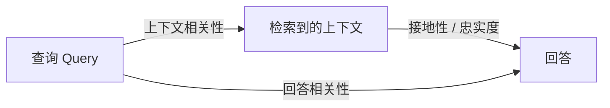
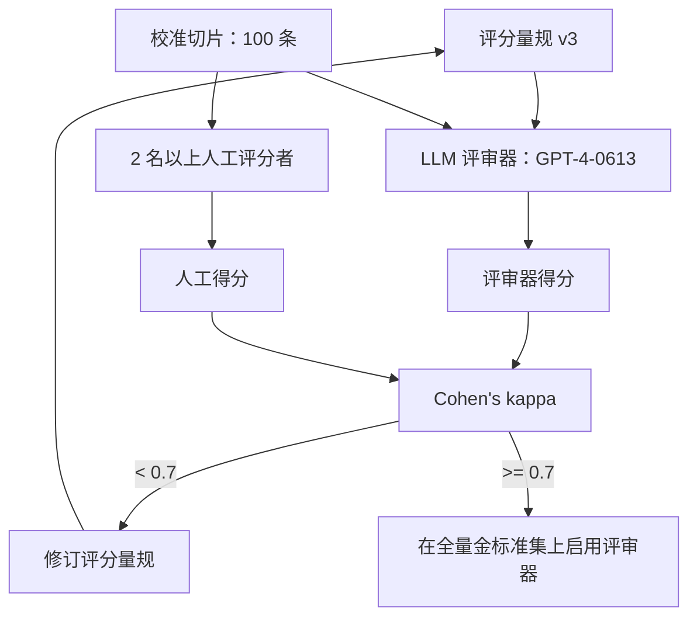
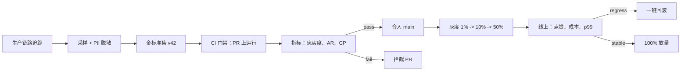
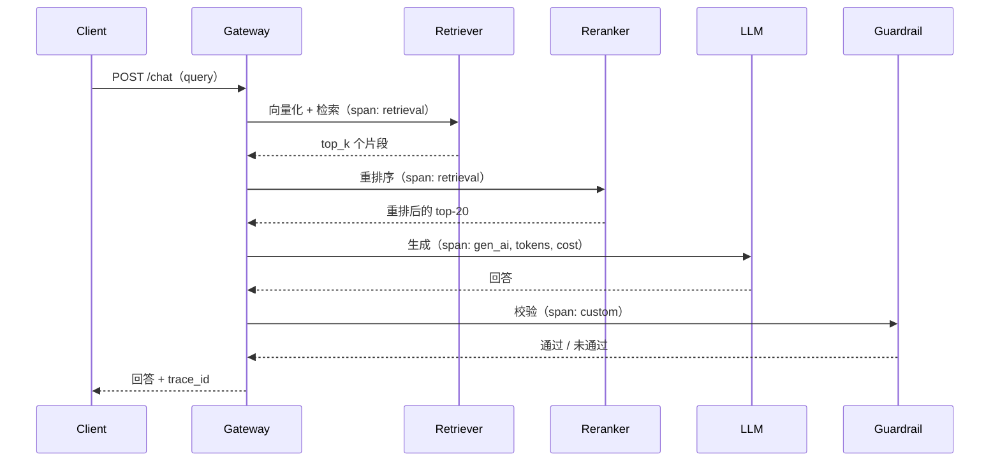

# LLM 评估与可观测性（Ragas、LangSmith、TruLens、LLM-as-Judge）

> **TL;DR**: LLM 评估难，是因为输出是开放式的、多个答案都对、模型又是随机的。没有哪个单一指标能解决这件事。生产上的答案是分层堆叠：最底层是确定性校验（schema、精确匹配），中间是无参考答案的 RAG 指标（Ragas 忠实度、上下文精确度），顶层是 LLM 评审（LLM-as-judge），再加人工校准让评审器保持诚实。在 MT-Bench 上，用 GPT-4 当评审器与人类判断的一致率超过 80%[^1]，但只要供应商更新模型快照，它就会悄悄漂移[^2]。把带金标准集的评估接进 CI，按 OpenTelemetry GenAI 语义约定观测生产环境[^3]，告警要盯忠实度下滑，而不是 GPU 利用率。

## 学习目标

学完本模块，你将能够：

- [ ] 解释为什么准确率和 F1 在开放式 LLM 输出上会失效
- [ ] 为具体任务选对基于参考答案的指标（BLEU、ROUGE、BERTScore、精确匹配）
- [ ] 定义 Ragas 的忠实度、回答相关性、上下文精确度，并在 RAG 流水线上把它们算出来
- [ ] 设计一个 LLM 评审器，并用人工标注校准它
- [ ] 整理金标准数据集，并让它扛住漂移与投毒
- [ ] 把评估接进 CI，让一个坏 prompt 或坏模型无法合入
- [ ] 用链路追踪、用户反馈和在线评估为生产 LLM 系统埋点

## 直觉理解

你开了一家餐厅。每晚主厨（你的 LLM）即兴发挥一套品鉴菜单。每一道菜都没有唯一的"正确答案"。蘑菇烩饭和松露意面都是合格的主菜。但端上生鸡肉的菜是错的，无视客人过敏卡片的菜是危险的。

那你怎么评估这位主厨？你不能用清单（"你做的是烩饭吗？是/否"），因为正确答案有无穷多个。你也不可能每盘菜都亲口尝，因为一晚要做 500 份。所以你搭分层：

1. **确定性校验**（厨房温度计）：鸡肉中心温度到 165F 了吗？过敏原没出现吗？这就是你的精确匹配与 schema 校验器。
2. **同行评审**（副主厨试味）：一位有经验的同事判断这道菜是否忠于出菜口的食材、是否对上客人的点单。这就是你的 LLM 评审。
3. **食客反馈**（点赞、投诉、回头客）：最真实的信号，但慢且嘈杂。这就是你的生产用户反馈。
4. **校准**（米其林评审员）：定期请专家给一批样本打分，再看你的副主厨是否与他一致。不一致就重训副主厨的味觉。这就是人工校准评审器。

任何一层单独都不够。温度计能抓食品安全，抓不到味道。副主厨能抓味道，但有偏见（偏爱法餐技法胜过亚洲菜）。食客反馈什么都能抓，但来得太晚，救不了这个糟糕的夜晚。四层都要，而且要把它们接进一个系统，让坏菜单在进餐厅之前就被拦住。

这就是 LLM 评估。本章其余部分逐层拆开讲。

## 原理

### 为什么经典 ML 评估在 LLM 上失效

分类指标假设答案是从有限集合里挑出的唯一正确标签。LLM 从组合爆炸的输出空间里吐出自由文本，其中大量不同表述承载同一个意思。失效有四层：

1. **多个正确答案。**"Paris is the capital of France"和"The capital is Paris"都对，但精确匹配会把第二个判错。
2. **部分得分。**一份大体正确、只夹了一个幻觉事实的摘要需要分档打分，而不是二分类标签。
3. **随机性。**同一个 prompt 在 temperature 0 下，跨供应商快照仍可能给出不同结果。GPT-4-0314 和 GPT-4-0613 在 Chatbot Arena（现名 Arena，曾名 LMArena）上的分差足够大，LMSYS 不得不在版本字符串上做区分[^2]。
4. **校准不对称。**一个会说"我不太确定"的模型，往往比一个自信说错的模型更可取，但准确率对两者一视同仁地扣分。

经典指标在输出受限的场景仍然好用：JSON schema 校验、SQL 执行正确性、代码的单测通过率（HumanEval pass@1[^4]）。这些场景就用它们。其余场景，你需要上面那几层。

### 基于参考答案的指标及其局限

基于参考答案的指标把模型输出与人工撰写的参考答案做比对：

- **BLEU**（Papineni 等，2002）：带简短惩罚的修正 n-gram 精确率。为机器翻译而生，会惩罚合理的改写。
- **ROUGE**（Lin，2004）：偏召回方向的 n-gram 重叠度。摘要基准的标配。ROUGE-L 用最长公共子序列。
- **BERTScore**（Zhang 等，2020）：在上下文化 BERT 向量里逐 token 算余弦相似度，再用贪心匹配聚合。在生成任务上，它与人类判断的相关性优于 BLEU/ROUGE，因为它衡量语义而非表面形式[^5]。
- **精确匹配 / 正则**：结构化输出（JSON、SQL、代码、数值答案）的正确选择。

关键局限：它们全都要参考答案。除非你预先人工整理好答案，否则无法用这些指标评估生产 RAG。而 BLEU/ROUGE 在改写上会灾难性失效：一个模型可能 BLEU 得 0.0，却完全正确（参考答案是"It is correct"，模型答"Yes"）。

> [!TIP]
> 把基于参考答案的指标当作确定性任务的护栏（代码 pass@k、SQL 执行、schema 合规）。开放式生成则改用无参考答案的指标或 LLM 评审。

### 无参考的 RAG 指标（Ragas 与 RAG 三元组）

对 RAG 系统来说，只要拿到了检索上下文，你就不需要参考答案。Ragas 把 RAG 质量拆成只用 query、context、answer 三个输入的指标[^6]：

**忠实度（Faithfulness）**先从回答里抽出原子陈述，再让评审 LLM 逐条标记该陈述是否被检索上下文支持（支持记 1，不支持记 0）。得分是 `supported_claims / total_claims`[^7]。忠实度低而上下文精确度高，说明生成器在正确的上下文上编造。

**回答相关性（Answer relevance）**从回答反推出 k 个问题（Ragas 的 `strictness` 参数默认 k=3），再计算每个生成问题的向量与原用户 query 向量的余弦相似度均值。分数低说明回答偏离了所问。

**上下文精确度（Context precision）**检查相关片段是否排在检索结果前列。**上下文召回（Context recall）**检查标准答案里的陈述是否都在上下文中出现。上下文精确度低，问题出在检索器，不在生成器。

TruLens 把同一套思路表述为 **RAG 三元组**：上下文相关性、接地性（groundedness）、回答相关性[^8]。三项都达标，就意味着这条流水线没有在编造。

*RAG 三元组：三个指标围绕（query、context、answer）三元组构成一个三角形。幻觉故障对应其中一条低分的边，从而把 bug 定位到具体环节。*

成本上的权衡是真实存在的：每个 Ragas 指标都要调用评审 LLM。每条链路几次评审调用，在高流量应用上成本会叠加。Vectara 的 HHEM（Hughes Hallucination Evaluation Model）提供了一个本地 transformer 替代方案，专门省掉忠实度检查那部分评审 LLM 开销[^7]。

### LLM 评审：用校准过的模型扩展评估

Zheng 等人在 NeurIPS 2023 的《Judging LLM-as-a-Judge with MT-Bench and Chatbot Arena》是这一方向的经典文献[^1]。他们证明用 GPT-4 当评审器与人类判断的一致率超过 80%，与人与人之间的一致率相当。主流形态有两种：

**成对比较**（A 与 B，哪个更好？）：评分者间信度高于绝对打分，因为相对比较比校准过的数值打分更容易。Arena（曾名 Chatbot Arena / LMArena）就靠众包投票和 Bradley-Terry 模型评分大规模使用这种方式。

**评分量规打分**（1 到 5 分，每档有明确锚点）：G-Eval（Liu 等，EMNLP 2023）把它形式化——先让评审器生成思维链式的评估步骤，再填一张打分表。在 SummEval 摘要基准上，用 GPT-4 的 G-Eval 与人工评分的 Spearman 相关系数为 0.514[^9]。

**已被记录在案的偏见**（Zheng 等）：

- **位置偏见**：成对比较时偏爱第一个选项
- **冗长偏见**：偏爱更长的回答
- **自我增强**：评审 LLM 偏爱自家模型家族的输出
- **推理能力有限**：评审器做不了的数学或逻辑题，它也判不对

**缓解手段**：随机化成对顺序并正反各跑一遍取平均。对长度做归一化或截断。选一个不在候选模型家族里的评审器。对敏感发布，用 50 条校准切片做人工校验。

**开源评审模型**：Prometheus 2（Kim 等，2024）在评估数据上微调，发表时在开源评审模型中与人类的相关性最高[^10]。Patronus Lynx 是基于 Llama-3-Instruct 的开源幻觉检测模型，提供 8B 与 70B 两个规格，其中 70B 旗舰版在 HaluBench 总体成绩上与 GPT-4o 相当（在 PubMedQA 医学子集上报告比 GPT-4o 高 8.3%），8B 版本则是实用的自托管选项[^11]。自托管可以避免专有快照变更带来的评审器漂移。

*校准切片让评审器保持诚实。Cohen's kappa 低于 0.7 就先修评分量规，再来谈把评审器用于全量评估集。*

### 金标准数据集与 CI 集成评估

金标准数据集是评估体系里最重要的单一资产。没有版本化、有标注、定期刷新的标准答案，其余一切都是表演[^12]。

**数据来源**：（1）脱敏后的生产日志采样；（2）针对已知失效模式由 LLM 生成的对抗性 query；（3）用户反馈信号（点踩样本、编辑距离修正）；（4）红队产出的安全样本。每个任务目标 100 到 500 条，按意图、难度、人群切片分层。

**防漂移**：每季度轮换 10% 到 20% 的样本，跟上用户 query 和产品能力的变化。留出一部分样本不进入训练数据和供应商微调，防止泄漏。

**污染是真实存在的**：已有研究发现约 40% 的 HumanEval 被认定为受污染，而从 GSM8K 中剔除污染样本会让测得准确率下降约 13 个百分点[^13]。公开基准（MMLU、GSM8K、HumanEval、SWE-bench）只当方向性信号用。另维护一份永不离开你自有基础设施的私有领域金标准集。

**接入 CI**：用 pytest 风格的测试框架（DeepEval、Ragas、promptfoo、Inspect AI）包装评审调用、计算指标汇总，并在回归时以非零码退出。一个典型门禁：忠实度 >= 0.90、回答相关性 >= 0.85、单次评估成本在预算内、墙钟时间不超过 15 分钟。应对抖动：temperature 0；供应商支持时固定随机种子；对不确定的供应商跑 N=3 取中位数。

*金标准集加上实时链路数据，同时喂养合入前的 CI 门禁和线上灰度决策。生产采样每季度回流刷新金标准集。*

### 生产可观测性与链路追踪

[可观测性](../part-6-reliability-and-operations/00-observability.md)一节讲过三大支柱（指标、日志、链路）与 OpenTelemetry。LLM 系统在此基础上扩展出领域特有的信号。

**OpenTelemetry GenAI 语义约定**（截至 v1.41.x，2026 年 5 月，仍处于 Development 阶段）把 LLM 特有的 span 属性标准化[^3]：`gen_ai.provider.name`（供应商：openai、anthropic、aws.bedrock；在 v1.36.0 之后的规范里由 `gen_ai.system` 改名而来）、`gen_ai.request.model`、`gen_ai.response.model`、`gen_ai.usage.input_tokens`、`gen_ai.usage.output_tokens`、`gen_ai.usage.reasoning.output_tokens`（用于推理模型）、`gen_ai.request.temperature`、`gen_ai.operation.name`（常见取值包括：chat、create_agent、embeddings、execute_tool、generate_content、invoke_agent、invoke_workflow、retrieval、text_completion）。内容载荷通过 `gen_ai.input.messages` 与 `gen_ai.output.messages` 采集（取代 v1.36.0 中按角色命名的那批旧事件名）；它们现在被归类为需显式开启（敏感载荷），不再默认采集。

一次 RAG 请求的 span 树：

*每次请求产生一个父 span，下挂检索、重排、生成、护栏四类子 span，各自携带 OTel GenAI 属性。token 数与成本挂在 LLM span 上。*

**要跟踪的生产信号**：首 token 时间（TTFT）、单输出 token 耗时（TPOT）、总延迟、单请求成本、输入/输出 token 数、错误率、护栏命中率、用户反馈（点赞）、会话放弃率，以及用户修正时的编辑距离。

**工具版图**：LangSmith（商业产品，与 LangChain 深度集成，数据集优先的评估界面）、Langfuse（开源、MIT、可自托管、OTel 原生）、TruLens（反馈函数优先，内置 RAG 三元组，集成 Snowflake Cortex）、Arize Phoenix（用 OpenInference 语义约定描述检索 span）、Helicone、Datadog LLM Observability、New Relic AI Monitoring。

**在线评估模式**：影子模式（在真实流量的一小部分上跑候选版本，只评审不对外服务）、带护栏的灰度（1% 到 10% 到 50% 逐步放量，同时盯忠实度和点赞比例）、交错对比（用于排序类任务，在同一份结果集里交替放入 A 和 B 的条目）。

## 真实案例

### LangSmith：数据集驱动的大规模评估

LangSmith 是 LangChain 的商业可观测性与评估平台，围绕两个原语构建：**runs**（一棵 span 树）和 **datasets**（版本化的输入/期望输出对集合）[^14]。

工作流是这样的：一个团队为客服 RAG agent 维护 300 条的金标准数据集。每个数据集版本都钉住样本 ID，这样跨实验的回归对比才是同口径的。开发者改了一个 prompt，就跑一次实验：目标链在全部 300 条样本上执行，并挂上评估器（Ragas 忠实度、一个自定义量规评审器、实体抽取的精确匹配）。界面按样本展示基线与候选版本之间的差异。

CI 门禁在忠实度低于 0.90 或回答相关性低于 0.85 时阻止合入。夜间定时跑能抓出上游模型快照变更带来的漂移。在线评估器自动跑在进来的生产链路上，越线即告警。

定价把成本模型说得更具体：Developer 档单席位免费，含每月 5,000 条基础链路，超出按量付费。Plus 档 $39/席位/月，含每月 10,000 条基础链路，超出按量付费。链路分两档保留期：基础链路保留 14 天，$2.50/千条；扩展链路保留 400 天，$5.00/千条（价格 2 倍，保留窗口约 28 倍）[^14]。规模化之后，一旦把人工标注时间、归档和运维开销算进去，落地总拥有成本据称会放大 10-15 倍。

开源替代是 Langfuse：核心 MIT 许可（企业版组件另有条款）、可自托管、OTel 原生，明确站在 LangSmith 闭源商业模型的对立面。它直接接收 OTel 链路，对已经基于 OpenTelemetry 建基础设施的团队来说是即插即用[^15]。

## 权衡

| 方案 | 优点 | 缺点 | 适用场景 | 我们的选择 |
|---|---|---|---|---|
| 人工评估 | 金标准；能抓细微问题 | 慢、贵、不一致 | 高风险发布；评审器校准 | 只用于校准 |
| LLM 评审 | 可扩展；与人类一致率 >80% | 位置、冗长、自我偏好等偏见；评审器漂移 | 夜间回归；大规模评估集 | **离线评估的默认选择** |
| BLEU / ROUGE | 确定性、零成本 | 在开放式任务上相关性差 | 有参考答案的摘要基准 | 仅在已有参考答案时使用 |
| BERTScore | 相关性优于 BLEU/ROUGE | 依赖参考答案 | 有参考答案时取快速信号 | 辅助信号 |
| Ragas（无参考） | 不需要标准答案；针对 RAG 失效 | 评审成本；偏英文调优 | 有检索上下文的 RAG | **RAG 的默认选择** |
| 精确匹配 / schema | 客观、零成本 | 要求输出形状受约束 | JSON、SQL、代码、数值 | 始终作为底层 |
| 在线影子评估 | 真实流量、真实分布 | 推理开销翻倍；副作用风险 | 上线前降低风险 | 上线前验证 |

## 常见陷阱

> [!WARNING]
> **没有评估框架（"凭感觉上线"）。**某团队只在 notebook 里验证过就把 LLM 功能发了出去。三周后一次 prompt 改动把忠实度从 0.92 悄悄拉到 0.81。从 20 条手工整理的样本、一个指标开始，用硬阈值接进 CI，随用量增长扩到 200 条以上。

> [!WARNING]
> **只在公开基准上评估（污染）。**MMLU、GSM8K、HumanEval 都出现在训练数据里。你的模型在榜单上很亮眼，干真活时却很平庸。公开基准只当方向性信号用，另维护一份永不离开自有基础设施的私有金标准集[^13]。

> [!WARNING]
> **评审器漂移。**你用 GPT-4 当评审器每晚跑忠实度。六周后，一次 prompt 都没改，分数却悄悄涨了 0.03。供应商推了一个打分更宽松的低调快照。把评审模型版本钉死，自托管开源评审模型（Prometheus 2、Patronus Lynx），维护人工标注的校准切片并每月重算 Cohen's kappa。

> [!WARNING]
> **单指标优化。**你只优化忠实度。下一个 prompt 版本对一半问题直接拒答。忠实度是 1.0，回答相关性暴跌，用户参与度掉 30%。门禁要卡一组指标的下限，而不是单一分数，并把产品指标（点赞率、会话时长）纳入灰度决策。

> [!WARNING]
> **没有生产可观测性。**你有一块显示 GPU 利用率的 Grafana 面板，却不知道哪些 prompt 在失败、每条路由的 P99 TTFT 是多少、`/chat` 端点每天烧掉多少美元。采用 OpenTelemetry GenAI 语义约定，在 span 上打出 `gen_ai.provider.name`、`gen_ai.request.model`、token 数和成本[^3]。

## 练习

为金融科技场景的客服 RAG agent 设计评估流水线：金标准集（规模、来源、刷新节奏）；离线指标与阈值；LLM 评审的量规及其人工校准；CI 门禁；在线可观测性（链路、反馈、告警）；以及你在凌晨 3 点会拿来报警的两个指标。说明一处你为速度放弃严谨的权衡。

提示

想想（a）在金融科技里"忠实度"意味着什么——报错账户余额就是合规事故；（b）如何按意图（余额查询、争议处理、产品推荐）给金标准集分层；（c）凌晨 3 点的警铃该是质量指标（忠实度）还是产品指标（PII 泄漏的护栏命中率）。

参考答案

**金标准集**：400 条，分层：100 条余额查询、100 条争议处理、100 条产品推荐、100 条对抗样本（prompt 注入、PII 提取尝试）。来源：60% 采样生产日志（已脱敏）、20% LLM 生成的困难样本、20% 红队产出。每季度刷新 15%。

**离线指标与阈值**：

- 忠实度 >= 0.95（金融科技要求高于默认的 0.90，因为编造余额就是监管事件）
- 回答相关性 >= 0.85
- 上下文精确度 >= 0.80
- 护栏通过率 >= 0.99（PII、prompt 注入）
- 数值字段（账户余额、交易金额）上做精确匹配

**LLM 评审量规**：5 分制，评（1）相对检索上下文的事实正确性、（2）回答完整性、（3）对不确定性的适度保留。评审器：钉死 GPT-4-0613。校准：2 位领域专家给 100 条打分；迭代量规直到 Cohen's kappa >= 0.75。

**CI 门禁**：凡触及 prompt、检索配置、模型版本的 PR 都跑。任一指标跌破阈值即阻止合入。预算：单次 < 10 分钟、< $5。

**在线可观测性**：LangSmith 或 Langfuse 对 100% 请求做链路追踪。span 包括：检索、重排、LLM 生成、输出护栏。跟踪 TTFT、成本、token 数、护栏命中率、用户点赞。抽 5% 做异步评审打分（忠实度）。

**凌晨 3 点的报警**：

1. **采样生产流量的忠实度跌破 0.90**（应用正在编造内容）
2. **PII 泄漏的护栏命中率超过 0.5%**（正在发生合规事故）

**为速度放弃严谨的权衡**：我们只对 5% 的生产流量跑评审，而不是 100%。这意味着以我们的流量规模，忠实度回归大约 20 分钟后才能被发现，而不是立刻发现，但省下了 95% 的评审 LLM 成本（$0.50/千条链路，在每天 10 万条链路时不是小数）。

## 要点回顾

- 经典 ML 指标（准确率、F1）无法平移到开放式 LLM 输出。你需要分层工具箱：底层确定性校验，中间无参考答案的指标，顶层 LLM 评审。
- 无参考答案的指标（Ragas 忠实度、上下文精确度、回答相关性）以检索上下文为锚，不需要标准答案就能评估 RAG。
- LLM 评审把评估扩展到上千条样本，与人类一致率 >80%，但必须用人工校准，否则会随供应商快照更新悄悄漂移。
- 金标准数据集是你手上最重要的资产。给它做版本、每季度刷新、防住污染与泄漏。
- 评估属于 CI。没有门禁，你只有一块面板，不是一个流水线。回归就阻止合入。
- 生产可观测性在传统链路追踪之上扩展了 GenAI 语义约定：每个 span 上带 token 数、成本、模型版本，以及 prompt/补全载荷。
- 没有哪个单一指标能抵抗古德哈特定律。门禁要卡一组互相制衡指标的下限，并把产品信号（用户反馈、会话时长）纳入灰度决策。

## 延伸阅读

- [Judging LLM-as-a-Judge with MT-Bench and Chatbot Arena (Zheng et al., NeurIPS 2023)](https://arxiv.org/abs/2306.05685) - 关于 LLM 评审器偏见与校准的经典论文；设计任何自动评估器之前先读它。
- [Ragas documentation: available metrics](https://docs.ragas.io/en/stable/concepts/metrics/available_metrics/) - 无参考答案 RAG 指标的实现细节；任何 RAG 评估流水线的起点。
- [OpenTelemetry GenAI semantic conventions](https://opentelemetry.io/docs/specs/semconv/gen-ai/) - LLM 链路属性的新兴标准；采用它可以避免在可观测性上被供应商锁死。
- [TruLens RAG Triad](https://www.trulens.org/getting_started/core_concepts/rag_triad/) - 接地性/上下文相关性/回答相关性的框架，让 RAG 失效可定位。
- [Prometheus 2 (Kim et al., 2024)](https://arxiv.org/abs/2405.01535) - 在开源评审模型中与人类相关性最高的评审 LM；逃离专有评审器漂移的出口。
- [AI Engineering by Chip Huyen (O'Reilly, 2024)](https://www.oreilly.com/library/view/ai-engineering/9781098166298/) - 面向实践者的 LLM 评估最佳纸质读物；覆盖从离线到在线的完整流水线。
- [Patronus Lynx](https://www.patronus.ai/blog/lynx-state-of-the-art-open-source-hallucination-detection-model) - 开源幻觉检测模型（8B 与 70B 的 Llama-3 变体），配套 HaluBench；评审 LLM 忠实度调用的可自托管替代。
- [DeepEval](https://github.com/confident-ai/deepeval) - pytest 风格的评估框架，把 Ragas 指标接进 CI；从"没有评估"到"有评估门禁"的最快路径。

## 记忆卡片

**Q:** 为什么准确率和 F1 在 LLM 评估上会失效？
**A:** 它们假设答案是从有限集合里挑出的唯一正确标签。LLM 输出是开放式文本，多种表述都正确、部分得分有意义、模型还会跨供应商快照随机变化。

**Q:** Ragas 的忠实度是什么，怎么算？
**A:** 忠实度衡量生成回答里的每条陈述是否都被检索上下文支持。它抽出原子陈述，用 LLM 评审器验证每条陈述能否从上下文推出（可选的 `FaithfulnesswithHHEM` 变体改用 Vectara 的 HHEM transformer），得分是 `supported_claims / total_claims`。

**Q:** LLM 评审（Zheng 等 2023）记录了哪四种偏见？
**A:** 位置偏见（偏爱第一个选项）、冗长偏见（偏爱更长的回答）、自我增强偏见（偏爱自家模型家族的输出）、推理能力有限（判不了超出自身能力的任务）。

**Q:** 什么是 RAG 三元组（TruLens 的表述）？
**A:** 三个指标构成三角形：上下文相关性（query 到 context）、接地性（context 到 answer）、回答相关性（query 到 answer）。幻觉对应其中一条低分的边，从而定位失效环节。

**Q:** 什么是评审器漂移，怎么发现？
**A:** 专有模型快照悄悄更新，在应用毫无改动的情况下改变评审得分，这就是评审器漂移。用固定的校准集跑评审器即可发现：应用没改而该集合上的分数动了，就是漂移。

**Q:** LLM 功能的最小可用评估配置是什么？
**A:** 20 条手工整理的样本、一个指标（忠实度或精确匹配）、一个硬阈值，以及一道回归就阻止合入的 CI 门禁。随用量增长扩到 200 条以上。

**Q:** 说出三个 OpenTelemetry GenAI 语义约定属性。
**A:** `gen_ai.provider.name`（供应商；v1.36.0 后由 `gen_ai.system` 改名）、`gen_ai.request.model`（模型名）、`gen_ai.usage.input_tokens`（token 数）。其他还有 `output_tokens`、`request.temperature`、`operation.name`。

**Q:** 为什么不应只依赖公开基准（MMLU、GSM8K、HumanEval）？
**A:** 它们被污染了：约 40% 的 HumanEval 样本出现在训练数据中，剔除受污染的 GSM8K 样本会让准确率下降约 13 个百分点。应另维护一份私有的领域金标准集。

**Q:** 对 LLM 评估来说，影子模式与灰度发布有什么区别？
**A:** 影子模式在真实流量上跑候选版本，但只对外提供生产版本的输出（用户零风险，推理成本翻倍）。灰度把候选版本提供给一小部分用户，一边盯指标看有没有回归，一边放量。

**Q:** 如何避免单指标优化被评估体系反向利用？
**A:** 门禁卡一组互相制衡指标的下限（忠实度 AND 回答相关性 AND 弃答率）。把产品指标（用户点赞、会话时长）纳入灰度决策。没有哪个单一指标能抵抗古德哈特定律。

**Q:** 推荐的金标准集规模与刷新节奏是多少？
**A:** 每个任务 100 到 500 条，按意图、难度、人群切片分层。随用户 query 和产品能力演变，每季度刷新 10% 到 20%。

**Q:** 什么时候用 BERTScore，什么时候用 Ragas 忠实度？
**A:** 有真人撰写的参考答案、只想要一个快速的向量相似度信号时用 BERTScore。没有参考答案但有检索上下文时用 Ragas 忠实度，这也是 RAG 生产的常态。

## 参考文献

[^1]: Zheng, Lianmin et al. "Judging LLM-as-a-judge with MT-Bench and Chatbot Arena." arXiv:2306.05685. https://arxiv.org/abs/2306.05685v2
[^2]: LMSYS Org. "Chatbot Arena: New models and Elo system update." December 2023. https://www.lmsys.org/blog/2023-12-07-leaderboard/（注：Chatbot Arena 于 2024 年 9 月更名为 LMArena，2026 年 1 月又更名为 Arena；现址为 https://arena.ai/）
[^3]: OpenTelemetry, Semantic Conventions for Generative AI Systems. https://opentelemetry.io/docs/specs/semconv/gen-ai/
[^4]: Chen, Mark et al. "Evaluating Large Language Models Trained on Code." arXiv:2107.03374 (HumanEval). https://arxiv.org/abs/2107.03374
[^5]: Zhang, Tianyi et al. "BERTScore: Evaluating Text Generation with BERT." ICLR 2020. https://arxiv.org/abs/1904.09675
[^6]: Es, Shahul et al. "RAGAS: Automated Evaluation of Retrieval Augmented Generation." https://arxiv.org/abs/2309.15217
[^7]: Ragas faithfulness source code, `src/ragas/metrics/_faithfulness.py`. https://github.com/vibrantlabsai/ragas/blob/main/src/ragas/metrics/_faithfulness.py
[^8]: TruLens, RAG Triad core concept. https://www.trulens.org/getting_started/core_concepts/rag_triad/
[^9]: Liu, Yang et al. "G-Eval: NLG Evaluation using GPT-4 with Better Human Alignment." EMNLP 2023. https://arxiv.org/abs/2303.16634
[^10]: Kim, Seungone et al. "Prometheus 2: An Open Source Language Model Specialized in Evaluating Other Language Models." 2024. https://arxiv.org/abs/2405.01535
[^11]: Patronus AI, "Lynx: State-of-the-Art Open Source Hallucination Detection Model." 2024. https://www.patronus.ai/blog/lynx-state-of-the-art-open-source-hallucination-detection-model
[^12]: Huyen, Chip. AI Engineering. O'Reilly, 2024. https://www.oreilly.com/library/view/ai-engineering/9781098166298/
[^13]: Tian, Pan, "Benchmark leak: how your eval set quietly joins the training corpus." 2026. https://tianpan.co/blog/2026-04-23-benchmark-leak-eval-contamination
[^14]: LangChain, LangSmith pricing. https://www.langchain.com/pricing
[^15]: Langfuse documentation overview. https://docs.langfuse.com/
