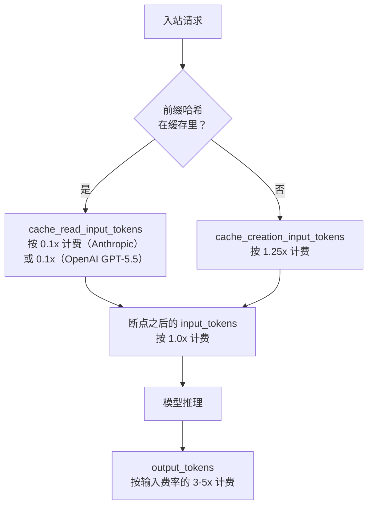
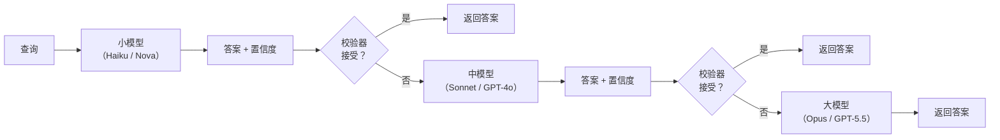
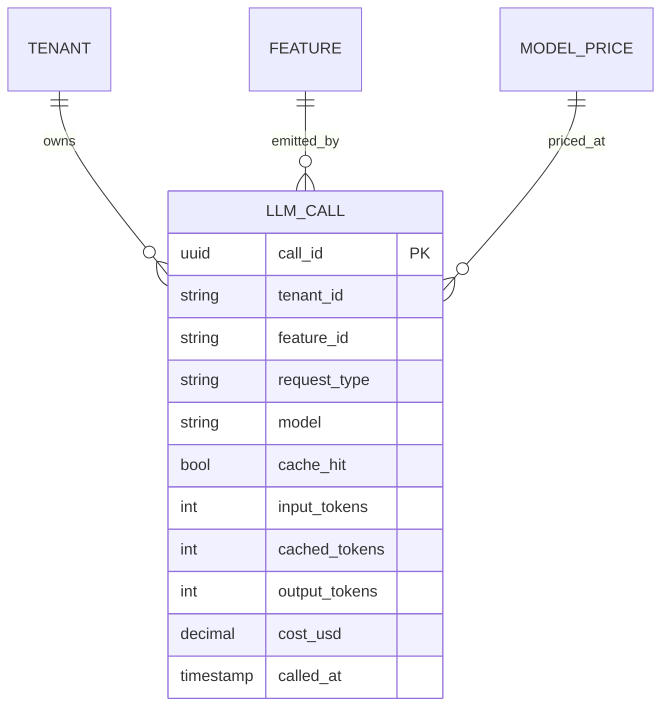
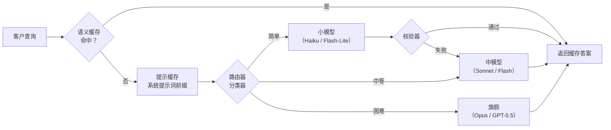

# LLM 成本优化（语义缓存、模型路由、级联、提示缓存）

> **TL;DR**: 在生产环境的各项成本里，只有 LLM 推理会因为在不同供应商上跑同一份输入而差出三个数量级。一个典型请求（1,200 个输入 token + 350 个输出 token）在 Amazon Nova Micro 上大约花 $0.0001，在 Claude Opus 上要 $0.015，相差 150 倍以上[^1]。成本工程工具箱里有五根杠杆：提示缓存（输入费用省 50% 到 90%，零质量风险）、语义缓存（对重复意图的流量直接绕过模型）、模型路由（把简单查询发给便宜模型）、级联（先试小模型，置信度低就升级，质量持平下最多省 98%[^2]）、上下文压缩（token 量减少 2 到 20 倍[^3]）。每一根杠杆都是用质量、延迟或新鲜度换来的节省。没有按租户的成本归因，这五根杠杆一根都没法决策。

## 学习目标

学完这一模块，你将能够：

- [ ] 把一张 LLM 账单拆成输入、输出和缓存 token，并指出主要成本驱动项
- [ ] 配置提示缓存（Anthropic 的 `cache_control`、OpenAI 的自动缓存），并度量命中率
- [ ] 有依据地选出一个语义缓存相似度阈值，并把缓存键限定到租户
- [ ] 设计一个模型路由器，并说清它的失效模式
- [ ] 区分路由与级联，并依据校验器是否可用在两者间做选择
- [ ] 在真实负载上，借助成本归因看板决定用缓存、路由还是级联

## 直觉理解

你在经营一家律所。每个走进门的案子都可以交给初级律师（$200/小时）、高级合伙人（$800/小时），或者冠名合伙人（$2,000/小时）。天真的做法是把所有案子都塞给冠名合伙人。客户爱这份质量，可律所在违停罚单和租约审阅这种任何初级律师都能处理的案子上流血。

聪明的律所会分诊。前台（路由器）看一眼案子，把它派给能处理它的最便宜的那位律师。拿不准的案子，初级律师先写一版意见，由律师助理（paralegal，也就是校验器）过一遍。如果助理发现问题，案子升级给高级合伙人。大多数案子根本走不到冠名合伙人那里。律所的人力成本省下 70%，胜诉率一点没降。

再加一招：律所留着一本过往意见的活页夹（缓存）。当新客户问的问题上周已有客户问过，前台翻出活页夹、确认事实一致，30 秒内把旧意见交出去，而不是计 4 小时的初级律师工时。

LLM 成本优化是同一套玩法。冠名合伙人是 GPT-5.5 或 Claude Opus 4.7（每百万输出 token $5 到 $30）。初级律师是 Haiku 或 Flash-Lite（每百万输出 $0.14 到 $5）。活页夹是你的语义缓存。律师助理是你的校验器。前台是你的路由器。本章剩下的部分把每个角色讲精确、把节省量化出来，并指出每一个在哪里崩掉。

## 原理

### Token 经济学与价格阶梯

输出 token 几乎是所有负载的主要成本驱动项。供应商把输出定到输入的 3 到 5 倍，因为生成是自回归的：每个输出 token 都要对 KV 缓存做一次完整的前向计算，而输入 token 在单次并行 prefill 里就处理掉了[^4]。

2026 年初的价格阶梯横跨三个数量级：

| 档位 | 模型 | 输入 / 百万 token | 输出 / 百万 token |
|---|---|---|---|
| 旗舰 | Claude Opus 4.7 | $5.00 | $25.00 |
| 旗舰 | GPT-5.5 | $5.00 | $30.00 |
| 中端 | Claude Sonnet 4.6 | $3.00 | $15.00 |
| 中端 | Gemini 3 Flash (Preview) | $0.50 | $3.00 |
| 小型 | Claude Haiku 4.5 | $1.00 | $5.00 |
| 小型 | Gemini 3.1 Flash-Lite | $0.25 | $1.50 |
| 小型 | Amazon Nova Micro | $0.035 | $0.14 |

给一个百万用户的产品做个量级估算：100 万用户，每人每天 10 次查询，平均 1,200 个输入 token 和 350 个输出 token。也就是每天 120 亿输入 token 和 35 亿输出 token。按 Sonnet 的价格（每百万 $3/$15），每日账单是 $36,000 输入 + $52,500 输出 = $88,500/天，即 $2.7M/月。按 Gemini 3.1 Flash-Lite 的价格（$0.25/$1.50），同样的负载是 $3,000 输入 + $5,250 输出 = $8,250/天。选模型是一个损益表决策。

DeepSeek 在 2025-01-20 发布 R1，定价 $0.55 输入 / $2.19 输出（发布时），逼着所有供应商打价格战；此后 DeepSeek 又发布了 V4-Flash 和 V4-Pro（2026 年 4 月），V4-Flash 大致是每百万 token $0.14 输入 / $0.28 输出，再次压低了开放 API 的地板[^5]。2025-01-27，Nvidia 在一个交易日里蒸发约 6,000 亿美元市值[^6]。成本地板一周内掉了一个数量级。你在 2024 年做的任何成本预测都已经错了。

### 提示缓存

提示缓存复用稳定前缀的 KV 缓存表示，让重复请求跳过 prefill 计算。它是第一根该伸手去抓的杠杆，因为零质量风险，而且实际上还降低延迟。

**Anthropic** 支持两种模式：自动缓存（在顶层放一个 `cache_control: {"type": "ephemeral"}` 字段，把断点落在最后一个可缓存块上，并随对话增长自动前移），以及显式缓存断点（放在单个内容块上，做细粒度控制）。读按 0.1x 计费（省 90%），写按 1.25x 计费，TTL 5 分钟（1 小时 TTL 需要付 2 倍写入溢价）。最小可缓存前缀因模型而异：Claude Opus 4.7/4.6/4.5 和 Haiku 4.5 是 4,096 个 token，Sonnet 4.6、Sonnet 4.5 和 Opus 4.1 是 1,024 个 token[^4]。盈亏平衡算法：一次写花 1.25x，每次读省 0.9x。两次命中就抵掉一次写。这个数字值得记住。

**OpenAI** 对 1,024 个 token 及以上的提示自动缓存。最初的公告（2024 年 10 月）说的是 50% 折扣；当前 GPT-5 级模型拿到明显更深的缓存折扣（最新快照上常被引用为缓存输入 token 约 90%），按 128 token 的增量匹配。TTL 通常是 5 到 10 分钟不活跃，硬上限约 1 小时。务必查清你要部署的那个具体模型和快照的实时价格页[^7]。

**Google Gemini** 按存储小时数为上下文缓存计费，读打折 75% 到 90%。

**自托管**引擎白拿前缀缓存：vLLM 的自动前缀缓存（APC）和 SGLang 的 RadixAttention 会在前缀相同的请求之间共享 KV 块，不额外收钱。

*Token 流经缓存前缀时经过的三个计费桶：缓存读打折、缓存写加价、新输入按基准价。*

该上看板的关键指标是 `cache_read_input_tokens / (cache_read + cache_creation)`。健康的长上下文负载会把这个比值保持在 0.8 以上。低于 0.3 说明你的断点落在了易变内容上（时间戳、每请求上下文，或者用户消息本身），于是每个请求都在付写入溢价，却从来没读到过东西。

### 语义缓存

语义缓存把进来的查询做 embedding，在历史（query_embedding, answer）元组上做 k 近邻搜索，余弦相似度超过阈值就返回缓存里的答案。命中时它完全绕过模型：延迟从 500ms 以上掉到 50ms 左右，成本降到一次 embedding 调用加一次向量查找[^8]。

生产环境的命中率通常从开放式聊天的 10% 到结构化 FAQ 的 70%，客服机器人常见的是 20% 到 45%。在每天 100 万次调用下，命中率每提升 1 个百分点，按 Sonnet 价格算每月大约省 $1,000。

**阈值选择**是关键设计决策。研究表明 0.8 在基准评测上是个经验甜点，MeanCache 的调优结果比 GPTCache 默认设置高 17% 的 F-score 和 20% 的精确率[^9]。但阈值取决于负载。太低（0.75）：不相干的查询会被喂上错误答案。太高（0.98）：本该命中的改写会被判成未命中。

> [!CAUTION]
> **跨租户缓存泄漏。** 如果缓存键只有 `embed(query)`，两个租户问余弦相似的问题，就会拿到彼此的答案。2023 年 3 月的 ChatGPT Redis 缓存 bug 正是出于这个原因，把用户的聊天标题和支付信息暴露给了其他用户。把 `tenant_id`、`role`、`locale` 放进缓存键。要严格隔离，就按租户拆分向量库。

实现：[GPTCache](https://github.com/zilliztech/GPTCache)（Zilliz，参考实现）、Redis Semantic Cache、Upstash Vector，以及 Portkey 的内置缓存。

### 模型路由

一个逐查询的分类器按预测难度，从一个模型池（小、中、大）里挑一个。简单查询给便宜模型，难的给旗舰。一次决策，一个模型，结束。

RouteLLM（Ong 等，2024，UC Berkeley）在 Chatbot Arena 的偏好数据上训练路由器，再配一套由 LLM 裁判打标签的增强训练集，在 MT-Bench 上报出超过 85% 的成本下降（MMLU 上 45%，GSM8K 上 35%），同时保住 GPT-4 95% 的表现（只用 Arena 数据训练的基线路由器，在约 48% 的成本下降下达到同样的 95% 质量）[^10]。生产网关（OpenRouter auto-route、LiteLLM、Portkey 条件路由、Martian）实现的是同一模式的变体。

路由信号包括：查询长度、推理类关键词（“compare”、“plan”、“analyse”）、对话深度、用户档位、工具调用意图，以及基于 embedding 的难度分。分类器给每个请求增加 10 到 50ms。

失效模式是需要旗舰的查询被误路由。一个在 DeepSeek-R1 之前训练的路由器，会高估需要旗舰的查询比例。路由器训练数据会随模型能力变化而漂移。每季度重训。

### 带校验器的级联

级联不是路由。路由做一次决策，然后就锁定。级联先试最便宜的模型，对答案跑一遍校验器，只在校验器拒绝时才升级。校验器就是全部的诀窍。

FrugalGPT（Chen、Zaharia、Zou，2023）把它形式化成带学习型校验器的三阶段级联。在新闻分类、阅读理解、科学问答上，它以最多 98% 的成本下降达到 GPT-4 的准确率，或者在同等成本下比 GPT-4 高 4%[^2]。

*FrugalGPT 的三阶段级联：只有校验器拒绝时才升级，所以小模型答得对的那一段永远不付旗舰的钱。*

校验器类型，按可靠性排序：

1. **确定性**（零质量风险）：schema 校验、正则匹配、代码编译、测试执行
2. **概率性**（需要校准）：token logprobs、便宜的 LLM 裁判、基于 embedding 的置信度
3. **人在回路**（昂贵，用于产训练数据）：把低置信答案标记出来等人工复核

小模型有 70% 以上的时候答对，级联才划算。没有可靠校验器的级联严格劣于一直用旗舰，因为每次未命中你都得为两个模型付钱。

### 上下文压缩与批处理 API

**上下文压缩**在提示进模型之前先把它缩小。LLMLingua（Microsoft Research，EMNLP 2023）用一个小语言模型给 token 打重要性分，剔除信息量低的 token，最多做到 20 倍压缩而质量损失极小[^3]。LongLLMLingua 针对 RAG 的“中间遗失”问题，在 1/4 的 token 下报出最多 21.4% 的质量提升。更简单的做法：把早于 N 轮的对话回合做摘要，RAG 检索 3 到 5 个块而不是 50 个。

**批处理 API** 给固定的 50% 折扣，SLA 24 小时。OpenAI、Anthropic（每批最多 100,000 个请求）、Azure 和 Bedrock 都支持[^11]。离线评测、夜间分类、数据补全，以及任何用户不在等结果的负载，都该用批处理。实践中大多数 Anthropic 批次一小时内就跑完。

**输出约束**是最简单的杠杆：每次调用都设 `max_tokens`。用 JSON 模式或 schema 约束生成，让模型在 schema 边界停下。一个要求“全面报告”却没设 `max_tokens` 的提示可以生成 8,000 个输出 token，在 Opus 上花掉 $0.24，而你预期的是 $0.02。

### 成本归因看板

没有按租户、按功能的成本归因，上面每一根杠杆都没法决策。你没法给量不出来的东西排优先级。

每次 LLM 调用都该带上结构化标签：`tenant_id`、`feature_id`、`request_type`、`model`、`cache_hit`、`input_tokens`、`output_tokens`、`cost_usd`。LLM 网关（Helicone、Langfuse、LangSmith、Portkey）以代理形式坐在中间，解析响应元数据，按每模型价格表算出成本，发出带标签的 trace。

*按租户、按功能做 LLM 成本归因的最小 schema。每条调用行都带着完整的维度上下文，所以按租户、功能、模型或时间范围汇总都是单条查询，而不是解析日志的活儿。*

多租户 SaaS 团队通常会发 5% 的租户贡献了 60% 的 token 开销。没有按租户归因，你既限不了流、也做不了内部计费、更杀不掉那个异常大户。把月度花费的 50/80/100% 设成预算烧穿告警，超过 100% 自动限流，就能挡住 agent 失控的账单。

## 真实案例

### Klarna 的 AI 助手：成本优先的反面教材

2024 年 2 月，Klarna 上线了一个基于 OpenAI GPT 模型构建的 AI 客服助手。在采用率峰值的第一个月，它处理了 230 万次对话，相当于 700 名全职客服的工作量[^12]。平均解决时长从 11 分钟降到 2 分钟以内（降 82%），Klarna 估计 2024 年该助手带来了 4,000 万美元的利润改善。

架构很直接：单个旗舰模型，在 Klarna 的政策和退款流程上做检索，用 35 种语言服务约 1.5 亿客户。Klarna 也报过营销上的 AI 驱动节省，不过具体数字是在财报电话会上说的，而不是公开新闻稿。

然后是反转。2025 年初，CEO Sebastian Siemiatkowski 对 Bloomberg 说 Klarna 又在重新招人，理由是“成本不幸成了过于主导的评估因素”。公司试点了一种“Uber 式”模式，用远程人工客服处理复杂工单。

本章要的教训是：Klarna 只优化成本，没有级联，也没有质量校验器。他们把一切都发给一个模型，量了解决时长和成本，却没有量复杂工单长尾上的质量退化。“替代了 700 名客服”这个头条没有对工单结构做控制，而这个结构在几个月里是恶化的。一个像样的级联（AI 处理容易的 70%，把难的 30% 升级给人或旗舰模型）本可以同时保住节省和质量。

*完整的成本优化请求路径：语义缓存在任何模型调用之前就短路，提示缓存给稳定前缀打折，路由选出档位，校验器可能触发升级。*

## 权衡

这些是互补的成本层，会叠加而不是纯替代；挑那些你的负载符合“适用场景”一列的，按列出的顺序启用。

| 方案 | 节省幅度 | 延迟影响 | 质量风险 | 适用场景 | 我们的选择 |
|---|---|---|---|---|---|
| 提示缓存 | 输入省 50-90% | TTFT 更快 | 无 | 稳定的系统提示词、反复复用的 RAG 上下文 | **永远第一个启用** |
| 语义缓存 | 重复流量省 20-60% | 绕过模型（约 50ms） | 中（改写误路由、租户泄漏） | 高频 FAQ、聊天开场白 | 启用，但缓存键必须限定租户 |
| 模型路由 | 整体省 40-80% | 分类器 +10-50ms | 中（难题误路由） | 易/难区分明显，没有便宜校验器 | 校验器不可用时用 |
| 级联 | 简单查询省 50-98% | 升级时 +100-300ms | 校验器靠得住时低 | 代码（编译）、schema（解析）、数学（测试） | **节省上限最高** |
| 上下文压缩 | 长上下文省 30-70% | 预处理 +50-200ms | 低到中 | 长对话、长文档 RAG | 任务无关场景用 LLMLingua-2 |
| 批处理 API | 统一省 50% | +数小时（24h SLA） | 无 | 离线评测、夜间分类 | 非交互负载的默认选项 |

## 常见陷阱

> [!WARNING]
> **把所有东西都钉在最贵的模型上。** 模型阶梯上 35 倍的价格跨度意味着大多数负载都有可观的降档空间。中端模型（Sonnet、GPT-4o、Gemini Flash）能扛住 80% 的生产负载。从能通过你评测套件的最便宜模型起步，只在它失手的地方升级。

> [!WARNING]
> **提示缓存断点落在易变内容上。** 如果 `cache_control` 放在含时间戳、每请求上下文或用户消息的块上，前缀哈希每次请求都会变。你每次调用都付 1.25x 的写入溢价，却永远读不到。盯 `cache_read_input_tokens`；低于 30% 说明断点位置错了。

> [!WARNING]
> **语义缓存阈值靠直觉设。** 因为 0.85 听起来靠谱就把 `threshold` 设成它，结果要么假命中（喂错答案），要么假未命中（白丢节省）。标注 500 对查询，画出 0.7 到 0.98 各阈值上的 F-score 曲线，挑交叉点。查询分布变了就每季度重调。

> [!WARNING]
> **没有可靠校验器就搞级联。** 每个升级的查询你都得为小模型和大模型各付一次钱。如果校验器永远升级（太严）或者永不升级（太松），级联就严格劣于只用旗舰。拿级联和一直用旗舰做 A/B；级联成本超过旗舰成本的 60%，就是校验器坏了。

> [!WARNING]
> **没有 `max_tokens` 上限。** 没有显式限制，旗舰模型可以在单个请求上生成 8,000+ 个输出 token，花掉你预算的 10 到 100 倍。永远设 `max_tokens`。结构化输出用 JSON 模式，让模型在 schema 边界停下。

## 练习

一个 SaaS 产品每天通过 Claude Sonnet 4.6 服务 500 万次查询，平均 1,200 个输入 token 和 350 个输出 token，每月约 $450k。设计一个 90 天计划，在不造成质量退化的前提下砍掉 60%。要写清：（1）杠杆的启用顺序与预期节省；（2）评测门禁；（3）上线方式（金丝雀、A/B、全量）；（4）你会拿哪两个指标做告警。

提示

想一想哪些杠杆是零风险的（提示缓存、离线路径的批处理 API），哪些需要评测门禁（路由、级联）。按风险排序：先上白捡钱的杠杆，再叠加那些用质量风险换节省的。两个告警指标应该同时覆盖成本和质量。

解答

**第一阶段（第 1 到 30 天）：零风险杠杆**

1. **提示缓存**（第 1 周）：把 `cache_control` 放在系统提示词和 few-shot 示例上（稳定前缀）。预期节省：被缓存前缀的输入 token 省 60% 到 80%。在 1,200 个输入 token、900 个 token 的稳定前缀下，仅输入一项每月约省 $80k。
2. **批处理 API**（第 2 周）：找出离线负载（夜间分类、评测跑批、数据补全），迁到 50% 折扣的批处理端点。预期节省：如果有 10% 流量是非交互的，每月 $20k。
3. **输出约束**（第 3 周）：所有路径都设 `max_tokens: 500`。结构化响应用 JSON 模式。预期节省：通过消掉长尾长度的回答，输出 token 省 10% 到 15%。

第一阶段合计：约降 30%（每月省 $135k）。零质量风险。

**第二阶段（第 30 到 60 天）：带评测门禁的路由**

1. **语义缓存**（第 5 周）：部署 GPTCache，缓存键限定租户，阈值 0.90（保守）。预期命中率：重复意图流量上 15% 到 25%。节省：每月 $50k。
2. **模型路由**（第 7 周）：在 2,000 条已标注查询（易/中/难）上训练分类器。把“易”（40% 流量）路由到 Haiku。评测门禁：在 500 条留出集上，被路由查询的质量分与 Sonnet 基线的差距必须保持在 2 个百分点以内。预期节省：每月 $80k。

第二阶段合计：累计约降 55%。

**第三阶段（第 60 到 90 天）：用级联吃掉最后 5%**

1. **带 schema 校验器的级联**（第 9 周）：结构化输出路径（JSON 响应）先试 Haiku。响应过不了 schema 校验就升级到 Sonnet。预期节省：在 30% 的结构化流量上再省每月 $30k。

第三阶段合计：累计约降 62%。目标达成。

**告警指标：**

- `monthly_spend_burn_rate > 110%_of_budget`：成本趋势高于降本后的目标时触发。
- `quality_score_p7d < baseline - 3pp`：7 天滚动质量分（抽样跑 LLM 裁判）低于优化前基线减 3 个百分点时触发。

**上线方式：** 每根杠杆先以 5% 金丝雀跑 48 小时，然后 50/50 A/B 跑 1 周，对比质量和成本指标，两个指标都绿了才全量。

## 要点回顾

- 输出 token 是主要成本驱动项：一个 200 token 的回答可能比一个 5,000 token 的提示更贵，因为输出有 3 到 5 倍的溢价。
- 前缀稳定时，提示缓存就是白捡的钱。Anthropic 上的盈亏平衡是每次写换两次命中。把 `cache_read_input_tokens` 当一等指标来盯。
- 语义缓存需要限定租户的缓存键，以及一个在标注数据上调出来、说得清依据的相似度阈值，而不是靠直觉。
- 路由做一次决策并锁定；级联先尝试、再校验、可能重试。手里有便宜可靠的校验器时，级联胜过路由。
- FrugalGPT 在质量持平下做到了最多 98% 的成本下降。校验器就是全部的诀窍。
- DeepSeek R1 的发布（Nvidia 单日约 6,000 亿美元市值蒸发）证明了成本地板可以一夜之间重置一个数量级。要为价格弹性做设计，而不是为价格假设做设计。
- 没有按租户、按功能的成本归因，你杀不掉那些吃掉预算的功能。先埋点，再优化。

## 延伸阅读

- [Anthropic Prompt Caching docs](https://docs.claude.com/en/docs/build-with-claude/prompt-caching) - `cache_control`、5 分钟/1 小时 TTL、1.25x/0.1x 计费倍率，以及最小 token 门槛的权威说明。
- [OpenAI Prompt Caching announcement](https://openai.com/index/api-prompt-caching) - 最初的 50% 折扣规则（现在旗舰模型最高 90%）、1,024 token 下限，以及 128 token 增量匹配。
- [FrugalGPT (Chen, Zaharia, Zou, 2023)](https://arxiv.org/abs/2305.05176) - 级联的奠基论文；任何设计带校验器升级的多模型工作流的人都该读。
- [RouteLLM (Ong et al., 2024)](https://arxiv.org/abs/2406.18665) - 基于偏好数据的路由典范论文，附 MT-Bench、MMLU、GSM8K 的成本-质量曲线。
- [GPTCache](https://github.com/zilliztech/GPTCache) - 语义缓存的参考实现，embedding、向量库、相似度评估器都可插拔。
- [MeanCache (Gill et al., 2024)](https://arxiv.org/abs/2403.02694) - 相似度阈值调优与按用户缓存；比 GPTCache 默认设置高 17% 的 F-score。
- [LLMLingua (Microsoft Research)](https://www.microsoft.com/en-us/research/blog/llmlingua-innovating-llm-efficiency-with-prompt-compression/) - 由粗到细的提示压缩论文；LongLLMLingua 和 LLMLingua-2 是生产级的后继工作。
- [Helicone docs](https://docs.helicone.ai/) - 生产级成本归因网关，带 300 多个模型的价格数据；搭按租户看板最快的一条路。

## 记忆卡片

**Q:** 为什么输出 token 比输入 token 贵？
**A:** 输出 token 是自回归生成的（每个 token 一次完整前向计算），而输入 token 在单次并行 prefill 里就处理完了。供应商因此把输出定到输入的 3 到 5 倍。

**Q:** Anthropic 提示缓存的盈亏平衡点是什么？
**A:** 两次缓存读抵一次缓存写。写花 1.25x 基准价；读省 0.9x（只付 0.1x）。所以 1.25 <= 2 * 0.9。同一前缀命中两次之后，你就在省钱了。

**Q:** 提示缓存效果该上看板的是哪个指标？
**A:** `cache_read_input_tokens / (cache_read_input_tokens + cache_creation_input_tokens)`。健康的负载会把它保持在 0.8 以上。低于 0.3 说明断点落在易变内容上。

**Q:** 语义缓存和提示缓存有什么区别？
**A:** 提示缓存在供应商侧复用 KV 缓存前缀（同前缀，算力打折）。语义缓存把查询做 embedding，找到余弦相似的旧查询，完全不调模型就返回旧答案。

**Q:** 多租户系统里语义缓存最大的风险是什么？
**A:** 跨租户数据泄漏。如果缓存键只有查询 embedding，两个租户问相似问题就会拿到彼此的答案。把 tenant_id、role、locale 放进缓存键。

**Q:** 模型路由和级联的区别是什么？
**A:** 路由做一次分类决策并锁定单个模型。级联先试最便宜的模型，对答案跑校验器，只在校验器拒绝时升级。级联需要校验器，路由不需要。

**Q:** 级联什么时候比一直用旗舰更差？
**A:** 校验器不可靠的时候。如果它永远升级（太严），或者小模型很少答对，你就要在大多数查询上为两个模型付钱。级联成本超过旗舰成本的 60%，就严格劣于只用旗舰。

**Q:** FrugalGPT 做到了多少成本下降？
**A:** 在新闻分类、阅读理解、科学问答基准上，用带学习型校验器的三阶段级联，在匹配 GPT-4 准确率的前提下最多降 98% 成本。

**Q:** DeepSeek R1 的发布说明了 LLM 成本规划的什么道理？
**A:** 成本地板可以一夜之间重置一个数量级。R1 发布价是每百万 token $0.55/$2.19，而 OpenAI o1 是 $15/$60，输入上便宜 27 倍。市场解读为前沿 AI 并不需要前沿 GPU，Nvidia 单日蒸发约 6,000 亿美元市值。DeepSeek 还在继续往下压：V4-Flash（2026 年 4 月）大约每百万 token $0.14 输入 / $0.28 输出。

**Q:** 大多数团队漏掉的最简单的输出成本杠杆是什么？
**A:** 每次调用都设 `max_tokens`。不设的话，旗舰模型可以在单个请求上生成 8,000+ 个 token，花掉预期金额的 10 到 100 倍。JSON 模式和 schema 约束生成也能把输出长度卡在 schema 边界。

**Q:** 成本归因看板该为每次 LLM 调用记录什么？
**A:** 至少要有：tenant_id、feature_id、request_type、model、cache_hit、input_tokens、cached_tokens、output_tokens、cost_usd。这样才能按租户切（计费）、按功能切（砍掉不经济的）、按模型切（追踪路由效果）。

**Q:** 部署成本杠杆的推荐顺序是什么？
**A:** 先上零风险杠杆（提示缓存、max_tokens、离线用批处理 API），再加阈值保守的语义缓存，然后是带评测门禁的模型路由，最后是带确定性校验器的级联。每一层都要对上一版基线做 A/B。

## 参考文献

[^1]: Wring.co，“AWS Bedrock Models: Every LLM and Its Cost”（Nova Micro $0.035/$0.14 对比 Claude Opus 的价格；倍数按每 token 单价算）。https://wring.co/blog/aws-bedrock-llm-models-guide
[^2]: Chen, Zaharia, Zou，“FrugalGPT: How to Use Large Language Models While Reducing Cost and Improving Performance”，arXiv:2305.05176，2023。https://arxiv.org/abs/2305.05176
[^3]: Microsoft Research，“LLMLingua: Innovating LLM efficiency with prompt compression”（最多 20 倍压缩）。https://www.microsoft.com/en-us/research/blog/llmlingua-innovating-llm-efficiency-with-prompt-compression/
[^4]: Anthropic，“Prompt caching”（Claude API 文档，cache_control，0.1x 读、1.25x 写，5 分钟 TTL）。https://docs.claude.com/en/docs/build-with-claude/prompt-caching
[^5]: DeepSeek R1 的发布定价（每百万 token $0.55/$2.19）在 2025-01-20 发布时被广泛报道。DeepSeek 随后在 2026-04-24 推出 V4-Flash 和 V4-Pro，其中 V4-Flash 大约每百万 token $0.14 / $0.28。https://api-docs.deepseek.com/quick_start/pricing ；发布背景：https://en.wikipedia.org/wiki/DeepSeek
[^6]: The Motley Fool，“Why Nvidia Stock Lost 11% in January”（引用 DeepSeek 反应导致的单日约 6,000 亿美元损失，2025-01-27）。https://www.fool.com/investing/2025/02/04/why-nvidia-stock-lost-11-in-january/
[^7]: OpenAI，“Prompt Caching in the API”（最初公告：50% 折扣、1,024 token 下限、128 token 增量；当前 GPT-5.5 定价显示缓存折扣 90%）。https://openai.com/index/api-prompt-caching
[^8]: Zilliztech，“GPTCache: A Library for Creating Semantic Cache for LLM Queries”。https://github.com/zilliztech/GPTCache
[^9]: Gill 等，“MeanCache: User-Centric Semantic Cache for Large Language Model Based Web Services”，arXiv:2403.02694（比 GPTCache 默认设置高 17% F-score、高 20% 精确率）。https://arxiv.org/abs/2403.02694
[^10]: Ong 等，“RouteLLM: Learning to Route LLMs with Preference Data”，arXiv:2406.18665，以及 LMSYS 博客（2024-07-01）：增强版（LLM 裁判打标签）路由器在 MT-Bench 上以 GPT-4 95% 的表现做到超过 85% 的成本下降；只用 Arena 数据的基线路由器在约 48% 的成本下降下达到同样的质量。https://arxiv.org/abs/2406.18665 与 https://lmsys.org/blog/2024-07-01-routellm/
[^11]: ActiveLogic，“10,000 Tasks, One Request, Half the Cost: Anthropic's Message Batches API”（50% 折扣，10 万请求上限）。https://activelogic.com/insights/10000-tasks-one-request-half-the-cost
[^12]: Twig，“Klarna AI Assistant: How It Cut Resolution Time 82%”（230 万次对话，相当于 700 名客服，11 分钟降到 2 分钟以内）。https://www.twig.so/blog/how-klarna-is-revolutionizing-customer-support-with-ai
