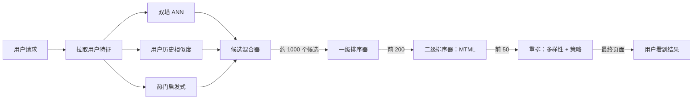
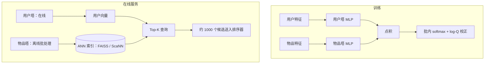
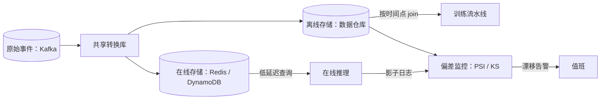
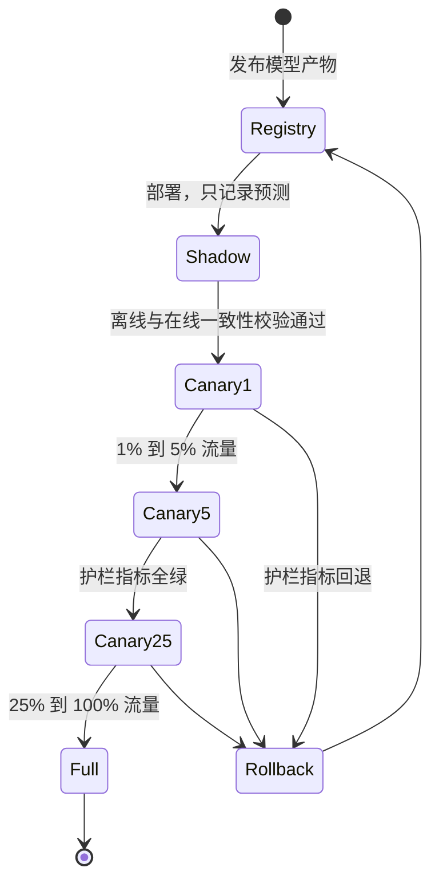

# ML 系统设计基础

> **TL;DR**：所有大规模推荐信息流都跑一条两阶段流水线：召回在 50 ms 内把数十亿条目收窄到数千个，随后排序模型用丰富特征在约 100 ms 内给这数千个打分。双塔（two-tower）嵌入模型靠预计算物品向量、在请求时查询 ANN 索引来支撑召回。特征存储让训练与服务保持一致。生产 ML 的头号隐形杀手是训练-服务偏差（training-serving skew），而不是模型本身：Sculley 等人发现，真实世界的 ML 代码里只有很小一部分是模型，剩下的全是可能悄悄走样的周边基础设施[^1]。先把流水线搭对，再去调模型。

## 学习目标

学完本章，你将能够：

- [ ] 解释为什么“先候选生成、再排序”的两阶段模式，比用单个模型扫全量目录效果更好
- [ ] 描述双塔模型：每个塔分别算什么、训练如何进行、服务时怎么做点积召回
- [ ] 设计一条特征流水线，在规模化场景下处理类别特征、数值特征、嵌入特征和序列特征
- [ ] 识别训练-服务偏差，并选出一套缓解手段（特征存储、共享转换、一致性测试）
- [ ] 用版本管理、影子部署和分阶段 A/B 测试规划一次模型上线
- [ ] 说清交错实验（interleaving）与经典 A/B 测试的区别，以及各自适用的场景

## 直觉理解

想象你经营一家有 1 亿种书目的书店。一位顾客走进来，说：“今晚我想读点好东西。”你不可能把所有书都塞给他，让他给这 1 亿本书排序。于是你做两件事。第一件，一位行动迅速的管理员扫过书架，根据顾客的阅读历史和书的题材标签，抽出 500 本大致合乎他口味的书。这只要几秒钟。第二件，一位动作慢些但眼光更毒的行家翻看这 500 本，考虑顾客此刻的心情、一天中的时段、最近的购买记录，还有一些隐蔽的交叉信号（“喜欢 X 的人也喜欢 Y”），然后挑出前 20 本摆在展示台上。

动作快的那位管理员就是召回阶段。她优化的是召回率：别漏掉对的那本书。那位行家就是排序阶段。他优化的是精度：在一小撮书上把顺序排对。两个人都干不了对方的活。管理员不可能每本书花 30 秒（那 1 亿本书要 95 年）。行家也不可能实时评估 1 亿本书。

这就是 YouTube 首页信息流、Instagram Explore、TikTok 的 For You 页、Pinterest 首页信息流，以及所有规模化广告竞价背后的基础架构。本章剩下的部分讲怎么把它搭起来：召回模型（双塔嵌入）、排序模型（DLRM、DCN、注意力）、喂养这两者的特征流水线，以及保证它们不出岔子的基础设施。

## 原理

### 先召回再排序的两级范式

单个深度模型没法在一次请求里给 10^9 个条目打分。按每次前向传播 1 微秒算，一次请求就要 1,000 秒。两级范式之所以存在，是因为延迟预算和模型成本是相乘的。

**第一阶段（召回，retrieval）**在 50 ms 内把全量目录收窄到约 1,000 个候选。它用的打分器便宜、偏向召回：双塔 ANN 检索、基于用户交互历史的倒排索引，或者热门启发式。多路召回源并行跑，再由候选混合器（candidate mixer）对输出去重[^2]。

**第二阶段（排序，ranking）**用一个偏向精度的深度模型给这 1,000 个候选打分，这个模型供得起丰富的交叉特征（用户-物品交互、上下文、实时信号）。预算是 100 ms 左右[^2]。

**第三阶段（重排，re-ranking）**施加多样性约束、内容完整性过滤（有害内容、策略合规）和业务规则。Instagram Explore 就在这一步强制“不能连续两条来自同一作者”[^2]。

YouTube 2016 年的论文把这个切分做成了经典：候选生成是一个深度 MLP，产出 256 维用户嵌入，在数百万视频上做 softmax；排序是另一个独立网络，用曝光特征和按观看时长加权的逻辑损失给候选打分[^3]。Instagram Explore（2023）把它形式化为四个子阶段：召回、轻量双塔初排（从第二阶段蒸馏而来）、重量级多任务多标签（MTML）精排，以及最终重排[^2]。

*漏斗：数十亿条目经召回变成数千个候选，经排序变成数百个，再经带多样性与策略过滤的重排变成最终一页。*

### 双塔嵌入模型

双塔模型由两个独立的子网络组成。用户塔把用户上下文（观看历史、人口属性、设备）编码成 d 维向量（通常在 64 到 256 之间）。物品塔把物品特征（标题、类目、热度）编码到同一个空间。两者只在顶层通过点积或余弦相似度汇合[^4]。

**训练：** 每个小批次里放若干（用户，正样本物品）对。批次里的其他物品充当批内负样本（in-batch negatives）。损失是对整个批次做 softmax。Yi 等人（2019）指出，如果不做校正，热门物品会在很多批次里作为负样本出现而被过度惩罚，导致对全量 softmax 梯度的估计出现偏差。他们的修正办法是：用流式频率估计器从 logits 里减去 `log(P_sampled(item))`（log-Q 校正）[^4]。难负样本挖掘（hard-negative mining）则用模型当前打分很高、但用户并没有交互的物品，替换随机负样本。

**服务：** 物品塔离线对全量目录跑一遍，每个物品产出一个向量。这些向量装进 ANN 索引（FAISS、ScaNN 或 HNSW，见 [向量数据库](../part-4-data-systems/08-vector-databases.md)）。请求到来时只跑用户塔，产出一个向量，ANN 索引在亚线性时间内返回 Top-K。

*两个塔在批内 softmax 上联合训练；服务阶段物品塔离线跑，用户塔在线跑，查询预先算好的 ANN 索引。*

关键约束：因为两塔相互独立，双塔模型看不到交互类特征（“这个用户 20 秒前刚看过一个类似的视频”）。这类特征属于排序模型。

### 规模化特征工程

生产级排序模型消费四类特征：

**类别特征**（user_id、country、item_category）：查一张大小为 `vocab_size x d` 的嵌入表。对高基数 ID（1 亿用户、10^10 个广告素材），要么哈希到更小的表里（哈希技巧，会冲突），要么像 TikTok 的 Monolith 那样用无冲突的 cuckoo 哈希表[^5]。

**数值特征**（价格、年龄、会话时长）：对重尾分布做 `log(1 + x)` 变换、分位数归一化，或等频分桶后再送进嵌入。

**预训练嵌入**（内容、文本）：图像用 CLIP 向量，文本用 Sentence-BERT。可冻结也可微调，再与学习出来的嵌入拼接。

**序列特征**（最近 N 次观看、最近 N 次查询）：均值池化、自注意力（如 BST 和 SASRec 中的 transformer 编码器），或对候选做目标注意力（阿里的 DIN）[^6]。

特征交叉有两类。**显式**交叉靠人工设计（国家 × 物品类目），由 Wide & Deep 里的 wide 线性层记忆[^7]。**学习式**交叉是自动的：DCN-V2 用低秩混合的交叉层，在 Google 多个系统上同时带来离线 AUC 和在线业务指标的提升[^8]；DLRM 在每对类别嵌入向量之间做二阶点积[^9]。

### 离线与在线特征存储

特征存储（feature store）把特征物化并服务两次：一次给训练（离线、历史、时间点正确），一次给推理（在线、低延迟、最新版本）。

离线存储落在数据仓库上（Snowflake、BigQuery、Iceberg）。在线存储落在 KV 系统上（Redis、DynamoDB、ScyllaDB）。两者必须在同一个逻辑时刻返回同一个值。这就是契约。

最关键的性质是**时间点正确性（point-in-time correctness）**：要训练一个预测“用户 U 在时刻 T 是否会点击物品 I”的模型，你必须关联到 U 在 T 减一秒时的特征，绝不能是 T 加一小时。少了这一条，训练 AUC 会被虚高 5 到 10 个点，而这些点在 A/B 里全部消失——因为你把未来信息泄漏进了训练样本。

*共享转换库同时写入离线和在线存储；偏差监控持续比对两侧分布，在偏差扩散到生产之前抓住它。*

Feast 是开源特征存储的参考实现；托管方案有 Tecton（现已并入 Databricks）、Hopsworks、Databricks Feature Store、Vertex AI Feature Store（在线服务走 Bigtable）和 SageMaker Feature Store。每个特征都有新鲜度 SLO：排序特征要求“user_last_click_item_id 的年龄小于 5 秒”，而“user_signup_country 是静态的”。

### 训练-服务偏差

训练-服务偏差（training-serving skew）指模型训练时见到的特征分布与推理时见到的特征分布出现分叉。成因是两条代码路径用不同方式计算“同一个”特征。Sculley 等人（2015）把它列为应用 ML 的标志性病症[^1]。

按出现频率从高到低排列的根本原因：

1. 转换代码分家（训练用 Spark UDF，服务用 Python lambda）
2. 单位不一致（英里 vs 公里，秒 vs 毫秒）
3. 空值处理不一致（训练 `fillna(0)`，服务 `fillna(-1)`）
4. 时区漂移（训练用 UTC，服务用本地时区）
5. 词表漂移（服务时出现训练中不存在的类目）

**检测：** 把在线特征以影子日志回写到离线存储，然后用群体稳定性指数（PSI）、Kolmogorov-Smirnov（KS）检验或 TFDV 的 `DetectFeatureSkew` 比对分布[^10]。

**预防：** 共享转换库（唯一事实来源）、把在线特征经特征存储回灌到训练数据，以及在每次发布前用留出样本做契约测试，断言 `offline_transform(x) == online_transform(x)`。

事后复盘的剧本永远一个样：“我们上线了，CTR 掉了 2%，花两周排查，最后发现 `user_age` 离线单位是年、在线单位是月。”

### 模型上线与 A/B 测试

每个模型产物都包含权重、特征 schema、训练数据快照哈希、离线指标和服务配置。上线序列是：

1. **影子部署（shadow deploy）**让新模型跑 100% 的流量，但不对外提供预测；预测结果只写日志，供离线对比。
2. **金丝雀（canary）**按指标放量：1% → 5% → 25% → 50% → 100%，耗时从几小时到几天，任何护栏指标（P99 延迟、错误率、公平性切片、业务指标）回退就暂停。
3. **回滚（rollback）**是翻一个功能开关，而不是重新部署。

*新模型版本要过四道闸门，任何护栏指标回退都自动回滚。回滚永远是翻功能开关切回注册表里的上一个产物，而不是重新部署。*

在线评估方面，**经典 A/B** 把用户随机分到实验组和对照组，观测一个主指标（CTR、留存、收入）。**交错实验（interleaving）**（Chapelle、Joachims、Radlinski、Yue 2012[^11]；Netflix 2017）把两个排序器的输出混排在同一页上，每次点击归因给贡献了该位置的排序器。Netflix 报告说，要检测出排序差异，交错实验所需的订阅用户数比他们最灵敏的 A/B 指标还要少 100 倍以上[^12]。把交错实验当作排序类改动的预筛；架构级或影响双边市场的发布，仍然用经典 A/B。

**干扰（interference）**会让经典 A/B 失效：实验组用户与对照组用户互相影响（社交网络），或实验组出价影响对照组价格（广告竞价）。缓解手段有整群随机化（整个社交簇一起进同一组）和 switchback 设计（按时间段给不同地区开关切换）。

## 真实案例

**YouTube 的两阶段推荐系统（Covington、Adams、Sargin 2016）**至今仍是经典参考。论文发表时，YouTube 有数亿个视频、每天数十亿次用户-视频交互[^3]。

候选生成网络把用户的观看历史（视频嵌入的词袋，取平均）、搜索词、人口属性和一个“样本年龄（example age）”特征送进若干全连接 ReLU 层（论文扫了不同深度；3.5 节报告的一个配置逐步加宽到 1024、512、256 个单元），输出 256 维用户嵌入。训练时在全视频词表上做 softmax。服务时，预先算好的视频向量装进 ANN 索引，用户嵌入直接取回前几百个候选[^3]。

排序网络对每个（用户，视频）对消费数百个特征，包括曝光视频 ID、用户语言、设备、距上次观看的时长。关键在于，排序目标是**期望观看时长**（用加权逻辑损失做回归），而不是点击概率，因为观看时长与商业价值的相关性比 CTR 更好[^3]。

有两个工程决策格外亮眼。第一是“样本年龄”特征：一个连续值，取视频上传到训练时刻之间的时长。推理时把它置为 0 来表示“此刻”，这显著改善了推荐的新鲜度。第二是训练标签取下一个被观看的视频，负样本从背景视频分布中采样并做重要性加权，于是服务时就退化成了最近邻搜索。

这套 2016 年发表的架构催生了此后所有的两阶段系统：Instagram Explore（Meta 规模的四阶段召回-排序-重排流水线，第二阶段用双塔蒸馏、第三阶段用多任务学习）[^2]、Pinterest PinSage（30 亿节点、180 亿边）[^13]、Meta DLRM（TB 级稀疏嵌入、数千块 GPU）[^14]，以及 TikTok Monolith（无冲突 cuckoo 哈希下的分钟级在线训练）[^5]。

## 权衡

| 方案 | 优点 | 缺点 | 适用场景 | 我们的选择 |
|---|---|---|---|---|
| 深度两阶段召回 + 排序 | 可扩展到 10^9 条目；排序器特征丰富 | 两条流水线；阶段之间存在陈旧数据 | 大语料信息流（>10^6 条目） | **多数团队的默认选择** |
| 规则召回 + ML 排序 | 简单、可调试、更便宜 | 覆盖有缺口；召回成为天花板 | 小目录、冷启动领域 | 仅适合 MVP |
| 双塔 + 交叉编码器重排 | 召回率 + 深度交叉特征 | 额外延迟；多一个训练回路 | 搜索、广告、质量敏感的界面 | 精度收益扛得住成本时 |

交错实验属于评估方法而不是排序架构，所以放在 A/B 的讨论里更合适：每个用户在同一条查询上同时看到两路的结果，消除了用户间方差，灵敏度大幅提升。Chapelle 等人报告，在交错实验下一条专家标注查询大约等价于十条有点击的查询（比基于标注查询的离线评估灵敏约 10 倍）[^11]；Netflix 随后报告，做排序对比时交错实验所需的订阅用户数比他们最灵敏的 A/B 指标少 100 倍以上[^12]。但它给不出留存或长期结果的信号，也只适用于排序改动，所以把它作为候选排序模型的全量 A/B 之前的预筛。

## 常见陷阱

> [!WARNING]
> **超过约 10^5 个条目还做单阶段深度打分。** 常见反模式是觉得“我们现在有 GPU 了”就跳过召回阶段，在请求时用完整深度排序器扫全量目录。按每个条目 1 微秒计，给 10^9 个条目打分就是一次请求 1,000 秒；即便只有 10^5 个条目，P99 延迟也会击穿任何现实的推荐流 SLO（[Covington 等，“Deep Neural Networks for YouTube Recommendations”，RecSys 2016](https://research.google.com/pubs/archive/45530.pdf)）。永远要拆成一个便宜的召回阶段（双塔、HNSW、ANN），把候选剪到约 1,000 个，再交给只给这些候选打分的深度排序器。近十年来，这套架构一直是 YouTube、Instagram、Pinterest 和 TikTok 的生产默认。

> [!WARNING]
> **缺少时间点关联导致的标签泄漏。** 训练特征在与标签关联时若不做时间正确性处理，就会把未来信息泄漏进来。离线 AUC 看着漂亮，线上 A/B 毫无提升。用支持 as-of-time 关联的特征存储（Feast、Tecton）。

> [!WARNING]
> **代码库分家导致的训练-服务偏差。** 团队用 Spark 写训练侧转换，用 Go 写服务侧转换。空值、时区、单位在无人察觉中走样。用 PSI/KS 对影子日志特征做检测；用共享转换库和契约测试来预防。

> [!WARNING]
> **未校正的批内负样本带来热度偏差。** 批内 softmax 会过度惩罚热门物品，因为它们在很多批次里都作为负样本出现。用 Yi 等人的 log-Q 校正配合流式频率估计器，否则模型会退化成只推小众物品。

> [!WARNING]
> **优化与业务结果无关的离线指标。** AUC 把所有样本对一视同仁；而收入只关心最靠前的那几个位置。在相信一个新代理指标之前，先用 20 多个历史实验验证离线与在线指标的相关性。排序改动可以用交错实验来弥补这个差距。

## 练习

为 1 亿 DAU 设计一个新闻排序服务，语料是最近 30 天的约 1,000 万篇文章。请给出：(a) 双塔模型，含损失与负采样；(b) 排序器特征集，按类别、数值、嵌入、序列四类拆开；(c) 每个特征在特征存储中的位置及其新鲜度 SLO；(d) 如何检测训练-服务偏差；(e) 上线计划，含主指标与护栏指标。

提示

想想新闻和视频的差别在哪：文章几小时就过期，不是几周。召回模型需要新鲜度信号（把发布时间作为特征，或在 ANN 索引里做时间衰减）。特征存储上，把静态特征（用户人口属性）和实时特征（最近 5 分钟点击的文章）分开。偏差检测应该重点对实时特征做影子日志，因为它们最容易走样。

解答

**(a) 双塔召回：** 用户塔输入：用户嵌入（最近 50 篇点击文章的嵌入均值池化）、用户国家、设备类型、时段分桶。物品塔输入：文章标题嵌入（Sentence-BERT，冻结）、发布方 ID、类目、发布后经过的小时数。损失：批内 softmax 加 log-Q 校正。难负样本：同一会话里展示过但用户没点的文章。物品向量每 15 分钟重算一次（文章过期很快）。

**(b) 排序器特征：**

- 类别：user_country、publisher_id、article_category、device_type
- 数值：hours_since_publication（对数变换）、user_session_length、article_word_count
- 嵌入：文章标题 Sentence-BERT（768 维）、用户兴趣簇嵌入（32 维，学习得到）
- 序列：最近 20 个点击文章 ID（目标注意力，DIN 风格）

**(c) 特征存储位置：**

- 静态（离线 + 在线，每小时物化）：user_country、publisher_id
- 近实时（流式，5 秒新鲜度 SLO）：last_20_clicks、session_length
- 批处理（每天）：用户兴趣簇嵌入

**(d) 偏差检测：** 把所有在线特征以影子日志回写到离线存储。每晚对每个特征跑一次 PSI 比对。任一特征 PSI > 0.1 就告警。契约测试：取 10,000 个随机（用户，文章，时间戳）三元组，在每次模型发布前断言 `abs(offline_feature - online_feature) < epsilon`。

**(e) 上线：** 影子部署 24 小时，比对离线与在线预测的相关性。1% 金丝雀跑 6 小时，盯 P99 延迟和错误率。3 天内逐步放量到 5%、25%、50%、100%。主指标：阅读时长（不是 CTR，因为标题党会把 CTR 抬高）。护栏：P99 延迟 < 150 ms、多样性分数（单一发布方占比不超过信息流的 30%）、错误率 < 0.1%。

## 要点回顾

- 两阶段“先召回再排序”是大目录个性化推荐的主流架构。它存在的原因很物理：在延迟预算内，用深度模型对每次请求给 10^9 个条目打分是不可能的。
- 带点积召回的双塔模型是候选生成的主力。把负采样和 log-Q 校正做对，剩下的自然就顺了。
- 特征存储是让训练和服务保持诚实的契约。没有它，偏差是必然的。
- 训练-服务偏差在成为建模问题之前，几乎总是流程问题（两套代码库、两条数据通路）。重训模型之前，先查流水线。
- 对排序类改动，交错实验的灵敏度大约是经典 A/B 的 100 倍，但它测不出留存或双边市场效应。
- 训练数据的时间点正确性没有商量余地。泄漏未来特征会让离线指标虚高 5 到 10 个点，而这些点在线上全部蒸发。
- 模型上线本质是功能开关问题：影子、金丝雀、放量、回滚。永远不要在没有一键回退路径的情况下发布。

## 延伸阅读

- [Deep Neural Networks for YouTube Recommendations (Covington et al. 2016)](https://dl.acm.org/doi/10.1145/2959100.2959190)。两阶段架构的奠基论文；此后每个系统都在引用它的候选生成与排序切分。
- [Sampling-Bias-Corrected Neural Modeling for Large Corpus Item Recommendations (Yi et al. 2019)](https://research.google/pubs/sampling-bias-corrected-neural-modeling-for-large-corpus-item-recommendations/)。带 log-Q 校正的双塔经典论文；读它才能理解为什么朴素的批内 softmax 会失效。
- [Hidden Technical Debt in Machine Learning Systems (Sculley et al. 2015)](https://papers.nips.cc/paper/5656-hidden-technical-debt-in-machine-learning-systems)。提出训练-服务偏差和“95% 是胶水代码”这一观察；是理解特征存储与监控的必读框架。
- [Scaling the Instagram Explore Recommendations System (Meta 2023)](https://engineering.fb.com/2023/08/09/ml-applications/scaling-instagram-explore-recommendations-system/)。带双塔蒸馏的四阶段排序器；生产级多阶段排序最新的公开参考。
- [Monolith: Real Time Recommendation System with Collisionless Embedding Table (Liu et al. 2022)](https://arxiv.org/abs/2209.07663)。字节跳动基于 cuckoo 哈希的在线训练系统；展示了“每天重训一次”的假设在 TikTok 的节奏下如何崩塌。
- [Feast Documentation](https://docs.feast.dev/)。开源特征存储的参考实现；覆盖离线/在线切分、时间点正确性和物化模式。
- [Innovating Faster on Personalization Algorithms at Netflix Using Interleaving](https://netflixtechblog.com/interleaving-in-online-experiments-at-netflix-a04ee392ec55)。Netflix 给出的证据：做排序评估时，交错实验所需用户数比经典 A/B 少 100 倍。
- [Designing Machine Learning Systems (Chip Huyen, O'Reilly 2022)](https://www.oreilly.com/library/view/designing-machine-learning/9781098107956/)。以整本书的篇幅讲特征存储、偏差、部署和完整的 ML 生命周期。

## 记忆卡片

**Q：** 为什么单个深度模型在 10^9 个条目上行不通？
**A：** 按每次前向传播 1 微秒算，给 10^9 个条目打分要一次请求 1,000 秒，远超任何延迟预算。

**Q：** 双塔模型的两个塔分别算什么？
**A：** 用户塔把用户上下文编码成 d 维向量；物品塔把物品特征编码到同一空间。两者只在顶层通过点积汇合。

**Q：** log-Q 校正是什么，为什么需要它？
**A：** 它在批内 softmax 中从 logits 里减去 log(P_sampled(item))，校正“热门物品在很多批次里作为负样本出现”带来的偏差。没有它，模型会过度惩罚热门物品。

**Q：** 特征存储里的时间点正确性指什么？
**A：** 把每条训练样本关联到事件时间戳那一刻的特征值，绝不使用未来的值。否则你会泄漏未来信息，让离线指标虚高 5 到 10 个点。

**Q：** 说出训练-服务偏差的三个根本原因。
**A：** （1）转换代码分家（训练用 Spark，服务用 Go），（2）单位不一致（英里 vs 公里），（3）空值处理不一致（fillna(0) vs fillna(-1)）。

**Q：** 怎么检测训练-服务偏差？
**A：** 把在线特征以影子日志回写到离线存储，再用 PSI、KS 检验或 TFDV 的 DetectFeatureSkew 比对分布。

**Q：** 交错实验是什么，什么时候比经典 A/B 更好？
**A：** 交错实验把两个排序器的输出混排在同一页，并把点击归因给贡献该位置的排序器。它所需用户数约为经典 A/B 的百分之一，但只适用于排序改动，不适用于架构级或影响双边市场的发布。

**Q：** 重排阶段的作用是什么？
**A：** 在排序模型给候选打完分之后，施加多样性约束、内容完整性过滤（有害内容、策略）和业务规则。

**Q：** 为什么 YouTube 的排序模型预测观看时长而不是点击概率？
**A：** 观看时长与商业价值的相关性比 CTR 更好。优化点击会奖励标题党；优化观看时长才会奖励真正吸引人的内容。

**Q：** 新模型的金丝雀上线序列是什么？
**A：** 先影子部署（只记录预测），再以 1% → 5% → 25% → 50% → 100% 做金丝雀，任何护栏指标回退就暂停。回滚是翻一个功能开关。

**Q：** TikTok 的 Monolith 如何避免嵌入冲突？
**A：** 它不用哈希技巧，而是用无冲突的 cuckoo 哈希表，配合过期计时器和出现次数过滤器来剔除陈旧或低频 ID。

**Q：** 什么是召回天花板问题？
**A：** 如果召回阶段漏掉了最好的条目，再强的排序也救不回来。第一阶段的 Recall@K 往往是团队调得最狠的 KPI。

## 参考文献

[^1]: Sculley et al., "Hidden Technical Debt in Machine Learning Systems", NeurIPS 2015. https://papers.nips.cc/paper/5656-hidden-technical-debt-in-machine-learning-systems
[^2]: Vorotilov, Shugaepov, "Scaling the Instagram Explore recommendations system", Meta Engineering, August 2023. https://engineering.fb.com/2023/08/09/ml-applications/scaling-instagram-explore-recommendations-system/
[^3]: Covington, Adams, Sargin, "Deep Neural Networks for YouTube Recommendations", RecSys 2016. https://dl.acm.org/doi/10.1145/2959100.2959190
[^4]: Yi, Yang, Hong, Cheng, Heldt, Kumthekar, Zhao, Wei, Chi, "Sampling-Bias-Corrected Neural Modeling for Large Corpus Item Recommendations", RecSys 2019. https://research.google/pubs/sampling-bias-corrected-neural-modeling-for-large-corpus-item-recommendations/
[^5]: Liu, Zou et al., "Monolith: Real Time Recommendation System With Collisionless Embedding Table", arXiv:2209.07663, ORSUM@RecSys 2022. https://arxiv.org/abs/2209.07663
[^6]: Zhou et al., "Deep Interest Network for Click-Through Rate Prediction", KDD 2018. https://arxiv.org/abs/1706.06978
[^7]: Cheng et al., "Wide & Deep Learning for Recommender Systems", arXiv:1606.07792, 2016. https://arxiv.org/abs/1606.07792
[^8]: Wang et al., "DCN V2: Improved Deep & Cross Network", WWW 2021. https://arxiv.org/abs/2008.13535
[^9]: Naumov et al., "Deep Learning Recommendation Model for Personalization and Recommendation Systems", arXiv:1906.00091, 2019. https://arxiv.org/abs/1906.00091
[^10]: Google / TensorFlow, "TensorFlow Data Validation: Checking Data Skew and Drift". https://github.com/tensorflow/data-validation
[^11]: Chapelle, Joachims, Radlinski, Yue, "Large-scale Validation and Analysis of Interleaved Search Evaluation", ACM TOIS 2012. https://dl.acm.org/doi/10.1145/2094072.2094078
[^12]: Parks, Aurisset, Ramm, "Innovating Faster on Personalization Algorithms at Netflix Using Interleaving", Netflix TechBlog, November 2017. https://netflixtechblog.com/interleaving-in-online-experiments-at-netflix-a04ee392ec55
[^13]: Ying et al., "Graph Convolutional Neural Networks for Web-Scale Recommender Systems", KDD 2018. https://arxiv.org/abs/1806.01973
[^14]: Huda et al., "Scaling Recommendation Systems Training to Thousands of GPUs with 2D Sparse Parallelism", PyTorch Blog, March 2025. https://pytorch.org/blog/scaling-recommendation-2d-sparse-parallelism/
