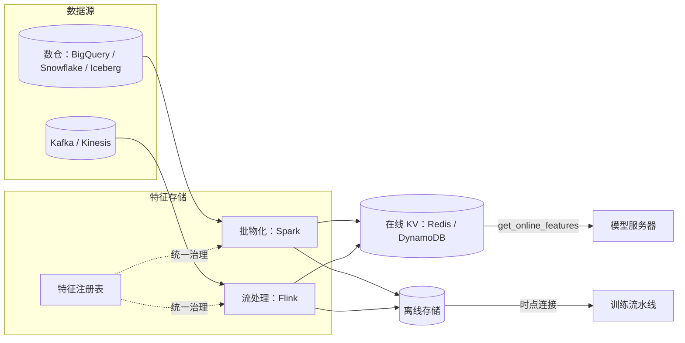
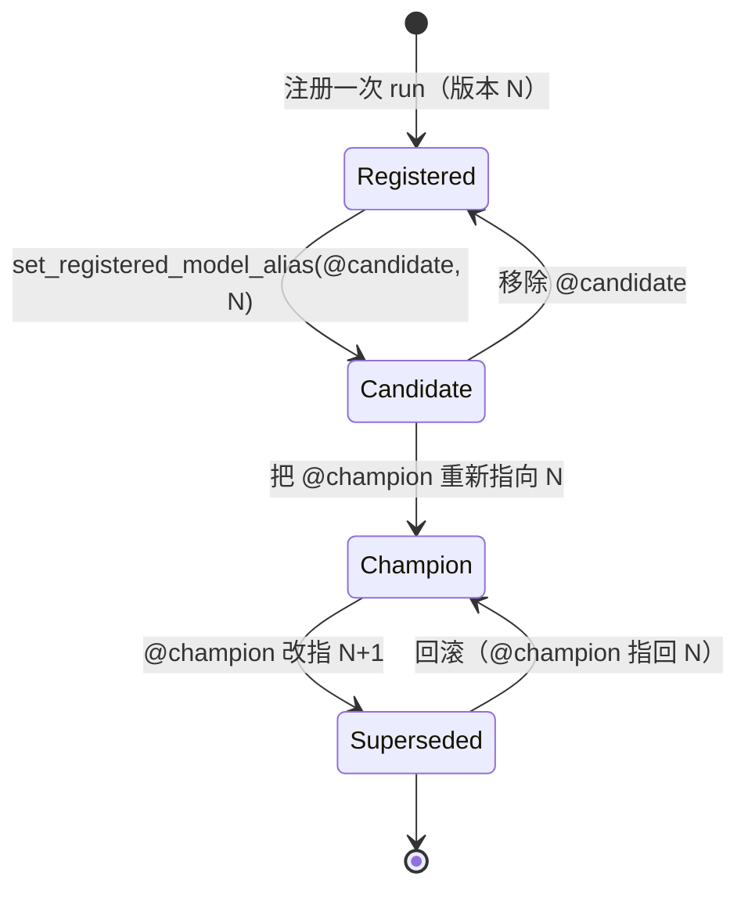
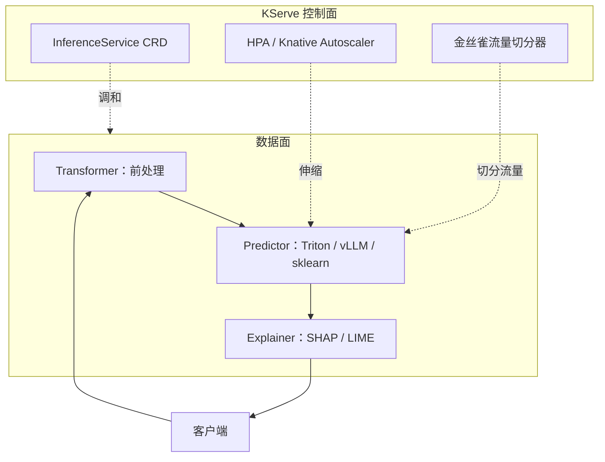
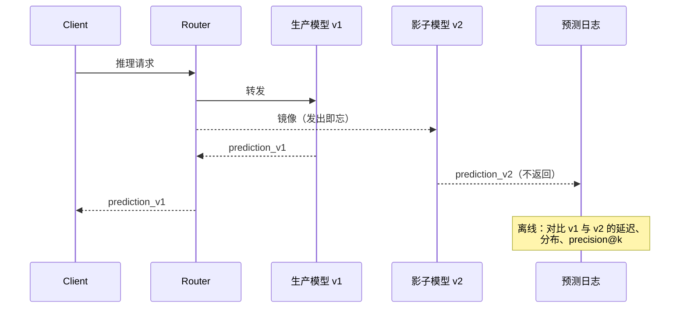

# 特征存储与模型服务

> **TL;DR**: 一个训练好的模型 checkpoint 只占把 ML 推上线所需工作量的 5% 左右。剩下 95% 是这些基础设施：在离线和在线两侧用完全相同的方式计算特征、给模型产物打版本、把它推送到一台能在延迟 SLA 内响应 RPC 的服务器、把受控的一小片流量切给新版本，并盯着漂移。Uber 曾报告其 Feature Store 中约有 10,000 个特征，截至 2017 年，其流量最高的 Michelangelo 模型每秒服务超过 250,000 次预测[^1]。核心论点：MLOps 里难的部分是一致性和时间。训练与服务之间的特征一致，以及时点正确性——让你永远不会拿未来训练。

## 学习目标

学完本模块后，你将能够：

- [ ] 解释特征存储为什么有两套后端，以及各自优化的是什么
- [ ] 在 Feast（开源、自带计算）与 Tecton（托管、有主张）之间做选择
- [ ] 用时点连接（point-in-time join）避免训练期的标签泄漏
- [ ] 用模型注册表区分“已训练”“已预发”“生产中”三种状态
- [ ] 在真正重要的维度上比较 KServe、BentoML 和 Triton
- [ ] 设计影子后金丝雀的发布流程，并给出明确的晋级与回滚判据
- [ ] 把漂移检测接到重训练触发上，同时不引发重训练风暴

## 直觉理解

你经营一家有 200 家门店的连锁餐厅。每道菜都有一张配方式卡片。厨房（服务侧）读卡片、实时出菜。试验厨房（训练侧）用同样的卡片格式试验新配方。如果试验厨房写的是“1 杯糖”，而生产厨房读到的是“1 汤匙糖”——因为有人抄卡片时抄错了——那这道菜在生产里的味道就和测试时不一样。而且没人会发现，直到顾客投诉。

现在再加上时间。试验厨房用上周二才有的食材来评估一款新酱料配方。如果他们误用了今天更新鲜的食材来做评估，这酱料在测试里比在实际生产里好吃得多，因为生产只有当下能拿到的东西。

这就是特征存储问题。配方卡片是特征定义。试验厨房是训练流水线。生产厨房是模型服务器。“1 杯 vs 1 汤匙”是训练-服务偏差（training-serving skew）。“用今天的食材评估上周二的配方”是时点泄漏（point-in-time leakage）。

本章剩下的部分走一遍同时解决这两个问题的基础设施：特征存储（共享的配方卡片）、模型注册表（带版本的配方活页夹）、模型服务器（按需出菜的厨房），以及发布纪律（怎么推出一道新菜而不会让任何人吃坏肚子）。

## 原理

### 特征存储：一张两副面孔的数据库

特征存储（feature store）是这样一种基础设施：特征只定义一次，然后以不同的延迟特征把同样的值提供给两类消费者。训练需要从数仓（BigQuery、Snowflake、Delta Lake、Iceberg）对多年历史做高吞吐扫描。服务需要在 10 ms 内对单个实体做低延迟点查，来自键值存储（Redis、DynamoDB、Cassandra、ScyllaDB）。

契约是：同一个特征名在两侧解析到同一个变换。LinkedIn 做了 Feathr，就是为了“确保特征在训练与推理两种场景下以同样的方式准备，从而防止训练-服务偏差”[^2]。Uber 先于其他组件投资特征存储，因为特征工程被认定为“机器学习中最难的部分”，而数据管道管理被认定为完整 ML 方案里“最昂贵的构件之一”[^1]。

**物化（materialization）** 把两个存储桥接起来。批任务（Spark、Airflow、Dagster）按调度计算特征，把最新值写进在线 KV 存储。流任务（Kafka 加 Flink 或 Spark Structured Streaming）让近实时特征保持新鲜。特征注册表记录每个特征的名字、实体键、数据类型、来源、变换、负责人、新鲜度 SLO 和血缘。

*特征注册表是共享契约；同一份定义既驱动批物化写入在线 KV 存储，也驱动时点连接生成训练数据集。*

### Feast 与 Tecton：开源 vs 托管

**Feast** 是一个插进你自己基础设施的特征存储框架。`feast apply` 把特征定义注册到对象存储里的注册表；`feast materialize` 把值从离线存储（BigQuery、Snowflake、Redshift、Postgres）加载到在线存储（Redis、DynamoDB、Cassandra、Bigtable、ScyllaDB）[^3]。数仓、流计算和在线存储的运维都归你。

**Tecton**（2024-2025 年被 Databricks 收购）是一个带主张的托管平台。它调度 Spark 和 Rift 作业，把特征物化到自己托管的在线存储，并对新鲜度和延迟承诺企业级 SLA[^4]。Stream Feature Views 在构造上就支持生成时点正确的训练数据。

**其他形态：** Databricks Feature Store（在 Unity Catalog 之上的湖仓原生）、Vertex AI Feature Store（GCP 原生，在线服务用 Bigtable）、SageMaker Feature Store（AWS 原生）、Hopsworks（实时 / 主权 AI 平台，Kubernetes 原生部署）、Chalk（实时优先）。

决策树：你有数据平台团队、想要完全控制权，选 Feast。你想把管道外包出去、让第一个模型几天而不是几个月就上线，选 Tecton 或某个云原生方案。

### 时点正确性

时点正确性（point-in-time correctness）的意思是：训练行里的每一个特征值，反映的是在该标签时间戳上可知的状态，而不是当前状态。

以欺诈检测为例。标签是“这笔交易在时间戳 T 是欺诈”。像“30 天拒付率”这样的特征，必须只反映 T 之前已知的拒付。如果你在训练时用今天的数据计算它，你就把未来的拒付泄漏进了训练行。离线 AUC 看起来很棒；在线增益为零，因为模型学会使用的是预测时刻根本不存在的信息。

修法是：对每个训练事件 `(entity, event_timestamp, label)`，特征存储执行一次 `AS OF` 连接，返回满足 `effective_timestamp <= event_timestamp` 的最大 `effective_timestamp` 对应的特征值。Feast 把这个暴露为 `get_historical_features(entity_df, features=...)`[^3]。Tecton 对这项操作的描述是：“给定记录 r，返回第二张表中时间戳与 r 最接近且小于等于 r 时间戳的那条记录”[^4]。Airbnb 的 Chronon 保证同样的性质，并且用可度量的方式验证它：记录在线取数，把它们在离线回填中重放，再比对取值[^5]。

> [!IMPORTANT]
> 时点连接是“诚实的训练”和“悄悄泄漏未来”之间的分界线。让它成为默认做法，而不是例外。永远不要手写训练侧连接。

### 模型注册表

注册表是已训练模型的记录系统：稳定名字、版本、阶段、回溯到训练 run 的血缘、审批、标签。

MLflow Model Registry 给每个模型版本存一个唯一的整数版本号。在 MLflow 2.x 中，每个版本同一时刻只能处于一个阶段（None、Staging、Production、Archived），通过 `transition_model_version_stage` 迁移。在 MLflow 3.x 中，阶段被全面弃用，改为**模型别名（model alias）**——即可变的命名引用，如 `@champion` 或 `@candidate`——通过 `set_registered_model_alias()` 设置；以 Unity Catalog 为后端的注册表上阶段迁移 API 完全不可用，在别处也计划移除。别名是指针而不是 N 选一的状态，因此一个模型上可以并存多个别名，晋级只是重新指向一个别名，而不是状态迁移[^6]。回滚仍然是一次 API 调用：把 `@champion` 指回上一个版本。

*MLflow 3.x 的别名（`@candidate`、`@champion`）让晋级和回滚都变成单次指针重指；同一个不可变产物在不同时间被不同别名引用，这正是回滚能像重指一样快、而不像重新部署一样慢的原因。MLflow 2.x 的阶段迁移（None / Staging / Production / Archived）用 N 选一的状态表达同样的模式。*

注册表让数据科学与平台之间的交接变成“一个不可变产物加一次状态迁移”，而不是一条 Slack 消息。SageMaker Model Registry 和 Vertex AI Model Registry 提供等价的原语，只是与其供应商的端点和 CI/CD 紧耦合。

### 模型服务器：Triton、KServe、BentoML

模型服务器加载一个或多个模型产物，通过 gRPC 或 REST 接收推理请求，做前处理和后处理，并对请求做批处理以摊薄 GPU 成本。决策树如下：

- **单框架、GPU 用得不多：** TF Serving（TensorFlow）或 TorchServe（PyTorch）。在自己原生框架上很强，出了框架就难受。
- **多框架、GPU 吃重：** NVIDIA Triton。支持 TensorFlow、PyTorch、ONNX、TensorRT、Python 和 vLLM 后端。它的动态批处理器把在途请求合并，上限是 `max_batch_size`，等待上限由 `max_queue_delay_microseconds` 约束；可选的 `preferred_batch_size` 旋钮留给 TensorRT 多 profile 这类细分调优场景[^7]。这才是那个不那么显然的收益：批处理把 GPU kernel 启动开销摊到多个请求上。
- **Kubernetes 原生控制面：** KServe。把控制面（InferenceService CRD、自动伸缩、金丝雀流量切分）与数据面（推理、transformer、explainer）分开[^8]。Knative 模式默认支持缩容到零。Raw 模式历史上只用 HPA（最小副本数下限为 1），但较新的 KServe 版本加入了基于 KEDA 的自动伸缩，在 Raw 模式下也支持缩容到零。
- **Python 优先的工程手感：** BentoML。把模型加上 Python 前/后处理打包成一个 “Bento” 产物。它的自适应批处理是一个服务端调度器，“根据实时流量模式持续调整批大小和批窗口”，并“根据请求模式与处理时间的近期趋势持续学习和调整批处理参数”，受 `max_batch_size` 和 `max_latency_ms` 约束[^9]。

*KServe 把 Kubernetes 原生控制面（生命周期、自动伸缩、金丝雀）与数据面（推理、transformer、explainer）分开，让运维管 CRD 的同时推理全速运行。*

缩容到零这个权衡值得单独强调。KServe 的 Knative 模式会终止空闲副本以省 GPU 成本，但空闲后的第一个请求要等上几百毫秒，用于 pod 启动和模型加载。面向用户的端点，请用 KServe 的标准模式，最小副本数设为 1，突发流量交给 HPA。缩容到零留给批任务和低流量的长尾模型。

### 影子部署、金丝雀与流量切分

[部署策略](../part-6-reliability-and-operations/05-deployment-strategies.md) 介绍过通用服务上的蓝绿与金丝雀。ML 把这些模式适配到一个现实：被改变的东西是预测分布，而不是响应码。

**影子（镜像）：** 新模型拿到 100% 的线上流量，但它的预测只被记录，不返回。这在零用户风险下验证延迟、吞吐和预测分布[^10]。影子实例绝不能影响生产响应路径。

**金丝雀：** 一小片用户（1% 到 5%）走新模型。把业务指标和 ML 指标与对照组比较。只有指标全绿才放量：1% 到 5% 到 25% 到 100%，历时数小时到数天，任何护栏指标回退就暂停。

**提前定义好晋级与回滚判据：** 延迟 P99、错误率、主要业务指标，以及一个 ML 指标（校准度、线上样本上的 AUC）。回滚是翻一个功能开关，而不是重新部署。

*影子在零用户风险下验证延迟与预测分布；影子干净之后，金丝雀才对一小撮用户放量，晋级与回滚的闸门提前定好。*

### 漂移检测与重训练触发

数据漂移（data drift）是输入分布的变化。概念漂移（concept drift）是 `P(y|x)` 的变化。两者都会让模型变差，但修法不同。

**检测：** 群体稳定性指数（Population Stability Index，PSI）把参考分布和当前窗口都分到 B 个桶，再对 `(Actual_b - Expected_b) * ln(Actual_b / Expected_b)` 求和。经验阈值：PSI < 0.1 表示分布相近，0.1 到 0.2 是中度漂移，> 0.2 表示该重训练了[^11]。Evidently、WhyLabs、Arize 和 Fiddler 提供托管等价物，带 SaaS 看板和告警。

**触发：** 定时重训练（每天、每周）会浪费算力。阈值触发在特征相关时会引发风暴。性能回退触发要等到用户已经受损。诚实的信号是漂移加上延迟标签的性能指标（滚动 AUC、校准度）。DoorDash 的 Sibyl 把预测日志直接接到 Prometheus，于是漂移看板从第一天就有[^12]。

**闭环：** 一次重训练不过是又一次落进注册表的 run。回到生产的晋级必须走同一道影子-金丝雀闸门。用迟滞（hysteresis）抑制触发，把多个特征聚合成单一决策信号，并限制并发重训练数以避免风暴。

## 真实案例

**Uber Michelangelo**（2017 年至今）确立了全行业照抄的经典特征存储范式。在这个平台之前，同一个业务概念被不同团队用不同方式计算，产生了偏差。特征工程被认定为 ML 工程“最难的部分”，数据管道管理被认定为“最昂贵的构件之一”[^1]。

Michelangelo 引入了后来成为标准的在线/离线分离。特征定义在同一份声明式配置里同时指定批计算（Hive/Spark SQL 产出每日更新）和在线服务目标（Cassandra，对需要特征查询的模型典型 p95 延迟低于 10 ms）[^1]。训练流水线从 Hive 读特征；在线服务从 Cassandra 读同一个特征名。（“Palette” 是后来给叠加在这之上的精选特征目录起的内部名字[^13]。）

**规模：** Uber 报告其 Feature Store 中约有 10,000 个精选特征，截至 2017 年那篇平台文章发布时，流量最高的 Michelangelo 模型每秒服务超过 250,000 次预测[^1]。后来的第三方综述描述了增长到数千个生产模型、上线周期缩短到不足一周，以及一个约 30 人的平台团队支撑约 400 名 ML 工程师[^13]；2020 年前后的确切数字并未出现在 Uber 官方工程博客里。

**哪里出了问题：** 随着特征目录扩张，发现能力崩了。工程师无法判断自己需要的特征是否已存在，于是造出实现略有差异的重复特征。Uber 用特征搜索引擎、语义相似度匹配，以及新特征的强制评审流程来应对[^13]。据说平台迁移本身比计划多花了 18 个月；好几个团队并行运行两套基础设施超过一年，迁移期间成本翻倍[^13]。

**关键教训：** 先于其他组件投资特征存储。统一平台消除了后来的集成 bug，而特征存储先行意味着从第一天起每个模型都训练在一致、可复用的特征上。

## 设计决策

**特征新鲜度。**

| 方案 | 优点 | 缺点 | 适用场景 | 我们的选择 |
|---|---|---|---|---|
| 预计算在线特征（批物化） | 服务延迟最低（< 5 ms），读路径简单 | 最多滞后一个批周期，全量实体都有存储成本 | 变化慢的特征（用户年龄、30 天聚合） | **多数特征的默认选择** |
| 在线特征计算（即时计算） | 永远新鲜，没有预计算浪费 | P99 更高，变换一致性有风险 | 冷启动实体、请求时上下文 | 仅当新鲜度被证明是关键时 |

**自建 vs 采购。**

| 方案 | 优点 | 缺点 | 适用场景 | 我们的选择 |
|---|---|---|---|---|
| 自托管（Feast + Redis + Spark/Flink） | 完全控制，规模化后边际成本更低，无按 GB 计费 | 需要沉重的平台团队投入；在线与离线存储的运维负担 | 已有数据平台的大型组织 | 有 5 名以上平台工程师的团队 |
| 托管（Vertex Feature Store、Databricks FS、SageMaker FS） | 少招人，第一个模型上线更快 | 供应商锁定，规模化后按 GB 计费 | 中小团队、云原生技术栈 | **创业公司和早期团队的默认选择** |
| 企业级托管（Tecton） | 开箱即用的生产级流处理、ACL、治理 | 企业级定价；B 轮之前很少划算 | 有严格合规或流处理需求的中大型组织 | 当治理和流处理是硬约束时 |

**部署方法。** 对任何错误会被用户或收入看到的模型，影子后金丝雀都是生产默认。把 100% 生产流量镜像给新模型但不服务它的预测，在固定窗口内比较分布和延迟，然后从 1% 到 5% 到 25% 到 50% 到 100% 放量，回退时自动回滚。[部署策略](../part-6-reliability-and-operations/05-deployment-strategies.md) 讲了通用模式；ML 特有的补充是：你必须把特征分布和预测分布与延迟、错误率信号分开监控，因为无声的数据漂移可以在任何基础设施指标都不动的情况下让预测变差。

## 常见陷阱

> [!WARNING]
> **时点违规导致的训练期标签泄漏。** 离线 AUC 很好；在线增益为零。训练侧连接用了特征的“当前”值，而不是标签时间戳上的值。用特征存储的时点 API，让存储去执行 AS OF 连接。

> [!WARNING]
> **重复的变换代码导致训练-服务偏差。** 模型训练时用的特征 X 是用 SQL 一种写法算的；服务时用 Python 另一种略微不同的写法算。Uber 认定不一致的特征计算导致的训练-服务偏差是 Michelangelo 之前生产 ML bug 的主要来源[^1]。一个特征定义、一个变换，两条路径逐字重放。

> [!WARNING]
> **没有漂移监控。** 模型无声退化好几周；第一个信号是业务指标下跌。在第一次上线之前就接好 Evidently、WhyLabs 或 Arize，而不是等第一次事故之后。

> [!WARNING]
> **延迟敏感的端点用了缩容到零的冷启动。** KServe 的 Knative 模式会终止空闲副本以省 GPU 成本。空闲后的第一个请求要等几百毫秒。面向用户的端点，用标准模式并把最小副本设为 1。缩容到零留给批处理和长尾模型。

> [!WARNING]
> **没有注册表、没有回滚方案的手工推模型。** 数据科学家把新模型拷到服务主机上。它退化了。回滚意味着去某个地方找上一个产物。每个生产模型都要以稳定名字和版本落进注册表；重新指向别名（或在 MLflow 2.x 上做阶段迁移）是唯一的晋级方式。

## 练习

为一个每秒处理 2,000 笔交易的支付平台设计欺诈检测模型的特征与服务栈。具体说明：(a) 五个特征，分布在批（例如 30 天拒付率）和流（例如最近 10 分钟内的不同设备数）两侧；(b) 你选哪个离线存储和在线存储，为什么；(c) 训练时怎么保证时点正确性；(d) 用哪个模型服务器，为什么；(e) 你的影子后金丝雀方案，以及在延迟、有标签交易上的 precision-at-k、按金额加权的召回率上的明确晋级与回滚判据；(f) 漂移信号和重训练节奏；(g) 第一周你会拿哪个指标来报警。

提示

2,000 TPS、5 个特征、每个 8 字节，对 Redis 来说微不足道（不到 1 MB/s）。真正的设计压力来自标签到达延迟：拒付要几天到几周后才到。这个延迟决定了你的重训练节奏，也决定了你能不能靠性能回退触发，还是只能靠漂移阈值。想一想标签延迟时“precision-at-k”到底意味着什么。

参考答案

**(a) 特征：**

- 批（每日物化）：30 天拒付率、生命周期交易笔数、平均交易金额（30 天滚动）、账户账龄（天）
- 流（Flink，30 秒新鲜度）：最近 10 分钟内不同设备数、交易速率（最近 5 分钟笔数）
- 按需（请求时计算）：本次交易金额相对该用户 30 天均值的比例

**(b) 存储：**

- 离线：Snowflake（现有数仓，原生支持 AS OF 连接）
- 在线：Redis Cluster（2,000 TPS 下 P99 低于 5 ms 很轻松；10,000 实体 × 5 特征 × 8 字节 = 400 KB 热集）

**(c) 时点正确性：** 用 Feast 的 `get_historical_features`，以交易时间戳作为事件时间。拒付率特征必须只反映在该交易时间戳之前已结案的拒付。回填时对历史 Kafka topic 重放完全相同的 Flink 聚合逻辑。

**(d) 模型服务器：** KServe 标准模式（最小副本 = 2），预测后端用 Triton。欺诈打分对延迟敏感（预算 < 100 ms）；缩容到零不可接受。动态批处理配 `max_queue_delay_microseconds: 500`，把 GPU 成本摊到并发的多笔交易上。

**(e) 发布：**

- 影子 48 小时：比较预测分布、P99 延迟，以及在 48 小时内会有结论的那部分交易上的误报率。
- 金丝雀 1% 跑 24 小时：盯已结案标签上的 precision@100、按金额加权的召回率（我们抓到了多少比例的欺诈金额），以及 P99 < 50 ms。
- 5 天后从 5% 放量到 25% 再到 100%。回滚触发条件：precision@100 相对下降 > 5%，或 P99 > 80 ms。

**(f) 漂移与重训练：** 每个特征在 1 小时滚动窗口上对最近 30 天参考分布算 PSI。PSI > 0.15 告警。默认每周重训练；若滚动精确率（在已结案标签上）绝对下降 > 3%，立即重训练。并发重训练上限为 1。

**(g) 值得报警的指标：** 按金额加权的假阴性率（漏掉的欺诈金额占比）。这个指标直接对应业务损失。若它连续 15 分钟超过基线的 2 倍就报警。

## 要点回顾

- 特征存储之所以存在，是因为训练和服务必须用完全相同的方式计算特征。在线-离线分离解决延迟问题；共享定义解决一致性问题。
- 时点连接是生产 ML 里最容易被搞混的概念。搞错了，离线指标就变得毫无意义。
- 模型注册表是数据科学与平台之间的契约。把阶段迁移当成生产事件，而不是改个表格。
- 按你的框架组合和规模选模型服务器：GPU 吃重的多框架选 Triton，Kubernetes 原生控制面选 KServe，追求 Python 优先的顺滑迭代选 BentoML。
- 先影子、再金丝雀、最后全量。晋级和回滚闸门在发布开始前定好，而不是在事故进行中定。
- 只有漂移检测、没有延迟标签的性能指标是不完整的。分布可以漂移而模型不受损，反过来也成立。
- Uber 的 Michelangelo 证明了先投特征存储是划算的：一个共享的万级特征目录和统一的服务栈，减少了全公司的重复工作和训练-服务偏差。

## 延伸阅读

- [Feast 文档](https://docs.feast.dev/) - 开源特征存储的参考实现；先读 Components Overview 和 `get_historical_features` API，那是时点连接的经典范式。
- [Tecton: Constructing Training Data](https://docs.tecton.ai/docs/reading-feature-data/reading-feature-data-for-training/constructing-training-data/) - 用广告点击时间线讲时点连接，是实践者写得最清楚的一篇。
- [Airbnb Chronon](https://github.com/airbnb/chronon) - 声明式特征定义，内置在线/离线一致性度量；示范了如何验证正确性，而不只是断言它。
- [Meet Michelangelo: Uber's ML Platform](https://www.uber.com/en-RS/blog/michelangelo-machine-learning-platform/) - 2017 年那篇定下行业范式的文章；配合 2020 年前后 Palette 的后续材料一起读，看规模数字。
- [KServe 架构](https://kserve.github.io/website/docs/concepts/architecture) - 控制面与数据面的分离，以及部署模式的权衡（Knative 缩容到零 vs Standard HPA）。
- [NVIDIA Triton Batchers](https://docs.nvidia.com/deeplearning/triton-inference-server/user-guide/docs/user_guide/batcher.html) - 动态批处理器配置，以及控制延迟-吞吐权衡的 `max_queue_delay_microseconds` 旋钮。
- [BentoML 自适应批处理](https://docs.bentoml.com/en/latest/get-started/adaptive-batching.html) - 服务端调度器，根据实时流量模式和处理时间持续调整批大小与批窗口，受 `max_batch_size` 和 `max_latency_ms` 约束。
- [用 PSI 度量数据漂移（Fiddler）](https://www.fiddler.ai/blog/measuring-data-drift-population-stability-index) - PSI 公式、阈值，以及它与对称化 KL 散度的等价性；漂移告警的实践者参考。

## 记忆卡片

**Q:** 特征存储为什么有两套后端（离线与在线）？
**A:** 训练需要从数仓对多年历史做高吞吐扫描。服务需要从 KV 存储做低延迟点查（< 10 ms）。同一个特征，不同的访问模式。

**Q:** 什么是时点正确性？
**A:** 把每个训练样本连接到它在事件时间戳当时的特征值，绝不使用未来的值。没有它，你就泄漏了未来信息，把离线指标抬高，而在线一上就归零。

**Q:** 什么是训练-服务偏差，由什么引起？
**A:** 模型训练时看到的特征分布与推理时看到的分布出现偏离。根因：两套变换代码、单位不一致、空值处理差异、时区漂移。

**Q:** Feast 怎么保证时点正确性？
**A:** `get_historical_features` 执行 AS OF 连接：对每个带 event_timestamp 的实体行，返回 effective_timestamp 最大且小于等于 event_timestamp 的那个特征值。

**Q:** 模型注册表的作用是什么？
**A:** 它是已训练模型的记录系统：稳定名字、版本、到训练 run 的血缘，以及指向“哪个版本在生产”的可变指针（MLflow 3.x 的别名如 `@champion`，或更早的 MLflow 2.x 阶段标签 None/Staging/Production/Archived）。它让数据科学与平台之间的交接变成一个不可变产物加一次指针更新。

**Q:** Triton 的动态批处理器怎么提升 GPU 利用率？
**A:** 它把在途请求合并到首选批大小，最多等待 `max_queue_delay_microseconds` 让更多请求到达。这把 GPU kernel 启动开销摊到多个请求上。

**Q:** 对 ML 模型来说，影子部署和金丝雀部署有什么区别？
**A:** 影子把线上流量镜像给新模型但不返回它的预测（零用户风险，验证延迟和分布）。金丝雀让一小片用户（1% 到 5%）走新模型，度量真实业务指标。

**Q:** 什么时候不该用 KServe 的缩容到零？
**A:** 面向用户、延迟敏感的端点。空闲后的冷启动（pod 启动加模型加载）会多出几百毫秒。用标准模式，最小副本设 1，突发交给 HPA。

**Q:** 哪些 PSI 阈值意味着漂移？
**A:** PSI < 0.1 表示分布相近。0.1 到 0.2 是中度漂移。> 0.2 说明模型该重训练了。

**Q:** 为什么仅靠漂移检测不足以决定是否重训练？
**A:** 分布可以漂移而模型性能不受损，反过来也可能。把漂移指标和延迟标签的性能指标（滚动 AUC、校准度）配起来，才是诚实的信号。

**Q:** Uber Michelangelo 的关键架构洞见是什么？
**A:** 先投资特征存储。统一平台、共享特征定义、统一的在线/离线分离，消除了训练-服务偏差，并让模型能复用跨团队精选出的约 10,000 个特征目录。

**Q:** 怎么避免特征相关导致的漂移引发重训练风暴？
**A:** 用迟滞抑制触发，把多个特征聚合成单一决策信号，限制并发重训练数，并在漂移阈值之外配合性能回退触发。

## 参考文献

[^1]: Mike Del Balso and Jeremy Hermann, "Meet Michelangelo: Uber's Machine Learning Platform", Uber Engineering Blog, 2017-09-05. https://www.uber.com/en-RS/blog/michelangelo-machine-learning-platform/
[^2]: David Stein, "Open sourcing Feathr - LinkedIn's feature store for productive machine learning", LinkedIn Engineering, 2022-04-12. https://engineering.linkedin.com/blog/2022/open-sourcing-feathr---linkedin-s-feature-store-for-productive-m
[^3]: Feast, "Architecture Overview (Components)", feast.dev docs. https://docs.feast.dev/getting-started/components/overview
[^4]: Tecton, "Constructing Training Data", docs.tecton.ai. https://docs.tecton.ai/docs/reading-feature-data/reading-feature-data-for-training/constructing-training-data/
[^5]: Airbnb, "chronon README", github.com/airbnb/chronon. https://github.com/airbnb/chronon
[^6]: MLflow, "ML Model Registry" (MLflow 3.x documentation). https://mlflow.org/docs/latest/ml/model-registry/
[^7]: NVIDIA, "Batchers - Triton Inference Server docs". https://docs.nvidia.com/deeplearning/triton-inference-server/user-guide/docs/user_guide/batcher.html
[^8]: KServe, "System Architecture Overview". https://kserve.github.io/website/docs/concepts/architecture
[^9]: BentoML, "Adaptive batching". https://docs.bentoml.com/en/latest/get-started/adaptive-batching.html
[^10]: Metricgate, "Shadow Deployment vs Canary Rollout", 2026. https://metricgate.com/blogs/shadow-deployment-vs-canary/
[^11]: Murtuza Shergadwala, "Measuring Data Drift with the Population Stability Index (PSI)", Fiddler AI blog, 2022. https://www.fiddler.ai/blog/measuring-data-drift-population-stability-index
[^12]: Swaroop Chitlur and Kornel Csernai, "Maintaining Machine Learning Model Accuracy Through Monitoring", DoorDash Engineering Blog, 2021-05-20. https://web.archive.org/web/20250226164316/https://careersatdoordash.com/blog/monitor-machine-learning-model-drift/
[^13]: kindatechnical, "Case Study: Uber Michelangelo ML Platform", 2026 (third-party summary; numbers beyond the 2017 Uber blog are not independently verified). https://www.kindatechnical.com/mlops-guide/case-study-uber-michelangelo-ml-platform.html
