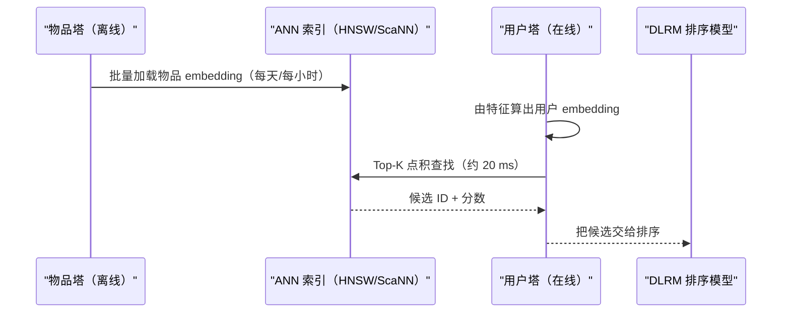
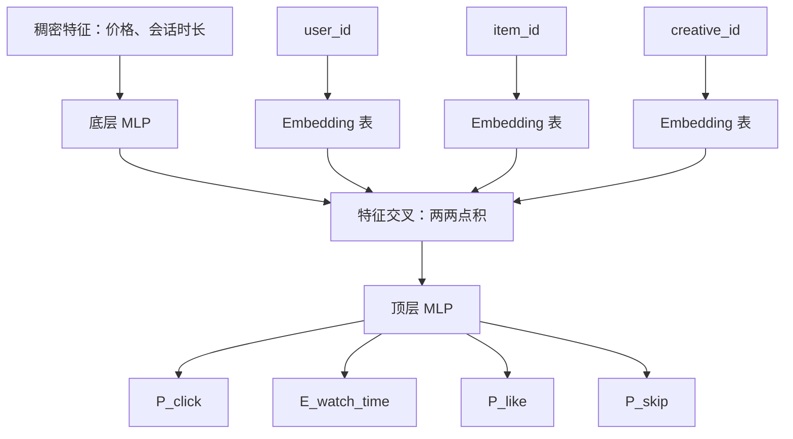
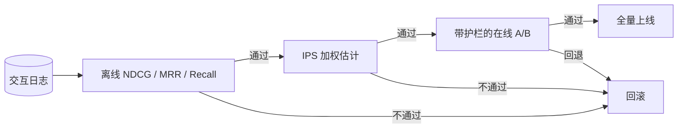

# 推荐系统深入剖析（DLRM、双塔、向量召回、冷启动）

> **TL;DR**: 现代推荐系统是一条多级漏斗。便宜的双塔召回模型在学到的 embedding 上做 ANN 检索，把十亿级物品收窄到几千个，耗时几十毫秒；昂贵的 DLRM 式排序模型再基于 TB 级 embedding 表做两两特征交叉，用几十个互动目标给这些候选打分。围绕这套结构的是：防止信息茧房坍缩的探索策略、面向新用户和新物品的冷启动通路，以及一条评估闭环——离线 NDCG 只是过滤器，带护栏的在线 A/B 才是上线决策。Meta 的 HSTU（1.5T 参数，在线 A/B 提升 +12.4%，2024 年）是第一个公开证明 LLM 式扩展律适用于推荐系统的模型[^1]；2025 年的一波工作（快手 OneRec、美团 MTGR、Meta LIGER、Pinterest PinRec）已经开始在十亿用户规模上端到端取代“先召回再排序”的级联流水线。

## 学习目标

学完本章，你将能够：

- [ ] 解释为什么现代推荐系统把召回和排序拆成两个阶段
- [ ] 设计一个双塔召回模型，并说明 ANN 如何让它在十亿物品规模下变得可算
- [ ] 描述 DLRM 的稀疏-稠密架构、特征交叉层，以及注意力从哪一层进入
- [ ] 针对给定约束选择合适的探索策略（Thompson 采样、epsilon-greedy、上下文 bandit）
- [ ] 在不砸掉互动指标的前提下完成新用户和新物品的冷启动
- [ ] 把离线排序指标（NDCG、MRR）与在线指标（CTR、观看时长）对齐起来看
- [ ] 判断什么场景适合生成式推荐，什么场景下 DLRM 仍是更好的基线

## 直觉理解

你走进一个有 500 个舞台的音乐节，只有 8 小时。一个懂你口味的朋友隔着人群喊：“去看看 12 号、47 号、88 号和 203 号舞台！”这就是召回。她很快，但不精确——她说不出演出顺序，说不出你到场时他们在唱哪首，也说不清人群会不会挤到进不去。

第二个朋友接过你的候选清单，查了时刻表、天气和你的体力，然后说：“先去 47 号，因为他们 20 分钟后唱你最喜欢的那首；然后去 88 号，离得近，而且你去年喜欢过一支类似的乐队。”这就是排序。他慢，但精准。他一个人没法评估全部 500 个舞台。

现在设想你永远只跟着这两位朋友走。你永远不会发现新流派。几个音乐节下来，每一句推荐听起来都一样。这就是信息茧房问题。你需要第三个朋友，他时不时说一句：“试试 311 号吧。我不知道你会不会喜欢，但没人往那儿去，不确定性很高。”这就是探索。

召回、排序、探索这三段结构，就是 YouTube、TikTok、Instagram、Pinterest、Netflix 和 Spotify 上每一个生产级推荐系统的骨架。本章余下的部分，补齐 [ML System Design Fundamentals](./09-ml-system-design-fundamentals.md) 只在高层面提到的工程细节。

## 原理

### 多级漏斗

[ML System Design Fundamentals](./09-ml-system-design-fundamentals.md) 介绍了两阶段模式。十亿用户规模的生产系统把它扩成四个阶段[^2]：

1. **召回**：用多条并行通路——双塔 ANN、共同访问启发式、热门物品、用户历史相似度——在 20 ms 内把 10^8 到 10^10 个物品收窄到几千个。
2. **一阶段排序**：用一个轻量双塔模型（从二阶段蒸馏而来）把几千个砍到几百个。
3. **二阶段排序**：跑一个重型的 DLRM 式多任务多标签（MTML）网络，带丰富的交叉特征。
4. **重排**：施加多样性（MMR、DPP）、新鲜度加权、策略过滤和业务规则。

召回决定天花板。召回漏掉了最好的那个物品，再强的排序模型也救不回来。一阶段的 Recall@K 是团队调得最狠的 KPI[^2]。

*漏斗通过四个阶段把十亿级物品压缩成一页渲染结果：精度逐级提升，候选数量逐级减少。*

### 双塔召回与批内 softmax

两个独立的子网络分别把用户和物品编码进同一个 d 维空间（64 到 256 维），彼此只靠一个点积相连[^3]。训练用批内负样本：每个 (用户, 正样本物品) 的 minibatch 把批内其他物品当作负样本，在批上做 softmax。

问题在于：在幂律分布下，热门物品作为负样本出现的频率高得离谱，会带偏梯度。Yi 等人（2019）提出 **log-Q 校正**：在 softmax 之前从每个 logit 里减去 `log P_sampled(item)`，用一个流式频率估计器实现，能跟随分布漂移而不依赖固定词表[^3]。

服务时，物品塔离线跑完全库，把向量灌进 ANN 索引（HNSW、ScaNN、FAISS）；每个请求只跑用户塔。这就是双塔召回能做到次线性的原因：一次前向传播，加一次 O(log N) 的 ANN 查找[^2]。

关键约束：两个塔不能共享用户-物品交互特征。一旦共享，物品 embedding 就会变成与用户相关，也就无法预先算好缓存。排序之所以必须作为独立阶段存在，正是因为这条约束。

*物品塔离线预计算 embedding；请求时只跑用户塔，在毫秒级内查询 ANN 索引。*

**难负样本挖掘**（hard-negative mining）把随机负样本换成“模型打分很高、但用户没有互动”的物品，从而提升召回质量。PinSage（Ying 等人，2018）是一个基于 GCN 的 embedding 方法，在 Pinterest 规模上验证了难负样本挖掘：30 亿节点、75 亿训练样本，训练过程中负样本逐步变难[^4]。此后 Pinterest 又公开了若干生产后继方案——PinnerFormer（2022，批式序列用户 embedding）、TransAct（KDD 2023，基于 transformer 的实时用户行为排序）、PinRec（2025，以结果条件化的多 token 生成式召回）——如果你在运营 Pinterest 量级的系统，这些都值得跟踪。

### DLRM：稀疏 embedding 遇上稠密特征

DLRM（Naumov 等人，2019，Meta）是排序架构的经典范式[^5]。它的结构核心是**特征交叉层**：

1. 稠密特征（数值型：价格、会话时长、一天中的时段）过一层底层 MLP。
2. 稀疏类别特征（user_id、item_id、creative_id）在 TB 级 embedding 表里查行。
3. 交叉层计算每个 embedding 与稠密 MLP 输出之间的两两点积，组成下三角矩阵。
4. 顶层 MLP 吞下展平后的交叉矩阵，为每个互动任务输出分数。

像“用户喜欢恐怖片 AND 物品是恐怖片”这样的交叉特征，在交叉矩阵里由一个点积就捕获了，拼接（concatenation）表达不出来[^5]。embedding 表主导内存占用：生产环境的表从几百 GB 到数 TB，需要对 embedding 做模型并行分片、对 MLP 做数据并行复制[^6]。

排序目标很少只是点击概率。Instagram 的排序模型输出一个加权和：`W_click * P(click) + W_like * P(like) - W_see_less * P(see_less) + ...`，权重用贝叶斯优化调[^2]。**MMoE**（Multi-gate Mixture-of-Experts，Google 2018）和 **PLE**（Progressive Layered Extraction，腾讯 2020）这类多任务架构，解决的是“跷跷板现象”——一个任务变好、另一个任务变差——它们把专家子网络通过任务专属的 gate 路由出去[^7][^8]。

*DLRM 让稠密特征走底层 MLP、稀疏 ID 走 embedding 表；交叉层在顶层 MLP 打多个目标分之前先捕获全部两两交叉特征。*

DLRM 这条技术线一路演进来：Wide & Deep（Cheng 等人，2016，Google Play）、DCN-V2（Wang 等人，2021，低秩混合的交叉层，在 Google 多个系统上都拿到显著在线提升）、DIN（阿里 2018，对用户历史做目标注意力），直到今天的 HSTU（Zhai 等人，2024，1.5T 参数的生成式序列转换）[^1]。

### 序列模型与生成式推荐

SASRec（Kang & McAuley 2018）对用户最近互动的 N 个物品做因果自注意力，预测下一个物品。BERT4Rec 把因果掩码换成双向的 Cloze 目标。两者都把用户历史当成一个 token 序列。

**HSTU**（Hierarchical Sequential Transduction Unit，Zhai 等人，ICML 2024）把推荐重构成序列转换问题，配一种硬件友好的注意力变体，在 8192 长度序列上比 FlashAttention2 快 5.3 到 15.2 倍。1.5T 参数的模型上线在 Meta 多个场景，在线 A/B 提升 +12.4%，而且模型质量在三个数量级的算力范围内呈幂律扩展[^1]。这是第一个公开证明 LLM 式扩展律适用于推荐系统的模型。2025 年的一波工作建立在它之上：**OneRec**（快手，2025 年 2 月）用端到端生成模型取代了“先召回再排序”的级联流水线，报告生产环境观看时长提升 1.6%；**MTGR**（美团，2025 年 5 月）在外卖场景部署了 HSTU 式排序模型，同时保留 DLRM 的交叉特征；**LIGER**（Meta，2024 年 11 月）把生成式召回与稠密召回统一起来，并处理冷启动。

**TIGER**（Rajput 等人，2023，Google Research）把每个物品编码成一个**语义 ID**（Semantic ID）：在内容 embedding 上训练残差量化 VAE，取码字的层级元组。一个 seq2seq transformer 自回归地解码下一个物品的语义 ID。这让模型能泛化到冷启动物品（新物品仅凭内容就能拿到语义 ID），并用生成式召回取代 ANN 查找[^9]。

> [!IMPORTANT]
> LLM 即推荐（LLM-as-recommender）路线（P5、LLaRA）在小物品库上有前景，但会幻觉，而且大规模下很难评估。截至 2026 年，DLRM 加双塔仍是大多数公司的生产默认方案，HSTU 式生成架构（以及 OneRec 式端到端生成替代）正在最大的平台上逐步占据上风。

### 探索-利用与冷启动

没有探索，推荐系统就在自己的日志上训练，从没曝光过的物品拿不到反馈，系统会收敛到一个很小的热门集合上。探索是可靠性特性，不是质量特性。

**Thompson 采样**对每个臂的回报建后验，决策时每个臂抽一个样本。DoorDash 用 Thompson 采样在 `Beta(alpha=orders_of_cuisine, beta=orders_of_other)` 上挑菜系筛选项[^10]。Deezer 的音乐轮播 bandit 发现，悲观初始化（例如 `Beta(1, 99)`）比朴素初始化（`Beta(1, 1)`）效果更好，因为更低的先验更贴近真实世界的回报率[^10][^11]。

**LinUCB**（Li 等人，2010，Yahoo）为每个臂拟合一个岭回归，选择 `x^T theta + alpha * sqrt(x^T A^-1 x)` 最大的臂，第二项就是置信半径。Yahoo 把它用在个性化新闻上：先把 1,193 个原始用户特征投影到文章类别上（用一个双线性逻辑回归模型）压成 6 维向量，再用 K-means 把用户聚成 5 组（这 6 维就是 5 个簇归属加一个常数项）[^10][^12]。

**冷启动物品**靠内容 embedding 起步：图像用 CLIP，文本用 Sentence-BERT，音频用 Whisper。TIGER 的语义 ID 用生成式方法解决冷启动：新物品不需要任何交互数据，就能被量化进同一个码字空间[^9]。**冷启动用户**靠注册特征（国家、设备、注册来源）加上下文 bandit 起步，后者每几次互动就更新一次。

### 离线与在线评估

离线指标（NDCG@K、MAP、MRR、Recall@K、AUC）在留出日志上计算。在线指标（CTR、观看时长、7 日留存、GMV）靠 A/B 测试测。两者之间的落差，是本章最重要的那个陷阱。

离线指标被记录策略（logging policy）带偏：当前系统从没展示过的物品没有任何反馈。**逆倾向加权**（Inverse Propensity Scoring，IPS）给每条观测元组乘上 `1/P_logged(item|user)`，得到对反事实策略回报的无偏估计[^13]。双稳健（doubly-robust）和自归一化变体能降低方差。

行业规则是：离线指标负责筛实验，带护栏的在线 A/B（最小 DAU、最小留存、内容安全边界）负责上线决策。

*离线 NDCG/MRR 是便宜的过滤器；IPS 加权的反事实估计能抓出记录策略带来的偏差；带护栏（留存、创作者公平性、内容安全）的在线 A/B 才是上线决策。任何一环不通过都会触发回滚。*

## 真实案例

**TikTok 的 Monolith 系统**（Liu 等人，2022，字节跳动）是明确为大规模在线训练设计的[^14]。常规推荐系统每天在批式日志上重训一次。Monolith 把训练和服务合成一个系统：模型参数更新从在线训练持续回流到服务端，模型能在几分钟内响应用户反馈。

核心创新是**无冲突布谷鸟哈希 embedding 表**。常规固定词表把 ID 哈希进固定数量的槽位，不相干的物品会撞在一起。Monolith 用布谷鸟哈希结构，插入新 ID 时不产生冲突，同时保持摊还 O(1) 的插入代价。内存靠两个机制兜住：可过期 embedding（丢弃时间窗口内没出现过的 ID）和频率过滤（ID 出现 N 次之后才准入）[^14]。

论文明确写下一个权衡：“系统可靠性可以被牺牲，换取实时学习。”这与典型的批式推荐系统是彻底的背离。结果是：一条新的爆款视频在几分钟内就变得可召回、可排序，而不是几小时。业界观察者把 TikTok 的产品优势部分归因于激进的 For You 探索、强内容 embedding 冷启动，以及这条快速反馈环。

这套架构是“双塔加每日重训”标准模式的反例。YouTube（2016）每天预计算一次物品 embedding，并按这个节奏刷新 ANN 索引；Monolith 的流式更新意味着 embedding 表永远新鲜。代价是运维复杂度：迟到事件和乱序事件会在流式管道里造成标签泄漏或特征缺失。

## 权衡

| 方案 | 优点 | 缺点 | 适用场景 | 我们的选择 |
|---|---|---|---|---|
| 协同过滤（矩阵分解） | 稠密互动场景下很强的基线；基础设施便宜；可解释 | 无法处理冷启动；用不上内容特征 | 成熟物品库、MVP、A/B 基线 | 仅作基线 |
| 基于内容的召回（CLIP、BERT embedding） | 天然处理冷启动；基础模型升级可直接受益 | 抓不住隐式偏好；推的是“长得像”而不是“真的相关” | 新闻、交互稀疏的领域、新物品上线 | 冷启动来源 |
| 混合：双塔召回 + DLRM 排序 | 十亿规模的生产默认方案；靠内容处理冷启动；排序阶段有丰富交叉特征 | 流水线复杂；两个模型要同步；阶段之间有陈旧度 | 过了 MVP 的十亿级规模 | 多数团队的默认选择 |
| 生成式推荐（HSTU、TIGER） | 扩展律成立；靠语义 ID 处理冷启动；端到端 | 服务成本高；工具链不成熟；为延迟必须蒸馏 | 有服务预算的十亿用户平台的前沿玩法 | 大型组织的下一代方案 |
| LLM 即推荐（P5、LLaRA） | 推理能力强；可解释；可对话 | 贵；慢；有幻觉；评估困难 | 对话式发现、小而高价值的物品库 | 增强 DLRM，而非替代 |

## 常见陷阱

> [!WARNING]
> **纯利用导致信息茧房坍缩。** 推荐系统在自己的日志上训练；从没展示过的物品拿不到反馈；几周之后系统收敛到一个很小的热门集合上。修法：Thompson 采样、LinUCB，或者在整个用户盘子上摊薄的显式探索配额。

> [!WARNING]
> **训练与服务的特征偏差。** 批式管道算出的特征和服务时同一个特征存在细微差异（中位数填充 vs 补零、30 天历史 vs 7 天历史）。离线 AUC 涨了，在线 CTR 掉了。修法：单一数据源的特征存储（Feast、Tecton、Monolith 式），配契约测试。

> [!WARNING]
> **离线-在线落差：NDCG 涨，观看时长不动。** 离线指标被记录策略带偏，奖励的是“把相关物品排到前面”，并不衡量长期满意度。修法：把 IPS 加权估计作为第二道过滤器；永远带留存护栏做 A/B。

> [!WARNING]
> **批内 softmax 的热门偏差。** 热门物品作为负样本出现的频率过高，被过度惩罚，把模型推向小众物品。修法：用流式频率估计器做 log-Q 校正（Yi 等人，2019）。

> [!WARNING]
> **多任务跷跷板：CTR 涨了，观看时长掉了。** 任务共享同一个主干，冲突的梯度把表征往不兼容的方向拽。修法：MMoE 或带任务级 gate 的 PLE，在共享专家上做路由；监控每任务 loss 与梯度余弦相似度。

## 练习

为 1 亿 DAU 的短视频信息流设计排序服务。需要给出：双塔召回（embedding 维度、负样本、索引）、DLRM 特征集、多任务头、新视频的探索、新用户的冷启动，以及 A/B 框架。明确一个 p99 延迟目标，并说明预算花在哪里。

提示

先想延迟预算怎么切：召回约 20 ms，排序约 80 ms。探索方面，新视频（上线不到 2 小时）需要不确定性加成，因为它们完全没有互动信号。冷启动用户方面，注册特征加一个上下文 bandit（LinUCB）就能给出一个默认策略，并在首次会话内完成更新。

解答

**双塔召回：** 用户塔输入：最近 100 个观看视频 embedding 的均值池化（128 维）、用户国家、设备、时段分桶。物品塔输入：视频内容 embedding（CLIP，128 维）、creator_id、类别、上传距今小时数。embedding 维度：128。训练：批内 softmax 加 log-Q 校正，batch size 8192。难负样本：展示了但 2 秒内被划走的视频。索引：ScaNN 提供的 HNSW，每 30 分钟刷新一次。延迟预算：用户塔前向 + ANN 查找共 15 ms。

**DLRM 排序特征：**

- 类别特征：user_id、video_id、creator_id、类别、设备、国家（各配一张 embedding 表，64 维）
- 数值特征：hours_since_upload（对数变换）、user_session_length、video_duration、creator_follower_count
- 序列特征：最近 50 个观看视频 ID，对候选做目标注意力（DIN 式）
- 预训练特征：视频 CLIP embedding（128 维，冻结）

**多任务头：** MMoE，8 个共享专家，4 个任务：P(click)、E(watch_time)、P(like)、P(share)。最终分数：`0.1*P(click) + 0.5*E(watch_time) + 0.3*P(like) + 0.1*P(share)`。权重用在线贝叶斯优化调。

**探索：** 上线不到 2 小时的视频拿 UCB 加成：`score + C * sqrt(log(total_impressions) / (1 + video_impressions))`。C 调到让新视频占约 5% 的信息流位置。

**冷启动用户：** 首次会话用国家 + 设备 + 时段，从预先算好的“冷启动播放列表”（每个画像簇的头部视频）里选。5 次互动后，LinUCB 更新用户表征。20 次互动后，完整双塔模型接管。

**A/B 框架：** 影子部署 48 小时。2% 灰度 24 小时。5 天内按 5%、25%、50%、100% 放量。主指标：每 DAU 总观看时长。护栏：p99 延迟 < 120 ms，创作者多样性 Gini < 0.7，内容安全违规率 < 0.01%。

**p99 延迟目标：** 总计 120 ms。预算：召回 15 ms，特征拉取 25 ms，排序前向 60 ms，重排 10 ms，其余开销 10 ms。

## 要点回顾

- “先召回再排序”的两阶段结构是通用架构，因为深层排序模型不可能在一个请求里给 10^9 个物品打分；在 embedding 上做 ANN 让召回能在几十毫秒内完成。
- DLRM 的特征交叉层用两两点积在结构上捕获交叉特征，这是拼接表达不出来的。瓶颈是 TB 级的 embedding 表，不是 FLOPs。
- 排序目标是多任务的（CTR、观看时长、点赞、分享、划走），合成一个价值模型分数。单看 CTR 与长期留存是负相关的。
- 探索不是可选项。没有探索，系统会坍缩到昨天的赢家上，制造信息茧房。Thompson 采样是有理论依据的默认选择。
- 冷启动物品靠内容 embedding（CLIP、BERT）起步；冷启动用户靠人群属性加上下文 bandit 起步。
- 离线指标（NDCG、MRR）是过滤器，不是决策。上线要依据带护栏的在线 A/B。离线-在线落差是最常见的工程师白干来源。
- 生成式推荐（HSTU、TIGER、OneRec、MTGR、LIGER、PinRec）证明了扩展律适用于推荐系统，但截至 2026 年，DLRM 加双塔仍是多数团队的生产默认方案。

## 延伸阅读

- [Deep Neural Networks for YouTube Recommendations](https://research.google/pubs/deep-neural-networks-for-youtube-recommendations/)。Covington 等人，RecSys 2016。两阶段结构的奠基论文；此后每个系统都引用它的“候选生成 + 观看时长加权排序”拆分。
- [Sampling-Bias-Corrected Neural Modeling for Large Corpus Item Recommendations](https://research.google/pubs/sampling-bias-corrected-neural-modeling-for-large-corpus-item-recommendations/)。Yi 等人，RecSys 2019。带 log-Q 校正的双塔经典论文；读它才能明白朴素批内 softmax 为什么在幂律数据上失效。
- [DLRM: Deep Learning Recommendation Model](https://arxiv.org/abs/1906.00091)。Naumov 等人，2019。TB 级稀疏-稠密交叉的架构与系统协同设计。
- [Monolith: Real-Time Recommendation System with Collisionless Embedding Table](https://arxiv.org/abs/2209.07663)。Liu 等人，RecSys ORSUM 2022。字节跳动的在线训练系统；展示了“每天重训一次”的假设在 TikTok 的节奏下如何失效。
- [Actions Speak Louder than Words: HSTU Generative Recommenders](http://arxiv.org/abs/2402.17152)。Zhai 等人，ICML 2024。第一个公开的、具备 LLM 式扩展律的推荐模型；1.5T 参数部署在 Meta。
- [Scaling the Instagram Explore Recommendations System](https://engineering.fb.com/2023/08/09/ml-applications/scaling-instagram-explore-recommendations-system/)。Meta Engineering，2023。带双塔蒸馏的四阶段流水线；生产级多级排序最新的公开参考。
- [Bandits for Recommender Systems](https://eugeneyan.com/writing/bandits/)。Eugene Yan，2022。综述 epsilon-greedy、UCB 和 Thompson 采样在生产推荐系统中的用法，附 DoorDash 与 Netflix 案例。
- [Homepage Recommendation with Exploitation and Exploration](https://web.archive.org/web/20221207201105/https://doordash.engineering/2022/10/05/homepage-recommendation-with-exploitation-and-exploration/)。DoorDash Engineering，2022。UCB 打分与深层排序模型的组合；生产环境中的探索实践。

## 记忆卡片

**Q：** 推荐系统里为什么会有两阶段结构？
**A：** 单个深度模型不可能在延迟预算内给一个请求的 10^9 个物品打分。双塔 ANN 召回在约 20 ms 内收窄到几千个，丰富的排序模型再在约 100 ms 内给这几千个打分。

**Q：** log-Q 校正是什么，双塔训练为什么需要它？
**A：** 它在批内 softmax 时从 logit 里减去 log(P_sampled(item))，纠正热门物品在大量批次里充当负样本带来的偏差。不做校正，模型会过度惩罚热门物品。

**Q：** DLRM 的特征交叉层是什么？
**A：** 它计算每个稀疏 embedding 与稠密 MLP 输出之间的两两点积，组成下三角矩阵。这样就能捕获“用户喜欢恐怖片 AND 物品是恐怖片”这类交叉特征，而拼接表达不出来。

**Q：** 排序目标为什么要多任务，而不是只看 CTR？
**A：** 单看 CTR 与长期留存负相关，因为标题党能最大化点击、却最小化观看时长和满意度。生产级排序模型同时预测点击、观看时长、点赞、分享和划走。

**Q：** 多任务排序里的跷跷板现象是什么？
**A：** 一个任务（例如 CTR）变好会让另一个任务（例如观看时长）变差，因为共享层上的冲突梯度把表征往不兼容的方向拽。MMoE 和 PLE 用任务级 gate 解决它。

**Q：** Thompson 采样怎么做探索？
**A：** 它对每个臂的回报建后验，决策时每个臂抽一个样本，选样本值最高的臂。高不确定性的臂自然会被探索到。

**Q：** 完全没有互动数据的新物品怎么做冷启动？
**A：** 用冻结编码器的内容 embedding（图像用 CLIP，文本用 BERT）作为物品的初始表征。TIGER 的语义 ID 用生成式方式解决：把内容量化进与既有物品相同的码字空间。

**Q：** 推荐系统评估中的离线-在线落差是什么？
**A：** 离线指标（NDCG、MRR）被记录策略带偏，与在线指标（观看时长、留存）往往只有弱相关。一个模型可以在离线 NDCG 上赢，却拿不到任何在线提升。

**Q：** IPS（逆倾向加权）是什么，什么时候用？
**A：** IPS 给每条日志观测乘上 1/P_logged(item|user)，得到对反事实策略回报的无偏估计。它用在离线指标和在线 A/B 之间的第二道过滤。

**Q：** TikTok 的 Monolith 与常规推荐系统的区别在哪？
**A：** Monolith 把训练和服务统一起来，参数持续在线更新，并用无冲突布谷鸟哈希 embedding 表，让模型在几分钟而不是几小时内响应用户反馈。

**Q：** HSTU 证明了关于推荐系统的什么结论？
**A：** HSTU（Zhai 等人，2024）是第一个公开证明推荐模型质量随算力呈 LLM 式幂律扩展的模型。1.5T 参数的版本在 Meta 带来 +12.4% 的在线 A/B 提升。

**Q：** 举三个标志，说明信息茧房正在坍缩。
**A：** （1）物品库覆盖率（曾被推荐过的物品占比）下降；（2）创作者层面的 Gini 系数上升；（3）长尾曝光占比随时间收缩。

## 参考文献

[^1]: Zhai et al., "Actions Speak Louder than Words: Trillion-Parameter Sequential Transducers for Generative Recommendations (HSTU)", ICML 2024. http://arxiv.org/abs/2402.17152
[^2]: Vorotilov & Shugaepov, "Scaling the Instagram Explore recommendations system", Meta Engineering, August 2023. https://engineering.fb.com/2023/08/09/ml-applications/scaling-instagram-explore-recommendations-system/
[^3]: Yi, Yang, Hong, Cheng, Heldt, Kumthekar, Zhao, Wei, Chi, "Sampling-Bias-Corrected Neural Modeling for Large Corpus Item Recommendations", RecSys 2019. https://research.google/pubs/sampling-bias-corrected-neural-modeling-for-large-corpus-item-recommendations/
[^4]: Ying, He, Chen, Eksombatchai, Hamilton, Leskovec, "Graph Convolutional Neural Networks for Web-Scale Recommender Systems (PinSage)", KDD 2018. https://arxiv.org/abs/1806.01973
[^5]: Naumov et al., "Deep Learning Recommendation Model for Personalization and Recommendation Systems", arXiv 1906.00091, 2019. https://arxiv.org/abs/1906.00091
[^6]: Gupta et al., "The Architectural Implications of Facebook's DNN-based Personalized Recommendation", arXiv 1906.03109, 2019. https://arxiv.org/abs/1906.03109
[^7]: Ma, Zhao, Yi, Chen, Hong, Chi, "Modeling Task Relationships in Multi-task Learning with Multi-gate Mixture-of-Experts", KDD 2018. https://research.google/pubs/modeling-task-relationships-in-multi-task-learning-with-multi-gate-mixture-of-experts/
[^8]: Tang, Liu, Zhang, Zhao, "Progressive Layered Extraction (PLE): A Novel Multi-Task Learning (MTL) Model for Personalized Recommendations", RecSys 2020. https://dl.acm.org/doi/abs/10.1145/3383313.3412236
[^9]: Rajput et al., "Recommender Systems with Generative Retrieval (TIGER)", NeurIPS 2023. https://arxiv.org/abs/2305.05065
[^10]: Yan, "Bandits for Recommender Systems", eugeneyan.com, May 2022. https://eugeneyan.com/writing/bandits/
[^11]: Bendada, Salha, Bontempelli, "Carousel Personalization in Music Streaming Apps with Contextual Bandits", RecSys 2020. https://arxiv.org/abs/2009.06546
[^12]: Li, Chu, Langford, Schapire, "A Contextual-Bandit Approach to Personalized News Article Recommendation", WWW 2010. https://arxiv.org/abs/1003.0146
[^13]: Schnabel et al., "Recommendations as Treatments: Debiasing Learning and Evaluation", ICML 2016. https://proceedings.mlr.press/v48/schnabel16.html
[^14]: Liu et al., "Monolith: Real Time Recommendation System With Collisionless Embedding Table", ORSUM@RecSys 2022. https://arxiv.org/abs/2209.07663
