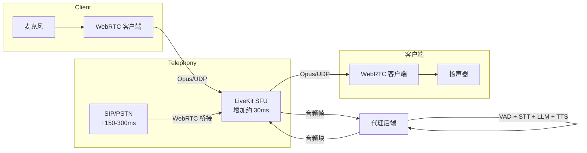
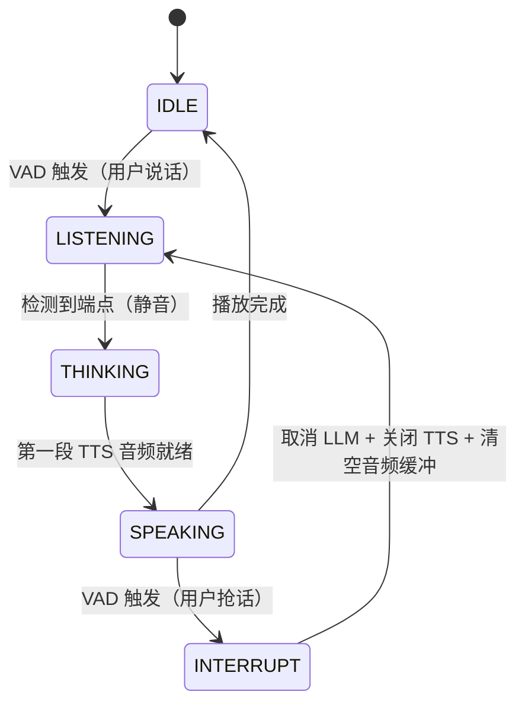
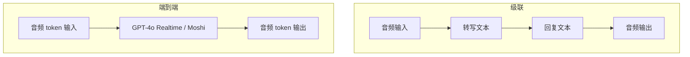

# 实时 AI 与语音代理

> **TL;DR**: 对话式语音代理必须在用户说完话之后的 500 到 700 ms 内作出回应，否则对话就会显得断掉[^1]。做法是让三个模型首尾相接、全程流式（ASR、LLM、TTS），这样流水线的总耗时约等于 `max(各阶段延迟)`，而不是它们的和。WebRTC 用 UDP 承载音频，自带回声消除，也能从容应对丢包。打断（barge-in，用户在代理说话中途插话）是演示级代理与生产级代理之间最大的体验分水岭。像 GPT-4o Realtime 这样的端到端语音模型能把级联结构压缩到 320 ms[^2]，代价是拿可调试性和供应商灵活性换延迟。

## 学习目标

学完本章，你将能够：

- [ ] 把低于 700 ms 的轮次交替预算拆到 ASR、LLM、TTS 和网络上
- [ ] 设计一个能处理中间假设和端点检测的流式 ASR 层
- [ ] 说清为什么语音场景下 WebRTC 胜过 WebSocket，以及什么时候该用 LiveKit 这类 SFU
- [ ] 用 VAD 加上对 LLM 与 TTS 流的在途取消来实现打断
- [ ] 对轮次内的工具调用，在快速路径与慢速路径之间做选择
- [ ] 比较 ASR-LLM-TTS 级联流水线与端到端语音模型的差异

## 直觉理解

你在跟朋友打电话。他问了一个问题，你大约四分之一秒之内就开始回答。如果你每次回话前都要停满两秒，朋友一定会问“你还在吗？”那四分之一秒的间隔不是礼貌，而是一种根深蒂固的预期：在十种语言里，自然对话中说话人之间的平均间隔约为 200 ms[^3]。

现在设想你是个机器人，必须听完问题、把它转成文字、想清楚答案、把答案写出来，再念出声。如果每一步都等上一步彻底做完，延迟会叠到 1.5 到 2 秒。朋友已经挂电话了。

解法跟同声传译用的是同一招：在说话人讲完之前就开始翻译。译员听到一个从句，就开始译这个从句，同时继续往下听。用工程语言说，就是在每个边界上都做流式。用户还在说话时，语音识别器就已经吐出半个词；语言模型拿这些半成品开始生成答案；TTS 引擎在模型还在写第二句时就已经念出第一句。用户感知到的总延迟，从所有阶段之和塌缩成大约最慢的那一个阶段。

本章教你怎么搭出这条流式流水线，怎么把它跑在能容忍丢包的网络上，以及怎么处理最难的体验问题：用户抢话时会发生什么。

## 原理

### 低于 700 ms 的延迟预算

自然轮次交替平均约 200 ms。用户能忍到大约 700 ms，再慢代理就显得迟钝，超过 2 秒则明显是坏了[^1]。预算可以拆到流水线各段：

```mermaid
gantt
    title 轮次交替延迟预算（ms，最坏情况串行）
    dateFormat X
    axisFormat %L
    section 流水线
    网络上行             :a1, 0, 100
    VAD 端点检测         :a2, after a1, 150
    STT 收尾             :a3, after a2, 100
    LLM TTFT             :a4, after a3, 250
    TTS TTFB             :a5, after a4, 150
    抖动 + 播放          :a6, after a5, 50
```



*用户说完话到代理开口，最坏情况相加约 800 ms。流式让各阶段重叠，实际总耗时能压到 700 ms 以内。*

生产环境里的一份典型分配是：网络 100 ms、ASR 端点检测 150 ms、LLM 首 token 延迟（TTFT）250 ms、TTS 首字节延迟（TTFB）150 ms、抖动缓冲 50 ms[^1]。PSTN（电话网）单程还要再搭 150 到 300 ms，所以电话代理的 p50 常落在 850 ms 而不是 500 ms。

关键判断：要测 p95 和 p99，不是 p50。p50 是 600 ms 而 p99 是 3 秒，意味着每一百轮里就有一次体验是坏的。用户记住的正是那些坏轮次。

### 流式 ASR（语音转文字）

流式 ASR 每 100 ms 吐一次中间假设，在端点处（用户停止说话）给出最终转写。服务端先发带 `is_final: false` 标记的部分结果，然后在静音或语义边界上发最终结果。

Deepgram **Flux** 现在是他们专为语音代理打造的对话式 ASR 模型（内置轮次检测）；批量转写和多说话人会议转写仍然推荐 Deepgram Nova-3。在 Deepgram 内部的对话音频基准上，Nova-3 的转写延迟低于 300 ms，中位词错误率比竞品低约 54%[^4]。可选方案还有 AssemblyAI Universal-3、Google Streaming 和 Azure Speech。OpenAI Whisper 只能批量跑；生产环境的流式要靠 `faster-whisper`（CTranslate2，INT8）做分块解码，厂商基准称在 RTX 4090 上每 3 秒音频块耗时不到 15 ms[^5]。

ASR 边界上有两个设计选择：

1. **等 `is_final`** 再送给 LLM。实现简单，但要吃下完整的端点检测延迟（视静音阈值而定，100 到 500 ms）。
2. **对中间结果做投机**，等最终结果到达后再对齐。能砍掉一部分感知延迟，风险是 LLM 基于错误的片段做推理。

多数生产系统选择等 `is_final`，因为端点检测延迟（典型 150 ms）相对于紧随其后的 LLM TTFT 并不大。

### LLM 流式推理

[LLM 服务架构](./00-llm-serving-architecture.md) 介绍过 TTFT 和前缀缓存。在语音流水线里，TTFT 是延迟的主要贡献者。全尺寸模型（GPT-4o、Claude）的 TTFT 落在 300 到 800 ms。据说 Groq 的 LPU 跑小模型能把 TTFT 压到 150 ms 以内。蒸馏过的 7B 模型配专用硬件可以做到 50 到 100 ms[^1]。

LLM 通过 SSE 或 WebSocket 流式吐 token。语音流水线不等整段回复结束，而是把 token 攒到句子边界（句号、问号、分号），就把这一句立刻刷给 TTS。这种按句子切分是必须的。整段缓冲完再送 TTS，会平白多出 500 到 1,500 ms 的延迟。

前缀缓存在多轮语音通话里极其重要。第 N 轮的系统提示加对话历史，就是第 N+1 轮的前缀。开着缓存时，只有新的用户消息会触发新的 prefill 计算。

### 流式 TTS（文字转语音）

现代 TTS 引擎通过 WebSocket 接收文本，在后半段仍在生成时就按短语边界吐出音频块（PCM 或 Opus）。关键指标是 TTFB：文本发出后第一个音频块多快到达。

- **Cartesia Sonic 3.5**：流式 TTS，延迟业界领先（Sonic-2 曾报出 90 ms 模型延迟，但将于 2026 年 6 月弃用；Sonic 3.5 是当前推荐模型）[^6]
- **ElevenLabs Flash v2.5**：模型 TTFB 50 ms，多区域路由（美国、荷兰、新加坡）在 EMEA/APAC 把感知 TTFB 再降低 100 到 200 ms[^7]
- **Deepgram Aura**、**OpenAI TTS**、**Azure Neural TTS**：都提供 100 到 300 ms 区间的流式端点

延迟与音质之间的旋钮是分块大小。块越小播放开始得越早，但韵律可能不够自然；块越大听起来越顺，首字节越晚。生产系统一般在句子边界冲刷，两边都能兼顾。

声音克隆（ElevenLabs Instant Clone、PlayHT）可以做出品牌一致的声音。医疗和金融的部署会用真人坐席的克隆音色来保持连续性。

### WebRTC 传输与 SFU 架构

[实时通信](../part-2-building-blocks/10-real-time-communication.md) 讲过 WebSocket、SSE 和 WebRTC 的基础。对语音 AI 来说，传输选型是决定性的。

**WebSocket** 跑在 TCP 上。2% 丢包（移动网络上的常态）就足以让一个丢失的包阻塞后续所有包，直到重传完成。音频卡住。一个落后的 WebSocket 客户端只会越落越远[^8]。

**WebRTC** 用 UDP 传音频，配 SRTP 加密、DTLS 密钥交换和 ICE 完成 NAT 穿透。Opus 编解码器在语音场景下用 20 ms 帧长。丢包时 WebRTC 丢掉晚到的包、做前向纠错，继续播放。抖动缓冲抹平到达时间的方差。浏览器原生提供回声消除、噪声抑制和自动增益控制。

SFU（Selective Forwarding Unit，选择性转发单元）位于客户端和代理后端之间。它只转发音频流、不做混音，给链路增加约 30 ms。生产可用的 SFU 有 LiveKit、mediasoup、Janus 和 Agora。LiveKit 是开源的，并提供用于语音 AI 编排的 Agents SDK。



*SFU 在客户端与代理后端之间用 WebRTC 转发音频。PSTN 来电经 SIP 桥接进来，单程多出 150 到 300 ms 延迟。*

### 打断与轮次交替

打断（barge-in）指用户能在代理说到一半时插话。没有它，代理会一直压着用户说，对话就像机器。实践中，业界普遍认为打断是演示级代理与生产级代理之间最大的体验分水岭[^1]。

机制上需要一个语音活动检测器（VAD）持续运行，代理说话时也不能停。Silero VAD 是一个 2 MB 的 JIT 模型，在单个 CPU 线程上处理 30 ms 音频块耗时不到 1 ms[^9]。它事实上是每个开源语音代理框架的默认选择。



*代理在 IDLE、LISTENING、THINKING、SPEAKING 之间循环。从 SPEAKING 出发的一条 INTERRUPT 边会取消在途生成并回到 LISTENING。*

打断触发时，编排器必须：

1. 取消在途的 LLM 请求（关闭 SSE/WebSocket 连接）
2. 关闭 TTS 的 WebSocket，停止音频生成
3. 清空播放缓冲里排队的音频帧
4. 在对话历史里截断被取消的那一轮，让模型知道自己实际说了什么、哪里被打断

全双工的端到端模型（Moshi、GPT-4o Realtime）原生处理这件事。Moshi 把两个说话人都建模成并行的音频流，“永远在听，也随时可以开口”[^10]。没有显式的轮次边界。

### 级联与端到端

级联流水线（VAD、STT、LLM、TTS）模块化、可调试、供应商可替换。每个阶段边界都能留下文本，这对合规、日志和 RAG 都很重要。但它叠了三份延迟预算，并且在 STT 一步丢掉副语言信息（语气、笑声、重音）。

端到端语音到语音模型把级联塌缩成单个模型：

- **OpenAI Realtime（`gpt-realtime`，2025 年 8 月 28 日 GA）**：可配置推理强度的生产级语音到语音模型。最初以 GPT-4o Realtime API 的形态在 2024 年 10 月 1 日发布，只支持 WebSocket；2024 年 12 月加入 WebRTC 支持[^11]。音频延迟在 200-300 ms 区间，与它的前身 GPT-4o Realtime 一致[^2]。
- **Moshi**（Kyutai，2024 年 9 月）：理论 160 ms，实测 200 ms。全双工、开源、7B 参数[^10]。
- **Gemini Live API**：Google 的流式多模态 API。

端到端模型保住了韵律和情绪，但把你锁在单一供应商上，调试更难（没有中间文本），结构化工具调用也更弱。



*级联产出三个可供文本审计的边界（转写、回复、合成输入），这对 HIPAA、金融和日志都很关键；端到端模型跳过这些边界，整个模型都用音频 token 贯穿，韵律得以保留，却没有任何东西可供检查。*

**2026 年的建议**：生产环境要可靠性、合规和供应商灵活性，就用级联。要高端消费级体验、且低于 300 ms 的延迟值回那些代价，就用端到端。

## 真实案例

### 电信客服代理（LiveKit + Deepgram + Cartesia）

一家一级电信运营商为账单查询、套餐变更和故障查询部署语音代理。架构用 LiveKit Agents 框架配级联流水线：

**入站路径**：Twilio SIP 接 PSTN 来电（单程约 250 ms），经 WebRTC 桥接到 LiveKit SFU（再加约 30 ms）。音频抵达代理之前，网络开销共 280 ms。

**流水线**：Silero VAD 检测说话。Deepgram Flux 流式给出带轮次感知的中间与最终转写（到最终结果低于 300 ms）。GPT-5.4 mini 负责路由；GPT-5.4 处理复杂查询，系统提示是 2,000 token 并做了前缀缓存。Cartesia Sonic 3.5 TTS 用克隆的品牌音色合成回复[^6]。

**工具**：账单查询（p50 200 ms）走快速路径：代理一边说“我帮你调出账户”，一边并行发 API 请求。知识库 RAG（p50 400 ms）用同一套模式。

**结果**：含 PSTN 延迟的轮次交替 p50 约 850 ms，p95 约 1,400 ms。业界估算，一个高质量的级联代理每分钟成本大约 $0.15 到 $0.30，取决于 LLM 选型和通话复杂度[^12]。

```python
# LiveKit Agents 会话（简化自 livekit/agents）
from livekit.agents import AgentSession, Agent, function_tool

session = AgentSession(
    vad=silero.VAD.load(),
    stt=inference.STT("deepgram/nova-3", language="multi"),
    llm=inference.LLM("openai/gpt-5.4-mini"),
    tts=inference.TTS("cartesia/sonic-3.5", voice="brand-voice-id"),
)

@function_tool()
async def check_billing(context, account_id: str):
    """Look up current balance and recent charges."""
    context.disallow_interruptions()  # 写数据库期间禁止打断
    return await billing_api.lookup(account_id)
```

`disallow_interruptions()` 调用阻止打断取消不可逆操作（写数据库、支付处理）。没有它，用户在写入过程中插话，可能让系统停在状态不一致的位置。

## 设计决策

**流水线架构。**

| 方案 | 优点 | 缺点 | 适用场景 | 我们的选择 |
|---|---|---|---|---|
| 级联流水线（ASR + LLM + TTS） | 每个环节都能用最优组件、供应商可替换、完整的文本审计链 | 三段延迟预算叠加；情绪语气在 STT 一步丢失 | 大多数生产代理、受监管行业 | **生产环境默认** |
| 端到端语音模型（GPT-4o Realtime、Moshi） | 生产环境 200 到 600 ms 延迟，保留韵律与情绪 | 供应商锁定、调试更难、工具调用更弱 | 高端消费级体验、延迟极度敏感 | 当低于 400 ms 不可妥协时 |

**工具调用模式。**

| 方案 | 优点 | 缺点 | 适用场景 | 我们的选择 |
|---|---|---|---|---|
| 快速路径工具（先确认再取数） | 保持轮次交替预算不被打乱 | 工具失败时确认内容可能是错的 | 工具延迟 500 ms 到 2 s | **大多数工具的默认做法** |
| 慢速路径工具（阻塞等待） | 简单，永远正确 | 约 1 s 之后出现一段死寂 | 500 ms 以内的短调用 | 只用于简单查询 |

**传输。** 用 WebRTC，不要用 WebSocket。移动网络典型的 2% 丢包下，WebSocket 音频流会为 TCP 重传卡住，而 WebRTC 丢掉晚到的包继续播。走 LiveKit 或 Agora 还能顺带拿到回声消除、噪声抑制、优雅降级和 PSTN 桥接，代价是要维护 TURN/STUN 基础设施和证书。为 WebSocket 的简洁付出的这笔税，换不回用户可见的卡顿；详细故障模式见下面的常见陷阱，以及 LiveKit 的轮次检测指南[^8]。

## 常见陷阱

> [!WARNING]
> **没有流式的同步级联。** 每个阶段都等上一阶段彻底做完，总延迟相加就是 1.5 到 2 秒。要在每个边界上流式：STT 吐中间结果，LLM 流式吐 token，TTS 按句合成，后面的块还没渲染就先开始播放。这是新语音代理项目里最常见的失败模式[^1]。

> [!WARNING]
> **不支持打断。** 代理一直压着用户说。用户挂电话。在 SPEAKING 状态下持续跑 VAD。一旦检测到：取消 LLM、关闭 TTS WebSocket、清空播放缓冲、在历史里截断被取消的那一轮。

> [!WARNING]
> **整句缓冲完 LLM 输出再送 TTS。** TTS 要等 LLM 写完整段回复才启动，多出 500 到 1,500 ms。用按句切分：LLM 继续生成的同时，每到一个句子边界就刷给 TTS。

> [!WARNING]
> **用 WebSocket 导致 TCP 队头阻塞。** 2% 丢包（移动网络常态）下，WebSocket 音频会为重传卡住，而 WebRTC 丢掉晚到的包继续播。媒体走 WebRTC，WebSocket 留给信令和控制[^8]。

> [!WARNING]
> **对话上下文不设上限。** 系统提示加历史越滚越长，撑破上下文窗口；TTFT 随 token 数线性退化；每一轮成本飙升。用滚动摘要加滑动窗口：最近 N 轮原文保留，更早的轮次用便宜模型摘要，并利用前缀缓存。

## 练习

为一条医疗分诊热线设计语音代理，要求 (a) 轮次交替延迟 p95 低于 1,200 ms，(b) 遇到紧急症状时 3 秒内转接真人护士，(c) 挂机后 10 秒内产出一份书面通话摘要。请给出 ASR、传输、LLM、TTS、VAD 策略、打断状态机，以及两个会触发 on-call 告警的指标。并说明你选级联还是端到端，为什么。

<details>
<summary>提示</summary>

医疗要求文本审计链（HIPAA），这直接排除了端到端语音模型。1,200 ms 的 p95 预算足以在 PSTN 上跑级联。再想一层：“紧急症状检测”在架构上意味着什么——一个跑在每次 STT 最终结果上的分类器，配一条绕过正常轮次交替流程的硬中断。

</details>

<details>
<summary>解答</summary>

**架构**：级联流水线（不是端到端），因为 HIPAA 要求每个阶段边界都有完整文本转写以供审计。

**组件**：

- **传输**：WebRTC 走 LiveKit SFU，PSTN 来电用 Twilio SIP 桥接。给 PSTN + SFU 预留 280 ms。
- **VAD**：Silero，30 ms 帧，500 ms 静音判定端点。
- **ASR**：Deepgram Flux，加医疗词表增强。到最终结果低于 300 ms，内置轮次检测。
- **LLM**：GPT-5.4，系统提示 3,000 token 写入分诊协议。前缀缓存。TTFT 预算：400 ms。
- **TTS**：Cartesia Sonic 3.5，使用沉稳专业的克隆音色。
- **紧急度分类器**：一个小型微调模型跑在每次 STT 最终结果上。一旦识别到紧急关键词（胸痛、呼吸困难、无反应），就发出硬中断，覆盖正常的轮次交替流程并启动护士转接。

**打断状态机**：标准的 IDLE、LISTENING、THINKING、SPEAKING、INTERRUPT。再加一个由紧急度分类器触发的 HANDOFF 状态：播放“我现在为您转接护士”（预渲染音频，零 TTS 延迟），并发起指向护士队列的 SIP REFER。

**延迟预算**（p95）：网络 100 ms + VAD 150 ms + STT 150 ms + LLM TTFT 400 ms + TTS TTFB 150 ms + 抖动 50 ms = 1,000 ms。低于 1,200 ms 目标，还有 200 ms 余量。

**通话摘要**：挂机时，完整转写（在 STT 阶段已经留存）异步送到摘要模型（GPT-5.4 mini）。10 秒目标很容易达成，因为转写本来就是文本。

**告警指标**：

1. `turn_taking_p95 > 1,000ms`（在 1,200 ms 的 SLO 被突破之前先响）
2. `nurse_handoff_p95 > 2,500ms`（在 3 秒目标之前先响）

</details>

## 要点回顾

- 700 ms 的轮次交替预算是语音 AI 里所有架构选择的约束源。从它倒推你的设计。
- 每个阶段（ASR、LLM、TTS）都必须流式。流水线里任何一处走批量，预算就爆。
- 语音场景下 WebRTC 胜过 WebSocket，因为 UDP 能优雅地容忍丢包，而 TCP 会队头阻塞。
- 带在途取消的打断，是演示级代理与生产级代理的分界线。VAD 要一直跑，代理说话时也跑。
- 端到端语音模型（GPT-4o Realtime 320 ms、Moshi 200 ms）大幅压低延迟，但拿可调试性和供应商灵活性做了交换。
- LLM 到 TTS 之间按句切分是必须的。整段缓冲会多出 500 到 1,500 ms 本可避免的延迟。
- 要测 p95 和 p99，不是 p50。用户记住的是坏轮次，不是平均轮次。

## 延伸阅读

- [Sequential Pipeline Architecture for Voice Agents (LiveKit blog)](https://livekit.com/blog/sequential-pipeline-architecture-voice-agents) - 讲级联模式、阶段边界流式和打断实现最清楚的一份材料。
- [Why WebRTC beats WebSockets for realtime voice AI (LiveKit blog)](https://livekit.com/blog/why-webrtc-beats-websockets-for-voice-ai-agents) - 具体解释了 TCP 队头阻塞，以及为什么语音需要 UDP 传输。
- [Moshi: a speech-text foundation model for real-time dialogue (arXiv:2410.00037)](https://arxiv.org/abs/2410.00037) - 全双工语音模型论文；重点读 Mimi 编解码器、Inner Monologue 技术和多流架构。
- [OpenAI Realtime API documentation](https://platform.openai.com/docs/guides/realtime) - 语音到语音 API 的权威参考：WebRTC 会话建立、打断处理、函数调用。
- [LiveKit Agents framework](https://docs.livekit.io/agents/) - 基于 WebRTC 的开源语音代理编排框架；级联流水线里文档最齐全的生产框架。
- [Deepgram streaming ASR documentation](https://developers.deepgram.com/docs/getting-started-with-live-streaming-audio) - 中间结果、端点检测配置、词级时间戳，以及延迟测量方法论。
- [ElevenLabs streaming latency optimization](https://elevenlabs.io/docs/eleven-api/guides/how-to/best-practices/latency-optimization) - 具体的 WebSocket TTS 延迟调优，附各区域基准数据。
- [Pipecat framework (GitHub)](https://github.com/pipecat-ai/pipecat) - 与供应商无关的 Python 编排器，40 多个服务集成，用来搭语音流水线。

## 记忆卡片

**Q:** 对话式语音代理要多快响应，人才能觉得自然？
**A:** 从用户说完话到代理开口低于 700 ms。低于 500 ms 感觉像在跟真人说话。超过 2 秒就是坏了。

**Q:** 为什么级联语音流水线每个阶段都流式，而不是走批量？
**A:** 批量模式下所有阶段延迟相加（总共 1.5 到 2 秒）。流式让阶段重叠，总耗时约等于最慢的那个阶段，能落在 700 ms 以内。

**Q:** 级联语音代理的典型延迟预算怎么分？
**A:** 网络 100 ms + ASR 端点检测 150 ms + LLM TTFT 250 ms + TTS TTFB 150 ms + 抖动缓冲 50 ms = 总共约 700 ms。

**Q:** 语音 AI 的传输为什么 WebRTC 胜过 WebSocket？
**A:** WebRTC 用 UDP，丢包时丢掉晚到的包并做 FEC，从容应对。WebSocket 用 TCP，一个丢包就会阻塞后续所有包（队头阻塞），在真实网络条件下直接造成音频卡顿。

**Q:** 打断是什么，为什么重要？
**A:** 打断是用户在代理说到一半时插话。它要求取消在途的 LLM 生成、关闭 TTS 流、清空音频缓冲。没有它，代理会压着用户说，体验就像机器。

**Q:** Silero VAD 做什么，为什么是默认选择？
**A:** Silero VAD 是一个 2 MB 的模型，在单个 CPU 线程上处理 30 ms 音频块的检测耗时不到 1 ms。MIT 许可、无需注册，是每个开源语音代理框架事实上的标准。

**Q:** LLM 到 TTS 交接处的按句切分是什么？
**A:** 不缓冲整段 LLM 回复，而是 LLM 继续生成的同时，每完成一句就立刻刷给 TTS。这样 TTS 能念出第一句时第二句还在写。

**Q:** GPT-4o Realtime 与级联流水线有什么不同？
**A:** GPT-4o Realtime 是端到端语音到语音模型，直接处理音频 token，跳过独立的 STT 和 TTS 阶段。平均延迟 320 ms，保留韵律，但把你锁在单一供应商上，也不产出中间文本转写。

**Q:** 语音轮次内工具调用的快速路径模式是什么？
**A:** 代理立刻说一句确认（“我查一下”），同时并行执行工具调用。这样即使工具要 500 ms 到 2 秒，轮次交替预算也不被打乱。

**Q:** 语音代理进入 INTERRUPT 状态时会发生什么？
**A:** 当 VAD 在 SPEAKING 状态检测到用户说话：(1) 取消在途 LLM 请求，(2) 关闭 TTS WebSocket，(3) 清空播放缓冲里排队的音频，(4) 在对话历史里截断被取消的那一轮，让模型知道实际说了什么、哪里被打断。

**Q:** 生产级级联语音代理每分钟的成本区间是多少？
**A:** 业界估算，一个高质量级联代理（STT + LLM + TTS + 基础设施）每分钟约 $0.15 到 $0.30。GPT-4o Realtime 在 2024 年 10 月发布时约 $0.30/分钟（输入 $0.06 + 输出 $0.24）。

**Q:** 受监管行业为什么选级联而不是端到端？
**A:** 级联在每个阶段边界都产出文本（ASR 输出、LLM 回复、TTS 输入），这是 HIPAA、金融合规和审计链所必需的。端到端模型直接处理音频 token，没有任何中间文本。

## 参考文献

[^1]: Jesse Hall, "Sequential Pipeline Architecture for Voice Agents," LiveKit blog, March 2026. https://livekit.com/blog/sequential-pipeline-architecture-voice-agents
[^2]: OpenAI, "Hello GPT-4o," May 2024. https://openai.com/index/hello-gpt-4o/

[^3]: Stivers et al., "Universals and cultural variation in turn-taking in conversation," PNAS 2009, 106(26):10587-10592. https://doi.org/10.1073/pnas.0903616106
[^4]: Deepgram, "Speech-to-Text API Benchmarks: Accuracy, Speed, and Cost Compared," 2025. https://deepgram.com/learn/speech-to-text-benchmarks
[^5]: Spheron, "Deploy Whisper v4 and Production ASR on GPU Cloud," 2026. https://www.spheron.network/blog/whisper-v4-asr-gpu-cloud-production-guide/
[^6]: Cartesia Docs, "Sonic 3.5 TTS model (current recommended model)." https://docs.cartesia.ai/build-with-cartesia/tts-models/sonic-3-5
[^7]: Joe Reeve, "Text to Speech API - Up To 40% Faster Globally," ElevenLabs blog, February 2026. https://elevenlabs.io/blog/text-to-speech-api-up-to-40-faster-globally
[^8]: LiveKit, "Why WebRTC beats WebSockets for realtime voice AI," 2026. https://livekit.com/blog/why-webrtc-beats-websockets-for-voice-ai-agents
[^9]: Silero Team, "Silero VAD: pre-trained enterprise-grade Voice Activity Detector," GitHub. https://github.com/snakers4/silero-vad
[^10]: Defossez et al., "Moshi: a speech-text foundation model for real-time dialogue," Kyutai, arXiv:2410.00037, September 2024. https://arxiv.org/abs/2410.00037
[^11]: OpenAI, "Introducing the Realtime API," October 2024. https://openai.com/index/introducing-the-realtime-api/ (archived: https://web.archive.org/web/20241228095910/https://openai.com/index/introducing-the-realtime-api/)
[^12]: Ciela AI, "How Much Does Vapi Actually Cost Per Minute? Real Numbers Breakdown (2026)." https://www.ciela.ai/blogs/how-much-does-vapi-cost-per-minute
