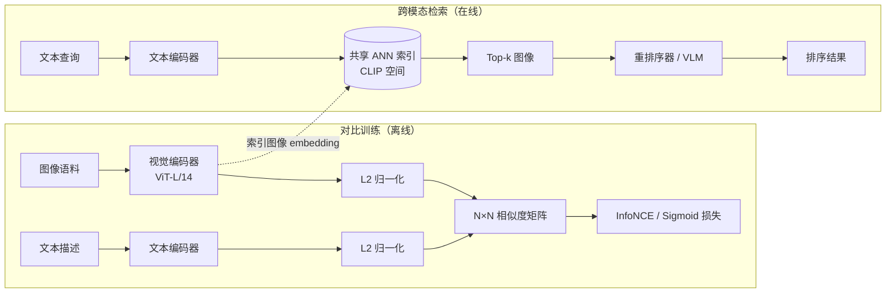
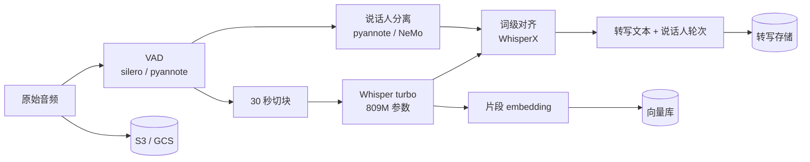
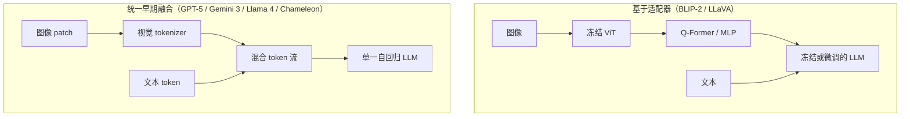
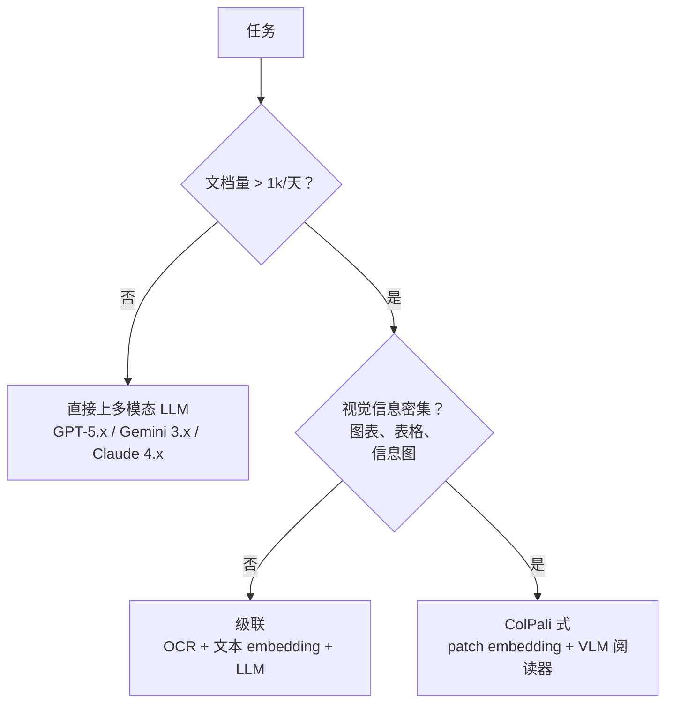

# 多模态 AI 系统（CLIP、Whisper、LayoutLM、文档 AI）

> **TL;DR**: 生产级 AI 早就不是纯文本了。用户上传照片、语音备忘和 PDF，期待系统能在所有这些内容上推理。整个栈分四层：摄入（解析、OCR、转写）、embedding（图像用 CLIP/SigLIP，音频用 Whisper，文档用 ColPali）、存储（原始文件放对象存储，embedding 放向量库，两者用对象 ID 关联）、服务（ANN 检索，外加可选的多模态 LLM）。Google Lens 在 2025 年跨过 1000 亿次视觉搜索（每月约 80 亿次），同比增长 65%[^1]。在生产规模下，级联流水线（先 OCR 再 embedding 再 LLM）在成本和可调试性上胜过端到端多模态 LLM；前沿视觉模型（GPT-5.x、Gemini 3、Claude 4.x、Llama 4）留给量小、质量关键的场景——图像 token 成本随模型家族而异，务必针对你实际部署的那个模型重新算一遍账[^2]。

## 学习目标

学完本模块，你将能够：

- [ ] 解释跨模态 embedding（CLIP、SigLIP）在什么情况下胜过按模态分开建索引
- [ ] 设计一条用 Whisper 加说话人分离的音频摄入流水线
- [ ] 搭建把 OCR、版式建模和表格抽取组合起来的文档 AI 流水线
- [ ] 选择一种把原始对象存储（S3）与向量索引配起来的存储架构
- [ ] 为混合模态检索挑一套评估策略（Recall@K、MRR）
- [ ] 在端到端多模态模型与级联、按模态分离的流水线之间做权衡

## 直觉理解

你经营一家博物馆，馆里有三种讲解员：一种读展牌（文本），一种讲解画作（图像），一种负责语音导览（音频）。一位观众问：“那幅戴珍珠耳环的女人的画在哪里？”文本讲解员按标题查目录，图像讲解员靠眼睛认画，音频讲解员记得自己在导览第 14 站提过它。

每位讲解员都只能单干，但观众只想要一个答案。于是你请了一位协调员：他把问题翻译成每位讲解员各自的语言，收集他们的回答，合并成一个答复：“三层，二楼，左墙。”

多模态 AI 系统就是这位协调员。它把每种模态（文本、图像、音频、文档）投影到同一个表示空间，使一种模态的查询能从其他任何模态里召回答案。文本编码器和图像编码器产出的向量落在同一个空间里，余弦相似度负责搭桥。难的地方不在任何单一模态，而在它们之间的对齐、把原始对象与各自 embedding 关联起来的存储架构，以及那套决定你到底跑一个大模型还是跑一串专家的成本账。

[RAG 流水线](./01-rag-pipelines.md) 讲了基于文本的检索增强生成。本章把这套模式延伸到图像、音频、视频和文档。你学过的分块、embedding、混合检索和重排序依然适用。新的挑战在于，“块”现在是图像 patch、音频片段和 PDF 页面，而产出它们的 embedding 模型来自完全不同的训练范式。

## 原理

### 用 CLIP 和 SigLIP 做跨模态检索

CLIP（Contrastive Language-Image Pre-training，对比语言-图像预训练）是现代跨模态搜索的地基。OpenAI 用双编码器架构在从网上爬来的 4 亿对图文数据上训练它：视觉 transformer 编码图像，文本 transformer 编码描述，对比损失（InfoNCE）把成对的 embedding 拉近、把不成对的推开[^3]。产出的是一个共享向量空间：一句“一张金毛寻回犬的照片”和一张真的金毛照片会落在彼此附近。

```python
# CLIP 前向传播（简化自 openai/CLIP）
def forward(self, image, text):
    image_features = self.encode_image(image)       # ViT 编码器
    text_features = self.encode_text(text)          # 文本 transformer
    image_features = image_features / image_features.norm(dim=1, keepdim=True)
    text_features = text_features / text_features.norm(dim=1, keepdim=True)
    logit_scale = self.logit_scale.exp()
    logits_per_image = logit_scale * image_features @ text_features.t()
    return logits_per_image, logits_per_image.t()
```

CLIP 的零样本图像分类在完全不用 ImageNet 那 128 万条训练标签的情况下，追平了原始 ResNet-50 在 ImageNet 上的表现[^3]。这就是规模的力量：4 亿对带噪声的网络图文，打败了 128 万条精挑细选的标签。

SigLIP（Google，2023）把 softmax 对比损失换成了逐对的 sigmoid，不必再把 N×N 的全局相似度矩阵整个算出来[^4]。这让训练能在更小的 batch 上扩起来，同时每份算力换来更高精度。SigLIP 是 PaliGemma 的默认视觉主干，也是 ColPali 的基础。



*CLIP 在图文对上用对比损失训练两个编码器。查询时，一条文本查询通过 ANN 搜索从共享 embedding 空间里召回图像。*

视频的务实做法是按 1 FPS 抽帧做 embedding 再池化。帧率一高，token 预算就爆炸：在 Gemini 的视频 API 里，从 1 FPS 换成 24 FPS，成本变成 21.5 倍[^2]。用感知哈希或场景检测去掉几乎重复的帧。

### 音频流水线：Whisper 与说话人分离

Whisper（OpenAI，2022）是一个编码器-解码器 transformer，最初在 68 万小时弱标注的多语言音频上训练（large-v3 后来用 100 万小时弱标注加 400 万小时伪标注数据训练）[^5]。让它稳健的那个设计选择，是用网上的弱监督数据，而不是干净标注的语音数据集。音频先重采样到 16 kHz，切成 30 秒窗口，转成 80 通道的对数梅尔频谱（large-v3 及以后是 128 通道），再用特殊 token 自回归解码——这些 token 标注语言、任务（转写还是翻译）和时间戳。

Whisper 有六种尺寸：tiny（39M，约 10 倍实时）、base（74M）、small（244M）、medium（769M）、large-v3（1,550M，用 100 万小时弱标注加 400 万小时伪标注数据训练，按 HuggingFace Open ASR Leaderboard 在 LibriSpeech clean 上约 2.0% WER）、turbo（809M，解码器层数从 32 层砍到 4 层，约 8 倍实时）[^6][^7][^8]。turbo 是生产上的最优解：接近 large 的质量，接近 small 的速度。

一条生产级音频流水线会在 Whisper 外面再包三个阶段：

1. **VAD（语音活动检测，Voice Activity Detection）：** Silero 或 pyannote 去掉静音，在真实通话录音上能砍掉 30-40% 的音频时长[^2]。
2. **说话人分离（diarization）：** pyannote 或 NVIDIA NeMo 把每一段语音归属到说话人（在 2025 年的基准上，pyannoteAI 的 DER 为 11.2%[^9]）。
3. **对齐：** WhisperX 产出词级时间戳，供下游搜索使用。



*音频依次经过 VAD、Whisper 转写、说话人分离和对齐。转写文本与 embedding 分开存储，用录音 ID 关联。*

成本账：走 Whisper API 的批量 STT 是每分钟 $0.006，而 OpenAI 的 `gpt-4o-transcribe` / `gpt-4o-mini-transcribe`（2025 年 3 月发布）是官方推荐的高质量托管后继者。实时音频 API（OpenAI Realtime、Gemini Live）要每分钟 $0.30 到 $2 以上[^2]。不需要亚秒级延迟的场景，一律用批量。

### 文档 AI：LayoutLM、Donut 与 ColPali

文档 AI 从 PDF、扫描件和图文混排的图像里抽取结构化信息。三种架构各占一方，各自适配不同的任务：

**LayoutLMv3（Microsoft，2022）：** 先跑 OCR（Tesseract、PaddleOCR 或云服务），再把词框加上图像 patch 喂给一个多模态 transformer，训练时用统一的文本掩码和图像掩码，外加词-patch 对齐目标[^10]。最适合表单上的细粒度 token 标注：“哪个字段是发票总额？”

**Donut（Kim 等，2022）：** 免 OCR 的路线。Swin Transformer 编码器加 BART 式自回归解码器，把文档图像直接映射成结构化 JSON，完全跳过 OCR。在不用任何 OCR 引擎的情况下，Donut 在 CORD 上拿到 91.3% 的树编辑距离准确率，在 DocVQA 上 67.5%[^11]。最适合从半结构化文档里端到端抽 JSON。

**ColPali（Faysse 等，2024）：** 把页面图像过一遍 PaliGemma（SigLIP patch 编码器加 Gemma-2B），把约 1,024 个 patch 各自投影到 D=128，再用 ColBERT 式 MaxSim 在 patch 多向量上检索[^12]。ColPali 在 ViDoRe 基准上拿到 81.3 NDCG@5，而 Unstructured+BGE-M3 是 58.8，绝对提升 +22.5[^12]。最适合在视觉信息密集的文档（图表、表格、信息图）上做检索。

一句话的判据：表单上的 token 标注用 LayoutLM，端到端 JSON 抽取用 Donut，检索用 ColPali。

围绕这些内核，Unstructured.io 负责编排 PDF 解析，输出统一的元素 schema（Title、NarrativeText、Table、ListItem），附带页码和边界框元数据[^13]。LlamaParse、Reducto、Docling（IBM，2024）和 Marker 是当前的替代方案。云服务（AWS Textract、Google Document AI、Azure Document Intelligence）把类似的流水线包成按页计费的 API。

### 多模态 LLM：从适配器到统一模型

今天的多模态 LLM 靠三种架构模式撑起来：

**基于适配器（BLIP-2、LLaVA）：** 冻结的视觉编码器输出 patch embedding。一个可学习的适配器（BLIP-2 的 Q-Former 用 32 个可学习 query token 对 patch 做交叉注意力；LLaVA 用一层线性投影）把它们映射进 LLM 的 embedding 空间[^14]。LLM 可选地用指令数据微调。因为视觉编码器保持冻结，训练很便宜。

**Perceiver 重采样器（Flamingo）：** Perceiver 重采样器把变长的视觉特征压成固定数量的视觉 token，冻结 LLM 内部交错插入的门控交叉注意力层让它能关注到这些 token[^15]。这是第一个在规模上展现少样本多模态推理的架构。

**统一早期融合（Chameleon、Fuyu、GPT-4o、GPT-5、Gemini 3、Llama 4）：** 图像（有些模型还包括音频和视频）被 token 化成离散的视觉 token，和文本 token 混在同一条自回归序列里[^16]。跨模态推理最强，但训练和服务的成本也最高。



*基于适配器的模型用很低的成本把视觉能力挂到冻结的 LLM 上。统一模型则把所有模态 token 化进一条序列，推理更强，成本更高。*

Gemini 3.1 Pro（2026 年 2 月 19 日发布）支持最多 100 万输入 token，能在单条 prompt 里对几个小时的视频和音频做推理[^17]。举个说明性的例子：GPT-4o 的高细节模式每张图要 85 + (瓦片数 × 170) 个 token（一张 1024×1024 的图 = 765 个 token）。每天 1 万次图像查询，光图像输入就是每月约 $19,125。成本账很重要。OpenAI 较新的 GPT-5.x 用的是基于 patch 的 token 化，而不是 GPT-4o 的瓦片公式，Claude 4.x / Gemini 3.x 也各有自己的每图 token 规则——务必针对你部署的具体模型和版本重新算一遍[^2]。

### 多模态 RAG 与 ColPali 式检索

[RAG 流水线](./01-rag-pipelines.md) 讲的是文本检索。多模态 RAG 用四种模式把它扩展开：

1. **按模态分开建索引**，配一个按查询分发的路由器。质量最高，基础设施也最多。
2. **共享 CLIP 式索引**，文本和图像映射到同一个空间。最简单，天花板是 CLIP 的质量。
3. **先描述再 embedding：** 用 VLM 给每张图写描述，再用文本模型把描述 embedding。在视觉信息密集的内容上会退化，因为描述丢掉了版式和表格结构[^12]。
4. **ColPali 及其后继**（ColQwen、ColIdefics2）：把文档页面当图像、按 patch 粒度做 embedding，用晚交互检索。检索之后，把 top-k 页面的图像直接喂给多模态 LLM，让它在视觉内容上落地答案。

ColPali 的优势是保住了文本流水线会抹掉的图表、表格和字体。权衡在于：patch 多向量索引每页存 256 KB（1,024 个 patch × 128d × 2 字节），而 BGE-M3 每块 8.6 KB[^12]。用聚类质心做压缩（PLAID 式）能省回一个数量级。



*多模态检索的决策树：文档量决定按次调用 LLM 视觉能力的账是否算得过来；视觉密度决定文本流水线能否保住足够的结构。三个叶子节点对应下面的权衡表。*

存储层这块，[向量数据库](../part-4-data-systems/08-vector-databases.md) 讲了让检索变得可行的 ANN 索引结构（HNSW、IVF、DiskANN）。[大规模向量检索](./02-vector-search-at-scale.md) 讲了怎么把这些索引分片到数十亿向量上。

## 真实案例

### Google Lens：每年 1000 亿次以上视觉搜索

Google Lens 在 2025 年跨过 1000 亿次视觉搜索（每月约 80 亿次），同比增长 65%，其中大约每 5 次查询就有 1 次跟购物相关[^1]。

架构是“先检测、再 embedding、再检索”：

1. **检测：** 目标检测器从用户图像里提出显著区域（商品、植物、地标、文本块、条码）。裁剪能滤掉背景噪声，抬高下游索引的召回。
2. **按垂直领域 embedding：** 每个裁剪区域路由到一个或多个专用索引：文本走 OCR 流水线，购物走商品视觉 embedding 索引，植物和地标走知识图谱匹配，再加一个通用网络图像索引负责“找相似”。
3. **排名融合：** 并行索引的结果合并成一个 SERP 式响应。

在数十亿张图像上做到亚秒级延迟，需要分片 ANN 索引（ScaNN 家族）、GPU 模型服务，以及给检测前端做激进的特征缓存。

Pinterest 的 Shop the Look 走的是同一套模式：在场景图里检测商品，用统一的视觉 embedding 模型给每个裁剪区域做 embedding，从建在 200B+ 个 Pin 上的 ANN 索引里检索，再按品类一致性重排序。他们那套统一 embedding（Shop the Look、Visual Search 和 Related Pins 共用）靠消除各入口的重复 embedding 降低了存储[^18]。反复打磨这条流水线，带来线上互动 +80%、累计相关性收益 +160%[^18]。

关键的工程经验：按垂直领域建索引、配领域微调的 embedding，胜过单一的通用 CLIP 索引，因为在专业内容（医疗、卫星、法律文书）上，领域不匹配会让召回急剧下滑。

## 权衡

| 方案 | 优点 | 缺点 | 适用场景 | 我们的选择 |
|---|---|---|---|---|
| 端到端多模态 LLM（GPT-5.x、Gemini 3.x、Claude 4.x、Llama 4） | 一个 API 搞定，跨模态推理最强 | 图像 token 化因模型而异（例如 GPT-4o 高细节模式下 1024×1024 的图算 765 个 token；GPT-5.x 的 patch 式 token 化不同；Claude 用 `width × height / 750`，1024×1024 的图约 1,300 个 token；Gemini 3.x 切成 768×768 的块）；$0.20-$1.00/页；上下文超过 5K token 后出现 context rot | 量小、质量关键 | 只走质量路线 |
| 级联（OCR 后接 LLM，Whisper 后接 LLM） | 各阶段可替换，便宜（$0.01-$0.05/页），可调试 | 误差逐级累积 | 大批量摄入 | **生产默认** |
| 共享 CLIP 索引 | 简单，跨模态基线强 | 天花板就是 CLIP 的质量；漏掉细粒度属性 | 消费级搜索、原型 | 从这里起步 |
| ColPali 式视觉检索 | 比文本基线 +22.5 NDCG@5；可端到端训练 | 原始 256 KB/页；索引大约大 30 倍 | 带图表、表格的文档 RAG | 视觉密集的文档 |
| 按模态分开的索引 + 路由器 | 每个模态的质量最好 | 路由器复杂，基础设施更多 | 各模态有不同 SLO 的大型系统 | 上规模之后 |
| 自托管（Whisper、LLaVA） | 数据留在 VPC 内，成本可预测 | 运维负担，要做 GPU 容量规划 | 受监管领域、稳定负载 | 合规驱动时 |

## 常见陷阱

> [!WARNING]
> **每轮对话都重传图像。** 天真封装的做法是每次 API 调用都重发图像字节，因为纯文本 LLM API 就是这么用的。token 数会单调增长。修法：缓存图像 embedding，或者用服务端缓存（Gemini 的隐式缓存能把重复分析的成本砍掉 90%[^2]）。不需要精细视觉细节的任务，切到低细节模式（固定 85 个 token），token 减少 9 倍。

> [!WARNING]
> **文档里忽视版式。** 纯文本 OCR 会摧毁二维结构。分行写的“Total 1 234 .56 USD”会把下游 LLM 搞糊涂。ColPali 相对 Unstructured+BGE-M3 的 +22.5 NDCG@5 提升，把这个差距量化了出来[^12]。视觉信息密集的子集要用版式感知的模型（LayoutLMv3、Donut、ColPali）。

> [!WARNING]
> **扫描版 PDF 没有 OCR 兜底。** 很多 PDF 库会检查是否存在内嵌文本层，没有就跳过 OCR。纯图像 PDF 于是静默返回空文本，那部分子集的检索召回直接掉到随机水平。给每份文档分类（有文本层还是纯图像）并据此路由。Unstructured 的 `hi_res` 策略会自动做这件事[^13]。

> [!WARNING]
> **所有图像用同一分辨率。** 一张 4000×6000 的商品图在 GPT-4o 高细节模式下约 16,000 个 token（约 $0.041/张），而这个任务在 512×512 低细节下（85 个 token，约 $0.0002）就能干好[^2]。换成 GPT-5.x/Gemini 3.x/Claude 4.x 数字会变，但原则不变：除非任务真的需要精细细节，把长边缩到 512px。

> [!WARNING]
> **视频帧率无人监控。** 在没人盯的流水线里把 Gemini 视频从 0.1 FPS 调到 1 FPS，月账单会涨 10 倍，等有人发现已经晚了[^2]。用内容感知的抽帧（感知哈希、场景检测），并把每个视频的 token 数当作一等可观测性指标来跟踪。

## 练习

为一个拥有 5000 万张商品图、每天 10 万次上传的购物应用设计视觉搜索后端。用户上传一张照片来搜索，返回视觉上最相似的 20 个商品。请说明：embedding 模型（CLIP 还是 SigLIP 还是领域微调）、索引策略（分片、ANN 算法）、模型升级时的重 embedding 流程、每向量元数据、缺货品类的兜底方案，以及两个延迟 SLO（摄入 p99、查询 p99）和预算拆解。还要给出你打算建的评估集，用来在切换之前证明新模型更好。

<details>
<summary>提示</summary>

想一想：(a) 为什么在精确色号和纽扣数量这类商品属性上，领域微调的 embedding 胜过原版 CLIP；(b) 怎么处理每天 10 万次上传而不重建全部 5000 万语料；(c) 你的黄金集长什么样（人工判定“这 5 个商品与这张查询图视觉相似”）。

</details>

<details>
<summary>解答</summary>

**Embedding 模型：** SigLIP ViT-L/14，用你自己的商品目录微调，在（商品图，标题+属性）对上做 in-batch 对比损失。原版 CLIP 会漏掉细粒度商品属性；在 100 万到 500 万对数据上做领域微调能补上这个差距。

**索引：** HNSW（M=32，ef_construction=200），按商品品类分到 8 个分片。每片约 600 万条 768d float16 向量（每片约 9 GB）。沿用[大规模向量检索](./02-vector-search-at-scale.md) 里的模式：按品类分片，让路由器在品类限定的查询上跳过无关分片。

**模型升级时的重 embedding：** 过渡期双写。新上传同时用旧模型和新模型做 embedding。后台任务在 GPU 集群上花 3-5 天把 5000 万语料重新 embedding 一遍。用黄金集对新索引做影子测试。nDCG@20 至少提升 2 个点再切换。对象 ID 是稳定的关联键；重 embedding 是一次重建，不是一次迁移。

**每向量元数据：** `product_id`、`category`、`brand`、`in_stock`、`price_bucket`、`ingested_at`。查询时过滤 `in_stock=true`。

**兜底：** 如果 top-20 结果的相似度分数偏低（低于在黄金集上校准出的阈值），退回到用查询图自动生成的描述、在商品标题上做文本搜索。

**延迟 SLO：** 摄入 p99 < 500 ms（embedding + 索引写入）。查询 p99 < 100 ms（查询 embedding + ANN 搜索 + 元数据过滤）。

**预算：** SigLIP 在 A100 上推理约 5 ms/张。每天 10 万次上传 = 每天约 8 GPU-分钟用于 embedding。查询负载每天 100 万次 = 每天约 83 GPU-分钟。GPU 总成本：embedding 约 $200-400/月；向量库托管是大头，5000 万向量配 HNSW 约 $2,000-5,000/月。

**评估集：** 500 张查询图，每张 5 个人工判定的相关商品（共 2,500 条相关性判定）。度量 nDCG@20 和 Recall@20。每次模型变更都重评，另外每月跑一次看漂移。

</details>

## 要点回顾

- 跨模态检索对消费级 AI 不是可选项；CLIP 系 embedding 是基线，SigLIP 通常每份算力更强。
- Whisper 靠 68 万小时弱监督（到 large-v3 是 500 万小时）把语音转文字普及了；说话人分离和 VAD 仍是真正需要工程投入的流水线部件。
- 文档 AI 的成败在版式建模：LayoutLM 做 token 标注，Donut 做 JSON 抽取，ColPali 做检索（比文本基线 +22.5 NDCG@5）。
- 原始对象存储与向量存储分开，用对象 ID 关联，这样重 embedding 是重建而不是迁移。
- 端到端多模态 LLM 很诱人，但在生产规模下，级联流水线在成本和可调试性上赢。
- 视频帧率是无声的成本乘数：1 FPS 到 24 FPS 就是 21.5 倍的 token 预算。用内容感知的抽帧。
- Google Lens 每年 1000 亿次以上的视觉搜索证明了这个模式：检测、按垂直领域 embedding、用分片 ANN 检索、融合结果。

## 延伸阅读

- [Learning Transferable Visual Models From Natural Language Supervision (CLIP)](https://arxiv.org/abs/2103.00020) - Radford 等，2021；所有多模态系统都要拿来对比的那篇双编码器原始论文。
- [Robust Speech Recognition via Large-Scale Weak Supervision (Whisper)](https://arxiv.org/abs/2212.04356) - Radford 等，2022；68 万小时弱标注音频，以及为什么在 ASR 上规模比精标更有效。
- [ColPali: Efficient Document Retrieval with Vision Language Models](https://arxiv.org/abs/2407.01449) - Faysse 等，2024（ICLR 2025）；给出 +22.5 NDCG@5 提升的那篇论文，以及文档检索的 ViDoRe 基准。
- [LayoutLMv3: Pre-training for Document AI with Unified Text and Image Masking](https://arxiv.org/abs/2204.08387) - Huang 等，2022；对表单和发票做文本+版式+图像联合预训练，讲得最清楚的一篇。
- [Shop The Look: Building a Large Scale Visual Shopping System at Pinterest](http://arxiv.org/abs/2006.10866v1) - Shiau 等，KDD 2020；在 200B+ 个 Pin 上做“检测-embedding-检索”的生产级视觉搜索工程。
- [BLIP-2: Bootstrapping Language-Image Pre-training with Frozen Image Encoders and Large Language Models](https://arxiv.org/abs/2301.12597) - Li 等，2023；LLaVA 及其后继反复迭代的 Q-Former 适配器设计。
- [Gemini 1.5: Unlocking multimodal understanding across millions of tokens of context](https://arxiv.org/abs/2403.05530) - Gemini 团队，2024；200 万 token 上下文的模型及其视频/音频推理能力。
- [Unstructured.io documentation](https://docs.unstructured.io/) - 把 PDF、DOCX、HTML 归一成统一元素 schema 供 RAG 使用的参考级开源文档摄入库。

## 记忆卡片

**Q:** 什么是 CLIP，它怎么实现跨模态检索？
**A:** CLIP 是一个双编码器模型，用对比损失在 4 亿对图文上训练。它把图像和文本映射到同一个向量空间，于是一条文本查询可以通过 ANN 索引上的余弦相似度召回图像（反过来也行）。

**Q:** SigLIP 在 CLIP 的训练方式上改进了什么？
**A:** SigLIP 把 softmax 对比损失（需要把 N×N 的全局相似度矩阵整个算出来）换成了逐对的 sigmoid 损失。这让它能扩到更小的 batch，同时每份算力拿到更高精度。

**Q:** Whisper 有哪六种尺寸，哪个是生产上的最优解？
**A:** tiny（39M）、base（74M）、small（244M）、medium（769M）、large-v3（1,550M）和 turbo（809M）。turbo 是最优解：它把 large-v3 的解码器从 32 层剪到 4 层，约 8 倍实时，还保住接近 large 的质量（large-v3 在 LibriSpeech clean 上约 2.0% WER，turbo 约 2.1%）。

**Q:** 生产级音频流水线在 Whisper 外面包了哪三个阶段？
**A:** (1) VAD 去掉静音（砍掉 30-40% 音频）。(2) 说话人分离（pyannote/NeMo）把语音归属到说话人。(3) 对齐（WhisperX）产出词级时间戳供搜索使用。

**Q:** 在 LayoutLM、Donut 和 ColPali 之间做选择，那一句话的判据是什么？
**A:** 表单上的细粒度 token 标注用 LayoutLM，端到端 JSON 抽取用 Donut，视觉信息密集的文档检索用 ColPali。

**Q:** ColPali 的核心优势和它在存储上的权衡分别是什么？
**A:** ColPali 把页面按 patch 级多向量做 embedding，在视觉信息密集的文档上比文本基线高 +22.5 NDCG@5。代价是每页 256 KB，而 BGE-M3 每块 8.6 KB，索引大约大 30 倍。

**Q:** 多模态 LLM 的三种架构模式是哪三种？
**A:** (1) 基于适配器（BLIP-2、LLaVA）：冻结视觉编码器 + 可学习适配器 + LLM。(2) Perceiver 重采样器（Flamingo）：固定数量的视觉 token + 门控交叉注意力。(3) 统一早期融合（GPT-4o、GPT-5、Gemini 3、Llama 4、Chameleon）：所有模态 token 化进一条自回归序列。

**Q:** 一张 1024x1024 的图在 GPT-4o 高细节模式下要多少 token？
**A:** 765 个 token（85 基础 + 瓦片数 × 170）。每天 1 万次图像查询，光图像输入就是每月约 $19,125。

**Q:** 生产团队为什么更偏爱级联流水线而不是端到端多模态 LLM？
**A:** 级联流水线（先 OCR 再 embedding 再 LLM）每页 $0.01-$0.05，而直接上 LLM 视觉是 $0.20-$1.00。它还可调试（每个阶段都能查看），并且允许单独替换组件而不重新训练。

**Q:** 多模态数据的存储架构长什么样？
**A:** 原始对象放对象存储（S3/GCS），按内容哈希做键；派生产物（转写文本、缩略图、JSON）放文档存储，用对象 ID 关联；embedding 放向量库，键还是同一个对象 ID。模型换代时重 embedding 是重建，不是迁移。

**Q:** Google Lens 怎么在数十亿张图像上做到亚秒级延迟？
**A:** 检测-embedding 架构：目标检测器裁出显著区域，每个裁剪区域 embedding 进按垂直领域分的索引（购物、植物、文本、网络），分片 ANN 索引（ScaNN 家族）承担检索，排名融合拼出最终响应。在每月 250 亿次以上的视觉搜索量下，这是最大的生产级多模态检索系统。

**Q:** 批量音频转写和实时音频转写的成本差多少？
**A:** 批量 STT（Whisper API）约 $0.006/分钟（要更高质量可以用 `gpt-4o-transcribe`/`mini-transcribe` 做批量转写，自 2025 年 3 月起可用）。实时音频 API（OpenAI Realtime、Gemini Live）每分钟 $0.30 到 $2 以上，大约贵 50-300 倍。

## 参考文献

[^1]: Ivan Mehta, "Sundar Pichai shares some Google Lens stats", TechCrunch, 2025-05-20. https://techcrunch.com/snippet/3009713/sundar-pichai-shares-some-google-lens-stats/
[^2]: Tian Pan, "Multimodal LLMs in Production: The Cost Math Nobody Runs Upfront", 2026-04-10. https://tianpan.co/blog/2026-04-10-multimodal-llms-production-cost-math
[^3]: Radford et al., "Learning Transferable Visual Models From Natural Language Supervision (CLIP)", arXiv:2103.00020, ICML 2021. https://arxiv.org/abs/2103.00020
[^4]: Zhai et al., "Sigmoid Loss for Language Image Pre-Training (SigLIP)", arXiv:2303.15343, ICCV 2023 Oral. https://arxiv.org/abs/2303.15343
[^5]: OpenAI, "Introducing Whisper", 2022-09-21. https://openai.com/index/whisper/
[^6]: OpenAI, "whisper" GitHub README with model sizes and WER guidance, 2022-2024. https://github.com/openai/whisper
[^7]: Simon Willison, "Whisper large-v3-turbo model", 2024-10-01. http://feeds.simonwillison.net/2024/Oct/1/whisper-large-v3-turbo-model/
[^8]: HuggingFace, "openai/whisper-large-v3" model card, evaluation results on hf-audio/open-asr-leaderboard (Librispeech Clean WER: 2.01). https://huggingface.co/openai/whisper-large-v3
[^9]: Lanzendorfer et al., "Benchmarking Diarization Models", arXiv:2509.26177, 2025. https://arxiv.org/abs/2509.26177
[^10]: Huang et al., "LayoutLMv3: Pre-training for Document AI with Unified Text and Image Masking", arXiv:2204.08387, ACM MM 2022. https://arxiv.org/abs/2204.08387
[^11]: clovaai, "donut" GitHub README with CORD and DocVQA scores. https://github.com/clovaai/donut
[^12]: Faysse et al., "ColPali: Efficient Document Retrieval with Vision Language Models", arXiv:2407.01449, ICLR 2025. https://arxiv.org/abs/2407.01449
[^13]: Unstructured.io, "PDF Parsing Strategies Part 2", Unstructured blog, 2025. https://unstructured.io/blog/mastering-pdf-transformation-strategies-with-unstructured-part-2
[^14]: Li et al., "BLIP-2: Bootstrapping Language-Image Pre-training with Frozen Image Encoders and Large Language Models", arXiv:2301.12597, ICML 2023. https://arxiv.org/abs/2301.12597
[^15]: Alayrac et al., "Flamingo: a Visual Language Model for Few-Shot Learning", arXiv:2204.14198, NeurIPS 2022. https://arxiv.org/abs/2204.14198
[^16]: Chameleon Team (Meta FAIR), "Chameleon: Mixed-Modal Early-Fusion Foundation Models", arXiv:2405.09818, 2024. https://arxiv.org/html/2405.09818v1/
[^17]: Google DeepMind, "Gemini 3.1 Pro" model card and API docs (1M-token context, multimodal reasoning over video/audio), Feb 2026. https://deepmind.google/models/model-cards/gemini-3-1-pro/ (see also Gemini 1.5 paper, arXiv:2403.05530, which first established the long-context family).
[^18]: Shiau et al., "Shop The Look: Building a Large Scale Visual Shopping System at Pinterest", arXiv:2006.10866, KDD 2020. http://arxiv.org/abs/2006.10866v1
